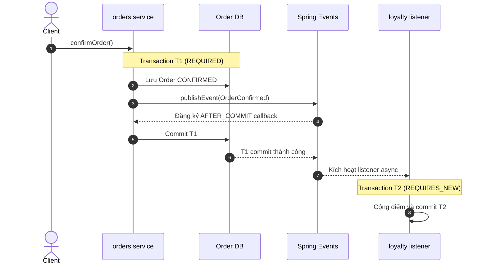
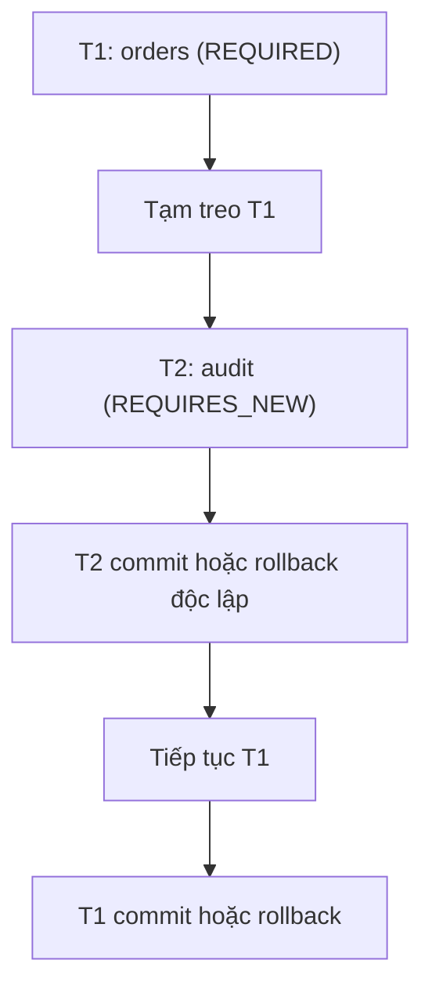
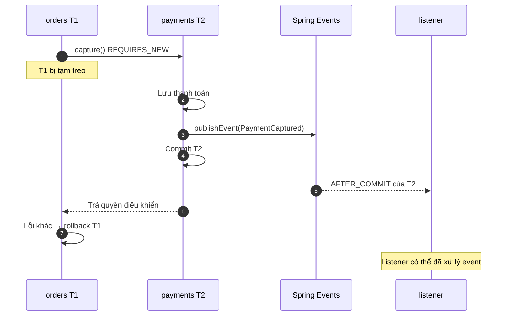
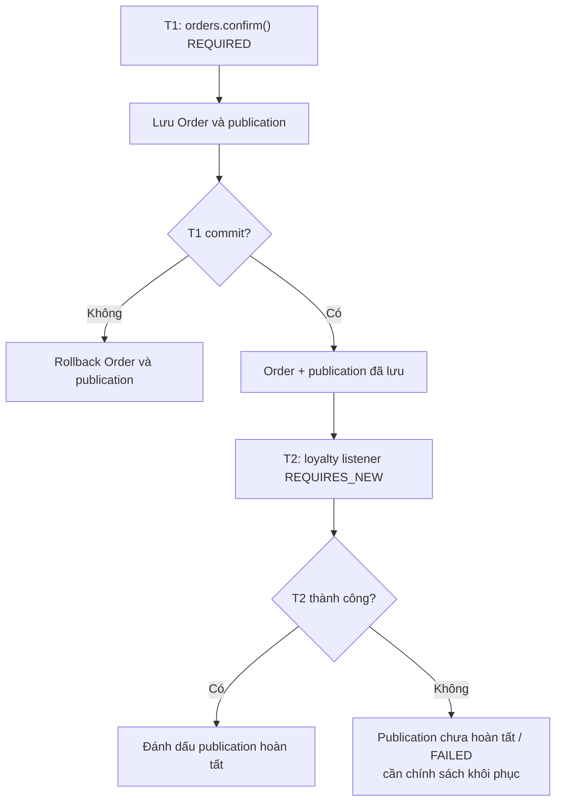

# Propagation trong giao dịch và application events của Spring Modulith

## 1. Propagation giải quyết vấn đề gì?

Trong Spring Framework, **transaction propagation** quy định method được gọi sẽ **tham gia giao dịch hiện có, mở giao dịch độc lập, tạo savepoint hoặc không dùng giao dịch**. Với Spring Modulith, lựa chọn propagation đặc biệt quan trọng vì một nghiệp vụ có thể phát event trong transaction gốc, còn listener xử lý sau commit ở một transaction khác.

Ví dụ: module `orders` xác nhận đơn và phát `OrderConfirmed`; module `loyalty` nhận event để cộng điểm. Ta cần làm rõ:

- Nếu module `orders` rollback, listener có chạy không?
- Nếu cộng điểm thất bại, đơn hàng đã xác nhận có bị rollback ngược không?
- Khi listener sau commit ghi DB, `REQUIRED` có đủ không hay cần `REQUIRES_NEW`?
- Điều gì xảy ra nếu một service con tự mở `REQUIRES_NEW` rồi phát event, nhưng transaction cha rollback?
- `NESTED` có tạo một transaction độc lập như `REQUIRES_NEW` không?

**Nguyên tắc trung tâm:** propagation gắn với **lời gọi method có transactional advice**, còn thời điểm listener nhận event do cơ chế phân phối event và transaction phase quyết định. Việc gọi `ApplicationEventPublisher.publishEvent(...)` **không tự mở transaction**.

Mục tiêu bài học là chọn propagation phù hợp trong luồng publisher → listener, tránh event của dữ liệu chưa commit, và thiết kế xử lý sau commit đáng tin cậy.

## 2. Phân biệt transaction scope, event publication và listener

Trong Spring sử dụng transaction dựa trên thread (ví dụ JDBC/JPA thông thường), `@Transactional` dùng proxy để xác định transaction của lời gọi method. Khi `publishEvent(...)` xảy ra, có ba cơ chế khác nhau:

1. **Publisher:** nghiệp vụ chính chạy trong transaction do `@Transactional` hoặc `TransactionTemplate` quản lý.
2. **Event dispatch:** `ApplicationEventPublisher` công bố event. Với `@EventListener` đồng bộ mặc định, listener được gọi ngay trong quá trình phân phối.
3. **Transactional listener:** `@TransactionalEventListener` liên kết phản ứng với một pha giao dịch như `AFTER_COMMIT`. `@ApplicationModuleListener` của Spring Modulith bổ sung xử lý bất đồng bộ và transaction riêng.

Một ví dụ bằng sơ đồ:



T1 và T2 là **hai transaction vật lý khác nhau**. Nếu T2 thất bại, T1 đã hoàn tất nên không thể rollback ngược. Nếu T1 rollback, listener `AFTER_COMMIT` của event phát trong T1 không được kích hoạt.

Sơ đồ chỉ thể hiện quan hệ commit → kích hoạt; vì listener bất đồng bộ, không nên suy diễn thứ tự chính xác giữa HTTP response và thời điểm T2 kết thúc.

## 3. Các loại propagation thường gặp

Spring cung cấp bảy giá trị trong `org.springframework.transaction.annotation.Propagation`:

| Propagation | Khi đã có transaction | Khi chưa có transaction | Ý nghĩa trong luồng event |
|---|---|---|---|
| `REQUIRED` | Tham gia transaction hiện tại | Mở transaction mới | Thường dùng ở publisher để lưu dữ liệu và phát event trong cùng unit of work |
| `REQUIRES_NEW` | Tạm treo transaction hiện tại, mở transaction vật lý độc lập | Mở transaction mới | Phù hợp cho việc ghi DB ở listener sau commit |
| `NESTED` | Tạo savepoint trong cùng transaction vật lý, nếu transaction manager hỗ trợ | Thường hoạt động như `REQUIRED` | Rollback cục bộ đến savepoint; **không có commit độc lập** |
| `SUPPORTS` | Tham gia transaction hiện tại | Chạy không có transaction | Cần cẩn trọng khi phát event chờ `AFTER_COMMIT` |
| `MANDATORY` | Bắt buộc tham gia transaction hiện tại | Ném exception | Giúp bảo đảm method được gọi trong transaction phù hợp |
| `NOT_SUPPORTED` | Tạm treo transaction, chạy ngoài transaction | Chạy ngoài transaction | Event phát ở đây không được listener transactional mặc định tiếp nhận |
| `NEVER` | Ném exception | Chạy ngoài transaction | Dùng khi cần cấm chạy bên trong transaction |

**Mặc định của `@Transactional` là `REQUIRED`.** Với `REQUIRES_NEW`, inner transaction độc lập về commit và rollback. Với `NESTED`, các scope chia sẻ một transaction vật lý và dùng savepoint; support tùy transaction manager và tài nguyên.

Cần phân biệt thêm **propagation với isolation**: `READ_COMMITTED`, `REPEATABLE_READ`... điều khiển cách một transaction nhìn thấy thay đổi, còn `REQUIRED` / `REQUIRES_NEW` điều khiển việc tham gia hay tách transaction. Propagation không tự tạo thứ tự xử lý event hoặc đảm bảo exactly-once.

## 4. `REQUIRED`: nghiệp vụ và việc công bố event nằm trong cùng unit of work

Với phần lớn use case, publisher nên dùng `@Transactional` mặc định:

```java
package com.example.shop.orders;

import java.time.Clock;
import java.util.UUID;
import org.springframework.context.ApplicationEventPublisher;
import org.springframework.stereotype.Service;
import org.springframework.transaction.annotation.Transactional;

@Service
public class OrderService {

    private final OrderRepository orders;
    private final ApplicationEventPublisher events;
    private final Clock clock;

    public OrderService(OrderRepository orders,
                        ApplicationEventPublisher events,
                        Clock clock) {
        this.orders = orders;
        this.events = events;
        this.clock = clock;
    }

    @Transactional // Propagation.REQUIRED mặc định
    public void confirm(UUID orderId) {
        Order order = orders.findById(orderId).orElseThrow();
        if (order.isConfirmed()) {
            return;
        }

        order.confirm();
        orders.save(order);
        events.publishEvent(new OrderConfirmed(
                UUID.randomUUID(), orderId, clock.instant()));
    }
}
```

Ở đây `OrderRepository`, `Order` là thành phần minh họa bên trong module `orders`; giả định ứng dụng có bean `Clock` và transaction manager. Event công khai có thể là:

```java
package com.example.shop.orders;

import java.time.Instant;
import java.util.UUID;

public record OrderConfirmed(
        UUID eventId,
        UUID orderId,
        Instant occurredAt
) {}
```

Trình tự chính:

1. Khi `confirm(...)` được gọi **qua Spring proxy** và chưa có transaction, `REQUIRED` tạo T1.
2. Entity được thay đổi và lưu trong T1.
3. `publishEvent(...)` được gọi trong T1; sự kiện **được phát trước khi T1 commit**.
4. Listener `AFTER_COMMIT` chỉ được kích hoạt nếu T1 commit thành công.
5. Nếu `order.confirm()` ném lỗi khiến T1 rollback, không có side effect sau commit của listener.

Nếu một service khác có `@Transactional(REQUIRED)` được gọi trong T1, nó **tham gia cùng transaction vật lý**. Một lỗi tại scope con đánh dấu rollback-only có thể khiến T1 không commit được, kể cả khi bên ngoài bắt exception.

## 5. `REQUIRED` và `UnexpectedRollbackException`

Tình huống dễ mắc lỗi: service A mở T1, gọi service B cùng `REQUIRED`; B ném `RuntimeException` khiến transaction được đánh dấu rollback-only, nhưng A bắt exception rồi tiếp tục phát event và trả về bình thường.

```java
@Service
class CheckoutService {
    private final PaymentService payments;
    private final ApplicationEventPublisher events;

    CheckoutService(PaymentService payments,
                    ApplicationEventPublisher events) {
        this.payments = payments;
        this.events = events;
    }

    @Transactional
    public void checkout(UUID orderId) {
        try {
            payments.reservePayment(orderId);
        } catch (PaymentUnavailableException ex) {
            // Bắt exception không tự xóa rollback-only của T1.
        }
        events.publishEvent(new CheckoutSucceeded(orderId));
    }
}

@Service
class PaymentService {
    @Transactional(propagation = Propagation.REQUIRED)
    public void reservePayment(UUID orderId) {
        throw new PaymentUnavailableException();
    }
}
```

Các import và kiểu ngoại lệ được lược bớt để tập trung vào propagation; giả định `PaymentUnavailableException` là unchecked exception. Khi transactional interceptor của B thấy exception, nó đánh dấu rollback-only cho transaction chung. Dù A bắt lỗi, commit T1 vẫn thất bại và có thể ném **`UnexpectedRollbackException`**. Listener `AFTER_COMMIT` không chạy.

**Sai lầm về mô hình nghiệp vụ:** phát `CheckoutSucceeded` trong nhánh không thành công. Hãy xác định kết quả nghiệp vụ trước khi công bố. Nếu thất bại thanh toán cần lưu trạng thái và thông báo riêng, hãy thiết kế một luồng lỗi hợp lệ thay vì bắt exception để buộc transaction tiếp tục.

## 6. `REQUIRES_NEW`: transaction độc lập trong lời gọi service

Giả sử một nghiệp vụ đang chạy T1 và gọi service B với `REQUIRES_NEW`:



`REQUIRES_NEW` luôn dùng một transaction vật lý **độc lập** với transaction hiện tại. T2 có thể commit ngay cả khi T1 sau đó rollback; rollback T2 cũng không tự làm T1 rollback-only, trừ khi lỗi lan lên và caller quyết định rollback.

Ví dụ ghi nhật ký kiểm toán tách biệt:

```java
package com.example.shop.audit;

import java.util.UUID;
import org.springframework.stereotype.Service;
import org.springframework.transaction.annotation.Propagation;
import org.springframework.transaction.annotation.Transactional;

@Service
public class AuditService {

    private final AuditRepository repository;

    public AuditService(AuditRepository repository) {
        this.repository = repository;
    }

    @Transactional(propagation = Propagation.REQUIRES_NEW)
    public void recordAttempt(UUID orderId) {
        repository.save(new AuditEntry(orderId, "CHECKOUT_ATTEMPT"));
    }
}
```

Nếu `recordAttempt(...)` được gọi qua proxy khi T1 đang hoạt động, audit có thể được lưu ngay cả khi đơn hàng rollback. Điều này **có thể đúng** cho “đã có một lần thử checkout”, nhưng **sai** nếu ghi “checkout đã hoàn tất” khi T1 thực sự thất bại.

**Cảnh báo về connection pool:** trong lời gọi `REQUIRES_NEW` đồng bộ, T1 có thể giữ connection trong khi T2 cần connection riêng. Khi nhiều thread cùng làm vậy, pool nhỏ có thể cạn và gây deadlock tài nguyên. Chỉ dùng `REQUIRES_NEW` khi yêu cầu nghiệp vụ thực sự cần transaction độc lập, và cấu hình pool tương xứng.

## 7. Khi `REQUIRES_NEW` phát event bên trong một outer transaction

Đây là bẫy quan trọng trong module giao tiếp bằng event.

Giả sử T1 mở ở `orders.checkout()`; service `payments.capture()` dùng `REQUIRES_NEW` mở T2, ghi thanh toán rồi phát `PaymentCaptured` trong T2. T2 commit; sau đó một thao tác khác khiến T1 rollback.



**Kết luận:** `AFTER_COMMIT` liên kết với **transaction đang hoạt động khi event được phát**, ở đây là T2. Nó **không đợi transaction bao ngoài T1** đã tạm treo. Listener có thể chạy ngay cả khi T1 sau đó rollback.

Điều này không nhất thiết là lỗi: nếu `PaymentCaptured` là sự thật về khoản tiền thực sự đã thu trong T2 thì sự kiện có thể hợp lệ. Nhưng nếu event mang nghĩa “đơn hàng hoàn tất” trong khi dữ liệu đơn hàng ở T1 chưa commit, thiết kế đang mâu thuẫn.

Giải pháp tùy nghiệp vụ: giữ trạng thái cần đồng bộ trong một T1 với `REQUIRED`; nếu không thể, mô hình hóa các mốc độc lập và dùng trạng thái quy trình/Saga, bù trừ hoặc event chỉ sau khi bước phụ thuộc thật sự hoàn tất.

## 8. `NESTED`: savepoint không phải transaction độc lập

`Propagation.NESTED` tạo một **nested scope** trong cùng transaction vật lý bằng **savepoint** khi transaction manager hỗ trợ. Nó khác `REQUIRES_NEW` ở hai điểm:

- Rollback scope con có thể quay về savepoint nhưng transaction ngoài vẫn được tiếp tục.
- Scope con **không commit độc lập**; thay đổi chỉ được commit thực sự khi transaction ngoài commit.

Ví dụ minh họa:

```text
T1 bắt đầu
  cập nhật Order
  tạo savepoint S1
    cập nhật Inventory
  rollback đến S1 nếu Inventory lỗi
  tiếp tục nghiệp vụ T1
T1 commit hoặc rollback toàn bộ
```

Spring Framework thường hỗ trợ NESTED dựa trên JDBC savepoint, điển hình với `DataSourceTransactionManager`. Không được mặc định JPA transaction manager, mọi driver hoặc mọi cách kết hợp resource đều hỗ trợ đầy đủ.

**Cẩn trọng khi phát event trong nested scope:** savepoint rollback chỉ hoàn tác dữ liệu resource; việc đã gọi `publishEvent(...)` hoặc đã đăng ký transaction synchronization không được mặc nhiên “undo” giống một câu SQL. Một `@TransactionalEventListener(AFTER_COMMIT)` có thể vẫn được kích hoạt ở **commit transaction ngoài**, dù phần dữ liệu tạo ra event đã bị rollback về savepoint, tùy đường đi đăng ký event.

Vì vậy, nếu một nested scope có khả năng rollback cục bộ, hãy **chỉ phát event sau khi biết quyết định nghiệp vụ đã được chấp nhận** trong outer transaction, hoặc chủ động trì hoãn việc tạo event. Không dựa vào `NESTED` để tự động hủy mọi publication đã ghi nhận trong scope con.

## 9. `SUPPORTS`, `NOT_SUPPORTED`, `MANDATORY` và `NEVER` khi phát event

Một lời gọi `publishEvent(...)` chỉ mang tính “transaction-bound” nếu tại thời điểm phát có transaction đang hoạt động và cơ chế hỗ trợ đồng bộ giao dịch phù hợp.

| Propagation của method phát event | Khi caller có transaction | Tác động đến `@TransactionalEventListener` mặc định |
|---|---|---|
| `SUPPORTS` | Tham gia transaction caller | `AFTER_COMMIT` có thể liên kết với commit caller |
| `SUPPORTS` | Không có transaction | Event được phát nhưng transactional listener **không chạy** theo mặc định |
| `NOT_SUPPORTED` | Tạm treo transaction caller | Event phát ngoài transaction; transactional listener mặc định không chạy |
| `MANDATORY` | Yêu cầu transaction caller | Phù hợp khi method bắt buộc phát event trong một transaction |
| `MANDATORY` | Không có transaction | Ném exception khi gọi method qua proxy |
| `NEVER` | Có transaction | Ném exception |
| `NEVER` | Không có transaction | Chạy ngoài transaction; listener mặc định bỏ qua |

Ví dụ bắt buộc có transaction:

```java
@Service
class OrderEventPublisher {

    private final ApplicationEventPublisher events;

    OrderEventPublisher(ApplicationEventPublisher events) {
        this.events = events;
    }

    @Transactional(propagation = Propagation.MANDATORY)
    public void publishConfirmed(OrderConfirmed event) {
        events.publishEvent(event);
    }
}
```

`MANDATORY` là một **rào chắn hợp đồng**: gọi từ một service không có transaction sẽ thất bại ngay, tránh việc event “được phát” nhưng `@TransactionalEventListener` im lặng không xử lý.

Ngược lại, `@TransactionalEventListener(fallbackExecution = true)` cho phép listener xử lý khi event phát ngoài transaction; tùy cấu hình, listener đó có thể chạy **ngay** mà không chờ commit. Chỉ bật nếu chấp nhận cả hai đường xử lý và đã kiểm thử khác biệt.

## 10. Ba loại listener và mối quan hệ với propagation

| Cách đăng ký | Thời điểm điển hình | Transaction nơi listener xử lý | Khi publisher rollback |
|---|---|---|---|
| `@EventListener` mặc định | Gọi đồng bộ trong `publishEvent(...)` | Tham gia T1 khi có lời gọi DB trong cùng thread/transaction; method không tự mở transaction | Listener có thể **đã chạy** trước rollback |
| `@TransactionalEventListener(AFTER_COMMIT)` | Sau commit của transaction phát | Không tự mở transaction mới; resource cũ có thể còn bound trong callback | Không chạy (nếu rollback) |
| `@ApplicationModuleListener` | Sau commit và bất đồng bộ | Có transaction **mới** theo `REQUIRES_NEW` mặc định | Không chạy tác vụ sau commit |

Với Spring Modulith, `@ApplicationModuleListener` tương đương cấu hình kết hợp:

```java
@Async
@Transactional(propagation = Propagation.REQUIRES_NEW)
@TransactionalEventListener(phase = TransactionPhase.AFTER_COMMIT)
void on(OrderConfirmed event) {
    // Business reaction chạy trong một transaction độc lập.
}
```

Annotation trên minh họa cấu hình cơ chế; trong class thực, các import tương ứng đến từ Spring `org.springframework.scheduling.annotation.Async`, `org.springframework.transaction.annotation.Transactional`, `org.springframework.transaction.event.TransactionalEventListener` và `TransactionPhase`. Shortcut của Spring Modulith:

```java
import org.springframework.modulith.events.ApplicationModuleListener;
import org.springframework.stereotype.Component;

@Component
class LoyaltyListener {
    private final LoyaltyService loyalty;

    LoyaltyListener(LoyaltyService loyalty) {
        this.loyalty = loyalty;
    }

    @ApplicationModuleListener
    void on(OrderConfirmed event) {
        loyalty.creditPointsOnce(event.eventId(), event.orderId());
    }
}
```

Với annotation này, transaction của publisher T1 phải commit thành công rồi listener mới được kích hoạt; listener mở một transaction riêng T2 và xử lý ở luồng bất đồng bộ. `LoyaltyService` trong ví dụ là dịch vụ của module nhận, có trách nhiệm chống xử lý trùng.

**Quan trọng:** không mặc định rằng callback `AFTER_COMMIT` thuần dùng `@Transactional(REQUIRED)` sẽ luôn mở transaction độc lập. Tại thời điểm callback sau commit, resource của transaction cũ có thể vẫn được gắn với thread nhưng không còn lượt commit mới. Nếu cần ghi DB từ callback **đồng bộ** sau commit, sử dụng `REQUIRES_NEW` một cách rõ ràng.

## 11. Ví dụ ghi DB an toàn từ listener sau commit

Một lựa chọn khi không muốn dùng `@ApplicationModuleListener` là tách phần xử lý DB thành service có `REQUIRES_NEW`:

```java
package com.example.shop.notifications;

import com.example.shop.orders.OrderConfirmed;
import org.springframework.stereotype.Component;
import org.springframework.transaction.event.TransactionalEventListener;
import org.springframework.transaction.event.TransactionPhase;

@Component
class NotificationHandler {

    private final NotificationInboxService inbox;

    NotificationHandler(NotificationInboxService inbox) {
        this.inbox = inbox;
    }

    @TransactionalEventListener(phase = TransactionPhase.AFTER_COMMIT)
    void on(OrderConfirmed event) {
        inbox.recordReceived(event.eventId(), event.orderId());
    }
}
```

```java
package com.example.shop.notifications;

import java.util.UUID;
import org.springframework.stereotype.Service;
import org.springframework.transaction.annotation.Propagation;
import org.springframework.transaction.annotation.Transactional;

@Service
public class NotificationInboxService {

    private final NotificationInboxRepository repository;

    public NotificationInboxService(
            NotificationInboxRepository repository) {
        this.repository = repository;
    }

    @Transactional(propagation = Propagation.REQUIRES_NEW)
    public void recordReceived(UUID eventId, UUID orderId) {
        repository.insertIfAbsent(eventId, orderId);
    }
}
```

Ưu điểm của việc tách service: lời gọi `inbox.recordReceived(...)` đi **qua Spring bean proxy**, nên transactional advice hoạt động đúng và transaction ghi Inbox có commit riêng. `insertIfAbsent(...)` là API minh họa cần triển khai bằng unique constraint hoặc cơ chế tương đương.

Nếu muốn listener chạy bất đồng bộ như mô hình module, dùng `@ApplicationModuleListener` sẽ gọn hơn. Dù dùng cách nào, Spring Modulith Event Publication Registry (khi có backend bền vững) giúp theo dõi việc chuyển event đến từng listener và hỗ trợ khôi phục khi xử lý lỗi.

## 12. Propagation không tự đi theo thread bất đồng bộ

Transaction dạng imperative của Spring thông thường gắn với thread hiện tại. Khi dùng `@Async`, lời gọi listener chạy ở thread khác và **không mang theo transaction T1 của publisher**.

Ví dụ:

```text
Thread-A:
  @Transactional(REQUIRED) → T1
  publishEvent(OrderConfirmed)
  commit T1

Thread-B:
  @ApplicationModuleListener được kích hoạt sau commit
  @Transactional(REQUIRES_NEW) → T2
  xử lý listener, commit/rollback T2
```

Không giả định có thể truy cập lazy JPA entity của T1 từ Thread-B. Payload nên dùng ID hoặc snapshot bất biến. Cũng không nên dựa vào request-bound ThreadLocal hay session HTTP của publisher trong listener.

**Lưu ý với reactive transactions:** Spring có thể dùng Reactor context thay vì ThreadLocal. `@TransactionalEventListener` trong ứng dụng reactive cần tuân thủ hợp đồng event/source và transaction context tương ứng; không áp dụng máy móc ví dụ JDBC/JPA dựa trên thread cho luồng reactive.

Một callback `@EventListener` có `@Async` cũng không được mặc định nhận T1, kể cả khi publisher phát event trong transaction. Nếu muốn đảm bảo chỉ chạy sau commit và trong transaction riêng, chọn annotation listener tương ứng.

## 13. Transaction proxy và lỗi self-invocation

`@Transactional(propagation = ...)` thường được áp dụng bởi **Spring AOP proxy**. Nếu một method trong cùng object gọi `this.otherMethod()`, lời gọi có thể **không đi qua proxy**, khiến propagation khai báo ở method đích không có hiệu lực.

Ví dụ sai:

```java
@Service
class RiskyOrderService {

    @Transactional
    public void confirm(UUID orderId) {
        // Cùng bean tự gọi method: có thể bỏ qua transactional advice.
        this.saveAuditSeparately(orderId);
    }

    @Transactional(propagation = Propagation.REQUIRES_NEW)
    public void saveAuditSeparately(UUID orderId) {
        // Thực tế có thể vẫn ở transaction hiện tại.
    }
}
```

Cách sửa là tách method `REQUIRES_NEW` sang bean Spring độc lập như `AuditService` ở mục 6 và inject bean đó vào service gọi. Có thể dùng `TransactionTemplate` khi muốn transaction boundaries tường minh và phù hợp với code hiện có.

Đừng nhầm điều này với event publisher: nếu listener được Spring quản lý thông qua bean/advice phù hợp, event infrastructure có cơ chế kích hoạt riêng. Nhưng các lời gọi `this.methodWithTransactional(...)` trong code nghiệp vụ vẫn cần review.

Ngoài self-invocation, `@Transactional` đặt trên object tự tạo bằng `new` không được Spring quản lý cũng không tự có tác dụng. Kiểm thử cần xác minh transaction **thực sự tồn tại**, không chỉ nhìn annotation.

## 14. Rollback rules và ý nghĩa của event

Mặc định Spring đánh dấu rollback khi một `RuntimeException` hoặc `Error` thoát khỏi transactional method; **checked exception** không tự gây rollback theo mặc định nếu không có cấu hình khác. Có thể khai báo `rollbackFor` khi yêu cầu nghiệp vụ khác.

```java
@Transactional(rollbackFor = PaymentDeclinedException.class)
public void capture(UUID orderId)
        throws PaymentDeclinedException {
    // Thao tác nghiệp vụ và phát event nếu thật sự thành công.
}
```

Nếu `PaymentDeclinedException` là checked exception, `rollbackFor` khiến transaction rollback theo quy tắc khai báo. Do đó listener `AFTER_COMMIT` không được kích hoạt cho transaction này. Nếu không khai báo và exception thoát ra, transaction có thể **vẫn commit**; event được phát trước đó có thể được xử lý sau commit, dù caller nhận exception.

Một exception bị **bắt và nuốt** cũng có thể làm transaction vẫn commit, nếu chưa có rollback-only. Vì thế cần xác định chính xác trạng thái nghiệp vụ trước khi phát event và dùng rollback rules phù hợp.

Ở listener `@ApplicationModuleListener`, một unchecked exception khiến transaction T2 thường rollback và publication không được đánh dấu thành công; T1 đã commit nên không thể rollback ngược. Với external side effects như email, rollback T2 không thu hồi email đã gửi: cần idempotency và đối soát.

## 15. Event Publication Registry và propagation

Spring Modulith hỗ trợ **Event Publication Registry** để theo dõi publication gửi tới các transactional listener. Khi cấu hình phần tích hợp persistence thích hợp, publication được lưu **trong transaction gốc cùng nghiệp vụ**. Điều này hỗ trợ khôi phục nếu listener lỗi hoặc ứng dụng dừng sau commit.



Cần hiểu đúng ba điểm:

1. Registry **không thay thế transaction của listener** và không tự làm T1/T2 thành một transaction phân tán.
2. Publication của một event được theo dõi **theo từng listener**; listener A thành công không chứng minh listener B đã xong.
3. Retry/resubmit có thể gửi lại cùng event; consumer phải đảm bảo **idempotency** bằng `eventId`/business key và uniqueness phù hợp. Một email đã gửi nhưng chưa đánh dấu publication hoàn tất có thể được gửi lại.

Trạng thái publication, các API resubmit và chính sách staleness khác nhau theo phiên bản Spring Modulith; nên kiểm tra phiên bản và cấu hình cụ thể trước khi dùng API quản trị. Không tự kết luận chỉ thêm `@ApplicationModuleListener` là registry persistence đã được thiết lập.

## 16. Ma trận các tình huống dễ nhầm

| Tình huống | Kết quả dự kiến | Điều cần làm |
|---|---|---|
| T1 `REQUIRED` rollback | `AFTER_COMMIT` không chạy | Test rollback |
| T1 commit; listener T2 lỗi | T1 giữ commit; T2 rollback | Retry và idempotency |
| Service `REQUIRED` đánh dấu rollback-only | Có thể nhận `UnexpectedRollbackException` | Sửa nguyên nhân, tránh nuốt lỗi |
| T2 `REQUIRES_NEW` commit; T1 rollback | Event thuộc T2 vẫn có thể chạy | Kiểm tra ngữ nghĩa event |
| `NOT_SUPPORTED` phát event | Không có transaction gốc | Listener transactional mặc định bỏ qua |
| `NESTED` rollback savepoint | Event đã đăng ký có thể còn callback | Phát sau quyết định hợp lệ |
| `AFTER_COMMIT` ghi DB đồng bộ | Resource cũ có thể còn bound | Dùng `REQUIRES_NEW` |
| Self-invocation hoặc `@Async` | Advice/context không tự lan | Qua proxy, tách T2 và dùng immutable event |

## 17. Kiểm thử propagation trong Spring Modulith

Test nên quan sát **dữ liệu commit và tác động của listener**, thay vì chỉ kiểm tra lời gọi `publishEvent(...)`:

| Kịch bản | Điều cần xác minh |
|---|---|
| T1 commit | Đơn được lưu, T2 xử lý sau commit; publication hoàn tất nếu registry đã cấu hình |
| T1 rollback | Không lưu đơn, không có side effect sau commit hoặc publication bền vững từ T1 |
| T2 lỗi sau khi T1 commit | Đơn vẫn tồn tại; publication lỗi/tồn đọng, retry idempotent |
| T2 `REQUIRES_NEW` commit rồi T1 rollback | Dữ liệu và event của T2 vẫn có thể tồn tại độc lập |

Không đặt `@Transactional` trên test rồi kỳ vọng listener `AFTER_COMMIT` tự chạy: test transaction thường rollback mặc định. Dùng test không bọc transaction tự động hoặc chủ động commit qua `TestTransaction`/`TransactionTemplate`. Với listener async, chờ trạng thái quan sát có timeout thay vì `Thread.sleep` cố định.

## 18. Checklist trước khi đưa propagation vào production

- Publisher được gọi qua proxy/`TransactionTemplate` và phát event khi quyết định nghiệp vụ đã hợp lệ?
- Đã chọn đúng transaction phase; listener sau commit ghi DB với transaction mới?
- Có `REQUIRES_NEW` ở service con hoặc `NESTED` rollback savepoint khiến event không đúng nghĩa?
- Rollback rules, self-invocation, `@Async` và ranh giới thread đã được kiểm tra?
- Registry persistence, retry, idempotency, giới hạn connection pool và metrics đã sẵn sàng?
- Test đã bao phủ commit/rollback, lỗi listener, phục hồi và xử lý trùng?

**Tổng kết:** Propagation xác định các method chia sẻ hoặc tách transaction; transaction phase xác định **khi nào listener được phép xử lý event**. Trong Spring Modulith, mẫu thông dụng là publisher `REQUIRED` phát event trong T1 và `@ApplicationModuleListener` xử lý **sau commit** trong T2 với `REQUIRES_NEW`. Cần đặc biệt thận trọng với `NESTED`, `REQUIRES_NEW` ở service con, `AFTER_COMMIT` ghi DB và xử lý bất đồng bộ. Thiết kế đúng các ranh giới này giúp các module giảm phụ thuộc trực tiếp mà vẫn bảo vệ tính nhất quán và khả năng khôi phục.

### Tài liệu tham khảo

- [Spring Framework – Transaction Propagation](https://docs.spring.io/spring-framework/reference/data-access/transaction/declarative/tx-propagation.html): semantics của REQUIRED, REQUIRES_NEW, NESTED và rollback-only.
- [Spring Framework – Transaction-bound Events](https://docs.spring.io/spring-framework/reference/data-access/transaction/event.html): TransactionalEventListener, các transaction phase và fallback execution.
- [Spring Modulith – Working with Application Events](https://docs.spring.io/spring-modulith/reference/events.html): ApplicationModuleListener và Event Publication Registry.
- [Spring Framework – TransactionSynchronization](https://docs.spring.io/spring-framework/docs/current/javadoc-api/org/springframework/transaction/support/TransactionSynchronization.html): lưu ý resource vẫn có thể bound ở AFTER_COMMIT.
