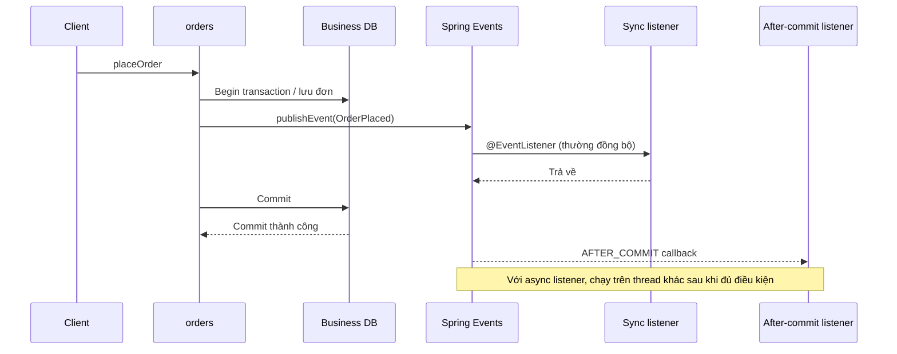
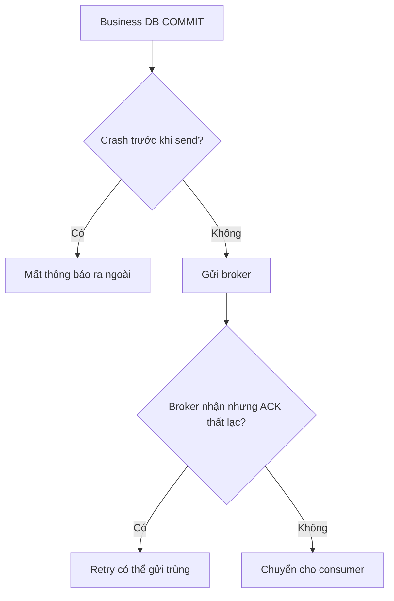
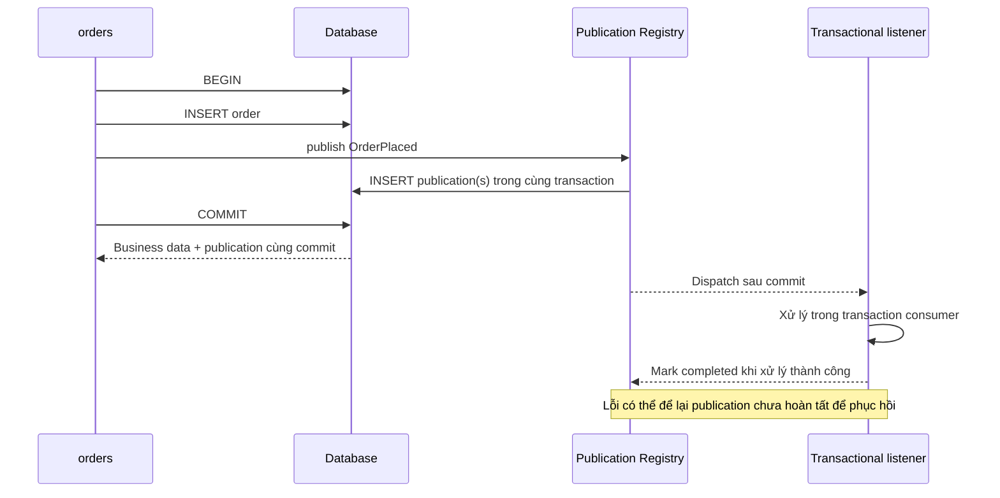
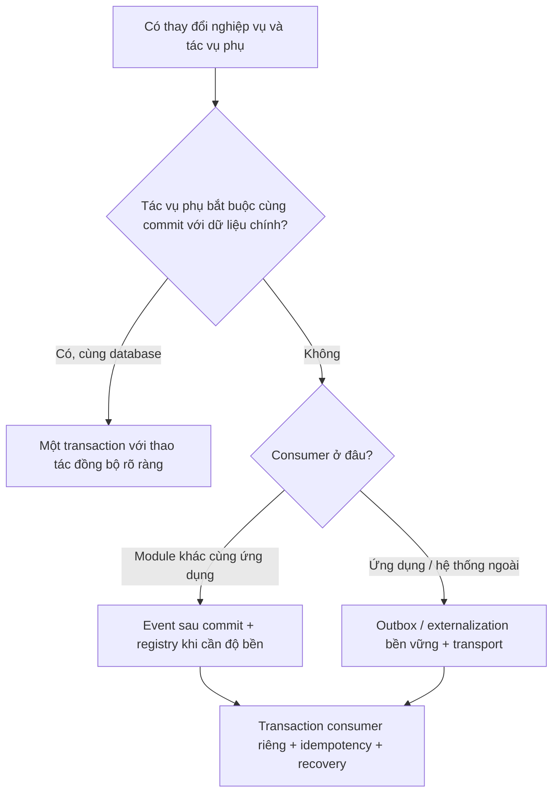

# Tính nguyên tử của giao dịch và application events trong Spring Modulith

## 1. Tính nguyên tử giải quyết vấn đề gì?

Trong **SPRING_MODULITH_APPLICATION_EVENTS**, các module Spring Modulith giao tiếp bằng application events để giảm phụ thuộc và giữ ranh giới nghiệp vụ. Chẳng hạn, module `orders` tạo đơn rồi phát `OrderPlaced`; `notifications` gửi email, `reporting` cập nhật thống kê và `inventory` thực hiện công việc riêng khi nhận sự kiện.

Giả sử database đã lưu đơn hàng, nhưng tiến trình JVM dừng trước khi `notifications` nhận event. Người dùng thấy “đặt hàng thành công” nhưng không nhận được thư. Ngược lại, nếu thư được gửi **trước khi đơn hàng commit**, một lần rollback có thể làm khách nhận email xác nhận cho đơn không tồn tại.

Đó là lý do phải đặt câu hỏi **tính nguyên tử (atomicity) bao trùm những thao tác nào**.

Trong một database transaction, atomicity nghĩa là **mọi thay đổi được quản lý bởi transaction đó cùng commit, hoặc cùng rollback**. Tuy nhiên, việc gọi `ApplicationEventPublisher.publishEvent(...)` không tự mở rộng transaction database sang listener bất đồng bộ, hệ thống gửi email hay message broker.

> **Nguyên tắc trọng tâm:** Không nói chung chung “event là atomic”. Hãy chỉ rõ *business data*, *publication record* và *side effect của consumer* có cùng transaction resource hay không, khi nào commit và cách phục hồi khi có lỗi.

## 2. Bốn mức tính nguyên tử cần phân biệt

| Mức | Cặp thao tác muốn nhất quán | Phạm vi có thể bảo đảm | Điều không được suy diễn |
| --- | --- | --- | --- |
| **Business atomicity** | Lưu đơn và cập nhật các bảng nghiệp vụ của `orders` | Một database transaction thích hợp | Email hoặc message broker cùng rollback |
| **Publication atomicity** | Lưu đơn và **lưu dấu cần giao event** | Cùng transaction lưu nghiệp vụ, khi registry/outbox dùng cùng transaction resource được cấu hình đúng | Listener đã chạy hoặc external consumer đã nhận |
| **Consumer atomicity** | Cập nhật projection và ghi dấu `eventId` đã xử lý | Một transaction riêng của consumer trên các dữ liệu liên quan | Hoạt động HTTP/email ngoài DB cũng rollback |
| **End-to-end business consistency** | Đơn, tồn kho, thanh toán, email ở nhiều hệ thống đạt trạng thái đúng | Phối hợp bằng trạng thái, retry, idempotency, đối soát và đôi khi Saga | Một annotation tự tạo transaction toàn cục qua mọi hệ thống |

Ví dụ: `orders` có thể bảo đảm cả bản ghi đơn hàng **và** publication dành cho `reporting` cùng commit. Nhưng `reporting` vẫn có thể cập nhật báo cáo muộn vài giây hoặc sau khi retry. Đây là **eventual consistency** có cơ chế phục hồi, không phải tính nguyên tử tức thời giữa hai module.

Trong cùng một ứng dụng Java, hai module không mặc nhiên chia sẻ transaction khi chúng xử lý bằng hai listener sau commit. **Cùng JVM không đồng nghĩa cùng transaction.**

## 3. Dòng thời gian của publisher: phát trước hay sau commit?

Một use case đơn giản:

```java
package com.example.shop.orders;

import java.time.Instant;
import java.util.Objects;
import java.util.UUID;

public record OrderPlaced(
        UUID eventId,
        UUID orderId,
        Instant occurredAt
) {
    public OrderPlaced {
        Objects.requireNonNull(eventId, "eventId");
        Objects.requireNonNull(orderId, "orderId");
        Objects.requireNonNull(occurredAt, "occurredAt");
    }
}
```

Publisher đặt ở package nội bộ của module phát, chỉ công bố kiểu `OrderPlaced` thuộc API module:

```java
package com.example.shop.orders.internal;

import com.example.shop.orders.OrderPlaced;
import java.time.Clock;
import java.time.Instant;
import java.util.UUID;
import org.springframework.context.ApplicationEventPublisher;
import org.springframework.stereotype.Service;
import org.springframework.transaction.annotation.Transactional;

@Service
class PlaceOrderService {
    private final OrderRepository orders;
    private final ApplicationEventPublisher events;
    private final Clock clock;

    PlaceOrderService(
            OrderRepository orders,
            ApplicationEventPublisher events,
            Clock clock
    ) {
        this.orders = orders;
        this.events = events;
        this.clock = clock;
    }

    @Transactional
    public UUID place(PlaceOrderCommand command) {
        var saved = orders.create(command);

        events.publishEvent(new OrderPlaced(
                UUID.randomUUID(),
                saved.id(),
                Instant.now(clock)
        ));
        return saved.id();
    }
}
```

`OrderRepository`, `PlaceOrderCommand` và đối tượng trả về từ `create(...)` là abstractions minh họa; dự án thật cần triển khai chúng và cung cấp `Clock` bean. Không để module nhận truy cập entity/repository nội bộ chỉ để xử lý event.

**Lưu ý quan trọng:** lệnh `publishEvent(...)` được gọi **trong transaction chưa commit**. Ý nghĩa của việc đó phụ thuộc kiểu listener:



Sơ đồ mô tả **thứ tự logic**, không khẳng định callback bất đồng bộ hoàn thành trước phản hồi HTTP. Nếu transaction rollback, listener `AFTER_COMMIT` thông thường không được gọi; listener `@EventListener` đồng bộ có thể đã chạy trước đó.

## 4. `@EventListener` đồng bộ: có thể tham gia transaction, nhưng chưa đủ

Theo cấu hình event multicaster đồng bộ mặc định, `@EventListener` chạy trên thread gọi `publishEvent(...)`. Một listener có thể truy cập các resource của transaction đang hoạt động nếu được quản lý bởi cùng transaction manager:

```java
package com.example.shop.orders.internal;

import com.example.shop.orders.OrderPlaced;
import org.springframework.context.event.EventListener;
import org.springframework.stereotype.Component;

@Component
class InternalOrderAuditHandler {
    private final OrderAuditRepository audit;

    InternalOrderAuditHandler(OrderAuditRepository audit) {
        this.audit = audit;
    }

    @EventListener
    public void on(OrderPlaced event) {
        audit.insert(event.eventId(), event.orderId());
    }
}
```

Nếu `audit.insert(...)` sử dụng **cùng transaction database** của publisher, bản ghi audit và đơn hàng có thể cùng commit/rollback. Nhưng không nên biến điều đó thành bảo đảm ngầm:

- Nếu listener ghi sang **database khác** hoặc dùng transaction riêng, atomicity chung có thể không tồn tại.
- Nếu multicaster được cấu hình với executor bất đồng bộ, listener thường không còn chạy trên thread/transaction của publisher.
- Nếu listener gọi email, HTTP API hoặc message broker, tác dụng phụ đó không trở thành một phần của transaction JPA.
- Nếu listener phát sinh exception và exception lan trở lại publisher, transaction có thể bị đánh dấu rollback theo các quy tắc Spring; nếu listener nuốt lỗi, publisher có thể tiếp tục commit.

Đồng bộ thích hợp khi một thao tác là **thành phần bắt buộc của cùng giao dịch** và có thể phối hợp transaction rõ ràng. Tuy nhiên, nếu cần kết quả nghiệp vụ tức thời để quyết định có chấp nhận đơn hay không, **gọi API nghiệp vụ đồng bộ** thường thể hiện sự phụ thuộc rõ hơn event listener.

## 5. `@TransactionalEventListener(AFTER_COMMIT)`: nhất quán về thời điểm, không phải một transaction chung

Khi một tác dụng phụ chỉ hợp lệ **sau khi business transaction commit**, sử dụng transactional event listener:

```java
package com.example.shop.notifications.internal;

import com.example.shop.orders.OrderPlaced;
import org.springframework.stereotype.Component;
import org.springframework.transaction.event.TransactionPhase;
import org.springframework.transaction.event.TransactionalEventListener;

@Component
class ConfirmationListener {
    private final ConfirmationSender sender;

    ConfirmationListener(ConfirmationSender sender) {
        this.sender = sender;
    }

    @TransactionalEventListener(phase = TransactionPhase.AFTER_COMMIT)
    public void on(OrderPlaced event) {
        sender.sendConfirmation(event.orderId());
    }
}
```

Ý nghĩa:

1. Listener được đăng ký khi event phát **trong transaction đang hoạt động**.
2. Khi publisher **commit thành công**, callback `AFTER_COMMIT` mới được kích hoạt.
3. Nếu transaction **rollback**, callback `AFTER_COMMIT` không được gọi.
4. Nếu không có transaction tại lúc phát, transactional listener theo mặc định **không chạy** (trừ khi cấu hình `fallbackExecution = true`).
5. `AFTER_COMMIT` **không mặc nhiên là async**; callback có thể chạy trên thread hiện tại.
6. `AFTER_COMMIT` **không mặc nhiên lưu event bền vững**; crash sau commit nhưng trước callback vẫn có thể làm mất việc xử lý nếu không có registry/outbox.

`ConfirmationSender` là API minh họa; phương thức gửi cần xử lý tác dụng phụ bên ngoài theo hợp đồng. Không được xem việc gọi `sendConfirmation(...)` là thao tác rollback được khi callback đã chạy.

### 5.1. Bẫy transaction khi ghi database trong callback sau commit

Tại thời điểm callback `AFTER_COMMIT`, transaction **đã commit**, nhưng tài nguyên giao dịch có thể vẫn còn được bind tới thread trong giai đoạn cleanup. Nếu bắt đầu một thao tác ghi database với propagation mặc định `REQUIRED`, nó có thể tham gia resource của transaction vừa hoàn tất và **không có lượt commit mới** cho thay đổi đó.

Khi cần ghi dữ liệu **trong một transaction mới**, dùng `REQUIRES_NEW` qua lời gọi Spring proxy thích hợp:

```java
package com.example.shop.reporting.internal;

import com.example.shop.orders.OrderPlaced;
import org.springframework.stereotype.Service;
import org.springframework.transaction.annotation.Propagation;
import org.springframework.transaction.annotation.Transactional;

@Service
class OrderProjectionWriter {
    private final OrderProjectionRepository projections;

    OrderProjectionWriter(OrderProjectionRepository projections) {
        this.projections = projections;
    }

    @Transactional(propagation = Propagation.REQUIRES_NEW)
    public void store(OrderPlaced event) {
        projections.upsertByOrderId(event.orderId(), event.eventId());
    }
}
```

Một listener đồng bộ sau commit gọi bean `OrderProjectionWriter` sẽ mở transaction riêng:

```java
@Component
class OrderProjectionListener {
    private final OrderProjectionWriter writer;

    OrderProjectionListener(OrderProjectionWriter writer) {
        this.writer = writer;
    }

    @TransactionalEventListener(phase = TransactionPhase.AFTER_COMMIT)
    public void on(OrderPlaced event) {
        writer.store(event);
    }
}
```

`OrderProjectionRepository.upsertByOrderId(...)` là abstraction minh họa, cần thiết kế idempotent. Annotation `REQUIRES_NEW` phải được Spring AOP áp dụng trên lời gọi qua bean/proxy; gọi nội bộ `this.store(...)` trong cùng đối tượng có thể không kích hoạt transaction mới theo cơ chế proxy thông thường.

**Kết luận:** việc mở transaction mới giúp consumer commit độc lập, **không** biến thao tác của consumer thành phần nguyên tử với business transaction đã commit trước đó.

## 6. `@ApplicationModuleListener` và transaction của module nhận

Spring Modulith có `@ApplicationModuleListener` để phục vụ giao tiếp event giữa các module. Annotation này kết hợp semantics **transactional event listener ở pha sau commit, chạy bất đồng bộ và dùng transaction riêng** để xử lý listener:

```java
package com.example.shop.reporting.internal;

import com.example.shop.orders.OrderPlaced;
import org.springframework.modulith.events.ApplicationModuleListener;
import org.springframework.stereotype.Component;

@Component
class OrderReportListener {
    private final ReportProjectionService reporting;

    OrderReportListener(ReportProjectionService reporting) {
        this.reporting = reporting;
    }

    @ApplicationModuleListener
    public void on(OrderPlaced event) {
        reporting.applyOnce(event.eventId(), event.orderId());
    }
}
```

`ReportProjectionService.applyOnce(...)` là API minh họa, cần thực sự chống xử lý lặp. Đường giao nhận logic:

```text
orders transaction:
    INSERT order + publish OrderPlaced
    → COMMIT

reporting handler (sau commit, bất đồng bộ):
    BEGIN transaction mới
    → xử lý event / cập nhật projection
    → COMMIT riêng
```

Khi transaction của `reporting` lỗi, transaction tạo đơn ở `orders` **không bị rollback ngược lại**. Đây là sự độc lập có chủ đích và dẫn đến eventual consistency. Nếu báo cáo là **điều kiện bắt buộc để đặt hàng thành công**, không nên chỉ kỳ vọng một listener bất đồng bộ sẽ hoàn tất ngay.

Lưu ý: `@ApplicationModuleListener` không tự chứng minh một event **được ghi bền trước khi publisher commit**. Muốn bảo đảm có thể phục hồi publication, còn phải kiểm tra **Event Publication Registry, storage backend, transaction tham gia và cơ chế xử lý lại**.

## 7. Vấn đề “dual write”: lưu nghiệp vụ và gửi event ở hai nơi

Nếu một service vừa lưu vào database vừa gửi thông điệp tới hệ thống ngoài, rất dễ có lỗi **dual write**:

```java
// Anti-pattern nếu cần bảo đảm đơn đã commit luôn có integration event.
public UUID place(PlaceOrderCommand command) {
    UUID orderId = orderWriter.saveAndCommit(command);
    broker.send(new OrderPlacedMessage(orderId));
    return orderId;
}
```

Nếu JVM crash **sau `saveAndCommit` nhưng trước `broker.send`**, đơn đã tồn tại nhưng không có message. Đổi thứ tự cũng không giải quyết triệt để: gửi message trước, rồi database rollback thì consumer thấy một đơn chưa từng được commit.



Transaction cục bộ của một database **không** bao phủ tùy ý một HTTP service, email server hay broker. Có những kỹ thuật transaction phân tán/XA trong một số môi trường, nhưng chúng đòi hỏi hỗ trợ phối hợp thực sự của các resource và không phải hành vi mặc định của Spring application events.

Để giải quyết thực tiễn, cần tách **ghi ý định giao event một cách atomic** khỏi **việc phân phối và xử lý event có thể thử lại**.

## 8. Event Publication Registry: atomicity của bản ghi publication

Spring Modulith cung cấp **Event Publication Registry** để theo dõi publication tới những transactional listener được hỗ trợ. Khi có storage implementation thích hợp và được cấu hình để tham gia **cùng business transaction**, mỗi publication liên quan có thể được ghi nhận cùng với thay đổi nghiệp vụ.

Mô hình khái niệm:



Hai trạng thái quan trọng:

- **Rollback publisher:** nếu publication record thực sự nằm trong cùng transaction, cả đơn hàng lẫn dấu vết event cùng rollback.
- **Commit publisher:** đơn hàng và dấu vết publication cùng tồn tại. Nếu listener chưa chạy hoặc thất bại, hệ thống **có thể có bằng chứng cần xử lý lại** thay vì mất sự kiện trong RAM.

Đây là **publication atomicity**. Nó **không** đồng nghĩa consumer đã xử lý xong trong cùng transaction với `orders`, và cũng không tự tạo end-to-end exactly-once.

### 8.1. Điều kiện bắt buộc trước khi tin vào bảo đảm

1. **Backend lưu publication:** ứng dụng thực sự đã cài đặt và cấu hình repository/storage tương ứng (JDBC, JPA hoặc phương án được hỗ trợ bởi stack đang dùng). Chỉ thêm annotation listener không đủ chứng minh dữ liệu được lưu bền.
2. **Transaction chung:** business data và publication record phải dùng transaction resource phù hợp; nếu lưu ở database khác và không có phối hợp transaction thì chưa thể nói atomic.
3. **Listener được registry hỗ trợ:** không mặc định `@EventListener` thông thường được theo dõi như một transactional event listener.
4. **Publication tồn tại tại thời điểm phát:** registry phục vụ các listener đã biết theo cơ chế đăng ký; không phải event store để replay tùy ý cho listener được thêm về sau.
5. **Cơ chế phục hồi:** cần cấu hình/khởi chạy việc resubmit các publication chưa hoàn tất theo API và phiên bản Spring Modulith thực tế; không mặc định tự retry vô hạn.
6. **Payload đọc lại được:** serialization và phiên bản class phải tương thích với event còn chưa xử lý.
7. **Giám sát:** phải phát hiện backlog, publication quá hạn, lỗi và số lần xử lý lại.

Các tên bảng, API resubmission, trạng thái trong storage và lịch chạy phục hồi **có thể khác theo phiên bản và backend**; đừng viết logic vận hành dựa vào một tên nội bộ không được xác minh.

### 8.2. Hoàn tất publication khác với hoàn tất tác dụng phụ

Giả sử listener gửi email, email gateway trả về “đã nhận”, nhưng tiến trình crash **trước khi registry đánh dấu publication hoàn tất**. Khi phục hồi, event có thể được xử lý lại và email có thể gửi lần nữa.

Ngược lại, listener **nuốt exception** do gửi email thất bại rồi trả về bình thường, framework có thể coi listener đã thành công; publication không còn chờ retry trong khi email thực tế bị thiếu.

Do đó, một hệ thống đáng tin cậy cần thiết kế **xử lý lặp an toàn** và **báo lỗi thật** bên cạnh việc lưu publication.

## 9. Transactional outbox khi phát integration event ra ngoài

Nếu consumer nằm ở ứng dụng CRM riêng hoặc message broker, application event trong cùng JVM **không tự truyền sang tiến trình khác**. Một mô hình phổ biến là **transactional outbox**:

1. Transaction nghiệp vụ tạo đơn.
2. **Trong cùng transaction database**, ghi bản ghi outbox chứa ý định phát integration event.
3. Commit: đơn và outbox cùng tồn tại, hoặc cùng rollback.
4. Relay đọc những bản ghi chưa gửi và chuyển lên broker.
5. Relay ghi trạng thái đã gửi/ack; khi lỗi hoặc crash, có thể thử lại.
6. Consumer sử dụng idempotency key để tránh áp dụng tác dụng phụ hai lần.

Ví dụ schema PostgreSQL minh họa:

```sql
CREATE TABLE integration_outbox (
    event_id UUID PRIMARY KEY,
    event_type VARCHAR(120) NOT NULL,
    aggregate_id UUID NOT NULL,
    payload_json TEXT NOT NULL,
    created_at TIMESTAMPTZ NOT NULL DEFAULT CURRENT_TIMESTAMP,
    dispatched_at TIMESTAMPTZ NULL
);
```

Một API outbox do ứng dụng định nghĩa:

```java
@Service
class PlaceOrderWithOutbox {
    private final OrderRepository orders;
    private final IntegrationOutbox outbox;

    PlaceOrderWithOutbox(OrderRepository orders, IntegrationOutbox outbox) {
        this.orders = orders;
        this.outbox = outbox;
    }

    @Transactional
    public UUID place(PlaceOrderCommand command) {
        var saved = orders.create(command);
        outbox.insertOrderPlaced(saved.id()); // Cùng DB transaction
        return saved.id();
    }
}
```

`IntegrationOutbox.insertOrderPlaced(...)` là **abstraction minh họa**, không phải API có sẵn mặc định của Spring Modulith. Phải bảo đảm nó lưu trong đúng transaction database; việc gọi HTTP hoặc gửi broker bên trong method này **không phải ghi outbox atomic**.

**Outbox giải quyết khoảng mất từ business commit tới lúc có thể gửi message**, nhưng không bảo đảm relay không gửi trùng. Nếu broker nhận thành công rồi relay crash trước khi đánh dấu `dispatched_at`, relay có thể gửi lại. Vì vậy vẫn cần event ID ổn định, acknowledgement phù hợp, retry có backoff, retention và consumer idempotent.

### 9.1. Registry và outbox: liên hệ nhưng không đồng nhất

| Thành phần | Đơn vị theo dõi | Phạm vi chính |
| --- | --- | --- |
| Event Publication Registry | Publication ứng với listener mà registry hỗ trợ | Ghi nhận/khôi phục việc giao cho transactional listener trong tích hợp Spring Modulith |
| Transactional outbox | Bản ghi ý định gửi integration message | Chuyển qua ranh giới database → broker/hệ thống ngoài một cách bền vững |
| Message broker | Message/offset/ack và trạng thái tiêu thụ theo transport | Lưu, định tuyến và giao message theo cấu hình |

Trong một stack cụ thể, Spring Modulith Event Externalization có thể phối hợp với registry và adapter messaging. Nhưng **đừng khẳng định mọi cấu hình registry chính là outbox, hoặc mọi broker tự tham gia transaction ứng dụng**. Phải đánh giá adapter, phương thức ghi publication và transport đang dùng.

## 10. Tính nguyên tử ở consumer: xử lý lặp là bài toán riêng

Giả sử `reporting` tăng bộ đếm đơn hàng sau khi nhận `OrderPlaced`. Nếu consumer retry cùng event, một đoạn code `count = count + 1` ngây thơ có thể tăng đếm hai lần dù publisher chỉ commit một đơn.

Nên có một **danh tính sự kiện ổn định**. `eventId` định danh *lần xảy ra event*; `orderId` định danh *đơn hàng*. Hai khái niệm không thay thế nhau.

Ví dụ bảng PostgreSQL:

```sql
CREATE TABLE processed_event (
    consumer_name VARCHAR(120) NOT NULL,
    event_id UUID NOT NULL,
    processed_at TIMESTAMPTZ NOT NULL DEFAULT CURRENT_TIMESTAMP,
    PRIMARY KEY (consumer_name, event_id)
);
```

Luồng xử lý consumer có thể là:

```text
BEGIN transaction của reporting
  INSERT processed_event("reporting", eventId)
  → nếu trùng khóa, bỏ qua phần cập nhật
  → nếu mới, cập nhật số liệu nghiệp vụ
COMMIT
```

Để atomicity này có ý nghĩa:

- Việc **ghi dấu** và **thay đổi số liệu** phải nằm **trong cùng transaction** của consumer.
- Nếu cập nhật số liệu thất bại, transaction rollback cả dấu đã xử lý, để retry vẫn có thể cập nhật lại.
- Nếu event bị giao lại sau commit, khóa duy nhất ngăn cộng lần thứ hai.
- Nếu có nhiều event hợp lệ trên cùng `orderId`, không dùng mỗi `orderId` làm khóa chống trùng toàn hệ thống.
- Nếu consumer áp dụng snapshot có thể tới sai thứ tự, cân nhắc `aggregateVersion` hoặc đọc trạng thái hiện tại để chống ghi đè cũ.

SQL hoặc repository phải xử lý **unique constraint conflict** một cách rõ ràng (ví dụ bằng `INSERT ... ON CONFLICT DO NOTHING` ở PostgreSQL) thay vì bắt exception trùng rồi tiếp tục sử dụng một transaction đã bị đánh dấu lỗi.

**Ranh giới quan trọng:** một lần gửi email hoặc gọi API thanh toán **không nằm trong cùng transaction PostgreSQL**. Ngay cả khi consumer đã ghi `processed_event`, gửi email vẫn có thể thất bại. Cần thiết kế thứ tự, trạng thái gửi riêng, idempotency key phía ngoài hoặc outbox của chính consumer khi tác dụng phụ có yêu cầu tin cậy cao.

## 11. Bảng failure windows: khi nào rollback, khi nào có thể phục hồi?

| Điểm xảy ra lỗi | Business transaction | Publication/side effect | Cách xử lý đúng |
| --- | --- | --- | --- |
| Exception trước khi gọi `publishEvent` | Có thể rollback | Chưa có event | Đảm bảo các nhánh tạo nghiệp vụ phát event đúng |
| `@EventListener` đồng bộ ném exception | Có thể rollback tùy propagation/rules | Listener khác có thể đã gây side effect ngoài DB | Không dùng side effect ngoài DB trước commit nếu yêu cầu rollback đồng bộ |
| Publisher rollback sau `publishEvent` | Rollback | `AFTER_COMMIT` không chạy; bản ghi registry chung transaction rollback | Đây là hành vi đúng, không phải mất event |
| Publisher commit, crash trước callback `AFTER_COMMIT` | Đã commit | Listener trong RAM có thể chưa chạy | Registry/outbox bền vững trong cùng transaction và cơ chế phục hồi |
| Listener sau commit đọc DB trong transaction riêng | Đã commit | Có thể thấy dữ liệu đã commit | Thiết kế API truy vấn, isolation và eventual consistency |
| Listener `@ApplicationModuleListener` lỗi | Đơn vẫn commit | Publication có thể chưa hoàn tất nếu được registry theo dõi | Bảo toàn lỗi, retry/resubmit, idempotency |
| Side effect ngoài DB thành công rồi crash | Đơn đã commit | Publication có thể chưa mark completed | Có thể redelivery; dùng idempotency key/đối soát |
| Listener nuốt lỗi rồi return | Đã commit | Có thể bị đánh dấu hoàn tất sai | Không nuốt lỗi mà không có trạng thái nghiệp vụ phục hồi |
| Gửi broker thành công nhưng ACK bị mất | Đã commit | Có thể gửi lại | Dùng message/event ID và consumer dedup |
| Consumer ghi dấu và projection ở hai transaction riêng | Không liên quan | Có thể chỉ một trong hai commit | Đưa cả hai vào transaction consumer |
| Deploy mới không đọc được payload cũ | Đã commit từ trước | Publication bị kẹt | Kiểm thử deserialize/migration trước deploy |

Tính nguyên tử **không có nghĩa mọi thứ hoàn tất tại cùng thời điểm**. Một kết quả thực tế đáng tin thường gồm: thay đổi nghiệp vụ và dấu publication cùng commit; sau đó các consumer xử lý **ít nhất một lần theo cấu hình phục hồi phù hợp**, và mỗi tác dụng phụ phải được làm idempotent hoặc có cơ chế đối soát.

## 12. Ba thiết kế thường gây ngộ nhận về atomicity

### 12.1. “Có `@Transactional` ở publisher là chắc chắn có event”

`@Transactional` bảo đảm giao dịch resource mà nó quản lý, không mặc định bảo đảm event đã được đăng ký bền vững. Nếu gọi `publishEvent` nhưng listener chỉ tồn tại trong RAM, vẫn có khoảng crash sau commit.

### 12.2. “`@TransactionalEventListener(AFTER_COMMIT)` thì mọi thay đổi của listener đều commit”

`AFTER_COMMIT` chỉ xác định **thời điểm kích hoạt**. Muốn ghi dữ liệu mới trong callback đồng bộ, cần transaction mới phù hợp, ví dụ gọi một bean `@Transactional(REQUIRES_NEW)`. Nếu ghi HTTP/email, không thể kỳ vọng rollback database hoàn tác tác dụng phụ đó.

### 12.3. “Registry hoặc outbox cho exactly-once end-to-end”

Publication record có thể atomic với business commit, nhưng quá trình xử lý sau đó vẫn có khoảng “side effect hoàn thành nhưng chưa mark completed”. Retry giúp phục hồi lỗi nhưng có thể giao lặp. Kết quả mong muốn phải đạt thông qua **idempotency, versioning, state management và kiểm thử**, không phải một khẩu hiệu exactly-once.

## 13. Kiểm thử tính nguyên tử trong ứng dụng

Một bài test unit xác minh `publishEvent(...)` được gọi **chưa đủ**. Phải thử các tình huống rollback, commit, crash và xử lý lại với hạ tầng transaction thật hoặc môi trường thử nghiệm gần production.

| Kiểm thử | Kết quả cần chứng minh |
| --- | --- |
| Đặt hàng hợp lệ rồi commit | Business data tồn tại; publication được ghi khi có registry đúng cấu hình |
| Ném exception sau `publishEvent` nhưng trước commit | Không có dữ liệu đơn và publication chung transaction được commit |
| `@EventListener` đồng bộ ghi vào cùng database | Cùng transaction và rollback khi publisher rollback |
| `@TransactionalEventListener(AFTER_COMMIT)` | Callback chỉ chạy khi transaction commit, không chạy khi rollback |
| Phát event không có transaction | Transactional listener mặc định không chạy, trừ khi đã chọn fallback |
| Crash ngay sau business commit | Publication còn để phục hồi khi đã bảo đảm atomic persistence |
| Listener ghi dữ liệu trong transaction mới | Dữ liệu consumer được commit độc lập và có thể xử lý lỗi |
| Listener ném exception | Publication chưa hoàn tất được nhìn thấy nếu đang được registry theo dõi |
| Giao cùng event hai lần | Không tạo thêm một tác dụng phụ nghiệp vụ |
| Consumer crash sau side effect trước mark complete | Có thể redeliver nhưng kết quả cuối vẫn đúng |
| Broker unavailable hoặc timeout ACK | Có khả năng retry mà không mất ý định gửi |
| Nâng cấp code khi còn publication cũ | Payload cũ vẫn có thể deserialize/replay |

### 13.1. Dùng `TransactionTemplate` để chủ động commit và rollback trong integration test

Một chiến lược test là cho service chạy trong transaction do test điều khiển và **để transaction thực sự kết thúc** trước khi assert. Ví dụ có tính khung:

```java
import static org.junit.jupiter.api.Assertions.assertThrows;
import static org.junit.jupiter.api.Assertions.assertTrue;

import org.junit.jupiter.api.Test;
import org.springframework.beans.factory.annotation.Autowired;
import org.springframework.boot.test.context.SpringBootTest;
import org.springframework.transaction.support.TransactionTemplate;

@SpringBootTest
class OrderTransactionIntegrationTest {
    @Autowired TransactionTemplate transactions;
    @Autowired OrderTestGateway orders;

    @Test
    void rollbackDoesNotPersistOrder() {
        assertThrows(RuntimeException.class, () ->
                transactions.executeWithoutResult(status -> {
                    orders.placeOrderForTest();
                    throw new RuntimeException("Force rollback");
                }));

        assertTrue(orders.noNewOrderWasCommitted());
        // Kiểm chứng riêng: transactional listener không có side effect;
        // với registry chung transaction, không có publication được commit.
    }
}
```

`OrderTestGateway` là abstraction test do ứng dụng cung cấp. **Chú ý:** nếu service dùng `REQUIRES_NEW`, nó có thể commit riêng bất kể transaction bao ngoài rollback; hãy thiết kế test theo transaction propagation thực tế. Với listener bất đồng bộ, assert phải chờ kết quả một cách có giới hạn và tránh giả định listener hoàn tất ngay.

Ngoài ra, nếu bản thân test được chú thích `@Transactional` và transaction của test chỉ rollback ở cuối, một callback `AFTER_COMMIT` có thể **không chạy trong test** dù production hoạt động đúng. Hãy sử dụng transaction hoàn tất thực sự (ví dụ `TransactionTemplate`) hoặc công cụ test transaction của Spring để kiểm tra hành vi sau commit.

### 13.2. Kiểm thử crash ở đúng failure window

Để kiểm chứng khả năng phục hồi, tạo event và publication bằng backend thật, sau đó **chấm dứt tiến trình ở một mốc đã kiểm soát** rồi chạy lại một tiến trình khác. Xác minh business data còn, publication chưa hoàn tất được phát hiện, listener xử lý đúng và không có side effect trùng.

Đây là phép thử khác hoàn toàn việc ném exception trong cùng JVM. Nó cần môi trường kiểm thử cô lập, dữ liệu thử nghiệm và cách điều khiển restart hợp lệ; không thực hiện phá tiến trình hay xóa dữ liệu trên production.

## 14. Chọn cơ chế theo ranh giới nguyên tử cần có



Nếu bước phụ là **điều kiện bất biến nghiệp vụ** (ví dụ phải giữ hàng thành công mới chấp nhận đơn), chỉ gửi một event rồi trả “đã đặt hàng” có thể không đáp ứng yêu cầu. Có thể cần lời gọi đồng bộ hoặc workflow/Saga với trạng thái rõ ràng. Với tác dụng phụ như email hoặc reporting, chấp nhận eventual consistency thường giúp giảm coupling và tránh giữ transaction nghiệp vụ quá lâu.

## 15. Checklist thực hành về tính nguyên tử

1. **Xác định transaction:** thay đổi nào cần cùng commit/rollback, và chúng dùng đúng một transaction manager/resource không?
2. **Nơi phát event:** `publishEvent(...)` diễn ra trước hay sau business commit? Có đường ghi nghiệp vụ nào bỏ quên event?
3. **Loại listener:** xử lý đồng bộ, `AFTER_COMMIT` hay `@ApplicationModuleListener`? Có nắm rõ transaction/thread của từng loại?
4. **Publication durability:** nếu cần không mất event khi crash, registry hoặc outbox có được ghi **atomic với business data** không?
5. **Giao tiếp giữa module:** event contract nằm ở API công khai/named interface; consumer không phụ thuộc repository/entity nội bộ?
6. **Transaction consumer:** thao tác ghi mới sau commit có transaction phù hợp, không vô tình tham gia transaction vừa hoàn tất?
7. **Retry:** ai phát hiện và resubmit publication chưa hoàn tất, có backoff và cảnh báo khi lỗi lâu dài?
8. **Idempotency:** có event ID ổn định, khóa nghiệp vụ và chiến lược chống xử lý trùng cho cả DB lẫn hệ thống ngoài?
9. **Tương thích:** publication còn tồn đọng có thể deserialize sau thay đổi schema/class không?
10. **Quan sát:** có metric backlog, tuổi publication, số lần retry và truy vết event tới consumer?
11. **Kiểm thử:** đã kiểm chứng rollback, commit, crash sau commit, retry, duplicate và upgrade có dữ liệu cũ chưa?

**Ghi nhớ:** Với Spring Modulith application events, **tính nguyên tử của transaction nghiệp vụ không tự mở rộng tới việc giao và xử lý event**. `@TransactionalEventListener` kiểm soát thời điểm sau commit; `@ApplicationModuleListener` tách transaction của consumer; **Event Publication Registry hoặc transactional outbox** có thể ghi dấu cần xử lý cùng transaction nghiệp vụ khi được cấu hình đúng. Sau commit vẫn cần **retry, idempotency, kiểm thử crash và quan sát** để các module giữ được tính nhất quán cuối cùng.
