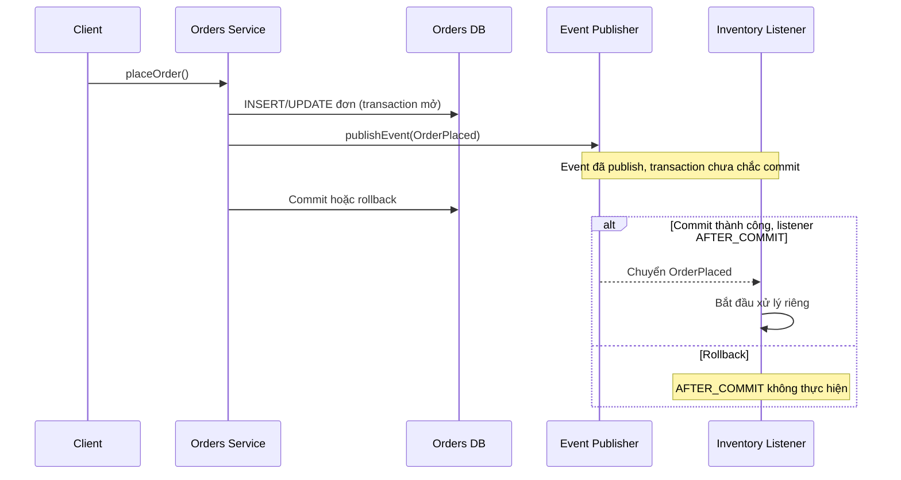
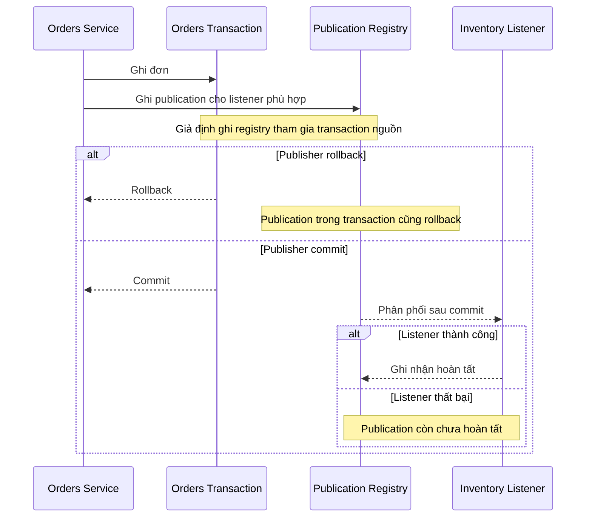
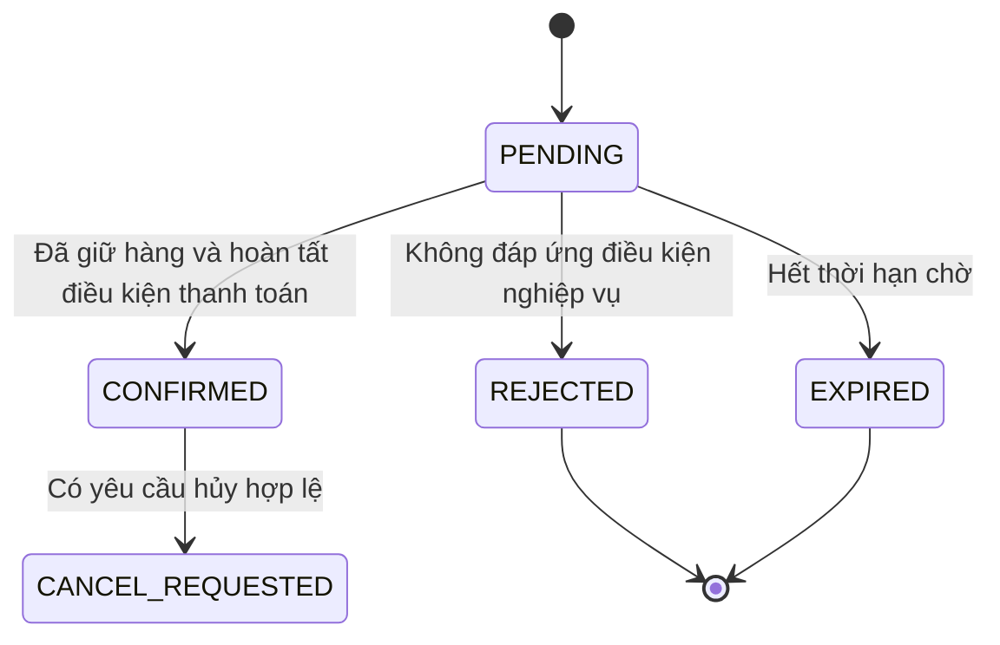
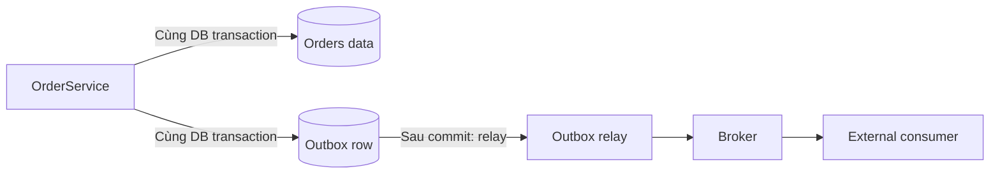

# Nhất quán giao dịch khi giao tiếp bằng application events trong Spring Modulith

## 1. Vì sao transaction và event phải được thiết kế cùng nhau?

Trong một ứng dụng Spring Modulith, module `orders` có thể lưu một đơn hàng rồi phát `OrderPlaced` để module `inventory` giữ hàng và module `billing` xử lý thanh toán. Việc dùng application events làm giảm phụ thuộc mã nguồn, nhưng đặt ra câu hỏi quan trọng: **điều gì xảy ra nếu đơn hàng rollback, listener thất bại hoặc ứng dụng dừng ngay sau khi commit?**

**Nhất quán giao dịch** (*transactional consistency*) nghĩa là dữ liệu và các phản ứng nghiệp vụ không được rơi vào trạng thái trái với những bất biến đã cam kết. Với một transaction cục bộ, tính nguyên tử cho phép toàn bộ thay đổi bên trong cùng transaction **cùng commit hoặc cùng rollback**. Nhưng một event được xử lý sau commit có thể chạy trong **một transaction khác**, nên không còn thuộc cùng đơn vị nguyên tử với publisher.

Một vài bất biến mẫu:

- Đơn hàng chưa được commit **không được** khiến kho giữ hàng vĩnh viễn.
- Một sự kiện đã được commit nhưng listener tạm lỗi **không được bị mất dấu** nếu nghiệp vụ yêu cầu xử lý tin cậy.
- Phát lại cùng sự kiện không được làm kho giữ hàng hai lần hoặc tạo hai yêu cầu thanh toán.
- Đơn hàng có thể ở trạng thái `PENDING_RESERVATION` trong một thời gian, nhưng không được tự tuyên bố `CONFIRMED` trước khi đủ điều kiện xác nhận.

Chủ đề này nằm trong lộ trình `SPRING_MODULITH_APPLICATION_EVENTS`: dùng publisher, listener và ranh giới module rõ ràng, đồng thời kết hợp xử lý sau commit, **Event Publication Registry**, retry, kiểm thử và quan sát để duy trì giao sự kiện đáng tin cậy.

> **Điểm mấu chốt:** `publishEvent(...)` mô tả một thao tác *công bố sự kiện*; nó **không tự mang nghĩa** “đợi commit”, “lưu sự kiện bền vững” hay “đảm bảo listener xử lý đúng một lần”.

## 2. Phân biệt nhất quán trong một transaction và giữa nhiều transaction

Một ứng dụng modular monolith có thể dùng cùng database và cùng transaction manager. Về kỹ thuật, nhiều thao tác ở các package khác nhau có thể tham gia **cùng transaction** nếu được gọi đồng bộ theo cấu hình Spring phù hợp. Nhưng điều đó không mặc nhiên có nghĩa mọi module **nên** chia sẻ transaction hoặc repository của nhau.

| Mô hình | Đơn vị nguyên tử | Ưu điểm | Đánh đổi |
| --- | --- | --- | --- |
| API đồng bộ, cùng transaction database | Một transaction bao trùm những thao tác được enlist | Có thể commit/rollback cùng nhau | Coupling thời gian chạy, dễ kéo dài transaction và xói mòn quyền sở hữu |
| `@EventListener` đồng bộ trong transaction publisher | Thông thường chạy ngay khi publish; có thể tham gia transaction đang hoạt động | Phản ứng tức thì; exception có thể ảnh hưởng publisher | Listener làm publisher chậm; không tự bảo đảm sau commit |
| `@TransactionalEventListener(AFTER_COMMIT)` | Publisher đã commit; xử lý sau đó không thể rollback publisher | Không phản ứng với dữ liệu publisher đã rollback | Cần transaction ghi độc lập, theo dõi lỗi và xử lý lại |
| `@ApplicationModuleListener` | Xử lý liên module sau commit, thường bất đồng bộ trong transaction riêng | Tách vòng đời xử lý, phù hợp ranh giới module | **Nhất quán cuối cùng**, có độ trễ và cần idempotency/khôi phục |

**Nhất quán mạnh** và **nhất quán cuối cùng** không phải nhãn tốt/xấu tuyệt đối. Với bước bắt buộc phải quyết định trước khi trả kết quả, API đồng bộ có thể hợp lý. Với bước tự động phản ứng sau khi nghiệp vụ nguồn đã thành công, event sau commit và xử lý bù trừ thường phù hợp hơn.

Trong mọi trường hợp, cần phân biệt:

1. **Transaction publisher:** nơi quyết định sự kiện nghiệp vụ đã thực sự xảy ra hay chưa.
2. **Transaction consumer:** nơi listener cập nhật trạng thái nghiệp vụ của mình.
3. **Publication state:** bản ghi theo dõi event đã được giao/xử lý chưa, nếu có cơ chế registry.
4. **Tác dụng phụ bên ngoài database:** gửi HTTP, email hoặc message broker; những thao tác này không tự tham gia transaction cơ sở dữ liệu.

## 3. Thời điểm phát và thời điểm xử lý: một timeline

Giả sử `OrderService.placeOrder` dùng `@Transactional`:



Sơ đồ chỉ minh họa một listener gắn với pha `AFTER_COMMIT`. Một `@EventListener` thông thường có thể đã chạy **ngay tại bước `publishEvent`**, trước khi transaction hoàn tất.

Các mốc thời gian cần tách rõ:

- `occurredAt` do publisher đặt trên payload thường là lúc xác định sự kiện nghiệp vụ, **không nhất thiết** là thời điểm commit.
- `publishedAt` nếu có là lúc ứng dụng gọi `publishEvent(...)`.
- Transaction thực sự chỉ thành công khi commit thành công; tại thời điểm gọi publish, còn có thể xảy ra exception hoặc rollback.
- `processedAt` là lúc consumer xử lý; có thể muộn hơn nhiều vì async, lỗi hoặc retry.

Việc gắn timestamp không tự chứng minh sự kiện đã commit, và timestamp cũng không bảo đảm thứ tự hoàn tất của các listener.

## 4. Publisher: tạo event trong transaction có ranh giới rõ ràng

Ví dụ record sự kiện bất biến được công bố như API của module `orders`:

```java
// orders/events/OrderPlaced.java
package com.example.shop.orders.events;

import java.time.Instant;
import java.util.Objects;
import java.util.UUID;

public record OrderPlaced(
        UUID eventId,
        UUID orderId,
        Instant occurredAt) {

    public OrderPlaced {
        Objects.requireNonNull(eventId, "eventId");
        Objects.requireNonNull(orderId, "orderId");
        Objects.requireNonNull(occurredAt, "occurredAt");
    }
}
```

Publisher tạo event **sau khi xác định sự thật nghiệp vụ** nhưng vẫn trong transaction ghi dữ liệu:

```java
// Trích đoạn của orders.internal.OrderService
@Transactional
public UUID placeOrder(PlaceOrderCommand command) {
    Order order = orderRepository.save(Order.from(command));

    OrderPlaced event = new OrderPlaced(
        UUID.randomUUID(),
        order.getId(),
        clock.instant()
    );

    publisher.publishEvent(event);
    return order.getId();
}
```

Ở đây `publisher` là `ApplicationEventPublisher`, `clock` là `java.time.Clock`; `Order`, repository và command là các kiểu nội bộ của ví dụ. Đoạn trích tập trung vào phạm vi transaction, chưa phải service độc lập có thể biên dịch.

**Điều được bảo đảm bởi `@Transactional`:** khi gọi qua proxy Spring phù hợp với transaction manager đã cấu hình, phần ghi dữ liệu tham gia transaction của method. **Điều không được bảo đảm chỉ từ đoạn mã:** rằng mọi listener đã xử lý xong, event được lưu bền vững hay có retry khi ứng dụng dừng đột ngột.

Tránh phát event chứa `OrderEntity` hoặc collection mutable. Listener sau commit có thể chạy khi entity đã detached hoặc dữ liệu đã đổi; một record chứa ID/snapshot bất biến giúp các module chỉ tiêu thụ hợp đồng được công bố.

### 4.1. Cẩn thận với self-invocation và transaction thực tế

`@Transactional` là cơ chế được áp dụng qua proxy trong cấu hình Spring thông dụng. Nếu một method gọi `this.placeOrder(...)` ngay bên trong cùng bean, lời gọi đó có thể bỏ qua proxy và transaction dự kiến **không được mở theo annotation**. Kiểm thử nên chứng minh event thực sự được phát trong transaction, thay vì chỉ dựa vào sự tồn tại của annotation trên method.

Một số cấu hình transaction cũng phụ thuộc cơ sở dữ liệu, connection và transaction manager. Đừng mặc định một thao tác HTTP, email hay broker được đưa vào transaction của database chỉ vì code nằm bên trong method `@Transactional`.

## 5. Vì sao listener đồng bộ có thể làm thay đổi kết quả publisher?

Một `@EventListener` thông thường nhận trực tiếp payload và được chạy đồng bộ với multicaster mặc định:

```java
@Component
class ImmediateOrderListener {

    @EventListener
    void on(OrderPlaced event) {
        // Được gọi khi Spring dispatch event;
        // chưa có bảo đảm transaction publisher đã commit.
        doSomeWork(event.orderId());
    }
}
```

Nếu listener đồng bộ ném unchecked exception và exception không được xử lý, lỗi có thể lan ngược tới `publishEvent(...)`, khiến transaction publisher bị đánh dấu rollback theo quy tắc rollback áp dụng. Điều này có thể được **chủ động sử dụng** trong một số quy trình phải thành công/ thất bại cùng nhau, nhưng đồng thời tạo coupling giữa publisher và listener.

Một failure đáng chú ý:

```text
1. orders bắt đầu transaction T1.
2. orders lưu đơn và publish OrderPlaced.
3. @EventListener đồng bộ gửi HTTP hoặc email.
4. Sau đó T1 rollback vì lỗi nghiệp vụ/DB.
5. Dịch vụ ngoài đã nhận yêu cầu hoặc khách đã nhận email,
   dù đơn hàng không được commit.
```

**Không nên thực hiện tác dụng phụ không thể rollback bên trong listener đồng bộ thuộc transaction publisher**, trừ khi hệ thống đã thiết kế bù trừ và chấp nhận rủi ro. Đặc biệt, “gửi email thành công” không thể được rollback bằng transaction SQL.

### 5.1. BEFORE_COMMIT không phải AFTER_COMMIT

`@TransactionalEventListener` hỗ trợ các phase:

| Phase | Khi nào listener chạy? | Lưu ý |
| --- | --- | --- |
| `BEFORE_COMMIT` | Trước khi transaction commit | Lỗi có thể ảnh hưởng commit; không có nghĩa commit chắc chắn thành công |
| `AFTER_COMMIT` | Sau khi commit thành công | Publisher đã commit; lỗi consumer không thể rollback kết quả đó |
| `AFTER_ROLLBACK` | Sau khi transaction rollback | Phù hợp dọn dẹp/ghi nhận thất bại có chủ đích, không phải đường xử lý event thành công |
| `AFTER_COMPLETION` | Sau khi transaction hoàn tất, bất kể commit hay rollback | Phải phân biệt outcome nếu nghiệp vụ cần biết kết quả |

`AFTER_COMMIT` là phase mặc định của `@TransactionalEventListener`. Khi không có transaction đang hoạt động, listener kiểu này **mặc định không chạy**, trừ khi cấu hình `fallbackExecution = true`. Vì vậy phải kiểm soát publisher có thật sự đang chạy trong transaction hay không.

## 6. @TransactionalEventListener: sau commit nhưng ghi dữ liệu bằng transaction nào?

Một cách triển khai listener sau commit trong Spring Framework:

```java
// inventory/internal/InventoryOrderEvents.java
package com.example.shop.inventory.internal;

import com.example.shop.orders.events.OrderPlaced;
import org.springframework.stereotype.Component;
import org.springframework.transaction.event.TransactionPhase;
import org.springframework.transaction.event.TransactionalEventListener;

@Component
class InventoryOrderEvents {

    private final StockReservationService stock;

    InventoryOrderEvents(StockReservationService stock) {
        this.stock = stock;
    }

    @TransactionalEventListener(phase = TransactionPhase.AFTER_COMMIT)
    void on(OrderPlaced event) {
        stock.reserveOnce(event.eventId(), event.orderId());
    }
}
```

Nếu `stock.reserveOnce(...)` phải ghi database, hãy đặt transaction ghi ở **service riêng được Spring quản lý**:

```java
// inventory/internal/StockReservationService.java (trích đoạn)
package com.example.shop.inventory.internal;

import java.util.UUID;
import org.springframework.stereotype.Service;
import org.springframework.transaction.annotation.Propagation;
import org.springframework.transaction.annotation.Transactional;

@Service
class StockReservationService {

    @Transactional(propagation = Propagation.REQUIRES_NEW)
    public void reserveOnce(UUID eventId, UUID orderId) {
        // Kiểm tra/chốt dấu xử lý trùng và thay đổi tồn kho.
        // Cả hai phải nhất quán trong transaction ghi này.
    }
}
```

Vì sao cần cẩn thận? Ở các callback `AFTER_COMMIT`, transaction gốc đã commit nhưng một số transaction resource có thể **vẫn đang gắn với thread**. Spring cảnh báo rằng các truy cập tài nguyên sau commit có thể còn tham gia transaction cũ mà những thay đổi bổ sung **không được commit như mong đợi**. Dùng `REQUIRES_NEW` cho hành động ghi độc lập là một hướng thiết kế rõ ràng.

Đặt method `@Transactional(REQUIRES_NEW)` trên **bean khác được gọi qua Spring proxy** giúp annotation được áp dụng theo cơ chế proxy thông dụng. Nếu listener gọi một method `this.reserveOnce(...)` trong cùng class thì dễ vướng self-invocation và không kích hoạt transaction mới.

**Không nhầm lẫn:** `AFTER_COMMIT` không có nghĩa listener chắc chắn chạy trên thread khác; `@TransactionalEventListener` tự nó không bật `@Async`. Một listener sau commit đồng bộ vẫn có thể tăng thời gian trả lời của publisher trong quá trình hoàn tất transaction.

### 6.1. Fallback execution có thể làm thay đổi bất biến

Một số dự án dùng:

```java
@TransactionalEventListener(
    phase = TransactionPhase.AFTER_COMMIT,
    fallbackExecution = true
)
void on(OrderPlaced event) { /* ... */ }
```

Với `fallbackExecution = true`, nếu publish **không nằm trong transaction**, listener vẫn có thể chạy như fallback, không phải “sau một commit không tồn tại”. Đây là quyết định cần cân nhắc: nếu bất biến là “chỉ phản ứng với đơn đã commit”, thường nên giữ hành vi mặc định và kiểm tra publisher luôn phát sự kiện trong transaction hợp lệ.

## 7. @ApplicationModuleListener: mẫu liên module trong Spring Modulith

Spring Modulith cung cấp `@ApplicationModuleListener` để đơn giản hóa cách nhận event giữa các module, kết hợp **listener gắn transaction**, **xử lý bất đồng bộ** và **transaction riêng** với ngữ nghĩa phù hợp. Ví dụ:

```java
// inventory/internal/OrderPlacedListener.java
package com.example.shop.inventory.internal;

import com.example.shop.orders.events.OrderPlaced;
import org.springframework.modulith.events.ApplicationModuleListener;
import org.springframework.stereotype.Component;

@Component
class OrderPlacedListener {

    private final StockReservationService stock;

    OrderPlacedListener(StockReservationService stock) {
        this.stock = stock;
    }

    @ApplicationModuleListener
    void on(OrderPlaced event) {
        stock.reserveOnce(event.eventId(), event.orderId());
    }
}
```

Đây là **phương án thay thế** cho listener `@TransactionalEventListener` ở mục 6, không phải thêm một listener nữa cùng thực hiện hành động giữ hàng. Khi đăng ký cả hai, cùng một event có thể gây hai tác dụng phụ nếu không có chính sách chống trùng.

Với `@ApplicationModuleListener`, transaction mới của listener là một phần ý định của annotation. Nếu service được gọi bên trong lại có `REQUIRES_NEW` như ví dụ mục 6 thì có thể mở thêm một transaction nữa, **không cần thiết** cho tình huống thông thường. Trong ứng dụng thực, hãy chọn **một ranh giới transaction rõ ràng**: hoặc để listener Modulith quản lý transaction và để các thao tác kho tham gia transaction hiện tại, hoặc chủ động thiết kế transaction ở service theo yêu cầu. Không nên ghép annotation tùy tiện mà không hiểu propagation.

### 7.1. Hợp đồng event phải nằm trên API module

Nếu `OrderPlaced` đặt ở `orders.events` thì có thể công bố named interface:

```java
// orders/events/package-info.java
@org.springframework.modulith.NamedInterface("events")
package com.example.shop.orders.events;
```

Module `inventory` giới hạn phụ thuộc của mình:

```java
// inventory/package-info.java
@org.springframework.modulith.ApplicationModule(
    allowedDependencies = "orders::events"
)
package com.example.shop.inventory;
```

Như vậy `inventory` có thể import `OrderPlaced` nhưng không cần biết `orders.internal.OrderRepository`. `ApplicationModules.of(ShopApplication.class).verify()` giúp kiểm chứng ranh giới phụ thuộc; còn độ tin cậy sau commit cần kiểm thử và hạ tầng event riêng.

### 7.2. Transactional listener không đồng nghĩa gọi đồng bộ từ publisher

Một listener `@ApplicationModuleListener` có thể thất bại **sau khi API đặt hàng đã trả thành công**. Kết quả HTTP `201 Created` chỉ phản ánh hợp đồng đặt hàng của publisher, không nhất thiết phản ánh kho và thanh toán đã xong.

Nếu API cần cho biết “đơn đã được xác nhận đầy đủ”, mô hình dữ liệu nên có trạng thái rõ ràng như `PENDING`, `CONFIRMED`, `REJECTED` và một cơ chế theo dõi tiến trình. Đừng phát event rồi giả định mọi listener bất đồng bộ đã hoàn thành trước khi trả kết quả.

## 8. Cửa sổ lỗi giữa commit và xử lý event

Xét hai câu hỏi độc lập:

1. **Publisher đã commit dữ liệu chưa?**
2. **Consumer đã hoàn tất công việc chưa?**

Giữa hai mốc có thể xuất hiện lỗi mạng, lỗi database, shutdown hoặc crash tiến trình. Nếu chỉ dùng application events **in-memory**, thông báo đang chờ xử lý có thể mất khi tiến trình dừng. Đó là lý do giao tiếp liên module cần độ tin cậy thường bổ sung một cơ chế lưu dấu publication.

### 8.1. Event Publication Registry làm gì?

Spring Modulith cung cấp **Event Publication Registry**, hỗ trợ ghi nhận các publication hướng đến những transactional event listener phù hợp, theo dõi publication đã hoàn tất hoặc chưa hoàn tất, và tạo cơ sở cho việc xử lý lại.

Khi cấu hình một cơ chế lưu trữ publication được hỗ trợ và transaction tích hợp đúng, publication có thể được ghi nhận bền vững **cùng transaction nghiệp vụ của publisher**, giúp tránh việc dữ liệu nguồn đã commit nhưng không còn dấu vết event cần giao. Chi tiết bảo đảm còn tùy loại storage, phiên bản Spring Modulith và cấu hình ứng dụng; không mặc định mọi kiểu repository hoặc mọi listener đều có đúng semantics này.



**Registry không phải state machine nghiệp vụ.** Nó biết publication cần giao tới listener nào và đã hoàn tất chưa; nó không tự biết đơn có đủ điều kiện giữ hàng, thanh toán đã hợp lệ hay có nên hủy đơn khi quá hạn.

### 8.2. Registry không đồng nghĩa retry tự động được cấu hình sẵn

Việc **phát hiện**, **xếp lịch**, **kích hoạt tái công bố** hoặc **khôi phục sau restart** phụ thuộc vào API, phiên bản và các cấu hình vận hành được chọn. Không nên mặc định rằng chỉ thêm dependency registry hoặc `@ApplicationModuleListener` sẽ làm mọi publication tự retry theo chính sách mong muốn.

Trong vận hành cần quyết định:

- Loại kho lưu trữ publication nào được dùng và có tồn tại qua restart không?
- Transaction ghi publication có tham gia cùng transaction nghiệp vụ nguồn không?
- Publication chưa hoàn tất được quét/phát lại bằng cơ chế nào?
- Khi listener lỗi vĩnh viễn, ai xử lý và giới hạn retry ra sao?
- Có theo dõi số publication chưa hoàn tất, tuổi của chúng và số lần thử lại không?

Khi thiết kế, nên coi `eventId` trong payload là **ID của sự kiện nghiệp vụ do ứng dụng cấp**, không mặc định trùng với ID bản ghi publication của Spring Modulith.

## 9. Ma trận các tình huống lỗi thường gặp

| Tình huống | Dữ liệu publisher | Listener sau commit | Biện pháp bảo đảm nhất quán |
| --- | --- | --- | --- |
| Publisher ném lỗi trước commit | Rollback nếu transaction được cấu hình đúng | Không chạy với phase `AFTER_COMMIT` | Kiểm thử rollback, không tạo tác dụng phụ trước commit |
| Publisher commit nhưng JVM dừng trước khi listener bắt đầu | Đã commit | Có thể chưa chạy | Cần lưu publication bền vững và đường phục hồi được cấu hình |
| Listener bắt đầu rồi lỗi trước khi commit transaction của mình | Đã commit | Transaction listener rollback | Publication còn dở dang, retry có idempotency |
| Listener commit xong nhưng lỗi khi ghi nhận completion | Đã commit | Có thể đã tác động nghiệp vụ | Xử lý lại có thể gây trùng; chống trùng nghiệp vụ bắt buộc |
| Publisher gọi `publishEvent` ngoài transaction | Không có transaction tương ứng | `@TransactionalEventListener` mặc định bỏ qua | Bắt buộc publisher phát trong transaction hoặc chủ động chọn fallback |
| Consumer đọc trạng thái database mới thay vì snapshot event | Đã commit | Nhìn thấy dữ liệu có thể đã thay đổi tiếp | Chọn payload snapshot/contract phù hợp với ngữ nghĩa nghiệp vụ |
| Consumer gửi email/broker rồi DB của consumer rollback | Publisher đã commit | Tác dụng phụ ngoài có thể đã xảy ra | Dùng outbox/relay, idempotency hoặc bù trừ |

Trong trường hợp listener **commit xong nhưng báo hoàn tất publication chưa được ghi nhận**, một lần retry có thể xuất hiện mặc dù dữ liệu nghiệp vụ đã thay đổi. Đây là phản ví dụ điển hình cho phát biểu “sử dụng transaction sẽ xử lý đúng một lần”: **có nhiều transaction với các điểm commit khác nhau**.

## 10. Idempotency: điều kiện để retry không phá dữ liệu

**Idempotency** nghĩa là xử lý lặp lại cùng một yêu cầu hợp lệ không tạo thêm tác dụng phụ ngoài kết quả mong muốn. Với event processing, nó không chỉ là kiểm tra rằng listener đã từng thấy `eventId`; còn phải ngăn **thao tác nghiệp vụ lặp**.

Ví dụ module `inventory` nhận `OrderPlaced(eventId=E1, orderId=O1)`:

```text
Lần đầu:  E1, O1 → giữ hàng thành công, ghi nhận đã xử lý.
Retry:    E1, O1 → thấy đã xử lý, không giữ hàng thêm.
Sự kiện mới cho cùng O1: E2, O1 → kiểm tra quy tắc
                                   "mỗi đơn chỉ được giữ một lần".
```

Hai lớp bảo vệ bổ sung cho nhau:

| Lớp | Dữ liệu khóa | Mục tiêu |
| --- | --- | --- |
| Dedup publication/event | `(consumerName, eventId)` | Không làm lại cùng một sự kiện đã xử lý |
| Bất biến nghiệp vụ | `orderId` hoặc `(orderId, reservationAttemptId)` | Không tạo nhiều lượt giữ hàng không hợp lệ |

Một thiết kế lưu trữ minh họa:

```sql
-- Ví dụ cú pháp PostgreSQL.
CREATE TABLE inventory_consumed_events (
    consumer_name VARCHAR(80) NOT NULL,
    event_id UUID NOT NULL,
    order_id UUID NOT NULL,
    PRIMARY KEY (consumer_name, event_id)
);

CREATE TABLE inventory_reservations (
    order_id UUID PRIMARY KEY,
    status VARCHAR(32) NOT NULL,
    reserved_at TIMESTAMP WITH TIME ZONE NOT NULL
);
```

Khi xử lý event, listener nên **cùng transaction** ghi nhận dedup và cập nhật trạng thái kho:

```java
// Mô hình xử lý trong transaction của inventory (phác thảo).
@Transactional
public void reserveOnce(UUID eventId, UUID orderId) {
    // INSERT có unique constraint, trả false khi event đã xử lý.
    if (!consumedEvents.insertIfAbsent("order-placed", eventId, orderId)) {
        return;
    }

    // Unique key theo orderId và logic nghiệp vụ ngăn giữ hàng hai lần.
    reservations.reserveForOrderIfAbsent(orderId);
}
```

`consumedEvents` và `reservations` là hai repository **do module inventory hiện thực**. `insertIfAbsent` phải bảo đảm tính nguyên tử bằng database/unique constraint hoặc chiến lược đồng thời thích hợp; mẫu `if (exists) insert` không an toàn khi hai consumer chạy song song.

Hai hành động ghi dedup và reservation cần được commit/rollback cùng nhau, nếu không sẽ có lỗi: “đánh dấu đã xử lý nhưng chưa giữ hàng” hoặc “đã giữ hàng rồi nhưng lần retry vẫn không phát hiện”.

### 10.1. Idempotency không nhất thiết đồng nghĩa bỏ qua mọi event cùng orderId

Nếu nghiệp vụ cho phép giải phóng hàng rồi giữ lại trong **lần thử mới**, không thể dùng `orderId` duy nhất để từ chối mọi event về sau. Khi đó cần thêm `reservationAttemptId`, `aggregateVersion` hoặc khóa nghiệp vụ tương ứng. Tính đúng đắn phụ thuộc **ngữ nghĩa sự kiện**, không phải chỉ phụ thuộc một công thức ID.

## 11. Nhất quán cuối cùng và quy trình nhiều bước

Khi `orders`, `inventory` và `billing` xử lý trong các transaction khác nhau, không tồn tại một rollback đơn giản có thể tự đảo ngược **tất cả** thay đổi đã commit ở từng module. Một quy trình đặt hàng nên có trạng thái và chuyển tiếp rõ ràng:



Sơ đồ là ví dụ cho một domain; thực tế có thể dùng `PAYMENT_PENDING`, `INVENTORY_PENDING` hoặc các trạng thái chi tiết hơn. Điều quan trọng là API không hứa `CONFIRMED` nếu các listener liên module mới chỉ **được lên lịch**.

Khi một nhánh đã thành công nhưng nhánh khác thất bại, ứng dụng có thể cần **compensating action**:

- Kho đã giữ hàng nhưng thanh toán bị từ chối → tạo yêu cầu giải phóng reservation.
- Thanh toán đã được ủy quyền nhưng kho thiếu hàng → tạo yêu cầu hủy authorization hoặc hoàn trả tùy giai đoạn.
- Listener giao hàng nhận `OrderConfirmed` quá muộn khi đơn đã hủy → kiểm tra trạng thái/quy tắc hiện tại trước khi thực hiện hành động không thể đảo ngược.

Những hành động bù trừ là **nghiệp vụ mới**, không phải rollback ngược thời gian của transaction cũ. Chúng cần event/hợp đồng riêng, trạng thái xử lý, giới hạn retry và idempotency.

### 11.1. Đừng nhầm “đủ event” với “đủ điều kiện nghiệp vụ”

Một module điều phối kiểu fan-in có thể chờ `InventoryReserved` và `PaymentAuthorized` cho cùng `orderId`. Nhưng nếu authorization có thể hết hạn hoặc đơn đã bị hủy, chỉ đếm hai event chưa đủ để xác nhận đơn. Bản ghi trạng thái của coordinator phải được cập nhật nguyên tử và kiểm tra điều kiện hiện hành trước khi phát event tổng hợp.

Một hệ thống dùng application events có thể **cuối cùng nhất quán** nhưng vẫn sai về nghiệp vụ nếu không quản lý trạng thái, deadline và cách xử lý tín hiệu đến muộn.

## 12. Dual-write khi cần gửi sự kiện ra ngoài ứng dụng

Spring application events thường phục vụ giao tiếp **trong cùng ứng dụng**. Nếu còn cần đẩy integration event sang Kafka, RabbitMQ hoặc gọi HTTP, transaction database của publisher **không tự** commit nguyên tử với hệ thống ngoài.

Một cách triển khai có vấn đề:

```java
@Transactional
public void placeOrder(PlaceOrderCommand command) {
    orderRepository.save(Order.from(command));
    kafkaProducer.send("orders.created", /* payload */);
}
```

Có ít nhất hai cửa sổ lỗi:

1. Broker nhận message nhưng database transaction của publisher rollback: consumer bên ngoài đã thấy một đơn không tồn tại.
2. Database commit thành công nhưng việc phát message thất bại hoặc ứng dụng crash: đơn đã tồn tại nhưng consumer ngoài chưa được thông báo.

Đặt `kafkaProducer.send(...)` trong method `@Transactional` **không tự biến hai hạ tầng thành một transaction phân tán nguyên tử**.

### 12.1. Transactional outbox

Một hướng xử lý là **transactional outbox**: lưu thay đổi nghiệp vụ và một bản ghi message/outbox **trong cùng database transaction**; sau commit, một relay đọc outbox rồi gửi broker:



Mẫu này giảm nguy cơ mất dấu message sau commit, nhưng relay có thể gửi lặp nếu broker nhận rồi relay chưa kịp ghi nhận hoàn tất. Consumer ngoài cần dedup/idempotency, và outbox cần giám sát bản ghi tồn đọng.

### 12.2. Spring Modulith externalization và registry

Spring Modulith có các khả năng externalization sự kiện khi tích hợp với hạ tầng được hỗ trợ. Chúng có thể giúp tổ chức bước chuyển internal event thành integration event và theo dõi publication theo cấu hình. Cần hiểu rõ **phiên bản Spring Modulith, loại storage, transport, cách định tuyến, serialization, xác nhận broker và khôi phục publication** trước khi khẳng định độ bền và ngữ nghĩa giao nhận.

Outbox tự triển khai, cơ chế publication registry/externalization và một giải pháp CDC đều là những cách có thể cân nhắc tùy điều kiện. Không nên đồng nhất một lời gọi broker bất đồng bộ với sự kiện đã được lưu và giao thành công.

## 13. Observability: phải đo được trạng thái nào bị kẹt

Với một hệ thống xử lý nhiều transaction, việc có log “event published” là chưa đủ. Cần quan sát ở cả publisher, registry và consumer:

| Chỉ số hoặc thông tin | Ý nghĩa |
| --- | --- |
| `eventId`, `orderId`, event type | Liên kết log cùng một sự kiện và đối tượng nghiệp vụ |
| Thời điểm tạo event và commit | Phân biệt sự kiện được tạo với kết quả transaction nguồn |
| Số publication chưa hoàn tất | Phát hiện listener có công việc đang chờ hoặc bị lỗi |
| Tuổi publication lâu nhất | Cảnh báo độ trễ bất thường, backlog tồn đọng |
| Số lần retry, nhóm nguyên nhân lỗi | Phân biệt lỗi kết nối tạm thời với lỗi payload/nghiệp vụ |
| Số event trùng được bỏ qua | Xác minh idempotency có hoạt động và nhận biết mức độ replay |
| Trạng thái nghiệp vụ `PENDING` quá hạn | Phát hiện quy trình không đạt nhất quán cuối cùng như kỳ vọng |
| Độ trễ từ publisher commit đến consumer hoàn tất | Đánh giá trải nghiệm và mục tiêu vận hành |

Micrometer metrics, structured logging và tracing có thể hỗ trợ quan sát. Cần tránh ghi token, dữ liệu cá nhân không cần thiết hoặc nguyên entity JPA vào log. Correlation ID nghiệp vụ có thể giữ ổn định qua retry, còn trace ID của lần thực thi có thể thay đổi.

**Một quy trình “eventually consistent” cần một giới hạn vận hành:** thế nào là quá chậm, publication nào cần cảnh báo, và ai chịu trách nhiệm xử lý trường hợp không thể tự phục hồi.

## 14. Kiểm thử tính nhất quán theo từng ranh giới

Không có một bài test đơn lẻ chứng minh được toàn bộ độ tin cậy của hệ thống. Nên tách **semantics transaction**, **độ tin cậy publication**, **tính đúng đắn consumer** và **quy trình nghiệp vụ end-to-end**.

### 14.1. Kiểm thử commit và rollback của transactional listener

Để kiểm chứng `@TransactionalEventListener(AFTER_COMMIT)`, nên có một transaction **được commit thật** và một transaction chủ động rollback. Ví dụ JUnit dưới đây giả định ứng dụng Spring Boot có `PlatformTransactionManager` được cấu hình sẵn. Nó dùng một event kiểm thử riêng để không kích hoạt các listener nghiệp vụ khác:

```java
import static org.junit.jupiter.api.Assertions.assertEquals;

import java.util.UUID;
import java.util.concurrent.atomic.AtomicInteger;
import org.junit.jupiter.api.BeforeEach;
import org.junit.jupiter.api.Test;
import org.springframework.beans.factory.annotation.Autowired;
import org.springframework.boot.test.context.SpringBootTest;
import org.springframework.boot.test.context.TestConfiguration;
import org.springframework.context.ApplicationEventPublisher;
import org.springframework.context.annotation.Bean;
import org.springframework.context.annotation.Import;
import org.springframework.transaction.PlatformTransactionManager;
import org.springframework.transaction.event.TransactionPhase;
import org.springframework.transaction.event.TransactionalEventListener;
import org.springframework.transaction.support.TransactionTemplate;

@SpringBootTest(classes = ShopApplication.class)
@Import(AfterCommitIT.ProbeConfiguration.class)
class AfterCommitIT {

    @Autowired PlatformTransactionManager transactionManager;
    @Autowired ApplicationEventPublisher publisher;
    @Autowired Probe probe;

    record ProbeEvent(UUID id) {}

    static class Probe {
        private final AtomicInteger calls = new AtomicInteger();

        @TransactionalEventListener(phase = TransactionPhase.AFTER_COMMIT)
        public void on(ProbeEvent event) {
            calls.incrementAndGet();
        }

        void reset() {
            calls.set(0);
        }

        int count() {
            return calls.get();
        }
    }

    @TestConfiguration
    static class ProbeConfiguration {
        @Bean Probe probe() {
            return new Probe();
        }
    }

    @BeforeEach
    void resetProbe() {
        probe.reset();
    }

    @Test
    void runsAfterCommit() {
        var tx = new TransactionTemplate(transactionManager);
        tx.executeWithoutResult(status ->
            publisher.publishEvent(new ProbeEvent(UUID.randomUUID()))
        );

        assertEquals(1, probe.count());
    }

    @Test
    void doesNotRunAfterRollback() {
        var tx = new TransactionTemplate(transactionManager);
        tx.executeWithoutResult(status -> {
            publisher.publishEvent(new ProbeEvent(UUID.randomUUID()));
            status.setRollbackOnly();
        });

        assertEquals(0, probe.count());
    }
}
```

Ở đây `Probe` không chạy bất đồng bộ; callback `AFTER_COMMIT` của Spring Framework được kích hoạt trong luồng hoàn tất transaction thông thường. Vì vậy test có thể kiểm tra số lần gọi ngay sau `TransactionTemplate`. Nếu thêm `@Async` hoặc dùng `@ApplicationModuleListener`, cần cơ chế **chờ có điều kiện** để kiểm thử bất đồng bộ, thay vì dùng kết luận đồng bộ như trên.

**Quan trọng:** không bọc cả test method trong `@Transactional` mặc định rollback rồi mong kiểm chứng được `AFTER_COMMIT`. Hãy kiểm soát commit/rollback bằng `TransactionTemplate`, `TestTransaction` hoặc cách tạo transaction phù hợp với hạ tầng thực tế. Ví dụ cần được đặt trong dự án có dependency và cấu hình Spring Boot test/transaction tương ứng.

### 14.2. Ma trận integration test thiết yếu

| Kịch bản | Kỳ vọng kiểm chứng |
| --- | --- |
| `orders` commit thành công | Đơn được lưu, listener `AFTER_COMMIT` chạy theo cấu hình |
| `orders` rollback trước commit | Không có tác dụng phụ từ listener `AFTER_COMMIT`; publication cùng transaction không được commit |
| `publishEvent` ngoài transaction | Listener transactional không chạy nếu chưa bật fallback |
| Listener lỗi trước khi commit transaction riêng | Dữ liệu listener rollback; có dấu publication chưa hoàn tất nếu registry được cấu hình |
| Listener commit xong, đánh dấu completion thất bại | Retry không gây tác dụng phụ trùng |
| Ứng dụng restart khi còn publication chưa hoàn tất | Publication được phát hiện và phục hồi theo cơ chế đã cấu hình |
| Hai worker đồng thời nhận cùng event | Unique constraint/locking bảo vệ dedup và bất biến nghiệp vụ |
| Đơn được thay đổi sau khi phát event | Listener nhận snapshot có ý nghĩa đúng, không phụ thuộc entity mutable |
| Xử lý event đến muộn sau khi đơn hủy | Consumer áp dụng trạng thái/bất biến phù hợp, không hồi sinh quy trình sai |
| Broker có message nhưng producer mất xác nhận | Relay/consumer chịu được gửi lại mà không tạo tác dụng phụ nhân đôi |

Các bài test liên quan registry cần dùng **đúng storage và cấu hình production dự định dùng** khi có thể. Một test in-memory chứng minh listener được gọi không cho thấy publication thực sự tồn tại qua restart.

### 14.3. Module boundary và tính đúng đắn nghiệp vụ

Đảm bảo `inventory` chỉ import hợp đồng `orders::events` bằng kiểm thử kiến trúc:

```java
import org.junit.jupiter.api.Test;
import org.springframework.modulith.core.ApplicationModules;

class ArchitectureTests {

    @Test
    void moduleDependenciesAreValid() {
        ApplicationModules.of(ShopApplication.class).verify();
    }
}
```

`verify()` kiểm tra mô hình phụ thuộc module, không tự xác minh commit/rollback, không mô phỏng crash và không bảo đảm listener idempotent. Mỗi tầng phải có bài kiểm thử đúng trách nhiệm.

## 15. Những nhầm lẫn phổ biến

| Nhầm lẫn | Cách hiểu chính xác |
| --- | --- |
| “`publishEvent` đã chạy thì đơn chắc chắn commit.” | Publisher có thể đang ở trong transaction chưa commit, thậm chí sau đó rollback |
| “`@EventListener` mặc định chạy sau commit.” | Listener thông thường thường được dispatch ngay khi publish |
| “`@TransactionalEventListener` luôn nhận event.” | Mặc định cần transaction đang hoạt động; không có transaction thì listener bị bỏ qua |
| “`AFTER_COMMIT` cho phép ghi database bằng chính transaction cũ.” | Transaction cũ đã commit; cần transaction mới phù hợp cho ghi bền vững |
| “`@ApplicationModuleListener` làm mọi module cập nhật nguyên tử.” | Nó hỗ trợ xử lý tách sau commit, thường trong transaction riêng; dữ liệu cuối cùng nhất quán |
| “Event Publication Registry tự retry mọi listener.” | Registry cần storage/integration phù hợp và cơ chế phục hồi được cấu hình; phạm vi không phải mọi listener |
| “Có transaction thì event sẽ chỉ xử lý đúng một lần.” | Nhiều điểm commit tạo cửa sổ retry/trùng; cần idempotency |
| “Một transaction database có thể rollback cả email hoặc broker.” | Tác dụng phụ ngoài DB không tự tham gia transaction cục bộ |
| “Nhất quán cuối cùng là khỏi cần kiểm tra timeout.” | Vẫn cần deadline, trạng thái lỗi/bù trừ và quan sát các quy trình bị kẹt |

## 16. Checklist thiết kế nhất quán giao dịch

Khi phát một event để module khác xử lý, hãy trả lời lần lượt:

1. **Nguồn sự thật nghiệp vụ ở đâu?** Xác định module sở hữu dữ liệu và trạng thái nào chứng minh event hợp lệ.
2. **Event phát trong transaction nào?** Xác minh `@Transactional` thật sự được áp dụng qua proxy và transaction manager đúng.
3. **Consumer cần phản ứng lúc nào?** Đồng bộ trước commit, sau commit hay bất đồng bộ? Không chọn theo thói quen.
4. **Consumer ghi dữ liệu bằng transaction nào?** Chọn rõ `REQUIRES_NEW` khi dùng `AFTER_COMMIT` để ghi hoặc tận dụng transaction riêng của `@ApplicationModuleListener`.
5. **Bị rollback thì sao?** Listener `AFTER_COMMIT` không thực hiện tác dụng phụ của event nguồn chưa commit.
6. **Crash sau commit thì sao?** Cân nhắc registry bền vững, lưu publication cùng transaction nguồn và cấu hình khôi phục.
7. **Listener retry thì sao?** Thiết kế cả chống trùng theo `eventId` lẫn bất biến theo business ID trong một transaction phù hợp.
8. **Có tác dụng phụ ra ngoài không?** Cân nhắc outbox, externalization/relay, xác nhận broker và idempotency consumer.
9. **Quy trình có thể chờ bao lâu?** Có trạng thái `PENDING`, deadline, lỗi cuối cùng và hành động bù trừ rõ ràng.
10. **Đã kiểm chứng chưa?** Chạy test commit, rollback, lỗi listener, restart, concurrency và vận hành publication backlog.

### Bài tập tình huống

Một hệ thống có luồng:

```text
OrderService @Transactional
  -> lưu đơn O1
  -> publish OrderPlaced(E1, O1)

InventoryListener @ApplicationModuleListener
  -> giữ hàng cho O1
  -> commit transaction kho
```

Hãy phân tích các trường hợp:

1. Transaction `OrderService` rollback ngay sau khi publish: listener nào được phép xử lý, vì sao?
2. Transaction đơn đã commit, ứng dụng dừng trước khi listener bắt đầu: cần cơ chế gì để không mất dấu công việc?
3. Listener kho đã commit nhưng publication chưa được ghi nhận hoàn tất: nếu event `E1` được giao lại, cần kiểm soát gì?
4. Đã giữ hàng nhưng thanh toán bị từ chối: tại sao không thể chỉ rollback transaction đơn, và bước bù trừ nào nên được phát sinh?
5. Module cần đẩy `OrderPlaced` sang một broker ngoài: vì sao `kafkaProducer.send(...)` trong method `@Transactional` không đủ, và outbox thay đổi cửa sổ lỗi ra sao?

**Ghi nhớ:** Với Spring Modulith, **nhất quán giao dịch** không phải là đảm bảo mọi listener chạy trong cùng transaction. Nó là lựa chọn có chủ đích về ranh giới commit, thời điểm xử lý, dữ liệu có thể tạm thời chưa đồng bộ và cách khôi phục khi lỗi. Kết hợp event bất biến, listener sau commit, transaction consumer riêng, Event Publication Registry hoặc outbox phù hợp, idempotency, kiểm thử và quan sát để phối hợp giữa các module mà không đánh đổi tính đúng đắn nghiệp vụ.
