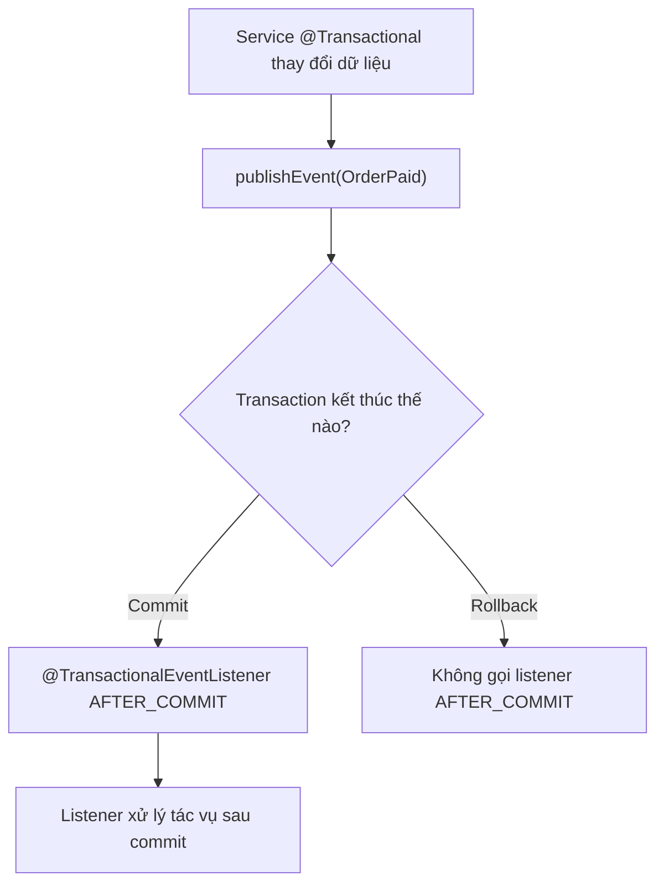
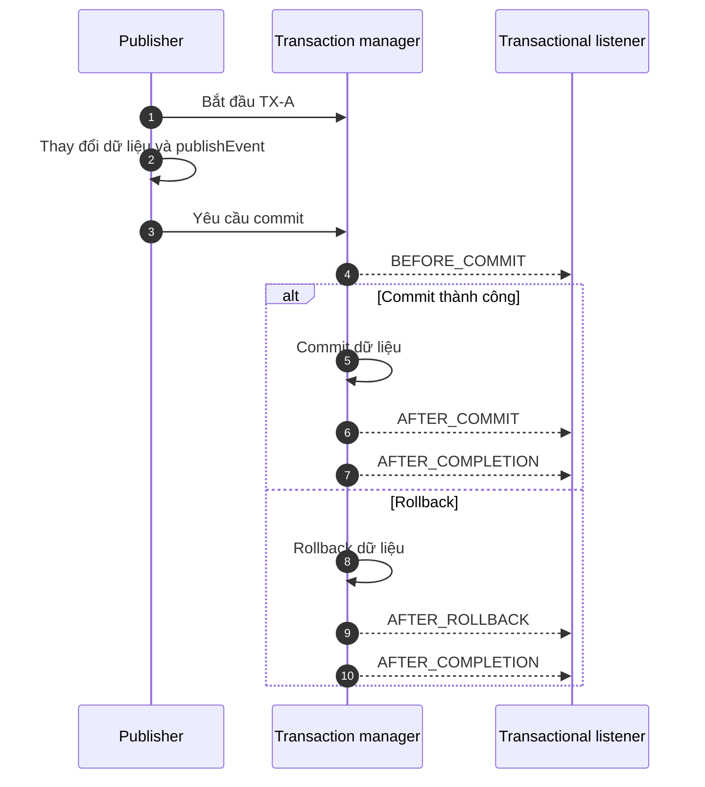
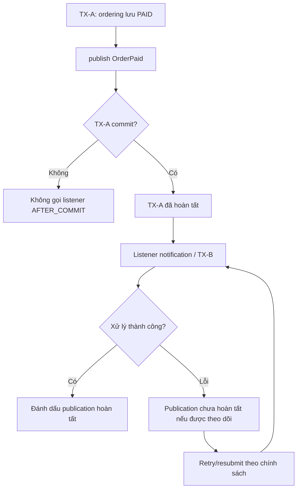

# @TransactionalEventListener trong Spring Modulith

## 1. Vì sao cần listener gắn với vòng đời transaction?

Trong ứng dụng Spring Boot thiết kế theo **Spring Modulith**, nhiều application module trao đổi thông tin qua application events. Ví dụ: `ordering` ghi nhận đơn hàng đã thanh toán, `notification` lên lịch gửi biên nhận và `analytics` cập nhật báo cáo. Nếu module nhận xử lý sự kiện trước khi giao dịch tạo đơn được commit, hệ thống có thể tạo thông báo về một đơn cuối cùng lại bị rollback.

Sự kiện miền như `OrderPaid` thể hiện một **sự thật nghiệp vụ**. Nhưng lệnh gọi `ApplicationEventPublisher.publishEvent(...)` có thể xảy ra **trong khi transaction của publisher vẫn đang mở**. Vì vậy phải phân biệt:

1. **Thời điểm phát sự kiện**: phương thức publisher công bố một đối tượng event.
2. **Thời điểm kết thúc transaction**: dữ liệu publisher commit hoặc rollback.
3. **Thời điểm listener thực thi hành vi**: có thể trong transaction nguồn, sau commit, sau rollback hoặc sau khi transaction hoàn tất.

Annotation **`@TransactionalEventListener`** của Spring Framework cho phép khai báo một event listener được kích hoạt theo **pha của transaction**, thay vì luôn chạy ngay khi event được phát. Đây là nền tảng để chọn đúng thời điểm cho listener trong Spring Modulith, nhất là khi giao tiếp giữa module phải tuân thủ nguyên tắc “chỉ phản ứng sau khi dữ liệu nguồn đã được commit”.

Với phạm vi học **SPRING_MODULITH_APPLICATION_EVENTS**, hiểu annotation này giúp thiết kế publisher/listener, xử lý sau commit, bảo vệ ranh giới module và phối hợp với Event Publication Registry, retry, idempotency, kiểm thử và quan sát sự kiện đáng tin cậy.

> **Điểm cốt lõi:** `@TransactionalEventListener` quyết định **khi nào** listener được gọi trong vòng đời transaction. Nó **không mặc định** biến listener thành bất đồng bộ, không tự mở một transaction mới cho tác động sau commit và không tự cung cấp bảo đảm giao sự kiện bền vững.

## 2. Cơ chế hoạt động cơ bản

Publisher thường được đặt trong một application service có `@Transactional`:

```java
@Transactional
public UUID pay(UUID orderId) {
    orders.markPaid(orderId);
    events.publishEvent(new OrderPaid(orderId));
    return orderId;
}
```

Khi phương thức phát event, Spring sẽ chuyển event tới infrastructure đăng ký listener. Đối với `@TransactionalEventListener`, việc chạy phương thức listener được **gắn với transaction synchronization** và pha đã cấu hình. Ví dụ:

```java
import org.springframework.transaction.event.TransactionalEventListener;

@TransactionalEventListener
public void on(OrderPaid event) {
    // Theo mặc định chỉ chạy sau khi publisher commit.
}
```

Pha mặc định là **`TransactionPhase.AFTER_COMMIT`**. Nếu publisher rollback, listener sau commit sẽ **không thực thi**. Nếu publisher phát sự kiện khi **không có transaction đang hoạt động**, transactional listener mặc định cũng **không được gọi** (trừ khi cấu hình `fallbackExecution = true`).



**Lưu ý:** event được gửi qua cơ chế application event **trong JVM**, không phải mặc định được ghi vào Kafka/RabbitMQ. Muốn dùng message broker hoặc đảm bảo qua nhiều tiến trình cần một adapter/hợp đồng tích hợp riêng.

## 3. Bốn TransactionPhase cần biết

Annotation hỗ trợ tham số `phase` với bốn giá trị:

| Pha | Lúc thực thi | Mục đích thường gặp | Cảnh báo |
| --- | --- | --- | --- |
| `BEFORE_COMMIT` | Trước thao tác commit transaction nguồn | Kiểm tra bổ sung, ghi audit nội bộ cần chung transaction | Exception có thể làm transaction không commit |
| `AFTER_COMMIT` | Sau khi transaction nguồn commit thành công | Phát sinh hiệu ứng hậu xử lý từ dữ liệu đã commit | Không mặc định có transaction ghi dữ liệu mới |
| `AFTER_ROLLBACK` | Sau khi transaction nguồn rollback | Ghi log, metrics hoặc xử lý quan sát thất bại | Không được hiểu là có trạng thái nghiệp vụ đã commit |
| `AFTER_COMPLETION` | Sau khi transaction kết thúc, bất kể commit hay rollback | Dọn dẹp/quan sát cuối vòng đời giao dịch | Muốn phân biệt kết quả cần sự kiện/ngữ cảnh bổ sung |

Giá trị cấu hình tường minh:

```java
import org.springframework.transaction.event.TransactionPhase;
import org.springframework.transaction.event.TransactionalEventListener;

@TransactionalEventListener(phase = TransactionPhase.BEFORE_COMMIT)
void beforeCommit(OrderPaid event) { /* ... */ }

@TransactionalEventListener(phase = TransactionPhase.AFTER_COMMIT)
void afterCommit(OrderPaid event) { /* ... */ }

@TransactionalEventListener(phase = TransactionPhase.AFTER_ROLLBACK)
void afterRollback(OrderPaid event) { /* ... */ }

@TransactionalEventListener(phase = TransactionPhase.AFTER_COMPLETION)
void afterCompletion(OrderPaid event) { /* ... */ }
```

Các method trên chỉ minh họa API. Không nên tạo bốn listener cho **cùng một nghiệp vụ** chỉ vì có bốn phase: mỗi listener phải có mục tiêu rõ ràng, và trong ứng dụng thật cần đăng ký method trên Spring bean.

### 3.1. Trình tự minh họa



Sơ đồ thể hiện vòng đời logic, không khẳng định bốn method cùng được chạy ở một transaction. `BEFORE_COMMIT` có thể không được gọi nếu transaction bị đánh dấu rollback trước khi bước commit bắt đầu. `AFTER_COMMIT` và `AFTER_ROLLBACK` loại trừ nhau theo kết quả transaction.

## 4. BEFORE_COMMIT: việc thật sự cần ở cùng transaction

Pha `BEFORE_COMMIT` phù hợp với một tác vụ **phải thành công trước khi cho phép commit** và có thể dùng cùng transaction nguồn. Ví dụ một module cần ghi bản ghi audit bắt buộc trong **cùng database** và cùng ranh giới giao dịch.

```java
// Ví dụ trong cùng phạm vi trách nhiệm dữ liệu.
@Component
class AuditTrailListener {

    private final AuditRecordRepository audit;

    AuditTrailListener(AuditRecordRepository audit) {
        this.audit = audit;
    }

    @TransactionalEventListener(phase = TransactionPhase.BEFORE_COMMIT)
    public void on(OrderPaid event) {
        audit.appendPaidOrderAudit(event.orderId(), event.eventId());
    }
}
```

Trong ví dụ, `AuditRecordRepository` cần dùng **cùng transaction manager/tài nguyên** với transaction đang commit. Nếu thao tác audit không thành công và exception được để truyền ra, commit có thể bị chặn/transaction rollback theo cơ chế Spring.

Tuy nhiên, **không dùng listener `BEFORE_COMMIT` để che giấu invariant cốt lõi** vốn nên nằm trong domain/application service của module sở hữu. Nếu điều kiện quyết định thanh toán có hợp lệ hay không, hãy kiểm tra minh bạch trước khi ghi nhận `PAID`. Listener trước commit có thể hữu ích cho chính sách phụ thuộc transaction, nhưng một chuỗi listener khó dự đoán không phải nơi tốt nhất để giữ mọi quy tắc nghiệp vụ quan trọng.

Không nên gọi email provider hoặc hệ thống ngoài ở `BEFORE_COMMIT` rồi hy vọng rollback SQL sẽ thu hồi được email đã gửi. Transaction database không bao trùm hiệu ứng ở dịch vụ ngoài.

## 5. AFTER_COMMIT: lựa chọn phổ biến cho phản ứng giữa các module

Khi một module cần **dựa vào dữ liệu đã được commit**, `AFTER_COMMIT` là pha phù hợp. Ví dụ: `notification` chỉ nên lên lịch biên nhận khi `ordering` đã commit trạng thái thanh toán thành công.

```java
// notification/internal/PaidReceiptListener.java
package com.example.shop.notification.internal;

import com.example.shop.ordering.OrderPaid;
import org.springframework.stereotype.Component;
import org.springframework.transaction.event.TransactionPhase;
import org.springframework.transaction.event.TransactionalEventListener;

@Component
class PaidReceiptListener {

    private final ReceiptScheduler receiptScheduler;

    PaidReceiptListener(ReceiptScheduler receiptScheduler) {
        this.receiptScheduler = receiptScheduler;
    }

    @TransactionalEventListener(phase = TransactionPhase.AFTER_COMMIT)
    public void on(OrderPaid event) {
        receiptScheduler.scheduleOnce(event);
    }
}
```

Điểm đáng chú ý: chỉ khai báo `@TransactionalEventListener` **không làm method `on(...)` bất đồng bộ**. Nếu không thêm `@Async` hoặc cơ chế riêng, listener thường thực hiện đồng bộ trong luồng đang hoàn tất transaction, tức caller vẫn có thể phải chịu độ trễ của listener. Việc chạy sau commit không đồng nghĩa “trả HTTP response trước khi listener làm xong”.

### 5.1. Một bẫy quan trọng: sau commit không đồng nghĩa transaction mới

Theo cơ chế transaction synchronization của Spring, ở pha `AFTER_COMMIT` (tương tự `AFTER_ROLLBACK`/`AFTER_COMPLETION`), transaction nguồn **đã hoàn tất**, nhưng resource như JDBC connection hoặc persistence context **có thể chưa được dọn dẹp ngay**. Một thao tác truy cập dữ liệu ở listener có thể trông như còn tham gia resource của transaction cũ, **nhưng sẽ không có commit mới cho thay đổi đó**.

Vì thế, code này không đủ để cam kết dữ liệu mới sẽ được lưu bền vững:

```java
@TransactionalEventListener(phase = TransactionPhase.AFTER_COMMIT)
public void on(OrderPaid event) {
    receiptRepository.save(new ReceiptRequest(event.orderId()));
    // Nguy cơ: không có transaction ghi dữ liệu mới như mong muốn.
}
```

Để ghi database một cách đúng đắn sau commit, nên gọi **một Spring bean khác mở transaction mới rõ ràng**:

```java
// notification/internal/ReceiptScheduler.java
package com.example.shop.notification.internal;

import com.example.shop.ordering.OrderPaid;
import org.springframework.stereotype.Service;
import org.springframework.transaction.annotation.Propagation;
import org.springframework.transaction.annotation.Transactional;

@Service
class ReceiptScheduler {

    private final ReceiptRequestRepository requests;

    ReceiptScheduler(ReceiptRequestRepository requests) {
        this.requests = requests;
    }

    @Transactional(propagation = Propagation.REQUIRES_NEW)
    public void scheduleOnce(OrderPaid event) {
        requests.insertPendingOnce(event.orderId(), event.eventId());
    }
}
```

`ReceiptRequestRepository.insertPendingOnce(...)` là API nội bộ cần triển khai với unique constraint theo đơn/loại biên nhận. Phương thức được gọi qua bean do Spring quản lý để propagation `REQUIRES_NEW` có hiệu lực. **Đừng đặt `@Transactional(REQUIRES_NEW)` vào method private rồi tự gọi trong cùng bean**, vì self-invocation có thể bỏ qua proxy.

Ở tình huống chỉ đọc dữ liệu hoặc ghi log, có thể không cần transaction mới. Nhưng với tác vụ **ghi bền vững trong database** sau commit, phải xác định ranh giới transaction một cách có chủ đích.

## 6. AFTER_ROLLBACK và AFTER_COMPLETION: biết transaction đã kết thúc

`AFTER_ROLLBACK` phù hợp khi cần biết một transaction **đã thất bại**, ví dụ ghi metrics hoặc log một lần thử xử lý không thành công:

```java
@Component
class PaymentAttemptObserver {

    @TransactionalEventListener(phase = TransactionPhase.AFTER_ROLLBACK)
    public void onRollback(PaymentAttempted event) {
        // Ghi metric/log về transaction đã rollback.
        // Không khẳng định việc thanh toán đã được ghi nhận thành công.
    }
}
```

Event `PaymentAttempted` cần được công bố **trong transaction đang được theo dõi**. Nếu rollback vì lỗi trước khi event được phát, listener trên đương nhiên sẽ không có sự kiện để nhận.

`AFTER_COMPLETION` dùng khi tác vụ áp dụng sau cả hai kết quả:

```java
@TransactionalEventListener(phase = TransactionPhase.AFTER_COMPLETION)
public void onTransactionFinished(PaymentAttempted event) {
    // Ví dụ dọn dẹp một tài nguyên được quản lý riêng.
}
```

Không tự suy ra trạng thái “đã thanh toán” từ việc `AFTER_COMPLETION` chạy, vì phase này **chạy sau commit hoặc rollback**.

Nếu muốn **lưu bản ghi thất bại bền vững** vào database từ `AFTER_ROLLBACK`, phải lưu bằng transaction mới (ví dụ chuyển lời gọi sang service `REQUIRES_NEW`). Transaction đã rollback không thể được sử dụng để commit một bản ghi audit mới.

Đối với cảnh báo gửi ra ngoài ở pha sau rollback, cần cân nhắc việc lặp sự kiện, thông tin nhạy cảm và trường hợp transaction khác bị rollback vì lý do kỹ thuật; không coi mọi rollback là một kết quả nghiệp vụ như “thanh toán bị từ chối”.

## 7. Phân biệt @EventListener, @TransactionalEventListener và @ApplicationModuleListener

| Đặc tính | `@EventListener` | `@TransactionalEventListener` | `@ApplicationModuleListener` |
| --- | --- | --- | --- |
| Phụ thuộc transaction | Không bắt buộc | Có, mặc định phải có transaction | Có, dùng mô hình transactional listener |
| Thời điểm thông thường | Khi publish event | Mặc định `AFTER_COMMIT` | Sau commit |
| Bất đồng bộ mặc định | Không (với multicaster mặc định) | Không | Có, theo thiết kế Spring Modulith |
| Transaction mới cho listener | Không tự có | Không tự có | Có, theo quy ước transaction riêng |
| Có thể chọn phase khác | Không phải cơ chế chính | Có `BEFORE_COMMIT`, `AFTER_ROLLBACK`, ... | Dành cho listener sau commit |
| Phù hợp | Phản ứng đơn giản cùng luồng thực thi | Muốn kiểm soát thời điểm theo transaction | Giao tiếp giữa module cần async sau commit |

`@ApplicationModuleListener` của Spring Modulith kết hợp ý nghĩa của `@Async`, `@TransactionalEventListener` và `@Transactional(propagation = Propagation.REQUIRES_NEW)`. Đối với consumer của module khác cần xử lý bất đồng bộ sau commit trong transaction độc lập, annotation này thường ngắn gọn và phù hợp hơn việc tự tổ hợp từng annotation.

Nhưng **không có một lựa chọn “đúng cho tất cả”**. Nếu handler phải kiểm tra trước commit hoặc phản ứng sau rollback, hãy dùng `@TransactionalEventListener` với `phase` phù hợp. Nếu kết quả của bước khác cần thiết để quyết định commit, có thể phải dùng **public API đồng bộ** thay vì listener sau commit.

## 8. Ví dụ đầy đủ: ordering phát OrderPaid, notification xử lý sau commit

### 8.1. Cấu trúc module và event contract

```text
com.example.shop
├── ShopApplication.java
├── ordering/
│   ├── OrderPaid.java                 # Public event contract
│   └── internal/
│       ├── OrderPaymentService.java
│       └── OrderRepository.java
└── notification/
    └── internal/
        ├── PaidReceiptListener.java
        ├── ReceiptScheduler.java
        └── ReceiptRequestRepository.java
```

Kiểu event thuộc **API công khai của module phát** để listener import mà không phụ thuộc vào repository nội bộ:

```java
// ordering/OrderPaid.java
package com.example.shop.ordering;

import java.time.Instant;
import java.util.Objects;
import java.util.UUID;

public record OrderPaid(
        UUID eventId,
        UUID orderId,
        Instant occurredAt) {

    public OrderPaid {
        Objects.requireNonNull(eventId, "eventId");
        Objects.requireNonNull(orderId, "orderId");
        Objects.requireNonNull(occurredAt, "occurredAt");
    }
}
```

`eventId` nhận diện một lần xảy ra, `orderId` nhận diện đơn hàng và `occurredAt` là thời điểm tạo event, **không phải** thời điểm commit. Consumer chỉ import `ordering.OrderPaid`, không import `ordering.internal.*`.

### 8.2. Publisher tạo và phát event trong transaction

```java
// ordering/internal/OrderPaymentService.java
package com.example.shop.ordering.internal;

import com.example.shop.ordering.OrderPaid;
import java.time.Instant;
import java.util.UUID;
import org.springframework.context.ApplicationEventPublisher;
import org.springframework.stereotype.Service;
import org.springframework.transaction.annotation.Transactional;

@Service
class OrderPaymentService {

    private final OrderRepository orders;
    private final ApplicationEventPublisher events;

    OrderPaymentService(OrderRepository orders,
                        ApplicationEventPublisher events) {
        this.orders = orders;
        this.events = events;
    }

    @Transactional
    public void recordPaid(UUID orderId) {
        PaymentUpdate result = orders.markPaidIfEligible(orderId);

        if (result == PaymentUpdate.ALREADY_PAID) {
            return; // Retry không phát lại một sự kiện nghiệp vụ mới.
        }
        if (result != PaymentUpdate.CHANGED_TO_PAID) {
            throw new IllegalStateException("Order cannot be paid");
        }

        events.publishEvent(new OrderPaid(
                UUID.randomUUID(), orderId, Instant.now()));
    }
}
```

`OrderRepository` và `PaymentUpdate` ở đây là các kiểu nội bộ minh họa, cần được cài đặt trong dự án thật. `markPaidIfEligible(...)` phải thực hiện cập nhật **có điều kiện, chống cạnh tranh**. Việc ghi nhận thanh toán thật phải dựa trên kết quả xác thực từ cổng thanh toán, không coi một request bất kỳ là bằng chứng thanh toán thành công.

Khi transaction được commit, listener `AFTER_COMMIT` mới xử lý. Nếu transaction rollback, listener không chạy. Nếu cùng yêu cầu bị gọi lại sau khi đã chuyển `PAID` thành công, phương thức không phát một `OrderPaid` mới cho cùng lần chuyển đổi.

### 8.3. Consumer ghi công việc bằng transaction mới

`PaidReceiptListener` gọi `ReceiptScheduler` đã minh họa ở phần 5. Với một cơ sở dữ liệu như PostgreSQL, repository bên trong có thể dùng ràng buộc unique cho tác vụ:

```sql
CREATE TABLE receipt_request (
    request_id UUID PRIMARY KEY,
    order_id UUID NOT NULL,
    request_type VARCHAR(40) NOT NULL,
    source_event_id UUID NOT NULL,
    status VARCHAR(20) NOT NULL,
    UNIQUE (order_id, request_type)
);
```

```sql
INSERT INTO receipt_request (
    request_id, order_id, request_type, source_event_id, status
) VALUES (
    :request_id, :order_id, 'PAID_RECEIPT', :event_id, 'PENDING'
)
ON CONFLICT (order_id, request_type) DO NOTHING;
```

Khi cùng `OrderPaid` được xử lý lại, dữ liệu không tạo thêm yêu cầu biên nhận. Phần gửi email thật có thể do một worker khác đọc `receipt_request`, với chính sách idempotency của nhà cung cấp hoặc đối soát riêng. **Ghi một yêu cầu duy nhất** không tự đảm bảo email bên ngoài được gửi đúng một lần.

## 9. fallbackExecution: nếu publisher không có transaction thì sao?

Mặc định:

```java
@TransactionalEventListener // fallbackExecution = false
void on(OrderPaid event) {
    // Không được gọi nếu event phát ngoài transaction.
}
```

Có thể bật:

```java
@TransactionalEventListener(
        phase = TransactionPhase.AFTER_COMMIT,
        fallbackExecution = true)
void on(OrderPaid event) {
    // Nếu có TX: gắn với AFTER_COMMIT.
    // Nếu không có TX: fallback thực thi ngay khi event được giao.
}
```

Điểm quan trọng: khi **không có transaction**, không có “commit” để chờ. `fallbackExecution = true` chỉ cho phép listener **thực thi dự phòng**, không hô biến một lệnh phát ngoài transaction thành một thông điệp sau commit. Vì thế, không dùng tùy chọn này để “chữa cháy” một publisher bị cấu hình transaction sai nếu nghiệp vụ thật sự yêu cầu chỉ xử lý dữ liệu đã commit.

Một lựa chọn thiết kế đúng phải nêu rõ event nào hợp lệ khi không có transaction và việc xử lý ngay có an toàn hay không. Với sự kiện nghiệp vụ phát sau thay đổi database, giữ mặc định và sửa ranh giới transaction ở publisher thường tốt hơn.

## 10. Sử dụng @Async có chủ đích

`@TransactionalEventListener` theo mặc định không bất đồng bộ. Nếu consumer không cần làm xong trước khi caller hoàn tất đường đi chính, có thể cân nhắc thêm `@Async` với hạ tầng executor thích hợp:

```java
import org.springframework.scheduling.annotation.Async;
import org.springframework.transaction.event.TransactionPhase;
import org.springframework.transaction.event.TransactionalEventListener;

@Async
@TransactionalEventListener(phase = TransactionPhase.AFTER_COMMIT)
public void on(OrderPaid event) {
    // Chạy trên executor khi async được kích hoạt.
}
```

Khi dùng async, cần lưu ý:

1. **Bật và cấu hình async execution** bằng `@EnableAsync` hoặc cấu hình/autoconfiguration tương ứng; chọn executor giới hạn thread, queue và chính sách từ chối quá tải.
2. **Transaction context không được tự động mang sang thread mới.** Listener phải mở transaction của nó nếu cần ghi database, ví dụ gọi bean `@Transactional(REQUIRES_NEW)` hoặc dùng `@ApplicationModuleListener`.
3. **Exception không còn truyền thẳng về request thread**; cần xử lý lỗi/log, kiểm tra registry và giám sát việc chưa hoàn tất.
4. **Không mặc định thứ tự xử lý** của các listener bất đồng bộ, kể cả khi event được phát theo thứ tự.
5. **Không mặc định bảo toàn ThreadLocal** như MDC, security context hoặc persistence context của publisher; truyền ID nghiệp vụ/tracing theo cơ chế thích hợp.

Khi ứng dụng đã dùng Spring Modulith cho event giữa các module, `@ApplicationModuleListener` thường là lựa chọn ngắn gọn hơn việc tự kết hợp async và transaction mới. Tuy nhiên, annotation này cũng không tạo ra một message queue có durability tự động nếu chưa cấu hình hạ tầng tương ứng.

## 11. Transactional listener trong lập trình reactive

Với **Spring Framework 6.1 trở lên**, transactional event listeners cũng hỗ trợ transaction được quản lý theo mô hình **reactive**. Điểm khác nhau là transaction imperative thường được gắn với **thread-local**, còn reactive transaction gắn với **Reactor context**.

Do vậy, một event công bố trong luồng reactive không thể luôn dựa vào thread-local để listener tìm ra transaction đang hoạt động. Spring cung cấp `TransactionalEventPublisher` hỗ trợ gắn transaction context phù hợp vào event source cho trường hợp reactive; event listener phải tuân theo quy ước context đó.

Không sao chép trực tiếp code `@Transactional` imperative và `ApplicationEventPublisher.publishEvent(...)` sang pipeline reactive rồi giả định hành vi transaction giống hệt. Cần kiểm tra API Spring Framework đang dùng, cách event mang transaction context và test cả commit/rollback trong luồng reactive.

Phần lớn ví dụ trong bài sử dụng transaction kiểu imperative của Spring Boot/Spring Data/JDBC/JPA. Với WebFlux và R2DBC, hãy chọn cách publish event hỗ trợ reactive transaction theo phiên bản cụ thể.

## 12. Những gì @TransactionalEventListener không bảo đảm

Hành vi sau commit giải quyết **thời điểm xử lý**, nhưng không tự biến việc giao event thành hệ thống đáng tin cậy qua mọi sự cố:

| Điều muốn bảo đảm | Vì sao annotation chưa đủ? | Cần bổ sung |
| --- | --- | --- |
| Không xử lý trước commit | `AFTER_COMMIT` đáp ứng nếu event nằm trong TX phù hợp | Test publisher commit/rollback |
| Consumer ghi được database mới | Transaction nguồn đã kết thúc | Transaction mới với propagation phù hợp |
| Listener tự retry sau process crash | Event trong JVM tự nó không là durable message | Event Publication Registry với storage/republication được cấu hình hoặc outbox |
| Không xử lý trùng | Có thể replay publication chưa hoàn tất | Idempotency theo event và khóa nghiệp vụ |
| Tất cả consumer cùng hoàn tất trước response | Consumer có thể độc lập, async hoặc lỗi | Workflow có trạng thái và SLA rõ |
| Giữ thứ tự toàn cục | Async/concurrency/retry làm thứ tự thay đổi | Aggregate version hoặc cơ chế ordering thích hợp |
| Giao đúng một lần qua email/HTTP | External side effect không tham gia SQL transaction | Idempotency key, outbox và đối soát |

Đây là lý do **giao sự kiện đáng tin cậy** đòi hỏi nhiều lớp: hợp đồng nghiệp vụ chính xác, transaction phù hợp, registry, retry có chính sách, idempotency và khả năng vận hành.

## 13. Event Publication Registry kết hợp với transactional listeners

Spring Modulith có **Event Publication Registry** để theo dõi publication của các sự kiện dành cho transactional event listeners. Một event như `OrderPaid` có thể được lắng nghe bởi `notification` và `analytics`; mỗi listener được theo dõi theo publication riêng.

```text
OrderPaid(eventId = E-100)
    |
    +--> notification.on(...)  --> publication P-1: incomplete
    |
    +--> analytics.on(...)     --> publication P-2: completed
```

**`eventId` là định danh nghiệp vụ trong payload**, trong khi **publication ID** là định danh hạ tầng dùng để theo dõi việc giao event cho listener. Một event có thể có nhiều publication.

Với lựa chọn adapter lưu trữ bền vững và cấu hình thích hợp, registry có thể theo dõi publication còn dang dở sau khi listener lỗi hoặc tiến trình dừng. Nhưng các điểm sau **phải được kiểm tra ở phiên bản đang sử dụng**:

- Registry có được bật và dùng storage nào (ví dụ JDBC, JPA hoặc adapter khác)?
- Publication được ghi và hoàn tất ở những thời điểm nào trong vòng đời transaction?
- Có cơ chế resubmission khi khởi động, theo lịch hoặc qua thao tác vận hành không?
- Lỗi nào giữ publication ở trạng thái chưa hoàn tất, lỗi nào bị listener nuốt mất?
- Cần giới hạn retry, cảnh báo và quy trình xử lý thủ công những bản ghi kéo dài thế nào?

Không nên tuyên bố rằng chỉ dùng `@TransactionalEventListener` hoặc `@ApplicationModuleListener` là bảo đảm **exactly-once delivery/processing**. Hạ tầng publication có thể phục hồi các lượt chưa hoàn tất, nhưng một consumer vẫn phải chịu trách nhiệm chống tác động lặp.

### 13.1. Tại sao lỗi sau commit không rollback publisher?



Nếu `notification` lỗi sau commit, trạng thái `PAID` ở `ordering` vẫn đã commit. Muốn xử lý lỗi cần retry riêng, hiển thị trạng thái công việc đang chờ hoặc sử dụng hành vi bù trừ **theo nghiệp vụ**, chứ không giả định một SQL rollback ở TX-B có thể đảo ngược TX-A.

## 14. Idempotency khi listener xử lý lại

Giả sử consumer đã ghi yêu cầu biên nhận vào database nhưng tiến trình dừng trước lúc publication được ghi nhận hoàn tất. Registry có thể xác định publication chưa hoàn tất và hệ thống cho phép xử lý lại `OrderPaid`. Nếu không có idempotency, consumer sẽ tạo yêu cầu biên nhận thứ hai.

Cần phân biệt:

| Mức chống trùng | Ví dụ khóa | Ý nghĩa |
| --- | --- | --- |
| Theo event | `(consumerName, eventId)` | Cùng event nguồn xử lý lại tại cùng consumer |
| Theo hiệu ứng nghiệp vụ | `(orderId, receiptType)` | Hai event khác ID vẫn không tạo hai yêu cầu biên nhận cùng loại |

Ví dụ inbox:

```sql
CREATE TABLE consumed_event (
    consumer_name VARCHAR(120) NOT NULL,
    event_id UUID NOT NULL,
    processed_at TIMESTAMPTZ NOT NULL DEFAULT CURRENT_TIMESTAMP,
    PRIMARY KEY (consumer_name, event_id)
);
```

Đánh dấu đã xử lý và cập nhật dữ liệu nghiệp vụ local nên nằm trong **cùng transaction mới của consumer**. Nếu lưu dấu xử lý thành công trong transaction riêng rồi bước chính thất bại, retry có thể sai vì hệ thống tưởng sự kiện đã hoàn tất.

Ngay cả khi dùng inbox, vẫn phải bảo vệ **khóa nghiệp vụ** nếu nhiều event khác ID có thể yêu cầu cùng một tác động. Với thao tác gửi email ra ngoài, transaction SQL không thể rollback thư đã gửi; phải có outbox, idempotency phía provider hoặc cách kiểm tra kết quả.

## 15. Lỗi, exception và chiến lược khôi phục

Trong listener sau commit, cần phân biệt ba nhóm sự cố:

**Lỗi kỹ thuật tạm thời:** database connection timeout, HTTP 503, DNS lỗi. Có thể để exception được báo về hạ tầng listener/registry và retry theo backoff, giới hạn số lần và cảnh báo.

**Kết quả nghiệp vụ hợp lệ:** đơn không thuộc chương trình thưởng, không có quyền phát hành tài liệu hoặc không đủ hàng. Nên biểu diễn bằng kết quả miền, trạng thái mới hoặc event kết quả tương ứng, thay vì ném exception để retry mãi một điều không thể thỏa mãn.

**Lỗi hợp đồng:** event thiếu `orderId`, serializer không đọc được payload cũ, version schema không hỗ trợ. Cần quan sát và sửa/migrate có kiểm soát; không thay bằng giá trị mặc định nguy hiểm.

Phản ví dụ:

```java
@TransactionalEventListener(phase = TransactionPhase.AFTER_COMMIT)
void on(OrderPaid event) {
    try {
        receiptScheduler.scheduleOnce(event);
    } catch (Exception ex) {
        log.warn("Receipt scheduling failed", ex);
        // Nếu không có cơ chế lưu lỗi khác, listener kết thúc bình thường:
        // hạ tầng có thể coi publication là đã xử lý.
    }
}
```

**Không nuốt exception kỹ thuật chưa được khôi phục.** Nếu listener có cơ chế lưu công việc lỗi bền vững và retry riêng, nó có thể coi bước “tiếp nhận công việc” là thành công; nhưng phải phân biệt rõ thành công của **việc lên lịch** và thành công của **việc gửi email thật**.

Với listener đồng bộ sau commit, lỗi có thể xuất hiện ở cuối lời gọi giao dịch; tuy nhiên transaction nguồn đã commit và không thể rollback theo exception đó. Với listener async, lỗi thường không quay về caller như exception đồng bộ. Do đó cần log, trạng thái publication, metrics và luồng hỗ trợ vận hành.

## 16. Thứ tự xử lý và phụ thuộc module

`@TransactionalEventListener` đảm bảo thời điểm theo **transaction phase**, không tự đảm bảo thứ tự các event hoặc listener ở quy mô workflow. Có thể dùng `@Order` để quy định thứ tự tương đối cho những synchronization/listener tương thích trong cùng pha, nhưng không nên dùng đó để thiết kế một quy trình nghiệp vụ phụ thuộc giữa các handler bất đồng bộ.

Ví dụ:

```text
T1: OrderStatusChanged(orderId=A, newStatus=PENDING_STOCK, version=2)
T2: OrderStatusChanged(orderId=A, newStatus=CONFIRMED, version=3)
T3: Consumer xử lý version=3 trước
T4: Consumer xử lý version=2 sau
```

Với consumer xây projection trạng thái mới nhất, có thể dùng `aggregateVersion` từ module sở hữu aggregate để bỏ qua bản cũ, thay vì ghi lùi từ `CONFIRMED` về `PENDING_STOCK`. Consumer ghi audit lịch sử lại cần lưu từng sự kiện theo chính sách riêng, không tự bỏ qua tất cả event cũ.

**Ranh giới module:** `notification` được phép import `ordering.OrderPaid` từ public API; không nên import `ordering.internal.OrderRepository`. Kiểm tra kiến trúc:

```java
import org.junit.jupiter.api.Test;
import org.springframework.modulith.core.ApplicationModules;

class ModulithArchitectureTest {

    @Test
    void verifiesDependencies() {
        ApplicationModules.of(ShopApplication.class).verify();
    }
}
```

Kiểm tra này giúp phát hiện phụ thuộc nội bộ không hợp lệ hoặc phụ thuộc vòng. Nếu module A và B cần trao đổi sự kiện hai chiều, hãy xem lại ownership API, mô hình coordinator hoặc module trung gian hợp lý, không mặc định event tự xóa được vòng import của Java.

## 17. Kiểm thử @TransactionalEventListener đúng theo commit và rollback

Một số test xác nhận chỉ có method `publishEvent()` được gọi, nhưng không thực sự test thời điểm listener chạy. Cần kiểm tra **transaction commit/rollback** và kết quả ở consumer.

| Test case | Kỳ vọng |
| --- | --- |
| Publish event trong TX-A, commit thành công | Listener `AFTER_COMMIT` xử lý |
| Publish event trong TX-A, rollback | Listener `AFTER_COMMIT` không chạy |
| Listener `BEFORE_COMMIT` ném lỗi | Transaction bị chặn/rollback theo quy tắc transaction |
| Listener `AFTER_ROLLBACK` | Chỉ thực thi khi transaction rollback |
| Listener `AFTER_COMPLETION` | Thực thi sau khi transaction hoàn tất |
| Publish event ngoài transaction, mặc định | Transactional listener không chạy |
| Publish event ngoài transaction, bật fallback | Listener chạy dự phòng ngay khi event được giao |
| Ghi database ở `AFTER_COMMIT` qua service `REQUIRES_NEW` | Yêu cầu được commit độc lập |
| Listener retry cùng event | Không tạo hiệu ứng trùng |
| Registry theo dõi publication bị lỗi | Publication chưa hoàn tất và được khôi phục theo chính sách |

### 17.1. Test transaction thật, không chỉ gọi trực tiếp method listener

Spring hỗ trợ `TransactionTemplate` để kiểm soát commit/rollback trong integration test:

```java
// Khung minh họa trong @SpringBootTest (cần bổ sung fixture và assertion).
@Autowired TransactionTemplate transactions;
@Autowired ApplicationEventPublisher events;

@Test
void eventAfterCommit() {
    UUID orderId = UUID.randomUUID();

    transactions.executeWithoutResult(status ->
        events.publishEvent(new OrderPaid(
            UUID.randomUUID(), orderId, Instant.now())));

    // Sau khi executeWithoutResult kết thúc, TX đã commit.
    // Assert listener AFTER_COMMIT đã xử lý hoặc đợi điều kiện nếu async.
}

@Test
void rollbackDoesNotInvokeAfterCommit() {
    UUID orderId = UUID.randomUUID();

    transactions.executeWithoutResult(status -> {
        events.publishEvent(new OrderPaid(
            UUID.randomUUID(), orderId, Instant.now()));
        status.setRollbackOnly();
    });

    // Assert listener AFTER_COMMIT không được gọi.
}
```

Trong test thực tế cần bean transaction manager, các imports JUnit/Spring, test double hoặc repository kiểm tra kết quả; đoạn trên chỉ mô tả **khung cách điều khiển transaction**.

### 17.2. Cẩn thận với @Transactional trên phương thức test

Trong Spring Test, test có `@Transactional` thường được rollback lúc kết thúc. Nếu phát event trong transaction test đó, listener `AFTER_COMMIT` **không chạy** vì không có commit thành công. Đây là một nguyên nhân phổ biến khiến test “listener không hoạt động” trong khi production vẫn chạy.

Có thể chủ động commit transaction test bằng cơ chế `TestTransaction.flagForCommit()` và `TestTransaction.end()`, hoặc tạo integration test **không chạy trong transaction bao ngoài** rồi gọi service tự mở và commit giao dịch. Quan trọng là mô phỏng ranh giới transaction của production.

### 17.3. Test event trong Spring Modulith

Spring Modulith cung cấp `@ApplicationModuleTest` để kiểm thử từng application module và hỗ trợ kiểm tra event qua API như `PublishedEvents` hoặc `Scenario` ở các phiên bản phù hợp.

```java
import org.junit.jupiter.api.Test;
import org.springframework.modulith.test.ApplicationModuleTest;

@ApplicationModuleTest
class OrderingModuleTests {

    @Test
    void onlyPublishesOrderPaidForCommittedTransition() {
        // Arrange: đơn ở trạng thái phù hợp.
        // Act: service ghi nhận thanh toán qua public API.
        // Assert: đúng một OrderPaid với orderId chính xác.
        // Rollback: listener AFTER_COMMIT không có tác động.
    }
}
```

Với listener async, dùng công cụ chờ điều kiện/sự kiện có timeout hoặc support scenario thích hợp, không chỉ `Thread.sleep(500)` cố định. Cần kiểm thử riêng quá trình retry và replay publication khi ứng dụng có adapter registry bền vững.

## 18. Quan sát và khắc phục sự cố

Khi một `@TransactionalEventListener` không chạy, hãy kiểm tra theo thứ tự:

1. **Event có được công bố?** `ApplicationEventPublisher.publishEvent(...)` thực sự chạy hay không, event type có đúng listener signature không?
2. **Có transaction tại thời điểm phát?** `@Transactional` có hiệu lực qua proxy? Có gọi self-invocation? Dùng đúng transaction manager chưa?
3. **Transaction commit hay rollback?** Listener `AFTER_COMMIT` không chạy khi rollback và khi không có transaction (theo mặc định).
4. **Bean listener có được đăng ký?** Package/component scanning, annotation, visibility và cấu hình application context có đúng?
5. **Có phải listener chạy ở pha khác?** `BEFORE_COMMIT`, `AFTER_ROLLBACK` và `AFTER_COMPLETION` có hành vi khác nhau.
6. **Listener cần ghi DB trong transaction riêng chưa?** Sau commit có thể truy cập resource cũ nhưng không commit thay đổi mới như mong muốn.
7. **Có async executor/registry không?** Nếu listener async, xem log executor, hàng đợi, exception và publication chưa hoàn tất.
8. **Có lỗi idempotency hoặc dữ liệu đã xử lý?** Một listener đúng có thể bỏ qua event trùng và không tạo bản ghi mới.

Thông tin hữu ích trong log/metric:

| Trường hoặc chỉ số | Mục đích |
| --- | --- |
| `eventId`, `eventType`, `orderId` | Liên hệ sự kiện và đối tượng nghiệp vụ |
| `publisherModule`, `listenerModule` | Xác định ranh giới và listener đích |
| Transaction phase | Biết callback chạy trước hay sau commit/rollback |
| Listener duration, outcome | Xác định tác vụ chậm hoặc lỗi |
| Publication chưa hoàn tất | Tìm công việc cần retry/khôi phục |
| Số lượt idempotency skip | Nhận diện event được gửi lại |
| Business status cuối | Đối chiếu việc giao event với kết quả nghiệp vụ |

Ví dụ log cấu trúc:

```json
{
  "eventType": "OrderPaid",
  "eventId": "ea8be155-85c6-4d5f-b8ab-24e47bb8a784",
  "orderId": "9ecda41a-ecba-4d19-93dc-71cc617a4ab5",
  "listener": "PaidReceiptListener",
  "phase": "AFTER_COMMIT",
  "result": "RECEIPT_SCHEDULED"
}
```

Micrometer/Tracing, Spring Boot Actuator và dashboard có thể giúp quan sát khi được tích hợp; **không mặc định** Spring Modulith tự xuất mọi trường/metric này. Tránh log dữ liệu thanh toán, token hoặc thông tin cá nhân không có lý do nghiệp vụ.

## 19. Sai lầm thường gặp

| Sai lầm | Tác hại | Cách khắc phục |
| --- | --- | --- |
| Coi `publishEvent()` là đã commit | Listener đồng bộ có thể xử lý sự thật chưa được lưu | Chọn transactional phase phù hợp |
| Nghĩ `@TransactionalEventListener` mặc định bất đồng bộ | Caller vẫn có thể phải chờ xử lý | Dùng `@Async` phù hợp hoặc `@ApplicationModuleListener` |
| Ghi DB ở `AFTER_COMMIT` nhưng không mở TX mới | Thay đổi có thể không được commit như mong muốn | Gọi bean `REQUIRES_NEW` |
| Dùng `fallbackExecution = true` để vá mất transaction | Event ngoài TX chạy ngay, không có commit để chờ | Sửa publisher transaction và chỉ dùng fallback khi có chủ đích |
| Dùng `AFTER_ROLLBACK` cho hành vi yêu cầu dữ liệu đã commit | Dữ liệu nguồn không tồn tại như kỳ vọng | Chỉ phản ứng theo kết quả rollback |
| Tin rằng exception ở listener sau commit rollback publisher | Publisher đã commit | Retry/bù trừ nghiệp vụ nếu cần |
| Nuốt exception ở listener nhưng mong registry retry | Publication có thể bị coi hoàn tất | Phản ánh lỗi chưa xử lý hoặc lưu công việc bền vững |
| Coi registry bảo đảm exactly once | Replay có thể nhân đôi tác động | Idempotency theo event và khóa nghiệp vụ |
| Dùng JPA entity mutable làm payload | Lộ internal, lỗi lazy loading hoặc serialization | Public event bất biến |
| Coi mọi Spring event được xử lý trong JVM là message broker | Không có giao tiếp bền vững xuyên tiến trình mặc định | Tách integration events/adapter riêng |
| Test rollback nhưng mong listener `AFTER_COMMIT` chạy | Test không phản ánh commit thành công | Test commit thực tế hoặc điều khiển `TestTransaction` |
| Dựa vào thứ tự listener async | Dữ liệu consumer có thể sai | Aggregate version, idempotency hoặc workflow rõ |

## 20. Bài tập thực hành

**Bối cảnh:** Ứng dụng có `ordering` quản lý trạng thái đơn và `notification` quản lý yêu cầu biên nhận. Khi đơn chuyển thành `PAID`, `ordering` phát `OrderPaid`. Yêu cầu biên nhận chỉ được tạo **sau commit**, và retry không được tạo bản ghi trùng.

**Yêu cầu thực hiện:**

1. Tạo record public `OrderPaid(eventId, orderId, occurredAt)`. Phân biệt ID sự kiện với ID đơn.
2. Viết `OrderPaymentService.recordPaid(...)` có `@Transactional`, cập nhật có điều kiện và `publishEvent(...)` chỉ khi trạng thái chuyển thành công.
3. Viết listener `@TransactionalEventListener(phase = AFTER_COMMIT)`, giải thích vì sao cần gọi service khác `@Transactional(propagation = REQUIRES_NEW)` để ghi dữ liệu sau commit.
4. Viết listener thử nghiệm `BEFORE_COMMIT` và quan sát ảnh hưởng khi ném exception; không dùng nó để gửi I/O bên ngoài.
5. Viết một listener `AFTER_ROLLBACK` ghi nhận log cho một event mô tả lần thử, và chứng minh nó không được kích hoạt khi commit.
6. Phát event từ nơi không có transaction: xác minh listener mặc định không chạy; sau đó thử `fallbackExecution` trong ví dụ riêng và diễn giải rủi ro.
7. So sánh cùng nghiệp vụ khi dùng `@ApplicationModuleListener` (sau commit, async, transaction mới) với cách tự khai báo các annotation của Spring.
8. Bổ sung unique constraint theo `(orderId, receiptType)`. Gửi lại cùng event ID và cả event khác ID có cùng `orderId`; kết quả nghiệp vụ không trùng.
9. Với Event Publication Registry bền vững, mô phỏng listener lỗi và thử resubmit publication theo phiên bản dự án đang dùng; kiểm tra dữ liệu publisher vẫn commit.
10. Viết integration test commit, rollback và test asynchronous có timeout; kiểm tra kiến trúc bằng `ApplicationModules.of(ShopApplication.class).verify()`.

**Câu hỏi tự đánh giá:** Tại sao `@TransactionalEventListener` không chạy khi publisher phát event ngoài transaction? Sự khác nhau giữa `BEFORE_COMMIT` và `AFTER_COMMIT` trong khả năng rollback là gì? Vì sao ghi database ở pha `AFTER_COMMIT` cần transaction mới? Khi listener gửi email thành công nhưng publication chưa được đánh dấu hoàn tất, idempotency cần bảo vệ thao tác nào?

**Tiêu chí hoàn thành:** Học viên mô tả được bốn phase, giải thích mặc định `AFTER_COMMIT` và `fallbackExecution`, viết được publisher và listener đúng ranh giới, hiểu sự khác nhau giữa listener đồng bộ/bất đồng bộ, dùng transaction mới để ghi sau commit, kết hợp registry/idempotency và kiểm thử commit/rollback.

## 21. Ghi nhớ

**`@TransactionalEventListener`** giúp Spring gắn việc thực thi listener với **vòng đời transaction**: `BEFORE_COMMIT`, `AFTER_COMMIT` (mặc định), `AFTER_ROLLBACK` hoặc `AFTER_COMPLETION`. Annotation này không tự làm listener bất đồng bộ và không tự tạo transaction ghi mới sau commit; với tác vụ lưu database sau commit, hãy mở transaction riêng một cách rõ ràng. Trong Spring Modulith, `@ApplicationModuleListener` cung cấp mô hình thuận tiện cho giao tiếp giữa module theo hướng sau commit, async và transaction độc lập. Kết hợp ranh giới nghiệp vụ rõ ràng, Event Publication Registry có cấu hình phù hợp, retry/idempotency, kiểm thử transaction thực và khả năng quan sát mới tạo nên luồng application events đáng tin cậy.
