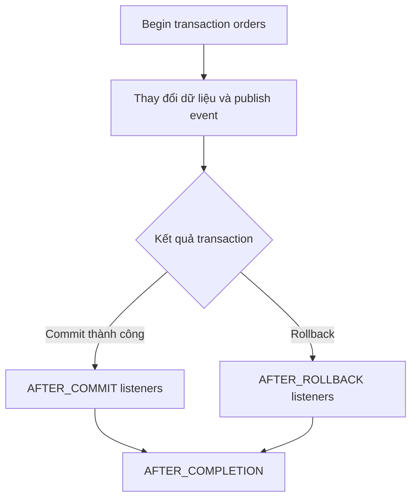

# Pha AFTER_ROLLBACK trong Transactional Event Listener của Spring Modulith

Một ứng dụng sử dụng Spring Modulith application events không chỉ cần phản ứng khi nghiệp vụ **commit thành công**, mà đôi khi còn cần nhận biết **transaction đã rollback**: ghi chỉ số vận hành, loại bỏ tài nguyên tạm ở bên ngoài database, đánh dấu một attempt thất bại trong hệ thống theo dõi độc lập hoặc thực hiện công việc bù trừ có kiểm soát.

Trong Spring Framework, `@TransactionalEventListener(phase = TransactionPhase.AFTER_ROLLBACK)` cho phép một listener phản ứng **sau khi transaction có chứa lần publish event kết thúc bằng rollback**. Đây là cơ chế thực thi callback theo vòng đời transaction; nó **không tự tạo transaction mới**, **không bảo đảm callback sẽ sống sót nếu JVM sập**, và **không có nghĩa mọi exception đều khiến callback chạy**.

Bài học thuộc chương **Transactional listener** của `SPRING_MODULITH_APPLICATION_EVENTS`. Trọng tâm là cách hiểu chính xác pha `AFTER_ROLLBACK`, thiết kế event và listener, phân biệt với `AFTER_COMMIT`, xử lý side effect, cấu hình transaction mới khi cần, các bẫy liên quan Event Publication Registry, retry/idempotency, kiểm thử và quan sát để giao tiếp giữa các module luôn rõ ranh giới nghiệp vụ.

> **Điểm nhớ quan trọng:** Pha `AFTER_ROLLBACK` nói lên **kết quả transaction nguồn**, không phải một bằng chứng bền vững rằng “một nghiệp vụ thất bại đã được ghi nhận”. Callback chỉ có cơ hội chạy khi event được publish trong transaction phù hợp và transaction đó thật sự rollback.

## 1. Khi nào cần dùng AFTER_ROLLBACK?

Giả sử module `orders` đang xử lý việc tạo đơn. Quy trình có thể gồm tạo dữ liệu trong database, ghi nhận ID attempt và publish event. Nếu transaction rollback, một vài tác vụ phụ trợ vẫn có thể cần biết để làm sạch tài nguyên hoặc đo thất bại.

Các trường hợp thường gặp:

| Nhu cầu | `AFTER_ROLLBACK` có phù hợp? | Vì sao |
| --- | --- | --- |
| Ghi một metric đếm lần transaction đặt hàng rollback | Có, nếu chấp nhận tính chất best-effort | Không cần ghi vào transaction nguồn đã hủy |
| Giải phóng tài nguyên tạm ngoài database do attempt vừa tạo | Có thể, nhưng cần cơ chế bù trừ bền vững nếu quan trọng | Callback sau rollback tránh cleanup khi commit thành công |
| Phát email “đơn hàng đã đặt thành công” | Không | Email này thuộc hậu quả `AFTER_COMMIT` |
| Ghi một bản ghi lịch sử lỗi **bắt buộc không được mất** | Không nên chỉ dựa vào callback | JVM có thể chết trước callback; ghi mới phải ở transaction riêng |
| Phát integration event “đặt hàng thất bại” với giao nhận bắt buộc | Cần thiết kế workflow/outbox riêng | Publication thuộc transaction đã rollback có thể không bền vững |
| Hủy thay đổi database đã nằm trong transaction nguồn | Không cần | Rollback của database đã hủy các thay đổi transaction đó |
| Gỡ một hold trên dịch vụ ngoài đã được tạo trước rollback | Có thể cần, nhưng nên ưu tiên workflow bù trừ có trạng thái | Side effect ngoài database không được rollback tự động |

Ví dụ dễ nhầm: nếu trong cùng transaction, code ghi `Order` rồi rollback, database đã tự hủy bản ghi `Order`. Listener `AFTER_ROLLBACK` **không cần và không nên** tiếp tục gọi `DELETE FROM orders`. Công việc sau rollback có ý nghĩa chủ yếu với **tài nguyên nằm ngoài transaction**, quan sát hoặc dữ liệu được ghi trong một transaction độc lập.

## 2. Các phase của TransactionalEventListener

Spring Framework cho phép ràng buộc việc xử lý event với nhiều thời điểm trong chu kỳ transaction:

| Phase | Thời điểm | Tình huống tiêu biểu |
| --- | --- | --- |
| `BEFORE_COMMIT` | Trước khi tiến hành commit | Công việc phải xảy ra trước khi commit, có thể ảnh hưởng kết quả |
| `AFTER_COMMIT` | Sau khi commit thành công; là mặc định | Tạo hóa đơn, gửi thông báo cho sự thật đã commit |
| `AFTER_ROLLBACK` | Sau khi rollback | Quan sát/công việc dọn dẹp liên quan transaction thất bại |
| `AFTER_COMPLETION` | Sau khi kết thúc, cả commit và rollback | Thu dọn hoặc đo thời gian không phụ thuộc kết quả |

`AFTER_ROLLBACK` và `AFTER_COMPLETION` **không giống nhau**. Nếu cần hành vi chỉ chạy khi thất bại, chọn `AFTER_ROLLBACK`. Nếu mọi kết quả đều cần cleanup, dùng `AFTER_COMPLETION`, đồng thời tránh suy ra transaction rollback từ việc callback chạy.

### Timeline commit so với rollback



Trong sơ đồ, listener theo phase chỉ xét các event được publish **trong transaction đang hoạt động** và không bật fallback tùy tiện. Không nên hiểu `publishEvent` là tín hiệu transaction đã kết thúc.

## 3. Public event nào nên được dùng cho rollback?

Để tránh tạo hợp đồng nghiệp vụ gây hiểu lầm, cần phân biệt:

- **Event sự thật đã commit**, ví dụ `OrderPlaced`: listener `AFTER_COMMIT` có thể dựa vào sự thật rằng đơn đã lưu.
- **Event mô tả attempt trong transaction**, ví dụ `OrderPlacementAttempted`: được phát khi xử lý attempt và có thể dùng với `AFTER_ROLLBACK` để biết attempt thuộc transaction bị hủy.
- **Event sự thật thất bại bền vững**, ví dụ `OrderPlacementFailed`: chỉ nên tuyên bố đã được ghi nhận khi hệ thống thực sự có một workflow/transaction riêng xác nhận và lưu được trạng thái thất bại.

Không nên đặt tên `OrderPlaced` rồi sử dụng listener `AFTER_ROLLBACK` để thông báo “đơn đã đặt”, vì sau rollback sự thật “đơn đã đặt” **không còn đúng**.

Ví dụ public event tối thiểu:

```java
// com.example.shop.orders.OrderPlacementAttempted.java
package com.example.shop.orders;

import java.time.Instant;
import java.util.UUID;

public record OrderPlacementAttempted(
        UUID attemptId,
        UUID correlationId,
        Instant attemptedAt
) {}
```

Event trên chỉ mang metadata an toàn, không chứa entity JPA mutable, transaction handle hoặc dữ liệu cá nhân. Nó diễn tả **một attempt được thực hiện**, không tuyên bố đơn đã được commit.

### Quyền sở hữu sự kiện vẫn thuộc module nghiệp vụ

Trong ứng dụng theo module:

```text
com.example.shop
├── ShopApplication.java
├── orders
│   ├── OrderPlacementAttempted.java
│   ├── OrderPlaced.java
│   └── internal
│       ├── PlaceOrderService.java
│       └── OrderRepository.java
├── operations
│   └── internal
│       └── OrderRollbackObserver.java
└── notifications
    └── internal
        └── OrderPlacedListener.java
```

`orders` quyết định attempt/đơn hợp lệ theo quy tắc của nó. Module `operations` có thể nghe public event để quan sát transaction thất bại; nó không import `orders.internal.OrderRepository`. Module `notifications` nghe `OrderPlaced` ở `AFTER_COMMIT` để gửi thông báo thành công.

Không nên tạo module “common-events” với toàn bộ domain logic chỉ để mọi nơi import cho tiện. Sự kiện thuộc module sở hữu sự thật hoặc có hợp đồng tích hợp được tách có chủ ý.

## 4. Publisher cần nằm trong transaction thực sự

Ví dụ public command:

```java
// com.example.shop.orders.PlaceOrder.java
package com.example.shop.orders;

import java.util.UUID;

public record PlaceOrder(UUID customerId, String sku, int quantity) {}
```

Application service:

```java
// com.example.shop.orders.internal.PlaceOrderService.java
package com.example.shop.orders.internal;

import com.example.shop.orders.OrderPlacementAttempted;
import com.example.shop.orders.PlaceOrder;
import java.time.Clock;
import java.time.Instant;
import java.util.UUID;
import org.springframework.context.ApplicationEventPublisher;
import org.springframework.stereotype.Service;
import org.springframework.transaction.annotation.Transactional;

@Service
class PlaceOrderService {

    private final OrderRepository orders;
    private final ApplicationEventPublisher publisher;
    private final Clock clock;

    PlaceOrderService(
            OrderRepository orders,
            ApplicationEventPublisher publisher,
            Clock clock) {
        this.orders = orders;
        this.publisher = publisher;
        this.clock = clock;
    }

    @Transactional
    public UUID place(PlaceOrder command) {
        UUID attemptId = UUID.randomUUID();

        // Attempt được đăng ký trong transaction hiện hành.
        publisher.publishEvent(new OrderPlacementAttempted(
                attemptId,
                UUID.randomUUID(),
                Instant.now(clock)
        ));

        // Order, OrderRepository cần hiện thực trong module orders.
        // Các lỗi persistence/validation sau đây có thể gây rollback.
        Order order = Order.place(
                command.customerId(),
                command.sku(),
                command.quantity()
        );

        orders.save(order);
        return order.id();
    }
}
```

Đoạn ví dụ dùng `Order`, `OrderRepository` và bean `Clock` giả định, cần bổ sung để chạy trong project thật. Nó chỉ minh họa **đăng ký event trong transaction trước khi biết kết quả cuối cùng**.

Khi `place(...)` được gọi qua Spring transactional proxy, Spring mở transaction và đăng ký callback cho listener phù hợp. Nếu transaction commit, listener `AFTER_ROLLBACK` **không được chạy**. Nếu transaction rollback sau khi event đã publish, callback `AFTER_ROLLBACK` mới được kích hoạt.

### Nếu lỗi xảy ra trước publish thì sao?

Listener không thể nhận một event **chưa từng được phát**. Ví dụ command bị validation từ chối ở controller trước khi vào `PlaceOrderService` thì không có publication để ràng buộc vào transaction. Nếu bắt buộc thống kê mọi request thất bại, hãy quan sát ở **boundary HTTP hoặc workflow ngoài transaction**, không kỳ vọng `AFTER_ROLLBACK` bao phủ tất cả lỗi nghiệp vụ.

### Nếu method trả về nhưng commit thất bại?

Transaction có thể thất bại ở thời điểm flush/commit sau khi method Java trả về. Khi transaction manager quyết định rollback và hoàn tất rollback, `AFTER_ROLLBACK` có thể được gọi với event đã đăng ký trong transaction đó. Nhưng nếu tiến trình chết trước callback, ứng dụng không có bảo đảm callback sẽ chạy.

## 5. Listener AFTER_ROLLBACK cơ bản

Ví dụ `operations` nhận `OrderPlacementAttempted` để ghi số liệu không yêu cầu lưu bền vững:

```java
// com.example.shop.operations.internal.OrderRollbackObserver.java
package com.example.shop.operations.internal;

import com.example.shop.orders.OrderPlacementAttempted;
import org.springframework.stereotype.Component;
import org.springframework.transaction.event.TransactionPhase;
import org.springframework.transaction.event.TransactionalEventListener;

@Component
class OrderRollbackObserver {

    private final RollbackMetrics metrics;

    OrderRollbackObserver(RollbackMetrics metrics) {
        this.metrics = metrics;
    }

    @TransactionalEventListener(phase = TransactionPhase.AFTER_ROLLBACK)
    void on(OrderPlacementAttempted event) {
        metrics.incrementOrderRollback();
    }
}
```

`RollbackMetrics` trong ví dụ là abstraction tự định nghĩa, chẳng hạn bean dùng Micrometer counter; không phải interface có sẵn của Spring Modulith.

**Ba đặc tính quan trọng:**

1. `@TransactionalEventListener` tự gắn handler với phase transaction; `AFTER_ROLLBACK` phải được chỉ rõ vì phase mặc định là `AFTER_COMMIT`.
2. Handler **không mặc định async**. Với transaction manager thông thường, nó có thể chạy trên thread đang hoàn tất rollback.
3. Một metric in-memory/best-effort có thể phù hợp, nhưng không phải nguồn dữ liệu đủ để lập báo cáo tài chính/kiểm toán bắt buộc.

Nếu callback chạy lâu hoặc gọi hệ thống ngoài chậm, nó vẫn có thể làm kéo dài thời gian kết thúc lời gọi transaction. Khi cần tách tải, hãy cân nhắc async có kiểm soát; async tự nó cũng không bảo đảm durability.

## 6. AFTER_ROLLBACK khác @EventListener và AFTER_COMMIT

| Annotation | Khi nào handler chạy? | Nếu transaction rollback? | Phù hợp với |
| --- | --- | --- | --- |
| `@EventListener` | Thông thường chạy ngay khi publish | Có thể đã chạy **trước** rollback | Xử lý nhẹ, có ý thức gắn với luồng publisher |
| `@Async @EventListener` | Worker có thể chạy ngay khi publish | Có thể chạy dù source rollback | Tác vụ không phụ thuộc sự thật đã commit |
| `@TransactionalEventListener` | Mặc định `AFTER_COMMIT` | Không chạy nếu rollback | Hậu quả của nghiệp vụ đã commit |
| `@TransactionalEventListener(phase = AFTER_ROLLBACK)` | Sau rollback | Chạy khi rollback thực sự xảy ra | Quan sát/dọn dẹp attempt bị hủy |
| `@TransactionalEventListener(phase = AFTER_COMPLETION)` | Sau commit hoặc rollback | Có | Công việc áp dụng cho cả hai kết quả |
| `@ApplicationModuleListener` | Theo thiết kế Spring Modulith: sau commit, async, transaction riêng | **Không phải** listener AFTER_ROLLBACK | Phản ứng liên module với sự thật đã commit |

`@ApplicationModuleListener` trong Spring Modulith là shortcut phù hợp với nhiều tác vụ sau commit. **Không nên thay nó cho `@TransactionalEventListener(phase = AFTER_ROLLBACK)`** chỉ vì muốn xử lý thất bại: bạn cần phase cụ thể và hợp đồng transaction tương ứng.

### Có nên tạo hai listener trên cùng event?

Nếu muốn đo cả kết quả commit và rollback của một attempt, có thể đăng ký hai method với phase khác nhau:

```java
@Component
class OrderAttemptOutcomeObserver {

    private final OrderAttemptMetrics metrics;

    OrderAttemptOutcomeObserver(OrderAttemptMetrics metrics) {
        this.metrics = metrics;
    }

    @TransactionalEventListener(phase = TransactionPhase.AFTER_COMMIT)
    void committed(OrderPlacementAttempted event) {
        metrics.incrementCommittedAttempts();
    }

    @TransactionalEventListener(phase = TransactionPhase.AFTER_ROLLBACK)
    void rolledBack(OrderPlacementAttempted event) {
        metrics.incrementRolledBackAttempts();
    }
}
```

Giả định import và các bean được đặt đúng package. Với **một** transaction kết thúc, chỉ một trong hai phase commit/rollback tương ứng được gọi; đó không phải lý do để nhận xét “listener được gọi hai lần”.

Lưu ý: nếu có nhiều event attempt được publish trong cùng transaction, **mỗi event** có thể kích hoạt callback, không nhất thiết tương ứng một transaction duy nhất. Đừng dùng số lần callback làm số transaction rollback nếu một transaction có thể publish nhiều attempt.

## 7. Rollback thực sự xảy ra khi nào?

Pha `AFTER_ROLLBACK` dựa trên **kết quả cuối cùng của transaction manager**, không dựa vào việc một method có ném exception hay không.

Các tình huống:

| Tình huống | Transaction cuối cùng | `AFTER_ROLLBACK` có chạy? |
| --- | --- | --- |
| Runtime exception thoát khỏi method `@Transactional` và áp dụng rollback mặc định | Rollback | Có, nếu event đã publish và callback đăng ký |
| Code gọi `TransactionStatus.setRollbackOnly()` | Rollback | Có |
| Code ném exception nhưng bắt và xử lý, không đánh dấu rollback | Có thể commit | Không, nếu cuối cùng commit |
| Checked exception thoát method, không có rule rollback phù hợp | Có thể commit theo cấu hình truyền thống | Không, nếu cuối cùng commit |
| Dữ liệu lỗi khiến commit/flush thất bại và transaction rollback | Rollback | Có, nếu callback đã được đăng ký và tiến trình còn chạy |
| Transaction commit thành công dù phía caller coi response là lỗi | Commit | Không |
| Không có transaction đang hoạt động khi publish | Không có phase rollback | Mặc định không |
| JVM bị kill trước khi Spring chạy callback | Không biết/callback có thể không chạy | Không được bảo đảm |

Spring `@Transactional` thường mặc định đánh dấu rollback đối với unchecked exceptions và `Error`; với checked exceptions, hành vi phụ thuộc rollback rules/version/cấu hình. Không dùng “có exception” làm tiêu chí thay thế trạng thái transaction.

### Rollback-only và UnexpectedRollbackException

Một method bên trong có thể đánh dấu transaction **rollback-only**, trong khi method ngoài bắt exception rồi tiếp tục:

```text
outerMethod()       // @Transactional
  -> innerMethod()  // cùng physical transaction, đánh dấu rollback-only
  -> bắt exception hoặc bỏ qua
  -> outerMethod() trả về
transaction manager -> rollback
caller có thể nhận UnexpectedRollbackException
AFTER_ROLLBACK callback -> chạy sau kết quả rollback
```

Nếu event đã publish trong transaction này, listener vẫn phản ứng theo kết quả rollback. Việc method ngoài trả về bình thường không chứng minh commit đã thành công.

### REQUIRES_NEW và NESTED không giống nhau

- `REQUIRES_NEW` mở một **physical transaction riêng**: event được publish trong transaction đó sẽ gắn với kết quả của transaction riêng, không tự gắn với outer transaction.
- `NESTED` thường dùng savepoint trong cùng physical transaction khi transaction manager hỗ trợ: rollback về savepoint **không tương đương** rollback toàn bộ physical transaction và không nhất thiết kích hoạt `AFTER_ROLLBACK`.
- Khi application cần phản ứng riêng với rollback của một savepoint, phải hiểu lifecycle/savepoint support của transaction manager; không kỳ vọng listener phase `AFTER_ROLLBACK` hoạt động như một listener riêng cho mọi nested block.

Đây là một trong những chỗ dễ mắc lỗi nhất khi code có nhiều lớp service.

## 8. Ghi dữ liệu sau rollback: bắt buộc xem xét transaction mới

Theo tài liệu Spring Framework, ngay sau commit hoặc rollback, transaction resources (như JDBC connection hay persistence context) **có thể vẫn còn được gắn với thread** trong lúc chạy completion callback. Nếu handler truy cập database tại thời điểm này, nó có thể vẫn tham gia ngữ cảnh tài nguyên cũ nhưng **không có commit mới**, làm thao tác ghi không được lưu như mong đợi.

Vì vậy, nếu cần lưu một bản ghi lỗi sau rollback, hãy gọi một **bean riêng** dùng `@Transactional(propagation = Propagation.REQUIRES_NEW)`.

```java
// com.example.shop.operations.internal.RollbackAuditService.java
package com.example.shop.operations.internal;

import com.example.shop.orders.OrderPlacementAttempted;
import org.springframework.stereotype.Service;
import org.springframework.transaction.annotation.Propagation;
import org.springframework.transaction.annotation.Transactional;

@Service
class RollbackAuditService {

    private final RollbackAuditRepository repository;

    RollbackAuditService(RollbackAuditRepository repository) {
        this.repository = repository;
    }

    @Transactional(propagation = Propagation.REQUIRES_NEW)
    public void record(OrderPlacementAttempted event) {
        // Repository/record là các type tự định nghĩa.
        repository.save(RollbackAuditRecord.from(event));
    }
}
```

Listener gọi service:

```java
// com.example.shop.operations.internal.PersistRollbackObserver.java
package com.example.shop.operations.internal;

import com.example.shop.orders.OrderPlacementAttempted;
import org.springframework.stereotype.Component;
import org.springframework.transaction.event.TransactionPhase;
import org.springframework.transaction.event.TransactionalEventListener;

@Component
class PersistRollbackObserver {

    private final RollbackAuditService audit;

    PersistRollbackObserver(RollbackAuditService audit) {
        this.audit = audit;
    }

    @TransactionalEventListener(phase = TransactionPhase.AFTER_ROLLBACK)
    void on(OrderPlacementAttempted event) {
        audit.record(event); // Transaction độc lập, có commit của chính nó.
    }
}
```

Nếu dùng cả metric và audit listener theo hai ví dụ, chúng thực hiện hai trách nhiệm khác nhau; không nên cấu hình hai listener cùng ghi một audit record nếu không có chủ ý/idempotency.

**Chú ý:** `REQUIRES_NEW` giúp thao tác ghi có một transaction mới **khi listener thật sự chạy**. Nó **không giải quyết** tình huống JVM chết trước callback, lỗi network lúc ghi audit, hoặc trường hợp event chưa được publish.

### Vì sao tự gọi method `@Transactional` không đủ?

Spring AOP proxy mặc định không áp dụng transaction advice khi một bean gọi `this.record(...)` cho method của chính nó. Đặt transaction trên **service khác và gọi qua Spring-managed bean** là cách rõ ràng để bảo đảm `REQUIRES_NEW` có hiệu lực.

### Nếu audit bắt buộc tồn tại dù rollback xảy ra?

Không dùng listener `AFTER_ROLLBACK` như nguồn ghi audit duy nhất. Cần một **transaction độc lập** để ghi attempt trước/sau khi xử lý theo policy nghiệp vụ, hoặc một workflow/job bền vững có trạng thái attempt, trạng thái thất bại và cơ chế phục hồi. Thiết kế này có chi phí và ngữ nghĩa khác, nhưng tránh phụ thuộc vào callback bộ nhớ khi tiến trình gặp lỗi nặng.

## 9. Tính bền vững: Event Publication Registry có bảo đảm AFTER_ROLLBACK không?

Spring Modulith **Event Publication Registry** ghi nhận các publication cho transactional listeners theo cơ chế tích hợp. Trong cấu hình persistence thông dụng, việc ghi publication diễn ra **trong transaction nghiệp vụ nguồn**, nhằm bảo đảm event của nghiệp vụ commit có thể được xử lý sau commit và phục hồi nếu listener thất bại.

Đây là khác biệt quan trọng khi nói đến `AFTER_ROLLBACK`:

**Nếu publication record được ghi trong cùng transaction nguồn, khi transaction đó rollback thì publication record cũng bị rollback.** Vì vậy không thể mặc nhiên coi registry là kho lưu bền vững các notification/công việc `AFTER_ROLLBACK`. Dù listener có thể được gọi khi Spring chạy completion callback, không nên giả định có một publication còn tồn tại để retry sau restart.

| Tình huống | Điều có thể kết luận |
| --- | --- |
| Transaction nguồn commit | Publication lưu cùng transaction có thể bền vững và được theo dõi theo registry đã cấu hình |
| Transaction nguồn rollback | Publication lưu trong cùng transaction nguồn cũng không còn |
| Listener `AFTER_ROLLBACK` thực thi ngay trong JVM và thành công | Side effect có thể xảy ra; không có nghĩa tồn tại dấu ghi bền vững của event trong registry |
| JVM crash sau rollback nhưng trước callback | Không thể dựa vào in-memory callback để khôi phục |
| Side effect từ rollback cần bắt buộc thực hiện sau restart | Cần workflow/compensation/outbox/attempt record **ở transaction độc lập** |

Registry có thể nhận diện transactional listener theo cấu hình framework, nhưng **việc có listener được nhận diện không biến một record đã rollback thành record bền vững**. Cần kiểm tra implementation, version và transaction boundary trước khi đưa ra cam kết vận hành.

### Sự khác biệt với AFTER_COMMIT

Với `AFTER_COMMIT`, một registry được cấu hình đúng có cơ sở lưu những publication trong transaction nguồn **đã commit** và đánh dấu completed sau khi listener thành công; những publication chưa hoàn thành có thể phục hồi theo API/chính sách.

Với `AFTER_ROLLBACK`, transaction nguồn **không commit được publication record ấy**. Do đó, nếu yêu cầu “không mất thông tin thất bại” có ý nghĩa nghiệp vụ, phải thiết kế luồng **độc lập với transaction đã hủy** thay vì áp dụng máy móc mô hình `AFTER_COMMIT`.

## 10. Dọn dẹp và bù trừ sau rollback: giới hạn của callback

Một tình huống phức tạp là ứng dụng giữ hàng trên hệ thống ngoài, sau đó transaction database đặt hàng rollback. Hold ngoài database có thể vẫn tồn tại.

Một callback `AFTER_ROLLBACK` có thể yêu cầu giải phóng hold:

```java
// Pseudocode: cần định nghĩa ExternalReservationClient và chính sách retry.
@TransactionalEventListener(phase = TransactionPhase.AFTER_ROLLBACK)
void releaseRemoteHold(OrderPlacementAttempted event) {
    reservationClient.releaseIfHeld(event.attemptId());
}
```

Nhưng đây chỉ là **best-effort compensation**:

1. JVM có thể chết trước callback.
2. Kết nối tới hệ thống ngoài có thể lỗi.
3. Lệnh giải phóng có thể thành công ở phía ngoài nhưng timeout ở phía ứng dụng.
4. Callback có thể được đăng ký nhiều lần hoặc được gọi trong các luồng khác; release cần idempotent.
5. Không nên để callback phụ thuộc vào entity/row đã bị rollback trong database.

Với hold/tiền thực/nguồn lực cần độ tin cậy cao, nên dùng **workflow bền vững/Saga/compensation coordinator**:

- Lưu một attempt/operation record trong transaction độc lập trước khi gọi dịch vụ ngoài.
- Đặt trạng thái như `RESERVING`, `RESERVED`, `RELEASE_PENDING`, `RELEASED`.
- Dùng một worker đáng tin cậy với retry/backoff và khóa idempotency để giải phóng.
- Cho phép reconciliation định kỳ với hệ thống ngoài để phát hiện hold bị kẹt.
- Ghi log và cảnh báo khi compensation không thể hoàn tất.

Không nhầm callback sau rollback với **distributed transaction**. Transaction của database ứng dụng không tự rollback API HTTP, email, payment hoặc broker.

## 11. @Async với AFTER_ROLLBACK

Nếu listener rollback gọi dịch vụ chậm, bạn có thể cân nhắc bất đồng bộ:

```java
// com.example.shop.operations.internal.AsyncRollbackObserver.java
package com.example.shop.operations.internal;

import com.example.shop.orders.OrderPlacementAttempted;
import org.springframework.scheduling.annotation.Async;
import org.springframework.stereotype.Component;
import org.springframework.transaction.event.TransactionPhase;
import org.springframework.transaction.event.TransactionalEventListener;

@Component
class AsyncRollbackObserver {

    private final RollbackAuditService audit;

    AsyncRollbackObserver(RollbackAuditService audit) {
        this.audit = audit;
    }

    @Async("rollbackEventsExecutor")
    @TransactionalEventListener(phase = TransactionPhase.AFTER_ROLLBACK)
    void on(OrderPlacementAttempted event) {
        audit.record(event);
    }
}
```

Ví dụ giả định ứng dụng đã bật async execution qua `@EnableAsync`, có executor `rollbackEventsExecutor` và `RollbackAuditService` mở transaction `REQUIRES_NEW`. Kết hợp annotation chỉ **lên lịch công việc sau rollback** rồi chạy trên worker; không đảm bảo callback được lên lịch thành công khi executor đầy hay JVM sập.

### Thread context không tự được kế thừa

Spring thread-bound transaction không tự truyền sang async worker. MDC, trace context, `SecurityContext` và request-scoped bean cũng không mặc nhiên được sao chép. Cần:

- Đưa `attemptId`, `correlationId`, loại nghiệp vụ và thời điểm vào immutable event.
- Không chuyền entity lazy-loaded hoặc connection của transaction vừa rollback.
- Dùng tích hợp context propagation phù hợp nếu cần tracing.
- Tránh phụ thuộc identity của HTTP request thread để cho worker quyền thực hiện side effect nhạy cảm.
- Theo dõi executor queue, rejection, processing time và lỗi handler.

Nếu sự kiện rollback mang thông tin nhạy cảm, đừng đưa toàn bộ vào logs hoặc một event nội bộ có nhiều subscriber chỉ để hỗ trợ debugging.

### Exception của callback có làm đảo ngược rollback không?

Không. Khi `AFTER_ROLLBACK` chạy, transaction nguồn đã rollback. Exception trong callback **không thể phục hồi** dữ liệu đã rollback. Nó có thể được log hoặc truyền qua hạ tầng completion/async tùy cấu hình, nhưng không có transaction nguồn để “rollback lần nữa”.

Nếu callback quan trọng, phải có quản lý lỗi độc lập và cơ chế recovery bền vững; chỉ để exception bị log không tạo bảo đảm vận hành.

## 12. Publish ngoài transaction và fallbackExecution

Theo mặc định, `@TransactionalEventListener` **không chạy** nếu event được publish mà không có transaction đang hoạt động:

```java
@TransactionalEventListener(
    phase = TransactionPhase.AFTER_ROLLBACK
)
void on(OrderPlacementAttempted event) {
    // Không chạy khi publish không có transaction.
}
```

Spring cho phép `fallbackExecution = true`:

```java
@TransactionalEventListener(
    phase = TransactionPhase.AFTER_ROLLBACK,
    fallbackExecution = true
)
void on(OrderPlacementAttempted event) {
    // Nếu không có transaction, có thể được gọi theo fallback.
}
```

Tuy nhiên, **fallback không có nghĩa rollback đã xảy ra**. Khi không có transaction, listener được phép thực thi theo đường fallback chứ không phải vì Spring quan sát thấy kết quả rollback. Đối với logic bù trừ hoặc audit “chỉ khi rollback”, việc bật fallback là **nguy hiểm về mặt ngữ nghĩa**; thường nên để mặc định `false`.

### Chẩn đoán listener không chạy

Nếu đã có `@Transactional` mà `AFTER_ROLLBACK` không chạy, hãy kiểm tra:

1. Method publish có thực sự thực thi trong transaction được quản lý bởi Spring không?
2. Lời gọi `@Transactional` có đi qua proxy hay là self-invocation?
3. Event có được publish **trước khi transaction kết thúc** không?
4. Transaction cuối cùng **commit hay rollback**?
5. Có callback được đăng ký cho đúng event type hay chưa?
6. Có async executor bị từ chối task hoặc application context shutdown không?
7. Exception có bị catch mà không đánh dấu rollback-only không?
8. Có dùng transaction propagation khác khiến event gắn với transaction không như mong đợi không?

Việc một method ném exception **không đủ** để kết luận transaction đã rollback.

## 13. Kiểm thử AFTER_ROLLBACK bằng TransactionTemplate

Để kiểm chứng phase, cách rõ ràng nhất là điều khiển transaction thật bằng `TransactionTemplate`. Đừng chỉ gọi trực tiếp `listener.on(event)`: lời gọi Java trực tiếp **bỏ qua** cơ chế đăng ký và điều kiện phase của Spring.

### 13.1. Test observer đơn giản

Tạo một bean test đếm event rollback:

```java
// com.example.shop.testing.RollbackProbe.java
package com.example.shop.testing;

import com.example.shop.orders.OrderPlacementAttempted;
import java.util.concurrent.atomic.AtomicInteger;
import org.springframework.stereotype.Component;
import org.springframework.transaction.event.TransactionPhase;
import org.springframework.transaction.event.TransactionalEventListener;

@Component
class RollbackProbe {

    private final AtomicInteger rollbacks = new AtomicInteger();

    @TransactionalEventListener(phase = TransactionPhase.AFTER_ROLLBACK)
    void on(OrderPlacementAttempted event) {
        rollbacks.incrementAndGet();
    }

    int count() {
        return rollbacks.get();
    }

    void reset() {
        rollbacks.set(0);
    }
}
```

Đây là test helper, không phải component nên dùng làm audit bền vững. Việc sử dụng `AtomicInteger` phù hợp với test đồng bộ; nếu listener chạy async, cần chờ theo điều kiện với timeout.

### 13.2. Rollback phải gọi listener; commit thì không

```java
// com.example.shop.testing.RollbackPhaseTest.java
package com.example.shop.testing;

import static org.assertj.core.api.Assertions.assertThat;

import com.example.shop.orders.OrderPlacementAttempted;
import java.time.Instant;
import java.util.UUID;
import org.junit.jupiter.api.BeforeEach;
import org.junit.jupiter.api.Test;
import org.springframework.beans.factory.annotation.Autowired;
import org.springframework.boot.test.context.SpringBootTest;
import org.springframework.context.ApplicationEventPublisher;
import org.springframework.transaction.PlatformTransactionManager;
import org.springframework.transaction.support.TransactionTemplate;

@SpringBootTest
class RollbackPhaseTest {

    @Autowired PlatformTransactionManager transactionManager;
    @Autowired ApplicationEventPublisher publisher;
    @Autowired RollbackProbe probe;

    @BeforeEach
    void reset() {
        probe.reset();
    }

    @Test
    void rollbackTriggersListener() {
        TransactionTemplate tx = new TransactionTemplate(transactionManager);

        tx.executeWithoutResult(status -> {
            publisher.publishEvent(event());
            status.setRollbackOnly();
        });

        assertThat(probe.count()).isEqualTo(1);
    }

    @Test
    void commitDoesNotTriggerRollbackListener() {
        TransactionTemplate tx = new TransactionTemplate(transactionManager);

        tx.executeWithoutResult(status -> {
            publisher.publishEvent(event());
            // Không setRollbackOnly, kết thúc bình thường -> commit.
        });

        assertThat(probe.count()).isZero();
    }

    private static OrderPlacementAttempted event() {
        return new OrderPlacementAttempted(
                UUID.randomUUID(),
                UUID.randomUUID(),
                Instant.now()
        );
    }
}
```

Test giả định Spring Boot test context có transaction manager thật, component `RollbackProbe` được component-scan, application module event contract có sẵn, và các test không chạy cạnh tranh cùng probe. Để test code thực tế, nên sử dụng database test phù hợp và không cho test framework tự mở một outer transaction rollback ngoài dự kiến.

**Không dùng `@Transactional` mặc định ở test method** khi cần kiểm thử cả commit và rollback rõ ràng, vì một số test framework tự rollback sau mỗi test. Điều đó có thể làm kết quả quan sát listener không như mong đợi.

### 13.3. Những test không thể bỏ qua

| Case | Kết quả kỳ vọng |
| --- | --- |
| Publish trong transaction rồi `setRollbackOnly()` | `AFTER_ROLLBACK` chạy |
| Publish trong transaction và commit | `AFTER_ROLLBACK` không chạy |
| Publish ngoài transaction, mặc định fallback `false` | Listener không chạy |
| Checked exception không làm transaction rollback theo cấu hình | Không chạy nếu cuối cùng commit |
| Runtime exception thực sự dẫn tới rollback | Listener chạy nếu đã publish và callback còn được thực thi |
| Event chưa publish trước khi lỗi | Listener không thể nhận |
| `REQUIRES_NEW` rollback trong khi outer transaction commit | Callback gắn với transaction nội bộ nếu event publish trong đó |
| Listener ghi DB qua `REQUIRES_NEW` | Audit record tồn tại sau rollback nguồn |
| JVM crash trước callback | Không giả định registry tự có publication durable |
| Async executor từ chối task | Không được coi side effect đã hoàn thành |
| Compensation được gọi hai lần | Không gây giải phóng/tác vụ ngoài trùng nguy hiểm |

### 13.4. Kiểm thử việc lưu audit độc lập

Một integration test tốt cho `RollbackAuditService`:

1. Tạo event với `attemptId` xác định.
2. Mở transaction nguồn và publish event.
3. Đánh dấu rollback-only rồi kết thúc transaction.
4. Truy vấn `RollbackAuditRecord` trong **transaction mới** hoặc sau callback.
5. Xác minh attempt được lưu, dù dữ liệu đơn trong transaction nguồn không tồn tại.
6. Kiểm tra unique constraint/idempotency khi callback được gọi lại.

Test này chứng minh **khi callback chạy thì ghi dữ liệu trong transaction mới hoạt động**. Nó vẫn không chứng minh callback sống sót qua JVM crash; yêu cầu đó phải được bảo đảm bởi thiết kế workflow bền vững.

## 14. Quan sát và tracing sự kiện rollback

Khi cần điều tra đơn không được tạo, phải phân biệt:

- HTTP request bị từ chối trước transaction.
- Validation trong use case thất bại và transaction rollback.
- Transaction bị đánh dấu rollback-only ở method bên trong.
- Commit/flush thất bại ở database.
- Transaction rollback thành công, callback `AFTER_ROLLBACK` chạy và hoàn tất.
- Transaction rollback nhưng callback phụ trợ thất bại hoặc không được lên lịch.

Một log cấu trúc **do ứng dụng tự định nghĩa**, không phải định dạng mặc định của Spring Modulith:

```json
{
  "eventType": "OrderPlacementAttempted",
  "attemptId": "81d61dc5-4f96-44bf-8b82-4b8045f674a3",
  "sourceModule": "orders",
  "listener": "operations.OrderRollbackObserver",
  "transactionPhase": "AFTER_ROLLBACK",
  "correlationId": "06f3e367-fb5e-429d-ab9d-f91df419416e",
  "callbackOutcome": "COMPLETED"
}
```

Log `callbackOutcome = COMPLETED` chỉ nói callback được thực thi, không chứng minh một tác vụ ngoại vi đã thành công hoặc được gửi đúng một lần.

Các chỉ số hữu ích:

| Chỉ số | Diễn giải |
| --- | --- |
| Tổng số transaction rollback theo use case | Phát hiện lỗi nghiệp vụ/DB tăng đột biến |
| Số rollback callback được thực thi | Phân biệt số lần event publish với số transaction |
| Thời gian chạy rollback callback | Callback kéo dài việc kết thúc request |
| Số lần ghi audit thất bại | Đánh giá phụ thuộc vào DB riêng |
| Số compensation pending/failed | Cảnh báo tài nguyên ngoài chưa được giải phóng |
| Độ trễ hoàn tất compensation | Phân tích eventual consistency sau rollback |
| Số bản ghi attempt cần reconciliation | Phát hiện crash window và thiếu callback |

Không ghi thông tin thanh toán, dữ liệu khách hàng nhạy cảm hoặc nguyên request body vào event/log chỉ vì muốn debug.

## 15. Anti-pattern khi dùng AFTER_ROLLBACK

| Sai lầm | Hậu quả | Cách sửa |
| --- | --- | --- |
| Xem `AFTER_ROLLBACK` như `AFTER_COMMIT` | Gửi thông báo thành công cho transaction thất bại | Chọn phase theo sự thật nghiệp vụ |
| Dùng `@ApplicationModuleListener` để bắt rollback | Listener này chủ yếu dành cho sau commit | Dùng `@TransactionalEventListener(phase = AFTER_ROLLBACK)` |
| Cho rằng cứ ném exception là rollback | Transaction có thể commit theo rollback rules | Kiểm tra transaction outcome thật |
| Publish event sau khi transaction đã kết thúc | Không có callback gắn với transaction nguồn | Publish trong transaction đang hoạt động |
| Ghi audit DB trực tiếp trong callback sau rollback mà không có transaction mới | Có thể không có commit mới | Gọi service `REQUIRES_NEW` qua Spring proxy |
| Chỉ cần registry là lưu được mọi event rollback | Publication cùng transaction nguồn bị rollback | Thiết kế audit/workflow ở transaction độc lập |
| Callback gửi lệnh release đến API ngoài mà không có retry/reconciliation | JVM crash hoặc network lỗi làm hold bị kẹt | Saga/workflow bền vững, idempotency |
| Bật `fallbackExecution = true` cho listener chỉ được chạy khi rollback | Handler có thể chạy khi không có rollback | Giữ fallback mặc định `false` |
| Lấy entity JPA đã rollback làm đầu vào callback | Entity/state không còn đáng tin hoặc không tồn tại | Dùng immutable event metadata |
| Tin rằng callback sau rollback không làm tăng latency | Listener sync vẫn có thể chạy trên completion thread | Giữ nhẹ, cân nhắc async có quản lý |
| Dùng `NESTED` savepoint rollback như physical rollback | Callback không chạy theo kỳ vọng | Hiểu propagation/savepoint semantics |
| Ghi log lỗi rồi coi compensation hoàn tất | Side effect ngoài chưa thành công | Theo dõi trạng thái và cơ chế recovery thực sự |

## 16. Bài tập tự đánh giá

### Bài tập A — Phân biệt phase

Có `OrderPlacementAttempted` được publish trong transaction, sau đó transaction kết thúc theo ba cách:

1. Transaction commit thành công.
2. Transaction rollback do `setRollbackOnly()`.
3. Không có transaction từ lúc publish.

Listener được khai báo:

```java
@TransactionalEventListener(phase = TransactionPhase.AFTER_ROLLBACK)
void on(OrderPlacementAttempted event) {
    rollbackMetrics.increment();
}
```

**Câu hỏi:** listener chạy trong trường hợp nào? Nếu bật `fallbackExecution=true` thì câu trả lời cho trường hợp 3 mang ý nghĩa gì?

### Bài tập B — Ghi audit sau rollback

Một listener `AFTER_ROLLBACK` gọi trực tiếp repository để lưu bản ghi lỗi, nhưng không thấy dữ liệu sau khi callback kết thúc.

**Câu hỏi:** tại sao? Nên sửa ranh giới transaction thế nào? Cách sửa đó có bảo đảm audit không mất khi JVM chết trước callback không?

### Bài tập C — Hủy hold bên ngoài

Một application service gọi dịch vụ tồn kho ngoài để giữ hàng, sau đó transaction `orders` rollback. Listener `AFTER_ROLLBACK` gửi lệnh hủy hold.

**Câu hỏi:** nếu ứng dụng crash trước callback hoặc phía tồn kho timeout sau khi nhận lệnh, giải pháp chỉ có callback có đủ đáng tin cậy không? Hãy đề xuất thiết kế workflow bảo vệ tài nguyên.

<details>
<summary>Gợi ý lời giải</summary>

**A:** Listener chạy trong trường hợp 2. Nó không chạy khi commit (1) và mặc định không chạy nếu không có transaction (3). Nếu bật fallback, callback có thể chạy ở trường hợp 3 dù **không hề có rollback**, nên không phù hợp với ý nghĩa “chỉ khi rollback”.

**B:** Tài nguyên transaction cũ có thể còn gắn với thread sau rollback, nhưng không còn commit mới cho thao tác ghi. Nên delegate tới một bean khác với `@Transactional(propagation = REQUIRES_NEW)`. Điều này giúp commit audit khi callback thực thi, **không** bảo đảm callback sống qua crash; cần workflow/attempt record bền vững nếu audit bắt buộc.

**C:** Không đủ. Cần lưu attempt ngoài transaction nguồn, trạng thái hold/release, worker có retry/backoff, idempotency key và reconciliation với hệ thống tồn kho. Callback `AFTER_ROLLBACK` có thể là tín hiệu tối ưu, nhưng không phải đường phục hồi duy nhất.

</details>

## 17. Ghi nhớ

- `@TransactionalEventListener(phase = AFTER_ROLLBACK)` chạy sau khi **transaction nguồn thật sự rollback**, với điều kiện event được publish trong transaction phù hợp.
- **Exception ≠ rollback**. Phải dựa vào kết quả transaction manager; checked exception, catch exception và rollback-only có thể tạo kết quả khác dự đoán ban đầu.
- `AFTER_ROLLBACK` khác `AFTER_COMMIT` (mặc định) và `AFTER_COMPLETION` (mọi kết quả). `@ApplicationModuleListener` trong Spring Modulith phục vụ chủ yếu luồng **sau commit**, không thay phase rollback.
- Callback sau rollback **không tự async**, không tự mở transaction mới và không tự bảo đảm durability; với thao tác ghi DB nên dùng service có `REQUIRES_NEW`.
- Event Publication Registry thường ghi publication trong transaction nguồn. **Nếu transaction đó rollback, publication record cũng bị rollback**, nên không giả định registry sẽ phục hồi các callback rollback bị lỡ.
- Với compensation/audit quan trọng, cần workflow bền vững, retry, idempotency và reconciliation. Callback rollback là một mắt xích, **không phải** giao dịch phân tán.
- Test phải kiểm chứng commit/rollback thực bằng `TransactionTemplate`, test callback và audit transaction mới, đồng thời quan sát các trạng thái failure/compensation.

**Tài liệu tham khảo chính thức:**

- [Spring Framework — Transaction-bound Events](https://docs.spring.io/spring-framework/reference/data-access/transaction/event.html)
- [Spring Framework — TransactionalEventListener API](https://docs.spring.io/spring-framework/docs/current/javadoc-api/org/springframework/transaction/event/TransactionalEventListener.html)
- [Spring Framework — TransactionSynchronization và afterCompletion](https://docs.spring.io/spring-framework/docs/current/javadoc-api/org/springframework/transaction/support/TransactionSynchronization.html)
- [Spring Modulith — Working with Application Events và Event Publication Registry](https://docs.spring.io/spring-modulith/reference/events.html)
- [Spring Modulith — Module Fundamentals](https://docs.spring.io/spring-modulith/reference/fundamentals.html)
- [Spring Modulith — Testing Application Modules](https://docs.spring.io/spring-modulith/reference/testing.html)
