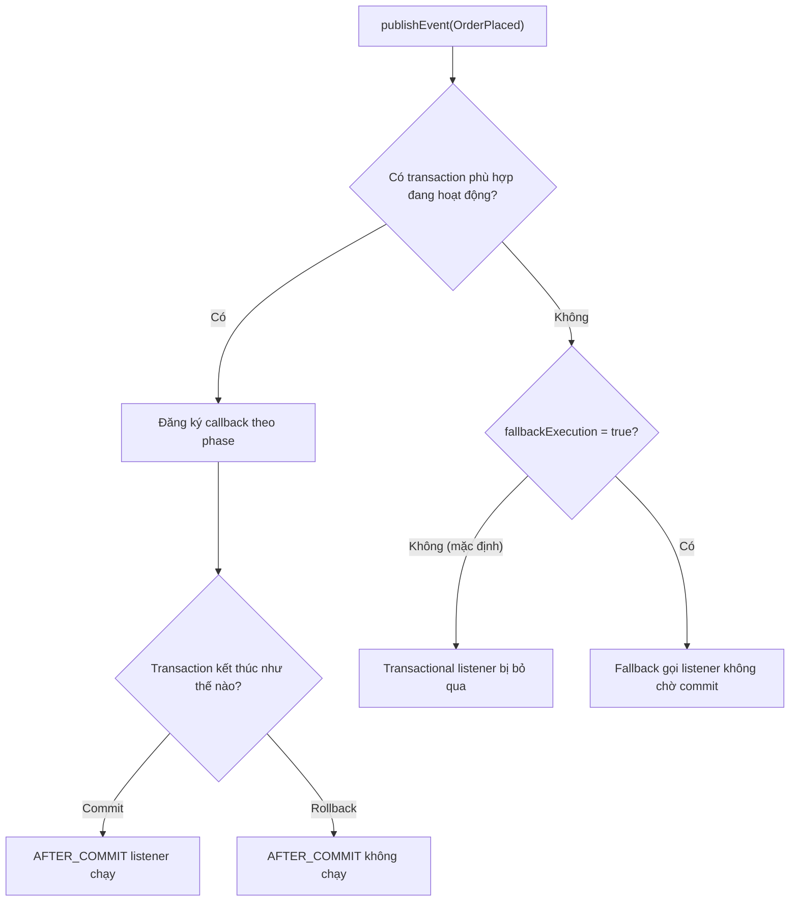

# Không có transaction: transactional event listener có chạy không?

## 1. Bài toán: đã publish nhưng listener không phản ứng

Trong **SPRING_MODULITH_APPLICATION_EVENTS**, các module Spring Modulith dùng application events để giao tiếp mà không phụ thuộc vào implementation của nhau. Chẳng hạn, module `orders` phát `OrderPlaced`, module `notifications` gửi email và module `reporting` cập nhật báo cáo. Các tác vụ phụ thường phải chạy **sau khi dữ liệu nghiệp vụ commit thành công**, tránh gửi email xác nhận cho một đơn hàng đã rollback.

Spring cung cấp `@TransactionalEventListener` để gắn thời điểm gọi listener với vòng đời transaction. Tuy nhiên, có một trường hợp dễ gây nhầm lẫn:

**Nếu sự kiện được publish mà không có transaction phù hợp đang hoạt động, `@TransactionalEventListener` mặc định không xử lý sự kiện đó.**

Ví dụ, method có `@TransactionalEventListener` không được gọi mặc dù `ApplicationEventPublisher.publishEvent(...)` đã chạy không báo lỗi. Người phát nhìn thấy log “published”, còn người nhận không có log, exception hay bản ghi xử lý.

Đây không phải chuyện “Spring làm rơi một event ngẫu nhiên”: nếu không có transaction, framework không thể xác định thời điểm `AFTER_COMMIT` hoặc `AFTER_ROLLBACK` của transaction đó. Việc bỏ qua sự kiện là một phần của **semantics mặc định**. Bài học này tập trung vào cách nhận biết, lựa chọn `fallbackExecution`, sửa ranh giới giao dịch và kiểm thử để không gây mất tác dụng phụ nghiệp vụ.

## 2. Vì sao `@TransactionalEventListener` cần transaction?

`@TransactionalEventListener` là biến thể transaction-aware của `@EventListener`. Nó cho phép method được gọi khi transaction đạt một giai đoạn nhất định:

| `TransactionPhase` | Ý nghĩa khi transaction hợp lệ tồn tại |
| --- | --- |
| `BEFORE_COMMIT` | Gọi trước khi transaction commit; vẫn có khả năng commit thất bại hoặc rollback |
| `AFTER_COMMIT` | Gọi sau khi transaction commit thành công; **mặc định** khi không khai báo `phase` |
| `AFTER_ROLLBACK` | Gọi sau khi transaction rollback |
| `AFTER_COMPLETION` | Gọi sau khi transaction kết thúc, bất kể commit hay rollback |

Framework dùng cơ chế synchronization với transaction để đăng ký callback cho listener. Một listener với `phase = AFTER_COMMIT` không đơn giản là “chạy sau dòng `publishEvent(...)`”; nó phải biết **transaction nào commit**.

Khi không có transaction thích hợp, các pha này **không tồn tại để chờ**. Mặc định listener bỏ qua event, trừ khi người lập trình chủ động bật `fallbackExecution = true`.



Sơ đồ đang xét **`AFTER_COMMIT`** và cách dùng transaction trên thread thông thường. Với những pha khác, callback tương ứng được kích hoạt theo bảng trên. Fallback không giả lập một lần commit: nó chỉ cho phép xử lý event dù không có transaction.

## 3. So sánh khi publish không có transaction

Giả sử một event được phát từ method **không có transaction đang hoạt động**, và ứng dụng dùng multicaster mặc định đồng bộ, không có cấu hình bất đồng bộ khác:

| Cách khai báo listener | Phản ứng khi publish ngoài transaction | Điều cần nhớ |
| --- | --- | --- |
| `@EventListener` | Chạy ngay theo cơ chế dispatch thông thường | Không đợi commit; có thể xảy ra side effect trước khi giao dịch ở nơi khác hoàn tất |
| `@TransactionalEventListener` | **Không chạy** | Mặc định `phase = AFTER_COMMIT` và `fallbackExecution = false` |
| `@TransactionalEventListener(fallbackExecution = true)` | Chạy theo đường fallback | Không có transaction để đợi; có thể chạy tại thời điểm publish |
| `@Async @EventListener` | Được đưa sang executor theo cấu hình async | Không tự đảm bảo sau commit hay độ bền |
| `@Async @TransactionalEventListener` | Mặc định vẫn không chạy nếu event không có transaction | `@Async` không tự tạo transaction cho publisher |
| `@ApplicationModuleListener` | Theo semantics transactional mặc định, không dùng để nhận mọi event ngoài transaction | Không mặc định bật fallback; cần kiểm tra context phát |

Ngay cả khi listener chạy, điều đó không có nghĩa việc gửi email hay cập nhật hệ thống ngoài sẽ thành công. Phát event trong cùng JVM **không mặc nhiên là durable queue hoặc message broker**.

## 4. Ví dụ tối thiểu tái hiện hiện tượng

### 4.1. Event contract thuộc API của module phát

```java
// com/example/shop/orders/OrderPlaced.java
package com.example.shop.orders;

import java.time.Instant;
import java.util.Objects;
import java.util.UUID;

public record OrderPlaced(
        UUID eventId,
        UUID orderId,
        Instant occurredAt
) {
    public OrderPlaced {
        Objects.requireNonNull(eventId, "eventId");
        Objects.requireNonNull(orderId, "orderId");
        Objects.requireNonNull(occurredAt, "occurredAt");
    }
}
```

`eventId` định danh một sự kiện để đối chiếu và hỗ trợ chống trùng khi retry; `orderId` định danh đơn hàng. Kiểu event nằm trong API công khai của module `orders`, không yêu cầu consumer import entity hay repository nội bộ.

### 4.2. Publisher không có transaction

```java
// com/example/shop/orders/internal/OrderEventTrigger.java
package com.example.shop.orders.internal;

import com.example.shop.orders.OrderPlaced;
import java.time.Clock;
import java.time.Instant;
import java.util.UUID;
import org.springframework.context.ApplicationEventPublisher;
import org.springframework.stereotype.Service;

@Service
class OrderEventTrigger {
    private final ApplicationEventPublisher events;
    private final Clock clock;

    OrderEventTrigger(ApplicationEventPublisher events, Clock clock) {
        this.events = events;
        this.clock = clock;
    }

    // Cố ý KHÔNG có @Transactional để minh họa lỗi thiết kế.
    public void emitWithoutTransaction(UUID orderId) {
        events.publishEvent(new OrderPlaced(
                UUID.randomUUID(), orderId, Instant.now(clock)));
    }
}
```

Đoạn ví dụ giả định không có transaction bao ngoài do caller mở; dự án cần cung cấp `Clock` bean. Chỉ nhìn chữ ký method chưa đủ để khẳng định không có transaction: nó có thể được gọi từ một service khác đã mở transaction.

### 4.3. Hai listener, hai kết quả khác nhau

```java
// Ví dụ hai bean listener trong cùng Spring application context.
@Component
class OrdinaryOrderListener {
    @EventListener
    public void on(OrderPlaced event) {
        System.out.println("Ordinary listener: " + event.orderId());
    }
}

@Component
class AfterCommitOrderListener {
    @TransactionalEventListener(phase = TransactionPhase.AFTER_COMMIT)
    public void on(OrderPlaced event) {
        System.out.println("After-commit listener: " + event.orderId());
    }
}
```

Khi `emitWithoutTransaction(...)` được gọi từ context không có transaction, listener thường có thể in dòng đầu; **listener sau commit không in dòng thứ hai**. `publishEvent(...)` vẫn có thể trả về bình thường. Nếu sau đó method được gọi **từ transaction thật đang hoạt động**, listener sau commit có thể được đăng ký và chỉ chạy khi transaction commit.

> **Chẩn đoán chính:** Đừng kiểm tra duy nhất “có gọi publisher chưa?”. Hãy kiểm tra **transaction thực sự đang tồn tại tại thời điểm gọi `publishEvent`**.

## 5. `fallbackExecution = true`: cho phép chạy, không tạo commit

Spring cho phép chọn xử lý cả khi không có transaction:

```java
package com.example.shop.notifications.internal;

import com.example.shop.orders.OrderPlaced;
import org.springframework.stereotype.Component;
import org.springframework.transaction.event.TransactionPhase;
import org.springframework.transaction.event.TransactionalEventListener;

@Component
class OrderLoggingListener {
    private final OrderAuditLogger auditLogger;

    OrderLoggingListener(OrderAuditLogger auditLogger) {
        this.auditLogger = auditLogger;
    }

    @TransactionalEventListener(
            phase = TransactionPhase.AFTER_COMMIT,
            fallbackExecution = true
    )
    public void on(OrderPlaced event) {
        auditLogger.record(event.eventId(), event.orderId());
    }
}
```

`OrderAuditLogger` là abstraction minh họa do ứng dụng định nghĩa. Hành vi cần phân biệt:

| Bối cảnh lúc publish | Hành vi của listener trên |
| --- | --- |
| Có transaction, sau đó commit | Đợi pha `AFTER_COMMIT` rồi chạy |
| Có transaction, sau đó rollback | **Không chạy** vì pha mong đợi là `AFTER_COMMIT` |
| Không có transaction | Chạy theo đường fallback, **không đợi commit** |

Nói cách khác, bật fallback khiến **cùng một listener có hai semantics khác nhau tùy cách gọi publisher**. Trường hợp có transaction thì xử lý sau commit; trường hợp không có transaction thì xử lý tại lúc phát (hoặc theo cơ chế async nếu listener được cấu hình bất đồng bộ).

### Rủi ro khi lạm dụng fallback

- Nếu publisher tưởng dữ liệu đã commit nhưng thực tế một service khác mới đang ghi, listener có thể đọc trạng thái chưa sẵn sàng.
- Nếu event chỉ có ý nghĩa sau khi ghi thành công, fallback làm yếu đi contract “sự kiện tương ứng với nghiệp vụ đã commit”.
- Đường fallback không tự ghi publication vào registry bền vững, không tự có retry hay transaction cho tác dụng phụ.
- Một lỗi gọi từ bên ngoài transaction có thể **bị che giấu** thay vì được phát hiện và sửa.
- Nếu listener truy cập hệ thống ngoài, không có database transaction gốc để liên hệ thành công/thất bại.

**Khi nào cân nhắc?** Một listener chỉ ghi log chẩn đoán hoặc xử lý tác vụ best-effort có thể chấp nhận cả trường hợp có và không có transaction, với hợp đồng hai chế độ đã được tài liệu hóa và kiểm thử.

**Khi nào không nên?** Nếu email, tích hợp thanh toán hoặc cập nhật read model bắt buộc chỉ xảy ra sau khi business data commit, **không dùng fallback làm giải pháp thay thế transaction**. Hãy sửa service phát và thiết kế độ bền publication phù hợp.

## 6. Các nguyên nhân thực tế khiến publisher không có transaction

### 6.1. Method quên `@Transactional`

Một command handler lưu dữ liệu rồi publish event nhưng không có ranh giới transaction chung:

```java
public UUID place(PlaceOrderCommand command) {
    var order = orders.save(command);
    events.publishEvent(new OrderPlaced(
            UUID.randomUUID(), order.id(), Instant.now(clock)));
    return order.id();
}
```

Nếu repository tự mở transaction riêng và commit trước khi trả về, việc publish tiếp theo xảy ra **sau transaction của repository**. Listener `AFTER_COMMIT` không có transaction phù hợp để đăng ký.

Không thể chỉ đọc tên method repository hay nhìn thấy annotation ở một phương thức thấp hơn rồi kết luận event đã nằm trong transaction của nơi gọi.

### 6.2. Self-invocation làm `@Transactional` không được áp dụng

```java
@Service
class OrderWorkflow {
    public void run(PlaceOrderCommand command) {
        placeAndPublish(command); // Gọi this.method: có thể bỏ qua proxy.
    }

    @Transactional
    public void placeAndPublish(PlaceOrderCommand command) {
        // Save và publish, tưởng đang ở trong transaction.
    }
}
```

Với transaction management theo cơ chế **Spring proxy** phổ biến, lời gọi nội bộ trên cùng object không đi qua transactional proxy, nên `@Transactional` của `placeAndPublish(...)` có thể không mở transaction. Cách khắc phục rõ ràng hơn là chuyển thao tác transactional sang một bean riêng và gọi qua Spring-managed bean/proxy, hoặc thiết kế entry point transactional phù hợp.

Các tình huống tương tự: khởi tạo object bằng `new` thay vì để Spring quản lý, gọi từ constructor lúc proxy chưa sẵn sàng, áp dụng annotation ở method không được interceptor hỗ trợ trong cấu hình đang dùng, hoặc transaction management chưa được bật/cấu hình đúng.

### 6.3. `@Async` thay đổi thread và transaction context

```java
@Async
public void publishLater(UUID orderId) {
    events.publishEvent(new OrderPlaced(
            UUID.randomUUID(), orderId, Instant.now(clock)));
}
```

Nếu method `publishLater(...)` được gọi từ một method `@Transactional`, transaction gốc **không tự chuyển sang thread executor**. Khi event được phát ở thread async, transactional listener có thể bị bỏ qua dù caller vẫn đang trong transaction hoặc vừa commit.

`@Async` không có nghĩa “chạy sau commit” và cũng không tạo transaction mới trừ khi method xử lý tự có cấu hình transactional thích hợp. Đừng sao chép `TransactionSynchronizationManager` hoặc `EntityManager` qua thread để cố mang transaction gốc theo.

### 6.4. Scheduled job, message consumer hoặc startup hook

Một job theo lịch, `CommandLineRunner`, callback khởi động hay consumer nhận message từ broker có thể không có transaction bao quanh method business:

```java
@Scheduled(fixedDelayString = "PT1M")
public void scanAndPublish() {
    for (UUID id : pendingOrders.findIds()) {
        events.publishEvent(new OrderPlaced(
                UUID.randomUUID(), id, Instant.now(clock)));
    }
}
```

`pendingOrders.findIds()` là abstraction minh họa. Một method `@Scheduled` **không mặc nhiên mở transaction**. Nếu job cần ghi trạng thái và phát event cùng một transaction, hãy gọi một service transactional theo từng đơn hoặc từng batch với phạm vi được xác định rõ.

### 6.5. Propagation chủ động không mở transaction

| `@Transactional(propagation = ...)` | Hành vi khi không có transaction gọi vào |
| --- | --- |
| `REQUIRED` (mặc định) | Mở transaction mới |
| `REQUIRES_NEW` | Mở transaction mới |
| `MANDATORY` | Ném lỗi vì yêu cầu transaction hiện có |
| `SUPPORTS` | Chạy không có transaction thực sự nếu caller không có |
| `NOT_SUPPORTED` | Chạy ngoài transaction; suspend transaction hiện có nếu có |
| `NEVER` | Chỉ chấp nhận chạy không có transaction; lỗi nếu caller có transaction |

`SUPPORTS` đặc biệt dễ hiểu nhầm: có annotation `@Transactional` **không đồng nghĩa luôn có transaction thực sự**. Với `NOT_SUPPORTED`, việc phát event trong method bị tách khỏi transaction chủ động; transactional listener mặc định thường không có transaction để đăng ký.

### 6.6. Phát trong test nhưng transaction của test chưa commit

Một test `@Transactional` thường được Spring TestContext **rollback** ở cuối. Event được publish *có transaction*, nhưng listener `AFTER_COMMIT` không chạy vì transaction test không bao giờ commit. Đây khác với trường hợp **không có transaction**; cần phân biệt bằng cách xem transaction có hoạt động và kết quả kết thúc là commit hay rollback.

## 7. Kiểm tra transaction ở đúng thời điểm

Khi nghi ngờ listener bị bỏ qua, có thể ghi nhận thông tin ở **ngay trước `publishEvent(...)`**:

```java
import org.slf4j.Logger;
import org.slf4j.LoggerFactory;
import org.springframework.transaction.support.TransactionSynchronizationManager;

final class TransactionDiagnostics {
    private static final Logger log =
            LoggerFactory.getLogger(TransactionDiagnostics.class);

    static void logAtPublish() {
        log.info("actualTx={}, synchronizationActive={}, txName={}",
                TransactionSynchronizationManager.isActualTransactionActive(),
                TransactionSynchronizationManager.isSynchronizationActive(),
                TransactionSynchronizationManager.getCurrentTransactionName());
    }
}
```

Hai phương thức đầu **không đồng nghĩa nhau**:

- `isActualTransactionActive()` cho biết đang có transaction thực sự gắn với thread theo cơ chế transaction management đồng bộ truyền thống.
- `isSynchronizationActive()` cho biết synchronization đang được kích hoạt. Trong một số chế độ propagation như `SUPPORTS`, có thể có synchronization scope **mà không có resource transaction thực sự**.

Do đó, để xác nhận semantics nghiệp vụ, đừng xem mỗi flag synchronization là bằng chứng transaction database có thể commit. Cần hiểu loại transaction manager, propagation, thread và đường gọi proxy thực tế.

**Hạn chế:** `TransactionSynchronizationManager` dựa vào thread-bound context cho transaction thông thường. Với giao dịch reactive, thông tin transaction được giữ trong Reactor context theo mô hình khác; không dùng hai flag ThreadLocal làm phép đo tổng quát cho mọi luồng reactive.

Về vận hành, chỉ log các metadata chẩn đoán cần thiết, kèm event type, `eventId`, thread name và tên method; không log toàn bộ payload nếu có dữ liệu nhạy cảm.

## 8. Cách sửa ưu tiên: mở transaction ở use case sở hữu thay đổi

Nếu event có nghĩa “đơn hàng đã được ghi nhận bền vững”, publisher nên phát nó **trong transaction nghiệp vụ**, sau khi điều kiện nghiệp vụ đã thỏa mãn:

```java
// File: com/example/shop/orders/internal/OrderPlacementService.java
package com.example.shop.orders.internal;

import com.example.shop.orders.OrderPlaced;
import java.time.Clock;
import java.time.Instant;
import java.util.UUID;
import org.springframework.context.ApplicationEventPublisher;
import org.springframework.stereotype.Service;
import org.springframework.transaction.annotation.Transactional;

@Service
class OrderPlacementService {
    private final OrderRepository orders;
    private final ApplicationEventPublisher events;
    private final Clock clock;

    OrderPlacementService(
            OrderRepository orders,
            ApplicationEventPublisher events,
            Clock clock
    ) {
        this.orders = orders;
        this.events = events;
        this.clock = clock;
    }

    @Transactional
    public UUID place(PlaceOrderCommand command) {
        var saved = orders.create(command);
        events.publishEvent(new OrderPlaced(
                UUID.randomUUID(), saved.id(), Instant.now(clock)));
        return saved.id();
    }
}
```

Đây là code minh họa, cần cung cấp `OrderRepository`, `PlaceOrderCommand`, kiểu đơn trả về và `Clock`. Method `place(...)` cần được gọi **qua Spring bean/proxy được quản lý**, chứ không gọi nội bộ từ một method của chính bean theo kiểu bypass proxy.

Kết quả mong đợi:

1. `OrderPlacementService.place(...)` được gọi qua transactional proxy; transaction bắt đầu.
2. `orders.create(...)` lưu thay đổi và `events.publishEvent(...)` phát event **trong cùng transaction**.
3. `@TransactionalEventListener(AFTER_COMMIT)` đăng ký callback vào transaction này.
4. Nếu commit thành công, listener được kích hoạt; nếu rollback, listener không chạy.

**Nhưng:** đưa publish vào transaction **chưa tự bảo đảm event sống sót qua crash ngay sau commit**. Với tác vụ quan trọng, cần xem Event Publication Registry và storage backend phù hợp để lưu dấu publication một cách bền vững trong transaction đó.

## 9. Cách sửa khi không muốn annotation: `TransactionTemplate`

`TransactionTemplate` giúp chỉ ra ranh giới transaction một cách tường minh, thuận tiện cho job và những entry point không sử dụng proxy annotation:

```java
package com.example.shop.orders.internal;

import com.example.shop.orders.OrderPlaced;
import java.time.Clock;
import java.time.Instant;
import java.util.UUID;
import org.springframework.context.ApplicationEventPublisher;
import org.springframework.stereotype.Service;
import org.springframework.transaction.support.TransactionTemplate;

@Service
class OrderBatchPublisher {
    private final TransactionTemplate transactions;
    private final OrderRepository orders;
    private final ApplicationEventPublisher events;
    private final Clock clock;

    OrderBatchPublisher(
            TransactionTemplate transactions,
            OrderRepository orders,
            ApplicationEventPublisher events,
            Clock clock
    ) {
        this.transactions = transactions;
        this.orders = orders;
        this.events = events;
        this.clock = clock;
    }

    public UUID process(PlaceOrderCommand command) {
        return transactions.execute(status -> {
            var saved = orders.create(command);
            events.publishEvent(new OrderPlaced(
                    UUID.randomUUID(), saved.id(), Instant.now(clock)));
            return saved.id();
        });
    }
}
```

Khi `TransactionTemplate` được cấu hình với transaction manager đúng, callback `execute(...)` chạy trong transaction phù hợp; callback `AFTER_COMMIT` được kích hoạt sau khi transaction này commit.

Cần kiểm tra propagation của `TransactionTemplate` và trường hợp nó **tham gia transaction bên ngoài**: nếu chỉ tham gia, thời điểm commit thực sự thuộc transaction ngoài, không phải khi callback template kết thúc. Không dùng `TransactionTemplate` như cách “tạo transaction giả” quanh một HTTP operation ở xa.

## 10. Khi nghiệp vụ cố ý không có transaction, nên chọn gì?

Không phải event nào cũng cần gắn với database transaction. Ví dụ một tác vụ thuần thông báo “cấu hình trong bộ nhớ đã nạp xong”, một sự kiện UI hoặc invalidation best-effort không có ý nghĩa commit/rollback.

Có ba lựa chọn chủ động:

### Lựa chọn A: `@EventListener` thông thường

```java
@Component
class LocalCacheListener {
    @EventListener
    public void on(CacheInvalidated event) {
        cache.evict(event.key());
    }
}
```

Nếu callback cần chạy ngay khi event phát và không liên quan transaction, `@EventListener` thường mô tả đúng ý nghĩa hơn. `CacheInvalidated` và `cache` là ví dụ minh họa. Không mặc định event này có retry hay độ bền khi JVM dừng.

### Lựa chọn B: Fallback có chủ đích

Dùng `@TransactionalEventListener(fallbackExecution = true)` nếu bạn **thật sự muốn** cùng listener chạy sau commit khi có transaction, hoặc chạy ngay khi không có transaction. Hãy ghi rõ contract hai chế độ và kiểm thử cả hai.

### Lựa chọn C: Tạo một giao dịch nghiệp vụ thật, hoặc chuyển sang kiến trúc phù hợp

Nếu downstream cần biết thao tác nghiệp vụ đã hoàn tất bền vững, nhưng source là một message broker, remote API hoặc batch flow không có database transaction thích hợp, hãy mô hình hóa **đơn vị công việc bền vững** rõ ràng:

- Ghi trạng thái/outbox ở database trong transaction thực sự, rồi publish cho listener sau commit.
- Xử lý trực tiếp qua API nghiệp vụ, nếu kết quả cần thiết trước khi trả lời caller.
- Dùng consumer/broker với acknowledgment và cơ chế retry/idempotency phù hợp, thay vì cố dùng phase `AFTER_COMMIT` của transaction không tồn tại.

Không nên “mở transaction rỗng” chỉ để khiến `@TransactionalEventListener` được gọi nếu không có trạng thái nghiệp vụ cần commit. Transaction rỗng có thể làm thay đổi thời điểm callback nhưng **không cung cấp bảo đảm atomicity có ích** giữa nguồn sự kiện bên ngoài và database.

## 11. `@ApplicationModuleListener` trong Spring Modulith

Spring Modulith cung cấp `@ApplicationModuleListener` để listener giữa các module có thể chạy **bất đồng bộ, sau commit và trong transaction riêng của consumer**. Đó là lựa chọn phổ biến cho gửi thông báo hoặc cập nhật projection khi có transaction publisher:

```java
package com.example.shop.reporting.internal;

import com.example.shop.orders.OrderPlaced;
import org.springframework.modulith.events.ApplicationModuleListener;
import org.springframework.stereotype.Component;

@Component
class OrderReportListener {
    private final ReportProjection projection;

    OrderReportListener(ReportProjection projection) {
        this.projection = projection;
    }

    @ApplicationModuleListener
    public void on(OrderPlaced event) {
        projection.applyOnce(event.eventId(), event.orderId());
    }
}
```

`ReportProjection.applyOnce(...)` là API do ứng dụng thiết kế; nó phải chống xử lý trùng để chịu được retry. Quan trọng là tách **transaction dùng để quyết định có kích hoạt listener** với **transaction mà listener sử dụng để ghi dữ liệu**:

| Phần | Transaction |
| --- | --- |
| Publisher `orders` | Transaction tạo đơn, tại thời điểm phát event |
| Đăng ký callback `AFTER_COMMIT` | Gắn với transaction của publisher |
| Listener `@ApplicationModuleListener` | Transaction riêng của handler khi được kích hoạt |
| External API/email | Không tự tham gia transaction database của publisher hoặc consumer |

Nếu `orders` phát `OrderPlaced` **ngoài transaction**, việc listener tự có khả năng mở transaction khi xử lý **không giúp đăng ký callback sau commit** ở publisher. Hai vấn đề này phải được giải quyết riêng.

### Event Publication Registry không tự chữa thiếu transaction

Event Publication Registry của Spring Modulith có thể theo dõi publication tới transactional listener được hỗ trợ khi ứng dụng có storage implementation và cấu hình phù hợp. Nhưng nếu không có transaction cần thiết ở thời điểm publish:

- Không được mặc định rằng registry đã tạo bản ghi publication bền vững cho listener không được kích hoạt.
- Không có commit của publisher để ràng buộc atomicity giữa business data và publication.
- Retry chỉ phát huy tác dụng khi có publication **đã được ghi nhận hợp lệ** và có cơ chế phục hồi tương ứng.
- Một event chỉ tồn tại trong memory không trở thành durable message chỉ vì method listener mang annotation Spring Modulith.

Do đó, khi một `@ApplicationModuleListener` không chạy, hãy kiểm tra **transaction ở publisher trước tiên**, rồi mới điều tra storage, serialization, executor và cơ chế phục hồi.

## 12. Những khác biệt trong môi trường reactive

Các ví dụ phía trên tập trung vào giao dịch imperative gắn với thread. Từ **Spring Framework 6.1**, transactional event listeners còn có hỗ trợ cho **reactive transactions** do `ReactiveTransactionManager` quản lý. Tuy nhiên, trong reactive stack, trạng thái transaction được giữ trong **Reactor context**, không phải `ThreadLocal`.

Vì thế:

- Không dùng `TransactionSynchronizationManager.isActualTransactionActive()` kiểu imperative để xác định transaction reactive.
- Việc publish event từ reactive transaction cần đảm bảo transaction context đến được listener theo cơ chế hỗ trợ; tài liệu Spring mô tả `TransactionalEventPublisher` hỗ trợ đặt transaction context vào event source.
- Không giả định `ApplicationEventPublisher.publishEvent(...)` trong một callback reactive bất kỳ tự nhìn thấy transaction thông qua ThreadLocal.
- Nếu Spring Modulith của dự án dùng imperative persistence, hãy kiểm thử transaction trên stack đó trước; không áp dụng giải pháp reactive một cách máy móc.

**Quan trọng:** “không có transaction trên thread hiện tại” và “không có reactive transaction” là hai khẳng định khác nhau. Luôn xác định transaction manager và mô hình thực thi thật sự trước khi chẩn đoán.

## 13. Integration test xác nhận default và fallback

Test cần phân biệt **publish không có transaction**, **transaction commit** và **transaction rollback**. Ví dụ sau dùng Spring Boot test context có `PlatformTransactionManager` và `TransactionTemplate` hoạt động; dự án cần có cấu hình transaction manager phù hợp.

```java
import static org.junit.jupiter.api.Assertions.assertEquals;

import java.util.UUID;
import java.util.concurrent.atomic.AtomicInteger;
import org.junit.jupiter.api.BeforeEach;
import org.junit.jupiter.api.Test;
import org.springframework.beans.factory.annotation.Autowired;
import org.springframework.boot.test.context.SpringBootTest;
import org.springframework.boot.test.context.TestConfiguration;
import org.springframework.context.ApplicationEventPublisher;
import org.springframework.context.annotation.Bean;
import org.springframework.context.annotation.Import;
import org.springframework.transaction.event.TransactionPhase;
import org.springframework.transaction.event.TransactionalEventListener;
import org.springframework.transaction.support.TransactionTemplate;

@SpringBootTest
@Import(NoTransactionEventIntegrationTest.ListenerConfiguration.class)
class NoTransactionEventIntegrationTest {

    @Autowired ApplicationEventPublisher events;
    @Autowired TransactionTemplate transactions;
    @Autowired Probe probe;

    record ProbeEvent(UUID eventId) {}

    static class Probe {
        final AtomicInteger strict = new AtomicInteger();
        final AtomicInteger fallback = new AtomicInteger();

        @TransactionalEventListener(phase = TransactionPhase.AFTER_COMMIT)
        public void strictAfterCommit(ProbeEvent event) {
            strict.incrementAndGet();
        }

        @TransactionalEventListener(
                phase = TransactionPhase.AFTER_COMMIT,
                fallbackExecution = true
        )
        public void afterCommitOrFallback(ProbeEvent event) {
            fallback.incrementAndGet();
        }
    }

    @TestConfiguration
    static class ListenerConfiguration {
        @Bean
        Probe probe() {
            return new Probe();
        }
    }

    @BeforeEach
    void reset() {
        probe.strict.set(0);
        probe.fallback.set(0);
    }

    @Test
    void withoutTransaction_onlyFallbackRuns() {
        events.publishEvent(new ProbeEvent(UUID.randomUUID()));

        assertEquals(0, probe.strict.get());
        assertEquals(1, probe.fallback.get());
    }

    @Test
    void afterCommit_bothListenersRun() {
        transactions.executeWithoutResult(status -> {
            events.publishEvent(new ProbeEvent(UUID.randomUUID()));
            // Không listener nào được gọi trước commit.
            assertEquals(0, probe.strict.get());
            assertEquals(0, probe.fallback.get());
        });

        assertEquals(1, probe.strict.get());
        assertEquals(1, probe.fallback.get());
    }

    @Test
    void afterRollback_neitherListenerRuns() {
        transactions.executeWithoutResult(status -> {
            events.publishEvent(new ProbeEvent(UUID.randomUUID()));
            status.setRollbackOnly();
        });

        assertEquals(0, probe.strict.get());
        assertEquals(0, probe.fallback.get());
    }
}
```

**Điều kiện để test có ý nghĩa:** không đặt `@Transactional` trên lớp test hoặc method `withoutTransaction_onlyFallbackRuns()`; test phải chạy trong context không có transaction bao ngoài. Các listener trong ví dụ **đồng bộ**, không mang `@Async`, nên assertions kiểm tra ngay sau commit là phù hợp. Với `@ApplicationModuleListener` hoặc listener có `@Async`, phải chờ kết quả có timeout và tránh giả định handler hoàn thành ngay khi `TransactionTemplate.execute...` trả về.

Trong dự án thật, test có thể phải cấu hình `TransactionTemplate` bean nếu auto-configuration hiện tại chưa cung cấp; không dùng trực tiếp ví dụ này để suy ra mọi project Spring Boot đều có bean đó.

### Test điều kiện “đã publish nhưng listener không chạy”

Đừng chỉ mock `ApplicationEventPublisher` và assert `publishEvent(...)` được gọi. Mock như vậy không thực thi cơ chế event listener thật và **không chứng minh xử lý sau commit**. Integration test phải qua Spring application context, transaction manager và listener đã được đăng ký.

Khi kiểm thử trạng thái database, hãy để transaction thật **commit hoặc rollback**, không giữ mãi một test transaction mặc định sẽ rollback ở teardown.

## 14. Quy trình chẩn đoán khi thiếu log listener

Nếu người dùng báo “đơn đã lưu nhưng email không gửi”, làm theo trình tự:

1. **Xác định entry point:** request HTTP, job, callback, async task hay message consumer đã gọi publisher?
2. **Tìm thời điểm publish:** có gọi `publishEvent(...)` thật không, có truyền đúng event class không?
3. **Kiểm tra transaction thực sự:** ngay trước publish, xác minh transaction manager, propagation, proxy và thread.
4. **Kiểm tra kết quả kết thúc:** nếu có transaction, nó đã commit hay rollback? Listener `AFTER_COMMIT` chỉ chạy khi commit.
5. **Kiểm tra listener registration:** bean có được scan, method signature đúng, phase và condition có phù hợp không?
6. **Kiểm tra fallback:** nếu cố ý muốn nhận event ngoài transaction, đã đặt `fallbackExecution` và chấp nhận semantics khác biệt chưa?
7. **Kiểm tra async:** event có bị publish trong executor không; bean nào thực sự mở transaction?
8. **Kiểm tra registry:** nếu dựa vào độ bền, có publication record phù hợp và storage backend/khôi phục đã được cấu hình không?
9. **Kiểm tra lỗi consumer:** exception có bị nuốt, thread pool có từ chối task, downstream có thất bại không?
10. **Kiểm chứng bằng test:** tái hiện cả ba trường hợp *no transaction / commit / rollback*, rồi kiểm chứng retry hoặc restart nếu nghiệp vụ yêu cầu.

Không kết luận “event bị mất” chỉ vì không thấy log trong listener; có thể transaction rollback và listener bỏ qua đúng thiết kế, hoặc listener chạy bất đồng bộ muộn. Phân biệt **bị bỏ qua theo contract**, **chưa hoàn thành**, **giao lại** và **mất thực sự không thể khôi phục**.

## 15. Checklist trước khi sử dụng transactional listener

1. **Ngữ nghĩa:** Event có thật sự cần gắn với commit/rollback của business transaction không?
2. **Publisher:** `publishEvent(...)` có nằm trong transaction hợp lệ tại thời điểm gọi, không bị self-invocation/`@Async` tách ra?
3. **Propagation:** Có đang dùng `SUPPORTS`, `NOT_SUPPORTED` hoặc lời gọi repository transaction riêng làm publisher mất transaction không?
4. **Phase:** Listener dùng `AFTER_COMMIT`, `BEFORE_COMMIT`, `AFTER_ROLLBACK` hay `AFTER_COMPLETION` đúng với yêu cầu?
5. **Fallback:** Nếu `fallbackExecution = true`, có tài liệu hóa và kiểm thử việc chạy ngay khi không có transaction không?
6. **Consumer:** Có mở transaction mới khi cần ghi database sau commit, không dựa vào transaction vừa hoàn tất?
7. **Modulith:** `@ApplicationModuleListener` có được gọi từ publisher có transaction và consumer chỉ phụ thuộc vào event/API module công khai?
8. **Độ bền:** Nếu không được phép mất tác vụ sau commit, publication registry hoặc outbox có thực sự lưu dấu atomic với business data?
9. **Retry và idempotency:** Event có ID ổn định, consumer chịu được giao lặp và lỗi downstream?
10. **Kiểm thử:** Đã có test no-transaction, commit, rollback, async, restart/recovery và quan sát phù hợp với SLA chưa?

**Ghi nhớ:** `@TransactionalEventListener` mặc định **bỏ qua event khi không có transaction**, bởi không thể xác định pha commit/rollback để kích hoạt callback. `fallbackExecution = true` cho phép xử lý ngay theo đường fallback, **không tạo transaction hoặc bảo đảm sau commit**. Với Spring Modulith, hãy ưu tiên đặt `publishEvent(...)` trong **business transaction thật**, dùng `@ApplicationModuleListener` khi phù hợp để xử lý bất đồng bộ sau commit, và bổ sung Event Publication Registry, retry, idempotency cùng kiểm thử khi cần giao sự kiện đáng tin cậy.
