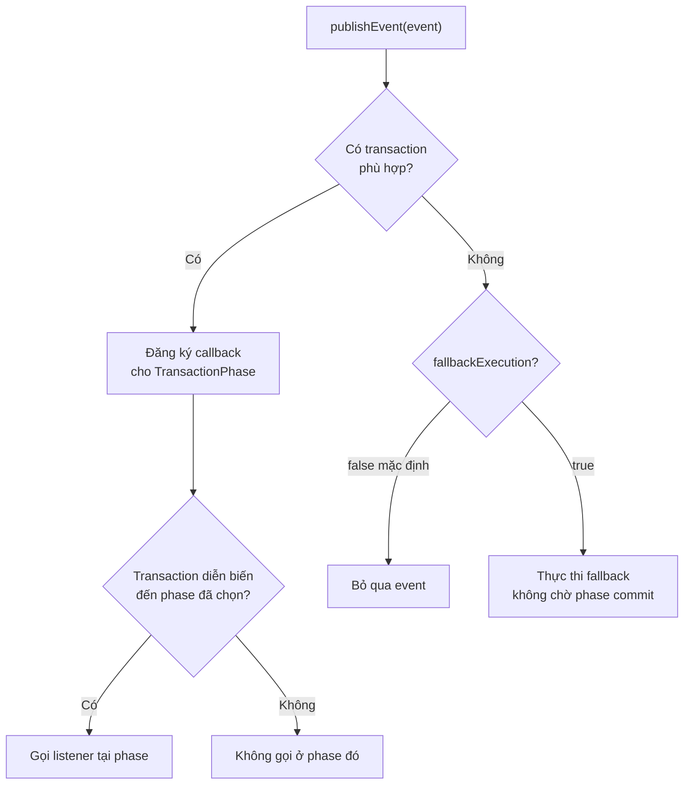
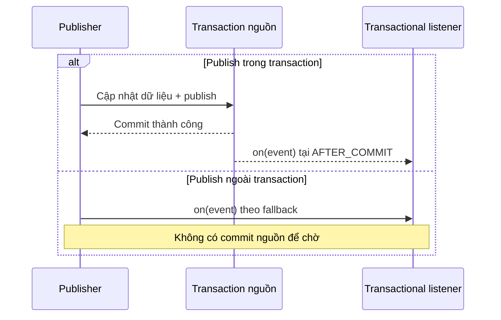
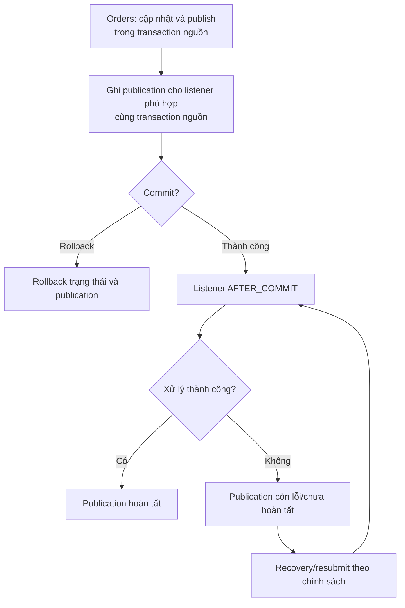

# fallbackExecution

> **Chương:** Transactional listener  
> **Học phần:** `SPRING_MODULITH_APPLICATION_EVENTS` — giao tiếp giữa các module Spring Modulith bằng application events nhằm giảm phụ thuộc và bảo vệ ranh giới nghiệp vụ; thực hành publisher, listener, xử lý sau commit, Event Publication Registry, retry, kiểm thử và quan sát việc giao sự kiện đáng tin cậy.

## 1. Vấn đề: cùng một event, hai cách publish

Giả sử module **Orders** phát `OrderConfirmed` khi đơn chuyển trạng thái xác nhận. Module **Billing** dùng `@TransactionalEventListener` để tạo hóa đơn **sau khi transaction Orders commit**.

Trong luồng HTTP chuẩn, `OrderService.confirm()` có `@Transactional`, vì vậy listener chạy sau commit như dự kiến. Nhưng một batch job, một lệnh quản trị, một test hoặc một đoạn code gọi `ApplicationEventPublisher` **ngoài transaction** có thể phát cùng loại event.

Điều gì xảy ra với listener?

```java
@TransactionalEventListener
public void on(OrderConfirmed event) {
    invoices.createFor(event.orderId());
}
```

Mặc định, **listener không được gọi** nếu sự kiện được publish khi không có transaction phù hợp. Đây là lựa chọn có chủ đích: Spring không thể bảo đảm ý nghĩa `AFTER_COMMIT` khi không có transaction nào để commit.

Spring Framework cho phép thay đổi hành vi này bằng thuộc tính:

```java
@TransactionalEventListener(fallbackExecution = true)
public void on(OrderConfirmed event) {
    invoices.createFor(event.orderId());
}
```

Khi không có transaction phù hợp, listener trên **vẫn được thực thi theo đường fallback**, thay vì bị bỏ qua. Tuy nhiên, **fallback không phải commit giả, không tự mở transaction và không tự mang lại độ tin cậy của Event Publication Registry**.

Mục tiêu bài học là hiểu rõ lúc nào nên hoặc không nên bật `fallbackExecution` trong ứng dụng Spring Modulith, cách bảo vệ giao tiếp liên module và cách kiểm thử đúng cả hai đường thực thi.

## 2. `fallbackExecution` là gì?

`fallbackExecution` là thuộc tính boolean của `org.springframework.transaction.event.TransactionalEventListener`:

```java
@TransactionalEventListener(
        phase = TransactionPhase.AFTER_COMMIT,
        fallbackExecution = false
)
public void on(OrderConfirmed event) {
    // ...
}
```

Giá trị mặc định là **`false`**. Ý nghĩa:

- **Khi có transaction đang hoạt động và được Spring nhận diện:** listener được gắn với `TransactionPhase` đã khai báo.
- **Khi không có transaction thích hợp:** nếu `false`, listener **bỏ qua event**; nếu `true`, listener **thực thi theo đường fallback**.
- `fallbackExecution` không quyết định việc có dùng thread khác hay không, không chuyển event thành message broker event và không biến hành vi xử lý thành “exactly once”.



**Câu cần ghi nhớ:** `fallbackExecution = true` nghĩa là *“vẫn thực thi nếu không có transaction”*, **không** có nghĩa *“luôn thực thi sau commit”*.

## 3. Ma trận hành vi theo transaction và phase

`@TransactionalEventListener` hỗ trợ bốn phase: `BEFORE_COMMIT`, `AFTER_COMMIT` (mặc định), `AFTER_ROLLBACK` và `AFTER_COMPLETION`.

| Ngữ cảnh publish | Phase khai báo | `fallbackExecution = false` | `fallbackExecution = true` |
|---|---|---|---|
| Có transaction, commit thành công | `BEFORE_COMMIT` | Gọi trước commit | Giống bên trái |
| Có transaction, commit thành công | `AFTER_COMMIT` | Gọi sau commit | Giống bên trái |
| Có transaction, rollback | `AFTER_COMMIT` | Không gọi | Không gọi |
| Có transaction, rollback | `AFTER_ROLLBACK` | Gọi sau rollback | Giống bên trái |
| Có transaction, commit hoặc rollback | `AFTER_COMPLETION` | Gọi khi transaction kết thúc | Giống bên trái |
| **Không có transaction** | **Bất kỳ phase nào** | **Bỏ qua** | **Gọi theo đường fallback; không có phase thật để đợi** |

Hai hệ quả đặc biệt dễ nhầm:

1. `fallbackExecution = true` **không làm listener `AFTER_COMMIT` chạy khi transaction nguồn rollback**. Khi transaction thực sự tồn tại, Spring vẫn tôn trọng phase.
2. `fallbackExecution = true` trên một listener `AFTER_ROLLBACK` **cũng có thể khiến listener chạy khi không có transaction**, dù không có rollback thực sự. Tên phase lúc này không diễn tả một sự kiện transaction đã xảy ra.

Do đó, chỉ nên bật fallback khi **cùng một hành vi có ý nghĩa hợp lệ trong cả trường hợp có transaction và không có transaction**. Nếu listener xử lý sự thật chỉ hợp lệ sau một commit, việc cho phép fallback có thể phá vỡ hợp đồng nghiệp vụ.

### 3.1. Bảng “khi nào” ngắn gọn

| Câu hỏi | Nếu câu trả lời là “có” |
|---|---|
| Listener chỉ được xử lý khi dữ liệu nguồn đã commit? | Giữ `fallbackExecution = false`; kiểm soát publisher bắt buộc có transaction |
| Event có thể được phát trong một tác vụ không dùng transaction nhưng vẫn có ý nghĩa hợp lệ? | Cân nhắc `true` sau khi đánh giá side effect |
| Listener phải ghi DB dù publish ngoài transaction? | Bổ sung transaction **mới** ở consumer; fallback không tự mở transaction |
| Muốn tránh mất event sau crash/retry? | Thiết kế persistent publication/outbox và idempotency; không coi fallback là giải pháp |
| Publisher đang “thỉnh thoảng không có transaction” do lỗi cấu hình? | Sửa transaction boundary thay vì bật fallback để che lỗi |

## 4. Ví dụ nhỏ: mặc định bỏ qua event ngoài transaction

Event minh họa:

```java
package com.acme.shop.orders.events;

import java.time.Instant;
import java.util.UUID;

public record OrderConfirmed(
        UUID eventId,
        UUID orderId,
        Instant occurredAt
) {}
```

Một listener chỉ chạy sau commit:

```java
package com.acme.shop.billing.internal;

import com.acme.shop.orders.events.OrderConfirmed;
import org.springframework.stereotype.Component;
import org.springframework.transaction.event.TransactionalEventListener;

@Component
class OrderConfirmedListener {

    private final InvoiceService invoices;

    OrderConfirmedListener(InvoiceService invoices) {
        this.invoices = invoices;
    }

    // Tương đương phase = AFTER_COMMIT, fallbackExecution = false.
    @TransactionalEventListener
    public void on(OrderConfirmed event) {
        invoices.issueFor(event.orderId());
    }
}
```

Khi publisher gọi trong transaction:

```java
@Transactional
public void confirm(UUID orderId) {
    orderRepository.confirm(orderId);
    publisher.publishEvent(new OrderConfirmed(
            UUID.randomUUID(), orderId, clock.instant()
    ));
}
```

Nếu transaction commit, Spring gọi listener sau commit. Nếu transaction rollback, listener `AFTER_COMMIT` không chạy.

Ngược lại:

```java
public void publishWithoutTransaction(UUID orderId) {
    publisher.publishEvent(new OrderConfirmed(
            UUID.randomUUID(), orderId, clock.instant()
    ));
}
```

Giả sử method này thật sự chạy **ngoài mọi transaction**, listener mặc định **không được gọi**. Không có exception bắt buộc báo rằng một listener transactional đã bị bỏ qua; vì vậy lỗi cấu hình có thể biểu hiện thành **thiếu phản ứng**.

**Không hiểu sai:** `publishEvent` vẫn được gọi thành công, nhưng việc gọi publisher không chứng minh rằng mọi loại listener đều đã xử lý event.

## 5. Bật `fallbackExecution = true` thay đổi điều gì?

Thay annotation của listener:

```java
import org.springframework.transaction.event.TransactionPhase;
import org.springframework.transaction.event.TransactionalEventListener;

@TransactionalEventListener(
        phase = TransactionPhase.AFTER_COMMIT,
        fallbackExecution = true
)
public void on(OrderConfirmed event) {
    invoices.issueFor(event.orderId());
}
```

Hành vi được chia thành hai nhánh:



Với multicaster mặc định và **không có `@Async`**, đường fallback thường thực thi **ngay trong đường publish**. Trong nhánh có transaction, lời gọi listener được đăng ký và thực thi ở phase được chọn. Với cấu hình async hoặc multicaster tùy chỉnh, phải kiểm tra cơ chế dispatch thực tế; `fallbackExecution` tự nó **không** cấu hình thread hay executor.

### 5.1. Điều gì không thay đổi?

Bật fallback **không**:

- Tạo một transaction mới cho listener.
- Biến `publishEvent` thành thao tác durable hoặc outbox.
- Chuyển phương thức sang async.
- Bảo đảm listener luôn nhận event **sau commit** khi publisher thực tế không có transaction.
- Bảo đảm có thể replay nếu ứng dụng crash.
- Thay thế kiểm tra xem nghiệp vụ nguồn đã chuyển trạng thái hợp lệ hay chưa.

Nếu phương thức listener gọi repository, tùy cấu hình của repository/service, có thể tồn tại các transaction riêng ở tầng thấp. Điều đó **không đồng nghĩa** fallback đã cung cấp một transaction bao trùm toàn bộ xử lý. Hãy thiết kế transaction của consumer rõ ràng.

## 6. Trường hợp sử dụng fallback hợp lý

Không phải mọi event trong một hệ thống đều phải được publish trong transaction DB. Có những event thực sự độc lập với persistence:

- `CacheWarmupRequested` từ một tác vụ bootstrap.
- `ConfigurationReloaded` sau khi ứng dụng áp dụng cấu hình trong bộ nhớ.
- `ReportSnapshotReady` khi một job tạo xong báo cáo vào một kho lưu đã có bảo đảm riêng.
- Event quản trị cần thực hiện cả khi tiến trình không mở transaction DB.

Một listener có thể quan sát và cập nhật thông tin nhẹ cho cả hai tình huống:

```java
public record ConfigurationReloaded(
        String configurationKey,
        Instant occurredAt
) {}

@Component
class ConfigurationAuditListener {

    private final AuditSink audit;

    ConfigurationAuditListener(AuditSink audit) {
        this.audit = audit;
    }

    @TransactionalEventListener(fallbackExecution = true)
    public void on(ConfigurationReloaded event) {
        audit.recordReload(
                event.configurationKey(), event.occurredAt()
        );
    }
}
```

Ví dụ giả định việc ghi nhận audit **có ý nghĩa ngay cả khi không tồn tại transaction nguồn**, và `AuditSink` được thiết kế rõ về exception, độ bền và retry. Nếu event này không bao giờ cần transaction phase, `@EventListener` bình thường có thể **đơn giản và dễ hiểu hơn**.

### 6.1. Sử dụng fallback cho các entry point hỗn hợp

Một ứng dụng có thể phát cùng event từ:

1. Một workflow trong transaction DB, cần xử lý `AFTER_COMMIT`.
2. Một nguồn đã có hợp đồng commit riêng, chẳng hạn adapter nhận **thông điệp đã xác nhận** từ hệ thống khác và chỉ thông báo cho module hiện tại.

Khi hai đường cùng mang **một sự thật nghiệp vụ tương đương**, `fallbackExecution = true` có thể hữu ích. Nhưng cần chứng minh cả hai nguồn có **cùng semantics**, data đã đạt điều kiện cần và side effect của listener an toàn. Nếu một bên chỉ là “đề nghị làm” còn bên kia là “đã hoàn tất”, **không** nên dùng chung event type.

## 7. Khi không nên bật fallback cho `OrderConfirmed`

Với event xác nhận đơn, điều được công bố là sự thật đã được Orders quyết định. Consumer Billing không nên lập hóa đơn nếu đơn chưa được xác nhận hợp lệ.

Giả sử thiếu `@Transactional` do:

- Gọi method từ chính bean (self-invocation), bỏ qua Spring transactional proxy.
- Method nằm trong class không do Spring quản lý hoặc không được proxy.
- Luồng batch gọi một helper không mở transaction nguồn.
- Dùng `Propagation.NOT_SUPPORTED` khiến transaction tạm bị đình chỉ.
- Publisher được gọi từ callback, thread hoặc hệ thống khác không mang ngữ cảnh transaction mà người viết code ngầm kỳ vọng.

Nếu bật fallback để “cho listener chạy luôn”, hệ thống có thể tạo hóa đơn **trước khi bất biến nguồn được commit hoặc thậm chí trước khi bất biến đó từng được ghi**.

**Hướng xử lý đúng:**

1. Làm rõ giao dịch nào xác nhận đơn.
2. Mở transaction tại application service phù hợp.
3. Chỉ phát `OrderConfirmed` khi có chuyển trạng thái hợp lệ.
4. Dùng listener `AFTER_COMMIT` với `fallbackExecution = false` cho phản ứng yêu cầu committed state.
5. Test trường hợp gọi qua HTTP, job, retry và luồng nội bộ để không có điểm phát “lạc” ra ngoài transaction.

### 7.1. Kiểm tra transaction khi hợp đồng bắt buộc

Với ứng dụng imperative dùng `PlatformTransactionManager`, có thể đặt guard tại điểm phát:

```java
import org.springframework.transaction.support.TransactionSynchronizationManager;

private void publishConfirmed(OrderConfirmed event) {
    if (!TransactionSynchronizationManager
            .isActualTransactionActive()) {
        throw new IllegalStateException(
                "OrderConfirmed must be published inside a transaction"
        );
    }
    publisher.publishEvent(event);
}
```

Guard này là lựa chọn **chẩn đoán/bảo vệ hợp đồng** trong môi trường transaction theo thread. Nó không tự chứng minh commit sẽ thành công hoặc đúng transaction manager/datasource. Đối với reactive transaction sử dụng Reactor context, không dùng guard thread-local này như nguồn sự thật duy nhất.

Giữ `fallbackExecution = false` và chủ động **fail fast** tại publisher thường an toàn hơn việc âm thầm mở fallback cho một event chỉ có ý nghĩa sau commit.

## 8. `fallbackExecution` không tự tạo transaction cho consumer

Một trap khác: listener nhận event theo fallback, sau đó cập nhật nhiều bảng và người viết nghĩ rằng vì có annotation `@TransactionalEventListener` nên mọi cập nhật đã thuộc một transaction.

`@TransactionalEventListener` là annotation **chọn thời điểm thực thi dựa trên transaction nguồn**; nó không tương đương `@Transactional`.

### 8.1. Ghi dữ liệu trong transaction mới

Nếu cùng một listener thực sự cần hỗ trợ cả hai đường có và không có transaction nguồn, có thể tách tác vụ sang **Spring service khác** với propagation rõ:

```java
package com.acme.shop.billing.internal;

import com.acme.shop.orders.events.OrderConfirmed;
import org.springframework.stereotype.Component;
import org.springframework.transaction.event.TransactionalEventListener;

@Component
class OrderConfirmedListener {

    private final InvoiceService invoices;

    OrderConfirmedListener(InvoiceService invoices) {
        this.invoices = invoices;
    }

    @TransactionalEventListener(fallbackExecution = true)
    public void on(OrderConfirmed event) {
        invoices.issueIfAbsent(
                event.orderId(), event.eventId()
        );
    }
}
```

Service nhận trách nhiệm ghi DB:

```java
package com.acme.shop.billing.internal;

import java.util.UUID;
import org.springframework.stereotype.Service;
import org.springframework.transaction.annotation.Propagation;
import org.springframework.transaction.annotation.Transactional;

@Service
public class InvoiceService {

    private final InvoiceRepository invoices;

    public InvoiceService(InvoiceRepository invoices) {
        this.invoices = invoices;
    }

    @Transactional(propagation = Propagation.REQUIRES_NEW)
    public void issueIfAbsent(UUID orderId, UUID eventId) {
        if (invoices.existsByOrderId(orderId)) {
            return;
        }
        invoices.save(Invoice.forOrder(orderId, eventId));
    }
}
```

Đặt transaction ở một bean khác giúp lời gọi đi qua Spring proxy trong mô hình AOP thông thường. `REQUIRES_NEW` mở transaction riêng cho công việc Billing, tránh nhầm một tài nguyên transaction nguồn còn gắn với thread ngay sau commit với một giao dịch mới thực sự có khả năng commit.

**Không coi code này là lý do mặc định bật fallback cho `OrderConfirmed`.** Nó chỉ cho thấy nếu **đã có lý do nghiệp vụ hợp lệ** để hỗ trợ đường ngoài transaction, consumer vẫn phải tự quản lý transaction. Đối với Orders thực sự cần commit trước, hãy giữ fallback false.

### 8.2. Chống trùng không chỉ là gọi `existsByOrderId`

Khi publication được xử lý lại, Billing có thể nhận cùng event nhiều lần. Trong ví dụ “mỗi đơn chỉ có một invoice”, cần ràng buộc **unique constraint trên `invoice.order_id`** và xử lý xung đột concurrency đúng. Hai worker có thể cùng thấy chưa có hóa đơn trước khi một worker insert.

`eventId` là danh tính một event instance; `orderId` là khóa nghiệp vụ thích hợp cho bất biến trên. Nếu một đơn có thể có nhiều hóa đơn, phải thiết kế lại khóa. `fallbackExecution` hoàn toàn **không cung cấp idempotency**.

## 9. Khác biệt với `@EventListener` và `@ApplicationModuleListener`

| Annotation | Khi publish trong transaction | Khi publish ngoài transaction | Mặc định async? |
|---|---|---|---|
| `@EventListener` | Thường chạy ngay khi publish, trước commit | Vẫn chạy | Không |
| `@TransactionalEventListener` | Theo `phase`, mặc định `AFTER_COMMIT` | **Bỏ qua** | Không |
| `@TransactionalEventListener(fallbackExecution = true)` | Theo `phase` | **Chạy fallback, không có commit nguồn** | Không |
| `@Async @EventListener` | Task có thể chạy trước commit | Task async được lên lịch | Có, khi async được bật/cấu hình |
| `@ApplicationModuleListener` | Sau commit, async và transaction mới | Theo semantics transactional listener mặc định, không nên giả định xử lý fallback | Có |

### 9.1. `@ApplicationModuleListener` trong Spring Modulith

Spring Modulith cung cấp `@ApplicationModuleListener` là shortcut cho mẫu:

```java
@Async
@Transactional(propagation = Propagation.REQUIRES_NEW)
@TransactionalEventListener
public void on(OrderConfirmed event) {
    // ...
}
```

Nó phù hợp cho giao tiếp **sau commit giữa các module** với transaction listener riêng. Annotation này không nên được dùng như một phương pháp “tự động chạy dù publisher không có transaction”. Hãy dùng transaction nguồn rõ ràng cho các domain events yêu cầu committed state.

Nếu nghiệp vụ cần hỗ trợ cả event trong và ngoài transaction, có thể thiết kế một listener riêng với `@TransactionalEventListener(fallbackExecution = true)` và propagation minh bạch, hoặc phân tách **event types/entry points** cho hai nguồn có semantics khác nhau. Không nên dựa vào việc `@ApplicationModuleListener` có thể tự tùy biến fallback theo một thuộc tính không có trong API của phiên bản đang dùng.

### 9.2. Đừng nhầm fallback với asynchronous dispatch

`@Async` thay đổi thread/lời gọi. `fallbackExecution` thay đổi điều kiện **có thực thi listener khi thiếu transaction nguồn hay không**.

```java
@Async
@TransactionalEventListener(fallbackExecution = true)
public void on(SomeEvent event) {
    // Khi thiếu transaction nguồn: vẫn nhận event theo fallback
    // và công việc async cần được cấu hình/kiểm thử riêng.
}
```

Trong cấu hình async, không được giả định listener chạy trên cùng thread, chung transaction, hoặc giữ nguyên MDC/trace context của publisher. Task bị từ chối hoặc thất bại vẫn cần xử lý lỗi và observability. `fallbackExecution` không có trách nhiệm phục hồi task async.

## 10. Khi publisher không có transaction: tìm nguyên nhân trước khi bật fallback

Không có transaction **có thể là chủ ý** hoặc **là một lỗi kiến trúc**. Phân biệt hai nhóm:

| Bối cảnh | Có phải không có transaction theo chủ ý? | Hướng xử lý |
|---|---|---|
| Startup event thuần in-memory | Có thể | `@EventListener` hoặc fallback tùy ý nghĩa |
| Command từ batch không mở transaction dù phải sửa DB nguyên tử | Thường không | Bọc command trong transaction service rõ |
| Self-invocation của method `@Transactional` | Không | Gọi qua bean/proxy thích hợp, tổ chức lại service |
| Method `@Transactional(propagation = NOT_SUPPORTED)` | Có chủ ý đình chỉ | Không phát event “đã commit” nếu chưa có committed state |
| Listener/worker async không tự mở transaction | Tùy thiết kế | Chọn transaction cho work unit rõ ràng |
| Domain event của thay đổi state trong database | Thường cần transaction nguồn | Giữ fallback false và test |
| Notification có ý nghĩa độc lập với DB | Có thể | Dùng event thường hoặc fallback sau khi review |

### 10.1. Spring proxy và self-invocation

Ví dụ dễ mắc:

```java
@Service
class OrderJob {

    public void run(UUID orderId) {
        confirmTransactional(orderId); // Gọi this: có thể bỏ qua proxy.
    }

    @Transactional
    public void confirmTransactional(UUID orderId) {
        // Sửa DB, publish event...
    }
}
```

Với cách quản lý transaction AOP proxy thông thường, lời gọi nội bộ trên cùng object **không đi qua proxy**, nên annotation `@Transactional` có thể không có hiệu lực. Bật fallback sẽ làm listener chạy nhưng **không sửa lỗi transaction của Orders**.

Giải pháp là chuyển work unit sang service bean khác được Spring quản lý, gọi qua proxy đúng cách hoặc chủ động sử dụng `TransactionTemplate`/API transaction phù hợp. Kiểm thử phải xác minh **commit/rollback thực tế**, không chỉ có event được phát.

## 11. Reactive transaction và ý nghĩa “không thấy transaction”

Trong ứng dụng imperative sử dụng `PlatformTransactionManager`, transaction thường được gắn với thread hiện tại. Nhưng với **reactive transaction**, ngữ cảnh transaction nằm trong **Reactor Context**, không phải ThreadLocal.

Từ Spring Framework 6.1, `@TransactionalEventListener` có thể hoạt động với cả transaction kiểu thread-bound và reactive. Trong đường reactive, event cần truyền **transaction context** theo cách được framework hỗ trợ, chẳng hạn sử dụng `TransactionalEventPublisher` để đưa context vào event source.

```text
Imperative:
  Transaction context -> thread hiện tại -> Spring listener nhận ra phase

Reactive:
  Transaction context -> Reactor Context
  Event publication cần mang đúng transaction context
```

Nếu một reactive event không mang transaction context đúng, việc listener không thấy transaction **không chứng minh publisher thực sự không có giao dịch**. Bật `fallbackExecution = true` để “cho chạy” có thể làm mất bảo đảm phase mà hệ thống đang cần.

**Ranh giới của ví dụ trong bài:** các đoạn Java dùng `@Transactional` và `TransactionTemplate` bên dưới mô tả **imperative application**. Khi dùng R2DBC/reactive, cần đọc tài liệu Spring tương ứng và kiểm thử khả năng truyền transaction context; không dùng `TransactionSynchronizationManager.isActualTransactionActive()` dạng thread-local để kết luận cho toàn bộ reactive flow.

## 12. `fallbackExecution` không thay thế Event Publication Registry

Trong Spring Modulith, **Event Publication Registry** hỗ trợ ghi nhận publication cho các transactional event listener phù hợp để ứng dụng có thể theo dõi và xử lý lại khi lỗi, nếu cấu hình **persistent publication store** đúng.

Với một nguồn phát event trong transaction:



Đường này dựa trên **giao dịch nguồn** và store phù hợp để có thể ghi nhận ý định xử lý. Khi bạn bật fallback và publish **không có transaction nguồn**, không thể mặc nhiên suy ra một publication đã được ghi **atomically** với nghiệp vụ nguồn, hoặc rằng đường fallback được registry lưu/phục hồi tương đương.

Vì vậy:

- Không dùng `fallbackExecution = true` làm thay thế việc mở transaction cho nghiệp vụ ghi DB.
- Không khẳng định event ngoài transaction chắc chắn được registry theo dõi và resubmit an toàn theo cùng bảo đảm.
- Kiểm tra cụ thể sự tham gia của listener với registry, persistent store, transaction boundary, serializer, hoàn tất publication và chính sách retry của phiên bản Spring Modulith đang dùng.
- Nếu yêu cầu độ bền ngay cả khi không có transaction nguồn, thiết kế một transaction lưu **outbox/publication** rõ ràng hoặc một cơ chế truyền tin bền vững với semantics được kiểm thử.

### 12.1. Sự khác nhau giữa fallback và retry

| Cơ chế | Trả lời câu hỏi | Không bảo đảm |
|---|---|---|
| `fallbackExecution` | Event không có transaction thì listener có được gọi không? | Durability, retry, commit, idempotency |
| `TransactionPhase.AFTER_COMMIT` | Khi transaction nguồn commit, listener được gọi ở pha nào? | Độ bền qua crash chỉ từ annotation |
| `@Async` | Listener có chạy tách khỏi thread caller không? | Chờ commit, durable queue |
| Event Publication Registry | Publication cho listener phù hợp đã hoàn tất hay còn tồn? | Exactly-once end-to-end |
| Idempotency key/unique constraint | Xử lý lại có tạo side effect trùng không? | Mọi publication chắc chắn được giao |

Đây là những **trục trách nhiệm khác nhau**. Hệ thống đáng tin cậy phải chọn và kết hợp theo đúng yêu cầu thay vì cố dùng một annotation để giải quyết tất cả.

## 13. Lỗi thường gặp và cách quan sát

### 13.1. Listener không chạy nhưng publisher không báo lỗi

Nếu publisher phát event ngoài transaction và `fallbackExecution = false`, listener sẽ bỏ qua. Vì vậy khi không thấy hóa đơn:

1. Xác nhận event đã được phát đúng loại.
2. Kiểm tra **có transaction nguồn thực sự hay không** tại thời điểm publish.
3. Kiểm tra listener bean được scan và method đăng ký đúng.
4. Kiểm tra `phase`, `fallbackExecution` và việc transaction commit/rollback.
5. Kiểm tra cấu hình async/executor và Event Publication Registry nếu có.

Không kết luận “Spring mất event” trước khi kiểm tra các điều kiện trên.

### 13.2. Phản ứng chạy quá sớm sau khi bật fallback

Nếu listener dùng fallback để đọc trạng thái đơn, nhưng publisher phát khi một bước nghiệp vụ **chưa commit**, handler có thể thấy dữ liệu cũ, không thấy dữ liệu hoặc thậm chí tác động đến sự thật chưa tồn tại. Tình huống này không phải lỗi của `AFTER_COMMIT`: **không có commit nguồn** để listener chờ.

### 13.3. Structured log cho điều tra

Ví dụ schema log do dự án tự chọn:

```json
{
  "eventType": "OrderConfirmed",
  "eventId": "28ce3f0e-0216-4500-bfba-bf10aac1071e",
  "publisher": "OrderService",
  "transactionActiveAtPublish": false,
  "listener": "BillingOrderConfirmedListener",
  "listenerPhase": "AFTER_COMMIT",
  "fallbackEnabled": false,
  "outcome": "SKIPPED_NO_TRANSACTION"
}
```

**Đây là thông tin quan sát minh họa, không phải bản log Spring tự động phát ra khi bỏ qua listener.** Muốn có `SKIPPED_NO_TRANSACTION`, ứng dụng phải tự thu thập thông tin phù hợp ở publisher/diagnostic layer. Spring không mặc định bảo đảm một log riêng cho mỗi listener bị bỏ qua.

Nên đo:

- Số lần publish có/không có transaction đối với các event quan trọng.
- Số lần listener được gọi và hoàn tất theo event type/consumer.
- Publication backlog, tuổi lớn nhất và số lần retry khi dùng registry.
- Độ trễ từ `occurredAt` đến listener hoàn tất.
- Executor queue/rejection nếu xử lý async.

Không đặt ID có cardinality cao như `eventId`, `orderId` hoặc `correlationId` làm metric labels; chúng phù hợp với logs/traces. Không ghi token, PII dư thừa hoặc toàn bộ payload nhạy cảm.

## 14. Kiểm thử chính xác đường mặc định và đường fallback

Một unit test chỉ gọi thẳng method `listener.on(event)` không kiểm thử bất kỳ semantics `@TransactionalEventListener` nào. Phải **publish qua Spring ApplicationEventPublisher trong một ApplicationContext thực**.

### 14.1. Ma trận kiểm thử tối thiểu

| Test | Điều kiện publish | Default listener | Fallback-enabled listener |
|---|---|---|---|
| A | Không transaction | Không được gọi | Được gọi theo fallback |
| B | Transaction commit | Được gọi `AFTER_COMMIT` | Được gọi `AFTER_COMMIT` |
| C | Transaction rollback | Không gọi `AFTER_COMMIT` | Không gọi `AFTER_COMMIT` |
| D | Transaction ngoài bị đình chỉ bằng `NOT_SUPPORTED` | Không gọi trong ngữ cảnh đình chỉ | Gọi fallback nếu đúng là không có transaction |
| E | Có transaction nhưng phase `AFTER_ROLLBACK` | Chỉ chạy khi rollback | Giống default; fallback không đổi phase |

Kiểm thử thật cần bảo đảm **transaction manager phù hợp được cấu hình** và test method không vô tình mở/rollback một transaction bao ngoài làm méo kết quả.

### 14.2. Ví dụ listener dùng counter để quan sát

Định nghĩa event cho test:

```java
public record ProbeEvent(String id) {}
```

Bean listener:

```java
import java.util.concurrent.atomic.AtomicInteger;
import org.springframework.stereotype.Component;
import org.springframework.transaction.event.TransactionalEventListener;

@Component
public class ProbeListeners {

    private final AtomicInteger defaultCount = new AtomicInteger();
    private final AtomicInteger fallbackCount = new AtomicInteger();

    @TransactionalEventListener
    public void defaultHandler(ProbeEvent event) {
        defaultCount.incrementAndGet();
    }

    @TransactionalEventListener(fallbackExecution = true)
    public void fallbackHandler(ProbeEvent event) {
        fallbackCount.incrementAndGet();
    }

    public int defaultCount() {
        return defaultCount.get();
    }

    public int fallbackCount() {
        return fallbackCount.get();
    }

    public void reset() {
        defaultCount.set(0);
        fallbackCount.set(0);
    }
}
```

Các counter chỉ dùng cho **test hành vi**, không đại diện storage production hay idempotency.

### 14.3. Ví dụ integration test với `TransactionTemplate`

```java
import static org.assertj.core.api.Assertions.assertThat;
import static org.junit.jupiter.api.Assertions.assertThrows;

import org.junit.jupiter.api.BeforeEach;
import org.junit.jupiter.api.Test;
import org.springframework.beans.factory.annotation.Autowired;
import org.springframework.boot.test.context.SpringBootTest;
import org.springframework.context.ApplicationEventPublisher;
import org.springframework.transaction.PlatformTransactionManager;
import org.springframework.transaction.support.TransactionTemplate;

@SpringBootTest
class FallbackExecutionTests {

    @Autowired ApplicationEventPublisher events;
    @Autowired PlatformTransactionManager transactionManager;
    @Autowired ProbeListeners probes;

    @BeforeEach
    void resetCounters() {
        probes.reset();
    }

    @Test
    void outsideTransactionOnlyFallbackHandlerRuns() {
        events.publishEvent(new ProbeEvent("without-tx"));

        assertThat(probes.defaultCount()).isZero();
        assertThat(probes.fallbackCount()).isEqualTo(1);
    }

    @Test
    void committedTransactionInvokesBothAfterCommit() {
        new TransactionTemplate(transactionManager)
                .executeWithoutResult(status -> {
                    events.publishEvent(new ProbeEvent("committed"));
                    assertThat(probes.defaultCount()).isZero();
                    assertThat(probes.fallbackCount()).isZero();
                });

        assertThat(probes.defaultCount()).isEqualTo(1);
        assertThat(probes.fallbackCount()).isEqualTo(1);
    }

    @Test
    void rollbackInvokesNeitherAfterCommitListener() {
        assertThrows(IllegalStateException.class, () ->
                new TransactionTemplate(transactionManager)
                        .executeWithoutResult(status -> {
                            events.publishEvent(
                                    new ProbeEvent("rolled-back"));
                            throw new IllegalStateException("rollback");
                        })
        );

        assertThat(probes.defaultCount()).isZero();
        assertThat(probes.fallbackCount()).isZero();
    }
}
```

**Điều kiện chạy ví dụ:** đây là bộ test minh họa cho ứng dụng **imperative**, cần có `PlatformTransactionManager`, component scan thấy `ProbeListeners` và `ProbeEvent`, dependencies JUnit/AssertJ/Spring Test phù hợp. Test phải chạy **không có `@Transactional` bao ngoài** và tránh sự can thiệp của fixture có transaction ẩn. Trong ứng dụng có nhiều transaction managers, inject/qualify **đúng manager**.

Vì các listener test **không có `@Async`**, kỳ vọng callback `AFTER_COMMIT` hoàn thành khi `TransactionTemplate.executeWithoutResult(...)` trả về là phù hợp với cách dispatch đồng bộ. Nếu thêm async, thay kiểm tra ngay bằng polling/`Scenario` với timeout.

### 14.4. Test rollback với fallback true không phải “fallback sau rollback”

Một lỗi test phổ biến: tạo transaction, publish, rollback rồi mong `fallbackExecution = true` làm listener `AFTER_COMMIT` chạy vì “commit không xảy ra”. Đó là sai.

**Transaction đã tồn tại khi publish**, nên listener đăng ký theo phase và `AFTER_COMMIT` sẽ không chạy khi rollback. Fallback chỉ dành cho **tình huống thiếu transaction thích hợp tại thời điểm publish**, không phải phương án dự phòng khi commit thất bại.

### 14.5. Test trong `@ApplicationModuleTest` và Spring Modulith

Trong Spring Modulith, `@ApplicationModuleTest`, `PublishedEvents` và `Scenario` hữu ích cho các trường hợp:

- Publisher có phát đúng event type/payload không?
- Listener sau commit có chạy khi transaction nguồn commit?
- Một module nhận event có cập nhật state của mình đúng không?
- Event publication registry/persistent store có phục hồi được khi listener thất bại không?

**Không suy ra fallback hoạt động chỉ từ việc `PublishedEvents` thấy sự kiện:** nó chứng minh event được publish, không chứng minh một listener transactional đã được gọi ngoài transaction. Cần một assertion trực tiếp trên side effect/counter của listener như các test trên.

## 15. `fallbackExecution` và ranh giới module

Giả sử Orders sở hữu `OrderConfirmed`; Billing nghe hợp đồng đó mà không import service/repository nội bộ Orders.

```text
com.acme.shop
├── orders
│   ├── events
│   │   ├── package-info.java
│   │   └── OrderConfirmed.java
│   └── internal
│       ├── OrderService.java
│       └── OrderRepository.java
└── billing
    ├── package-info.java
    └── internal
        └── OrderConfirmedListener.java
```

Khai báo API sự kiện:

```java
// orders/events/package-info.java
@org.springframework.modulith.NamedInterface("events")
package com.acme.shop.orders.events;
```

Cho Billing chỉ dùng hợp đồng `orders::events`:

```java
// billing/package-info.java
@org.springframework.modulith.ApplicationModule(
        allowedDependencies = "orders::events"
)
package com.acme.shop.billing;
```

Kiểm thử kiến trúc:

```java
import org.junit.jupiter.api.Test;
import org.springframework.modulith.core.ApplicationModules;

class ModuleBoundaryTests {

    @Test
    void verifiesModuleBoundaries() {
        ApplicationModules.of(ShopApplication.class).verify();
    }
}
```

`ApplicationModules.verify()` hỗ trợ phát hiện phụ thuộc vi phạm ranh giới và vòng phụ thuộc theo mô hình module. Nhưng nó **không chứng minh publisher luôn mở transaction**, cũng không kiểm tra semantics `fallbackExecution`. Đó là trách nhiệm của test runtime.

**Điểm kiến trúc cần giữ:** việc đưa event vào named interface chỉ cho phép Billing **thấy hợp đồng**; nó không trao quyền cho Billing tự khẳng định Orders đã xác nhận đơn hoặc bỏ qua transaction nguồn.

## 16. Những hiểu lầm dễ gây lỗi production

| Hiểu lầm | Hậu quả | Cách hiểu đúng |
|---|---|---|
| “`fallbackExecution = true` nghĩa là luôn sau commit” | Listener có thể xử lý ngay khi thiếu transaction | Chỉ giữ phase khi có transaction phù hợp |
| “Nếu rollback, fallback sẽ gọi listener” | Test và logic nghiệp vụ sai | Rollback của transaction có thật vẫn tuân theo phase đã chọn |
| “`@TransactionalEventListener` tự mở transaction” | Các cập nhật DB trong listener không có transaction như mong muốn | Dùng `@Transactional(REQUIRES_NEW)` ở service xử lý nếu cần |
| “Không có transaction thì bật fallback là xong” | Che lỗi self-invocation/transaction manager | Xác định tại sao không có transaction |
| “Fallback làm event bền vững” | Mất phản ứng khi crash | Persistent registry/outbox/recovery nếu yêu cầu |
| “Cứ bật fallback cho mọi event để không bị bỏ sót” | Phá ngữ nghĩa event chỉ hợp lệ sau commit | Chỉ bật khi cả hai đường có ý nghĩa đúng |
| “`@Async` tạo AFTER_COMMIT” | Task có thể chạy trước commit | Async và transaction phase là hai quyết định riêng |
| “Registry ghi mọi fallback event như trong transaction nguồn” | Hiểu sai bảo đảm atomicity | Kiểm thử registry/store/transaction cụ thể |
| “`@ApplicationModuleListener` tự động fallback” | Bỏ lỡ event ngoài transaction | Thiết kế publisher transaction hoặc listener riêng theo API hỗ trợ |
| “`PublishedEvents` có event nghĩa là listener đã xử lý” | Test dương tính giả | Assert side effect và commit/rollback thực tế |
| “Không thấy listener chạy nghĩa là nó bị lỗi” | Phân loại sự cố sai | Có thể bị bỏ qua có chủ đích do thiếu transaction |
| “Có `@Transactional` trong method là đủ” | Self-invocation khiến transaction không mở | Bảo đảm lời gọi đi qua proxy/manager phù hợp |

## 17. Quy trình quyết định có bật fallback hay không

Khi cân nhắc `fallbackExecution = true`, hãy thực hiện theo thứ tự:

1. **Định nghĩa event:** event tuyên bố sự việc gì? Nó có bắt buộc phản ánh dữ liệu đã commit không?
2. **Xác định mọi publisher:** HTTP request, batch, startup, scheduler, listener khác. Mỗi entry point có transaction nào?
3. **Xác định phase:** `AFTER_COMMIT`, `AFTER_ROLLBACK` hay phase khác? Khi không có transaction, phase đó còn mang ý nghĩa không?
4. **Nếu cần commit nguồn:** giữ fallback false và sửa transaction/publisher. Có thể thêm guard và test fail-fast.
5. **Nếu hai đường đều hợp lệ:** bật fallback trên một listener phù hợp và đảm bảo side effect thực hiện đúng ở cả hai đường.
6. **Nếu ghi DB ở consumer:** khai báo transaction riêng; tránh giả định annotation listener mở transaction.
7. **Nếu cần delivery đáng tin cậy:** cấu hình persistent publication/outbox, recovery, idempotency và observability, không chỉ annotation.
8. **Viết matrix test:** ngoài transaction, commit, rollback, propagation đặc biệt, async, retry.
9. **Kiểm tra ranh giới module:** event contract công khai đúng chỗ và không lộ entity/repository nội bộ.
10. **Tài liệu hóa:** vì sao bật fallback, entry points nào được phép publish không transaction, và trạng thái nào được xem là thành công.

Một nhận định ngắn gọn: **fallback là quyết định về điều kiện gọi listener, không phải một chính sách giao nhận sự kiện đáng tin cậy**.

## 18. Bài thực hành: phân biệt “bỏ qua” với “fallback”

**Bối cảnh:** ứng dụng Spring Boot + Spring Modulith có module Orders và Billing. Orders phát `OrderConfirmed`; Billing cần tạo invoice **chỉ khi đơn đã commit**. Ngoài ra, ứng dụng có `ConfigurationReloaded`, một event có ý nghĩa dù không có transaction DB.

**Nhiệm vụ:**

1. Tạo `OrderConfirmed(eventId, orderId, occurredAt)` trong named interface `orders::events`.
2. Cho `OrderService.confirm` chạy `@Transactional`, phát event sau khi chuyển trạng thái hợp lệ.
3. Tạo Billing listener `@TransactionalEventListener(phase = AFTER_COMMIT)` với fallback mặc định false.
4. Phát một `OrderConfirmed` ngoài transaction trong test; xác minh Billing listener **không chạy**.
5. Phát trong transaction commit; xác minh Billing listener chạy **sau commit**.
6. Phát trong transaction rollback; xác minh Billing listener **không chạy**.
7. Tạm bật `fallbackExecution = true` cho một listener test riêng; so sánh kết quả ba trường hợp.
8. Tạo `ConfigurationReloaded` và listener `fallbackExecution = true`; chứng minh nó chạy đúng cả từ startup ngoài transaction và từ một nguồn trong transaction đã commit.
9. Dùng `TransactionTemplate` để điều khiển commit/rollback, tránh test có transaction rollback bao ngoài.
10. Thử self-invocation làm mất transaction ở publisher; tìm cách sửa bằng bean/proxy thay vì bật fallback cho `OrderConfirmed`.
11. Nếu Billing ghi DB, chuyển logic ghi sang service với transaction mới và unique constraint phù hợp; kiểm tra khi cùng event được retry.
12. Cấu hình Event Publication Registry/persistent store theo yêu cầu, kiểm thử rằng fallback không bị hiểu nhầm là cơ chế hồi phục publication ngoài transaction.
13. Ghi log chẩn đoán transaction active tại thời điểm publish, event type/ID, listener outcome và publication backlog.
14. Chạy `ApplicationModules.verify()` để xác minh Billing chỉ phụ thuộc contract công khai của Orders.

### 18.1. Tiêu chí nghiệm thu

| Tiêu chí | Cách xác minh |
|---|---|
| Bỏ qua đúng khi thiếu transaction và fallback false | Integration test với publish ngoài transaction |
| Chạy đúng sau commit khi có transaction | `TransactionTemplate` commit và assertion |
| Không chạy khi rollback dù fallback true | Test rollback với listener `AFTER_COMMIT` |
| Event không gắn DB có thể dùng fallback hợp lệ | Test `ConfigurationReloaded` |
| Không che lỗi self-invocation | Test transaction boundary/fail-fast |
| Consumer ghi DB trong transaction riêng khi cần | Test transaction rollback/commit của Billing |
| Retry không tạo invoice trùng | Unique constraint và idempotency test |
| Không gán bảo đảm durability cho fallback | Kiểm tra registry/outbox/recovery độc lập |
| Không import internal package giữa module | `ApplicationModules.verify()` |
| Có thể điều tra listener bị bỏ qua | Diagnostic log/metrics đã thiết kế |

### Câu hỏi tự kiểm tra

1. `fallbackExecution` mặc định là `true` hay `false`? Điều gì xảy ra nếu publish không có transaction?
2. Vì sao `fallbackExecution = true` không đồng nghĩa `AFTER_COMMIT`?
3. Một event phát trong transaction rồi rollback có kích hoạt listener `AFTER_COMMIT(fallbackExecution = true)` không?
4. Vì sao listener `AFTER_ROLLBACK` với fallback true có thể gây hiểu lầm khi publish ngoài transaction?
5. Khi nào `@EventListener` thông thường rõ ràng hơn `@TransactionalEventListener(fallbackExecution = true)`?
6. Bật fallback có tự mở transaction cho việc ghi DB trong handler không?
7. Vì sao self-invocation của `@Transactional` là nguyên nhân nên kiểm tra trước khi bật fallback?
8. Cách kiểm thử nào chứng minh listener thật sự bị bỏ qua khi không có transaction?
9. Bản chất khác nhau giữa fallback, `@Async` và Event Publication Registry là gì?
10. Vì sao việc publish reactive event cần quản lý Reactor transaction context phù hợp?

## 19. Ghi nhớ

`fallbackExecution` là thuộc tính của `@TransactionalEventListener`, **mặc định bằng `false`**. Khi publish **không có transaction phù hợp**, listener mặc định **không chạy**; đặt `fallbackExecution = true` cho phép thực thi theo **đường fallback**, **không có commit nguồn để chờ**.

Khi transaction **có thật**, Spring vẫn tuân thủ `TransactionPhase`: listener `AFTER_COMMIT` chỉ chạy sau commit thành công, kể cả khi bật fallback. Vì vậy, với các domain events như `OrderConfirmed` mà consumer chỉ được phản ứng sau khi trạng thái nguồn đã commit, nên **giữ fallback false và bảo vệ transaction publisher**.

Trong Spring Modulith, `fallbackExecution` không thay thế `@ApplicationModuleListener`, Event Publication Registry, transaction của consumer, retry hay idempotency. Thiết kế chính xác đòi hỏi phân biệt **điều kiện gọi listener, pha transaction, cách thực thi async và độ bền publication**, sau đó kiểm thử cả đường **không transaction, commit và rollback**.

### Tài liệu tham khảo

- [Spring Framework — Transaction-bound Events](https://docs.spring.io/spring-framework/reference/data-access/transaction/event.html): ngữ nghĩa `fallbackExecution`, các transaction phase và reactive transaction context.
- [Spring Framework — `TransactionalEventListener` Javadoc](https://docs.spring.io/spring-framework/docs/current/javadoc-api/org/springframework/transaction/event/TransactionalEventListener.html): thuộc tính `phase`, `fallbackExecution` và điều kiện listener được gọi.
- [Spring Modulith — Working with Application Events](https://docs.spring.io/spring-modulith/reference/events.html): `@ApplicationModuleListener`, Event Publication Registry, publication lifecycle và resubmission.
- [Spring Modulith — Fundamentals](https://docs.spring.io/spring-modulith/reference/fundamentals.html): ranh giới module và named interfaces.
- [Spring Modulith — Testing Application Modules](https://docs.spring.io/spring-modulith/reference/testing.html): `@ApplicationModuleTest`, `PublishedEvents` và `Scenario`.
