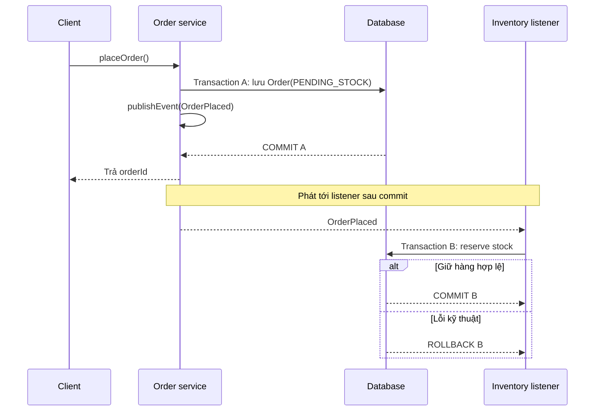
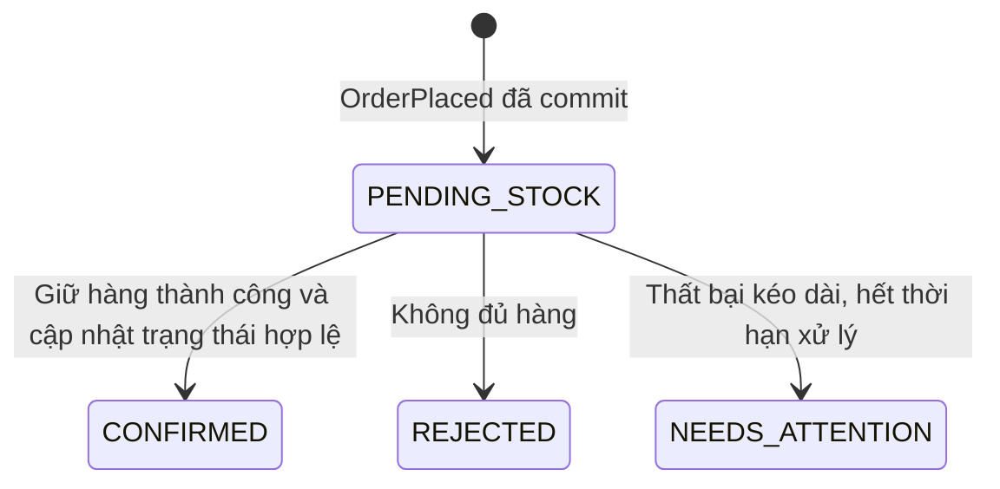
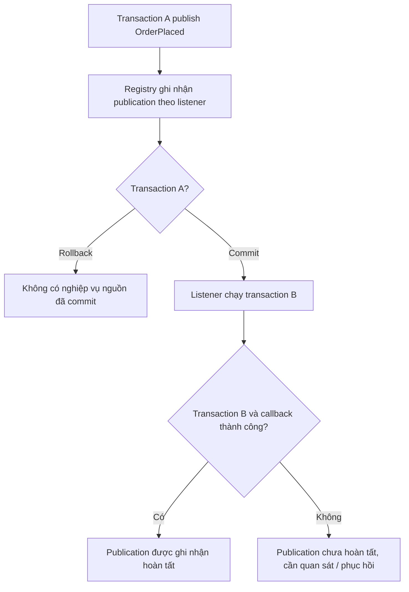
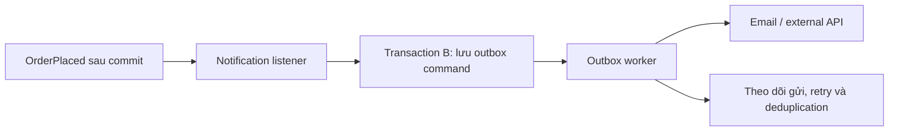

# Listener và transaction mới trong Spring Modulith

## 1. Vấn đề: nhận event sau commit, ghi dữ liệu bằng giao dịch nào?

Trong một ứng dụng Spring Modulith, module `order` nhận đơn hàng và công bố `OrderPlaced`. Module `inventory` cần giữ hàng; `notification` cần gửi thông báo đã tiếp nhận. Các module phản ứng trước một **sự thật nghiệp vụ đã xảy ra** mà không yêu cầu `order` import repository hoặc service nội bộ của bên nhận.

Một câu hỏi quyết định tính đúng đắn là: **listener được kích hoạt sau khi transaction tạo đơn commit thì phần ghi dữ liệu của listener nằm trong transaction nào?** Việc chạy *sau commit* chỉ trả lời **thời điểm** thực thi; nó không tự tạo một transaction mới có khả năng commit dữ liệu của module nhận.

Bài **Listener và transaction mới** thuộc chương **Transactional listener** của **SPRING_MODULITH_APPLICATION_EVENTS**. Toàn bộ module học tập trung vào giao tiếp giữa các Spring Modulith application module qua application events, giữ ranh giới nghiệp vụ, thực hành publisher, listener, xử lý sau commit, Event Publication Registry, retry, kiểm thử và quan sát sự kiện đáng tin cậy.

Học xong, bạn có thể:

1. Giải thích rõ khác biệt giữa **transaction nguồn** và **transaction của listener**.
2. Nêu lý do `AFTER_COMMIT` thường phải kết hợp `REQUIRES_NEW` khi listener ghi database.
3. Dùng `@ApplicationModuleListener` hoặc tổ hợp annotation Spring phù hợp.
4. Phân tích rollback, lỗi sau commit, retry và idempotency mà không nhầm thành một transaction phân tán.
5. Thiết kế kiểm thử xác nhận **dữ liệu đã commit**, không chỉ kiểm tra method được gọi.

## 2. Hai transaction độc lập trong một luồng nghiệp vụ

Xét yêu cầu đặt hàng với trạng thái ban đầu `PENDING_STOCK`:



**Transaction A** thuộc module `order`: ghi đơn và hoàn tất việc tiếp nhận. **Transaction B** thuộc module `inventory`: ghi reservation sau khi đơn đã commit. Nếu B rollback thì A **vẫn đã commit**; một listener không thể quay ngược thời gian để rollback giao dịch nguồn đã kết thúc.

| Đặc tính | Transaction A: publisher | Transaction B: listener |
| --- | --- | --- |
| Bắt đầu từ | Use case đặt hàng (`placeOrder`) | Handler xử lý `OrderPlaced` |
| Module chịu trách nhiệm | `order` | `inventory` |
| Dữ liệu sở hữu | Đơn, trạng thái đơn | Tồn kho, reservation |
| Thời điểm | Trước khi event được xử lý sau commit | Sau khi transaction A commit |
| Kết quả commit | Lưu đơn thành công | Giữ hàng thành công |
| Rollback | Đơn không được commit | Reservation không được commit, **đơn vẫn tồn tại** |
| Cách phục hồi | Tùy use case đặt hàng | Retry/idempotency và xử lý kết quả nghiệp vụ |

Một hệ thống dùng cùng database cho hai module vẫn có thể có **hai transaction độc lập**. Không phải vì các bảng nằm trong cùng cơ sở dữ liệu mà `@ApplicationModuleListener` có thể tham gia lại transaction nguồn đã commit.

### 2.1. Sự khác biệt giữa “thời điểm” và “transaction”

- **`AFTER_COMMIT`**: một listener được gọi khi transaction nguồn đã commit thành công.
- **`REQUIRES_NEW`**: Spring transaction interceptor tạo transaction độc lập mới cho phạm vi thực thi được áp dụng.
- **`@Async`**: bố trí xử lý bất đồng bộ qua executor được cấu hình; không phải lệnh mở database transaction.

Ba ý nghĩa này không thay thế nhau. Một listener có thể chạy sau commit nhưng không có transaction mới; cũng có thể mở transaction mới mà không có callback `AFTER_COMMIT`; hoặc chạy bất đồng bộ trong một transaction khác.

## 3. Vì sao `AFTER_COMMIT` đơn lẻ chưa đủ để ghi dữ liệu?

Với Spring Framework, callback sau commit được kích hoạt **khi transaction gốc đã commit**. Tuy nhiên, ở thời điểm callback này được gọi, một số tài nguyên giao dịch như connection hoặc entity manager có thể vẫn còn gắn với thread trước khi hoàn tất cleanup. Vì thế code truy cập database trong callback có thể vẫn thấy tài nguyên giao dịch cũ.

Hệ quả quan trọng: **không có một lượt commit tiếp theo của transaction nguồn** cho những thay đổi mới được thực hiện trong callback. Do vậy, tài liệu về transactional event listener của Spring khuyến nghị dùng **`PROPAGATION_REQUIRES_NEW`** cho thao tác transactional cần ghi dữ liệu ở giai đoạn sau commit.

Ví dụ dễ gây hiểu nhầm:

```java
@Component
class OrderPlacedListener {

    private final InventoryRepository inventory;

    OrderPlacedListener(InventoryRepository inventory) {
        this.inventory = inventory;
    }

    @TransactionalEventListener(phase = TransactionPhase.AFTER_COMMIT)
    public void on(OrderPlaced event) {
        // Không được mặc nhiên coi save() ở đây sẽ có commit mới.
        // inventory.save(...);
    }
}
```

`InventoryRepository` và dữ liệu ghi là thành phần minh họa. Vấn đề không nằm ở tên `save`, mà ở việc **không có transaction mới được xác lập rõ ràng** cho phần công việc sau commit.

### 3.1. Cách chủ động mở transaction mới

```java
import org.springframework.stereotype.Component;
import org.springframework.transaction.annotation.Propagation;
import org.springframework.transaction.annotation.Transactional;
import org.springframework.transaction.event.TransactionPhase;
import org.springframework.transaction.event.TransactionalEventListener;

@Component
class OrderPlacedListener {

    private final StockReservationService reservations;

    OrderPlacedListener(StockReservationService reservations) {
        this.reservations = reservations;
    }

    @TransactionalEventListener(phase = TransactionPhase.AFTER_COMMIT)
    @Transactional(propagation = Propagation.REQUIRES_NEW)
    public void on(OrderPlaced event) {
        reservations.reserveOnce(event.orderId());
    }
}
```

`StockReservationService` là kiểu do ứng dụng tự xây dựng. Đoạn ví dụ minh họa phối hợp `@TransactionalEventListener` với `@Transactional(propagation = REQUIRES_NEW)` trên phương thức callback. Tùy cách tổ chức bean, cũng có thể đặt transaction mới ở **service khác** được listener gọi qua Spring proxy, giúp phân tách điều phối event và xử lý nghiệp vụ.

Điều kiện quan trọng là lời gọi được **Spring intercept đúng cách**, với transaction manager có quyền điều khiển tài nguyên cần ghi; nếu dùng các loại proxy/cấu hình khác nhau, cần kiểm thử việc commit chứ không chỉ nhìn annotation.

### 3.2. Không dùng `REQUIRED` chỉ vì nó là mặc định

Nếu một method sử dụng `@Transactional` với propagation mặc định `REQUIRED`, Spring sẽ tham gia transaction hiện có **nếu có**; khi được gọi ở thời điểm sau commit, trạng thái tài nguyên có thể chưa được cleanup như bình thường. Vì thế không nên dựa vào `REQUIRED` một cách mơ hồ để đảm bảo ghi dữ liệu bền vững từ callback `AFTER_COMMIT`.

**`REQUIRES_NEW` thể hiện ý định rõ hơn:** phần việc của consumer cần transaction độc lập, commit hoặc rollback riêng. Điều này càng quan trọng khi thay đổi annotation, executor hoặc cách gọi service trong tương lai.

## 4. `@ApplicationModuleListener` kết hợp các ý nghĩa ra sao?

Spring Modulith cung cấp `org.springframework.modulith.events.ApplicationModuleListener`, một annotation tiện ích cho giao tiếp giữa các application module. Trong cấu hình Spring Modulith thông dụng, nó tổng hợp:

- `@TransactionalEventListener`: phản ứng theo transaction phase, mặc định sau commit.
- `@Async`: thực hiện handler bất đồng bộ theo executor.
- `@Transactional(propagation = REQUIRES_NEW)`: chạy công việc listener trong transaction mới.

Do đó:

```java
@Component
class ReserveStockWhenOrderPlaced {

    private final StockReservationService reservations;

    ReserveStockWhenOrderPlaced(StockReservationService reservations) {
        this.reservations = reservations;
    }

    @ApplicationModuleListener
    void on(OrderPlaced event) {
        reservations.reserveOnce(event.orderId());
    }
}
```

là một cách thể hiện ý định **nhận sự kiện sau commit, xử lý độc lập và có transaction mới** mà không phải tự lặp cả ba annotation. Ví dụ thiếu phần khai báo import để tập trung vào semantics; khi triển khai cần import `org.springframework.modulith.events.ApplicationModuleListener` và các kiểu của ứng dụng.

### 4.1. Bảng so sánh các cơ chế phổ biến

| Cơ chế | Gắn phase commit? | Bất đồng bộ mặc định? | Mở transaction mới mặc định? | Dùng khi |
| --- | --- | --- | --- | --- |
| `@EventListener` | Không | Không | Không | Phản ứng đồng bộ hoặc xử lý nội bộ có chủ đích |
| `@TransactionalEventListener(AFTER_COMMIT)` | Có | Không | Không | Chỉ cần chạy sau commit, hoặc tự cấu hình transaction |
| `@TransactionalEventListener` + `@Transactional(REQUIRES_NEW)` | Có | Không | Có, khi interceptor áp dụng | Muốn xử lý đồng bộ sau commit nhưng commit dữ liệu listener độc lập |
| `@ApplicationModuleListener` | Có (sau commit) | Có | Có | Consumer module khác làm việc độc lập sau commit |

**Lưu ý:** `@TransactionalEventListener` thông thường không tự biến method thành async. Việc bật custom multicaster hoặc `@Async` có thể thay đổi đường thực thi, vì vậy kiểm thử phải dùng đúng cấu hình. Với `@ApplicationModuleListener`, khả năng chạy async và transaction mới phụ thuộc hạ tầng Spring cần thiết được bật và quản lý đúng.

### 4.2. Mặc định không có transaction nguồn thì sao?

Transactional event listener được đăng ký để phản ứng theo transaction. Khi event được publish **ngoài transaction phù hợp**, listener transactional mặc định không thực thi callback. Một số annotation/configuration cho phép `fallbackExecution = true`, nhưng khi fallback xảy ra thì **không có commit nguồn để đợi**; cách xử lý đó khác về hợp đồng.

Đừng bật fallback chỉ để integration test trông có vẻ PASS. Nếu contract của `OrderPlaced` yêu cầu được phát trong transaction tạo đơn, test cần bắt đầu và commit transaction thật, rồi chứng minh listener xử lý. Nếu ứng dụng hỗ trợ phát ngoài transaction, cần mô tả và kiểm thử ngữ nghĩa ấy riêng.

### 4.3. Kiểu API công khai và trạng thái nguồn

Đặt event ở API công khai của module sở hữu sự thật. Listener `inventory` chỉ import kiểu `order.OrderPlaced`, không import `order.internal.OrderRepository`; event nên mang dữ liệu snapshot cần thiết thay vì entity JPA. Điều này giúp tránh lazy loading ngoài transaction và giúp transaction B không phải đọc trực tiếp dữ liệu riêng của transaction A.

## 5. Ví dụ từ publisher đến transaction mới của consumer

Hãy thiết kế rõ hai ranh giới:

```text
com.example.shop
├── ShopApplication.java
├── order/
│   ├── OrderPlaced.java                   # Event contract công khai
│   └── internal/
│       ├── PlaceOrderService.java          # Publisher, transaction A
│       └── OrderRepository.java
└── inventory/
    └── internal/
        ├── ReserveStockOnOrderPlaced.java # Listener, transaction B
        ├── StockReservationService.java   # Nghiệp vụ giữ hàng
        └── ReservationRepository.java
```

Theo cấu trúc module Spring Modulith mặc định, package con trực tiếp dưới package ứng dụng thường là application module. Chỉ `OrderPlaced` nằm ở bề mặt công khai của `order`; các repository nằm trong `internal`. Điều này cho phép `inventory` phản ứng qua event mà vẫn giữ ranh giới trách nhiệm.

### 5.1. Contract sự kiện bất biến

```java
// com/example/shop/order/OrderPlaced.java
package com.example.shop.order;

import java.time.Instant;
import java.util.List;
import java.util.Objects;
import java.util.UUID;

public record OrderPlaced(
        UUID eventId,
        UUID orderId,
        Instant occurredAt,
        List<Line> lines
) {
    public OrderPlaced {
        Objects.requireNonNull(eventId, "eventId");
        Objects.requireNonNull(orderId, "orderId");
        Objects.requireNonNull(occurredAt, "occurredAt");
        lines = List.copyOf(Objects.requireNonNull(lines, "lines"));
        if (lines.isEmpty()) {
            throw new IllegalArgumentException("lines must not be empty");
        }
    }

    public record Line(UUID skuId, int quantity) {
        public Line {
            Objects.requireNonNull(skuId, "skuId");
            if (quantity <= 0) {
                throw new IllegalArgumentException("quantity must be positive");
            }
        }
    }
}
```

`eventId` định danh một sự kiện đã công bố; `orderId` định danh đơn; `occurredAt` là mốc nghiệp vụ xảy ra, không phải mốc listener bắt đầu. Khi cùng publication được xử lý lại, phải giữ các giá trị gốc, không tạo `eventId` hay timestamp mới.

### 5.2. Publisher sở hữu transaction A

```java
// Trích đoạn thuộc com.example.shop.order.internal.PlaceOrderService
@Service
class PlaceOrderService {
    private final OrderRepository orders;
    private final ApplicationEventPublisher events;
    private final Clock clock;

    PlaceOrderService(OrderRepository orders,
                      ApplicationEventPublisher events,
                      Clock clock) {
        this.orders = orders;
        this.events = events;
        this.clock = clock;
    }

    @Transactional
    public UUID place(PlaceOrderCommand command) {
        Order order = orders.save(Order.placePendingStock(command));

        var lines = order.lines().stream()
                .map(line -> new OrderPlaced.Line(
                        line.skuId(), line.quantity()))
                .toList();

        events.publishEvent(new OrderPlaced(
                UUID.randomUUID(), order.id(), clock.instant(), lines));

        return order.id();
    }
}
```

`OrderRepository`, `Order`, `PlaceOrderCommand` là các kiểu do ứng dụng định nghĩa; đây là trích đoạn tập trung vào ranh giới transaction và event, không phải dự án đủ các class/import để biên dịch độc lập. `events` là `ApplicationEventPublisher`, còn `clock` là `java.time.Clock` được inject (ví dụ với bean `Clock.systemUTC()`).

Khi Spring transaction interceptor quản lý đúng đường gọi `place(...)`, việc `publishEvent` diễn ra **trong transaction A**, trước khi commit. Nếu A rollback, sự thật “đơn đã được ghi nhận thành công” chưa trở thành bền vững; listener sau commit không được tiếp tục xử lý nó như một đơn đã lưu.

### 5.3. Consumer sở hữu transaction B

```java
// com/example/shop/inventory/internal/ReserveStockOnOrderPlaced.java
package com.example.shop.inventory.internal;

import com.example.shop.order.OrderPlaced;
import org.springframework.modulith.events.ApplicationModuleListener;
import org.springframework.stereotype.Component;

@Component
class ReserveStockOnOrderPlaced {
    private final StockReservationService reservations;

    ReserveStockOnOrderPlaced(StockReservationService reservations) {
        this.reservations = reservations;
    }

    @ApplicationModuleListener
    void on(OrderPlaced event) {
        var lines = event.lines().stream()
                .map(line -> new ReservationLine(
                        line.skuId(), line.quantity()))
                .toList();

        reservations.reserveOnce(event.orderId(), lines);
    }
}
```

`StockReservationService` và `ReservationLine` thuộc `inventory.internal`, tự kiểm tra số lượng tồn và lưu reservation. `ReserveStockOnOrderPlaced` là **adapter nhận sự kiện**: nó không tự quyết định validation, dữ liệu hay transaction của `order`.

Trong ví dụ này, listener nằm trong transaction B do `@ApplicationModuleListener` cung cấp. Nếu `reserveOnce` dùng repository tham gia cùng transaction manager, các thay đổi dữ liệu của `inventory` được commit/rollback trong B. Nếu code gọi nhiều database/transaction manager hoặc hệ thống ngoài, không thể tự suy ra mọi thay đổi đều nguyên tử: phải xác định resource nào thuộc transaction B.

### 5.4. Nếu muốn service nội bộ tự khai báo transaction?

Có thể chuyển ranh giới transaction tới service được Spring quản lý:

```java
@Service
class StockReservationService {

    @Transactional(propagation = Propagation.REQUIRES_NEW)
    public void reserveOnce(UUID orderId, List<ReservationLine> lines) {
        // Validate, reserve and save within a transaction.
    }
}
```

Khi lời gọi **đi qua Spring proxy của bean này**, transaction interceptor có thể mở một transaction mới cho use case. Nếu adapter vốn đã được bao bởi `@ApplicationModuleListener` với `REQUIRES_NEW`, thêm `REQUIRES_NEW` ở service **có thể tạo transaction B2 lồng về mặt lời gọi nhưng độc lập với B**, thay vì chỉ bảo vệ cùng transaction B. Đây không phải lúc nào cũng mong muốn.

**Quyết định rõ transaction nằm ở đâu.** Nếu service dùng `@Transactional(REQUIRED)` và được gọi trong B của listener thì nó có thể tham gia B; nếu service thực sự cần một ranh giới B2 độc lập, chỉ khi đó mới chọn `REQUIRES_NEW` ở service. Tránh gắn annotation transaction trùng lặp mà không hiểu propagation.

## 6. So sánh `REQUIRED`, `REQUIRES_NEW` và `NESTED`

Ba propagation này có tên dễ nhầm nhưng semantics rất khác:

| Propagation | Khi có transaction hiện tại | Khi không có transaction | Dùng trong listener |
| --- | --- | --- | --- |
| `REQUIRED` | Tham gia transaction hiện có | Mở transaction mới | Hợp lý cho service nội bộ tham gia B đã mở |
| `REQUIRES_NEW` | Tạm gác transaction hiện có, mở một transaction độc lập | Mở transaction mới | Bắt buộc cân nhắc khi ghi dữ liệu trong callback sau commit; dùng để tách B khỏi A |
| `NESTED` | Dùng savepoint nếu transaction manager hỗ trợ | Có thể hoạt động như `REQUIRED` tùy cấu hình | Không thay thế transaction B độc lập; vẫn phụ thuộc transaction ngoài |

`REQUIRES_NEW` không đồng nghĩa một lời gọi chạy trên thread khác. Nó mô tả **ranh giới transaction**. Trong khi đó, `@Async` nói về **đường thực thi bất đồng bộ**; executor tạo hoặc sử dụng thread khác, và transaction context dạng thread-local không tự chuyển theo.

### 6.1. Self-invocation: annotation có nhưng interceptor không chạy

```java
@Service
class InventoryService {

    public void react(OrderPlaced event) {
        reserveInNewTransaction(event.orderId());
    }

    @Transactional(propagation = Propagation.REQUIRES_NEW)
    public void reserveInNewTransaction(UUID orderId) {
        // Ghi database.
    }
}
```

Nếu `react()` gọi `reserveInNewTransaction()` trực tiếp **trong cùng object** bằng cơ chế gọi nội bộ thông thường, lời gọi có thể bỏ qua Spring AOP proxy. Khi đó annotation không tạo transaction B mới như người viết kỳ vọng. Một cách an toàn là đặt method transactional trên **bean khác** rồi gọi qua bean được Spring inject; hoặc chọn transaction programmatic với `TransactionTemplate` khi cần kiểm soát ranh giới rõ.

### 6.2. TransactionTemplate là lựa chọn tường minh

```java
@Component
class ReserveStockOnOrderPlaced {
    private final TransactionTemplate newTransaction;
    private final StockReservationService reservations;

    ReserveStockOnOrderPlaced(TransactionTemplate template,
                             StockReservationService reservations) {
        this.newTransaction = template;
        this.reservations = reservations;
    }

    @TransactionalEventListener(phase = TransactionPhase.AFTER_COMMIT)
    void on(OrderPlaced event) {
        var lines = event.lines().stream()
                .map(line -> new ReservationLine(
                        line.skuId(), line.quantity()))
                .toList();

        newTransaction.executeWithoutResult(status -> {
            reservations.reserveOnce(event.orderId(), lines);
        });
    }
}
```

Đây là **phác thảo** để thấy chỗ bắt đầu transaction; `StockReservationService`, `ReservationLine` và các import tương ứng do ứng dụng định nghĩa. Trong thực tế bean `TransactionTemplate` inject vào đây **phải được cấu hình `PROPAGATION_REQUIRES_NEW`** cho callback sau commit; đồng thời phải chọn đúng transaction manager. Dùng template mặc định `REQUIRED` ở after-commit **không giải quyết rõ ràng** vấn đề tài nguyên transaction nguồn còn gắn với thread.

Ví dụ cấu hình ý tưởng:

```java
TransactionTemplate newTransaction = new TransactionTemplate(transactionManager);
newTransaction.setPropagationBehavior(
        TransactionDefinition.PROPAGATION_REQUIRES_NEW);
```

`transactionManager` phải là manager điều phối đúng database mà listener sẽ ghi. Cấu hình trong code thực tế nên có bean hoặc factory rõ, không tạo template mới tùy tiện trong mỗi callback.

### 6.3. Tài nguyên và connection pool

`REQUIRES_NEW` có thể cần connection độc lập khi một transaction ngoài vẫn giữ tài nguyên. Nếu nhiều luồng hoặc nhiều transaction lồng nhau cùng giữ connection, pool quá nhỏ có thể gây chờ hoặc cạn connection. Với listener bất đồng bộ có thread pool, hãy cân đối kích thước executor, pool kết nối và giới hạn concurrency; không phải cứ tăng số listener thread là cải thiện hiệu năng.

Đừng dựa vào `@Async` để sửa vấn đề transaction propagation: chạy trên thread mới có thể tránh gắn tài nguyên transaction nguồn, nhưng nếu method cần ghi dữ liệu bền vững thì **vẫn cần transaction được quản lý rõ**.

## 7. Rollback của hai transaction có tác động thế nào?

Một cơ chế test hoặc debug tốt phải chỉ rõ vị trí lỗi và transaction nào đã commit:

| Tình huống | Transaction A của order | Transaction B của inventory | Hệ quả |
| --- | --- | --- | --- |
| Validation thất bại trước khi phát event | Rollback/không tạo đơn | Không chạy | Không có đơn đã lưu |
| Phát event rồi A rollback | Rollback | Listener after-commit không chạy cho A | Không được giữ hàng theo đơn chưa commit |
| A commit, listener đợi trong executor | Commit | Chưa bắt đầu | Đơn ở `PENDING_STOCK`, chờ consumer |
| A commit, B ghi reservation thành công | Commit | Commit | Đơn tồn tại, reservation đã lưu |
| A commit, B ném exception trước commit | Commit | Rollback | Reservation chưa hoàn tất, cần xử lý lại |
| A commit, B commit nhưng đánh dấu publication hoàn tất lỗi | Commit | Có thể đã commit | Retry phải chống giữ hàng trùng |
| A commit, `inventory` hết hàng | Commit | Có thể commit kết quả từ chối | Không tự động retry lỗi nghiệp vụ cố định |
| A commit, `notification` thất bại sau B thành công | Commit | Inventory đã commit | Tách trạng thái các consumer; không rollback ngược B |

Nếu một callback `AFTER_COMMIT` **đồng bộ** ném exception khiến caller cuối cùng nhận HTTP 500, vẫn có khả năng **transaction A đã commit xong**. Vì vậy không được suy luận “HTTP lỗi thì đơn chắc chắn chưa tồn tại” nếu exception phát sinh sau commit. Đối với `@ApplicationModuleListener` bất đồng bộ, lỗi của consumer thường được xử lý qua executor và hạ tầng event, không tự biến thành rollback của request tạo đơn.

### 7.1. Thiết kế trạng thái thay vì kỳ vọng một transaction khổng lồ



`PENDING_STOCK` là trạng thái có ý nghĩa nghiệp vụ vì B có thể chưa xảy ra khi A đã commit. Khi B kết thúc, module sở hữu trạng thái đơn hoặc một module điều phối được phép cập nhật theo hợp đồng công khai; `inventory` không nên sửa bảng/entity riêng của `order`.

## 8. Event Publication Registry: lỗi sau commit không được làm mất công việc

Listener bất đồng bộ sau commit đem lại ranh giới rõ nhưng cũng tạo một **khoảng thời gian dễ gặp lỗi**: transaction A đã commit, trong khi B chưa bắt đầu hoặc chưa hoàn tất. Ứng dụng có thể bị dừng, executor quá tải hoặc listener ném exception.

Spring Modulith có **Event Publication Registry** để theo dõi việc phát tới những transactional listener đủ điều kiện, khi ứng dụng đã cấu hình phần lưu trữ tương ứng. Registry hỗ trợ biết publication nào chưa được ghi nhận hoàn tất và cung cấp nền tảng cho cơ chế khôi phục phù hợp phiên bản/cấu hình.



Sơ đồ là mô hình khái niệm: cách registry ghi, truy vấn, đánh dấu hoàn tất hay dọn publication phụ thuộc loại repository và phiên bản Spring Modulith. **Không mặc định** mọi ứng dụng có registry bền vững chỉ vì đã dùng `@ApplicationModuleListener`; cần kiểm chứng dependency, cấu hình lưu trữ và luồng phục hồi thực tế.

### 8.1. Hoàn tất listener và hoàn tất nghiệp vụ không đồng nghĩa

Nếu transaction B commit reservation và listener trả về thành công, publication đến `inventory` có thể được đánh dấu hoàn tất. Nhưng nếu `notification` vẫn gửi email thất bại, publication của `notification` có thể còn chưa hoàn tất.

Mặt khác, callback `inventory` có thể trả về bình thường sau khi **chỉ khởi chạy một tác vụ bên ngoài chưa được lưu bền vững**. Khi đó completion mới phản ánh callback kết thúc, chưa chứng minh nghiệp vụ đã hoàn thành.

Nên định nghĩa rõ hợp đồng từng listener: **thành công là ghi kết quả nghiệp vụ, hay ghi một yêu cầu outbox bền vững để hệ thống khác xử lý tiếp?** Chỉ ghi “listener hoàn tất” là chưa đủ.

### 8.2. Khoảng lỗi sau khi B commit nhưng trước khi registry ghi completion

```text
T1. OrderPlaced(eventId=E1, orderId=O42) được giao tới inventory.
T2. Transaction B commit Reservation(orderId=O42).
T3. Ứng dụng hoặc kết nối gặp lỗi trước khi ghi nhận completion.
T4. Registry vẫn có thể xem publication E1 là chưa hoàn tất.
T5. Khi phục hồi, handler nhận lại chính event E1.
```

Nếu `reserveOnce` trừ tồn kho lần hai, hệ thống sai dữ liệu dù logic phục hồi đang cố thực hiện đúng mục tiêu: **hoàn thành publication chưa được xác nhận**. Vì vậy transaction mới và Event Publication Registry phải đi kèm **idempotency**; không nên hứa hẹn “exactly-once side effects” chỉ dựa vào hai cơ chế này.

### 8.3. Không nuốt exception nếu công việc chưa hoàn tất

```java
@ApplicationModuleListener
void on(OrderPlaced event) {
    try {
        reservations.reserveOnce(event.orderId());
    } catch (RuntimeException exception) {
        log.warn("Reservation failed", exception);
        // Nuốt exception và trả về bình thường.
    }
}
```

Đây là ví dụ **anti-pattern**; `reservations` và `log` là field giả định. Nếu database không commit được reservation nhưng listener không báo lỗi, hạ tầng có thể coi callback hoàn tất và publication có thể được đánh dấu thành công. Chỉ ghi log không làm callback trở thành một xử lý thất bại trong mắt cơ chế theo dõi.

Lỗi kỹ thuật cần retry nên được phản ánh đúng vào cơ chế lỗi. Ngược lại, tình huống **không đủ hàng** có thể là một **kết quả nghiệp vụ hợp lệ**: listener ghi kết quả `REJECTED_OUT_OF_STOCK` một cách bền vững rồi kết thúc thành công; không được coi đó là database timeout để retry vô hạn.

## 9. Idempotency phải nằm trong transaction của consumer

Với reservation, bất biến thường là: **không giữ hàng hai lần cho cùng đơn và cùng mục đích reservation**. Định danh `eventId` giúp phát hiện lặp một event; `(orderId, purpose)` là một ví dụ về khóa nghiệp vụ chống lặp tác dụng phụ.

```text
Nhận E1/O42 lần đầu:
    INSERT reservation(orderId=O42, purpose=INITIAL_HOLD)
    Giảm tồn khả dụng theo quy tắc tồn kho
    COMMIT B

Nhận lại E1/O42:
    Phát hiện reservation hợp lệ đã tồn tại
    Không giảm tồn lần thứ hai
    Trả kết quả đã xử lý
```

### 9.1. Ràng buộc dữ liệu mới giúp chống xử lý đồng thời

Một kiểu repository có thể kiểm tra `existsByOrderIdAndPurpose`, nhưng kiểm tra rồi mới insert **không tự bảo đảm** tránh cạnh tranh:

```text
Listener 1: SELECT chưa có reservation
Listener 2: SELECT chưa có reservation
Listener 1: INSERT reservation
Listener 2: INSERT reservation
```

Phải thiết kế cùng transaction B với **unique constraint** trên khóa nghiệp vụ phù hợp, locking và điều kiện cập nhật tồn có tính nguyên tử. Một phương án có thể là `UNIQUE(order_id, purpose)`, song schema thực tế phụ thuộc mô hình reservation; không lấy ví dụ này làm quy tắc bất biến cho mọi hệ thống.

Khi gặp conflict unique, đừng nuốt mọi `DataIntegrityViolationException`: cần đọc bản ghi đã tồn tại và xác minh cùng ý nghĩa/yêu cầu hay không. Dữ liệu từ hai event khác nhau có cùng order ID nhưng payload khác biệt phải được phân biệt với một lần xử lý lặp hợp lệ.

### 9.2. Event ID, aggregate version và thứ tự

Ngay cả khi mỗi `OrderPlaced` mang `occurredAt`, nó **không bảo đảm thứ tự xử lý**. Hai listener chạy async có thể nhận event sau một event được phát muộn hơn; retry càng làm thời điểm xử lý lệch khỏi thời điểm tạo.

Nếu một aggregate có các sự kiện `OrderPlaced`, `OrderCancelled`, hãy cân nhắc thêm **aggregate version** do module sở hữu sinh ra và trạng thái hợp lệ để không xử lý `OrderPlaced` cũ làm sống lại reservation đã hủy. Đồng hồ và thứ tự callback không thay thế được quy tắc chuyển trạng thái nghiệp vụ.

## 10. Side effect ngoài transaction B: email, REST và outbox

Một transaction mới chỉ quản lý những resource mà transaction manager kiểm soát. Gửi email hoặc gọi payment provider thường **không được rollback** khi database transaction B thất bại.

Ví dụ với module `notification`:

```text
Transaction A (order): commit đơn.
Notification listener bắt đầu.
Email provider chấp nhận email.
Ứng dụng crash trước khi ghi trạng thái đã gửi/completion.
Publication cần retry.
Lần retry có thể gửi email thêm lần nữa.
```

Không giải quyết được rủi ro này chỉ bằng `@Transactional(REQUIRES_NEW)` quanh lệnh `mailGateway.send(...)`. Muốn có đường ghi nhận bền vững, hãy cân nhắc **transactional outbox**:



Khi listener chỉ ghi outbox trong transaction B, **publication của listener hoàn tất ở thời điểm yêu cầu gửi đã được lưu bền vững**, còn việc thực sự gửi thành công thuộc vòng đời riêng của outbox worker. Không gọi trạng thái này là “khách đã nhận email”.

| Công việc | Kết quả có thể bảo vệ trong B? | Cần bổ sung |
| --- | --- | --- |
| Tạo reservation trong database của inventory | Có, với transaction/lock/constraint phù hợp | Idempotency khi replay publication |
| Ghi outbox command trong cùng database | Có, nếu cùng transaction manager | Worker xử lý outbox và chống gửi trùng |
| Gửi email trực tiếp | Không bảo đảm atomic với B | Deduplication, đối soát và/hoặc outbox |
| Gọi payment gateway | Không mặc nhiên atomic với B | Idempotency key phía provider, truy vấn trạng thái/bù |
| Ghi vào database khác với transaction manager riêng | Không mặc nhiên atomic với B | Quy trình phối hợp, sự kiện kết quả và nhất quán cuối cùng |

## 11. Giới hạn hiệu năng và concurrency của transaction mới

Sự tách biệt giữa A và B rất hữu ích nhưng không có nghĩa có thể chạy vô hạn listener cùng lúc. Một ứng dụng nhiều event cần xem xét:

1. **Executor bất đồng bộ:** số worker thread, queue, chính sách quá tải và shutdown ảnh hưởng thời điểm B được chạy.
2. **Connection pool:** mỗi transaction B cần connection và có thể chờ lock trên cùng bản ghi tồn kho.
3. **Transaction duration:** listener giữ transaction quá lâu gây cạnh tranh tài nguyên; tránh gọi HTTP chậm trong transaction database nếu không thực sự cần.
4. **Concurrency theo khóa nghiệp vụ:** hai event cho cùng SKU hoặc order có thể chạy đồng thời; locking hoặc optimistic versioning cần được kiểm thử.
5. **Thứ tự và nhận lặp:** không suy ra executor xử lý từng order theo thứ tự tuyệt đối nếu không có cơ chế điều phối tương ứng.
6. **Backpressure:** khi tốc độ phát event vượt năng lực xử lý của consumer, publication chưa hoàn tất có thể tăng. Cần chỉ số và chính sách xử lý tồn đọng.

**Một transaction mới không tự khiến listener trở nên đáng tin cậy hơn nếu quá trình thực thi có thể bị mất trước khi bắt đầu.** Độ tin cậy cần kết hợp persistence publication, idempotency và giám sát.

## 12. Kiểm thử transaction mới thực sự đã commit

Một unit test gọi trực tiếp `listener.on(event)` chỉ kiểm tra logic Java và mapping payload; nó **không chứng minh** listener được Spring đăng ký đúng phase, transaction A đã commit, hay B được mở bởi transaction interceptor. Cần kết hợp unit test với integration test dùng Spring context và database phù hợp.

### 12.1. Kiểm thử sau commit và rollback bằng transaction rõ ràng

Với `@TransactionalEventListener(AFTER_COMMIT)` đồng bộ, có thể dùng `TransactionTemplate` để tạo ranh giới A và một test fixture nhận event. Ví dụ:

```java
// Test trong Spring context, dùng các bean transactionTemplate,
// publisher và probe được inject từ fixture.
@Test
void notifiesAfterCommitButNotBefore() {
    UUID orderId = UUID.randomUUID();
    OrderPlaced event = testOrderPlaced(orderId);

    transactionTemplate.executeWithoutResult(status -> {
        publisher.publishEvent(event);
        assertThat(probe.received(orderId)).isFalse();
    });

    assertThat(probe.received(orderId)).isTrue();
}
```

`probe` trong ví dụ là **listener test đồng bộ** được đăng ký với `@TransactionalEventListener(phase = AFTER_COMMIT)`. `testOrderPlaced(...)` là factory event trong test. Không dùng assertion ngay sau transaction cho `@ApplicationModuleListener` bất đồng bộ vì thread xử lý có thể chưa hoàn tất.

Rollback test tương ứng:

```java
@Test
void doesNotNotifyAfterSourceRollback() {
    UUID orderId = UUID.randomUUID();
    OrderPlaced event = testOrderPlaced(orderId);

    transactionTemplate.executeWithoutResult(status -> {
        publisher.publishEvent(event);
        status.setRollbackOnly();
    });

    assertThat(probe.received(orderId)).isFalse();
}
```

Các test này cần fixture tách biệt, dữ liệu/probe được reset giữa các test và một transaction manager thật. Đừng gắn `@Transactional` lên cả method test rồi giả định có commit: nhiều Spring test mặc định rollback khi method kết thúc, nên callback `AFTER_COMMIT` có thể không chạy.

### 12.2. Kiểm tra transaction B bằng dữ liệu bền vững

Để chứng minh `@ApplicationModuleListener` thực sự commit B:

1. Gọi use case `order.place(...)` qua Spring-managed bean với transaction A thật.
2. Đợi transaction A commit và có `orderId`.
3. Đợi một điều kiện database bền vững trong `inventory`, ví dụ `Reservation` đã được ghi, thay vì chỉ đợi method callback được gọi.
4. Đọc reservation bằng transaction hoặc entity manager mới để loại trừ dữ liệu chỉ còn trong persistence context cũ.
5. Xác nhận một rollback có chủ đích trong transaction B **không xóa** `Order` đã commit ở A.

Ví dụ dùng Awaitility nếu dự án có dependency test này:

```java
UUID orderId = orderService.place(command); // Transaction A kết thúc qua proxy.

await().atMost(Duration.ofSeconds(10))
       .untilAsserted(() ->
           assertThat(reservationQueries.countByOrderId(orderId))
                   .isEqualTo(1)
       );
```

`orderService`, `command`, `reservationQueries` là test fixture do ứng dụng định nghĩa; `await()` thuộc Awaitility, không phải API mặc định của Spring Modulith. Test phải bảo đảm `orderService.place(...)` đã thực sự được gọi qua transactional proxy và không còn transaction bao ngoài đang mở. Thời hạn chờ nên có giới hạn và kết quả phải được khẳng định từ **nguồn dữ liệu bền vững**.

### 12.3. Kiểm thử thất bại và replay

Hãy chủ động gây lỗi trong `inventory` lần đầu, rồi xác nhận:

```text
1. Order đã commit: truy vấn vẫn thấy trạng thái PENDING_STOCK.
2. Inventory transaction B rollback: không có reservation commit.
3. Khi registry được cấu hình, publication cần phục hồi còn nhận diện được.
4. Sau khi sửa lỗi, chạy lại đúng publication / listener theo API phù hợp.
5. Inventory commit reservation; publication có thể được đánh dấu hoàn tất.
6. Retry thêm cùng event không làm giảm tồn hoặc thêm reservation lần nữa.
```

Trường hợp **B commit nhưng đánh dấu completion thất bại** quan trọng hơn một lỗi trước khi xử lý vì nó kiểm chứng idempotency thực sự. Cần có kiểm thử repository/database cho unique constraint trong điều kiện cạnh tranh và không chỉ dựa vào mock.

### 12.4. Kiểm tra ranh giới module

```java
package com.example.shop;

import org.junit.jupiter.api.Test;
import org.springframework.modulith.core.ApplicationModules;

class ModularityTests {

    @Test
    void respectsApplicationModuleBoundaries() {
        ApplicationModules.of(ShopApplication.class).verify();
    }
}
```

`ShopApplication` là lớp `@SpringBootApplication` giả định ở package gốc. Phép `verify()` giúp phát hiện phụ thuộc vòng và tham chiếu không hợp lệ vào implementation của module khác. Nó **không kiểm chứng** transaction B có thật hay không; cần integration test riêng.

### 12.5. Ma trận xác minh tối thiểu

| Test | Điều chứng minh | Lỗi có thể phát hiện |
| --- | --- | --- |
| A commit, B thành công | Cả đơn và reservation được commit | Listener không mở/commit B |
| A rollback | Không có tác dụng sau commit | Dùng `@EventListener` đồng bộ sai mục đích |
| A commit, B ném lỗi | Đơn vẫn tồn tại, reservation không commit | Hiểu nhầm rollback liên module |
| B thành công, completion thất bại, replay | Reservation vẫn chỉ một | Thiếu idempotency |
| Hai replay cùng order đồng thời | Ràng buộc dữ liệu bảo vệ bất biến | Race condition check-then-insert |
| Listener nuốt exception | Phát hiện callback báo thành công giả | Registry ghi nhận completion không đúng thực tế |
| Consumer ghi outbox | Outbox được commit độc lập với email | Nhầm hoàn tất listener với email đã giao |
| Tăng concurrency | Không cạn pool/deadlock kéo dài | Pool kết nối và executor cấu hình thiếu |

## 13. Quan sát transaction B và publication đang chờ

Trong vận hành, số HTTP request tạo đơn thành công **không nói lên** bao nhiêu listener đã hoàn tất. Một dashboard chỉ đếm `OrderPlaced` đã phát cũng không phản ánh tình trạng giữ hàng.

Các thông tin nên thu thập (tên field là **quy ước minh họa của ứng dụng**, không phải schema bắt buộc của Spring Modulith):

| Thuộc tính | Dùng để |
| --- | --- |
| `eventId`, `orderId` | Kết nối log của publisher và các consumer |
| `listener`/`consumerModule` | Biết chính xác publication đích nào còn lỗi |
| `occurredAt`, `receivedAt` | Ước tính độ trễ phát đến nhận; phân biệt timestamp nguồn |
| `transactionOutcome` | Phân biệt commit B, rollback B và kết quả nghiệp vụ |
| `attempt`, `failureCategory` | Theo dõi số lần retry và nhóm lỗi |
| `publicationStatus` | Xác định publication đã hoàn tất hoặc còn chờ, khi registry được cấu hình |
| `reservationStatus` | Biết ý nghĩa nghiệp vụ, không chỉ trạng thái hạ tầng |

Ví dụ log cấu trúc ở consumer:

```text
eventType=OrderPlaced
eventId=E1
orderId=O42
consumerModule=inventory
listener=ReserveStockOnOrderPlaced
transactionOutcome=ROLLED_BACK
failureCategory=TRANSIENT_DATABASE_ERROR
publicationStatus=INCOMPLETE
```

Log này chỉ là **ví dụ**, các trường cần lấy từ telemetry thực tế chứ không đoán trạng thái publication. Không ghi mật khẩu hoặc dữ liệu cá nhân không cần thiết trong log. ID của từng đơn phù hợp với log/trace, **không nên dùng làm metric label có cardinality rất cao**.

Các chỉ số nên theo dõi là số publication chưa hoàn tất theo listener, tuổi publication lâu nhất, tỷ lệ callback lỗi, thời gian B xử lý, số lần idempotency chặn trùng, số đơn kẹt `PENDING_STOCK` và mức sử dụng connection pool/executor.

## 14. Những hiểu nhầm cần tránh

| Hiểu nhầm | Điều đúng cần ghi nhớ |
| --- | --- |
| “AFTER_COMMIT nghĩa là tự có transaction mới.” | Phase của listener và propagation là hai khía cạnh khác nhau. |
| “`@Transactional` với mặc định REQUIRED luôn an toàn sau commit.” | Cần nhận diện tài nguyên còn gắn với thread; dùng `REQUIRES_NEW` khi cần một transaction độc lập. |
| “Chỉ cần dùng `@Async` là có transaction riêng.” | `@Async` chỉ đổi đường thực thi; transaction phải được khai báo/quản lý. |
| “`REQUIRES_NEW` làm cả A và B commit/rollback chung.” | B độc lập; không rollback ngược A đã commit. |
| “Gọi method `@Transactional` bằng `this.method()` luôn kích hoạt transaction.” | Với proxy AOP thông thường, self-invocation có thể bỏ qua interceptor. |
| “Mọi repository trong callback dùng cùng transaction B.” | Cần xem transaction manager, data source, propagation và tài nguyên thật sự. |
| “Đã có Event Publication Registry thì không nhận trùng.” | Publication có thể replay; consumer cần idempotency. |
| “Listener trả về bình thường chắc chắn nghiệp vụ xong.” | Có thể nuốt lỗi hoặc chỉ khởi chạy công việc ngoài transaction. |
| “Tăng executor thread giúp listener chạy nhanh vô hạn.” | Có thể làm cạn pool kết nối, tăng contention và thời gian retry. |
| “Sau commit là chắc chắn email đã được gửi.” | Listener có thể chưa chạy; gửi email còn là side effect ngoài transaction. |
| “Gọi trực tiếp listener trong unit test là đã test transaction.” | Cần Spring context, transaction thực và trạng thái bền vững. |

## 15. Bài tập thực hành: Transaction mới cho một listener giữ hàng

**Bối cảnh:** Một modular monolith có module `order`, `inventory` và `notification`. Khi đơn được tiếp nhận, `order` ghi `PENDING_STOCK` và phát `OrderPlaced`. `inventory` giữ hàng sau commit; `notification` gửi thông báo tiếp nhận bằng quy trình riêng.

**Yêu cầu thực hiện:**

1. Tạo `OrderPlaced(eventId, orderId, occurredAt, lines)` dưới API công khai của `order`, bảo đảm payload là snapshot và validation số lượng dương.
2. Tạo `PlaceOrderService.place(...)` với `@Transactional`, lưu đơn và gọi `ApplicationEventPublisher.publishEvent(...)` trong transaction A.
3. Tạo `ReserveStockOnOrderPlaced` ở `inventory.internal` với `@ApplicationModuleListener`; xác định transaction B bao quanh công việc nào và vì sao B độc lập A.
4. Thử dùng `@TransactionalEventListener(AFTER_COMMIT)` **không khai báo transaction mới** cho thao tác ghi, so sánh bằng integration test với phương án dùng `REQUIRES_NEW`.
5. Tạo lỗi trước khi A commit: chứng minh listener after-commit không ghi reservation của đơn đã rollback.
6. Tạo lỗi trong B: chứng minh A vẫn commit, B rollback và đơn vẫn ở trạng thái chờ.
7. Thêm khóa idempotency `(orderId, INITIAL_HOLD)` và unique constraint; nhận lại cùng event hai lần chỉ giữ hàng một lần.
8. Thử hai lượt retry chạy đồng thời để kiểm tra race condition; không chỉ dùng mock repository trong bộ nhớ.
9. Cấu hình Event Publication Registry bằng store phù hợp của dự án; quan sát publication còn incomplete khi B lỗi và cách phục hồi theo API của phiên bản hiện dùng.
10. Cho B commit rồi giả lập lỗi trước khi ghi nhận publication hoàn tất; chạy replay và chứng minh không tạo tác dụng phụ trùng.
11. Với notification, thay việc gọi email trực tiếp bằng ghi outbox trong transaction B; diễn giải “listener hoàn tất” khác “email đã được giao” như thế nào.
12. Bổ sung integration test với `TransactionTemplate` cho ranh giới A, cơ chế chờ có timeout cho listener async, kiểm tra dữ liệu bền vững và chạy `ApplicationModules.verify()`.

### Câu hỏi tự kiểm tra

**Câu 1.** Transaction B rollback thì có thể ném exception để rollback lại transaction A không?

**Trả lời:** Không nếu A đã commit. B có thể truyền thông tin thất bại tới quy trình nghiệp vụ và cần cơ chế retry hoặc xử lý bù, nhưng không khôi phục transaction A đã hoàn tất.

**Câu 2.** Có thể đặt `@Transactional(REQUIRES_NEW)` lên service mà listener gọi nội bộ trong cùng object rồi kết luận đã mở B không?

**Trả lời:** Không thể kết luận chỉ từ annotation; self-invocation qua proxy AOP thông thường không được intercept. Nên gọi một bean transactional khác hoặc dùng transaction programmatic và test commit.

**Câu 3.** Vì sao sau khi B commit thành công vẫn có thể cần idempotency?

**Trả lời:** B có thể commit trước khi Event Publication Registry ghi nhận hoàn tất. Khi replay publication chưa hoàn tất, cùng event có thể được giao lại. Service giữ hàng phải bảo vệ bất biến.

**Câu 4.** `@ApplicationModuleListener` có phải giải pháp phù hợp khi `order` bắt buộc phải biết kết quả giữ hàng trước khi trả HTTP 200?

**Trả lời:** Không phải mặc định. Listener sau commit bất đồng bộ không cung cấp kết quả đồng bộ cho use case nguồn. Có thể cần API đồng bộ, orchestration và trạng thái trả về khác tùy yêu cầu nghiệp vụ.

**Câu 5.** Callback trả về thành công sau khi ghi outbox, nhưng email provider chưa nhận yêu cầu. Publication đã “xong” nghĩa là gì?

**Trả lời:** Nghĩa là nhiệm vụ **ghi outbox bền vững** của callback đã hoàn tất theo hợp đồng; việc gửi email thành công là công việc và trạng thái khác cần được theo dõi riêng.

## 16. Checklist lựa chọn transaction cho listener

Trước khi triển khai, hãy trả lời theo thứ tự:

1. Event được phát trong transaction nào và **đã commit** khi consumer bắt đầu hay chưa?
2. Handler đang dùng `@EventListener`, `@TransactionalEventListener` hay `@ApplicationModuleListener`?
3. Handler cần chạy đồng bộ hay bất đồng bộ, ở phase nào?
4. Listener có ghi database hay chỉ đọc/quan sát? Nếu ghi, **transaction mới được mở ở đâu**?
5. Propagation thực tế là `REQUIRED` hay `REQUIRES_NEW`? Lời gọi đã đi qua Spring proxy chưa?
6. Transaction manager nào điều khiển đúng tài nguyên database mà consumer ghi?
7. Nếu B rollback sau A commit, trạng thái nghiệp vụ và đường phục hồi là gì?
8. Có publication được lưu bền vững và cơ chế replay đã được cấu hình, kiểm thử hay chưa?
9. Khóa idempotency, ràng buộc unique và chính sách concurrent delivery là gì?
10. Callback có side effect ra email, broker hoặc API ngoài không; nếu có cần outbox/đối soát không?
11. Test có chứng minh **commit thực sự**, rollback đúng phạm vi và replay không trùng không?
12. Metrics/log có phân biệt trạng thái transaction B, publication và kết quả nghiệp vụ không?

## 17. Ghi nhớ

**Listener và transaction mới** là hai quyết định phải đi cùng nhau: **chạy sau commit** bảo đảm consumer chỉ phản ứng trước giao dịch nguồn đã thành công; **transaction độc lập** bảo đảm các thay đổi dữ liệu của consumer có điểm commit/rollback riêng.

- `@TransactionalEventListener(AFTER_COMMIT)` quy định phase, không tự mở transaction mới.
- `REQUIRES_NEW` là propagation dành cho trường hợp cần transaction mới thực sự; `REQUIRED` có semantics khác và self-invocation có thể bỏ qua Spring AOP proxy.
- `@ApplicationModuleListener` của Spring Modulith là cách thuận tiện kết hợp listener sau commit, bất đồng bộ và transaction riêng trong ứng dụng theo module.
- Khi A đã commit, B thất bại **không rollback ngược** A. Hãy dùng trạng thái chờ, phản hồi nghiệp vụ, phục hồi và idempotency.
- Event Publication Registry giúp theo dõi publication, nhưng không tự loại bỏ lỗi giữa commit B và đánh dấu hoàn tất.
- External side effects cần cơ chế riêng như outbox, deduplication hoặc đối soát; không mặc nhiên nằm trong transaction database.
- Chỉ kiểm thử gọi listener là chưa đủ: cần chứng minh transaction thật, dữ liệu bền vững, xử lý đồng thời và replay an toàn.

Nắm rõ ranh giới giữa transaction của publisher và transaction mới của listener giúp Spring Modulith duy trì giao tiếp giảm phụ thuộc giữa các module mà vẫn kiểm soát được lỗi, dữ liệu và tính đáng tin cậy của luồng application events.
