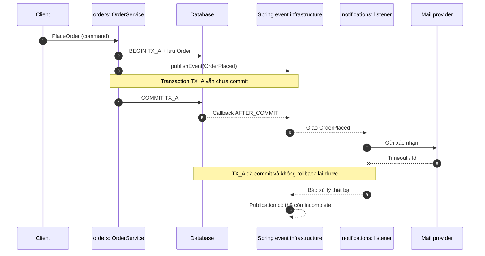
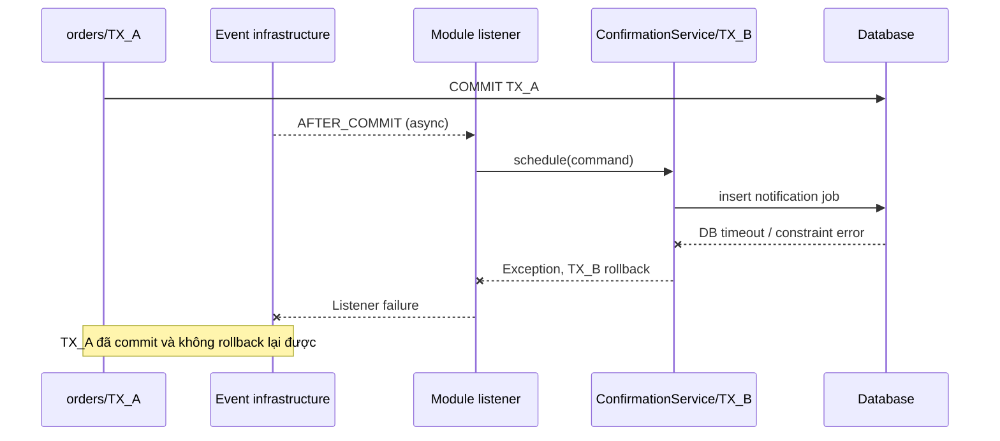
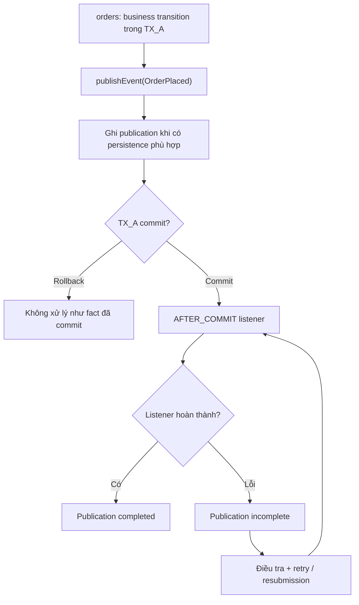
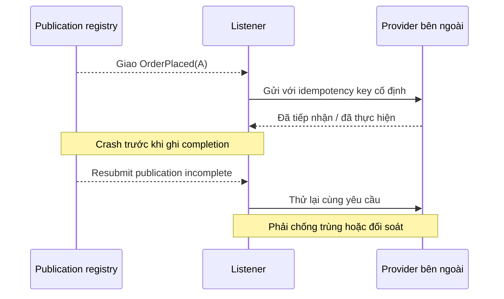

# Lỗi sau commit trong Transactional Event Listener của Spring Modulith

## 1. Tình huống thực tế: đơn đã lưu, xử lý hậu kỳ thất bại

Trong hệ thống Spring Boot chia thành các **application module** bằng Spring Modulith, module `orders` ghi nhận đơn hàng, phát `OrderPlaced`, còn module `notifications` gửi thông báo và `inventory` xử lý yêu cầu giữ hàng. Dùng event thay vì lời gọi service trực tiếp giúp giảm phụ thuộc giữa các module và bảo vệ quyền sở hữu nghiệp vụ.

Nhưng một tình huống dễ gây nhầm lẫn là:

1. `OrderService.placeOrder()` lưu đơn hàng trong transaction.
2. Module `orders` gọi `ApplicationEventPublisher.publishEvent(...)`.
3. Transaction của `orders` **commit thành công**.
4. Một listener `AFTER_COMMIT` bắt đầu chạy.
5. Listener gặp lỗi khi ghi notification job hoặc gọi nhà cung cấp email.

Lúc này, **đơn hàng đã được commit**; không thể coi việc ném exception ở bước 5 là cách hủy ngược đơn. Nếu ứng dụng không ghi nhận thất bại và không có khả năng thử lại, một phần workflow có thể bị bỏ dở lâu dài.

Bài **“Lỗi sau commit”** thuộc chương **“Transactional listener”** của **SPRING_MODULITH_APPLICATION_EVENTS**. Bài học tập trung vào việc tổ chức giao tiếp qua application events có ranh giới transaction rõ ràng, xử lý exception sau commit, event publication registry, retry, idempotency, kiểm thử và observability để các module giao tiếp ít phụ thuộc nhưng đáng tin cậy.

### Mục tiêu

Sau bài này, bạn có thể:

- Xác định chính xác thời điểm listener `AFTER_COMMIT` chạy và tác động của lỗi đến transaction nguồn.
- Phân biệt listener `@TransactionalEventListener` đồng bộ với `@ApplicationModuleListener` bất đồng bộ.
- Hiểu vì sao ghi dữ liệu trong callback sau commit cần transaction **mới** phù hợp.
- Phân loại lỗi có thể thử lại, lỗi vĩnh viễn và tình huống không biết side effect đã thành công hay chưa.
- Thiết kế registry, resubmission, idempotency và đối soát cho event publication chưa hoàn thành.
- Kiểm thử các khoảng lỗi: rollback nguồn, lỗi sau commit, process crash, retry và trùng side effect.
- Xây dựng runbook vận hành mà không xóa bỏ bằng chứng hay công việc chưa hoàn tất.

> **Nguyên tắc trung tâm:** Lỗi xảy ra *sau* commit không thể đảo ngược commit nguồn. Hãy biến thất bại hậu xử lý thành trạng thái **quan sát được, có thể phục hồi và an toàn khi thực hiện lại**.

## 2. Dòng thời gian: commit nguồn và xử lý listener là hai giai đoạn



Bảng dưới đây tách các mốc để tránh diễn giải sai:

| Mốc | Thao tác | Điều đã được bảo đảm | Điều **chưa** được bảo đảm |
|---|---|---|---|
| T1 | Domain tạo trạng thái đơn hợp lệ | Quy tắc tạo đơn được thực thi trong TX_A | Database đã commit |
| T2 | `publishEvent(OrderPlaced)` | Event được công bố trong Spring application context | Transaction đã commit; listener hậu commit đã chạy |
| T3 | TX_A commit thành công | Đơn được ghi nhận bền vững theo bảo đảm DB | Email/giữ hàng đã hoàn tất |
| T4 | Callback `AFTER_COMMIT` được kích hoạt | Hậu xử lý được phép bắt đầu | Hậu xử lý chắc chắn thành công |
| T5 | Listener hoàn thành hoặc ném lỗi | Có kết quả của một consumer | Các consumer khác cũng thành công |
| T6 | Registry đánh dấu publication hoàn thành hoặc còn incomplete | Hạ tầng có thể biết kết quả giao khi được cấu hình phù hợp | Side effect ngoài DB luôn chính xác một lần |

**Rất quan trọng:** Lời gọi `publishEvent(...)` thường xảy ra **bên trong transaction**, còn `AFTER_COMMIT` là **phase thực thi listener**. Không nên nhầm việc đặt mã publish sau một dòng `save(...)` với việc publish sau commit: `save(...)` và `flush()` không tự cam kết transaction đã commit.

### 2.1. Ba câu hỏi khác nhau khi điều tra lỗi

Khi thấy log “OrderPlaced published” rồi “Email failed”, đừng vội kết luận yêu cầu đặt đơn thất bại. Hãy hỏi theo thứ tự:

1. **Business transaction:** Đơn có được commit hay không?
2. **Publication:** Event có được ghi nhận để giao đến listener cần xử lý không?
3. **Consumption:** Listener nào đã xử lý, listener nào thất bại và side effect nào đã xảy ra?

Mỗi câu hỏi đòi bằng chứng khác nhau: database/business state, publication registry, và trạng thái riêng của consumer hoặc hệ thống ngoài.

## 3. Các loại listener khi lỗi xảy ra

Không phải mọi annotation lắng nghe event đều có cùng ngữ nghĩa thời gian hoặc exception.

| Listener | Khi nào chạy | Lỗi có thể ảnh hưởng gì? |
|---|---|---|
| `@EventListener` mặc định đồng bộ | Trong khi `publishEvent(...)` được gọi, trừ cấu hình đặc biệt | Exception có thể lan về publisher, khiến TX_A rollback nếu được xử lý theo quy tắc rollback |
| `@TransactionalEventListener` mặc định `AFTER_COMMIT` | Khi transaction nguồn commit thành công | Lỗi callback không hủy được TX_A; exception có thể lan về call stack hoàn tất commit |
| `@TransactionalEventListener(phase = AFTER_ROLLBACK)` | Sau khi transaction rollback | Không phải nơi báo “đơn đã đặt”; dùng cho cleanup/quan sát rollback |
| `@TransactionalEventListener(phase = AFTER_COMPLETION)` | Sau commit **hoặc** rollback | Phải cẩn thận với outcome, không mặc định thành công |
| `@ApplicationModuleListener` | Theo semantics Modulith: transactional after-commit, bất đồng bộ, transaction xử lý riêng | Lỗi thường không lan về HTTP thread; cần registry, logging, error handling và recovery thích hợp |

`@TransactionalEventListener` mặc định sử dụng phase `AFTER_COMMIT`, với `fallbackExecution=false`. Nếu event được publish **không có transaction đang hoạt động**, listener transactional mặc định không được thực thi. Đây có thể là nguyên nhân “không thấy lỗi nhưng listener không chạy”.

Ở một số ứng dụng, `@EventListener` được cấu hình async qua executor hoặc multicaster, nên cần kiểm tra cấu hình thay vì luôn coi nó đồng bộ. Đối với mẫu `@ApplicationModuleListener`, behavior cụ thể phải được xác nhận theo phiên bản Spring Modulith đang dùng và cấu hình `@EnableAsync`, executor, transaction manager.

### 3.1. Khác biệt khi exception được ném

Một exception từ **listener `AFTER_COMMIT` đồng bộ** có thể được báo trên call stack hoàn tất transaction. Người gọi nhận exception hoặc HTTP 500 **không có nghĩa đơn chưa được tạo**: lỗi có thể xuất hiện **sau khi commit thành công**.

Ngược lại, lỗi của **listener bất đồng bộ** có thể xảy ra trên executor thread. HTTP response của publisher thường không biết kết quả này. Nếu không có cơ chế quan sát/registry, lỗi dễ bị giới hạn trong log của async exception handler.

Đây là một nguồn gốc của “false negative”: caller tưởng lệnh thất bại vì nhận lỗi, nhưng đơn đã tồn tại. Khi thử lại lệnh, hệ thống có thể tạo đơn thứ hai nếu command không idempotent. Bên cạnh listener idempotency, nên có **idempotency key cho command đặt đơn** hoặc API truy vấn kết quả theo business request ID.

## 4. Ví dụ chuẩn bị: event và publisher

Để tập trung vào lỗi sau commit, ta dùng event công khai từ module `orders`:

```java
// orders/OrderPlaced.java
package com.example.shop.orders;

import java.time.Instant;
import java.util.UUID;

public record OrderPlaced(
        UUID eventId,
        UUID orderId,
        Instant occurredAt
) {
    public OrderPlaced {
        if (eventId == null || orderId == null || occurredAt == null) {
            throw new IllegalArgumentException("Event fields must be present");
        }
    }
}
```

`eventId` là định danh **một fact**; khi cùng publication được replay, event ID logic cần giữ nguyên. `orderId` là business ID của đơn, còn `occurredAt` là thời điểm fact được tạo theo quy ước publisher (không phải timestamp commit chính xác).

Publisher:

```java
// orders/internal/OrderService.java
package com.example.shop.orders.internal;

import com.example.shop.orders.OrderPlaced;
import java.time.Clock;
import java.util.UUID;
import org.springframework.context.ApplicationEventPublisher;
import org.springframework.stereotype.Service;
import org.springframework.transaction.annotation.Transactional;

@Service
public class OrderService {

    private final OrderRepository orders;
    private final ApplicationEventPublisher events;
    private final Clock clock;

    public OrderService(
            OrderRepository orders,
            ApplicationEventPublisher events,
            Clock clock
    ) {
        this.orders = orders;
        this.events = events;
        this.clock = clock;
    }

    @Transactional
    public UUID placeOrder(PlaceOrderCommand command) {
        // Domain và repository giả định của module orders.
        Order order = orders.save(Order.place(command));

        events.publishEvent(new OrderPlaced(
                UUID.randomUUID(),
                order.id(),
                clock.instant()
        ));

        return order.id();
    }
}
```

`Order`, `OrderRepository` và `PlaceOrderCommand` là các kiểu ví dụ; cần triển khai trong ứng dụng thực tế cùng datasource, transaction manager và bean `Clock`. Method `@Transactional` phải được gọi qua Spring transaction proxy hoặc một cơ chế transaction đang có hiệu lực; self-invocation có thể khiến annotation không hoạt động như mong đợi.

**Hợp đồng sự kiện:** `OrderPlaced` chỉ xác nhận module orders đã ghi nhận đơn hợp lệ. Nó không tự khẳng định đã thu tiền, giữ hàng hoặc gửi email. Consumer của module khác không được dựa vào những điều event chưa cam kết.

## 5. `@TransactionalEventListener(AFTER_COMMIT)`: lỗi sau commit không hủy được đơn

Một listener có thể lập notification job sau khi transaction đơn hàng hoàn thành:

```java
// notifications/internal/OrderNotificationListener.java
package com.example.shop.notifications.internal;

import com.example.shop.orders.OrderPlaced;
import org.springframework.stereotype.Component;
import org.springframework.transaction.event.TransactionPhase;
import org.springframework.transaction.event.TransactionalEventListener;

@Component
class OrderNotificationListener {

    private final NotificationJobService jobs;

    OrderNotificationListener(NotificationJobService jobs) {
        this.jobs = jobs;
    }

    @TransactionalEventListener(phase = TransactionPhase.AFTER_COMMIT)
    void on(OrderPlaced event) {
        jobs.scheduleOnce(event.orderId(), event.eventId());
    }
}
```

Transaction nguồn đã commit trước khi `on(...)` được gọi. Nếu `scheduleOnce(...)` ném exception, điều kiện “đơn đã được lưu thành công” **vẫn giữ nguyên**. Ứng dụng phải quyết định:

- Ghi log/cảnh báo và để lỗi lan ra khi cần theo dõi xử lý chưa hoàn thành.
- Lưu publication cho việc resubmission, nếu sử dụng hạ tầng hỗ trợ.
- Tránh gọi lại cả `placeOrder()` chỉ để phục hồi việc gửi thông báo.

### 5.1. Bẫy ít được nhận ra: tài nguyên transaction cũ có thể còn gắn với thread

Theo cơ chế transaction synchronization của Spring, callback sau commit có thể được gọi khi resource như connection/entity manager của transaction gốc **chưa được giải phóng hoàn toàn**. Một lời gọi repository trong callback có thể nhìn như “tham gia transaction đang có”, nhưng transaction đó đã commit và **không còn một commit tiếp theo** dành cho thao tác ghi mới.

Vì vậy, với `@TransactionalEventListener(AFTER_COMMIT)` thuần, khi cần ghi dữ liệu trong listener, nên gọi một service mở transaction **`REQUIRES_NEW`**.

```java
// notifications/internal/NotificationJobService.java
package com.example.shop.notifications.internal;

import java.util.UUID;
import org.springframework.stereotype.Service;
import org.springframework.transaction.annotation.Propagation;
import org.springframework.transaction.annotation.Transactional;

@Service
public class NotificationJobService {

    private final NotificationJobRepository jobs;

    public NotificationJobService(NotificationJobRepository jobs) {
        this.jobs = jobs;
    }

    @Transactional(propagation = Propagation.REQUIRES_NEW)
    public void scheduleOnce(UUID orderId, UUID sourceEventId) {
        // API tự triển khai: atomic insert / unique business key.
        jobs.insertIfAbsent(orderId, "ORDER_RECEIVED", sourceEventId);
    }
}
```

`NotificationJobRepository.insertIfAbsent(...)` là API minh họa, không phải method chuẩn có sẵn trong Spring Data. Service được Spring quản lý và được listener gọi **qua bean proxy**, giúp `REQUIRES_NEW` có hiệu lực. Nếu tự gọi `this.scheduleOnce(...)` ngay trong cùng bean, proxy transaction thông thường có thể bị bỏ qua.

### 5.2. Không nhầm `REQUIRES_NEW` của consumer với transaction nguồn

TX_A của orders đã commit. Khi service notifications mở TX_B, chỉ công việc của notifications nằm trong TX_B. Nếu TX_B rollback:

- Order trong TX_A **vẫn tồn tại**.
- Notification job của TX_B có thể **không được ghi**.
- Listener phải báo lỗi để publication được nhận diện chưa hoàn thành khi có cơ chế theo dõi phù hợp.
- Recovery cần xử lý lại tác vụ notifications, không phải tự tạo lại đơn.

Một method `@Transactional(propagation = REQUIRED)` trong callback `AFTER_COMMIT` thuần có thể không tạo một transaction mới như người viết mong đợi; do đó không nên thay `REQUIRES_NEW` bằng `REQUIRED` mà không kiểm chứng bằng test persistence.

### 5.3. Nếu chỉ làm side effect không ghi DB thì sao?

Gửi HTTP/email từ callback `AFTER_COMMIT` giúp tránh gửi khi đơn rollback, nhưng vẫn có nguy cơ:

- Callback gọi provider thất bại.
- Provider đã xử lý request nhưng response bị mất.
- JVM chết sau commit nhưng trước khi callback được thực thi.
- Provider thành công nhưng ứng dụng chết trước khi ghi dấu hoàn tất.

“Chạy sau commit” giải quyết **đúng thời điểm bắt đầu**, không giải quyết **reliable delivery** hay **exactly-once side effect**. Với tác vụ cần bền vững, hãy thêm publication registry hoặc transactional outbox và idempotency.

## 6. `@ApplicationModuleListener`: xử lý khác transaction nguồn

Spring Modulith cung cấp `@ApplicationModuleListener` để viết listener liên module với semantics transactional after-commit, asynchronous và transaction riêng theo phiên bản hỗ trợ.

```java
// notifications/internal/OrderPlacedSubscriber.java
package com.example.shop.notifications.internal;

import com.example.shop.orders.OrderPlaced;
import org.springframework.modulith.events.ApplicationModuleListener;
import org.springframework.stereotype.Component;

@Component
class OrderPlacedSubscriber {

    private final ConfirmationService confirmations;

    OrderPlacedSubscriber(ConfirmationService confirmations) {
        this.confirmations = confirmations;
    }

    @ApplicationModuleListener
    void on(OrderPlaced event) {
        confirmations.schedule(new ScheduleConfirmation(
                event.orderId(),
                event.eventId()
        ));
    }
}
```

`ConfirmationService` và `ScheduleConfirmation` là ứng dụng tự định nghĩa. Listener nên mỏng: chuyển public event contract thành một use case thuộc module notifications, không import repository nội bộ của orders.

Ví dụ service:

```java
// notifications/internal/ScheduleConfirmation.java
package com.example.shop.notifications.internal;

import java.util.UUID;

record ScheduleConfirmation(UUID orderId, UUID eventId) {
    ScheduleConfirmation {
        if (orderId == null || eventId == null) {
            throw new IllegalArgumentException("IDs must be present");
        }
    }
}
```

```java
// notifications/internal/ConfirmationService.java
package com.example.shop.notifications.internal;

import org.springframework.stereotype.Service;
import org.springframework.transaction.annotation.Transactional;

@Service
class ConfirmationService {

    private final NotificationJobRepository jobs;

    ConfirmationService(NotificationJobRepository jobs) {
        this.jobs = jobs;
    }

    @Transactional
    public void schedule(ScheduleConfirmation command) {
        jobs.insertIfAbsent(
                command.orderId(),
                "ORDER_RECEIVED",
                command.eventId()
        );
    }
}
```

Trong cấu hình Modulith có transaction riêng của listener, `@Transactional` với propagation mặc định `REQUIRED` trên service có thể tham gia transaction đó. **Không tự thêm `REQUIRES_NEW` vào mọi tầng** chỉ vì đang xử lý event. Cần kiểm tra đúng semantics của annotation và transaction manager ứng dụng.

### 6.1. Nếu service thất bại, transaction nào bị rollback?



Tùy cấu hình/phiên bản, transaction TX_B có thể được mở bởi listener annotation và service tham gia, hoặc cần được khai báo rõ tại service. Điểm quan trọng là **lỗi của TX_B không hủy TX_A**, và hạ tầng phải nhận được tín hiệu lỗi nếu cần phục hồi.

### 6.2. Đừng trông chờ HTTP response phản ánh kết quả async

Nếu API `POST /orders` trả `201 Created` ngay sau khi TX_A commit, listener async có thể thất bại một giây sau đó. Response `201` chỉ nên xác nhận **đơn đã được tạo** theo contract API, không phải email đã giao thành công.

Nếu nghiệp vụ bắt buộc gửi email trước khi trả response, dùng listener async sau commit có thể không đáp ứng thời điểm trả kết quả. Hãy định nghĩa lại quy trình hoặc response contract thay vì giả định executor sẽ chạy đủ nhanh.

## 7. Tác động của exception trong từng kiểu callback

### 7.1. `AFTER_COMMIT` đồng bộ: caller có thể thấy lỗi dù dữ liệu đã commit

Khi callback after-commit đồng bộ ném runtime exception, lỗi có thể lan qua đường gọi đang hoàn tất transaction. Một API caller có thể nhìn thấy exception, dù thay đổi database đã commit thành công. Hành vi biểu hiện cụ thể phụ thuộc transaction manager và event infrastructure, vì vậy cần test môi trường thực tế.

**Hệ quả đối với client retry:** nếu client coi mọi HTTP 500 là “đơn chưa tạo” và gửi lại không có idempotency key, hệ thống có thể tạo hai đơn. Giải pháp là phân biệt lỗi hậu xử lý với kết quả command và hỗ trợ khóa idempotency/cơ chế tra cứu kết quả.

### 7.2. `AFTER_COMMIT` async: lỗi phải có đường báo riêng

Lỗi listener bất đồng bộ thường không thể ném trở lại request thread. Cần:

- Đảm bảo exception không bị nuốt ở listener.
- Kiểm tra async error handling và executor rejection.
- Dùng registry/persistence để theo dõi publication chưa hoàn thành nếu workflow yêu cầu reliability.
- Có cảnh báo, retry có kiểm soát và khả năng replay sau restart.
- Theo dõi trạng thái side effect tại module tiêu thụ.

### 7.3. `AFTER_COMPLETION` không đồng nghĩa `AFTER_COMMIT`

`@TransactionalEventListener(phase = AFTER_COMPLETION)` được gọi sau **commit hoặc rollback**. Không nên gửi email xác nhận đơn từ phase này nếu nội dung chỉ đúng khi transaction commit.

### 7.4. Không có transaction: `fallbackExecution` thay đổi rủi ro

Nếu dùng `@TransactionalEventListener(fallbackExecution = true)`, listener có thể được thực thi khi không có transaction tương ứng. Điều này hữu ích trong một số trường hợp nhưng **không có “đợi commit”** ở nhánh fallback. Hãy chỉ bật khi contract rõ ràng và có test bao phủ; đừng bật chỉ để che việc method publisher mất `@Transactional`.

## 8. Phân loại lỗi sau commit trước khi chọn retry

Không nên coi mọi exception như nhau.

| Nhóm lỗi | Ví dụ | Chiến lược |
|---|---|---|
| **Transient** | DB connection bị gián đoạn, HTTP 503, timeout ngắn | Retry có giới hạn và backoff khi side effect idempotent |
| **Rate limiting** | HTTP 429 hoặc quota tạm thời | Tôn trọng thời gian chờ, giới hạn concurrency và retry |
| **Không rõ kết quả** | Timeout sau khi provider đã nhận lệnh | Kiểm tra trạng thái qua provider hoặc dùng idempotency key trước khi gọi lại |
| **Dữ liệu/contract sai** | Event cũ không deserialize, field bắt buộc thiếu | Sửa code, migration/upcaster, không retry mù |
| **Lỗi nghiệp vụ cố định** | Trạng thái không hợp lệ, tác vụ đã hết hạn | Có kết quả nghiệp vụ hủy/bỏ qua được định nghĩa; không che lỗi bất thường |
| **Phân quyền hoặc cấu hình** | Credential sai, schema registry thiếu | Cảnh báo/sửa cấu hình rồi mới resubmit |
| **Process crash** | JVM dừng giữa hai bước | Registry/outbox bền vững, replay và idempotency |
| **Concurrency race** | Hai listener cùng tạo job | Unique constraint/UPSERT và xử lý trùng đúng business key |

### 8.1. Vì sao timeout là trường hợp nguy hiểm?

Ví dụ listener gọi nhà cung cấp thanh toán. Nếu response timeout, có thể provider đã thực hiện thu tiền nhưng response không về. Gọi lại bằng một request không idempotent có thể thu tiền **hai lần**.

Khi API ngoài có idempotency key, truyền key ổn định và hiểu rõ thời gian hiệu lực của nó. Nếu không có hỗ trợ, cần đối soát theo provider transaction ID hoặc API truy vấn trạng thái. **Không được đồng nhất “không nhận response” với “provider chưa làm gì”.**

### 8.2. Hành động “skip hợp lệ” khác với nuốt exception

Nếu nghiệp vụ quyết định không gửi email vì người dùng đã rút quyền nhận loại thông báo này, service có thể ghi nhận một kết quả `SKIPPED` hợp lệ rồi hoàn thành. Nhưng nếu query xác định quyền gửi bị lỗi do database timeout, việc trả về bình thường có thể làm hệ thống đánh dấu đã xử lý dù không biết kết quả đúng.

Nên mô hình hóa rõ những kết quả:

- `COMPLETED`: use case đã thực hiện xong theo contract.
- `SKIPPED`: nghiệp vụ cho phép không thực hiện và lý do được ghi nhận phù hợp.
- `FAILED_RETRYABLE`: chưa hoàn thành, có thể phục hồi sau.
- `FAILED_PERMANENT`: chưa hoàn thành tự động; cần quyết định xử lý rõ.
  
Các tên trạng thái trên chỉ là **ví dụ do ứng dụng tự định nghĩa**, không phải enum mặc định của Spring Modulith.

## 9. Đừng catch và nuốt lỗi cần được phục hồi

Phản mẫu:

```java
// Không nên nếu lỗi phải được retry hoặc điều tra.
@ApplicationModuleListener
void on(OrderPlaced event) {
    try {
        confirmations.schedule(new ScheduleConfirmation(
                event.orderId(), event.eventId()
        ));
    } catch (RuntimeException ex) {
        log.warn("Could not schedule: {}", ex.getMessage());
        // Kết thúc bình thường => có thể bị xem là publication hoàn thành.
    }
}
```

Với cơ chế hoàn thành publication dựa vào xử lý listener thành công, việc nuốt exception khiến hạ tầng có thể coi event đã xử lý **dù công việc thất bại**. Từ đó, một tác vụ đáng lẽ phải retry có thể bị mất dấu.

Cách khác:

```java
@ApplicationModuleListener
void on(OrderPlaced event) {
    try {
        confirmations.schedule(new ScheduleConfirmation(
                event.orderId(), event.eventId()
        ));
    } catch (TransientSchedulingException ex) {
        log.warn(
                "schedule-failed eventId={} cause=TRANSIENT",
                event.eventId()
        );
        throw ex;
    }
}
```

`TransientSchedulingException` là kiểu exception minh họa do ứng dụng định nghĩa. Thường tốt hơn là **không catch ở listener nếu không bổ sung được thông tin xử lý hữu ích**: để lỗi từ application service lan ra hạ tầng.

Không log nguyên event hoặc dữ liệu nhạy cảm của payload/response. Nếu log exception chứa token/email/địa chỉ, cần áp dụng quy tắc redaction tại điểm phát và pipeline log.

### 9.1. Có nên ném exception vĩnh viễn cho registry?

Nếu lỗi do event contract không tương thích, việc ném exception giúp giữ publication chưa hoàn thành để operator phát hiện. Nhưng retry tự động liên tục sẽ vô ích cho đến khi code/schema được sửa.

Hãy tách **tín hiệu chưa hoàn thành** với **chính sách retry**. Có thể lưu/cách ly publication và yêu cầu can thiệp, thay vì đánh dấu completion giả hoặc chạy vô hạn.

## 10. Event publication registry: biết listener nào chưa hoàn thành

Spring Modulith hỗ trợ một **event publication registry** theo dõi việc giao event tới transactional listener. Khi chọn starter persistence bền vững phù hợp (chẳng hạn JDBC hoặc JPA tùy release), các publication có thể được lưu để quan sát và khôi phục xử lý chưa hoàn thành.

Giả sử một `OrderPlaced(eventId=A)` có ba consumer:

| Fact | Listener | Tình trạng logic | Hướng xử lý |
|---|---|---|---|
| `OrderPlaced(A)` | `notifications` | Chưa hoàn thành do timeout | Kiểm tra kết quả, sửa lỗi, resubmit phù hợp |
| `OrderPlaced(A)` | `inventory` | Hoàn thành | Không chạy lại vô cớ |
| `OrderPlaced(A)` | `analytics` | Hoàn thành | Giữ nguyên kết quả |

Đây là ví dụ trạng thái **theo listener**, không phải cấu trúc bảng/enum chính thức của mọi phiên bản Spring Modulith.



### 10.1. Registry không tự đảm bảo mọi thứ

Những khẳng định sau là **không an toàn** nếu chưa kiểm tra phiên bản và cấu hình:

- “Chỉ cần `publishEvent` là có persistence bền vững.”
- “Mọi `@EventListener` đều được registry theo dõi.”
- “Event sẽ tự retry vô hạn theo backoff hợp lý.”
- “Đã ghi publication thì side effect chắc chắn chỉ xảy ra một lần.”
- “Mọi lỗi sau commit đều có thể rollback lại business transaction.”
- “Registry tự làm sạch dữ liệu, xử lý quyền riêng tư và tương thích schema.”

Registry là một phần của **reliable publication**, không phải một message broker với mọi bảo đảm mặc định. Cần chọn starter, database, transaction manager, serializer, schema/migration và cơ chế resubmission theo release đang dùng.

### 10.2. Cấu hình bền vững và nguyên tử

Nếu công việc business và publication được ghi trong **cùng transaction database** ở cấu hình được hỗ trợ, khi TX_A rollback, publication không nên được coi là fact cần xử lý. Khi TX_A commit, có thể giữ một bản ghi cần giao dù process chết trước khi listener chạy.

Nếu dữ liệu nghiệp vụ ở DB_A còn registry ở DB_B hoặc sự kiện ra broker C, **không mặc định atomic commit xuyên hệ thống**. Cần xem transaction boundary, chọn transactional outbox hoặc chiến lược phối hợp tin cậy tương ứng.

### 10.3. Recovery là hành động riêng, không chỉ “đã có registry”

Định nghĩa rõ:

1. **Detection:** tìm publication incomplete và tuổi tồn đọng.
2. **Diagnosis:** phân loại exception, kiểm tra side effect đã xảy ra chưa.
3. **Recovery:** kích hoạt resubmission/replay theo cơ chế release đang cấu hình.
4. **Safety:** idempotency, concurrency control và policy với dữ liệu đã hết hạn.
5. **Completion:** đánh dấu hoàn thành sau khi consumer đạt contract.
6. **Retention:** cleanup publication thành công và xử lý tồn đọng theo chính sách.

API truy vấn/đánh dấu/resubmit có thể khác giữa phiên bản Modulith. Không copy tên method registry từ ví dụ release khác mà không đối chiếu dependency đang dùng.

## 11. Khoảng lỗi sau commit: crash trước dispatch và sau side effect

Có hai cửa sổ lỗi rất quan trọng.

### 11.1. TX_A đã commit, process chết trước khi listener bắt đầu

Nếu chỉ sử dụng callback in-memory mà không có publication persistence phù hợp, công việc có thể bị bỏ lỡ. Khi cần yêu cầu “không được mất bước thông báo/giữ hàng”, phải sử dụng publication registry/outbox có tính bền vững và recovery sau restart.

Việc tự gọi `publishEvent(...)` sau khi method transaction đã trả về **không tự giải quyết** trường hợp này, bởi process vẫn có thể chết ở giữa **commit** và **publish**.

### 11.2. Side effect đã thành công, chưa kịp mark completed



Từ góc nhìn hạ tầng, publication vẫn incomplete. Nhưng **email/thanh toán đã có thể xảy ra**. Nếu replay không có idempotency hoặc đối soát, một fact có thể tạo nhiều side effect.

Vì thế:

- **At-least-once attempt** là mô hình hợp lý để thiết kế consumer khi có retry.
- **Exactly-once effect xuyên database và provider** không tự xuất hiện nhờ registry.
- Mỗi consumer phải có business key hoặc event processing key phù hợp.
- Phải tính khoảng lỗi giữa “provider đã làm” và “ứng dụng ghi nhận thành công”.

## 12. Idempotency trong transaction listener

### 12.1. Chọn khóa theo nghiệp vụ

| Mục tiêu | Khóa ứng viên | Lý do |
|---|---|---|
| Xử lý một fact cho một consumer một lần | `(consumerName, eventId)` | Cùng event được giao lại không tạo xử lý mới |
| Một email xác nhận mỗi đơn | `(orderId, notificationType)` | Có thể có hai fact khác nhau cùng yêu cầu một email |
| Một yêu cầu giữ hàng cụ thể | `reservationRequestId` | Một đơn có thể có nhiều đợt giữ hàng hợp lệ |
| Một yêu cầu thanh toán bên provider | Idempotency key ổn định do provider hỗ trợ | Chống lặp ở ranh giới hệ thống ngoài |

Đừng dùng mỗi `orderId` để chặn **mọi** event của đơn, vì `OrderPlaced` và `OrderCancelled` là hai fact hợp lệ khác nhau.

### 12.2. Mẫu notification job an toàn hơn “check rồi insert”

Ví dụ schema PostgreSQL minh họa:

```sql
CREATE TABLE notification_jobs (
    id UUID PRIMARY KEY,
    order_id UUID NOT NULL,
    notification_type VARCHAR(50) NOT NULL,
    source_event_id UUID NOT NULL,
    status VARCHAR(24) NOT NULL,
    CONSTRAINT uq_notification_business UNIQUE (order_id, notification_type)
);
```

Ở mức persistence, có thể dùng một lệnh nguyên tử, chẳng hạn với PostgreSQL:

```sql
INSERT INTO notification_jobs(
    id, order_id, notification_type, source_event_id, status
) VALUES (
    :jobId, :orderId, 'ORDER_RECEIVED', :eventId, 'PENDING'
)
ON CONFLICT (order_id, notification_type) DO NOTHING;
```

Đây là ví dụ cú pháp **PostgreSQL**, không phải SQL portable cho mọi database. Nó giả định quy tắc domain “mỗi đơn chỉ một job loại `ORDER_RECEIVED`”. Với những loại thông báo lặp hợp lệ, unique key phải được thiết kế khác.

**Phản mẫu**:

```java
// Hai consumer có thể đồng thời nhìn thấy chưa tồn tại.
if (!jobs.exists(orderId, "ORDER_RECEIVED")) {
    jobs.save(new NotificationJob(orderId, "ORDER_RECEIVED"));
}
```

Kiểm tra rồi insert thiếu ràng buộc nguyên tử sẽ không an toàn khi retry đồng thời. Kể cả có unique constraint, cần xử lý conflict theo database đang dùng và tránh tiếp tục ghi trong một transaction đã bị đánh dấu lỗi.

### 12.3. Một job bền vững vẫn khác email đã giao

Listener có thể kết thúc sau khi tạo job trong database. Lúc đó publication `OrderPlaced` cho notifications được coi là hoàn thành **theo contract “schedule job”**. Nhưng một worker khác vẫn phải gửi email:

```text
OrderPlaced committed
      |
      v
Notification listener
      |
      v
Notification job PENDING (committed)
      |
      v
Delivery worker -> Email provider -> cập nhật SENT/FAILED
```

Cần hai bộ chỉ số:

- **Publication backlog:** listener chưa tạo được job.
- **Delivery backlog:** job đã tạo nhưng chưa gửi xong.

Nếu chỉ theo dõi registry, có thể kết luận sai “hệ thống gửi email bình thường” trong khi delivery worker bị lỗi.

## 13. Retry, backoff và lỗi không nên tự thử lại

Retry có ích khi lỗi **tạm thời** và thao tác **an toàn khi thực hiện lại**. Một chính sách tham khảo:

| Lần resubmit sau lỗi | Thời gian chờ minh họa | Điều kiện |
|---|---|---|
| 1 | 10 giây | Timeout/503, side effect có idempotency |
| 2 | 1 phút | Dịch vụ chưa khôi phục |
| 3 | 5 phút | Còn trong SLA và giới hạn |
| 4 | 30 phút | Chỉ khi vẫn có ý nghĩa nghiệp vụ |
| Sau giới hạn | Cách ly/alert/điều tra | Không retry mù, không đánh dấu completion giả |

**Đây là chính sách do ứng dụng tự chọn**, không phải mặc định Spring Modulith. Thực tế nên cân nhắc exponential backoff, jitter, max attempts, circuit breaker, timeout, rate limit và số worker xử lý đồng thời.

### 13.1. Phân biệt retry trong listener với resubmission bền vững

- **Retry nội bộ trong cùng lần listener chạy:** nhiều lần gọi trước khi method kết thúc; có thể giảm tác động lỗi mạng ngắn nhưng không bảo vệ được process crash nếu không có persistence.
- **Resubmission của incomplete publication:** một quy trình phục hồi độc lập dựa trên registry/outbox, có thể sau restart hoặc theo lịch được cấu hình.

Nếu retry nội bộ hết giới hạn, listener nên trả lỗi để hạ tầng ghi nhận chưa hoàn thành khi cần khôi phục. Nếu catch exception rồi return, publication có nguy cơ được xem là hoàn thành sai.

### 13.2. Poison event

Một event cũ không deserialize được sau đổi package/class hoặc thiếu trường bắt buộc là ví dụ **poison event**. Gọi lại cùng mã lỗi nhiều nghìn lần sẽ không sửa được. Cần:

1. Xác định record/schema/serializer liên quan.
2. Chặn vòng retry vô ích hoặc giảm nhịp xử lý.
3. Sửa compatibility/upcaster hoặc migration.
4. Thử phục hồi trong môi trường có kiểm soát.
5. Chỉ đánh dấu hoàn thành/hủy có căn cứ nghiệp vụ và ghi lại lý do.

Không xóa publication để “dashboard sạch hơn” nếu bước nghiệp vụ còn dang dở.

## 14. Dữ liệu, quyền truy cập và replay sau nhiều ngày

Event `OrderPlaced` có thể chỉ mang `orderId`. Listener sau commit đọc thêm dữ liệu qua public API của module sở hữu dữ liệu, nhưng dữ liệu có thể thay đổi **sau thời điểm fact xảy ra**.

Ví dụ khách đổi email giữa lúc đặt đơn và lúc retry. Consumer cần xác định:

- Gửi đến **email tại thời điểm đặt đơn** hay **email hiện tại**?
- Nếu khách rút quyền nhận thông báo, việc gửi sau nhiều ngày còn hợp lệ không?
- Nếu đơn bị hủy, event cũ có nên tạo job mới không?
- Nếu dữ liệu bị xóa, replay có làm dữ liệu “sống lại” không?

Chọn snapshot tối thiểu khi domain đòi hỏi giá trị quá khứ; còn không, dùng public read API có kiểm soát và kiểm tra trạng thái hiện tại. Không đưa entity JPA, access token, địa chỉ hay số thẻ vào payload chỉ để consumer “tiện dùng”.

Registry có persistence làm payload và metadata có thể xuất hiện trong database, backup và log. Cần kiểm soát quyền đọc, mã hóa/retention và tương thích serializer theo chính sách dữ liệu.

## 15. Observability: đo được thất bại sau commit, không chỉ số event đã publish

Một hệ thống chỉ log lúc `publishEvent(...)` không thể kết luận listener đã chạy xong. Nên theo dõi **vòng đời**:

| Tín hiệu | Câu hỏi trả lời | Cách diễn giải |
|---|---|---|
| `eventId`, event type, module nguồn | Fact nào đang được giao? | Dùng để trace; không tự chứng minh completion |
| Business transaction commit result | Đơn đã ghi thành công chưa? | Phân biệt lỗi tạo đơn và lỗi hậu xử lý |
| Publication incomplete count | Listener nào còn pending/failed? | Cần phân tích backlog |
| Oldest incomplete age | Có event nào vượt SLA chưa? | Phát hiện backlog bị kẹt |
| Listener attempts/error class | Lỗi loại gì và thử lại bao lần? | Chọn retry hay điều tra |
| Executor queue/rejected tasks | Có nghẽn thread hoặc bị từ chối lịch chạy? | Điều chỉnh concurrency và recovery |
| Job `PENDING`/`FAILED` | Hậu xử lý đã lập job nhưng delivery còn dang dở? | Không gộp với registry |
| External provider receipt/idempotency key | Side effect đã được provider chấp nhận chưa? | Đối soát khi timeout |
| Deserialize failures | Publication cũ không đọc được? | Cần xem schema/version |

### 15.1. Log có chọn lọc

```java
@ApplicationModuleListener
void on(OrderPlaced event) {
    log.info(
            "handle-start type={} eventId={} consumer={}",
            "OrderPlaced", event.eventId(), "OrderPlacedSubscriber"
    );

    try {
        confirmations.schedule(new ScheduleConfirmation(
                event.orderId(), event.eventId()
        ));
        log.info("handle-completed eventId={}", event.eventId());
    } catch (RuntimeException ex) {
        log.error("handle-failed eventId={} consumer={}",
                event.eventId(), "OrderPlacedSubscriber", ex);
        throw ex;
    }
}
```

Đoạn trên là fragment minh họa trong class đã có dependencies/logger. **Không nên log toàn bộ event** hoặc exception chưa được kiểm soát nếu có dữ liệu nhạy cảm từ provider. Kể cả ID cũng có thể liên kết đến cá nhân; cần phân loại và bảo vệ log.

Trong xử lý async, trace context/MDC có thể không tự truyền qua executor; cần cấu hình propagation theo hệ thống quan sát đang dùng. Đừng giả định Spring Boot Actuator tự cung cấp toàn bộ số liệu publication nếu chưa kiểm tra starter/version/config.

### 15.2. Phân biệt alert kỹ thuật và tác động nghiệp vụ

Một publication analytics trễ năm phút có thể ít nghiêm trọng hơn việc giữ hàng trễ năm phút trong quy trình cần hủy đơn sắp hết hạn. Đặt alert theo **SLA của consumer và trạng thái nghiệp vụ**, không chỉ theo số lượng event tồn đọng.

## 16. Kiểm thử lỗi sau commit: chia thành các lớp rõ ràng

Các kiểm thử cần trả lời **những câu hỏi khác nhau**:

1. Publisher có phát đúng event khi đơn hợp lệ?
2. Listener `AFTER_COMMIT` có bỏ qua event nếu TX_A rollback?
3. Lỗi của listener sau commit có làm dữ liệu TX_A mất đi không?
4. Khi listener ghi DB, TX_B có rollback khi lỗi không?
5. Lỗi có được registry nhận diện là publication chưa hoàn thành?
6. Khi replay, consumer có tránh side effect trùng không?

Không nên lấy một test `PublishedEvents` PASS làm bằng chứng cho cả sáu yêu cầu.

### 16.1. Test publisher với Spring Modulith

```java
// Test đặt trong package phù hợp với visibility của OrderService.
package com.example.shop.orders.internal;

import static org.assertj.core.api.Assertions.assertThat;

import com.example.shop.orders.OrderPlaced;
import org.junit.jupiter.api.Test;
import org.springframework.beans.factory.annotation.Autowired;
import org.springframework.modulith.test.ApplicationModuleTest;
import org.springframework.modulith.test.PublishedEvents;

@ApplicationModuleTest
class OrderPublisherTests {

    @Autowired OrderService orders;
    @Autowired PublishedEvents events;

    @Test
    void publishesOrderPlacedAfterValidTransition() {
        // Fixture do dự án tự triển khai.
        PlaceOrderCommand command = OrderFixtures.validCommand();
        var orderId = orders.placeOrder(command);

        assertThat(events.ofType(OrderPlaced.class))
                .anySatisfy(event ->
                        assertThat(event.orderId()).isEqualTo(orderId));
    }
}
```

`OrderFixtures` và các domain types cần được ứng dụng định nghĩa. Test chỉ xác nhận event được công bố; nó **không chứng minh** commit, delivery hoặc completion của listener.

### 16.2. Test callback sau commit và rollback bằng `TransactionTemplate`

Để kiểm tra **phase**, tạo một probe đồng bộ `@TransactionalEventListener(AFTER_COMMIT)` và điều khiển transaction thật. Ví dụ dưới đây giả định application có datasource, transaction manager, Spring test support và `OrderPlaced`.

```java
package com.example.shop;

import static org.assertj.core.api.Assertions.assertThat;

import com.example.shop.orders.OrderPlaced;
import java.time.Instant;
import java.util.List;
import java.util.UUID;
import java.util.concurrent.CopyOnWriteArrayList;
import org.junit.jupiter.api.Test;
import org.springframework.beans.factory.annotation.Autowired;
import org.springframework.boot.test.context.SpringBootTest;
import org.springframework.boot.test.context.TestConfiguration;
import org.springframework.context.ApplicationEventPublisher;
import org.springframework.context.annotation.Bean;
import org.springframework.context.annotation.Import;
import org.springframework.transaction.event.TransactionPhase;
import org.springframework.transaction.event.TransactionalEventListener;
import org.springframework.transaction.support.TransactionTemplate;

@SpringBootTest
@Import(AfterCommitPhaseTests.ProbeConfig.class)
class AfterCommitPhaseTests {

    @Autowired TransactionTemplate tx;
    @Autowired ApplicationEventPublisher publisher;
    @Autowired Probe probe;

    @Test
    void runsForCommitButNotForRollback() {
        probe.clear();

        var committed = new OrderPlaced(
                UUID.randomUUID(), UUID.randomUUID(), Instant.now()
        );

        tx.executeWithoutResult(status -> publisher.publishEvent(committed));
        assertThat(probe.received()).contains(committed);

        probe.clear();

        var rolledBack = new OrderPlaced(
                UUID.randomUUID(), UUID.randomUUID(), Instant.now()
        );

        tx.executeWithoutResult(status -> {
            publisher.publishEvent(rolledBack);
            status.setRollbackOnly();
        });

        assertThat(probe.received()).doesNotContain(rolledBack);
    }

    @TestConfiguration
    static class ProbeConfig {
        @Bean Probe probe() {
            return new Probe();
        }
    }

    static class Probe {
        private final List<OrderPlaced> events =
                new CopyOnWriteArrayList<>();

        @TransactionalEventListener(phase = TransactionPhase.AFTER_COMMIT)
        public void on(OrderPlaced event) {
            events.add(event);
        }

        void clear() {
            events.clear();
        }

        List<OrderPlaced> received() {
            return List.copyOf(events);
        }
    }
}
```

Test dùng **synchronous phase probe**; vì vậy nó **không khẳng định** callback bất đồng bộ của `@ApplicationModuleListener` đã xử lý. Khi test trong application thật, phải bảo đảm event không kích hoạt listener production không mong muốn (cấu hình test module/fixture phù hợp).

### 16.3. Test ném exception sau commit nhưng dữ liệu vẫn tồn tại

Một bài integration test cần thiết:

1. Tạo bảng/entity đơn hàng test trong transaction TX_A.
2. Đăng ký listener **đồng bộ** `@TransactionalEventListener(AFTER_COMMIT)` được cấu hình ném một exception test có kiểm soát.
3. Thực hiện transaction commit thật, bắt exception (nếu framework lan ra caller).
4. Truy vấn dữ liệu bằng **transaction mới**, xác minh đơn vẫn tồn tại.
5. Kiểm tra lỗi đã được ghi nhận ở kênh quan sát dự kiến.

**Đừng kết luận rollback chỉ vì test thấy exception**: cần đọc lại database. Cũng không nên dùng listener async để khẳng định exception luôn được ném về test thread; bài test đó phải dựa trên trạng thái publication/side effect và điều kiện chờ có timeout.

Pseudocode minh họa kết quả mong đợi:

```text
arrange: synchronous AFTER_COMMIT listener will throw
act:     create order + publish OrderPlaced + commit TX_A
assert:  a post-commit callback failure is observed
assert:  a new transaction still reads the committed order
assert:  no claim that notification work has completed
```

### 16.4. Test `REQUIRES_NEW` của consumer

Test với database integration cần xác nhận:

- Khi TX_A commit, `NotificationJobService.scheduleOnce(...)` thật sự commit TX_B.
- Khi service ném exception trong TX_B, job chưa được ghi còn đơn trong TX_A vẫn tồn tại.
- Listener không nuốt exception khiến publication bị coi là hoàn thành.
- Khi retry cùng event, business unique key không tạo job trùng.

Nếu test sử dụng mock repository, nó chỉ kiểm tra lời gọi service, **không kiểm tra transaction propagation** hoặc constraint trong database.

### 16.5. Test registry và recovery

Với event publication persistence được cấu hình theo release hiện tại, quy trình kiểm thử:

| Bước | Hành động | Kỳ vọng |
|---|---|---|
| 1 | Commit `OrderPlaced` qua publisher thật | Business state và publication phù hợp với transaction |
| 2 | Cho listener ném exception | Publication được phát hiện chưa hoàn thành |
| 3 | Khôi phục service rồi gọi resubmission | Listener được thử lại theo chính sách |
| 4 | Xác nhận consumer đạt use-case contract | Publication chuyển completed |
| 5 | Replay cùng fact/mô phỏng crash sau side effect | Không tạo kết quả nghiệp vụ trùng |
| 6 | Thử event cũ khác schema | Deserialize được hoặc có migration/lỗi có kiểm soát |

Tên API registry/resubmission phụ thuộc phiên bản Modulith, nên cần dùng đúng API và starter ứng dụng đang chạy, **không bịa một method chung cho mọi release**.

### 16.6. Test với async listener phải chờ điều kiện

Một test có thể chờ trạng thái notification job xuất hiện hoặc publication chuyển thành completed **trong một khoảng thời gian hữu hạn**. Không dùng `Thread.sleep(1000)` như bằng chứng chắc chắn: CI hoặc executor chậm sẽ khiến test flaky. Nếu dùng Awaitility, bổ sung dependency và cấu hình phù hợp; đó là một lựa chọn, không phải tính năng mặc định của mọi project.

**Lưu ý:** Test method có `@Transactional` trong Spring Test thường tự rollback sau test. Nếu muốn chứng minh listener `AFTER_COMMIT` đã chạy, cần commit transaction thật bằng `TransactionTemplate` hoặc công cụ quản lý transaction test phù hợp.

## 17. Quy trình điều tra sự cố trong production

Khi alert “`OrderPlaced` publication to notifications incomplete” xuất hiện:

1. **Định danh fact và consumer:** Loại event, event ID, listener nào, tuổi publication; không dump payload nhạy cảm tùy tiện.
2. **Xác minh TX_A:** Đơn đã commit thật? Trạng thái hiện tại còn phù hợp để gửi thông báo?
3. **Xác minh TX_B:** Có notification job hay dấu hiệu consumer đã xử lý một phần không?
4. **Kiểm tra provider:** Có receipt hoặc request ID chứng minh side effect đã diễn ra chưa?
5. **Phân loại lỗi:** Timeout, rate limit, bug, dữ liệu, schema, quyền truy cập, executor hay process crash?
6. **Xác nhận idempotency:** Resubmit có gây lặp hành động không? Khóa và constraint đang hoạt động?
7. **Sửa nguyên nhân:** Khôi phục dịch vụ, cấu hình, migration hoặc state phù hợp.
8. **Resubmit có giới hạn:** Dùng cơ chế recovery chính thức của version đang dùng; tránh chạy đồng thời nhiều replay không kiểm soát.
9. **Đọc lại kết quả:** Publication hoàn thành, job/delivery đúng, không có side effect trùng.
10. **Ghi nhận cải tiến:** Thêm test, alert, giới hạn retry, runbook hoặc thay đổi contract.

**Không nên:** xóa publication chưa hoàn thành chỉ để hết cảnh báo; khởi chạy lại cả command tạo đơn nếu chỉ consumer hậu xử lý lỗi; replay hàng loạt event khi chưa xác định khả năng idempotent.

## 18. Phản mẫu và cách sửa

| Phản mẫu | Hậu quả | Cách sửa |
|---|---|---|
| Cho rằng exception sau commit rollback TX_A | API trả lỗi nhưng đơn đã được tạo | Kiểm tra business state; tách kết quả command và hậu xử lý |
| `@EventListener` gửi email ngay lúc publish | Gửi trước commit/rollback | Xử lý sau commit nếu nghiệp vụ cho phép |
| Ghi repository trong `AFTER_COMMIT` thuần với `REQUIRED` mà không test | Có thể không có commit mới | Gọi service `REQUIRES_NEW` phù hợp |
| Dùng `REQUIRES_NEW` khắp mọi lớp khi `@ApplicationModuleListener` đã mở transaction | Transaction lồng ghép khó hiểu | Chọn propagation theo use case, test thực tế |
| Catch exception rồi return | Publication bị đánh dấu hoàn thành sai | Ném lỗi cần phục hồi hoặc ghi kết quả nghiệp vụ có chủ đích |
| Coi HTTP 500 là đơn chưa commit | Client retry tạo đơn thứ hai | Command idempotency + tra cứu kết quả |
| Chỉ có callback after-commit in-memory | Crash có thể làm mất công việc | Registry/outbox bền vững khi yêu cầu |
| Retry timeout bên ngoài vô điều kiện | Có thể gửi email/thu tiền trùng | Idempotency key + đối soát |
| Check rồi insert job không unique | Race khi event giao lại | Atomic insert và business unique constraint |
| Tự coi registry là retry engine hoàn chỉnh | Publication kẹt không được xử lý | Cấu hình resubmission, backoff, alert |
| Replay event cũ không xét schema/consent | Lỗi deserialize hoặc dùng dữ liệu hết quyền | Compatibility, retention và chính sách hiện tại |
| Chỉ log “publish success” | Không thấy listener thất bại | Monitor incomplete publication và delivery state |

## 19. Bài tập thực hành

### Bài tập 1 — “HTTP 500 nhưng đơn đã tạo”

Đơn hàng được lưu và TX_A commit, nhưng listener `@TransactionalEventListener(AFTER_COMMIT)` đồng bộ ném exception. Client thấy lỗi và gửi lại request.

Hãy trả lời: vì sao đơn đầu tiên vẫn có thể tồn tại? Thiết kế idempotency key cho command tạo đơn và cách client truy vấn lại kết quả. Nêu lý do không thể dùng exception ở listener để rollback một transaction đã commit.

### Bài tập 2 — Ghi database từ callback sau commit

Một listener thuần viết:

```java
@TransactionalEventListener
void on(OrderPlaced event) {
    notificationRepository.save(new Notification(event.orderId()));
}
```

Hãy phân tích rủi ro transaction resource vẫn bound sau commit và sửa bằng service riêng có `@Transactional(propagation = REQUIRES_NEW)`. Sau đó đề xuất integration test chứng minh notification thật sự được commit và rollback khi service lỗi.

### Bài tập 3 — Registry incomplete và replay

Một publication `OrderPlaced(A)` giao cho `inventory` đã được xử lý thành công, nhưng `notifications` thất bại. Hãy thiết kế test và quy trình resubmit **chỉ phần còn incomplete**, không chạy lại side effect inventory. Giải thích vai trò của idempotency ngay cả khi registry theo dõi từng listener.

### Bài tập 4 — Không biết email đã gửi chưa

Listener gọi email provider, request timeout, rồi application restart. Hãy xác định phương án:

- Khóa idempotency dùng cho provider và business job.
- Nơi kiểm tra trạng thái side effect.
- Retry/backoff, giới hạn lần thử và điều kiện cần đối soát.
- Những metric/alert nào phát hiện sự cố?
- Trường hợp nào phải dừng retry và yêu cầu người vận hành?

### Bài tập 5 — Lập ma trận test hậu commit

Tạo một bảng theo hai chiều: **TX_A commit/rollback** và **listener success/fail/crash**. Với mỗi ô, xác định business state, notification job, trạng thái publication và hành động phục hồi. Đánh dấu những kết quả **không thể suy luận** nếu chưa biết có registry persistence hoặc idempotency hay không.

## 20. Checklist áp dụng vào dự án

- [ ] Event mô tả fact thuộc quyền sở hữu module phát.
- [ ] Publisher gọi `publishEvent(...)` trong transaction nghiệp vụ phù hợp, không nhầm với commit.
- [ ] Listener cần fact bền vững sử dụng `AFTER_COMMIT`/`@ApplicationModuleListener` đúng ngữ nghĩa.
- [ ] Không dùng `AFTER_COMPLETION` như thể chỉ chạy sau commit thành công.
- [ ] Có test event phát ngoài transaction và hành vi `fallbackExecution`.
- [ ] Tác vụ ghi DB trong `AFTER_COMMIT` thuần có transaction **mới** phù hợp.
- [ ] Đã phân biệt exception đồng bộ sau commit và exception bất đồng bộ.
- [ ] API client có cách kiểm tra kết quả command/idempotency khi response không rõ.
- [ ] Listener không nuốt lỗi cần được khôi phục.
- [ ] Có registry bền vững hoặc outbox khi nghiệp vụ không chấp nhận mất publication do crash.
- [ ] Có resubmission/retry policy, timeout, backoff, giới hạn và quy trình poison event.
- [ ] Consumer idempotent theo đúng business key; đã kiểm tra database unique constraint.
- [ ] Side effect ngoài DB có idempotency key hoặc phương án đối soát.
- [ ] Kiểm thử commit/rollback, after-commit exception, TX_B rollback, replay và duplicate.
- [ ] Theo dõi incomplete publication, backlog tuổi lâu nhất và delivery status.
- [ ] Có quy tắc bảo vệ payload trong registry, log, trace và backup.

## 21. Tổng kết

**Lỗi sau commit** là một ranh giới thiết kế then chốt của transactional event listeners. Spring đã commit TX_A thì một callback `AFTER_COMMIT` thất bại **không thể đảo ngược thay đổi nghiệp vụ**. Với listener đồng bộ, caller vẫn có thể thấy exception; với listener bất đồng bộ, cần kênh quan sát riêng. Khi ghi dữ liệu từ `@TransactionalEventListener(AFTER_COMMIT)` thuần, hãy bảo đảm transaction mới phù hợp, thường qua service `REQUIRES_NEW`. Với `@ApplicationModuleListener`, cần hiểu và kiểm tra transaction riêng do framework thiết lập.

Để giao tiếp giữa các module Spring Modulith vừa ít phụ thuộc vừa đáng tin cậy, kết hợp **event contract đúng nghĩa, ranh giới after-commit, event publication persistence, retry/resubmission có kiểm soát, idempotency, đối soát và integration tests**. Không đánh đồng “đơn đã commit”, “event đã được publish”, “listener hoàn thành” và “side effect ngoài hệ thống đã thành công”: mỗi mốc có failure mode, trạng thái và cách chứng minh riêng.

