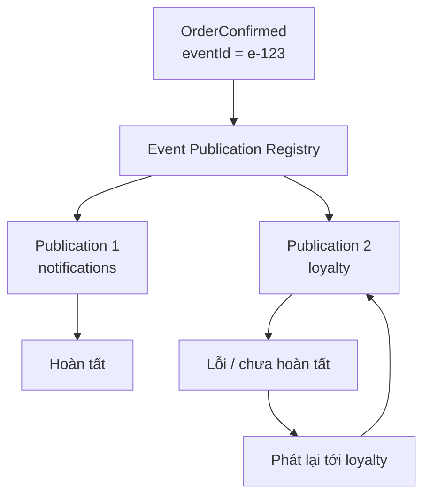
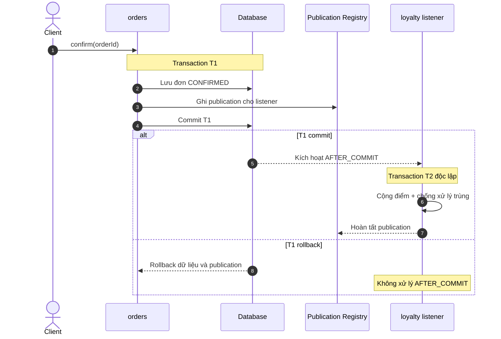
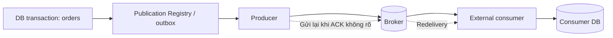

# At-least-once: giao sự kiện tối thiểu một lần trong Spring Modulith

## 1. Bài toán: sự kiện có thể được giao lại sau khi xử lý

Trong kiến trúc **Spring Modulith**, module `orders` phát sự kiện `OrderConfirmed` khi đơn hàng được xác nhận. Module `loyalty` cộng điểm, còn `notifications` gửi thông báo. Các module giao tiếp bằng **application events** để giảm lời gọi trực tiếp và giữ ranh giới nghiệp vụ.

Vấn đề xuất hiện khi một listener xử lý sự kiện nhưng ứng dụng không kịp ghi nhận việc xử lý đã hoàn tất. Ví dụ:

1. Transaction xác nhận đơn hàng đã commit.
2. Listener `loyalty` nhận `OrderConfirmed` và cộng 100 điểm thành công.
3. Tiến trình dừng đột ngột trước khi hệ thống đánh dấu publication đã hoàn thành.
4. Khi ứng dụng phục hồi và phát lại publication, `loyalty` nhận **cùng event lần nữa**.

Nếu listener cộng thêm 100 điểm, khách hàng được 200 điểm dù nghiệp vụ chỉ xác nhận một đơn. Tuy nhiên, nếu vì sợ xử lý trùng mà bỏ hoàn toàn việc phát lại, một lỗi xảy ra **trước** bước cộng điểm có thể khiến công việc bị mất.

**At-least-once delivery** (giao tối thiểu một lần) ưu tiên khả năng **không bỏ sót công việc đã được chấp nhận**, bằng cách cho phép giao lại khi chưa có bằng chứng hoàn thành. Hệ quả bắt buộc là consumer phải chịu được **duplicate delivery**.

Mục tiêu của bài: hiểu điều kiện để một luồng Spring Modulith đạt mục tiêu at-least-once; nhận diện thời điểm có thể mất hoặc giao trùng event; triển khai listener idempotent; kết hợp Event Publication Registry, retry, kiểm thử và quan sát.

## 2. So sánh at-most-once, at-least-once và exactly-once

| Mô hình | Cam kết kỳ vọng | Khi kết quả xử lý không chắc chắn | Đánh đổi |
|---|---|---|---|
| **At-most-once** | Giao tối đa một lần; có thể mất event | Không thử lại | Không tạo duplicate do retry, nhưng có nguy cơ bỏ sót |
| **At-least-once** | Cố gắng giao ít nhất một lần cho tới khi có xác nhận hoàn thành | Thử lại hoặc phát lại | Có thể giao trùng; yêu cầu idempotency |
| **Exactly-once** | Hiệu ứng được quan sát đúng một lần trong **phạm vi cam kết xác định** | Cần cơ chế phối hợp trạng thái/transaction phù hợp | Phức tạp; không tự có khi chỉ bật retry |

Cụm từ “ít nhất một lần” phải đi kèm **điều kiện**: thông điệp phải được ghi nhận bền vững, có cơ chế khôi phục chưa hoàn tất, chưa bị xóa theo retention và consumer cuối cùng có thể tiếp nhận. Nếu một lỗi dữ liệu vĩnh viễn không được xử lý, hệ thống không thể hứa rằng công việc cuối cùng sẽ thành công.

Đặc biệt, cần phân biệt:

- **Delivery:** listener được kích hoạt/nhận thông điệp.
- **Processing:** listener chạy logic.
- **Business effect:** thay đổi nghiệp vụ thật sự xảy ra (cộng điểm, gửi email, ghi giao dịch).

At-least-once **không** có nghĩa “ít nhất một lần thành công” trong mọi điều kiện, và không có nghĩa “business effect chỉ xảy ra đúng một lần”. Với consumer idempotent và kho dữ liệu giao dịch phù hợp, ta có thể đạt **hiệu ứng nghiệp vụ giống một lần** cho những thao tác cụ thể, dù event đã được giao nhiều lần.

## 3. Spring application events không mặc định là hàng đợi bền vững

`ApplicationEventPublisher.publishEvent(event)` công bố sự kiện tới bộ phân phối của Spring **trong tiến trình hiện tại**. Khi chưa có Event Publication Registry hoặc cơ chế lưu bền phù hợp, lời gọi đó không tự lưu event qua lần restart và không tự tạo quy trình retry đáng tin cậy.

Các cách lắng nghe khác nhau tạo ra hành vi khác nhau:

| Listener | Thời điểm | Tính chất liên quan đến độ tin cậy |
|---|---|---|
| `@EventListener` | Mặc định đồng bộ khi phân phối event | Exception có thể lan lên publisher; nếu publisher rollback thì listener có thể đã tạo side effect không rollback được |
| `@TransactionalEventListener(phase = AFTER_COMMIT)` | Sau transaction publisher commit | Không xử lý khi transaction rollback; không tự cung cấp persistence hay transaction DB mới |
| `@ApplicationModuleListener` | Sau commit, bất đồng bộ, với transaction mới | Tách xử lý nghiệp vụ listener khỏi transaction nguồn; kết hợp được với registry khi cấu hình |

**`@ApplicationModuleListener` không tự bảo đảm at-least-once bền vững.** Annotation giúp xác định **khi nào và ở đâu** listener chạy. Muốn khôi phục công việc sau khi ứng dụng chết, phải có lưu trữ publication và luồng resubmit được cấu hình, vận hành.

Tương tự, `@TransactionalEventListener` mặc định không chạy nếu event được phát **ngoài transaction đang hoạt động**. Nếu publisher quên transaction, có thể thấy log “đã publish” nhưng không có callback sau commit để chạy.

## 4. Event khác với publication: một event, nhiều đích nhận

Giả sử có một event:

```java
package com.example.shop.orders;

import java.time.Instant;
import java.util.UUID;

public record OrderConfirmed(
        UUID eventId,
        UUID orderId,
        Instant occurredAt
) {}
```

Hai module cùng lắng nghe. Spring Modulith Event Publication Registry, khi được cấu hình với persistent store, theo dõi các **publication hướng tới từng transactional listener**, không chỉ một cờ “event đã gửi” chung.



Các ID trong sơ đồ mang tính minh họa. Ý nghĩa:

- **`eventId`** thuộc hợp đồng nghiệp vụ; giữ nguyên qua những lần giao lại *cùng sự kiện*.
- **Publication identifier** thuộc registry; nhận diện việc giao một event tới một listener đích.
- **Listener target** giúp phân biệt phần việc của `notifications` và `loyalty`.
- Khi `notifications` đã hoàn tất nhưng `loyalty` lỗi, việc khôi phục có thể nhắm vào publication chưa hoàn tất của `loyalty`, thay vì phát lại toàn bộ lệnh xác nhận đơn.

Cách theo dõi theo từng listener giữ sự độc lập giữa các module. Tuy nhiên, nó cũng có nghĩa consumer không được dựa vào việc **một listener khác** đã thành công để cho rằng mình không cần xử lý.

## 5. Luồng chuẩn: commit nghiệp vụ, ghi publication và xử lý listener

Ví dụ dùng một DB giao dịch cục bộ và listener trong cùng ứng dụng:



Sơ đồ thể hiện **quan hệ nhân quả**, không khẳng định mọi thao tác chạy đồng bộ hoặc theo thời gian tuyệt đối. Khi dùng `@ApplicationModuleListener`, listener thường chạy ở thread khác, sau khi T1 commit.

Điểm mấu chốt là **ghi dữ liệu nghiệp vụ và ghi publication trong cùng transaction T1**. Khi đó, nếu T1 rollback, không lưu đơn cũng không còn publication cần xử lý. Nếu T1 commit và ứng dụng chết trước khi listener chạy, publication bền vững vẫn có thể được tìm thấy để khôi phục.

Cần bảo đảm starter lưu trữ, transaction manager, schema lưu publication và serializer phù hợp đã được cấu hình. Không được coi các bước trên là bảo đảm nếu registry chỉ ở bộ nhớ hoặc không ghi cùng transaction.

## 6. Ví dụ publisher: phát một business event ổn định

Module `orders` sở hữu việc chuyển trạng thái và ID event:

```java
package com.example.shop.orders;

import java.time.Clock;
import java.util.UUID;
import org.springframework.context.ApplicationEventPublisher;
import org.springframework.stereotype.Service;
import org.springframework.transaction.annotation.Transactional;

@Service
public class OrderConfirmationService {

    private final OrderRepository orders;
    private final ApplicationEventPublisher events;
    private final Clock clock;

    public OrderConfirmationService(OrderRepository orders,
                                    ApplicationEventPublisher events,
                                    Clock clock) {
        this.orders = orders;
        this.events = events;
        this.clock = clock;
    }

    @Transactional
    public void confirm(UUID orderId) {
        Order order = orders.findById(orderId).orElseThrow();

        if (order.isConfirmed()) {
            return; // Không tạo event mới cho lệnh xác nhận lặp.
        }

        order.confirm();
        orders.save(order);

        events.publishEvent(new OrderConfirmed(
                UUID.randomUUID(), orderId, clock.instant()));
    }
}
```

`OrderRepository`, `Order` là kiểu domain minh họa; cần có bean `Clock`, transaction manager và khóa đồng thời phù hợp. Khi hai request cùng xác nhận đơn, chỉ kiểm tra `isConfirmed()` chưa đủ để ngăn hai event; cần **optimistic locking**, unique business constraint hoặc cơ chế đồng thời khác.

**Hai loại duplicate khác nhau:**

1. **Duplicate business event:** hai transaction độc lập cùng phát `OrderConfirmed` với hai `eventId` khác nhau do lỗi cạnh tranh. Cần bảo vệ quyết định nghiệp vụ tại publisher.
2. **Duplicate delivery:** cùng `OrderConfirmed(eventId=E1)` được gửi lại cho listener vì chưa rõ kết quả. Cần idempotency tại consumer.

Không dùng logic chống duplicate delivery để che giấu lỗi publisher tạo hai sự kiện hợp lệ trên giấy nhưng sai về nghiệp vụ.

## 7. Các cửa sổ lỗi tạo ra mất event hoặc duplicate

Xét những điểm hệ thống có thể gặp lỗi:

| Thời điểm lỗi | Khi có registry bền vững, T1 atomic và recovery | Rủi ro còn lại |
|---|---|---|
| Trước khi T1 commit | Dữ liệu đơn và publication cùng rollback | Không có event đã được chấp nhận để khôi phục |
| Sau T1 commit, trước khi listener bắt đầu | Publication còn tồn tại, có thể khôi phục | Công việc bị trễ cho tới khi recovery chạy |
| Listener bắt đầu, chưa ghi thay đổi | Publication chưa hoàn tất, có thể thử lại | Có thể được gọi nhiều lần |
| Listener cập nhật DB nhưng transaction T2 rollback | Thay đổi cục bộ rollback; publication chưa hoàn tất | Retry cần chịu được lỗi lặp |
| Side effect đã xảy ra, trước khi đánh dấu publication hoàn tất | Recovery có thể gửi lại | **Nguy cơ lặp hiệu ứng** nếu consumer không idempotent |
| Đánh dấu publication hoàn tất và sau đó restart | Không cần thử lại publication đã hoàn tất | Cần tin đúng vào phạm vi bảo đảm của listener và completion mode |

Hai cửa sổ quan trọng nhất:

- **Lỗi sau commit nguồn nhưng trước callback:** giải thích vì sao cần lưu publication và khôi phục.
- **Lỗi sau side effect nhưng trước ACK/completion:** giải thích vì sao **retry bắt buộc đi cùng idempotency**.

Không thể dựa vào thời gian hoặc vị trí một dòng code để loại bỏ cả hai cửa sổ trong mọi trường hợp. Điều ta làm là quản lý trạng thái một cách bền vững và thiết kế xử lý trùng an toàn.

## 8. Thiết lập Event Publication Registry đúng phạm vi

Spring Modulith cung cấp các tích hợp persistence cho Event Publication Registry, ví dụ JDBC hoặc JPA. Với JDBC, một dependency minh họa theo hệ Spring Modulith:

```groovy
dependencies {
    implementation "org.springframework.modulith:spring-modulith-starter-jdbc"
    // Cần thêm driver database và cấu hình DataSource/
    // transaction manager theo Spring Boot của dự án.
}
```

Dependency trong ví dụ **không thay thế** cấu hình kết nối database, khởi tạo/migration schema và các yêu cầu phiên bản. Khi dùng JPA, chọn starter JPA thích hợp; lựa chọn persistence phải khớp hạ tầng và phiên bản Spring Modulith.

Để bảo đảm dữ liệu phục hồi được sau restart, cần xác minh:

1. Registry lưu bản ghi trong **kho bền vững**, không phải chỉ trong memory.
2. Publication cho các transactional listener được đăng ký trong transaction nguồn.
3. Backend có schema phù hợp và được triển khai/migration ổn định.
4. Payload có thể được **serialize và deserialize** sau khi ứng dụng nâng version.
5. Có **quy trình khôi phục publication chưa hoàn tất**, không chỉ lưu rồi bỏ quên.
6. Các instance được điều phối để tránh retry đồng thời không kiểm soát.

Không phải listener `@EventListener` bình thường nào cũng được registry theo dõi. Registry tập trung vào các publication cho transactional listener đủ điều kiện; hãy xác minh loại listener và cấu hình thực tế.

## 9. Registry theo dõi trạng thái nhưng không tự chạy lại vô hạn

Ở các phiên bản Spring Modulith mới, publication có thể có các trạng thái tường minh như `PUBLISHED`, `PROCESSING`, `COMPLETED`, `FAILED` và `RESUBMITTED`; trạng thái bổ sung tùy phiên bản. Ở những phiên bản cũ, việc quan sát có thể tập trung vào bản ghi **chưa hoàn tất** và thời gian hoàn thành.

Điểm chung cần nhớ: **publication chưa hoàn tất không đồng nghĩa chắc chắn chưa có side effect**. Một listener có thể hoàn thành công việc nhưng ứng dụng chết trước khi registry ghi nhận completion.

Spring Modulith cung cấp API để truy vấn và phát lại publication chưa hoàn tất; bộ API và chính sách lỗi thay đổi theo phiên bản. Có tùy chọn phục hồi outstanding publications khi khởi động:

```properties
# Chỉ bật sau khi đã đánh giá retry, idempotency và multi-instance.
spring.modulith.events.republish-outstanding-events-on-restart=true
```

Đây là **lựa chọn**, không phải lời hứa rằng mọi công việc sẽ tự phục hồi trong mọi tình huống. Với nhiều instance chạy đồng thời, một instance có thể đang xử lý publication mà instance khác coi là outstanding. Cần kế hoạch locking, retry có chọn lọc và giới hạn tốc độ phù hợp.

Nên phân biệt **retry tự động trong listener**, **resubmit publication từ registry** và **công việc vận hành khôi phục**. Chúng có thể cùng tồn tại, nhưng không nên bật mọi cơ chế mà không có giới hạn, vì có thể gây retry storm khi downstream gặp sự cố dài.

## 10. Consumer idempotent: chìa khóa của at-least-once

**Idempotency** nghĩa là xử lý lại cùng yêu cầu tạo ra **hiệu ứng nghiệp vụ tương đương một lần**. Ví dụ `loyalty` chỉ cộng điểm cho một `OrderConfirmed`, dù publication được giao hai hoặc ba lần.

Một mô hình lưu vết đơn giản là bảng inbox/processed events:

```sql
CREATE TABLE processed_event (
    consumer_name VARCHAR(120) NOT NULL,
    event_id UUID NOT NULL,
    processed_at TIMESTAMP WITH TIME ZONE NOT NULL
        DEFAULT CURRENT_TIMESTAMP,
    PRIMARY KEY (consumer_name, event_id)
);
```

Đây là DDL minh họa cho cơ sở dữ liệu hỗ trợ kiểu `UUID` và `TIMESTAMP WITH TIME ZONE`; khi dùng hệ quản trị khác, cần điều chỉnh cú pháp.

Khóa `(consumer_name, event_id)` giúp phân biệt **cùng event được hai consumer xử lý độc lập**. Nếu chỉ dùng `event_id` làm khóa toàn hệ thống, việc `notifications` xử lý thành công có thể khiến `loyalty` bị chặn nhầm.

Với PostgreSQL, thao tác claim idempotency có thể thực hiện nguyên tử:

```sql
INSERT INTO processed_event (consumer_name, event_id)
VALUES (:consumerName, :eventId)
ON CONFLICT (consumer_name, event_id) DO NOTHING;
```

Sau khi chạy SQL, kiểm tra **số hàng được insert**: `1` là lần đầu; `0` nghĩa là event đã được claim bởi cùng consumer. Cần giữ thao tác insert và cập nhật nghiệp vụ **trong cùng transaction cục bộ**; nếu nghiệp vụ thất bại, transaction rollback cả dấu đã xử lý, cho phép retry thực hiện lại.

## 11. Ví dụ Spring Modulith listener cộng điểm an toàn

Listener thuộc module `loyalty` nhận sự kiện công khai của `orders`:

```java
package com.example.shop.loyalty;

import com.example.shop.orders.OrderConfirmed;
import org.springframework.modulith.events.ApplicationModuleListener;
import org.springframework.stereotype.Component;

@Component
class OrderLoyaltyListener {

    private final LoyaltyCreditService credits;

    OrderLoyaltyListener(LoyaltyCreditService credits) {
        this.credits = credits;
    }

    @ApplicationModuleListener
    void on(OrderConfirmed event) {
        credits.creditOnce(event);
    }
}
```

Service xử lý idempotency và cộng điểm trong **cùng transaction T2**:

```java
package com.example.shop.loyalty;

import com.example.shop.orders.OrderConfirmed;
import org.springframework.stereotype.Service;
import org.springframework.transaction.annotation.Transactional;

@Service
public class LoyaltyCreditService {

    private final ProcessedEventStore processed;
    private final LoyaltyPointRepository points;

    LoyaltyCreditService(ProcessedEventStore processed,
                        LoyaltyPointRepository points) {
        this.processed = processed;
        this.points = points;
    }

    @Transactional // REQUIRED: tham gia T2 của @ApplicationModuleListener
    public void creditOnce(OrderConfirmed event) {

        boolean first = processed.tryInsert(
                "loyalty:OrderConfirmed", event.eventId());

        if (!first) {
            return; // Cùng consumer đã xử lý eventId này.
        }

        points.creditForConfirmedOrder(event.orderId());
    }
}
```

`ProcessedEventStore.tryInsert(...)` là API minh họa có thể thực thi bằng `INSERT ... ON CONFLICT DO NOTHING` ở mục trên. `LoyaltyPointRepository` là repository nghiệp vụ giả định. Triển khai thật phải bảo đảm **unique constraint**, transaction đồng nhất và xử lý cạnh tranh giữa nhiều listener chạy song song.

Cách này đúng khi việc cập nhật điểm và dấu đã xử lý đều nằm trong **một DB transaction T2**:

- Nếu `creditForConfirmedOrder(...)` thành công rồi T2 commit: dấu đã xử lý và điểm cùng tồn tại.
- Nếu `creditForConfirmedOrder(...)` ném unchecked exception: T2 rollback **cả hai**, retry được phép thử lại.
- Nếu event được giao lại sau khi T2 commit: `tryInsert(...)` không thêm bản ghi mới, listener bỏ qua nên không cộng điểm lần hai.

Giá trị điểm vẫn phải được tính theo quy tắc nghiệp vụ đúng (có thể cần snapshot từ event thay vì truy vấn trạng thái hiện tại). Idempotency chỉ ngăn lặp, **không tự sửa logic cộng điểm sai**.

## 12. Side effect bên ngoài DB khó hơn: email và HTTP

Giả sử `notifications` gửi email qua dịch vụ ngoài. Có hai cách đánh dấu đã xử lý dễ mắc lỗi:

| Thứ tự | Nếu ứng dụng crash giữa hai bước | Hậu quả |
|---|---|---|
| **Đánh dấu đã xử lý trước → gửi email** | Crash sau commit dấu đã xử lý nhưng trước khi gửi | Email có thể bị **mất vĩnh viễn** vì retry tưởng đã xong |
| **Gửi email trước → đánh dấu đã xử lý** | Crash sau khi gửi nhưng trước khi lưu dấu | Email có thể bị **gửi trùng** |

Transaction DB của listener **không rollback được email đã gửi**. Để giảm rủi ro:

- Dùng API nhà cung cấp hỗ trợ **idempotency key** (ví dụ `eventId` kèm loại notification), nếu có và nếu nhà cung cấp bảo đảm thời hạn lưu khóa thích hợp.
- Lưu **notification job/outbox** bằng transaction cục bộ, rồi worker gửi email với trạng thái và retry rõ ràng; vẫn phải chống gửi trùng ở cấp nhà cung cấp hoặc có quy trình đối soát.
- Định nghĩa chính sách nghiệp vụ chấp nhận được: email xác nhận gửi trùng ít nghiêm trọng hơn thu tiền trùng, nhưng vẫn gây phiền.
- Theo dõi cả trạng thái “đã yêu cầu gửi”, “được dịch vụ chấp nhận”, và “đã hoàn thành”, thay vì gộp thành một cờ chung.

**At-least-once ở mức chuyển giao event không tự cung cấp exactly-once cho API bên ngoài.** Độ tin cậy end-to-end phải được đánh giá tới **hiệu ứng cuối cùng**.

## 13. Retry: lỗi tạm thời, lỗi vĩnh viễn và giới hạn an toàn

Không phải exception nào cũng nên retry giống nhau.

| Loại lỗi | Ví dụ | Hành vi đề xuất |
|---|---|---|
| Tạm thời | Timeout, deadlock có thể phục hồi, downstream quá tải | Retry có backoff và giới hạn số lần/độ đồng thời |
| Hạ tầng dừng | DB hoặc broker ngừng hoạt động | Giữ publication bền vững, thử lại khi hạ tầng phục hồi |
| Payload/schema không tương thích | Không deserialize được event cũ | Sửa serializer, migration hoặc chuyển xử lý thủ công |
| Vi phạm nghiệp vụ vĩnh viễn | ID tham chiếu không hợp lệ, trạng thái không chấp nhận | Không retry vô hạn; cảnh báo, đối soát hoặc đánh dấu từ bỏ có kiểm soát |
| Trùng event đã xử lý | `eventId` nằm trong inbox của consumer | Trả về thành công, không làm side effect lần nữa |

Một chính sách khôi phục nên xác định:

1. **Ai kích hoạt retry?** Scheduler, startup recovery hay quản trị viên.
2. **Retry cái gì?** Publication lỗi của listener cụ thể, không tái phát lệnh nghiệp vụ gây trùng.
3. **Khi nào?** Exponential backoff, jitter, ngưỡng tuổi hoặc maintenance window.
4. **Bao nhiêu lần?** Giới hạn attempts; đưa lỗi dai dẳng vào luồng điều tra thay vì xử lý vô hạn.
5. **Có thể chạy đồng thời không?** Giới hạn in-flight, coordination giữa instance và unique constraint ở consumer.
6. **Khi nào coi là thành công?** Chỉ sau khi logic listener hoàn thành theo hợp đồng; không đánh dấu complete khi mới lên lịch.

Một publication được resubmit có thể xảy ra **sau** những event mới hơn. Vì vậy at-least-once không đồng nghĩa **giữ đúng thứ tự** giữa các event. Nếu consumer cần ordering, phải có thêm sequence/version, khóa aggregate hoặc một mô hình xử lý theo trạng thái.

## 14. At-least-once trong external events

Khi Spring Modulith externalize event ra Kafka, AMQP, JMS hoặc message channel, ta có thêm hai ranh giới:

1. **Application → broker:** producer gửi, broker chấp nhận message.
2. **Broker → consumer ngoài:** consumer nhận, xử lý rồi ACK/commit offset.

Mỗi ranh giới có thể gặp retry và duplicate. Một ACK từ broker **không chứng minh** consumer ngoài đã hoàn tất nghiệp vụ.



Để hướng tới at-least-once end-to-end:

- Publication từ transaction nguồn được lưu bền qua registry hoặc một **transactional outbox** phù hợp.
- Producer có retry khi không rõ broker đã nhận hay chưa, theo chính sách và cấu hình được xác minh.
- Broker lưu trữ và redelivery/ACK theo khả năng cụ thể.
- Consumer ngoài ghi kết quả và dấu `eventId` đã xử lý **cùng transaction của mình**, hoặc dùng cơ chế idempotency tương ứng cho side effect ngoài DB.

Một số broker có tính năng transactional/idempotent producer, nhưng chúng chỉ có hiệu lực trong **phạm vi broker/transaction đã định nghĩa**. Không nên suy rộng thành exactly-once cho nhiều database và HTTP service độc lập.

## 15. Observability: làm sao biết còn sự kiện chưa giao xong?

At-least-once cần cả **lưu vết** và **theo dõi vận hành**. Nếu publication chưa hoàn tất nằm trong DB nhưng không có ai giám sát hoặc resubmit, khả năng phục hồi chỉ tồn tại trên lý thuyết.

Một dashboard có thể theo dõi:

| Chỉ số đề xuất | Mục đích | Dấu hiệu bất thường |
|---|---|---|
| `publication_incomplete_count` theo target | Số công việc chưa kết thúc | Tăng liên tục khi downstream lỗi |
| `publication_failed_count` | Publication lỗi (khi version hỗ trợ trạng thái) | Có lỗi kéo dài cần xử lý |
| `oldest_incomplete_age_seconds` | Tuổi publication cũ nhất | Vượt SLO hoàn thành |
| `publication_resubmit_attempts` | Số lần thử lại | Retry storm hoặc poison message |
| `listener_completion_latency_seconds` | Độ trễ từ publish tới hoàn tất | Tăng sau một thay đổi hệ thống |
| `consumer_duplicate_suppressed_count` | Số event bị chặn lặp | Đột biến sau sự cố hoặc cấu hình retry sai |

Đây là **tên metric minh họa**, không phải khẳng định Spring Modulith tự động xuất chúng. Có thể xây từ API registry/persistence và Micrometer; tránh gắn `eventId`, `orderId` thành label metric vì cardinality rất cao.

Log nên có `eventId`, `orderId`, listener target, publication identifier, attempt/correlation ID (nếu có), trạng thái và exception. Tránh log toàn bộ payload có dữ liệu nhạy cảm.

Với Spring Modulith phiên bản hỗ trợ lifecycle trạng thái, có thể phân biệt publication đang xử lý và publication lỗi; phiên bản cũ có thể chỉ cung cấp bản ghi incomplete/completed. **Không suy luận “đang lỗi” chỉ từ một snapshot incomplete**: có listener vẫn đang chạy hợp lệ ở instance khác.

## 16. Kiểm thử thực tế cho at-least-once

Một test chỉ kiểm tra `publishEvent(...)` được gọi **chưa đủ** để chứng minh luồng có thể phục hồi sau restart. Cần kiểm thử các cửa sổ lỗi chủ động:

### A. Commit thành công, listener thành công

- Tạo `OrderConfirmed` trong transaction, để T1 commit.
- Đợi listener bất đồng bộ xử lý, kiểm tra hiệu ứng nghiệp vụ và publication hoàn tất.
- Với completion mode xóa bản ghi, xác minh theo trạng thái/cách quan sát phù hợp, không đòi vẫn còn bản ghi completed.

### B. Transaction nguồn rollback

- Phát event rồi gây lỗi để T1 rollback.
- Kiểm tra đơn không commit, không có side effect từ listener `AFTER_COMMIT` và không còn publication bền vững của T1.

### C. Listener lỗi rồi khôi phục

- Cho `loyalty` ném exception ở lần xử lý đầu.
- Xác nhận transaction nguồn vẫn commit và publication chưa hoàn tất/lỗi.
- Sửa lỗi downstream, kích hoạt resubmit theo API/chính sách của phiên bản.
- Kiểm tra cuối cùng có điểm thưởng và publication được hoàn tất.

### D. Giao lại **cùng eventId**

- Gọi logic listener lần hai với **cùng `eventId`**.
- Xác minh số điểm **không tăng thêm**; bảng `processed_event` giữ một record cho cặp consumer/eventId.
- Chạy đồng thời hai lượt xử lý để kiểm chứng unique constraint, không chỉ lệnh `exists()`.

### E. Crash sau side effect, trước completion

- Giả lập commit T2 xong nhưng không đánh dấu publication hoàn tất.
- Khởi động lại hoặc resubmit trong test tích hợp sử dụng registry bền vững.
- Xác nhận consumer bỏ qua duplicate dựa trên dấu đã xử lý.

Các bài kiểm thử sau commit thường cần **transaction thật sự commit**. Đặt `@Transactional` lên method test với rollback mặc định có thể làm listener `AFTER_COMMIT` không chạy. Dùng test không bọc transaction, hoặc chủ động commit với `TestTransaction`/`TransactionTemplate`. Đối với async, chờ điều kiện quan sát có timeout thay vì `Thread.sleep` tùy tiện.

## 17. Những sai lầm phổ biến

| Sai lầm | Vì sao nguy hiểm | Cách sửa |
|---|---|---|
| “Có `@ApplicationModuleListener` là có at-least-once” | Annotation không tự tạo durable registry và recovery | Cấu hình persistence, resubmit và kiểm thử restart |
| “Đã `publishEvent` thì DB đã commit” | Event có thể phát trước commit | Dùng transactional listener `AFTER_COMMIT` |
| “Không thấy exception là side effect đúng một lần” | Crash giữa side effect và completion | Thiết kế consumer idempotent |
| “Chỉ cần `orderId` để chống duplicate” | Cùng đơn có thể sinh nhiều event hợp lệ | Phân biệt business key và `eventId` |
| “Check `exists()` rồi insert là đủ” | Hai thread có thể cùng thấy chưa tồn tại | Unique constraint và transaction cục bộ |
| “Lưu dấu trước khi gọi API ngoài là chắc chắn” | Crash có thể làm mất tác vụ | Outbox/job và idempotency ở API đích |
| “Retry mãi rồi sẽ thành công” | Lỗi vĩnh viễn không tự biến mất | Phân loại lỗi, giới hạn retry, alert/đối soát |
| “Registry completion = external side effect exactly-once” | Completion chỉ phản ánh listener theo contract | Kiểm tra chuỗi end-to-end |
| “At-least-once luôn giữ đúng thứ tự” | Retry và async có thể đảo thứ tự | Aggregate version, ordering strategy |

## 18. Checklist thiết kế và vận hành

- Đã xác định rõ **phạm vi bảo đảm**: giao tới listener trong JVM, broker hay xử lý tận consumer ngoài?
- Sự kiện là **business fact** và phát trong transaction chứa quyết định nghiệp vụ.
- Registry bền vững, transaction và schema đã được kiểm chứng; không chỉ có annotation.
- Có cách truy vấn publication chưa hoàn tất, resubmit và phục hồi sau restart.
- Lần retry của **cùng event** giữ nguyên `eventId`, không tạo event mới bằng cách chạy lại command.
- Consumer có unique key theo `consumer + eventId` và hiệu ứng DB nằm trong cùng transaction.
- Với email/HTTP/payment, có idempotency key, outbox hoặc phương án đối soát.
- Retry có backoff, giới hạn, phân loại lỗi và an toàn trong triển khai multi-instance.
- Dashboard giám sát tuổi backlog, lỗi, attempts và duplicate; không làm lộ dữ liệu nhạy cảm.
- Test bao phủ commit, rollback, listener lỗi, restart, duplicate đồng thời và cửa sổ side effect trước completion.

**Tổng kết:** At-least-once trong Spring Modulith là một **mục tiêu độ tin cậy có điều kiện**: publication được lưu bền, công việc chưa hoàn tất được khôi phục và có thể được giao lại. Để đạt kết quả nghiệp vụ đúng, phải chấp nhận rằng listener có thể nhận **cùng sự kiện nhiều lần** và thiết kế idempotency phù hợp. Event Publication Registry, transaction sau commit, retry, monitoring và kiểm thử failure windows tạo thành một bộ giải pháp; không cơ chế đơn lẻ nào tự bảo đảm exactly-once cho toàn bộ hệ thống.

### Tài liệu tham khảo

- [Spring Modulith — Working with Application Events](https://docs.spring.io/spring-modulith/reference/events.html): `@ApplicationModuleListener`, publication registry và cơ chế khôi phục.
- [Spring Framework — Transaction-bound Events](https://docs.spring.io/spring-framework/reference/data-access/transaction/event.html): `@TransactionalEventListener` và `AFTER_COMMIT`.
- [Spring Framework — Transaction Propagation](https://docs.spring.io/spring-framework/reference/data-access/transaction/declarative/tx-propagation.html): transaction độc lập, `REQUIRES_NEW` và rollback.
