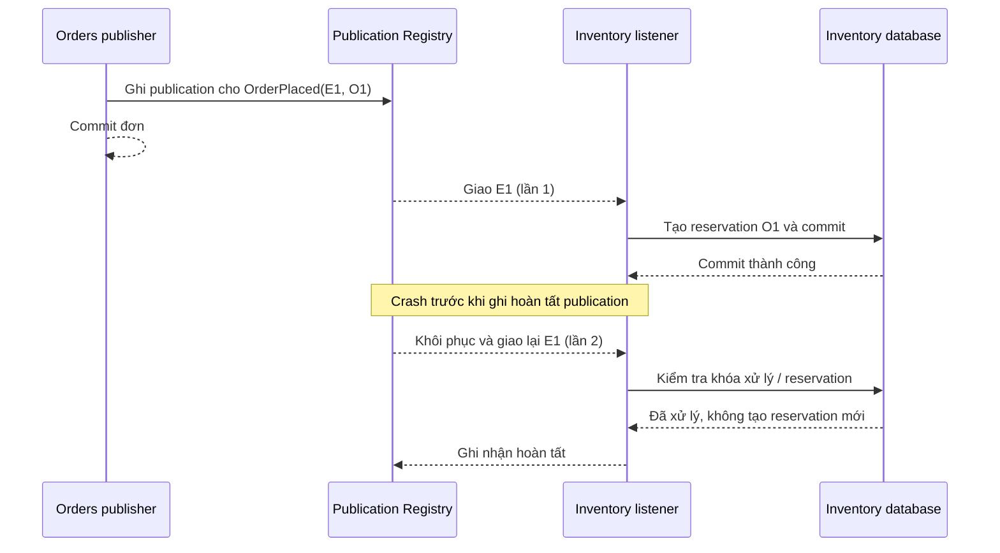
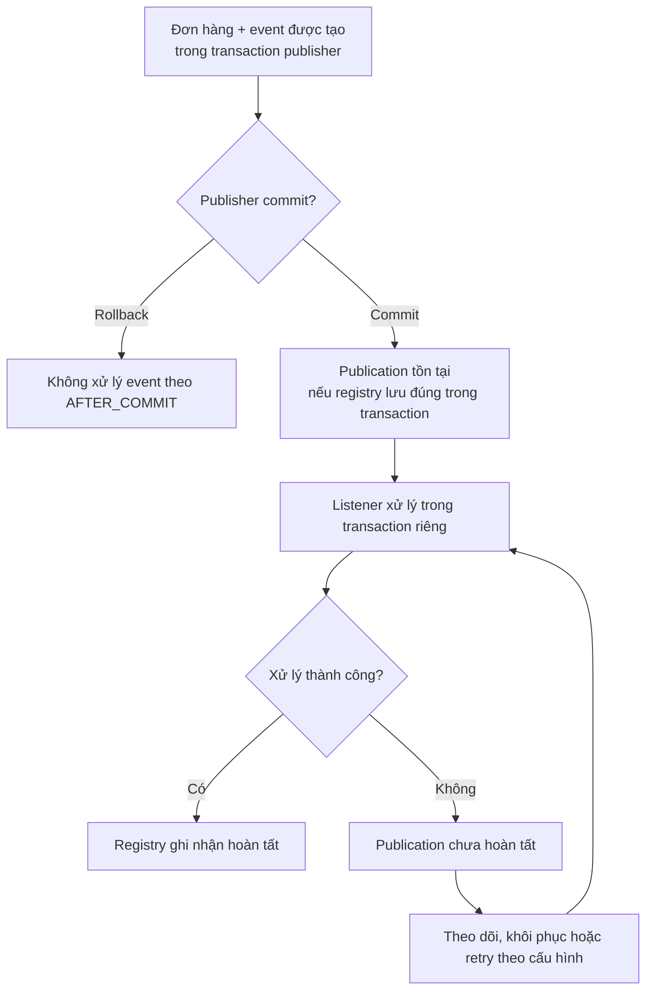
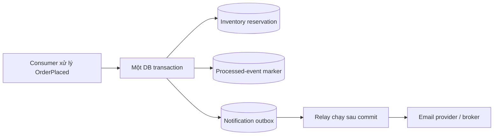

# Exactly-once và giới hạn của bảo đảm giao sự kiện trong Spring Modulith

## 1. Vì sao cần hiểu exactly-once trước khi thiết kế hệ thống?

Trong một ứng dụng Spring Boot theo kiến trúc **Spring Modulith**, module `orders` phát sự kiện `OrderPlaced` sau khi tạo đơn. Module `inventory` nhận sự kiện để giữ hàng, `billing` nhận để tạo yêu cầu thanh toán, còn `notifications` có thể gửi email xác nhận.

Một tình huống thực tế:

1. `orders` commit đơn hàng thành công.
2. `inventory` nhận `OrderPlaced` và commit việc giữ hàng.
3. Ứng dụng gặp lỗi hoặc không kịp ghi nhận rằng publication đến listener đã hoàn tất.
4. Khi khôi phục, cùng event được giao lại cho listener kho.

Nếu handler kho cứ trừ tồn kho mỗi lần nhận event, một đơn sẽ bị giữ hàng hai lần. Nhưng nếu hệ thống **không thử lại**, một sự kiện bị mất trước khi listener chạy có thể khiến đơn không bao giờ được giữ hàng. Đây là sự đánh đổi cốt lõi giữa **không mất việc** và **không lặp việc**.

Trong module học `SPRING_MODULITH_APPLICATION_EVENTS`, bài này giải thích chính xác các giới hạn của lời hứa “exactly-once”: publisher, listener sau commit, Event Publication Registry, retry, kiểm thử và quan sát có thể phối hợp để tăng độ tin cậy, nhưng **không nên đồng nhất một annotation hay một registry với exactly-once end-to-end**.

> **Nguyên tắc thực hành:** Thiết kế hệ thống **chịu được event được giao lại**, đồng thời dùng transaction và các khóa nghiệp vụ để làm cho **tác dụng phụ quan trọng không bị thực hiện lặp không hợp lệ**.

## 2. Ba cấp độ thường bị gọi chung là "exactly-once"

Trước khi thảo luận bảo đảm giao sự kiện, phải xác định **đang đếm điều gì**.

| Cấp độ | Câu hỏi | Ví dụ |
| --- | --- | --- |
| **Delivery (giao sự kiện)** | Listener có thể **nhìn thấy** event bao nhiêu lần? | `InventoryListener` được gọi hai lần với cùng `eventId` |
| **Processing (thực thi handler)** | Logic xử lý event được **chạy** bao nhiêu lần? | Handler bắt đầu, lỗi rồi chạy lại sau restart |
| **Business effect (tác dụng phụ nghiệp vụ)** | Một thay đổi có ý nghĩa được **commit hoặc phát ra ngoài** bao nhiêu lần? | Chỉ có một reservation hợp lệ cho đơn `O1` |

Một event có thể **được giao hai lần**, handler có thể **được thực thi hai lần**, nhưng cả hai lần đều cùng kiểm tra trạng thái để **chỉ tạo một reservation**. Đây là kiểu bảo đảm **idempotent/effectively-once business effect** trong một phạm vi nghiệp vụ được định nghĩa rõ.

Ngược lại, ngay cả khi một framework bảo đảm một bản ghi message được chuyển chỉ một lần tại một tầng cụ thể, consumer vẫn có thể ghi dữ liệu nhiều lần do retry ở tầng ứng dụng, lỗi logic hoặc một command nghiệp vụ khác. Cần nêu rõ **ranh giới, failure model và hệ thống nào tham gia** khi sử dụng cụm từ “exactly-once”.

### 2.1. Ba ngữ nghĩa giao nhận phổ biến

| Ngữ nghĩa | Tính chất mong muốn | Rủi ro hoặc giới hạn |
| --- | --- | --- |
| **At-most-once** | Không cố ý giao lại cùng message sau lỗi; tối đa một lần giao theo mô hình | Có thể mất event/công việc nếu lỗi trước khi hoàn tất |
| **At-least-once** | Tiếp tục giao lại cho đến khi nhận được xác nhận hợp lệ, khi hạ tầng còn hoạt động và chính sách còn hiệu lực | Có thể giao trùng; cần idempotency |
| **Exactly-once** | Một tác vụ hoặc kết quả chỉ được tính đúng một lần trong **phạm vi đã chỉ rõ** | Rất khó/không thể khẳng định toàn cục chỉ nhờ giao event; thường cần giao dịch nguyên tử và hợp tác của các bên |

Các thuật ngữ trên mô tả **mục tiêu thiết kế**, không phải tính năng mặc định của `ApplicationEventPublisher`. Một cơ chế at-least-once có thể vẫn không bảo đảm tiến độ vô hạn nếu retry bị tắt, event hỏng không được xử lý hoặc hệ thống không hoạt động trở lại.

## 3. Vì sao "nhận một lần" và "làm một lần" không giống nhau?

Sự cố nguy hiểm nhất thường nằm **sau khi tác dụng phụ đã thành công nhưng trước khi ghi nhận hoàn tất**.



Sơ đồ giả định có registry bền vững và một cơ chế tái xử lý publication tồn đọng được cấu hình. `Event Publication Registry` không tự bảo đảm mọi lần retry trong mọi phiên bản hoặc cấu hình.

Hãy xét hai thứ tự ghi nhận:

- **Ghi "đã xử lý" trước khi làm nghiệp vụ:** nếu ứng dụng crash sau khi ghi dấu nhưng trước khi giữ hàng, lần sau thấy dấu và bỏ qua → có thể **mất tác dụng phụ**.
- **Làm nghiệp vụ trước, ghi "đã xử lý" sau:** nếu crash ở giữa hai bước, lần sau làm nghiệp vụ lần nữa → có thể **trùng tác dụng phụ**.

Nếu hai thao tác cùng nằm **trong một transaction database** và đều phải commit/rollback cùng nhau, khoảng hở giữa hai bước **trong database đó** được loại bỏ. Tuy nhiên, việc xác nhận publication ở registry, gửi email hoặc gọi broker có thể tạo ra một **ranh giới commit khác**, nên vẫn phải kiểm tra phạm vi bảo đảm.

## 4. Sự kiện nội bộ Spring không tự là một hàng đợi bền vững

`ApplicationEventPublisher.publishEvent(...)` công bố application event cho cơ chế xử lý event trong Spring `ApplicationContext`. Trong cấu hình thông dụng, một `@EventListener` đồng bộ được gọi ngay trong đường đi của publisher.

Ví dụ:

```java
@Transactional
public void placeOrder(PlaceOrderCommand command) {
    Order order = repository.save(Order.from(command));
    publisher.publishEvent(new OrderPlaced(
        UUID.randomUUID(),
        order.getId(),
        clock.instant()
    ));
}
```

`Order`, `repository` và `command` là kiểu giả định của ứng dụng. Đoạn trên **không tự chứng minh** rằng listener đã chạy sau commit, rằng publication đã được lưu bền vững hoặc rằng lần gửi bị lỗi sẽ được phát lại.

So sánh cách lắng nghe:

| Kiểu listener | Thời điểm tiêu biểu | Có tự lưu publication để khôi phục không? |
| --- | --- | --- |
| `@EventListener` thông thường | Thường đồng bộ khi publish với multicaster mặc định | Không mặc định |
| `ApplicationListener<E>` thông thường | Theo cơ chế dispatch của multicaster, mặc định thường đồng bộ | Không mặc định |
| `@TransactionalEventListener(AFTER_COMMIT)` | Sau khi transaction publisher commit | Không chỉ nhờ annotation; cần cơ chế registry/storage phù hợp |
| `@ApplicationModuleListener` | Sau commit, bất đồng bộ, transaction riêng theo cấu hình Spring Modulith | Có thể được theo dõi bằng Event Publication Registry **khi tích hợp và cấu hình đúng** |

Một listener chạy sau commit tránh thực hiện nghiệp vụ vì đơn hàng bị rollback, nhưng **không giải quyết toàn bộ** các lỗi sau commit. Nếu ứng dụng dừng trước khi listener kịp chạy, một event chỉ tồn tại trong bộ nhớ có thể không còn cơ sở để khôi phục.

## 5. Bảo đảm của Event Publication Registry: giá trị và giới hạn

Spring Modulith cung cấp **Event Publication Registry** để theo dõi các publication hướng đến transactional event listener phù hợp. Khi dùng một triển khai kho lưu trữ bền vững và cấu hình đúng, registry có thể ghi publication cùng transaction nghiệp vụ nguồn, rồi ghi nhận publication đã hoàn tất sau khi listener xử lý.

Nhờ đó, ứng dụng có cơ sở để phát hiện công việc còn tồn đọng và tái xử lý theo chính sách khôi phục.



**Những gì không được tự suy ra từ registry:**

1. Không phải mọi `@EventListener` thông thường đều được lưu publication và phục hồi.
2. Chỉ thêm dependency hay annotation không đồng nghĩa tự động có storage bền vững, lịch retry đúng nhu cầu hoặc phục hồi sau restart.
3. Publication có thể được theo dõi **theo từng listener**: một listener thành công không có nghĩa các listener khác đã thành công.
4. Registry theo dõi **đường giao event đến listener**, không quyết định một đơn hàng có được giữ hàng hay thanh toán hợp lệ.
5. Registry không biến hai database hoặc một database với broker/email thành **một distributed transaction nguyên tử**.
6. Một listener đã commit nghiệp vụ nhưng chưa kịp đánh dấu publication hoàn tất vẫn có thể được gọi lại. **Idempotency của listener là cần thiết.**

**Phạm vi hỗ trợ, cách khởi tạo bảng/schema, cơ chế quét/khôi phục và chính sách retry** cần được xác minh với phiên bản Spring Modulith cùng kho lưu trữ thực sự đang triển khai. Không nên mô tả registry như một lời hứa exactly-once không có điều kiện.

## 6. Sự kiện bất biến và định danh ổn định là nền tảng

Thiết kế event theo hợp đồng **giá trị bất biến** giúp retry sử dụng lại cùng dữ liệu nghiệp vụ:

```java
// orders/events/OrderPlaced.java
package com.example.shop.orders.events;

import java.time.Instant;
import java.util.Objects;
import java.util.UUID;

public record OrderPlaced(
        UUID eventId,
        UUID orderId,
        Instant occurredAt) {

    public OrderPlaced {
        Objects.requireNonNull(eventId, "eventId");
        Objects.requireNonNull(orderId, "orderId");
        Objects.requireNonNull(occurredAt, "occurredAt");
    }
}
```

Vai trò các trường:

- `eventId` là định danh một **lần phát sinh sự kiện nghiệp vụ**, hữu ích cho dedup theo consumer. Retry **cùng event** phải giữ nguyên ID này.
- `orderId` là định danh **đơn hàng**; nhiều loại event có thể có cùng `orderId`. Dùng nó để kiểm soát quy tắc nghiệp vụ “một đơn chỉ có một reservation đang hiệu lực” nếu đúng với miền nghiệp vụ.
- `occurredAt` là thời điểm nghiệp vụ được publisher xác định, **không phải** thời điểm listener xử lý lại và không mặc định là thời điểm commit.

`eventId` do ứng dụng tự định nghĩa không nhất thiết trùng với ID bản ghi publication trong registry. Event payload cũng không cần chứa mọi trạng thái entity JPA; đưa entity mutable vào event có thể khiến cùng một tham chiếu cung cấp dữ liệu khác nhau giữa những lần xử lý.

### 6.1. Công bố event qua ranh giới module

Ví dụ `OrderPlaced` nằm tại `orders.events`, được khai báo là named interface:

```java
// orders/events/package-info.java
@org.springframework.modulith.NamedInterface("events")
package com.example.shop.orders.events;
```

Và module `inventory` chỉ được phụ thuộc vào API event:

```java
// inventory/package-info.java
@org.springframework.modulith.ApplicationModule(
    allowedDependencies = "orders::events"
)
package com.example.shop.inventory;
```

Nhờ đó consumer không cần truy cập `orders.internal.OrderRepository` hoặc `OrderEntity`. **Giới hạn phụ thuộc là bảo đảm kiến trúc**, không tự tạo bảo đảm at-least-once hay exactly-once.

## 7. Thiết kế idempotent consumer trong một transaction

Một mô hình thực dụng để đạt **tác dụng phụ nghiệp vụ một lần trong phạm vi database của consumer** gồm:

1. Event có một khóa định danh ổn định.
2. Mỗi consumer lưu dấu đã xử lý với **unique constraint**.
3. Việc lưu dấu và thay đổi nghiệp vụ nằm **trong cùng transaction**.
4. Nếu transaction rollback, cả dấu xử lý lẫn thay đổi nghiệp vụ đều không được lưu.
5. Khi retry, handler đọc/ghi dữ liệu theo quy tắc nguyên tử và kết thúc an toàn nếu event đã xử lý.

Ví dụ PostgreSQL minh họa:

```sql
-- Module inventory sở hữu các bảng này.
CREATE TABLE inventory_consumed_events (
    consumer_name VARCHAR(80) NOT NULL,
    event_id UUID NOT NULL,
    order_id UUID NOT NULL,
    processed_at TIMESTAMP WITH TIME ZONE NOT NULL,
    PRIMARY KEY (consumer_name, event_id)
);

CREATE TABLE inventory_reservations (
    order_id UUID PRIMARY KEY,
    status VARCHAR(24) NOT NULL,
    reserved_at TIMESTAMP WITH TIME ZONE NOT NULL
);
```

Hai khóa phục vụ hai mục đích khác nhau:

- `(consumer_name, event_id)` tránh xử lý lặp **cùng một event đối với cùng consumer**.
- `order_id` ở bảng `inventory_reservations` thực thi một quy tắc miền trong ví dụ: **mỗi đơn chỉ có một reservation**. Nếu một đơn có thể giữ hàng nhiều lần với những attempt hợp lệ, phải mở rộng khóa theo `reservationAttemptId` hoặc quy tắc nghiệp vụ khác.

Với PostgreSQL, một cách giành quyền xử lý event nguyên tử là:

```sql
INSERT INTO inventory_consumed_events
    (consumer_name, event_id, order_id, processed_at)
VALUES
    (:consumerName, :eventId, :orderId, CURRENT_TIMESTAMP)
ON CONFLICT (consumer_name, event_id) DO NOTHING;
```

Nếu số hàng chèn được là `1`, transaction này đã ghi dấu event; nếu là `0`, khóa đã tồn tại và handler có thể coi **event này** đã được xử lý. Quan trọng là truy vấn dùng ràng buộc duy nhất của database, thay vì:

```java
// Anti-pattern khi có nhiều thread/instance:
if (!repository.existsByEventId(eventId)) {
    repository.save(new ProcessedEvent(eventId));
}
```

Hai thread có thể cùng thấy `exists = false` rồi đều tiến vào xử lý. Unique constraint và xử lý xung đột là cơ chế bảo vệ thật sự ở ranh giới database.

### 7.1. Listener và service: thiết kế transaction rõ ràng

Spring Modulith cung cấp `@ApplicationModuleListener` để nhận event sau commit, bất đồng bộ và có transaction riêng trong điều kiện cấu hình phù hợp:

```java
// inventory/internal/OrderPlacedHandler.java
package com.example.shop.inventory.internal;

import com.example.shop.orders.events.OrderPlaced;
import org.springframework.modulith.events.ApplicationModuleListener;
import org.springframework.stereotype.Component;

@Component
class OrderPlacedHandler {

    private final InventoryReservationService reservations;

    OrderPlacedHandler(InventoryReservationService reservations) {
        this.reservations = reservations;
    }

    @ApplicationModuleListener
    void on(OrderPlaced event) {
        reservations.reserveOnce(event.eventId(), event.orderId());
    }
}
```

Service nghiệp vụ **tham gia transaction đang hoạt động** của listener:

```java
// inventory/internal/InventoryReservationService.java (phác thảo)
package com.example.shop.inventory.internal;

import java.util.UUID;
import org.springframework.stereotype.Service;
import org.springframework.transaction.annotation.Transactional;

@Service
class InventoryReservationService {

    private final ConsumedEventStore consumedEvents;
    private final ReservationStore reservationStore;

    InventoryReservationService(
            ConsumedEventStore consumedEvents,
            ReservationStore reservationStore) {
        this.consumedEvents = consumedEvents;
        this.reservationStore = reservationStore;
    }

    @Transactional // REQUIRED mặc định: tham gia transaction listener.
    public void reserveOnce(UUID eventId, UUID orderId) {
        if (!consumedEvents.insertIfAbsent(
                "inventory-order-placed", eventId, orderId)) {
            return;  // Đã xử lý cùng event cho consumer này.
        }

        // Phải dùng ràng buộc nghiệp vụ, unique/locking và cập nhật
        // tồn kho nguyên tử trong cùng transaction.
        reservationStore.reserveOrderIfAbsent(orderId);
    }
}
```

Đây là **phác thảo ứng dụng**: `ConsumedEventStore`, `ReservationStore` và các phương thức `insertIfAbsent` / `reserveOrderIfAbsent` do dự án tự hiện thực. Chúng không phải API có sẵn của Spring Modulith. Ví dụ cũng giả định database sử dụng chung cho dedup và reservation, cùng một transaction manager quản lý cả hai ghi chép.

Nếu `reserveOrderIfAbsent` thất bại bằng exception khiến transaction rollback, dấu event đã xử lý cũng **phải rollback**, để lần retry vẫn có cơ hội xử lý đúng. Đừng catch exception rồi commit dấu đã xử lý trong khi reservation chưa thành công, trừ khi đó là trạng thái lỗi nghiệp vụ **có chủ đích và được lưu rõ ràng**.

Nếu `reserveOrderIfAbsent` nhận thấy một reservation hợp lệ đã tồn tại, việc ghi nhận event là đã xử lý có thể phù hợp; nhưng phải kiểm tra **reservation đó có đúng trạng thái, đơn hàng và attempt mong đợi**. Không mặc định “có bất kỳ hàng dữ liệu cùng order ID” đồng nghĩa xử lý thành công.

### 7.2. Vì sao không nên mở transaction riêng cho từng câu lệnh?

Thiết kế sau dễ tạo khoảng hở:

```text
Transaction A: ghi processed_event rồi COMMIT
Ứng dụng crash
Transaction B: chưa kịp tạo reservation
Retry thấy processed_event đã tồn tại -> bỏ qua
```

Hãy đặt dấu dedup và cập nhật nghiệp vụ **cùng một transaction**. Nếu phải ghi ở **hai database khác nhau** hoặc có một dịch vụ HTTP bên ngoài, transaction cục bộ này không còn đủ để đảm bảo nguyên tử; cần giải pháp khác như outbox, workflow có trạng thái hoặc bù trừ.

### 7.3. Cạnh tranh giữa nhiều worker

Trong ứng dụng chạy nhiều instance, `synchronized` hoặc một `ConcurrentHashMap` chỉ bảo vệ bộ nhớ của từng JVM. Hai listener ở hai node vẫn có thể xử lý cùng event. Database unique constraint, isolation/locking hoặc atomic conditional update mới bảo vệ trạng thái chung.

Một số hệ quản trị cơ sở dữ liệu báo lỗi duplicate key; số khác hỗ trợ `ON CONFLICT DO NOTHING` hoặc `MERGE` với điều kiện riêng. Khi chọn optimistic locking, cần thử lại **toàn bộ transaction** nếu gặp xung đột; không được phát tác dụng phụ ngoài database trước khi transaction đã được xác nhận thành công.

## 8. Exactly-once là phạm vi của một transaction, không phải một nhãn toàn hệ thống

Với mẫu dedup và reservation ở trên, ta có thể tuyên bố một bảo đảm **có điều kiện**:

> *Trong phạm vi transaction của database inventory, với các khóa/constraint và quy tắc nghiệp vụ đã kiểm thử, xử lý lặp cùng một event không tạo thêm một reservation hợp lệ.*

Không nên chuyển câu đó thành:

> *Toàn bộ hệ thống nhận, chạy, ghi database, gửi email, đẩy Kafka và cập nhật mọi dịch vụ đúng một lần.*

Đó là những phạm vi khác nhau, với thời điểm commit và cơ chế xác nhận khác nhau.

Ví dụ module `billing` có thể nhận cùng `OrderPlaced` và xử lý một lần theo dữ liệu riêng. Một cờ `eventId=E1 đã được xử lý` **ở inventory** không được khiến `billing` bỏ qua công việc hợp lệ của mình. Nếu dùng bảng dedup chung, khóa phải phân biệt đúng **consumer/subscriber hoặc tác dụng phụ**.

Tương tự, một event có thể hợp lệ kích hoạt **hai tác dụng phụ khác nhau** trong cùng module; thiết kế phải xác định chúng được commit cùng nhau hay theo những trạng thái độc lập. Đừng coi một `eventId` trong bộ nhớ là khóa toàn cục có thể điều phối mọi nghiệp vụ.

## 9. Lỗi ngoài database: email, HTTP, broker và dual-write

Xét listener thực hiện:

```java
@Transactional
public void on(OrderPlaced event) {
    reservations.reserveForOrder(event.orderId());
    emailSender.sendConfirmation(event.orderId());
}
```

Nếu email được gửi đi nhưng database rollback, khách có thể nhận xác nhận cho một reservation không tồn tại. Ngược lại, nếu database commit rồi email thất bại, reservation đã có nhưng thông báo bị thiếu.

**Transaction SQL không rollback được email, HTTP request hoặc message broker** chỉ vì những thao tác này được gọi bên trong một method có `@Transactional`.

### 9.1. Outbox và relay

Một lựa chọn cho tác dụng phụ tích hợp là lưu bản ghi outbox cùng transaction chứa thay đổi nghiệp vụ:



Lúc transaction commit, reservation, dấu event và outbox cùng được lưu. Relay gửi message từ outbox, ghi nhận kết quả hoặc retry khi lỗi. Cách này khắc phục khoảng hở “database commit nhưng **không còn dấu vết việc cần gửi**”, nếu outbox được lưu đúng transaction.

Nhưng vẫn có thể xảy ra:

```text
Relay gửi message.
Broker/nhà cung cấp email đã nhận và xử lý.
Relay mất kết nối trước khi nhận/ghi nhận xác nhận.
Relay thử gửi lại.
```

Consumer của broker hoặc nhà cung cấp bên ngoài cần một phương án dedup/idempotency nếu yêu cầu tránh tác dụng phụ trùng. Với email, có dịch vụ không hỗ trợ idempotency key đáng tin cậy; khi đó **không thể cam kết tuyệt đối chỉ gửi một email** trong mọi sự cố mạng và crash.

### 9.2. "Exactly-once" của broker là bảo đảm trong phạm vi nào?

Một số broker và stream-processing framework có cơ chế transactional produce, idempotent producer hoặc xử lý exactly-once cho **một pipeline nhất định**. Ví dụ, một cấu hình transactional stream processing có thể liên kết việc ghi output và cập nhật vị trí tiêu thụ **trong hạ tầng broker**.

Tuy nhiên, những bảo đảm ấy **không tự bao trùm một database bên ngoài**, cuộc gọi REST tới ngân hàng, việc trừ tồn kho của một dịch vụ khác hoặc email đã gửi. Phải đọc đúng phạm vi của công nghệ đang dùng, kiểm chứng cấu hình và thử những lỗi tại **ranh giới ngoài hệ thống transaction của broker**.

Hãy đặt câu hỏi: *Bản ghi nào được commit nguyên tử với bản ghi nào? Ai chịu trách nhiệm phát hiện lần thử lại? Nếu bên nhận đã thực hiện hành động nhưng không gửi được xác nhận thì điều gì xảy ra?*

## 10. Giữ nguyên danh tính khi retry, nhưng không xóa đi nghiệp vụ mới

Đối với cùng một `OrderPlaced(E1, O1)`:

```text
Delivery #1: eventId=E1, orderId=O1
Delivery #2: eventId=E1, orderId=O1  // retry/replay cùng event
Delivery #3: eventId=E1, orderId=O1  // vẫn là event gốc
```

Không nên tạo `eventId` mới mỗi lần listener retry. Một ID mới khiến dedup theo `eventId` coi đây là một sự kiện mới, dễ tạo tác dụng phụ lặp.

Nhưng nếu sau đó phát sinh một **sự kiện nghiệp vụ khác thực sự** cho cùng đơn hàng, nó cần ID riêng và phải được xử lý theo quy tắc miền:

```text
OrderPlaced(E1, O1)      // đơn được đặt
PaymentAuthorized(E2, O1) // thanh toán được ủy quyền
OrderCancelled(E3, O1)    // đơn bị hủy
```

`orderId` giống nhau không có nghĩa ba event trùng nhau. Phải phân biệt **dedup theo event** và **bất biến nghiệp vụ theo đơn hàng**, nhất là khi đơn có nhiều lần thử thanh toán hoặc nhiều reservation hợp lệ theo thời gian.

## 11. Ma trận lỗi: điều gì xảy ra và nên kiểm soát ở đâu?

Một thiết kế reliability phải có câu trả lời cho **điểm lỗi cụ thể**, không chỉ tuyên bố “hệ thống có retry”.

| Điểm xảy ra lỗi | Tình trạng có thể có | Phòng vệ phù hợp |
| --- | --- | --- |
| Transaction publisher rollback trước commit | Event được publish trong JVM nhưng nghiệp vụ chưa commit | Listener `AFTER_COMMIT`, không tạo tác dụng phụ khi nguồn rollback |
| Publisher commit, JVM dừng trước lúc listener nhận | Nghiệp vụ nguồn đã có; listener chưa làm | Registry bền vững và cơ chế phát lại được cấu hình/kiểm thử |
| Listener nhận event rồi crash trước khi ghi dữ liệu | Publication có thể chưa hoàn tất | Retry và transaction riêng để thử lại |
| Listener ghi dấu dedup rồi crash trước reservation, **hai transaction tách rời** | Có dấu xử lý, thiếu reservation | Đưa dấu dedup và reservation vào cùng transaction |
| Listener commit reservation nhưng completion marker không ghi được | Publication có thể bị giao lại | Idempotency theo event/business key |
| Hai instance cùng xử lý một event | Có cạnh tranh ghi dấu/ghi nghiệp vụ | Unique constraint, locking và retry transaction đúng cách |
| Event khác loại nhưng chung `orderId` | Có thể là sự kiện nghiệp vụ hợp lệ tiếp theo | Phân biệt event ID/type và state machine nghiệp vụ |
| Broker nhận message nhưng producer mất xác nhận | Producer/relay có thể gửi lại | Outbox, idempotent consumer hoặc khóa yêu cầu được provider hỗ trợ |
| Event schema cũ được phát lại sau nâng cấp | Serializer hoặc handler không hiểu payload | Kiểm thử compatibility, kế hoạch version/migration |
| Poison event luôn lỗi validation | Retry vô hạn không đem lại tiến bộ | Phân loại lỗi, giới hạn, cách xử lý thủ công và cảnh báo |

### 11.1. Cần phân biệt lỗi tạm thời với lỗi vĩnh viễn

Các lỗi tạm thời như database connection timeout, deadlock có thể phù hợp với retry giới hạn và backoff. Các lỗi do **hợp đồng sai**, thiếu trường bắt buộc hoặc vi phạm quy tắc nghiệp vụ thường không được giải quyết bằng cách gọi lại giống hệt vô hạn.

Một chính sách retry nên nêu:

- **Khi nào retry?** Lỗi hạ tầng có khả năng hồi phục; xung đột concurrency cần thử lại transaction.
- **Bao nhiêu lần, với khoảng cách nào?** Số lần và lịch phải phù hợp khả năng chịu tải, có thể thêm jitter để tránh dồn tải.
- **Khi hết giới hạn thì sao?** Giữ dấu publication tồn đọng hoặc đưa vào luồng xử lý lỗi có thể kiểm tra; không âm thầm xóa sự kiện quan trọng.
- **Ai can thiệp?** Có người vận hành, dashboard và quy trình replay sau khi sửa nguyên nhân.
- **Có kiểm soát tác dụng phụ trùng không?** Retry chỉ an toàn khi consumer chịu được việc chạy lại.

Để tránh hiểu nhầm: Event Publication Registry giúp phát hiện các publication chưa hoàn tất; **lịch chạy lại và cách thực thi retry** phụ thuộc phiên bản và cấu hình của ứng dụng. Không nên mặc định các cơ chế dead-letter queue hoặc exponential backoff tự xuất hiện chỉ vì đã dùng Spring Modulith.

## 12. Kiểm thử bảo đảm: không chỉ nhìn thấy event được gọi một lần

Kiểm thử đúng phải **cố tình tạo lỗi** ở nhiều ranh giới transaction. Unit test xác minh logic idempotency; integration test xác minh database/transaction; test phục hồi xác minh publication bền vững; end-to-end test xác minh hệ thống ngoài nhận và xử lý theo hợp đồng.

### 12.1. Một phép thử idempotency ở mức logic

Ví dụ nhỏ sau dùng một fake collection để minh họa “cùng event được gọi lại nhưng không tính thêm kết quả”. Nó **không thay thế database unique constraint** khi có nhiều thread/instance:

```java
import static org.junit.jupiter.api.Assertions.assertEquals;

import java.util.HashSet;
import java.util.Set;
import java.util.UUID;
import org.junit.jupiter.api.Test;

class IdempotentEffectTest {

    static class FakeReservationHandler {
        private final Set<UUID> processed = new HashSet<>();
        private final Set<UUID> reservedOrders = new HashSet<>();

        void on(UUID eventId, UUID orderId) {
            if (processed.add(eventId)) {
                reservedOrders.add(orderId);
            }
        }

        int reservationCount() {
            return reservedOrders.size();
        }
    }

    @Test
    void duplicateDeliveryDoesNotDuplicateReservation() {
        var handler = new FakeReservationHandler();
        UUID eventId = UUID.randomUUID();
        UUID orderId = UUID.randomUUID();

        handler.on(eventId, orderId);
        handler.on(eventId, orderId); // Giao lại cùng event.

        assertEquals(1, handler.reservationCount());
    }
}
```

Unit test trên chỉ chứng minh **một thuộc tính của fake trên một thread**. Nó không kiểm tra transaction rollback, crash, cạnh tranh ở database hay mất dấu publication. Code production phải dùng persistence và transaction an toàn như ở mục 7.

### 12.2. Ma trận integration/failure-injection test

| Tình huống kiểm thử | Bằng chứng cần xác minh |
| --- | --- |
| Commit đơn và listener chạy thành công | Có đúng reservation hợp lệ và publication được đánh dấu hoàn tất |
| Publisher rollback sau khi publish | Listener `AFTER_COMMIT` không giữ hàng; publication tham gia transaction nguồn không được commit |
| Crash giả lập sau commit publisher, trước handler | Publication còn tồn tại và có thể khôi phục theo cấu hình |
| Crash giả lập sau commit consumer, trước completion | Khi replay, số reservation không tăng |
| Cùng event được gửi lại 2–10 lần | Không tạo thêm tác dụng phụ nghiệp vụ dù số lần handler được gọi tăng |
| Hai worker cùng nhận `E1` | Chỉ một worker tạo reservation hợp lệ; conflict được xử lý có chủ đích |
| Hai event khác nhau cho cùng đơn | Đúng state machine và bất biến nghiệp vụ, không chỉ dựa vào ID trùng |
| Listener gặp lỗi tạm thời rồi hồi phục | Publication được phát hiện, xử lý lại và hoàn tất |
| Listener gặp lỗi vĩnh viễn | Không retry vô hạn vô thức; tồn tại cảnh báo và quy trình can thiệp |
| Nâng cấp event/serializer khi còn publication cũ | Khôi phục dữ liệu cũ phù hợp hoặc có migration đã kiểm thử |
| Mất xác nhận từ broker sau khi broker nhận | Producer/relay có thể gửi lại, consumer không nhân đôi tác dụng phụ |

Trong bài test `@TransactionalEventListener(AFTER_COMMIT)`, transaction nguồn **phải commit thật** nếu muốn kiểm chứng listener chạy. Một test Spring được đánh dấu `@Transactional` và tự rollback cuối test thường **không kích hoạt** listener `AFTER_COMMIT`. Dùng `TransactionTemplate`, `TestTransaction` hoặc transaction boundary được kiểm soát tường minh.

Với `@ApplicationModuleListener` bất đồng bộ, bài test phải chờ theo điều kiện/công cụ kiểm thử phù hợp; không nên dùng một khoảng `Thread.sleep(...)` cứng rồi coi đó là bằng chứng mọi listener đã xong.

### 12.3. Cần kiểm tra ranh giới module riêng

Spring Modulith có thể kiểm tra module dependency:

```java
import org.junit.jupiter.api.Test;
import org.springframework.modulith.core.ApplicationModules;

class ModuleArchitectureTests {

    @Test
    void onlyUsePublishedInterfaces() {
        ApplicationModules.of(ShopApplication.class).verify();
    }
}
```

Test kiến trúc giúp phát hiện import sai API module, nhưng **không kiểm chứng exactly-once**, transaction hay khả năng phục hồi sau crash. Hai nhóm kiểm thử bổ sung cho nhau.

## 13. Observability: những gì cần đo để biết retry có hiệu quả

Không thể gọi hệ thống tin cậy nếu công việc bị kẹt mà không ai biết. Các metric và log nên gắn với **publication, consumer và tác dụng phụ**.

| Dữ liệu cần quan sát | Câu hỏi trả lời |
| --- | --- |
| `eventId`, `eventType`, `orderId`, `consumerName` | Event nào, đối tượng nào, consumer nào đang xử lý? |
| Số publication chưa hoàn tất | Còn bao nhiêu công việc cần phục hồi? |
| Tuổi publication lâu nhất | Có sự kiện nào bị kẹt lâu hơn mức chấp nhận? |
| Số lần thử lại và nhóm lỗi | Retry có giải quyết được lỗi hay đang lặp vô hạn? |
| Tỷ lệ duplicate bị bỏ qua | Tần suất giao lại và hiệu quả idempotency? |
| Số lần unique conflict/deadlock | Có contention hoặc cấu hình concurrency cần điều chỉnh? |
| Độ trễ từ commit publisher đến commit consumer | Mức độ trễ của tính nhất quán cuối cùng? |
| Trạng thái nghiệp vụ chờ quá hạn | Có đơn nào vẫn thiếu reservation/thanh toán không? |
| Outbox backlog và thời gian chưa gửi | Tác dụng phụ bên ngoài có bị dừng hoặc nghẽn? |

Nên dùng log có cấu trúc, tracing và Micrometer metrics nếu phù hợp. Không log toàn bộ entity JPA, token hay payload nhạy cảm chỉ để theo dõi retry. `correlationId` nghiệp vụ nên ổn định theo quy trình; một trace ID hạ tầng có thể thay đổi giữa các lần xử lý lại.

Ví dụ hệ thống cảnh báo khi một publication chưa hoàn tất vượt ngưỡng thời gian do nghiệp vụ quy định, hoặc khi số lần retry không giúp giảm số publication tồn đọng. Chỉ số **"đã publish"** không đủ để chứng minh consumer đã commit tác dụng phụ.

## 14. Những nhầm lẫn cần tránh

| Nhận định sai | Cách hiểu đúng |
| --- | --- |
| “Spring Modulith bảo đảm exactly-once cho mọi event.” | Không có bảo đảm toàn cục như vậy chỉ từ framework; cần xác định ranh giới và cấu hình |
| “Có `@ApplicationModuleListener` thì không bao giờ nhận trùng.” | Xử lý sau commit và transaction riêng không loại bỏ mọi cửa sổ lỗi/khả năng phát lại |
| “Registry lưu event nghĩa là listener đã xử lý xong.” | Publication có thể chưa hoàn tất; registry theo dõi trạng thái giao đến từng listener |
| “Retry có thể bật mà không cần thiết kế consumer.” | Retry có thể nhân đôi tác dụng phụ nếu handler không idempotent |
| “Lưu eventId vào Set là đủ trên nhiều node.” | Set trong heap mất khi restart và không bảo vệ nhiều instance |
| “Ghi dấu processed trước sẽ ngăn trùng.” | Nếu commit dấu trước nghiệp vụ, crash ở giữa gây mất việc |
| “Ghi nghiệp vụ trước, processed sau là an toàn.” | Nếu hai bước ở hai transaction, crash ở giữa gây xử lý trùng |
| “Một consumer xử lý event thì consumer khác không cần xử lý.” | Mỗi listener có tác dụng phụ/trạng thái publication riêng |
| “Gửi Kafka trong `@Transactional` làm DB và broker commit nguyên tử.” | Transaction SQL không tự bao trùm broker; cần outbox/thiết kế tích hợp |
| “Exactly-once của broker áp dụng cho email và HTTP.” | Bảo đảm thường bị giới hạn trong phạm vi broker/stream transaction |
| “Thêm eventId mới khi retry để dễ debug.” | Làm hỏng khả năng nhận diện cùng một sự kiện; giữ ID gốc |
| “Một bản ghi reservation là đủ mà không cần kiểm tra trạng thái.” | Cần quy tắc nghiệp vụ/attempt và chuyển trạng thái hợp lệ |

## 15. Checklist chọn bảo đảm phù hợp

1. **Nêu rõ mục tiêu:** cần không mất publication, không nhận trùng hay không nhân đôi *tác dụng phụ*?
2. **Xác định ranh giới transaction:** thay đổi nào cùng commit, thay đổi nào nằm ở transaction khác?
3. **Chọn listener đúng ngữ nghĩa:** listener đồng bộ, sau commit hay `@ApplicationModuleListener` tùy bất biến nghiệp vụ.
4. **Cấu hình theo dõi publication:** dùng storage bền vững của Event Publication Registry khi cần khôi phục qua restart; kiểm tra điều kiện tích hợp và retry thực tế.
5. **Thiết kế immutable event:** `eventId`, business ID và thời điểm nghiệp vụ ổn định giữa các lần phát lại.
6. **Bảo vệ consumer:** dedup atomically bằng unique constraint, cập nhật nghiệp vụ trong cùng transaction và dùng khóa phù hợp với từng consumer.
7. **Xử lý nhiều instance:** thử unique conflict, locking, timeout, deadlock và retry toàn bộ transaction.
8. **Kiểm soát tích hợp bên ngoài:** outbox/externalization, cơ chế ack, idempotency của bên nhận và lộ trình xử lý lỗi.
9. **Quản lý vòng đời event:** event schema/version, dữ liệu publication còn tồn đọng và khả năng replay sau deploy.
10. **Quan sát và thử lỗi:** metric backlog, độ trễ, retry, duplicate; diễn tập crash trước và sau từng mốc commit.

### Bài tập tình huống

Hệ thống có `OrderPlaced(E1, O1)` được phát trong transaction `orders`. `inventory` dùng `@ApplicationModuleListener` và Event Publication Registry lưu publication bền vững. Sau khi database kho commit reservation, ứng dụng bị dừng trước khi registry đánh dấu hoàn tất.

Hãy phân tích:

1. Khi khởi động lại, có thể xuất hiện bao nhiêu lần giao `E1` và tại sao không thể coi là vi phạm nếu hệ thống có cơ chế replay?
2. Thiết kế bảng dedup và reservation với các khóa duy nhất nào để retry vẫn đúng?
3. Vì sao việc ghi processed event và ghi reservation ở hai transaction khác nhau là nguy hiểm?
4. Nếu cần gửi email xác nhận sau giữ hàng, tại sao transaction của kho không tự bảo đảm email gửi đúng một lần?
5. Với một integration event được relay ra broker, hãy vẽ chuỗi lỗi “broker đã nhận, relay chưa ghi ack” và mô tả cách consumer ngoài chống trùng.

**Ghi nhớ:** Trong hệ thống application events, **giao một lần, xử lý một lần và chỉ có một tác dụng phụ nghiệp vụ** là những lời hứa khác nhau. Spring Modulith hỗ trợ tách module và theo dõi publication khi cấu hình phù hợp; nó không xóa bỏ các cửa sổ lỗi giữa nhiều transaction. Một thiết kế đáng tin cậy thường lựa chọn **at-least-once delivery có khả năng khôi phục**, kết hợp event bất biến, **idempotency nguyên tử trong consumer**, outbox khi đi ra hệ thống ngoài, kiểm thử lỗi và quan sát trạng thái tồn đọng. Đó là cách đạt hiệu quả “một lần” cho **bất biến nghiệp vụ được xác định**, thay vì hứa exactly-once end-to-end một cách không có điều kiện.
