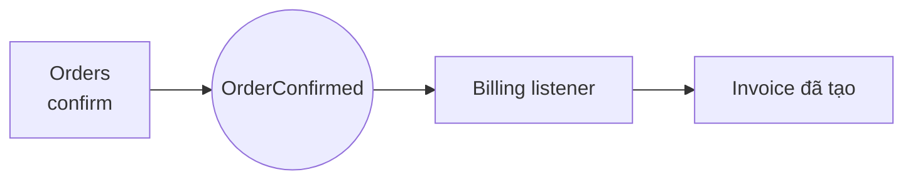
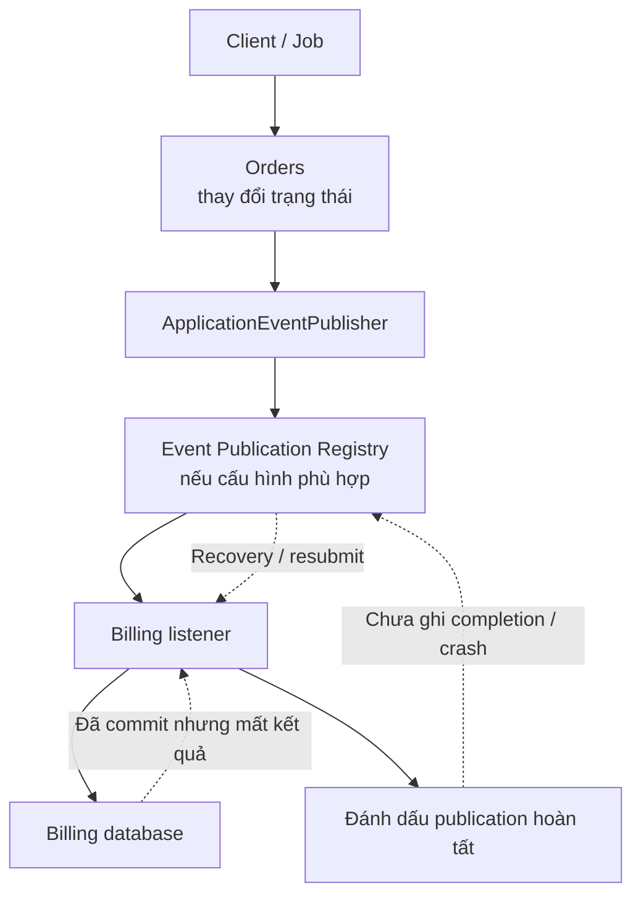
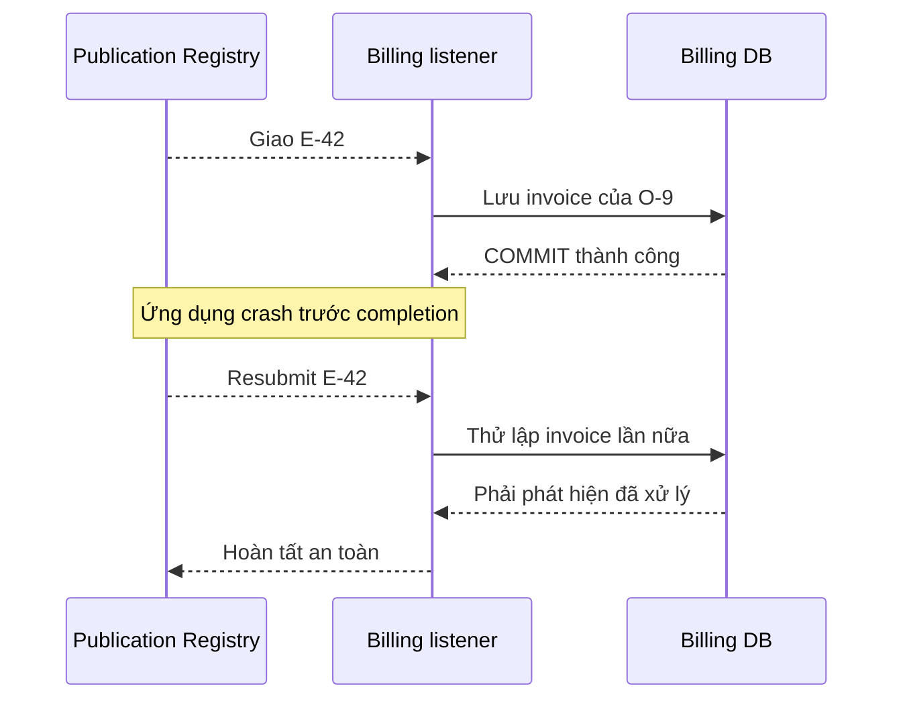
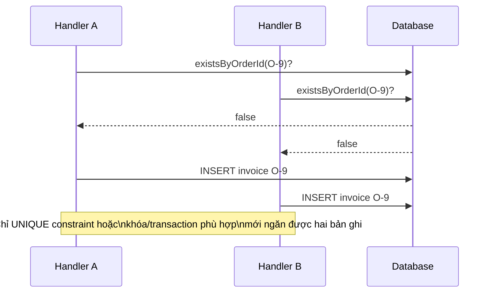
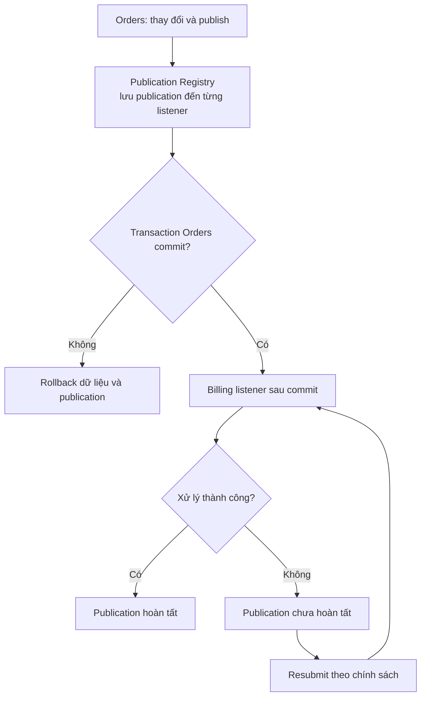
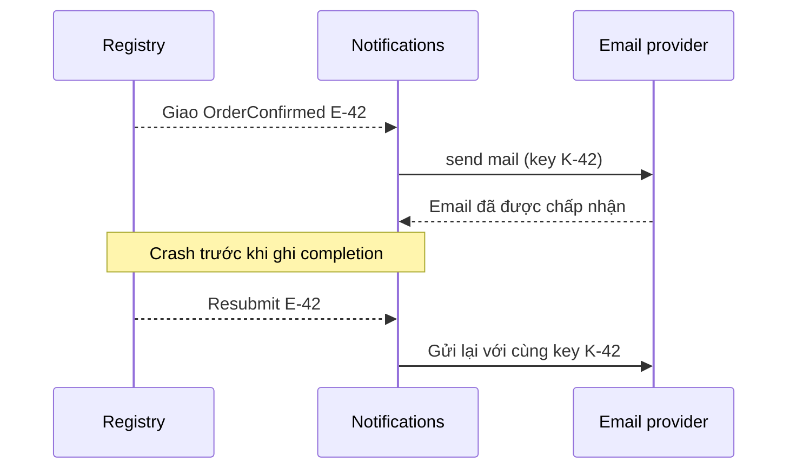

# Trùng event

> **Chương:** Đảm bảo tin cậy  
> **Học phần:** `SPRING_MODULITH_APPLICATION_EVENTS` — xây dựng giao tiếp bằng application events giữa các module Spring Modulith, giảm phụ thuộc và bảo vệ ranh giới nghiệp vụ; thực hành publisher, listener sau commit, Event Publication Registry, retry, kiểm thử và quan sát việc giao sự kiện đáng tin cậy.

## 1. Vì sao trùng event là vấn đề cần thiết kế trước?

Giả sử Orders công bố `OrderConfirmed` sau khi một đơn hàng được xác nhận. Billing nhận sự kiện và tạo hóa đơn. Hệ thống chạy bình thường:



Tuy nhiên, hệ thống có thể nhận lại **chính sự kiện đó** vì timeout, retry, lỗi tiến trình hoặc một thao tác resubmit. Nếu Billing chỉ có logic “nhận event thì tạo invoice”, nó có nguy cơ tạo **hai hóa đơn** cho một đơn.

```text
Lần 1: OrderConfirmed(eventId=E-42, orderId=O-9)
        -> Billing tạo invoice cho O-9

Lần 2: OrderConfirmed(eventId=E-42, orderId=O-9)
        -> Billing tạo THÊM invoice cho O-9   (SAI)
```

Trong một lỗi khác, hai request đồng thời có thể khiến Orders phát **hai event ID khác nhau** cho cùng một chuyển trạng thái đáng lẽ chỉ xảy ra một lần:

```text
Lần 1: OrderConfirmed(eventId=E-42, orderId=O-9)
Lần 2: OrderConfirmed(eventId=E-43, orderId=O-9)
```

Nếu Billing chỉ loại trùng bằng `eventId`, trường hợp thứ hai vẫn có thể tạo hai hóa đơn. Vì vậy chủ đề **trùng event** phải được xử lý ở cả **nguồn phát** và **nơi tiêu thụ**.

**Nguyên tắc cốt lõi:** Hãy thiết kế consumer sao cho việc **giao hoặc xử lý lại** cùng một sự kiện không nhân đôi tác dụng phụ, đồng thời dùng **bất biến nghiệp vụ** để ngăn những yêu cầu trùng ý nghĩa nhưng mang ID khác nhau.

## 2. Phân biệt ba kiểu trùng

Từ “trùng event” thường che giấu nhiều nguyên nhân khác nhau:

| Kiểu | Biểu hiện | Nguyên nhân thường gặp | Cách phòng vệ chính |
|---|---|---|---|
| **Trùng nghiệp vụ tại nguồn** | Hai event khác `eventId` cùng tuyên bố một chuyển trạng thái | Client retry, race condition, publisher không kiểm tra state | Invariant, locking, optimistic concurrency, idempotent command |
| **Giao lại cùng event** | Cùng `eventId` được listener nhận nhiều lần | Publication chưa đánh dấu hoàn tất, resubmit, broker redelivery | Consumer idempotency, processed-event key |
| **Xử lý trùng side effect** | Hai invoice, hai lần cộng điểm, hai email | Xử lý không nguyên tử, retry sau timeout, thiếu khóa chống trùng | Unique constraint, atomic inbox, API idempotency |

Một sự kiện có thể bị **giao lại** nhưng không gây **tác dụng phụ trùng** nếu consumer được thiết kế idempotent. Ngược lại, publisher có thể tạo hai event khác ID cho cùng nghiệp vụ khiến consumer phải dùng khóa nghiệp vụ để bảo vệ invariant.

### 2.1. Không nhầm hai sự kiện hợp lệ với sự kiện trùng

Ví dụ một đơn được xác nhận, rồi hủy, rồi nghiệp vụ cho phép tái xác nhận:

```text
OrderConfirmed(order=O-9, transition=1, eventId=E-1)
OrderCancelled(order=O-9, transition=2, eventId=E-2)
OrderConfirmed(order=O-9, transition=3, eventId=E-3)
```

Nếu domain thật sự cho phép chu trình này, `E-1` và `E-3` là **hai sự kiện hợp lệ**, không phải trùng chỉ vì có cùng `orderId` và cùng event type. Khóa chống trùng phải dựa trên **bất biến thực tế**: chẳng hạn một invoice cho mỗi order, hay một invoice cho mỗi lần xác nhận, tùy nghiệp vụ.

## 3. Trùng xảy ra tại đâu trong đường đi của application event?

Một hệ thống Spring Modulith thường có các điểm:



Từng điểm có thể tạo hiện tượng trùng:

1. **Client gửi yêu cầu lại:** request trước thành công nhưng response bị mất; Orders nhận thêm lệnh.
2. **Hai request chạy cạnh tranh:** cả hai cùng đọc trạng thái chưa confirmed.
3. **Publisher phát hai lần:** code phát ở hai chỗ hoặc phát trước khi kiểm tra state.
4. **Listener xử lý xong nhưng completion thất bại:** publication bị coi là chưa hoàn tất và được resubmit.
5. **Lỗi nhận acknowledgement:** hệ thống không biết phía nhận đã xử lý hay chưa, nên thử lại.
6. **Replay hoặc khôi phục thủ công:** người vận hành phát lại một publication để sửa dữ liệu thiếu.

Sự trùng lặp không nhất thiết là lỗi của Spring. Đây là hệ quả thường gặp khi các thành phần phải **khôi phục sau những trạng thái không chắc chắn**.

## 4. Vì sao retry dẫn đến “at least once”, không phải “exactly once”?

Để hiểu trùng, cần phân biệt ba khái niệm delivery:

| Mô hình | Ý nghĩa gần đúng | Đánh đổi |
|---|---|---|
| **At-most-once** | Một lần giao hoặc bỏ lỡ, không chủ động giao lại | Có thể mất phản ứng |
| **At-least-once** | Thử giao lại tới khi được xác nhận theo chính sách | Có thể giao và xử lý lặp |
| **Exactly-once effect** | Tác dụng nghiệp vụ chỉ được ghi nhận một lần | Cần thiết kế transaction/idempotency theo từng side effect; không suy ra từ delivery |

Trong mô hình có **persistent publication store** và cơ chế resubmit, một listener có thể được gọi **hơn một lần** cho cùng event. Đây là mô hình gần với **at-least-once processing** khi đáp ứng những giả định về dữ liệu bền vững, recovery và vận hành; không nên tự động khẳng định framework bảo đảm at-least-once trong mọi cấu hình.

### 4.1. Khoảng lỗi không thể loại bỏ chỉ bằng ack



Ngay khi DB đã commit, registry hoặc broker có thể chưa ghi nhận kết quả. Sau restart, nó không thể biết chắc consumer đã tạo invoice hay chưa, nên **retry** là hợp lý. Nhưng để retry an toàn, consumer phải **idempotent**.

**Không có bảo đảm exactly-once end-to-end mặc định** cho mọi hệ thống ngoài, DB, email và payment chỉ từ `@ApplicationModuleListener` hoặc Event Publication Registry.

## 5. Định danh nào giúp phát hiện trùng?

Một event contract nên có ID với ý nghĩa rõ ràng:

```java
package com.acme.shop.orders.events;

import java.time.Instant;
import java.util.Objects;
import java.util.UUID;

public record OrderConfirmed(
        UUID eventId,
        UUID orderId,
        Instant occurredAt,
        UUID correlationId
) {
    public OrderConfirmed {
        Objects.requireNonNull(eventId, "eventId");
        Objects.requireNonNull(orderId, "orderId");
        Objects.requireNonNull(occurredAt, "occurredAt");
        Objects.requireNonNull(correlationId, "correlationId");
    }
}
```

| Trường hoặc khóa | Câu hỏi trả lời | Có phù hợp làm khóa chống trùng? |
|---|---|---|
| `eventId` | Đây có phải **cùng một event instance**? | Có, để chặn xử lý lặp một event |
| `orderId` | Đây có phải cùng **đối tượng nghiệp vụ**? | Có khi invariant theo order; không luôn đúng |
| `(orderId, transitionVersion)` | Đây có phải cùng một **chuyển trạng thái**? | Có nếu version phản ánh transition đúng |
| `correlationId` | Các bước có cùng workflow/request gốc? | **Không mặc định**; một workflow có thể có nhiều event |
| Publication ID của registry | Đây có phải một publication đến listener cụ thể? | Hữu ích cho hạ tầng, **không thay** event/business ID |
| Broker message ID/offset | Đây có phải cùng thông điệp trong transport? | Tùy broker; không bảo vệ mọi duplicate nghiệp vụ |

**Quy tắc quan trọng:** Khi retry **cùng event instance**, giữ **nguyên `eventId`**. Nếu mỗi lần retry tạo `UUID.randomUUID()` mới, một consumer chống trùng theo `eventId` có thể xem nó thành sự kiện hoàn toàn mới.

### 5.1. Định danh của publication khác định danh event

Trong Spring Modulith, một event có thể được gửi tới **nhiều transactional listeners**. Registry theo dõi những publication theo listener/target, với ID và trạng thái do cơ chế hạ tầng quản lý. Không giả định publication ID chính là field `eventId` của `OrderConfirmed`.

```text
Event: OrderConfirmed(eventId = E-42)
  ├── Publication gửi Billing       (ID hạ tầng P-1)
  ├── Publication gửi Notifications (ID hạ tầng P-2)
  └── Publication gửi Analytics     (ID hạ tầng P-3)
```

`P-1`, `P-2` và `P-3` chỉ là ví dụ ký hiệu. Khi Billing đã hoàn tất nhưng Notifications còn thất bại, việc resubmit publication Notifications không đồng nghĩa Orders đã phát **một event mới**.

## 6. Phòng trùng từ publisher: chỉ phát cho chuyển trạng thái mới

Ở module Orders, event phải tương ứng một sự việc nghiệp vụ thực sự xảy ra:

```java
package com.acme.shop.orders.internal;

import com.acme.shop.orders.events.OrderConfirmed;
import java.time.Clock;
import java.util.UUID;
import org.springframework.context.ApplicationEventPublisher;
import org.springframework.stereotype.Service;
import org.springframework.transaction.annotation.Transactional;

@Service
public class OrderService {

    private final OrderRepository orders;
    private final ApplicationEventPublisher events;
    private final Clock clock;

    public OrderService(
            OrderRepository orders,
            ApplicationEventPublisher events,
            Clock clock
    ) {
        this.orders = orders;
        this.events = events;
        this.clock = clock;
    }

    @Transactional
    public void confirm(UUID orderId, UUID correlationId) {
        Order order = orders.findById(orderId).orElseThrow();

        // Chỉ true khi đơn vừa chuyển sang CONFIRMED hợp lệ.
        if (!order.confirmIfAllowed()) {
            return;
        }

        events.publishEvent(new OrderConfirmed(
                UUID.randomUUID(),
                order.getId(),
                clock.instant(),
                correlationId
        ));
    }
}
```

`confirmIfAllowed()` là API domain **giả định**. Nó phải bảo đảm không chuyển trạng thái mới cho yêu cầu lặp khi nghiệp vụ không cho phép. Nếu một đơn có thể chuyển CONFIRMED nhiều lần trong vòng đời, việc xác định “lặp” phải dùng transition/attempt ID phù hợp chứ không được coi mọi `OrderConfirmed` của cùng order là trùng.

### 6.1. Chống race condition ở nguồn

Chỉ kiểm tra trạng thái bằng `if (order.isConfirmed()) return;` **không đủ** với hai transaction đồng thời:

```text
Transaction A: đọc status = NEW
Transaction B: đọc status = NEW
Transaction A: confirm, publish E-1
Transaction B: confirm, publish E-2
```

Cần một cơ chế kiểm soát đồng thời:

- **Optimistic locking:** dùng version phù hợp (chẳng hạn JPA `@Version`) và xử lý conflict để chỉ một transaction có thể commit chuyển trạng thái từ version cũ.
- **Pessimistic locking:** khóa hàng theo tài nguyên nghiệp vụ khi có lý do phù hợp.
- **Atomic conditional update:** chỉ cập nhật khi trạng thái hiện tại còn phù hợp; dựa vào số dòng thực sự thay đổi.
- **Idempotency key cho command:** lưu dấu yêu cầu ở nguồn nếu cùng request có thể bị gửi lại.

Với optimistic locking, một transaction có thể publish event trong bộ nhớ **trước khi commit rồi sau đó rollback** vì conflict. Do đó phản ứng quan trọng phải xảy ra **sau commit**, không dùng listener đồng bộ phát email hoặc side effect không rollback được.

## 7. Xử lý trùng tại consumer: idempotency nghĩa là gì?

Một thao tác là **idempotent theo khóa đã chọn** nếu thực hiện lại cùng thao tác không làm thay đổi kết quả nghiệp vụ ngoài ý muốn. Không nhất thiết handler chỉ được gọi một lần; điều cần bảo đảm là **tác dụng có ý nghĩa** không được nhân lên.

Ví dụ:

```text
issueInvoice(orderId = O-9)
Lần 1: Invoice I-7 được tạo
Lần 2: Thấy I-7 đã tồn tại -> không tạo invoice mới
Lần 3: Thấy I-7 đã tồn tại -> không tạo invoice mới
```

Với một ledger điểm thưởng, “cộng 100 điểm” không idempotent:

```java
pointsBalance = pointsBalance + 100; // Lặp hai lần -> +200.
```

Có thể biến nó thành idempotent bằng cách lưu một **bút toán có khóa duy nhất** `(orderId, rewardType)` hoặc `(consumerName, eventId)` tùy bất biến, rồi chỉ cộng điểm trong transaction đã ghi thành công dấu nhận event.

### 7.1. Chọn khóa theo đúng invariant

| Handler | Ý nghĩa nghiệp vụ | Khóa được cân nhắc |
|---|---|---|
| Billing | Một invoice trên một order | `orderId` |
| Billing với nhiều lần tái phát hành hợp lệ | Một invoice cho mỗi lần phát hành | `(orderId, issuanceAttemptId)` |
| Loyalty | Một bút toán thưởng cho mỗi lần mua hợp lệ | `(orderId, rewardRuleId)` hoặc business transition ID |
| Analytics | Một event chỉ được áp dụng một lần vào projection | `(projectionId, eventId)` |
| Email | Một thông báo cho một mục đích nghiệp vụ | `(orderId, notificationType, recipientVersion)` nếu phù hợp |
| Payment | Một yêu cầu capture với idempotency key xác định | Key theo hợp đồng payment provider |

**Không sử dụng khóa `orderId` cho mọi handler một cách máy móc.** Nếu một order có thể tạo nhiều event hợp lệ cho nhiều lần cập nhật, loại bỏ tất cả event sau event đầu tiên sẽ làm mất dữ liệu.

## 8. Lớp bảo vệ thứ nhất: unique constraint theo nghiệp vụ

Với ví dụ “một invoice cho mỗi order”, Billing có thể đặt unique constraint ở DB:

```sql
CREATE TABLE invoices (
    invoice_id UUID PRIMARY KEY,
    order_id UUID NOT NULL,
    source_event_id UUID NOT NULL,
    issued_at TIMESTAMP WITH TIME ZONE NOT NULL,
    CONSTRAINT uq_invoices_order UNIQUE (order_id)
);
```

Listener:

```java
package com.acme.shop.billing.internal;

import com.acme.shop.orders.events.OrderConfirmed;
import org.springframework.modulith.events.ApplicationModuleListener;
import org.springframework.stereotype.Component;

@Component
class OrderConfirmedListener {

    private final InvoiceService invoices;

    OrderConfirmedListener(InvoiceService invoices) {
        this.invoices = invoices;
    }

    @ApplicationModuleListener
    public void on(OrderConfirmed event) {
        invoices.issueIfAbsent(event.orderId(), event.eventId());
    }
}
```

Service minh họa:

```java
package com.acme.shop.billing.internal;

import java.util.UUID;
import org.springframework.stereotype.Service;
import org.springframework.transaction.annotation.Transactional;

@Service
public class InvoiceService {

    private final InvoiceRepository invoices;

    public InvoiceService(InvoiceRepository invoices) {
        this.invoices = invoices;
    }

    @Transactional
    public void issueIfAbsent(UUID orderId, UUID eventId) {
        if (invoices.existsByOrderId(orderId)) {
            return;
        }
        invoices.save(Invoice.forOrder(orderId, eventId));
    }
}
```

Đây là **logic minh họa**, không phải thiết kế đã hoàn toàn xử lý xung đột: hai transaction có thể cùng vượt qua `existsByOrderId`. **Unique constraint ở database** mới là lớp bảo vệ cuối cùng. Trên đường concurrency, một insert có thể gặp unique violation; cần xử lý kết quả hợp lệ bằng transaction/SQL phù hợp.

**Không đơn giản catch `DataIntegrityViolationException` trong một transaction JPA đang bị lỗi rồi tiếp tục dùng transaction đó**; tùy provider, transaction có thể đã bị đánh dấu rollback-only hoặc không còn phù hợp để thực hiện truy vấn. Nên dùng lệnh insert idempotent được DB hỗ trợ, hoặc xử lý sau rollback trong một transaction/đường đọc mới, rồi xác nhận đúng bản ghi đã tồn tại.

### 8.1. Tại sao `existsBy...` chưa đủ?



Với hệ quản trị hỗ trợ `INSERT ... ON CONFLICT DO NOTHING`, có thể làm insert idempotent và đánh giá **số dòng thực sự được ghi**. Cú pháp cụ thể thay đổi theo database, nên không copy một đoạn SQL PostgreSQL sang MySQL/SQL Server mà không kiểm tra.

## 9. Lớp bảo vệ thứ hai: inbox / processed-events theo consumer

Một số handler không có invariant đơn giản kiểu “một invoice mỗi order”. Ví dụ Analytics cần cộng số liệu **một lần theo event**, nhưng nhiều event khác nhau của cùng order đều có thể hợp lệ.

Mẫu **inbox/processed-events** ghi nhận những event instance đã xử lý:

```sql
-- Ví dụ PostgreSQL.
CREATE TABLE processed_events (
    consumer_name VARCHAR(120) NOT NULL,
    event_id UUID NOT NULL,
    processed_at TIMESTAMP WITH TIME ZONE NOT NULL,
    PRIMARY KEY (consumer_name, event_id)
);
```

Khóa gồm cả `consumer_name` để **mỗi consumer tự quản lý tiến độ**. Billing xử lý event không có nghĩa Analytics đã xử lý event.

### 9.1. Chống trùng và side effect trong một transaction

Ví dụ PostgreSQL + Spring JDBC, Billing có thể kết hợp marker và insert hóa đơn trong **cùng transaction DB**:

```java
package com.acme.shop.billing.internal;

import com.acme.shop.orders.events.OrderConfirmed;
import java.util.Map;
import java.util.UUID;
import org.springframework.jdbc.core.namedparam.NamedParameterJdbcTemplate;
import org.springframework.stereotype.Service;
import org.springframework.transaction.annotation.Transactional;

@Service
public class BillingEventProcessor {

    private final NamedParameterJdbcTemplate jdbc;

    public BillingEventProcessor(NamedParameterJdbcTemplate jdbc) {
        this.jdbc = jdbc;
    }

    @Transactional
    public void process(OrderConfirmed event) {
        Map<String, ?> params = Map.of(
                "consumer", "billing-order-confirmed",
                "eventId", event.eventId(),
                "orderId", event.orderId(),
                "invoiceId", UUID.randomUUID()
        );

        int claimed = jdbc.update("""
                INSERT INTO processed_events (
                    consumer_name, event_id, processed_at
                )
                VALUES (:consumer, :eventId, CURRENT_TIMESTAMP)
                ON CONFLICT (consumer_name, event_id) DO NOTHING
                """, params);

        if (claimed == 0) {
            return; // Consumer này đã xử lý event ID này.
        }

        jdbc.update("""
                INSERT INTO invoices (
                    invoice_id, order_id, source_event_id, issued_at
                )
                VALUES (:invoiceId, :orderId, :eventId, CURRENT_TIMESTAMP)
                ON CONFLICT (order_id) DO NOTHING
                """, params);
    }
}
```

Đoạn code giả định:

- Database là **PostgreSQL**, có hai bảng và unique constraints như phần trên.
- `processed_events` và `invoices` dùng **cùng datasource/transaction manager**; method được gọi qua Spring bean/proxy.
- Nghiệp vụ cho phép **tối đa một invoice mỗi order**, vì vậy insert thứ hai có `ON CONFLICT (order_id) DO NOTHING`.
- Event được xử lý trong **transaction của Billing**. Nếu bất kỳ SQL nào lỗi và transaction rollback, marker chưa được commit, nên retry sau đó có thể xử lý lại.

Ở trạng thái bình thường, lần đầu xử lý ghi marker và invoice; lần nhận lại cùng `eventId` gặp `claimed == 0` và trở về. Nếu một event ID khác cùng `orderId` được gửi, unique constraint `invoices.order_id` vẫn ngăn tạo invoice thứ hai.

### 9.2. Giới hạn của inbox

Inbox **chỉ bảo đảm atomicity với side effect nằm trong cùng transaction đã ghi marker**. Nó không tự làm cho việc gửi email, gọi payment API hay Kafka publish trở nên nguyên tử với database.

Hãy cẩn trọng khi ghi marker **trước khi** gọi hệ thống ngoài:

```text
Ghi marker vào DB -> commit -> gọi email API -> API lỗi
Retry thấy marker đã tồn tại -> bỏ qua -> email mất
```

Nếu cần xử lý tác vụ bên ngoài đáng tin cậy, phải quản lý trạng thái gửi và quy trình retry/outbox riêng, hoặc dùng idempotency key ở provider. Không dùng bảng `processed_events` như một “cờ đã xong” trước khi side effect thực sự hoàn tất.

## 10. `@ApplicationModuleListener` và vai trò của Event Publication Registry

`@ApplicationModuleListener` của Spring Modulith giúp viết transactional listener theo mẫu **sau commit, bất đồng bộ, transaction mới**. Ví dụ:

```java
@Component
class BillingListener {

    private final BillingEventProcessor processor;

    BillingListener(BillingEventProcessor processor) {
        this.processor = processor;
    }

    @ApplicationModuleListener
    public void on(OrderConfirmed event) {
        processor.process(event);
    }
}
```

Điều quan trọng:

1. Orders phát `OrderConfirmed` trong transaction nguồn.
2. Listener chỉ phản ứng theo ngữ nghĩa **sau commit**, nên không lập invoice cho transaction Orders rollback.
3. Billing ghi dữ liệu và marker trong **transaction riêng**.
4. Nếu listener lỗi, publication có thể còn ở trạng thái chưa hoàn tất và cần xử lý lại **khi registry/store/recovery đã được cấu hình**.
5. Vì retry có thể xảy ra, Billing vẫn phải idempotent.

### 10.1. Registry là publication tracker, không phải bộ lọc trùng nghiệp vụ

Event Publication Registry của Spring Modulith ghi nhận publication dành cho các **transactional event listeners phù hợp** và theo dõi completion khi có cơ chế lưu tương ứng. Khi dùng **persistent event publication store** phù hợp và tích hợp transaction nguồn, publication có thể được lưu cùng transaction nghiệp vụ.



Các giới hạn:

- Chỉ gọi `ApplicationEventPublisher.publishEvent` **không tự bảo đảm** event được persist và replay sau crash.
- Cần chọn **persistent publication store**, cấu hình phù hợp và chính sách resubmit/recovery theo phiên bản Spring Modulith thật.
- Registry quản lý **publication lifecycle**, không tự bảo vệ invariant “một invoice cho mỗi order”.
- Không mặc định mọi `@EventListener` đồng bộ đều được theo dõi bởi registry.
- **Ghi completion** có thể nằm ngoài transaction của side effect, vì thế vẫn có cửa sổ cho event được giao lại.
- Cơ chế resubmit không có nghĩa có một chính sách retry vô hạn hoặc tự động sẵn có trong mọi deployment.

Vì vậy, trong thiết kế đáng tin cậy, **registry + idempotent listener** là hai mảnh ghép bổ sung, không thay thế nhau.

### 10.2. Khác nhau giữa lưu publication và lưu business state

Trong một hệ thống:

```text
Orders database:  Order.status = CONFIRMED
Registry store:   Publication(OrderConfirmed E-42 -> Billing) = INCOMPLETE
Billing database: Invoice(orderId O-9) = PRESENT
```

Đây **không phải mâu thuẫn**: Billing đã commit, nhưng registry chưa ghi completion. Resubmit có thể hợp lý, và Billing phải xử lý lại như một no-op.

Registry **không phải event sourcing store**: publication tracker phục vụ giao nhận tới các listener, còn event sourcing dùng chuỗi domain events làm nguồn chính của trạng thái aggregate. Đừng dùng registry để suy luận toàn bộ lịch sử nghiệp vụ.

## 11. Phân biệt `@EventListener` đồng bộ và giao nhận sau commit

Nếu dùng `@EventListener` mặc định:

```java
@EventListener
public void on(OrderConfirmed event) {
    // Thường được gọi ngay trong publishEvent().
}
```

Listener đồng bộ có thể chạy **trước transaction Orders commit**. Nếu nó ghi sang hệ thống ngoài trước commit, Orders rollback không thể thu hồi tác dụng phụ. Nếu listener ném exception, publisher/transaction nguồn có thể bị ảnh hưởng theo cấu hình.

Ngược lại:

| Cơ chế | Khi chạy? | Trùng/lỗi cần lưu ý |
|---|---|---|
| `@EventListener` mặc định | Đồng bộ lúc publish | Có thể chạy trước commit; không tự retry bền vững |
| `@Async @EventListener` | Async, không tự đợi commit | Có thể chạy trước commit và mất task nếu crash |
| `@TransactionalEventListener` | Theo transaction phase, mặc định `AFTER_COMMIT` | Không tự async; cần transaction mới nếu ghi DB sau commit |
| `@ApplicationModuleListener` | Sau commit, async, transaction mới | Phù hợp liên module; vẫn cần persistent store/recovery/idempotency |

Không thể giải quyết trùng chỉ bằng cách đổi annotation. Annotation điều chỉnh **thời điểm và cách xử lý**; chống trùng là trách nhiệm của **hợp đồng event và consumer data model**.

## 12. Tác dụng phụ ngoài database: email, webhook, payment

Các thao tác ngoài DB khó hơn việc insert invoice vì không nằm trong cùng transaction cục bộ:

### 12.1. Email gửi thành công nhưng acknowledgement thất bại



Nếu provider **hỗ trợ idempotency key có hiệu lực** và ứng dụng dùng lại cùng key, gửi lặp có thể không tạo thư thứ hai theo hợp đồng provider. Nếu provider không hỗ trợ hoặc key hết hiệu lực, cần trạng thái gửi/đối soát, kiểm soát retry và chấp nhận mức bảo đảm thực tế.

### 12.2. Transactional outbox cho các tác vụ phải gửi ra ngoài

Một cách tổ chức:

1. Trong transaction của Notifications, ghi một bản ghi `notification_outbox` với **business key duy nhất** và trạng thái `PENDING`.
2. Một worker đọc bản ghi và gửi qua provider với idempotency key ổn định (nếu được hỗ trợ).
3. Khi nhận xác nhận đủ mạnh, worker đánh dấu `SENT`.
4. Nếu timeout/không chắc kết quả, worker thử lại hoặc đối soát theo chính sách.

```text
OrderConfirmed E-42
   -> Notifications listener
      -> INSERT notification_outbox(PENDING, businessKey=K-42)
         [cùng transaction với dấu xử lý nội bộ nếu có]
   -> Worker gửi email
      -> provider ack -> SENT
      -> timeout      -> RETRY/RECONCILE
```

Outbox giải quyết sự phân tách giữa **ý định gửi** và **thao tác ngoài DB**; nó không tự bảo đảm provider không thực hiện thao tác hai lần nếu không có idempotency hoặc đối soát.

### 12.3. Đặc biệt thận trọng với payment

Không dùng một event ID mới cho mỗi retry gọi cổng thanh toán nếu provider cần key ổn định. Key phải phản ánh **một lần capture/charge logic** và tuân theo thời hạn/semantics phía provider. Giao dịch thanh toán có thể không thể hoàn tác bằng rollback DB; cần lưu trạng thái, thực hiện reconciliation và compensation/refund khi nghiệp vụ yêu cầu.

## 13. Xử lý event trễ hoặc sai thứ tự không phải chỉ là “trùng”

Giả sử Orders phát:

```text
E-1: OrderConfirmed(orderId=O-9, aggregateVersion=11)
E-2: OrderCancelled(orderId=O-9, aggregateVersion=12)
```

Nếu consumer đã xử lý version 12 nhưng sau đó nhận lại version 11, việc “event E-1 chưa có trong inbox” **không đủ** để cho phép chuyển trạng thái về CONFIRMED. Đây là **stale/out-of-order event**.

Tùy domain, consumer cần:

- Phiên bản/sequence của aggregate nguồn được sinh và công bố đúng cách.
- Quy tắc bỏ qua phiên bản **cũ hơn** trạng thái đã áp dụng.
- Cách xử lý **gap** khi nhận version 13 mà chưa nhận 12.
- Định nghĩa những event có thể xử lý giao hoán (commutative) và event bắt buộc theo thứ tự.
- Cơ chế đồng bộ lại state khi thiếu sự kiện.

**`eventId` dùng để nhận diện lặp một instance; `aggregateVersion` phục vụ thứ tự trạng thái.** Không được lấy `schemaVersion` của hợp đồng làm trình tự biến đổi nghiệp vụ.

## 14. Retry an toàn: không “nuốt” lỗi và không retry vô hạn

Một pattern nguy hiểm:

```java
@ApplicationModuleListener
public void on(OrderConfirmed event) {
    try {
        processor.process(event);
    } catch (RuntimeException ex) {
        log.error("Billing failed", ex);
        // Sai nếu hạ tầng hiểu return bình thường là xử lý thành công.
    }
}
```

Nếu listener đã thất bại nhưng trả về bình thường, registry có thể coi publication là **hoàn tất**. Muốn retry, phải để cơ chế phù hợp nhận biết thất bại hoặc chủ động quản trị trạng thái lỗi bằng thiết kế khác.

Ngược lại, retry không kiểm soát có thể gây bão:

| Lỗi | Có nên retry? | Chính sách gợi ý |
|---|---|---|
| Kết nối DB timeout | Thường có | Backoff, giới hạn số lần/thời gian, quan sát |
| Broker/email provider tạm unavailable | Thường có | Backoff, rate limit, idempotency |
| Payload thiếu trường bắt buộc | Không nên lặp vô hạn | Cách ly/đưa vào quy trình sửa dữ liệu |
| Event không tương thích schema | Không retry mù quáng | Migration hoặc dùng consumer tương thích |
| Dữ liệu nguồn vi phạm invariant | Tùy trường hợp | Phân loại lỗi nghiệp vụ và điều tra |
| Duplicate đã được xác minh | Không cần xử lý lại side effect | Return thành công có chủ đích (no-op) |

Với trùng đã được phát hiện hợp lệ, **return bình thường là đúng** vì kết quả mong muốn đã tồn tại. Với lỗi thật, **return bình thường là nguy hiểm** nếu nó làm hạ tầng tưởng công việc đã hoàn tất.

### 14.1. Không chỉ nhìn exception type

Một `DataIntegrityViolationException` có thể là **unique conflict do duplicate hợp lệ**, nhưng cũng có thể là vi phạm ràng buộc khác. Đừng catch toàn bộ exception rồi kết luận “đã xử lý”; phải kiểm tra đúng constraint/business key và thực hiện xác minh trong transaction phù hợp.

## 15. Quan sát trùng event và đường retry

Vận hành cần trả lời:

1. Event nào được publish? Producer, event type, event ID và business ID?
2. Listener nào đã nhận và xử lý bao nhiêu lần?
3. Lần nào xử lý thật, lần nào no-op do trùng?
4. Publication nào còn tồn, bao lâu và lỗi cuối là gì?
5. Consumer nào hoàn tất, consumer nào chưa? 

### 15.1. Structured log gợi ý

```json
{
  "eventType": "OrderConfirmed",
  "eventId": "a3e67343-90ce-48e9-b0b9-775da23f59a2",
  "orderId": "7f492b76-a61d-4765-bd8f-7f5e98d4c617",
  "consumer": "BillingOrderConfirmedListener",
  "attempt": 3,
  "outcome": "DUPLICATE_NOOP",
  "dedupKeyType": "consumer+eventId",
  "correlationId": "72f4fd80-065f-4ea8-aee6-0fd4eb0b64e7"
}
```

Đây là **schema log do ứng dụng định nghĩa**, không phải format mặc định Spring Modulith tự tạo. Một `attempt` counter nếu không được hạ tầng cung cấp cần được thu thập/lưu theo chính sách riêng, không invent từ số lần log.

### 15.2. Metrics và cảnh báo

| Chỉ số | Phân nhóm phù hợp | Mục tiêu |
|---|---|---|
| `event_delivery_attempts_total` | `eventType`, `consumer`, `outcome` | Biết tần suất thử giao |
| `event_duplicate_noop_total` | `eventType`, `consumer` | Biết lượng trùng đã được chặn |
| `event_handler_failures_total` | `eventType`, `consumer`, `errorCategory` | Phát hiện lỗi xử lý |
| Publication chưa hoàn tất | Consumer/event type | Phát hiện backlog |
| Tuổi publication cũ nhất | Consumer | Phát hiện stuck processing |
| Event-to-completion latency | Consumer/event type | Đo eventual consistency |
| Outbox pending / retry | Loại tích hợp | Theo dõi side effect bên ngoài |

Không dùng `eventId`, `orderId` hoặc `correlationId` làm **metrics labels** vì cardinality cao; nên lưu trong **structured logs và trace attributes**. Việc tăng đột biến `DUPLICATE_NOOP` có thể là dấu hiệu retry nhiều, nhưng không nên mặc định coi mọi duplicate là lỗi: có những đợt recovery hợp lệ.

## 16. Kiểm thử trùng event: chứng minh bằng dữ liệu, không bằng số lần gọi

Một test kiểm tra `publishEvent` được gọi một lần **không chứng minh** listener an toàn khi hệ thống giao lại. Cần kiểm chứng trạng thái thực sự sau những lần xử lý.

### 16.1. Các trường hợp bắt buộc

| Kịch bản | Kết quả mong đợi |
|---|---|
| Orders chuyển trạng thái hợp lệ | Có một event instance đúng ngữ nghĩa |
| Client retry cùng lệnh khi Order đã confirmed | Không tạo một chuyển trạng thái/event mới trái invariant |
| Hai lệnh confirm cạnh tranh | Không commit hai chuyển trạng thái xung đột |
| Cùng `eventId` giao Billing hai lần tuần tự | Tối đa một invoice |
| Cùng `eventId` giao Billing hai lần **đồng thời** | Unique constraint/atomic inbox vẫn bảo vệ |
| Hai `eventId` khác nhau, cùng `orderId` | Theo invariant ví dụ, vẫn tối đa một invoice |
| Listener lỗi trước khi commit Billing | Không có marker “đã xử lý”; retry có thể làm việc |
| Billing commit xong, completion chưa ghi | Resubmit no-op, publication có thể hoàn tất |
| Notifications thất bại, Billing thành công | Chỉ Notifications cần khôi phục, Billing không tạo invoice lại |
| Event cũ đến sau event mới | Consumer không cập nhật trạng thái sai thứ tự |
| Publisher rollback | Listener `AFTER_COMMIT` không gây side effect |
| Payload tồn đọng từ bản triển khai cũ | Có quy tắc deserialize/migration rõ |

### 16.2. Test publisher với Spring Modulith

Spring Modulith có `@ApplicationModuleTest` và `PublishedEvents` để kiểm tra event phát ra:

```java
@ApplicationModuleTest
class OrderPublicationTests {

    @Autowired
    OrderService orders;

    @Test
    void confirmPublishesEvent(PublishedEvents published) {
        UUID orderId = createConfirmableOrder();
        UUID correlationId = UUID.randomUUID();

        orders.confirm(orderId, correlationId);

        assertThat(published.ofType(OrderConfirmed.class)
                .matching(OrderConfirmed::orderId, orderId))
                .hasSize(1);
    }

    private UUID createConfirmableOrder() {
        // Viết fixture theo domain của ứng dụng thật.
        throw new UnsupportedOperationException("Implement fixture");
    }
}
```

Đây là **khung minh họa**, cần các import, test fixture, Spring Modulith test dependencies và phiên bản API phù hợp. Thêm test gọi confirm lần hai và hai request đồng thời để xác minh publisher không tạo event ngoài ý định.

### 16.3. Test consumer bằng các lần xử lý lặp

Ý tưởng integration test:

```java
@Test
void duplicateDeliveryDoesNotCreateSecondInvoice() {
    OrderConfirmed event = new OrderConfirmed(
            UUID.randomUUID(),
            existingConfirmedOrderId(),
            Instant.parse("2026-01-01T00:00:00Z"),
            UUID.randomUUID()
    );

    processor.process(event);
    processor.process(event);

    assertThat(invoices.countByOrderId(event.orderId()))
            .isEqualTo(1L);
    assertThat(processedEvents.countFor(
            "billing-order-confirmed", event.eventId()
    )).isEqualTo(1L);
}
```

Test minh họa giả định có fixture/repository `invoices` và `processedEvents` do dự án triển khai, và mỗi lần gọi `process` được Spring mở transaction qua proxy. **Không bọc toàn bộ test trong transaction rollback mặc định** nếu cần xác minh commit thực hoặc concurrency trên hai connection.

### 16.4. Test retry sau commit và registry

Với listener `@ApplicationModuleListener`, phải có **transaction nguồn commit thật**. Nếu test dùng `@Transactional` bao quanh rồi rollback khi kết thúc, listener `AFTER_COMMIT` có thể không chạy.

Để kiểm thử registry:

1. Cấu hình persistent publication store thực.
2. Phát event từ một transaction nguồn, commit.
3. Mô phỏng listener lỗi tạm thời; xác minh publication chưa hoàn tất.
4. Sửa lỗi và kích hoạt resubmit theo cơ chế hỗ trợ.
5. Xác minh publication hoàn tất và business side effect không bị nhân đôi.
6. Lặp kịch bản listener đã commit nhưng trạng thái completion chưa được ghi (thông qua mô phỏng lỗi tại ranh giới thích hợp).

Với xử lý async, dùng cơ chế chờ điều kiện có timeout (chẳng hạn `Scenario` trong Spring Modulith) thay vì `Thread.sleep(...)` cố định. Mock một method registry hoặc publisher **không chứng minh** khôi phục qua crash/restart.

### 16.5. Test ranh giới module

```java
import org.junit.jupiter.api.Test;
import org.springframework.modulith.core.ApplicationModules;

class ModuleArchitectureTests {

    @Test
    void verifiesBoundaries() {
        ApplicationModules.of(ShopApplication.class).verify();
    }
}
```

Test kiến trúc giúp xác minh module không phụ thuộc implementation nội bộ của nhau; nó **không thay thế** kiểm thử transaction, idempotency và dữ liệu trùng.

## 17. Ranh giới module và trách nhiệm chống trùng

Trong Spring Modulith, Orders sở hữu sự thật **“đơn đã xác nhận”**. Billing sở hữu invoice, Notifications sở hữu trạng thái gửi mail, Loyalty sở hữu ledger điểm.

```text
com.acme.shop
├── orders
│   ├── events
│   │   ├── package-info.java
│   │   └── OrderConfirmed.java
│   └── internal
│       └── OrderService.java
├── billing
│   ├── package-info.java
│   └── internal
│       ├── OrderConfirmedListener.java
│       └── InvoiceService.java
└── notifications
    └── internal
        └── ConfirmationListener.java
```

Orders công bố event qua một **named interface**:

```java
// orders/events/package-info.java
@org.springframework.modulith.NamedInterface("events")
package com.acme.shop.orders.events;
```

Billing chỉ phụ thuộc hợp đồng công khai:

```java
// billing/package-info.java
@org.springframework.modulith.ApplicationModule(
        allowedDependencies = "orders::events"
)
package com.acme.shop.billing;
```

Điều này bảo vệ ranh giới phụ thuộc. Billing không nên import `orders.internal.OrderRepository` để “chắc chắn không trùng”; nó phải dựa trên **event contract, state/invariant của chính Billing** và API công khai nếu thật sự cần dữ liệu bổ sung.

### 17.1. Ai chịu trách nhiệm lỗi trùng?

| Nơi | Trách nhiệm |
|---|---|
| Orders / publisher | Chỉ phát khi có sự thật nghiệp vụ mới; chống request/race tạo sự kiện trùng logic |
| Event Publication Registry | Theo dõi delivery/completion của publication phù hợp, hỗ trợ nhận biết việc chưa hoàn tất |
| Billing / consumer | Chống xử lý lặp và bảo vệ invoice invariant bằng unique constraint/transaction |
| Notifications | Không gửi trùng ngoài chính sách; quản trị side effect của email/provider |
| Observability / vận hành | Phát hiện retry bất thường, backlog, stuck publications và đối soát kết quả |

Tăng độ tin cậy không nên bằng cách “để publisher biết và gọi lại từng consumer”. Điều này làm mất mục tiêu giảm coupling giữa module. Mỗi bên cần sở hữu đúng phần trách nhiệm của mình.

## 18. Các sai lầm phổ biến khi đối phó trùng event

| Sai lầm | Vì sao nguy hiểm | Cách xử lý |
|---|---|---|
| Tạo `eventId` mới mỗi lần retry | Dedup theo ID mất tác dụng | Giữ identity gốc cho cùng event |
| Dùng `orderId` làm event ID cho mọi loại event | Bỏ mất sự kiện hợp lệ khác trên cùng order | Tách event ID và business ID |
| Nghĩ registry giao exactly-once | Có thể crash trước completion | Idempotent consumer |
| Nghĩ `@ApplicationModuleListener` là đủ chống trùng | Annotation không bảo vệ DB invariant | Unique constraint/atomic inbox |
| `if (!exists) insert` không có unique constraint | Race condition tạo hai bản ghi | Bảo vệ ở database |
| Ghi `processed_events` rồi commit trước side effect | Lỗi sau marker khiến retry bỏ qua công việc chưa xong | Ghi marker và side effect DB trong cùng transaction, hoặc outbox/đối soát |
| Catch mọi unique violation rồi coi thành công | Có thể bỏ qua lỗi ràng buộc khác | Phân loại đúng constraint và xác minh state |
| Catch exception rồi chỉ log và return | Registry có thể coi listener hoàn tất dù thất bại | Propagate hoặc quản trị failure rõ ràng |
| Chặn mọi event cùng `orderId` | Loại bỏ chuyển trạng thái hợp lệ ở lần sau | Chọn key theo invariant/transition |
| Dùng timestamp để phân biệt chắc chắn event trùng | Clock skew, độ phân giải và retry | Stable eventId và business sequence |
| Chỉ test handler gọi một lần | Không kiểm tra retry, crash, concurrency | Test xử lý lặp và side effect thực |
| Gửi email rồi tin DB rollback sẽ thu hồi | Side effect bên ngoài không thể rollback | Provider idempotency/outbox |
| Dùng publication ID làm khóa nghiệp vụ mặc định | ID hạ tầng không đồng nhất event instance | Business/event IDs ổn định |
| Đưa từng `eventId` vào metric label | Cardinality tăng quá lớn | Log/trace theo ID, metric nhãn ít giá trị |

## 19. Quy trình thiết kế chống trùng cho một event mới

Trước khi triển khai listener mới, trả lời lần lượt:

1. **Sự kiện là gì?** Event type, owner, điều kiện phát, ý nghĩa business.
2. **Mỗi lần phát có ID riêng không?** `eventId` ổn định qua retry; cần correlation/version nào?
3. **Client/producer có thể gửi yêu cầu lặp không?** Nguồn kiểm soát concurrency thế nào?
4. **Consumer có bất biến gì?** Một invoice/order hay một invoice/transition? Một email/loại thông báo?
5. **Khóa idempotency nào phản ánh bất biến?** Event ID, order ID, composite key hay provider key?
6. **Khóa được bảo vệ ở đâu?** Unique constraint, atomic insert, transaction và isolation phù hợp.
7. **Side effect có nằm trong cùng DB transaction không?** Nếu không, cần outbox/provider idempotency/đối soát.
8. **Khi retry, điều gì được xem là success?** Duplicate hợp lệ là no-op; lỗi thật cần được phát hiện.
9. **Publication được persist/recover thế nào?** Cấu hình registry/store và quy trình resubmit thực tế.
10. **Nếu event đến trễ/sai thứ tự thì sao?** Có cần aggregate version và xử lý gap?
11. **Quan sát được không?** Metric duplicate, retry, backlog, latency và lỗi theo consumer.
12. **Test nào chứng minh bảo đảm?** Hai lần tuần tự, cạnh tranh, crash sau commit, rollback và provider timeout.

Không nhất thiết phải triển khai đầy đủ cả inbox và unique constraint ở mọi consumer. **Chọn lớp bảo vệ đơn giản nhất thực thi đúng invariant và mức giao nhận cần thiết**, sau đó chứng minh bằng test.

## 20. Bài thực hành: phát lại `OrderConfirmed` mà không tạo hai hóa đơn

**Bối cảnh:** ứng dụng Spring Boot dùng Spring Modulith gồm Orders, Billing và Notifications. `OrderService.confirm` phát `OrderConfirmed`; Billing lập hóa đơn sau commit; Notifications gửi xác nhận. Cần chịu được trùng do cả **request retry** và **publication resubmit**.

### 20.1. Các bước

1. Định nghĩa immutable `OrderConfirmed(eventId, orderId, occurredAt, correlationId)` trong API/named interface của Orders.
2. Chỉ phát sự kiện khi Orders vừa chuyển trạng thái `CONFIRMED` hợp lệ; kiểm soát concurrency bằng version/locking thích hợp.
3. Viết Billing `@ApplicationModuleListener` gọi service xử lý invoice idempotent.
4. Tạo bảng `invoices` với unique constraint trên `order_id` theo invariant bài tập.
5. Nếu cần chống lặp theo consumer-event, tạo `processed_events` với unique `(consumer_name, event_id)`.
6. Ghi marker và invoice **trong một transaction**; dùng SQL insert idempotent hoặc cơ chế tương đương đã được kiểm thử.
7. Tạo hai test: (a) cùng `eventId` xử lý hai lần; (b) hai `eventId` khác nhau cùng `orderId`. Cả hai chỉ có một invoice.
8. Thêm test concurrency hai thread/transaction để unique constraint bảo vệ ngay cả khi cả hai cùng bắt đầu.
9. Cấu hình persistent Event Publication Registry với recovery/resubmit theo phiên bản Spring Modulith dùng thật.
10. Mô phỏng lỗi trước completion sau khi Billing commit, rồi resubmit: không được tạo invoice thứ hai.
11. Cho Notifications thất bại trong khi Billing hoàn tất: trạng thái publication/consumer phải độc lập.
12. Với email provider, thiết kế outbox và idempotency key nếu được hỗ trợ; mô phỏng timeout sau khi provider đã nhận.
13. Ghi metric `DUPLICATE_NOOP`, retry và backlog theo consumer; log `eventId`/`orderId` để điều tra.
14. Viết `ApplicationModules.verify()` để bảo đảm Billing chỉ phụ thuộc hợp đồng công khai của Orders.

### 20.2. Tiêu chí nghiệm thu

| Tiêu chí | Cách kiểm chứng |
|---|---|
| Không tạo event logic thừa khi confirm bị retry | Test state transition và PublishedEvents |
| Hai request đồng thời không tạo thay đổi nguồn sai | Test concurrency, version/conditional update |
| Xử lý cùng `eventId` nhiều lần không tạo invoice trùng | Integration test gọi processor lặp |
| Hai `eventId` khác nhau cho cùng order không tạo invoice thứ hai | Unique constraint invoice.order_id |
| Marker không được commit khi business operation thất bại | Test rollback transaction xử lý |
| Resubmit sau crash/uncertain completion không nhân đôi side effect | Test persistent registry/recovery |
| Billing và Notifications hoàn tất độc lập | Test fail một listener, nhận kết quả listener còn lại |
| Email retry không vượt bảo đảm provider | Test idempotency/outbox/provider giả |
| Event cũ không làm đảo trạng thái mới | Test aggregateVersion/ordering nếu domain cần |
| Có thể tra sự kiện bị retry liên tục | Logs, metrics và cảnh báo pending publication |

### Câu hỏi tự kiểm tra

1. Sự khác nhau giữa **trùng nghiệp vụ ở publisher** và **giao lại cùng event ở consumer** là gì?
2. Tại sao cùng `eventId` có thể được Billing nhận hai lần dù Orders chỉ phát một lần?
3. `eventId`, `orderId` và publication ID giải quyết những bài toán khác nhau như thế nào?
4. Trong trường hợp nào không được xem hai event có cùng `orderId` là trùng?
5. Tại sao `existsByOrderId` không đủ bảo vệ invariant khi hai listener chạy đồng thời?
6. Vì sao ghi marker inbox và side effect DB cần nằm trong một transaction?
7. Điều gì xảy ra khi email provider đã gửi nhưng listener chưa ghi completion?
8. Event Publication Registry có thay thế idempotency tại consumer không?
9. Vì sao lỗi thật không nên bị nuốt rồi trả về “thành công”?
10. Vì sao `aggregateVersion` và `eventId` không thể thay thế nhau để xử lý event đến trễ?

## 21. Ghi nhớ

**Trùng event** có thể xuất hiện vì publisher tạo **sự kiện logic thừa**, hoặc vì hệ thống **giao lại cùng một event** sau timeout, crash, retry hay resubmit. Tăng độ tin cậy giao nhận thường đồng nghĩa hệ thống phải **chấp nhận khả năng giao lặp**.

Trong Spring Modulith, cần kết hợp **publisher chỉ phát khi có chuyển trạng thái hợp lệ**, **event ID ổn định**, **listener sau commit**, **Event Publication Registry với persistence/recovery khi cần**, và **idempotency theo từng consumer**. Unique constraint, atomic processed-events/inbox và provider idempotency/outbox giải quyết các lớp side effect khác nhau.

**Đừng đặt mục tiêu “listener chỉ chạy một lần”; hãy đặt mục tiêu “kết quả nghiệp vụ vẫn đúng dù listener chạy lại”.** Cách chứng minh là kiểm thử giao lặp tuần tự, đồng thời, lỗi giữa commit và completion, rollback nguồn và tác dụng phụ ngoài database.

### Tài liệu tham khảo

- [Spring Modulith — Working with Application Events](https://docs.spring.io/spring-modulith/reference/events.html): `@ApplicationModuleListener`, Event Publication Registry và cơ chế publication/resubmit.
- [Spring Modulith — Fundamentals](https://docs.spring.io/spring-modulith/reference/fundamentals.html): ranh giới module và named interfaces cho event contract.
- [Spring Modulith — Testing Application Modules](https://docs.spring.io/spring-modulith/reference/testing.html): `@ApplicationModuleTest`, `PublishedEvents` và `Scenario`.
- [Spring Framework — Transaction-bound Events](https://docs.spring.io/spring-framework/reference/data-access/transaction/event.html): listener theo pha transaction và `AFTER_COMMIT`.
- [Spring Framework — Application Events](https://docs.spring.io/spring-framework/reference/core/beans/context-introduction.html#context-functionality-events): `ApplicationEventPublisher`, `@EventListener` và cơ chế phân phối sự kiện.
