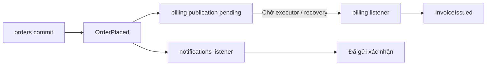
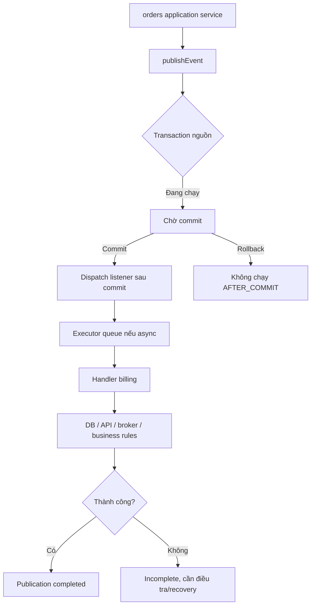
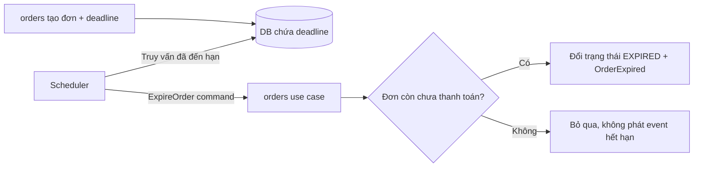

# Event bị trì hoãn trong Spring Modulith: phát hiện, xử lý và khôi phục

Trong hệ thống Spring Modulith, application events giúp các module giao tiếp mà không phải gọi trực tiếp implementation của nhau. Ví dụ, module `orders` phát `OrderPlaced` khi đơn hàng được tạo; module `billing` tiếp nhận để phát hành hóa đơn; module `notifications` gửi xác nhận. Nhưng nếu đơn đã được lưu thành công mà **nhiều phút sau hóa đơn vẫn chưa xuất hiện**, sự kiện đang bị trì hoãn ở đâu? Có phải event đã mất, listener bị lỗi, transaction chưa commit hay người nhận đang chờ tài nguyên?

Đây là một vấn đề thuộc **Đảm bảo tin cậy** của `SPRING_MODULITH_APPLICATION_EVENTS`. Bài học tập trung vào **event bị trì hoãn (delayed event delivery/processing)**: phân biệt trễ ngoài ý muốn với trì hoãn có chủ đích, đo đúng độ trễ, xác định nút nghẽn trong lifecycle, vận hành Event Publication Registry và recovery, xử lý retry/idempotency, tránh áp dụng sự kiện cũ sai thứ tự và kiểm thử tình huống thực tế.

> **Điểm cốt lõi:** Một event bị trễ **không nhất thiết đã mất**; một event đã được publish **không nhất thiết đã xử lý**; và một publication đang `INCOMPLETE` **không tự chứng minh** nguyên nhân là executor chậm. Phải xác định mốc thời gian và trạng thái của **từng listener** trước khi quyết định resubmit hay bỏ qua.

## 1. Event “bị trì hoãn” nghĩa là gì?

Trong luồng sự kiện, có nhiều khoảng trễ khác nhau:

1. **Trễ trước khi công bố:** nghiệp vụ đã bắt đầu nhưng event chưa được tạo hoặc `publishEvent(...)` chưa được gọi.
2. **Trễ do transaction:** event được publish bên trong transaction nhưng listener theo `AFTER_COMMIT` phải chờ transaction nguồn commit.
3. **Trễ chờ thực thi:** transaction đã commit nhưng listener bất đồng bộ đang xếp hàng trong executor hoặc broker.
4. **Trễ đang xử lý:** handler đã bắt đầu nhưng đợi khóa database, I/O, API khác hoặc retry.
5. **Trễ khôi phục:** handler thất bại, publication chưa hoàn thành và đang chờ lịch retry/resubmit hoặc thao tác vận hành.
6. **Trễ có chủ đích:** nghiệp vụ quy định thực thi vào thời điểm tương lai, ví dụ gửi nhắc thanh toán sau 24 giờ.

Không nên gộp tất cả thành một chỉ số “độ trễ event”. **Delay của việc bắt đầu xử lý** khác **thời gian xử lý** và khác **thời gian chờ phục hồi sau lỗi**.

| Hiện tượng | Có thể quan sát | Giải thích sơ bộ |
| --- | --- | --- |
| Đơn chưa commit | Listener sau commit chưa được gọi | Đây có thể là trạng thái bình thường trong transaction dài |
| Đơn đã commit, event đã ghi publication, listener chưa chạy | Publication đang chờ | Kiểm tra executor, scheduling, startup/recovery |
| Listener đã chạy nhưng chưa xong | Thời gian xử lý lớn | Kiểm tra DB lock, HTTP timeout, pool tài nguyên |
| Handler lỗi, publication chưa hoàn thành | Lỗi/attempt gần nhất | Kiểm tra nguyên nhân và chính sách retry |
| Event gửi sang broker nhưng consumer chậm | Broker có message, consumer lag cao | Trễ ở hệ thống tích hợp, không phải Spring application listener nội bộ |
| Event không được publish hoặc không có target phù hợp | Không có dấu vết publication | Có thể không phải “trễ”, cần kiểm tra producer/transaction/registration |

Một event có thể trễ đối với `billing` nhưng `notifications` vẫn xử lý đúng hạn. Vì vậy **đơn vị quan sát thường là event–listener/publication**, không chỉ event.

## 2. Ví dụ xuyên suốt: đơn hàng đã tạo, hóa đơn đến muộn

Giả sử có ba module:

```text
com.example.shop
├── ShopApplication.java
├── orders
│   ├── OrderPlaced.java
│   └── internal
│       └── PlaceOrderService.java
├── billing
│   └── internal
│       ├── OrderPlacedInvoiceListener.java
│       └── InvoiceService.java
└── notifications
    └── internal
        ├── OrderPlacedNotificationListener.java
        └── NotificationService.java
```

`orders` sở hữu việc tạo đơn. `billing` có quyền phát hành hóa đơn. `notifications` có quyền gửi thông báo. Cả hai chỉ cần biết public event của `orders` chứ không được phụ thuộc vào `orders.internal.OrderRepository`.

### Dòng thời gian minh họa

```text
10:00:00.000  orders: xử lý PlaceOrder
10:00:00.120  orders: publish OrderPlaced(E-19)
10:00:00.155  orders: transaction COMMIT
10:00:00.180  notifications: bắt đầu xử lý E-19
10:00:00.290  notifications: hoàn thành E-19
10:00:00.155  billing: publication chờ xử lý
10:03:30.000  billing: handler bắt đầu E-19
10:03:31.000  billing: tạo Invoice thành công
```

Từ góc nhìn người dùng, “hóa đơn đến muộn hơn 3 phút”. Nhưng từ góc nhìn vận hành, cần tách:

- Thời gian chờ từ commit đến `billing` bắt đầu: khoảng 3 phút 30 giây.
- Thời gian `billing` thực hiện handler: khoảng 1 giây.
- `notifications` hoàn thành sớm, chứng tỏ hai subscriber có trạng thái độc lập.

Những số trên **chỉ minh họa**. Không dùng chúng làm giá trị mặc định của Spring Modulith.



Điểm cần hiểu: publisher không cần biết `billing` có đang quá tải hay không; tuy nhiên **hệ thống vận hành** phải biết publication nào đang tồn đọng và ảnh hưởng tới SLA nghiệp vụ.

## 3. Các mốc thời gian phải được định nghĩa rõ

Một event có thể mang `occurredAt` do producer tạo, nhưng đây **không tự động** là thời điểm transaction commit hoặc listener nhận.

| Ký hiệu | Mốc | Thu thập như thế nào |
| --- | --- | --- |
| `t_business` | Sự thật nghiệp vụ được ghi nhận | Metadata bất biến trong event |
| `t_publish` | Code gọi `publishEvent` | Instrument tại publisher; chưa bảo đảm commit |
| `t_commit` | Transaction nguồn commit | Instrument transaction/lifecycle nếu cần |
| `t_eligible` | Listener đã đủ điều kiện bắt đầu | Thường sau commit với transactional listeners |
| `t_start` | Handler thực sự bắt đầu | Instrument ở đầu handler |
| `t_finish` | Handler hoàn tất theo contract | Instrument sau side effect và transaction thành công |
| `t_completed` | Publication được registry ghi nhận hoàn thành | Trạng thái registry theo adapter/backend |

Các cách đo:

```text
Publication wait        = t_start - t_eligible
Handler processing time = t_finish - t_start
End-to-end completion   = t_completed - t_business
Publication outstanding = now - t_eligible (nếu chưa completed)
```

**Lưu ý:** Các phép trừ trên chỉ có nghĩa nếu các timestamp được thu thập đáng tin cậy, thống nhất clock hoặc có cơ chế liên kết phân tán. Trong một JVM, đo duration bằng monotonic clock phù hợp hơn khi cần độ chính xác; khi so sánh giữa nhiều máy, đồng bộ đồng hồ và giới hạn clock skew.

Nếu chỉ có `occurredAt` và `startedAt`, hãy đặt tên chỉ số là “tuổi event tới lúc bắt đầu xử lý”, **đừng gọi là độ trễ sau commit chính xác**.

### Cần thống nhất SLA nào?

Một sản phẩm có thể định nghĩa:

- Đơn hàng phải được xác nhận ngay khi transaction tạo đơn commit.
- Hóa đơn cần tồn tại trong vòng một khoảng thời gian nghiệp vụ cho phép sau commit.
- Email xác nhận có thể chậm hơn hóa đơn, hoặc ngược lại.
- Analytics có thể chấp nhận trễ dài hơn vì không nằm trên đường xử lý đơn.

Mỗi target listener nên có **SLO/SLA riêng**. Một cảnh báo “mọi event trễ trên 30 giây” thường kém hữu ích nếu các consumer có thời gian xử lý và mức quan trọng khác nhau.

## 4. Điểm thường gây trễ trong Spring application events

Từ góc nhìn một application event nội bộ, có thể hình dung luồng:



Các nguyên nhân có thể kiểm tra theo thứ tự:

1. **Transaction nguồn kéo dài:** `@TransactionalEventListener(AFTER_COMMIT)` chưa thể chạy khi transaction chưa commit.
2. **Executor bão hòa:** số worker đang bận, queue dài, thread starvation.
3. **Lỗi scheduling:** executor từ chối task hoặc ứng dụng đang shutdown.
4. **Handler kẹt:** chờ transaction lock, connection pool, HTTP call không có timeout.
5. **Cơ chế retry/backoff:** publication được giữ để thử lại sau khi lỗi.
6. **Khởi động lại/deploy:** công việc chưa hoàn tất đợi recovery; không có store bền vững thì có thể bị mất.
7. **Điều kiện listener/transaction:** listener không được đăng ký hoặc điều kiện không khớp; **đây có thể là event không được xử lý, không phải bị trì hoãn**.

Luôn kiểm tra transaction và điều kiện đăng ký listener trước khi tăng kích thước thread pool. Nếu `@TransactionalEventListener` không chạy vì event được publish ngoài transaction, tăng worker không giải quyết được.

## 5. Chọn listener đúng mốc: đồng bộ, async và sau commit

| Cơ chế | Thời điểm mặc định | Đặc điểm liên quan delay |
| --- | --- | --- |
| `@EventListener` | Chạy đồng bộ ngay lúc publish | Có thể kéo dài transaction nguồn hoặc request latency |
| `@Async @EventListener` | Lên lịch async khi publish | Có thể xử lý trước commit; queue có thể chậm |
| `@TransactionalEventListener` | Mặc định `AFTER_COMMIT`, không tự async | Đợi transaction; handler có thể chạy trên thread commit |
| `@Async @TransactionalEventListener` | Đợi commit rồi chạy async | Có queue và worker; ghi DB cần transaction riêng |
| `@ApplicationModuleListener` | Sau commit, async, transaction mới | Thích hợp phản ứng xuyên module; vẫn có thể trễ vì executor/handler/recovery |

Với nhiệm vụ tạo hóa đơn sau khi đơn commit, `@ApplicationModuleListener` thường là lựa chọn gọn trong Spring Modulith. Tuy nhiên:

- Nó không bảo đảm việc tạo hóa đơn hoàn tất trước HTTP response.
- Nó không tự bảo đảm một publication sẽ được lưu bền vững khi thiếu storage registry.
- Nó không loại trừ việc handler nhận cùng event nhiều lần trong các lần recovery.

### Ví dụ public event

```java
// com.example.shop.orders.OrderPlaced.java
package com.example.shop.orders;

import java.time.Instant;
import java.util.UUID;

public record OrderPlaced(
        UUID eventId,
        UUID orderId,
        long orderVersion,
        Instant occurredAt,
        UUID correlationId
) {}
```

`orderVersion` là version của aggregate do ứng dụng **tự định nghĩa** để xử lý sự kiện đến muộn/sai thứ tự. Đây không phải field Spring Modulith bắt buộc. `correlationId` hỗ trợ quan sát xuyên luồng; cần tạo/truyền nhất quán.

### Publisher phát đúng một sự thật nghiệp vụ

```java
// com.example.shop.orders.internal.PlaceOrderService.java
package com.example.shop.orders.internal;

import com.example.shop.orders.OrderPlaced;
import java.time.Clock;
import java.time.Instant;
import java.util.UUID;
import org.springframework.context.ApplicationEventPublisher;
import org.springframework.stereotype.Service;
import org.springframework.transaction.annotation.Transactional;

@Service
class PlaceOrderService {

    private final OrderRepository orders;
    private final ApplicationEventPublisher publisher;
    private final Clock clock;

    PlaceOrderService(
            OrderRepository orders,
            ApplicationEventPublisher publisher,
            Clock clock) {
        this.orders = orders;
        this.publisher = publisher;
        this.clock = clock;
    }

    @Transactional
    public UUID place(UUID customerId, String sku, int quantity,
                      UUID correlationId) {
        // Các type Order, OrderRepository là domain/persistence nội bộ
        // được cài đặt theo quy tắc của module orders.
        Order order = Order.place(customerId, sku, quantity);
        orders.save(order);

        publisher.publishEvent(new OrderPlaced(
                UUID.randomUUID(),
                order.id(),
                order.version(),
                Instant.now(clock),
                correlationId
        ));
        return order.id();
    }
}
```

Ví dụ cần bean `Clock` và implementation của domain/repository trong project thật. `publishEvent(...)` chạy **trong transaction, trước khi commit**; nếu transaction rollback, một listener `AFTER_COMMIT` không được thực thi.

### Listener tạo hóa đơn sau commit

```java
// com.example.shop.billing.internal.OrderPlacedInvoiceListener.java
package com.example.shop.billing.internal;

import com.example.shop.orders.OrderPlaced;
import org.springframework.modulith.events.ApplicationModuleListener;
import org.springframework.stereotype.Component;

@Component
class OrderPlacedInvoiceListener {

    private final InvoiceService invoices;

    OrderPlacedInvoiceListener(InvoiceService invoices) {
        this.invoices = invoices;
    }

    @ApplicationModuleListener
    void on(OrderPlaced event) {
        // Làm việc của billing, không ghi vào tables của orders.
        invoices.issueOnce(
                event.orderId(),
                event.eventId(),
                event.orderVersion()
        );
    }
}
```

`InvoiceService.issueOnce(...)` là phương thức nghiệp vụ giả định. Nó phải xử lý idempotency theo khóa đơn và quyết định cách diễn giải event trễ. Annotation listener giúp tách xử lý khỏi transaction của `orders`, **không tự xác định một timeout/SLA cho billing**.

## 6. Event Publication Registry: publication chưa hoàn thành là gì?

Spring Modulith cung cấp **Event Publication Registry** để theo dõi publication đến transactional event listeners khi ứng dụng cấu hình một storage implementation phù hợp, chẳng hạn JDBC, JPA hoặc MongoDB tùy phiên bản.

Khái niệm quan trọng:

- Một event như `OrderPlaced(E-19)` có thể được giao đến **nhiều target listeners**.
- Registry có thể lưu một publication cho từng event/target.
- Khi handler được ghi nhận xử lý thành công, publication đó được đánh dấu **completed**.
- Khi chưa ghi nhận completion, publication vẫn **incomplete**, có thể do handler chưa chạy, đang chờ, đã lỗi, crash hoặc một vấn đề khác.
- Phục hồi/resubmit chỉ nên thực hiện theo cơ chế và chính sách được cấu hình, không suy rằng hệ thống luôn tự retry tức thì.

Bảng ví dụ **mang tính logic**, không phải schema SQL chính thức của mọi version:

| Event | Target | Trạng thái quan sát | Ghi chú |
| --- | --- | --- | --- |
| `E-19` | `billing.on(OrderPlaced)` | INCOMPLETE | Đang đợi hoặc đã lỗi, cần điều tra |
| `E-19` | `notifications.on(OrderPlaced)` | COMPLETED | Hoàn thành ở listener này |
| `E-20` | `billing.on(OrderPlaced)` | COMPLETED | Không cần phục hồi |
| `E-21` | `billing.on(OrderPlaced)` | INCOMPLETE | Cần kiểm tra retry/backoff |

**Incomplete không đồng nghĩa failed.** Một publication có thể chỉ đang chờ executor hoặc chưa được đánh dấu completed. Nếu hệ thống tự động resubmit quá sớm, hai lần xử lý có thể chạy đồng thời. Bởi vậy, cần phân biệt publication quá tuổi, task đang chạy thật và publication thật sự kẹt.

### Registry không tự thay thế scheduler hoặc broker

Registry theo dõi và hỗ trợ recovery cho application events theo phiên bản/cấu hình. Nó không mặc nhiên cung cấp **cơ chế đặt lịch gửi đúng một thời điểm nghiệp vụ tương lai** và không tự gửi event ra Kafka/RabbitMQ. Để xử lý thông điệp broker hoặc scheduled delivery, phải thiết kế thêm adapter/outbox/scheduler phù hợp.

### Publication record phải tồn tại bền vững

Nếu mục tiêu là tránh mất tác vụ khi JVM crash sau commit, cần xác nhận:

1. Có dependency và storage registry phù hợp.
2. Publication được ghi với transaction/lifecycle đúng của nghiệp vụ nguồn.
3. Storage của registry có sẵn và không bị tắt/đổi schema khi deploy.
4. Có cơ chế tìm publication chưa hoàn thành và thực hiện recovery theo chính sách.
5. Listener xử lý lại một event vẫn an toàn.

Không chỉ nhìn annotation `@ApplicationModuleListener` rồi kết luận đã có durability. Với ứng dụng không có storage/recovery, tác vụ async chậm có thể mất khi tiến trình dừng.

## 7. Phân biệt backlog, lỗi handler và event thật sự bị mất

Những hiện tượng này cần cách xử lý khác nhau:

| Trường hợp | Dấu hiệu | Hành động hợp lý |
| --- | --- | --- |
| **Backlog bình thường** | Queue tăng khi có đợt tải cao, xử lý vẫn tiến triển | Theo dõi tuổi và throughput, tăng/giảm năng lực khi hợp lý |
| **Handler chậm** | Task đã start nhưng processing duration tăng | Điều tra DB locks, I/O timeout, downstream |
| **Listener lỗi** | Có exception, publication incomplete | Phân loại lỗi, sửa nguyên nhân rồi retry |
| **Task bị từ chối** | Executor rejection, chưa xử lý | Giữ dấu publication, alert và recovery |
| **Ứng dụng vừa restart** | Event pending sau shutdown | Khởi động recovery theo chính sách |
| **Event không được publish** | Không tìm thấy event/registry record | Kiểm tra producer, rollback, transaction, điều kiện listener |
| **Event đã đến broker, consumer chậm** | Consumer lag tăng | Điều tra broker/consumer, không resubmit application listener tùy tiện |
| **Event đã xử lý nhưng completion chưa ghi** | Side effect tồn tại, registry incomplete | Dedupe và đánh dấu kết quả đúng qua retry/idempotency |

Đừng kết luận “event bị mất” chỉ vì người dùng không nhìn thấy hóa đơn ngay. Ngược lại, **không nên khẳng định event chắc chắn sẽ đến** nếu không có store bền vững, recovery và kiểm thử các điểm crash.

## 8. Executor backlog và backpressure

Với listener async, executor là nút cổ chai phổ biến. Giả sử hệ thống nhận 100 event/giây, nhưng handler trung bình xử lý được 30 event/giây trong cấu hình hiện tại. Nếu sự chênh lệch kéo dài, queue sẽ tích lũy và event ngày càng bị trễ.

Ví dụ cấu hình executor dùng cho `@Async("reliableEventExecutor")`:

```java
// com.example.shop.config.EventAsyncConfig.java
package com.example.shop.config;

import java.util.concurrent.Executor;
import org.springframework.context.annotation.Bean;
import org.springframework.context.annotation.Configuration;
import org.springframework.scheduling.annotation.EnableAsync;
import org.springframework.scheduling.concurrent.ThreadPoolTaskExecutor;

@Configuration
@EnableAsync
class EventAsyncConfig {

    @Bean(name = "reliableEventExecutor")
    Executor reliableEventExecutor() {
        ThreadPoolTaskExecutor executor = new ThreadPoolTaskExecutor();
        executor.setCorePoolSize(4);
        executor.setMaxPoolSize(12);
        executor.setQueueCapacity(200);
        executor.setThreadNamePrefix("event-worker-");
        executor.setWaitForTasksToCompleteOnShutdown(true);
        executor.setAwaitTerminationSeconds(20);
        executor.initialize();
        return executor;
    }
}
```

Các thông số trên **chỉ minh họa**, phải chọn dựa trên tải thực tế, downstream capacity, thời gian xử lý và yêu cầu nghiệp vụ. Cấu hình executor tên `reliableEventExecutor` không tự áp dụng cho mọi `@ApplicationModuleListener` nếu annotation không trỏ đến executor ấy. Cần xác minh cấu hình async thực tế và cách framework chọn executor.

Kết hợp listener tường minh:

```java
@Component
class BillingAfterCommitListener {

    private final InvoiceService invoices;

    BillingAfterCommitListener(InvoiceService invoices) {
        this.invoices = invoices;
    }

    @Async("reliableEventExecutor")
    @TransactionalEventListener(phase = TransactionPhase.AFTER_COMMIT)
    void on(OrderPlaced event) {
        invoices.issueOnce(event.orderId(), event.eventId(),
                           event.orderVersion());
    }
}
```

Đoạn trên giả định có các imports tương ứng, bean executor đã cấu hình và `InvoiceService` mở transaction phù hợp cho việc ghi dữ liệu. `@TransactionalEventListener` sau commit **không tự mở transaction mới**; nếu handler cần ghi DB thì dùng transaction mới trong service. Đây là **phương án thay thế** cho listener `@ApplicationModuleListener`, không đăng ký cả hai cùng làm một công việc trừ khi có chủ ý và bảo vệ idempotency.

### Queue đầy thì sao?

Executor có thể ném rejection exception, chạy task trên caller thread (tùy rejection policy) hoặc phản ứng theo cấu hình. Đặc biệt `CallerRunsPolicy` có thể khiến xử lý “async” quay lại chặn thread của transaction/request.

Phải thống nhất policy:

- Giới hạn queue để tránh memory tăng vô hạn.
- Đo queue depth, số active threads, rejection count và thời gian chờ.
- Cấu hình timeout của HTTP/database để không giữ worker vô hạn.
- Bảo đảm task bị từ chối **không bị đánh dấu completed sai**.
- Nếu công việc không thể mất, giữ publication bền vững và recovery đúng; không coi bounded memory queue là durable queue.

## 9. Cơ chế retry: trễ do chờ thử lại

Không phải mọi event bị trễ đều đang chờ worker. Có publication đang chờ **retry có chủ đích sau lỗi**.

Ví dụ:

```text
10:00  billing nhận OrderPlaced E-19
10:00  database bị lock timeout -> failure
10:01  retry lần 1 -> vẫn lỗi
10:03  retry lần 2 -> thành công
10:03  publication đánh dấu completed
```

Các mốc thời gian chỉ là ví dụ policy do ứng dụng đặt ra. Spring Modulith không tự cam kết lịch retry 1 phút, 2 phút cho mọi phiên bản/backend.

Một retry policy tốt cần xác định:

| Quyết định | Ví dụ nguyên tắc |
| --- | --- |
| Lỗi có retry không? | Timeout, temporary network failure, deadlock |
| Lỗi không retry mù | Schema không hợp lệ, permission cố định, business rule không thể đáp ứng |
| Retry tối đa | Số lần thử/budget theo mức quan trọng |
| Thời gian giãn | Exponential backoff, jitter, tránh đồng loạt |
| Timeout cho một attempt | Không chờ API bên ngoài vô hạn |
| Khi hết budget | Cảnh báo, chuyển sang xử lý thủ công hoặc cơ chế lỗi phù hợp |
| Khóa chống trùng | Event ID, business key, uniqueness và side-effect idempotency |

Ví dụ *thuật toán minh họa* tính backoff, không phải API có sẵn của registry:

```text
baseDelay = 5 seconds
maxDelay  = 5 minutes

for attempt = 1, 2, 3, ...:
    delay = min(maxDelay, baseDelay * 2^(attempt - 1))
    delay = delay + randomJitter(delay)
    nextEligibleAt = now + delay
    persist retry state in a durable store when required
```

Điểm quan trọng là **lưu trạng thái lịch thử lại** nếu yêu cầu vượt qua restart. Không dùng `Thread.sleep(...)` trong listener để “chờ 5 phút”: nó chiếm thread worker, tăng backlog và không giúp phục hồi khi JVM dừng.

### Retry có thể khiến trễ tăng thêm

Nếu mỗi lần retry gọi hệ thống ngoài đã quá tải, retry đồng loạt làm lỗi trầm trọng hơn. Cần giới hạn concurrency, backoff, timeout, circuit breaker khi phù hợp và giám sát tỷ lệ phục hồi thật.

## 10. Event đến muộn vẫn phải được xử lý đúng nghiệp vụ

**Vấn đề thứ hai sau độ trễ là tính đúng đắn khi dữ liệu đã thay đổi.** Ví dụ:

```text
10:00 OrderPlaced(orderId=O-42, orderVersion=1)
10:01 OrderCancelled(orderId=O-42, orderVersion=2)
10:05 billing mới nhận OrderPlaced version 1
```

Nếu `billing` tự động lập hóa đơn sau 5 phút mà không kiểm tra hợp đồng nghiệp vụ, có thể phát hành hóa đơn cho đơn đã hủy.

Có hai chiến lược chính:

1. **Snapshot-based event:** event chứa sự thật/chi tiết bất biến tại thời điểm xảy ra, consumer áp dụng business rule dựa trên snapshot và version đã phát.
2. **State-aware consumer:** consumer tra cứu trạng thái hiện tại qua public query API hoặc state machine của module nhận để quyết định event cũ còn cần xử lý hay không.

Không thể áp dụng quy tắc “event đến muộn luôn bỏ qua”. Với hóa đơn đã phát hành, có thể cần **bút toán điều chỉnh/hoàn tiền** thay vì bỏ sự thật lịch sử. Với email “đơn mới”, có thể cần bỏ nếu đơn đã hủy. **Chính sách trễ là quy tắc nghiệp vụ của từng subscriber**, không phải quy tắc kỹ thuật chung.

### Version và ordering

Một public event có thể kèm `orderVersion` để consumer biết thứ tự thay đổi của aggregate. Nhưng version chỉ hữu ích nếu producer tạo một cách nhất quán và consumer lưu/so sánh đúng.

| Trường hợp | Hành vi cần cân nhắc |
| --- | --- |
| Event version bằng version đã xử lý | Duplicate, xử lý idempotent |
| Event version thấp hơn version hiện tại của consumer | Event cũ; bỏ qua hoặc xử lý bù trừ theo nghiệp vụ |
| Event version đúng số tiếp theo | Có thể áp dụng nếu state machine cho phép |
| Event version vượt quá một khoảng | Có thể đang thiếu event trước; giữ lại/reconcile theo policy |
| Hai event khác loại đến lệch thứ tự | Không suy rằng callback async có global ordering |

Không chỉ dựa vào `occurredAt` để sắp xếp tuyệt đối; hai event có timestamp gần nhau, clock skew hoặc retry có thể khiến kết luận sai.

## 11. Idempotency: phục hồi có thể gây giao lặp

Giả sử `billing` đã tạo hóa đơn thành công nhưng tiến trình chết **trước khi publication được ghi nhận completed**. Sau restart, registry thấy publication chưa hoàn thành và người vận hành resubmit. Handler được gọi lại.

Nếu không có idempotency, một event trễ có thể tạo hai hóa đơn. Vì vậy mã xử lý cần vừa chống giao trùng vừa bảo vệ invariant nghiệp vụ.

```java
// Pseudocode thuộc billing; không bao gồm toàn bộ domain/repository.
@Transactional
public void issueOnce(UUID orderId, UUID eventId, long version) {
    if (invoiceRepository.existsByOrderId(orderId)) {
        return;
    }

    if (!invoicePolicy.canIssue(orderId, version)) {
        return; // Quyết định nghiệp vụ: kiểm tra trạng thái đã thay đổi.
    }

    invoiceRepository.save(
            Invoice.forOrder(orderId, eventId)
    );
    // Database cần ràng buộc UNIQUE(order_id) phù hợp nghiệp vụ.
}
```

Trong hệ thống thực, lưu ý:

- `existsByOrderId(...)` rồi insert **không đủ chống race condition** khi hai worker cùng chạy; cần unique constraint/locking phù hợp.
- Nếu business rule cho phép nhiều loại hóa đơn cho cùng một đơn, uniqueness key phải phản ánh đúng bất biến, không máy móc dùng `orderId`.
- Nếu handler muốn truy vấn `orders`, chỉ sử dụng public API. Không import `orders.internal.OrderRepository`.
- Nếu policy quyết định bỏ event, cần phân biệt **bỏ qua hợp lệ** với **lỗi cần retry**. Đừng nuốt exception rồi trả thành công vì tạm thời chưa truy vấn được đơn.
- Với tác vụ gửi email hoặc gọi API ngoài, cần idempotency key và reconciliation riêng; ghi đã xử lý trong DB không tự làm side effect ngoài DB exactly-once.

### Stable event ID quan trọng ở đâu?

Giữ nguyên `eventId` khi retry **cùng một event**. Nếu mỗi lần resubmit tạo eventId mới, việc deduplicate theo event ID khó hơn. Tuy nhiên, idempotency theo **business key** vẫn cần vì hai event khác ID có thể đề cập cùng nghiệp vụ.

## 12. Sự kiện bị trì hoãn có chủ đích: đừng lạm dụng registry

Không phải trễ nào cũng là sự cố. Một số use case chủ động đợi:

- Hủy đơn nếu chưa thanh toán sau 30 phút.
- Nhắc thanh toán sau 24 giờ.
- Gửi khảo sát sau khi giao hàng 3 ngày.
- Đồng bộ đối soát vào phiên cuối ngày.

Những việc này là **scheduled commands/jobs** hoặc **deferred workflows** có deadline, không đơn giản là listener xử lý quá chậm.

### Chọn mô hình có deadline bền vững

Ví dụ cần hủy đơn sau 30 phút nếu chưa thanh toán:

1. `orders` lưu `OrderCreated` và một `paymentDeadline` cùng trạng thái nghiệp vụ.
2. Scheduler/job truy vấn những đơn có deadline đã đến và còn chưa thanh toán.
3. Scheduler **gọi use case của `orders`** để thực hiện `ExpireOrder` (command).
4. `orders` kiểm tra trạng thái hiện tại, chỉ chuyển sang `EXPIRED` nếu hợp lệ.
5. Khi chuyển trạng thái thành công, `orders` phát `OrderExpired`.
6. Các module khác nghe `OrderExpired` theo phase/transaction thích hợp.



**Không nên** dùng cách giữ một `@ApplicationModuleListener` ngủ trong 30 phút bằng `Thread.sleep` hoặc tin registry sẽ tự trì hoãn publication đến thời điểm deadline theo ý muốn. Đó không phải nhiệm vụ chính của Event Publication Registry.

Nếu có nhu cầu scheduling bền vững, hãy dùng scheduler/workflow/queue có hỗ trợ trì hoãn và persistence phù hợp, cùng khóa idempotency và recovery sau restart.

### “Đến hạn” không đồng nghĩa “phải thực thi mù”

Ngay cả job chạy đúng giờ, đơn có thể đã được thanh toán trong lúc job chờ hoặc có race condition. **Use case sở hữu trạng thái phải kiểm tra lại invariant trong transaction**, tránh scheduler trực tiếp cập nhật bảng qua module khác.

## 13. Phục hồi publication bị kẹt: runbook vận hành

Khi có cảnh báo hóa đơn đến muộn, một quy trình vận hành an toàn nên theo trình tự:

### Bước 1 — Xác minh sự thật nguồn

Tìm `orderId`, `eventId`, transaction đã commit và `occurredAt`. Nếu đơn thực sự chưa được commit, **không tự phát `OrderPlaced`** để “sửa”.

### Bước 2 — Tìm target listener và trạng thái publication

Kiểm tra `billing` có đăng ký listener tương thích không; registry có publication tương ứng không; `notifications` có hoàn thành không. Không dùng trạng thái của một subscriber để suy ra subscriber khác.

### Bước 3 — Xác định việc đang xử lý

Kiểm tra thread/worker hoạt động, queue depth, thời gian handler đã chạy, DB locks và API timeout. Nếu publication đang được xử lý bình thường, resubmit quá sớm có thể gây cạnh tranh không cần thiết.

### Bước 4 — Phân loại lỗi

Xem exception và lần thử gần nhất: lỗi tạm thời (mạng/DB lock), lỗi cố định (schema/config), thiếu tài nguyên (pool/queue), lỗi nghiệp vụ hoặc event đã cũ. Mỗi loại cần cách khắc phục khác nhau.

### Bước 5 — Sửa nguyên nhân trước khi resubmit

Ví dụ mở lại kết nối, sửa cấu hình, deploy compatibility fix hoặc tăng năng lực worker có đo lường. Với event cũ, xác nhận policy xử lý quá hạn.

### Bước 6 — Resubmit có kiểm soát

Dùng cơ chế **recovery/resubmit của phiên bản Spring Modulith và registry backend đang sử dụng**; không tự gọi lại `PlaceOrder`, cũng không phát một event mới mang `eventId` khác chỉ để ép chạy listener. Đặt rate limit, batch size và điều kiện chọn publication.

### Bước 7 — Xác minh side effect và completion

Kiểm tra hóa đơn thực sự tồn tại, publication mục tiêu được ghi completed, không có bản ghi trùng và backlog đang giảm.

### Bước 8 — Theo dõi tái phát

Đo p95/p99 latency, tuổi publication incomplete và tỷ lệ retry theo listener. Nếu chỉ xóa cảnh báo mà không sửa nguyên nhân, backlog sẽ tăng trở lại.

**Lưu ý:** API truy vấn/resubmit cụ thể của Event Publication Registry khác nhau theo phiên bản. Bài học trình bày runbook ở mức thiết kế; không đưa ra tên method giả định rồi coi là API chính thức.

## 14. Một bảng chẩn đoán nhanh

| Dấu hiệu | Giả thuyết | Kiểm tra ưu tiên |
| --- | --- | --- |
| `PublishedEvents` thấy event, nhưng listener sau commit không chạy | Transaction test rollback hoặc publish ngoài transaction | Transaction manager, commit thật, `fallbackExecution` |
| Registry không có publication | Không có listener transactional phù hợp, lỗi cấu hình storage hoặc nguồn rollback | Bean registration, listener condition, transaction, backend |
| Registry incomplete, executor queue rất dài | Backlog do thiếu throughput | Queue age, active workers, handler duration |
| Registry incomplete, handler có lỗi DB timeout | Xử lý thất bại và chờ retry | Stack trace, retry policy, DB locks/pool |
| Registry incomplete nhưng hóa đơn đã tồn tại | Side effect thành công trước crash/completion lỗi | Idempotent replay, uniqueness |
| Hóa đơn tạo cho đơn đã hủy | Event cũ hoặc đến lệch thứ tự | State machine, snapshot/aggregate version |
| Broker có message, consumer lag lớn | Tắc nghẽn phía consumer ngoài ứng dụng | Broker lag, consumer instances, retries |
| Sau restart mọi pending không được phục hồi | Thiếu policy recovery hoặc backend không bền vững | Registry persistence, startup/replay configuration |
| Rejection count tăng mạnh | Executor quá tải | Pool/queue/rejection policy, backpressure |
| Chỉ có event ở `orders` nhưng không thấy `billing` | Có thể thiếu target listener hoặc filter | Component scan, condition, module boundary |

Với mỗi vấn đề, hãy xác minh trước khi can thiệp; **không nên xóa bản ghi registry bằng tay** chỉ để giảm chỉ số pending vì có thể làm mất dấu một công việc chưa hoàn tất.

## 15. Kiểm thử event bị trì hoãn

### 15.1. Phân biệt test publication và test completion

Spring Modulith có `@ApplicationModuleTest` và `PublishedEvents` để xác nhận module phát event:

```java
package com.example.shop.orders;

import static org.assertj.core.api.Assertions.assertThat;
import java.util.UUID;
import org.junit.jupiter.api.Test;
import org.springframework.beans.factory.annotation.Autowired;
import org.springframework.modulith.test.ApplicationModuleTest;
import org.springframework.modulith.test.PublishedEvents;

@ApplicationModuleTest
class OrdersEventTest {

    @Autowired Orders orders;

    @Test
    void orderPlacementPublishesEvent(PublishedEvents events) {
        UUID orderId = orders.place(
                new PlaceOrder(UUID.randomUUID(), "BOOK-01", 2)
        );

        assertThat(events.ofType(OrderPlaced.class)
                .matching(OrderPlaced::orderId, orderId))
            .hasSize(1);
    }
}
```

Ví dụ giả định đã có public API `Orders.place(PlaceOrder)`, domain, persistence và test setup phù hợp. Test chỉ chứng minh **đã publish event**. Nó không chứng minh listener chạy sau commit, hóa đơn tồn tại, publication completed hay event không bị trì hoãn.

### 15.2. Test after-commit với transaction thật

Có thể dùng `TransactionTemplate` để bảo đảm transaction test thực sự commit, rồi đợi kết quả từ listener async bằng assertion có timeout:

```java
// Pseudocode trong integration test:
UUID orderId = transactionTemplate.execute(status ->
        orders.place(validCommand)
);

// Không assert hóa đơn ngay: listener async có thể chưa chạy.
// await().atMost(Duration.ofSeconds(10))
//        .untilAsserted(() -> assertThat(
//              invoices.countForOrder(orderId)).isEqualTo(1));
```

Đây là đoạn minh họa: cần cấu hình test transaction/persistence, và chú ý propagation của `orders.place(...)` nếu đã có `@Transactional`. Không dùng `Thread.sleep(1000)` cố định làm tiêu chí thành công; test có thể chập chờn khi CI chậm.

### 15.3. Test trì hoãn, lỗi và phục hồi

| Kịch bản | Điều cần chứng minh |
| --- | --- |
| Executor giữ task trong queue có kiểm soát | Publisher/transaction commit không chờ handler hoàn thành |
| Handler bị giữ ở barrier rồi được giải phóng | Publication đang incomplete khi chưa hoàn thành; hoàn thành sau khi handler thành công |
| Source transaction rollback | Listener `AFTER_COMMIT` không xử lý |
| Handler timeout hoặc ném exception | Side effect chưa xong không được báo completed sai |
| Registry có publication incomplete khi JVM restart | Recovery/resubmit hoạt động theo config; không tự mất event |
| Publication resubmit hai lần gần nhau | Consumer idempotent và không nhân đôi side effect |
| Event đặt đơn đến sau event hủy | State machine/version bảo vệ invariant |
| Queue bị đầy, executor reject | Có dấu lỗi và recovery, không âm thầm drop |
| Event đã quá deadline nghiệp vụ | Chính sách “bỏ qua/bù trừ/tiếp tục” được áp dụng có kiểm chứng |
| Hai module nhận cùng event | Trạng thái success/failure độc lập theo target |

Để tái hiện delay ổn định, sử dụng **barrier/latch hoặc executor test có thể điều khiển** thay vì những `sleep` dài ngẫu nhiên. Test phải giải phóng barrier trong phần cleanup để không làm treo CI.

### 15.4. Kiểm tra module boundary

```java
package com.example.shop;

import org.junit.jupiter.api.Test;
import org.springframework.modulith.core.ApplicationModules;

class ModuleBoundaryTests {

    @Test
    void verify() {
        ApplicationModules.of(ShopApplication.class).verify();
    }
}
```

Test này phát hiện những vi phạm dependency structure mà Spring Modulith hỗ trợ. Nó **không kiểm tra** event đến muộn, retry, transaction timing hay idempotency; các vấn đề đó cần integration tests chuyên biệt.

## 16. Observability: dashboard dành cho event chậm

Một dashboard tốt giúp trả lời không chỉ **bao nhiêu event incomplete** mà còn **vì sao và lâu đến mức nào**.

| Chỉ số | Mục đích |
| --- | --- |
| Publication incomplete count theo event type/target | Biết module nào còn công việc |
| Oldest incomplete publication age | Tìm công việc kẹt lâu nhất |
| Queue depth/active worker/rejected tasks | Phân biệt thiếu năng lực executor |
| Start delay p50/p95/p99 | Đo thời gian chờ trước khi handler bắt đầu |
| Processing duration p50/p95/p99 | Đo tốc độ xử lý thực tế |
| Retry count và last error category | Phân biệt lỗi lặp với backlog |
| Commit-to-completion latency | Theo dõi eventual consistency/SLO |
| Duplicate suppression count | Đánh giá lượng replay và idempotency |
| Đơn chưa có hóa đơn quá ngưỡng | Chỉ số nghiệp vụ, không chỉ số kỹ thuật |
| Consumer lag nếu externalize sang broker | Tách lỗi tích hợp ngoài ứng dụng |

Những thông tin hữu ích trong trace/log:

```json
{
  "eventType": "OrderPlaced",
  "eventId": "e2842cc9-30f3-4f52-96f0-067f5e927614",
  "sourceModule": "orders",
  "aggregateId": "2d629d26-64fb-47ea-a832-e4ef24284cf1",
  "targetListener": "billing.OrderPlacedInvoiceListener",
  "correlationId": "1a2cd093-52eb-4cb6-bdfe-0c4c3bf1924c",
  "publicationState": "INCOMPLETE",
  "lastErrorCategory": "DATABASE_TIMEOUT",
  "retryAttempt": 2,
  "ageSeconds": 210
}
```

JSON này là **schema ví dụ do ứng dụng tự định nghĩa**, không phải định dạng mặc định của Spring Modulith hoặc danh sách status enum chuẩn. Không log dữ liệu thanh toán, email, địa chỉ khách hoặc payload nhạy cảm nếu không có lý do và chính sách phù hợp.

### Thiết kế cảnh báo tránh nhiễu

- Cảnh báo theo **mức quan trọng và tuổi**, không chỉ theo count.
- Phân biệt publication vừa tạo, đang thực thi, chờ retry và thực sự kẹt.
- Có cảnh báo về **năng lực phục hồi**: số retry liên tục, oldest pending age tăng đều.
- Liên kết cảnh báo với runbook và correlation/event ID để điều tra nhanh.
- Nếu event được delay có chủ đích, sử dụng **deadline nghiệp vụ** thay vì tuổi tính từ lúc tạo để tránh báo động giả.

## 17. Anti-pattern khi đối phó event chậm

| Sai lầm | Rủi ro | Hướng đúng |
| --- | --- | --- |
| Cứ thấy incomplete là lập tức resubmit mọi publication | Xử lý trùng, tăng áp lực lên DB/API | Phân loại backlog/đang chạy/lỗi, recovery có điều kiện |
| Gọi lại `PlaceOrder` để phát lại event | Có thể tạo đơn mới hoặc event khác | Resubmit publication mục tiêu hoặc workflow idempotent |
| Chỉ tăng số thread khi handler bị DB lock | DB quá tải hơn, trễ không giảm | Tìm tài nguyên thực sự nghẽn |
| Dùng `Thread.sleep(...)` để trì hoãn event nghiệp vụ | Chiếm worker, mất khi restart | Scheduled job/queue bền vững |
| Cho rằng `@Async` đồng nghĩa `AFTER_COMMIT` | Handler đọc dữ liệu chưa commit | Dùng transactional listener đúng phase |
| Không có Event Publication Registry nhưng nói task async không thể mất | Crash window làm task biến mất | Cấu hình store/recovery đúng |
| Nuốt exception và trả thành công | Registry có thể đánh dấu completed sai | Báo lỗi đúng, retry có kiểm soát |
| EventId mới cho mỗi retry | Dedup khó, trace đứt | Giữ stable event ID |
| Không chống side effect trùng | Hai hóa đơn/email khi replay | Unique key, inbox, idempotency |
| Bỏ mọi event cũ mà không xét nghiệp vụ | Mất nghiệp vụ bắt buộc/vi phạm audit | State-aware policy, compensation |
| Luôn xử lý event theo thời điểm đến | Sai khi event đến lệch thứ tự | Aggregate version/state machine |
| Dùng cùng một SLA cho mọi listener | Cảnh báo nhiễu hoặc bỏ sót sự cố | SLO riêng theo loại công việc |
| Đọc JPA entity của publisher từ worker async | Rò rỉ boundary, lazy-loading lỗi | Public immutable event/DTO |
| Xóa record registry cho hết pending | Có thể mất khả năng recovery | Runbook dựa trên trạng thái thật |

## 18. Bài tập tình huống

Ứng dụng `shop` có `orders`, `billing`, `notifications` và một service phân tích ngoài hệ thống.

**Tình huống A — Queue đầy:** `orders` commit đơn lúc 10:00. `billing` dùng listener async nhưng queue của executor chứa hàng nghìn task. Đến 10:05 hóa đơn mới bắt đầu được tạo.

**Tình huống B — Crash sau side effect:** `billing` tạo hóa đơn xong, JVM dừng trước khi registry ghi completion. Sau restart publication vẫn incomplete.

**Tình huống C — Event cũ:** `OrderPlaced(version=1)` bị trễ tới sau khi `OrderCancelled(version=2)` đã được xử lý.

**Tình huống D — Trì hoãn chủ đích:** nghiệp vụ yêu cầu hủy đơn sau 30 phút nếu chưa thanh toán.

**Tình huống E — Trễ ở hệ thống ngoài:** Application event đã externalize sang broker, nhưng dịch vụ phân tích chưa xử lý sau 20 phút.

Hãy trả lời:

1. Với A, những metrics nào giúp phân biệt queue backlog và handler chậm? Có nên resubmit ngay tất cả incomplete publication?
2. Với B, vì sao cần idempotency dù đã có registry? Nên dùng khóa nào cho hóa đơn?
3. Với C, có nên luôn bỏ event version 1 không? Những trường hợp nào cần bù trừ hoặc state machine?
4. Với D, vì sao `Thread.sleep(30 * 60 * 1000)` trong listener là sai? Ai được phép quyết định trạng thái đơn đã hết hạn?
5. Với E, kiểm tra ở Spring application listener hay ở broker/consumer trước? Vì sao?
6. Một test dùng `PublishedEvents` có chứng minh hóa đơn được tạo trong SLA không?

<details>
<summary>Gợi ý lời giải</summary>

- **A:** Theo dõi queue depth, queue wait/start latency, active workers, handler processing duration và oldest incomplete age. Không resubmit hàng loạt khi task có thể còn trong queue, vì làm tăng duplicate và tải.
- **B:** Registry có thể lưu incomplete dù side effect đã hoàn tất trước crash. Dùng business uniqueness phù hợp, ví dụ một hóa đơn theo `orderId`/loại hóa đơn, kết hợp `eventId` để deduplicate delivery.
- **C:** Không có quy tắc chung cho mọi event. Với email “đơn mới”, có thể bỏ khi đơn đã hủy; với nghiệp vụ kế toán, sự thật lịch sử có thể cần được ghi nhận/điều chỉnh. Consumer phải dùng version và state machine.
- **D:** Sleep chiếm thread và mất khi restart. Lưu deadline bền vững; scheduler gọi use case của `orders`, chính `orders` xác nhận đơn còn chưa thanh toán và phát `OrderExpired` sau chuyển trạng thái thành công.
- **E:** Kiểm tra producer có broker ACK và message đã tồn tại chưa; nếu đã có, xem consumer lag, retries, DLQ và contract ở service phân tích. Publication nội bộ completed không đồng nghĩa consumer ngoài đã xử lý.
- **F:** Không. `PublishedEvents` chỉ xác nhận publication. Cần integration test commit, chờ handler có timeout, kiểm tra side effect, registry và deadline nghiệp vụ.

</details>

## 19. Tổng kết

- “Event bị trì hoãn” có thể là **đợi commit**, **đợi executor**, **handler chậm**, **chờ retry/recovery** hoặc **delay có chủ đích**. Đừng dùng một nhãn chung cho các nguyên nhân khác nhau.
- Với Spring Modulith, phân biệt **event published**, **transaction committed**, **listener started**, **listener completed** và **publication marked completed**. Trạng thái cần được theo dõi **theo từng target listener**.
- `@ApplicationModuleListener` giúp phản ứng sau commit, async, transaction riêng, nhưng **không tự đảm bảo công việc sẽ được khôi phục sau crash** nếu thiếu publication persistence và recovery phù hợp.
- Event Publication Registry hỗ trợ theo dõi incomplete publication; **incomplete chưa chắc là lỗi**, và resubmit cần có điều kiện để tránh tải/trùng.
- Một event trễ có thể trở thành **event cũ**. Hãy bảo vệ trạng thái nghiệp vụ bằng aggregate version, state machine, snapshot và policy xử lý quá hạn.
- Retry, recovery và broker redelivery đều có thể giao lặp; consumer cần idempotency, ràng buộc business uniqueness và quan sát side effect.
- Với trì hoãn được yêu cầu về mặt nghiệp vụ, hãy dùng **deadline/scheduler/workflow bền vững**, không dùng sleep hoặc mặc định registry là bộ hẹn giờ.
- Đo độ trễ, backlog, completion và tác động nghiệp vụ; kiểm thử với transaction thật, barrier/controlled executor, crash/restart và resubmit.

**Tài liệu tham khảo chính thức:**

- [Spring Modulith — Working with Application Events](https://docs.spring.io/spring-modulith/reference/events.html)
- [Spring Modulith — Testing Application Modules](https://docs.spring.io/spring-modulith/reference/testing.html)
- [Spring Modulith — Application Module Fundamentals](https://docs.spring.io/spring-modulith/reference/fundamentals.html)
- [Spring Framework — Transaction-bound Events](https://docs.spring.io/spring-framework/reference/data-access/transaction/event.html)
- [Spring Framework — Task Execution and Scheduling](https://docs.spring.io/spring-framework/reference/integration/scheduling.html)
