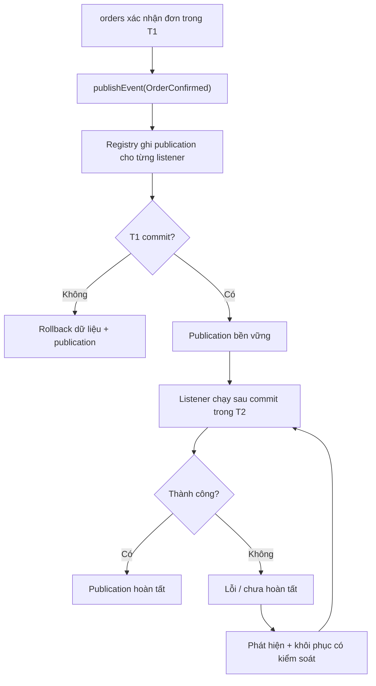
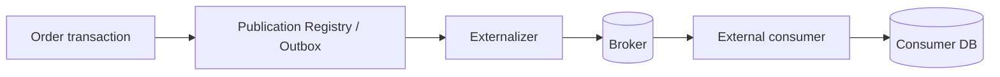

# Mục tiêu tin cậy cho application events trong Spring Modulith

## 1. Từ “đã phát event” đến kết quả nghiệp vụ đáng tin cậy

Trong một hệ thống Spring Modulith, module `orders` có thể phát `OrderConfirmed` để thông báo cho các module `loyalty`, `notifications` và `analytics`. Cách giao tiếp bằng application events giảm phụ thuộc trực tiếp, nhưng **không tự bảo đảm** các tác vụ theo sau đều thành công.

Xét một đơn đã xác nhận:

1. Transaction lưu đơn hàng commit.
2. `orders` đã gọi `ApplicationEventPublisher.publishEvent(...)`.
3. Listener `loyalty` chưa cộng điểm vì kết nối cơ sở dữ liệu gián đoạn.
4. Listener `notifications` đã gửi email, nhưng ứng dụng dừng trước khi ghi nhận hoàn thành.
5. Khi khởi động lại, email có nguy cơ được gửi lần nữa, còn điểm vẫn chưa cộng.

Một câu “hệ thống phải đáng tin cậy” không giúp chọn kiến trúc hay kiểm thử. Cần biến nó thành **mục tiêu tin cậy có phạm vi, số đo, ngưỡng và cách xử lý khi vi phạm**. Mục tiêu không chỉ là event được phát, mà là **phản ứng nghiệp vụ được hoàn thành đúng, trong thời gian chấp nhận được và có thể khôi phục**.

Bài học thuộc chương **Đảm bảo tin cậy**; tập trung thiết lập yêu cầu và tiêu chí nghiệm thu cho publisher, listener, xử lý sau commit, Event Publication Registry, retry, idempotency và quan sát. Mã và con số bên dưới là **ví dụ thiết kế**, không phải cam kết mặc định của Spring Modulith.

## 2. Định nghĩa ranh giới của từng cam kết

Trước khi chọn mức tin cậy, phải chỉ ra **ai chịu trách nhiệm** và **đến đâu được xem là hoàn tất**.

| Ranh giới | Mốc bắt đầu | Mốc hoàn tất có thể quan sát | Điều chưa được bảo đảm |
|---|---|---|---|
| Nghiệp vụ nguồn | Request xác nhận đơn được chấp nhận | Transaction `orders` commit | Module nhận đã xử lý |
| Phát publication nội bộ | Business event được công bố trong transaction | Bản ghi publication được commit bền vững cho listener đích | Listener đã thành công |
| Listener nội bộ | Listener được kích hoạt sau commit | Xử lý xong và publication được đánh dấu hoàn tất | Side effect ngoài DB xảy ra đúng một lần |
| Externalization | Publication cần xuất sang broker | Broker xác nhận nhận thông điệp theo cấu hình | Consumer bên ngoài hoàn tất |
| Consumer bên ngoài | Nhận message từ broker | Transaction/hiệu ứng nghiệp vụ ở hệ thống đích hoàn thành | Mọi hệ thống downstream khác đã xong |

Ví dụ, `publishEvent(...)` trả về không có nghĩa event đã được lưu bền, transaction đã commit hay email đã được gửi. Ngược lại, **publication được đánh dấu hoàn tất** thường biểu thị listener đã trả về thành công theo cơ chế theo dõi, không nhất thiết đồng nghĩa hệ thống email đã chuyển thư tới hộp thư người nhận.

**Hãy viết cam kết ở đúng ranh giới**: “99,9% publication đến listener `loyalty` hoàn tất trong 5 phút kể từ commit đơn hàng”, thay vì “99,9% email tới tay người dùng trong 5 phút” nếu hệ thống chưa đo được việc giao email.

## 3. SLI, SLO và SLA: từ ngôn ngữ nghiệp vụ sang phép đo

Ba khái niệm hữu ích:

- **SLI – Service Level Indicator:** phép đo thực tế, ví dụ tỷ lệ publication được xử lý thành công trước thời hạn.
- **SLO – Service Level Objective:** mục tiêu nội bộ của SLI, ví dụ “ít nhất 99,9% trong 5 phút”.
- **SLA – Service Level Agreement:** cam kết có tính thỏa thuận/hợp đồng với bên nhận dịch vụ, có thể kèm hậu quả khi vi phạm. Không phải mọi SLO đều là SLA.

Ví dụ bảng mục tiêu cho hệ thống bán hàng (giá trị minh họa, cần hiệu chỉnh theo nghiệp vụ):

| Luồng | Mục tiêu đề xuất | Khi không đạt |
|---|---|---|
| `orders → loyalty` | 99,9% publication hoàn tất trong 5 phút | Cảnh báo backlog; xử lý lại có kiểm soát |
| `orders → notifications` | 99% yêu cầu gửi email được nhà cung cấp chấp nhận trong 10 phút | Retry và kiểm tra yêu cầu thất bại |
| `orders → analytics` | 99% dữ liệu sẵn sàng để tổng hợp trong 30 phút | Theo dõi độ trễ và backfill |
| Sự kiện xác nhận đơn | Không để mất publication đã commit theo giới hạn RPO thiết kế | Điều tra, đối chiếu dữ liệu nguồn và khôi phục |
| Phản ứng cộng điểm | Không cộng điểm lặp cho cùng event hợp lệ | Unique constraint, idempotency, đối soát |

Những luồng có hậu quả nghiệp vụ khác nhau **không cần cùng SLO**. Một email chậm có thể chấp nhận; cộng điểm sai hoặc thu tiền trùng có thể không chấp nhận dù latency rất thấp.

## 4. Sáu chiều của mục tiêu tin cậy

Không nên gom độ tin cậy thành một con số duy nhất. Cần ít nhất sáu khía cạnh:

| Khía cạnh | Câu hỏi thiết kế | Ví dụ tiêu chí nghiệm thu |
|---|---|---|
| **Durability** – lưu bền | Sau commit rồi tiến trình dừng, việc cần xử lý còn không? | Publication chưa hoàn thành vẫn tồn tại sau restart |
| **Delivery/completion** | Listener cuối cùng có được gọi và hoàn tất không? | Tỷ lệ hoàn tất trong thời gian SLO |
| **Correctness** | Giao lại có gây trùng hiệu ứng hay thay đổi sai trạng thái? | Một event cộng điểm một lần về nghiệp vụ |
| **Timeliness** – đúng hạn | Mất bao lâu từ commit đến hoàn tất? | 99,9% publication `loyalty` hoàn tất trong 5 phút |
| **Recovery** – phục hồi | Phát hiện và xử lý backlog mất bao lâu? | Bắt đầu điều tra trong ngưỡng cảnh báo đã chọn |
| **Isolation** – cô lập lỗi | Một listener lỗi có làm chặn nghiệp vụ chính hoặc listener khác? | Lỗi email không rollback đơn đã commit |

**Ordering** có thể là khía cạnh thứ bảy nếu nghiệp vụ phụ thuộc thứ tự các event của cùng aggregate. Spring Modulith xử lý listener async và retry **không tự bảo đảm** thứ tự hoàn thành giữa các event.

Bộ mục tiêu tốt phải phân biệt **sự thật do Spring Modulith cung cấp** và **điều ứng dụng tự thiết kế**. Registry hỗ trợ theo dõi publication; SLO, retry policy, idempotency và cảnh báo là trách nhiệm cấu hình/vận hành của hệ thống.

## 5. Xác định chính xác mẫu số khi đo tỷ lệ hoàn tất

Một SLI mơ hồ dễ tạo dashboard đẹp nhưng che giấu lỗi. Ví dụ “99,9% event thành công” chưa rõ:

- Đếm **event nghiệp vụ** hay **publication đến từng listener**?
- Đếm từ lúc gọi `publishEvent(...)` hay từ lúc transaction **commit**?
- Publication mới chưa đến hạn 5 phút có bị coi là thất bại ngay không?
- Các publication bị xóa hoặc không được ghi do lỗi cấu hình có bị bỏ sót?
- Bản ghi bị retry nhiều lần có được tính là nhiều event thành công?

Một định nghĩa có thể kiểm chứng:

> Trong cửa sổ đánh giá 30 ngày, với mỗi **publication đủ điều kiện đã commit** và có thời hạn 5 phút kết thúc trong cửa sổ đó, tính thành công nếu listener đích hoàn tất trong 5 phút tính từ thời điểm commit nguồn. SLI = số publication đáp ứng / tổng số publication đủ điều kiện.

Lưu ý:

1. Dùng **mẫu số theo publication** để phản ánh từng listener. Một event có ba listener tương ứng có thể tạo ba publication.
2. Chỉ phân loại “đúng hạn” sau khi observation window của từng publication đã đủ chín; không trừng phạt publication mới phát cách đây vài giây.
3. Một publication retry ba lần **vẫn là một publication**, không được nhân ba mẫu số.
4. Một publication hoàn tất sau 7 phút là **hoàn tất muộn**, không đạt SLO “trong 5 phút” dù cuối cùng thành công.
5. Theo dõi cả **số event nghiệp vụ đã commit** để phát hiện trường hợp publisher bỏ quên việc tạo publication. Nếu chỉ đo từ bảng registry, event bị mất trước khi ghi registry có thể biến mất khỏi mẫu số.

`occurredAt` thường có trước commit. SLO tính từ commit phải dùng mốc commit hoặc công bố sai số của phép đo.

## 6. Mô hình vòng đời và các trạng thái cần quan sát

Một business event và các publication của nó có thể đi theo luồng:



Sơ đồ mô tả hành vi mong muốn khi registry có **backend persistence cùng transaction phù hợp**. Không phải trạng thái nào cũng có tên enum giống nhau trong mọi phiên bản: Spring Modulith 1.x thường tập trung vào “incomplete/completed”; các phiên bản 2.x có lifecycle status chi tiết hơn.

**Không biến trạng thái registry thành trạng thái nghiệp vụ.** `COMPLETED` nói về việc listener hoàn thành. Nó không thay cho `OrderStatus.CONFIRMED` trong domain hay một bằng chứng thanh toán đã được ngân hàng quyết toán.

## 7. Cửa sổ lỗi quyết định kiến trúc tin cậy

Để chốt SLO đúng, hãy đi qua từng điểm có thể mất tiến trình.

| Thời điểm gặp lỗi | Hậu quả nếu không có cơ chế phù hợp | Cơ chế bảo vệ |
|---|---|---|
| Trước commit T1 | Không nên phát sinh công việc hậu commit | Transactional listener và atomic rollback |
| Sau commit T1, trước khi listener chạy | Event có thể biến mất nếu chỉ nằm trong bộ nhớ | Event Publication Registry bền vững và recovery |
| Listener bắt đầu rồi exception | Công việc có thể chưa hoàn tất | Retry/resubmit và log nguyên nhân |
| Listener commit DB nhưng chưa đánh dấu hoàn tất | Có thể được giao lại và tạo hiệu ứng trùng | Idempotency cùng transaction nghiệp vụ |
| Broker nhận message nhưng producer mất ACK | Có thể gửi lại message đã được chấp nhận | Key ổn định và dedupe ở consumer |
| Consumer bên ngoài commit nhưng chưa ACK broker | Broker có thể redeliver | Inbox/processed-event key và unique constraint |
| Listener không xử lý được event cũ sau nâng version | Backlog tồn đọng dù retry nhiều | Kiểm thử deserialize, migration/schema versioning |

**Không có một annotation nào loại bỏ hết các cửa sổ lỗi.** Mục tiêu tin cậy phải thể hiện được cả: lưu bền công việc chưa làm, biết cách phát hiện thiếu sót và chống lặp khi xử lý lại.

## 8. Thiết kế publisher đúng ranh giới transaction

Một event công khai của module `orders` nên là một bản ghi bất biến có định danh ổn định:

```java
package com.example.shop.orders;

import java.time.Instant;
import java.util.UUID;

public record OrderConfirmed(
        UUID eventId,
        UUID orderId,
        Instant occurredAt
) {}
```

Publisher công bố event trong transaction chứa thay đổi nghiệp vụ:

```java
package com.example.shop.orders;

import com.example.shop.orders.internal.Order;
import com.example.shop.orders.internal.OrderRepository;
import java.time.Clock;
import java.util.UUID;
import org.springframework.context.ApplicationEventPublisher;
import org.springframework.stereotype.Service;
import org.springframework.transaction.annotation.Transactional;

@Service
public class OrderConfirmationService {

    private final OrderRepository orders;
    private final ApplicationEventPublisher publisher;
    private final Clock clock;

    public OrderConfirmationService(
            OrderRepository orders,
            ApplicationEventPublisher publisher,
            Clock clock) {
        this.orders = orders;
        this.publisher = publisher;
        this.clock = clock;
    }

    @Transactional
    public void confirm(UUID orderId) {
        Order order = orders.findById(orderId).orElseThrow();

        if (order.isConfirmed()) {
            return;
        }

        order.confirm();
        orders.save(order);

        publisher.publishEvent(new OrderConfirmed(
                UUID.randomUUID(), orderId, clock.instant()));
    }
}
```

`Order` và `OrderRepository` là thành phần minh họa, chưa trình bày implementation. Giả định ứng dụng có bean `Clock`, transaction manager và xử lý cạnh tranh phù hợp.

Phân biệt hai dạng trùng:

- **Phát hai business event khác nhau** vì hai request cùng xác nhận một đơn: cần optimistic locking/unique constraint hoặc ràng buộc nghiệp vụ ở publisher. Nếu sinh hai `eventId` khác nhau, consumer không thể biết chúng là hai lần quyết định sai chỉ bằng dedupe theo eventId.
- **Giao lại cùng business event** với **cùng `eventId`** vì publication chưa được xác nhận hoàn thành: cần idempotency ở listener.

**Mốc đo:** `publishEvent(...)` có thể xảy ra trước commit; chỉ khi T1 commit thành công mới có sự thật đã được xác nhận và publication bền vững thuộc T1. Nếu rollback, listener `AFTER_COMMIT` không xử lý event đó.

## 9. Thiết kế consumer có thể nhận event nhiều lần

Module `loyalty` có thể xử lý sau commit bằng `@ApplicationModuleListener`:

```java
package com.example.shop.loyalty;

import com.example.shop.orders.OrderConfirmed;
import org.springframework.modulith.events.ApplicationModuleListener;
import org.springframework.stereotype.Component;

@Component
class OrderLoyaltyListener {

    private final LoyaltyCreditService credits;

    OrderLoyaltyListener(LoyaltyCreditService credits) {
        this.credits = credits;
    }

    @ApplicationModuleListener
    void on(OrderConfirmed event) {
        credits.creditOnce(event);
    }
}
```

`@ApplicationModuleListener` của Spring Modulith kết hợp **listener sau commit**, **thực thi bất đồng bộ** và **transaction mới**. Nó giúp tác vụ cộng điểm không giữ transaction xác nhận đơn. Tuy nhiên, annotation **không tự triển khai** thuật toán chống lặp nghiệp vụ.

Với một cơ sở dữ liệu cho thay đổi điểm và dấu đã xử lý, triển khai `creditOnce(...)` theo ý tưởng:

```java
package com.example.shop.loyalty;

import com.example.shop.orders.OrderConfirmed;
import org.springframework.stereotype.Service;
import org.springframework.transaction.annotation.Transactional;

@Service
public class LoyaltyCreditService {

    private final ProcessedEventStore processed;
    private final PointAccountRepository accounts;

    public LoyaltyCreditService(
            ProcessedEventStore processed,
            PointAccountRepository accounts) {
        this.processed = processed;
        this.accounts = accounts;
    }

    @Transactional // REQUIRED: tham gia T2 của module listener
    public void creditOnce(OrderConfirmed event) {
        boolean first = processed.tryInsert(
                "loyalty:OrderConfirmed", event.eventId());

        if (!first) {
            return;
        }

        accounts.creditForOrder(event.orderId());
    }
}
```

`ProcessedEventStore.tryInsert(...)` là API minh họa, phải dùng **INSERT nguyên tử + unique constraint** (hoặc giải pháp DB tương đương) cho khóa `(consumer, eventId)`. Việc claim và cộng điểm cần nằm trong **cùng transaction T2**:

- Nếu cộng điểm lỗi → rollback cả claim, cho phép retry.
- Nếu T2 commit → claim và điểm đã được ghi cùng nhau.
- Nếu publication bị giao lại → claim trùng, không cộng điểm thêm.

Chỉ kiểm tra `exists(eventId)` rồi insert **không đủ** dưới cạnh tranh đồng thời: hai worker có thể cùng đọc “chưa tồn tại”. Nên có khóa unique do DB thực thi và xử lý xung đột giao dịch đúng cách.

Nếu việc cộng điểm có thể xảy ra với **hai eventId khác nhau nhưng cùng một mốc nghiệp vụ**, còn cần khóa nghiệp vụ (ví dụ một lần cộng điểm cho `orderId` và loại lý do) để bảo vệ tính đúng đắn.

## 10. Lưu publication bền vững và phục hồi có giới hạn

Spring Modulith cung cấp **Event Publication Registry** cho các transactional listener đủ điều kiện. Khi cài đúng persistence backend (ví dụ JDBC/JPA tùy phiên bản và dự án), registry lưu các publication trong transaction phù hợp với event nguồn, rồi theo dõi hoàn tất cho **từng listener đích**.

Ví dụ `OrderConfirmed` có hai đích:

```text
Event E1: OrderConfirmed(orderId=O1)
  Publication P1 → notifications: COMPLETED
  Publication P2 → loyalty: FAILED / incomplete
```

Nội dung trên minh họa, không quy định schema hay enum status cho mọi phiên bản. Có thể cần xử lý lại P2 mà **không phát lại** P1 hoặc chạy lại command xác nhận đơn.

Để phục hồi thực sự, hệ thống cần:

1. Persistence có schema ổn định, kết nối DB, transaction manager và serializer phù hợp.
2. Cơ chế tìm publication chưa hoàn tất/lỗi, có giới hạn tuổi, batch size và concurrency.
3. Chính sách **resubmit sau khi nguyên nhân lỗi được xử lý**, không retry nóng vô hạn.
4. Quan sát được những publication tồn lâu, không thể deserialize, hoặc bị tạm dừng/từ bỏ.
5. Quy trình vận hành tránh nhiều instance resubmit cùng backlog không kiểm soát.

Tùy phiên bản, Spring Modulith có cơ chế phát lại outstanding events khi restart và API resubmit. Chúng **không nên được xem là luôn bật mặc định**. Hãy xác minh cấu hình và hành vi theo đúng phiên bản sử dụng; đặc biệt cẩn thận với triển khai multi-instance.

Không được đặt SLO hoàn tất dựa trên giả định “registry sẽ tự retry cho tới khi thành công” nếu hệ thống chưa triển khai và kiểm tra quy trình đó.

## 11. Chọn chính sách retry theo mục tiêu nghiệp vụ

Retry giúp tăng khả năng đạt SLO khi lỗi tạm thời, nhưng cũng có thể làm quá tải hệ thống nhận hoặc tạo hiệu ứng lặp.

| Loại lỗi | Ví dụ | Hành động phù hợp |
|---|---|---|
| Tạm thời | Timeout, deadlock có thể phục hồi, DB bận | Backoff theo cấp số nhân, jitter, giới hạn attempts |
| Sự cố dài | DB/module nhận tạm không sẵn sàng | Giữ publication bền vững, cảnh báo và thử lại khi phục hồi |
| Lỗi dữ liệu | Payload thiếu trường, schema cũ không đọc được | Sửa mapping/serializer, migration, xử lý thủ công |
| Lỗi nghiệp vụ vĩnh viễn | Đối tượng không hợp lệ, yêu cầu bị từ chối hợp lệ | Không retry vô hạn; đưa vào luồng đối soát |
| Duplicate đã xử lý | EventId đã được ghi ở consumer | Trả về thành công, không sinh side effect mới |

Một retry policy cần nói rõ **ai thử lại**, **thử lại những publication nào**, **thời gian giữa các lần**, **giới hạn đồng thời**, **điều kiện dừng** và **ai nhận cảnh báo**. Với lỗi vĩnh viễn, không được biến việc “bỏ qua event” thành một thành công giả để làm đẹp chỉ số.

Trong Spring Modulith 2.x, các API và trạng thái quản trị có thể khác với 1.x; khi nêu cấu hình cụ thể, phải đối chiếu tài liệu đúng phiên bản thay vì suy diễn.

## 12. Durability, latency, RPO và RTO không đồng nghĩa

Mỗi chỉ số trả lời một câu hỏi:

- **Durability:** khi transaction đã được chấp nhận, publication cần xử lý có thể khôi phục sau crash không?
- **Completion latency:** từ mốc phát/commit đã thống nhất tới khi listener hoàn tất mất bao lâu?
- **RPO (Recovery Point Objective):** trong kịch bản thảm họa đã định nghĩa, chấp nhận mất bao nhiêu dữ liệu hoặc publication đã commit? RPO = 0 là mục tiêu rất mạnh, đòi hỏi cả sao lưu/replication và chiến lược hạ tầng; không tự có từ registry.
- **RTO (Recovery Time Objective):** sau sự cố, mất bao lâu để khôi phục khả năng phục vụ hoặc xử lý lại? RTO không giống SLO độ trễ của từng listener.

Ví dụ định nghĩa nội bộ:

| Mục tiêu | Ví dụ | Cần gì để chứng minh? |
|---|---|---|
| Không mất publication do restart ứng dụng đơn lẻ | Publication chưa hoàn tất tồn tại sau restart | Integration test dùng backend bền vững |
| SLO phản ứng | 99,9% publication `loyalty` trong 5 phút | Mốc commit/completion, công thức SLI |
| RTO module listener | Có thể khôi phục xử lý trong 15 phút sau sự cố ngắn | Diễn tập shutdown/startup và backlog |
| RPO hệ thống | Được đặt theo bài toán HA/DR thực tế | Kiểm thử backup, replica, khôi phục DB |

**Registry không tự bảo đảm RPO = 0.** Khi DB mất dữ liệu đã commit, cả đơn hàng và publication đều có thể mất.

## 13. Mục tiêu đúng đắn phải bao phủ side effect bên ngoài

Khi listener gửi email, gọi HTTP, ghi vào hệ thống điểm thưởng ngoài hoặc externalize ra broker, transaction DB của listener **không thể rollback** một side effect đã được hệ thống ngoài chấp nhận.

Hai cửa sổ quan trọng:

- **Ghi dấu hoàn tất trước, gọi HTTP sau:** nếu crash giữa hai bước, công việc có thể bị bỏ lỡ.
- **Gọi HTTP trước, ghi dấu hoàn tất sau:** nếu crash giữa hai bước, lệnh có thể được gửi lại và tạo hiệu ứng trùng.

Những mục tiêu thực tế nên tách riêng:

| Mục tiêu | Hướng thiết kế |
|---|---|
| Không bỏ sót yêu cầu gửi | Lưu notification/outbox job trong DB, worker gửi có retry |
| Hạn chế gửi trùng | Idempotency key ở nhà cung cấp nếu được hỗ trợ |
| Biết yêu cầu đã được chấp nhận | Lưu provider response/message ID và timestamp |
| Biết thư tới hộp thư | Chỉ cam kết nếu provider cung cấp delivery event tin cậy theo phạm vi thỏa thuận |
| Thu tiền không trùng | Khóa idempotency cấp giao dịch và đối soát với cổng thanh toán |

Event Publication Registry hữu ích để **không bỏ sót lượt xử lý listener**, nhưng không tự làm hiệu ứng ngoài DB trở thành exactly-once. Nếu hậu quả của lặp quá lớn, cần đưa điều kiện idempotency và đối soát vào **mục tiêu tin cậy chính thức**.

## 14. Khi externalize event qua broker, SLO có thêm một chặng

Đối với Kafka, AMQP, JMS hoặc một nền tảng messaging khác, đường đi có nhiều ranh giới:



Cần phân biệt:

1. **Publisher → broker:** đã được broker chấp nhận theo loại ACK và cấu hình nào?
2. **Broker → consumer:** consumer đã nhận thông điệp chưa, có thể nhận lại không?
3. **Consumer → business DB/API:** hiệu ứng nghiệp vụ đã commit hoặc được bên ngoài chấp nhận chưa?

SLO “đã gửi event sang broker trong 1 phút” **không tương đương** SLO “hệ thống vận chuyển đã tạo đơn giao trong 1 phút”. Nếu chỉ có ACK broker, hãy đặt mục tiêu chính xác là **broker acceptance latency**.

Với externalization, có thể cần outbox phù hợp để lưu công việc gửi broker trong cùng transaction dữ liệu nguồn, cùng retry/idempotency ở producer và consumer. Cần xác minh mô hình hỗ trợ của Spring Modulith theo phiên bản. Không suy luận `ApplicationEventPublisher` tự có broker, durable delivery hoặc exactly-once liên hệ thống.

## 15. Thiết kế metrics và cảnh báo để SLO đo được

Một dashboard tối thiểu có thể hiển thị:

| SLI/metric đề xuất | Cách dùng |
|---|---|
| `publications_eligible_total` | Mẫu số publication đã commit và đã đến hạn SLO |
| `publications_completed_in_deadline_total` | Tử số publication hoàn tất đúng hạn |
| `publication_completion_latency_seconds` | Phân bố độ trễ, p50/p95/p99 theo target |
| `publication_incomplete_count` | Tổng backlog theo listener |
| `oldest_incomplete_age_seconds` | Tuổi publication tồn đọng lâu nhất |
| `publication_retry_attempts_total` | Tình hình resubmit và nguy cơ retry storm |
| `publication_failed_count` | Publication lỗi theo event type/target, khi hệ thống hỗ trợ |
| `duplicate_business_effect_prevented_total` | Số lượt xử lý trùng được chặn ở consumer |

Các tên này là **đề xuất để ứng dụng xây dựng**, không phải metric tự động do Spring Modulith xuất dưới đúng tên trên.

Ví dụ cảnh báo theo mục tiêu minh họa:

- Cảnh báo khi backlog `loyalty` tăng liên tục trong một cửa sổ thời gian và độ tuổi bản ghi cũ nhất vượt 5 phút.
- Cảnh báo riêng khi không thể deserialize event còn tồn trong registry: retry tự động có thể không giải quyết được.
- Điều tra nếu tỷ lệ duplicate tăng bất thường sau một lần triển khai hoặc sau broker outage.
- Theo dõi **burn rate** của ngân sách lỗi SLO trên cả cửa sổ ngắn và dài, để phân biệt sự cố cấp tính với suy giảm kéo dài.

Hạn chế metric label có cardinality cao: `eventId`, `orderId`, `publicationId` nên nằm trong **log/trace**, không thành label Prometheus. Chỉ dùng label ổn định như `eventType`, `target` và `status`; không ghi toàn bộ payload có dữ liệu nhạy cảm.

### SLO và error budget

SLO 99,9% nghĩa là có một phần nhỏ publication đủ điều kiện có thể **không đạt thời hạn** trong cửa sổ đánh giá mà chưa vi phạm SLO. Phần cho phép đó gọi là **error budget**; nó giúp quyết định ưu tiên cải thiện độ tin cậy, dừng rollout hoặc đầu tư thêm năng lực thay vì chỉ tranh luận cảm tính.

**Không dùng error budget để biện minh cho sai lệch tiền tệ hoặc duplicate payment.** Những lỗi correctness nghiêm trọng có thể được quy định thành mục tiêu riêng, với chính sách an toàn và đối soát nghiêm ngặt hơn SLO latency.

## 16. Kiểm thử tiêu chí nghiệm thu thay vì chỉ test annotation

Cần thực hiện test đúng transaction, listener và backend đã chọn. Một test `publishEvent(...)` được gọi **không đủ** để chứng minh hệ thống đáp ứng mục tiêu tin cậy.

| Kịch bản | Điều phải chứng minh |
|---|---|
| Nghiệp vụ commit | Có event/publication cần thiết và cuối cùng listener hoàn tất |
| Transaction nguồn rollback | Không có tác động sau commit hoặc publication bền vững của transaction rollback |
| App chết sau commit trước listener | Publication chưa hoàn tất sống qua restart và có thể khôi phục |
| Listener lỗi lần đầu, thành công lần hai | Retry không cần chạy lại command nguồn và được ghi nhận kết quả |
| Crash sau khi T2 commit nhưng trước khi registry đánh dấu hoàn tất | Lần giao lại không tạo hiệu ứng nghiệp vụ trùng |
| Hai worker cùng nhận eventId | Unique constraint/idempotency bảo vệ hiệu ứng |
| Downstream timeout kéo dài | Backoff, concurrency limit và cảnh báo hoạt động |
| Payload cũ còn trong registry sau nâng version | Deserialize được hoặc có migration/đối soát |
| External broker mất ACK | Producer có thể gửi lại; consumer xử lý trùng an toàn |
| Load tăng hoặc backlog lớn | Tỷ lệ đúng hạn và thời gian phục hồi được đo bằng metric |

**Điểm chú ý với test:** nếu phương thức test có `@Transactional` và rollback mặc định, `@TransactionalEventListener(AFTER_COMMIT)` sẽ không chạy. Dùng test không bọc transaction tự động hoặc chủ động commit bằng `TestTransaction`/`TransactionTemplate`. Với listener async, chờ trạng thái có điều kiện và timeout, không dựa vào `Thread.sleep` tùy tiện.

Có thể dùng `@ApplicationModuleTest` và cơ chế quan sát published events để kiểm thử module, nhưng khi cần chứng minh **durability**, vẫn phải dùng test tích hợp có backend publication bền vững, restart hoặc giả lập sự cố.

## 17. Quy trình phản ứng khi mục tiêu tin cậy bị vi phạm

Ví dụ runbook cho backlog `loyalty`:

1. **Phát hiện:** kiểm tra backlog, tuổi publication, tỷ lệ lỗi và listener đích.
2. **Khoanh vùng:** xác định đơn đã commit nhưng chưa cộng điểm, xem log/exception để phân biệt lỗi hạ tầng và lỗi dữ liệu.
3. **Giảm thiểu:** chặn retry storm, giới hạn concurrency, khôi phục DB hoặc rollback release lỗi.
4. **Khôi phục:** resubmit publication phù hợp với batch giới hạn, giữ nguyên `eventId`.
5. **Đối soát:** so đơn nguồn với số điểm thực tế, xác minh không mất hoặc cộng trùng; ghi nhận thời gian khôi phục.

Nếu event **không được ghi vào registry**, quét registry không thể phát hiện nó: cần đối chiếu nguồn nghiệp vụ với kết quả. Chỉ đóng incident khi dữ liệu đã đúng, không phải khi vừa nhấn nút retry.

## 18. Năng lực xử lý và retention cũng là một phần của độ tin cậy

SLO độ trễ không đạt nếu tốc độ phát thường xuyên lớn hơn khả năng xử lý. Cần tính **throughput** bình thường/đột biến, số publication mỗi event, executor, connection pool, giới hạn API downstream và tải do retry.

Khi consumer chậm, **backpressure** phải giữ backlog bền vững cùng cảnh báo; resubmit backlog theo batch tránh chiếm hết tài nguyên xử lý event mới. Chỉ dọn publication hoàn tất theo chính sách **retention**; dữ liệu chưa hoàn tất cần sống đủ lâu để khôi phục và vẫn deserialize được sau nâng version.

Với nhiều instance, phối hợp worker giúp giảm duplicate không cần thiết; **unique constraint/idempotency** vẫn là lớp bảo vệ hiệu ứng cuối.

## 19. Bản mẫu đặc tả mục tiêu tin cậy

Ví dụ bản mẫu có thể đưa vào tài liệu vận hành của dự án; đây **không phải YAML cấu hình mặc định của Spring Modulith**:

```yaml
name: order-confirmed-to-loyalty
source: orders.OrderConfirmed
consumer: loyalty.OrderLoyaltyListener
start: source_transaction_committed
success: loyalty_transaction_committed_and_publication_completed
sli:
  population: eligible_committed_publications
  unit: per_listener_publication
  deadline: 5m
slo:
  objective: "99.9% within 5m"
  window: 30d
recovery:
  publication_store: durable
  retry: bounded_with_backoff
  concurrency: limited
correctness:
  dedupe_key: "consumer + eventId"
  duplicate_credit: prohibited
observability:
  alert_on: ["failed", "oldest_incomplete_age", "slo_burn"]
```

Bên cạnh bản đặc tả, cần ghi rõ **nguồn đo mốc commit/completion**, cách xử lý publication chưa đến hạn, quy tắc retention, người chịu trách nhiệm incident và kết quả kiểm thử failure windows. Nếu một mục chưa thể đo hoặc chưa có chủ sở hữu thì mục tiêu ấy chưa sẵn sàng để báo cáo là đạt.

## 20. Checklist trước khi công bố hệ thống đạt mục tiêu tin cậy

- SLO có **phạm vi, mốc thời gian, mẫu số, ngưỡng và cửa sổ đánh giá** rõ ràng?
- Đã phân biệt business event, publication, broker ACK và hiệu ứng nghiệp vụ?
- Publisher phát trong transaction, registry lưu bền và có recovery được kiểm chứng?
- Consumer chống lặp nguyên tử; side effect ngoài DB có idempotency/outbox hoặc đối soát?
- Retry có giới hạn, backoff; dashboard theo dõi độ trễ, backlog và lỗi?
- Đã xác định RTO/RPO, retention và chủ sở hữu incident?
- Test đã tái hiện rollback, crash/restart, duplicate và event cũ sau nâng version?

**Tổng kết:** “Mục tiêu tin cậy” trong Spring Modulith không phải lời khẳng định rằng chỉ cần application events là hệ thống sẽ không bao giờ mất sự kiện hay xử lý trùng. Đây là **hợp đồng kỹ thuật và nghiệp vụ có thể đo**: ghi nhận publication sau quyết định được commit, xử lý trong thời hạn, khôi phục công việc chưa hoàn thành và bảo vệ kết quả trước duplicate. Spring Modulith cung cấp publisher, transactional listener và Event Publication Registry; ứng dụng phải bổ sung cấu hình lưu bền, retry, idempotency, monitoring, test sự cố và quy trình vận hành để đạt mục tiêu đã công bố.

### Tài liệu tham khảo

- [Spring Modulith – Working with Application Events](https://docs.spring.io/spring-modulith/reference/events.html): application module listener, Event Publication Registry và khôi phục publication.
- [Spring Framework – Transaction-bound Events](https://docs.spring.io/spring-framework/reference/data-access/transaction/event.html): callback theo pha transaction.
- [Google SRE – Service Level Objectives](https://sre.google/sre-book/service-level-objectives/): định nghĩa SLI/SLO, error budget và lựa chọn thước đo.
- [Google SRE Workbook – Implementing SLOs](https://sre.google/workbook/implementing-slos/): xây dựng SLO dựa trên hành vi có thể quan sát.
