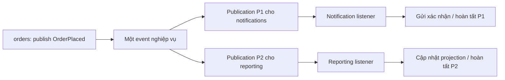
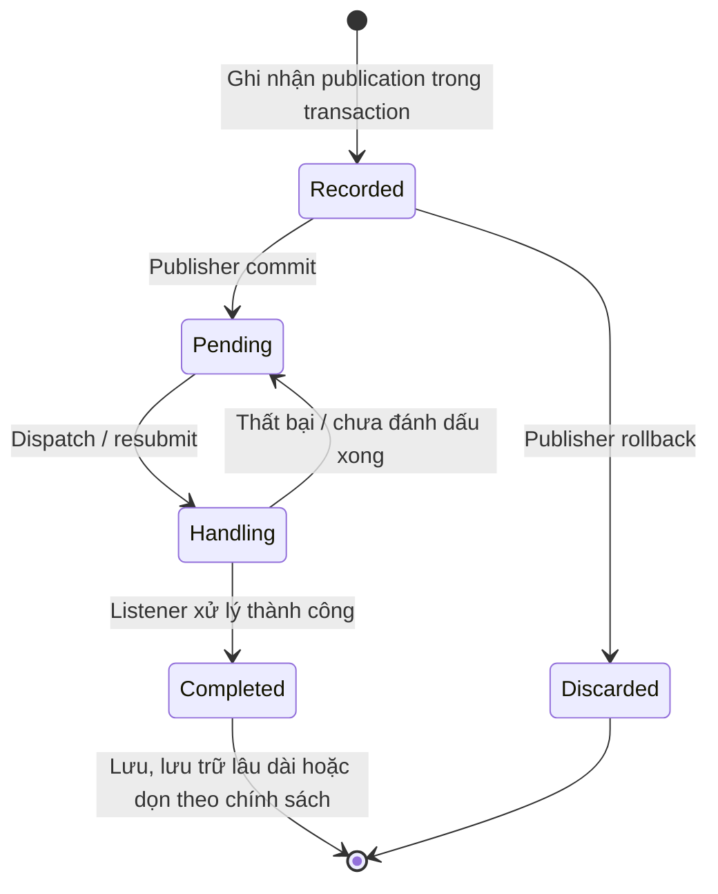
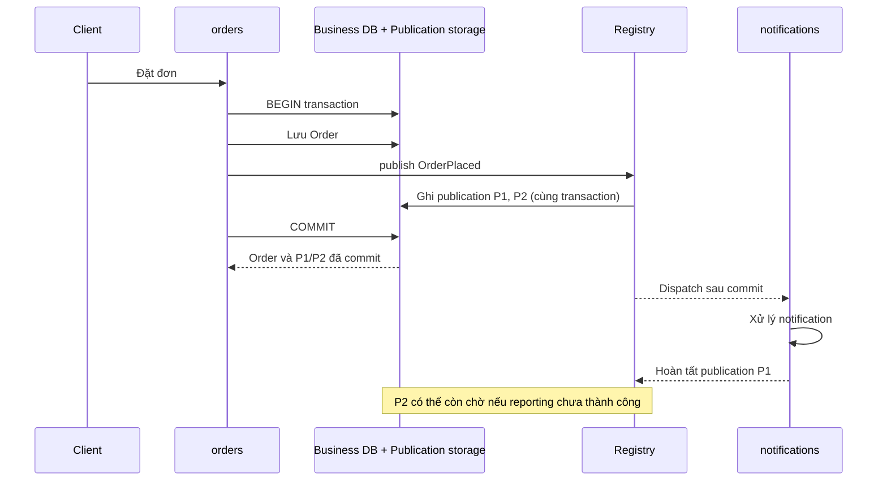
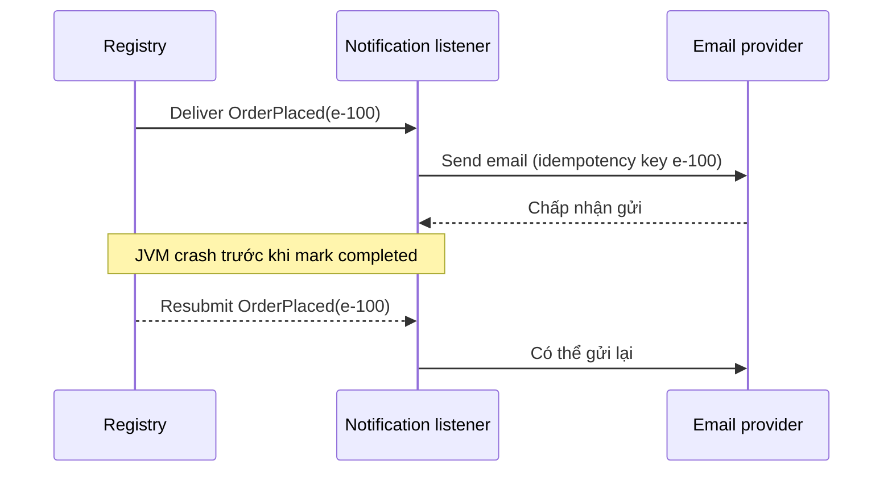

# Bản ghi publication trong Spring Modulith Event Publication Registry

## 1. Bản ghi publication là gì?

Trong module học **SPRING_MODULITH_APPLICATION_EVENTS**, Spring Modulith giúp các module giao tiếp qua application events thay vì gọi trực tiếp implementation của nhau. Ví dụ: `orders` phát `OrderPlaced`; `notifications` gửi xác nhận và `reporting` cập nhật báo cáo. Để xử lý sau commit một cách đáng tin cậy, hệ thống cần biết **event nào đã được công bố cho listener nào và listener đó đã xử lý xong chưa**.

**Bản ghi publication (event publication record)** là dấu vết do **Event Publication Registry** quản lý, biểu diễn một lần cần giao một sự kiện cho **một listener đích được hỗ trợ**. Về mặt logic, bản ghi liên kết:

- **Sự kiện đã phát**: loại event và dữ liệu cần thiết để giao lại.
- **Listener đích**: nơi phải nhận/xử lý event.
- **Danh tính publication**: phân biệt từng publication khi theo dõi, đánh dấu hoàn tất hoặc xử lý lại.
- **Thông tin thời gian/trạng thái**: lúc ghi nhận và việc xử lý đã hoàn tất hay chưa.

Đây **không phải** bản ghi đơn hàng, cũng không phải bản thân event business object, và không nhất thiết là một thông điệp đã được gửi ra message broker. Nó là dữ liệu vận hành giúp trả lời câu hỏi: **“Sau khi nghiệp vụ đã commit, listener nào còn chưa hoàn tất phần việc của mình?”**

Trong phạm vi bài **Publication Registry → Bản ghi publication**, mục tiêu là hiểu hình dạng logic, vòng đời, tính nguyên tử, các trường hợp lỗi và cách sử dụng an toàn của loại bản ghi này.

## 2. Phân biệt event, publication và kết quả xử lý

Ba thực thể dưới đây liên quan với nhau nhưng không đồng nhất:

| Thành phần | Ví dụ | Vai trò |
| --- | --- | --- |
| **Domain/application event** | `OrderPlaced(eventId, orderId, occurredAt)` | Nói một sự thật nghiệp vụ đã xảy ra |
| **Publication record** | Publication cho `OrderPlaced` tới `notifications` | Theo dõi việc một listener cần xử lý sự kiện |
| **Kết quả nghiệp vụ ở consumer** | Email được chấp nhận gửi hoặc projection đã cập nhật | Điều mà listener thực sự phải đạt được |

Ví dụ, `orders` phát **một** `OrderPlaced` và hai listener được registry theo dõi:



Nếu `notifications` xử lý thành công nhưng `reporting` thất bại, **P1 có thể hoàn tất trong khi P2 còn chờ**. Không nên dùng một cờ `delivered = true` chung cho toàn bộ event rồi suy ra mọi consumer đã xong.

Một điểm tinh tế: publication record gắn với **listener đích tại thời điểm phát**. Nếu sau này thêm một listener mới, registry **không mặc nhiên tạo bản ghi lịch sử** cho listener chưa tồn tại khi event được publish. Nếu cần backfill dữ liệu cũ, phải thiết kế cơ chế riêng.

## 3. Các trường thông tin logic trong một publication record

API và schema vật lý của registry có thể khác nhau theo **phiên bản Spring Modulith** và **persistence backend** (ví dụ một implementation lưu trên JDBC/JPA). Bảng sau mô tả **khái niệm**, không phải cam kết chính xác tên cột của một thư viện cụ thể.

| Dữ liệu logic | Ví dụ | Ý nghĩa |
| --- | --- | --- |
| **Publication ID** | `p-001` | Nhận diện một bản ghi publication cụ thể |
| **Target listener identifier** | `notifications.OrderEmailListener` | Chỉ ra listener mà publication cần được giao |
| **Event type** | `OrderPlaced` | Giúp nhận diện/khôi phục kiểu sự kiện |
| **Serialized event payload** | `{"eventId":"e-100","orderId":"o-9"}` | Dữ liệu để xử lý lại event |
| **Publication date** | `2026-11-25T08:00:00Z` | Mốc ghi nhận publication, phục vụ theo dõi tồn đọng |
| **Completion information** | Thời điểm hoàn tất hoặc trạng thái tương ứng | Phân biệt còn chờ và đã hoàn thành |
| **Thông tin lỗi/lần thử** (nếu backend/hệ thống lưu) | `attempt=3`, mã lỗi | Hỗ trợ retry, điều tra; không mặc định schema nào cũng có |

Một representation **minh họa**, không phải JSON hay database schema mặc định do Spring Modulith phát sinh:

```json
{
  "publicationId": "p-001",
  "targetIdentifier": "notifications.OrderEmailListener",
  "eventType": "com.example.shop.orders.OrderPlaced",
  "event": {
    "eventId": "e-100",
    "orderId": "o-9",
    "occurredAt": "2026-11-25T08:00:00Z"
  },
  "publicationDate": "2026-11-25T08:00:01Z",
  "completionDate": null
}
```

`completionDate = null` trong ví dụ mang nghĩa **chưa ghi nhận hoàn tất**. Một số implementation/phiên bản dùng trường trạng thái, timestamp, thao tác di chuyển hoặc xóa bản ghi theo chính sách completion. **Không lấy ví dụ này để tự viết SQL phụ thuộc tên cột thật.**

### Publication ID, event ID và aggregate ID khác nhau

- `orderId`: danh tính **đơn hàng**; một đơn có thể phát nhiều loại event.
- `eventId`: danh tính **một sự kiện nghiệp vụ** do ứng dụng quyết định thêm vào event contract; dùng để correlation và idempotency khi cần.
- `publicationId`: danh tính **lần ghi nhận event cho một listener** do registry quản lý; cùng một event có thể có nhiều publication ID.
- `targetIdentifier`: nhận diện listener đích để registry phân biệt việc giao và hoàn tất.

Không nhầm `publicationId` với `eventId` khi viết logic chống gửi email trùng. Một email gửi lại sau retry phải được nhận diện bằng **khóa nghiệp vụ ổn định** (thường `eventId` kết hợp consumer/purpose hoặc một unique business key); không tự giả định publication ID là khóa idempotency tốt nhất cho mọi tác dụng phụ.

## 4. Hình thành bản ghi khi publisher phát event

Giả sử có event công khai của module `orders`:

```java
// File: com/example/shop/orders/OrderPlaced.java
package com.example.shop.orders;

import java.time.Instant;
import java.util.Objects;
import java.util.UUID;

public record OrderPlaced(
        UUID eventId,
        UUID orderId,
        Instant occurredAt
) {
    public OrderPlaced {
        Objects.requireNonNull(eventId, "eventId");
        Objects.requireNonNull(orderId, "orderId");
        Objects.requireNonNull(occurredAt, "occurredAt");
    }
}
```

Module `orders` phát event trong giao dịch tạo đơn:

```java
// File: com/example/shop/orders/internal/OrderService.java
package com.example.shop.orders.internal;

import com.example.shop.orders.OrderPlaced;
import java.time.Clock;
import java.time.Instant;
import java.util.UUID;
import org.springframework.context.ApplicationEventPublisher;
import org.springframework.stereotype.Service;
import org.springframework.transaction.annotation.Transactional;

@Service
class OrderService {
    private final OrderRepository orders;
    private final ApplicationEventPublisher events;
    private final Clock clock;

    OrderService(
            OrderRepository orders,
            ApplicationEventPublisher events,
            Clock clock
    ) {
        this.orders = orders;
        this.events = events;
        this.clock = clock;
    }

    @Transactional
    public UUID place(PlaceOrderCommand command) {
        var order = orders.create(command);
        events.publishEvent(new OrderPlaced(
                UUID.randomUUID(),
                order.id(),
                Instant.now(clock)
        ));
        return order.id();
    }
}
```

`OrderRepository`, `PlaceOrderCommand` và `Clock` bean là những thành phần minh họa cần triển khai/cấu hình trong dự án. Event đặt tại API công khai của `orders`, không chứa JPA entity hay repository nội bộ.

Khi sử dụng Event Publication Registry và **storage backend phù hợp**, lúc phát event, hệ thống có thể đăng ký publication cho các **transactional listener được hỗ trợ** đang được nhận diện. Để bảo đảm publication atomic với việc tạo đơn, việc lưu publication phải tham gia **cùng transaction resource** với thay đổi nghiệp vụ.

Trong cấu hình đúng với yêu cầu đó, thứ tự logic là:

1. Business transaction bắt đầu.
2. `orders` lưu đơn và phát `OrderPlaced`.
3. Registry ghi nhận publication tương ứng với listener đích.
4. Transaction **commit**: cả dữ liệu đơn và dấu publication cùng tồn tại; hoặc **rollback**: cả hai đều không commit.
5. Sau commit, các listener đủ điều kiện được kích hoạt theo semantics của chúng.
6. Khi listener hoàn tất thành công, registry cập nhật trạng thái/thông tin hoàn tất.

**Quan trọng:** `publishEvent(...)` không tự chứng minh publication đã được lưu. Phải có implementation lưu trữ, transaction và listener integration phù hợp. Một `@EventListener` thông thường không mặc nhiên tạo publication được registry theo dõi.

## 5. Một event có thể tạo nhiều publication record

Hai listener ở hai module khác nhau:

```java
// com.example.shop.notifications.internal.OrderEmailListener
@Component
class OrderEmailListener {
    private final ConfirmationSender sender;

    OrderEmailListener(ConfirmationSender sender) {
        this.sender = sender;
    }

    @ApplicationModuleListener
    void on(OrderPlaced event) {
        sender.sendOnce(event.eventId(), event.orderId());
    }
}
```

```java
// com.example.shop.reporting.internal.OrderReportingListener
@Component
class OrderReportingListener {
    private final OrderProjectionService projections;

    OrderReportingListener(OrderProjectionService projections) {
        this.projections = projections;
    }

    @ApplicationModuleListener
    void on(OrderPlaced event) {
        projections.applyOnce(event.eventId(), event.orderId());
    }
}
```

Trong ví dụ, `ConfirmationSender.sendOnce(...)` và `OrderProjectionService.applyOnce(...)` chỉ là interface nghiệp vụ minh họa. Chúng **không tự idempotent** vì có chữ `Once` trong tên.

`@ApplicationModuleListener` là tiện ích Spring Modulith cho xử lý bất đồng bộ, sau commit và trong transaction riêng của listener. Với registry được cấu hình phù hợp, hai listener có thể tương ứng với **hai publication độc lập**:

| Publication | Event | Listener đích | Tình trạng |
| --- | --- | --- | --- |
| P1 | `OrderPlaced(e-100)` | Email listener | Hoàn tất |
| P2 | `OrderPlaced(e-100)` | Reporting listener | Chưa hoàn tất do database lỗi |

**Không đồng nhất “event đã publish” với “mọi listener đã xử lý xong”.** Một consumer lỗi không có nghĩa phải phát lại event cho tất cả consumer đã thành công. Việc chọn publication cụ thể để resubmit và cách đánh dấu hoàn tất phải theo API, cấu hình và chính sách vận hành của registry đang dùng.

## 6. Vòng đời logic của publication



Tên `Recorded`, `Pending`, `Handling`, `Completed` và `Discarded` là **trạng thái khái niệm trong bài học**, **không phải enum hoặc schema được bảo đảm có trong mọi phiên bản Spring Modulith**. Đặc biệt, một transaction rollback không nhất thiết tạo một “bản ghi trạng thái Discarded”; nó thường chỉ có nghĩa **bản ghi chưa từng commit**.

Những điểm cần phân biệt:

**Đã đăng ký publication.** Registry nhận được yêu cầu theo dõi event-listener pair, nhưng nếu transaction nghiệp vụ chưa commit, bản ghi chưa chắc đã bền vững.

**Publication chưa hoàn tất.** Dấu vết đã commit và chưa có kết quả hoàn tất; nguyên nhân có thể là listener chưa chạy, đang chạy, lỗi, bị tắt, hoặc đang chờ khôi phục.

**Publication hoàn tất.** Registry đã ghi nhận listener xử lý thành công theo cơ chế của nó. Điều này không mặc nhiên chứng minh tác dụng phụ bên ngoài (email, HTTP, thanh toán) đã hoàn tất theo nghĩa end-to-end.

**Publication thất bại và được xử lý lại.** Nếu callback lỗi hoặc JVM dừng trước lúc đánh dấu hoàn tất, publication có thể tiếp tục ở tình trạng cần xử lý. Việc tự động/chủ động resubmit và retry phụ thuộc phiên bản và cấu hình; đừng mặc định tự retry vô hạn.

## 7. Tính nguyên tử của bản ghi với transaction nghiệp vụ

Bản ghi publication hữu ích nhất khi nó là **dấu vết bền vững được commit cùng sự thật nghiệp vụ**:



Nếu phần nghiệp vụ và publication được ghi bằng **hai transaction/database không phối hợp**, có thể xảy ra tình trạng chỉ một trong hai bên commit. Khi đó không được tuyên bố bảo đảm atomic chỉ vì có registry.

| Trường hợp | Dữ liệu đơn | Publication trong cùng transaction | Ý nghĩa |
| --- | --- | --- | --- |
| Publisher rollback | Không commit | Không commit | Không có đơn hợp lệ để xử lý |
| Publisher commit | Commit | Commit | Có dấu vết cần giao đến listener |
| Publisher commit rồi JVM crash trước callback | Commit | Vẫn còn publication chưa hoàn tất | Có thể phục hồi nếu storage bền và cơ chế replay hoạt động |
| Listener lỗi sau commit | Không rollback ngược | Có thể còn chưa hoàn tất | Consumer cần được retry/đối soát |

Một thao tác như gửi email **không nằm trong transaction PostgreSQL của `orders`**, dù listener xử lý trong cùng ứng dụng. Publication record hỗ trợ **khả năng phục hồi**, không biến nhiều resource khác nhau thành một transaction toàn cục.

## 8. Bản ghi publication và listener identification

Registry cần nhận ra **listener nào** phải nhận event. Về mặt logic, publication gắn một **target identifier** với event. Điều này có hệ quả vận hành khi refactor:

1. Đổi tên class hoặc method của listener có thể làm thay đổi cách implementation nhận diện listener đích.
2. Nếu publication cũ còn chờ, phiên bản ứng dụng mới phải còn biết **publication đó thuộc consumer nào** hoặc có migration/adapter tương ứng.
3. Tên target identifier và cơ chế khớp listener có thể phụ thuộc implementation/phiên bản; không tự giả định nó đúng bằng `getClass().getName()`.
4. Xóa listener khỏi ứng dụng không có nghĩa publication cũ đã được xử lý hoặc không còn quan trọng.
5. Thêm listener mới không khiến registry tự phát lại toàn bộ event lịch sử cho nó.

Ví dụ:

```text
Phiên bản A:
    target: notifications.OrderEmailListener
    publication: P1 (đang chờ)

Phiên bản B:
    listener đổi tên/thay module
    => cần xác nhận P1 vẫn resolve được target mới
       hoặc có phương án xử lý/migration trước deploy.
```

Với kiến trúc Spring Modulith, kiểu event nên ở **base package** của module phát hoặc một **named interface** công khai. Consumer không nên import entity/repository nội bộ của `orders`. Registry phục vụ delivery, **không thay thế kiểm tra ranh giới module** như `ApplicationModules.verify()`.

## 9. Payload được lưu và khả năng deserialize

Khi publication phải tồn tại sau restart, backend cần một biểu diễn có thể lưu và đọc lại. Việc dùng Java `record` bất biến với field đơn giản như `UUID`, `String`, `Instant` thường dễ kiểm soát hơn gửi cả một object graph của JPA entity.

**Không nên đưa vào event:**

- `EntityManager`, repository, connection, servlet request, session hay thread-bound transaction context.
- JPA entity với lazy associations, proxy hoặc mutable state phức tạp.
- Access token, password, cookie, khóa bí mật hoặc dữ liệu cá nhân không cần thiết.
- Tham chiếu tới object không thể serialize ổn định qua restart hoặc deploy.

Một event nên mô tả **sự thật nghiệp vụ bất biến** và mang đủ dữ liệu để consumer xử lý đúng. Chọn giữa payload chứa ID và snapshot theo yêu cầu lịch sử: nếu consumer cần tổng tiền **tại thời điểm đặt đơn**, chỉ tải số tiền hiện tại bằng `orderId` sau retry có thể gây sai.

### Khi đổi phiên bản event

Giả sử bản cũ đã lưu publication:

```java
// Version A
public record OrderPlaced(UUID eventId, UUID orderId) {}
```

Sau đó ứng dụng đổi thành:

```java
// Version B, chỉ để minh họa thay đổi không tương thích
public record PurchaseConfirmed(
        UUID eventId, UUID purchaseId, String currencyCode
) {}
```

Việc đổi tên class/package, tên field, loại field hoặc cách serialize có thể làm publication cũ **không deserialize được**. Khi nâng cấp:

1. Xác định các publication chưa hoàn tất đang tồn tại.
2. Test đọc lại dữ liệu đã được ghi bởi phiên bản cũ trên backend thực tế.
3. Giữ adapter/serializer tương thích, triển khai migration hoặc giải quyết backlog trước khi loại bỏ kiểu cũ.
4. Không xóa publication lỗi deserialize chỉ để số liệu backlog về 0; cần điều tra và lưu bằng chứng.

Trường `schemaVersion` có thể hữu ích cho dữ liệu tích hợp, nhưng **chỉ thêm số phiên bản không tự giải quyết migration**. Tên trường, mã tiền, nullability và ngữ nghĩa nghiệp vụ đều thuộc event contract.

## 10. Completion record không phải bằng chứng exactly-once

Một publication có thể hoàn tất theo registry nhưng tác dụng phụ vẫn sai nếu listener không thực sự đạt kết quả cần thiết.

**Trường hợp A — Lỗi bị nuốt:**

```java
@ApplicationModuleListener
void on(OrderPlaced event) {
    try {
        emailGateway.send(event.orderId());
    } catch (RuntimeException ex) {
        log.warn("Gửi email lỗi", ex);
        // Hàm trả về bình thường: nguy cơ publication bị coi là thành công.
    }
}
```

Nếu lỗi này làm nghiệp vụ chưa hoàn tất và cần retry, **không được âm thầm nuốt lỗi**. Phải phát tín hiệu thất bại phù hợp để cơ chế theo dõi không ghi nhận thành công giả, hoặc có một trạng thái nghiệp vụ đáng tin cậy và một quy trình retry/đối soát riêng.

**Trường hợp B — Side effect đã xảy ra, registry chưa kịp ghi completion:**



Vì thế, **tính bền vững của publication** và **tính idempotent của consumer** là hai nhiệm vụ khác nhau:

- Retry **cùng một event** phải giữ `eventId` ổn định.
- Với cập nhật database, dùng khóa duy nhất như `(consumer_name, event_id)` và ghi dấu xử lý **trong cùng transaction** với cập nhật nghiệp vụ.
- Với HTTP/email, dùng idempotency key phía nhà cung cấp nếu có, hoặc cơ chế gửi bền và đối soát phù hợp.
- Nếu consumer xử lý nhiều event cùng aggregate, kiểm tra version/order khi cần; `occurredAt` không tự bảo đảm thứ tự.

Không được suy ra “exactly-once end-to-end” từ một cột `completion_date` hoặc một bản ghi `COMPLETED`.

## 11. Các trường hợp publication bị thiếu hoặc mắc kẹt

| Hiện tượng | Có thể xảy ra vì | Hướng kiểm tra |
| --- | --- | --- |
| Không thấy publication sau publish | Chưa cấu hình registry/storage; listener không được hỗ trợ/đăng ký; không có transaction phù hợp | Kiểm tra dependency, bean, listener, transaction tại lúc publish |
| Business data có nhưng không có publication | Publish sau commit; một nhánh code quên phát; persistence không cùng transaction | Soát điểm phát và cấu hình transaction |
| Publication còn chờ rất lâu | Listener lỗi, executor bị từ chối, downstream down, thiếu resubmission | Kiểm tra lỗi listener, backlog, lịch phục hồi |
| Publication đã hoàn tất nhưng business side effect thiếu | Listener nuốt exception, hoàn tất quá sớm, downstream chỉ ACK tạm | Soát semantics thành công, kiểm tra nguồn đích |
| Publication cũ không đọc được | Serializer/schema/class package thay đổi | Test dữ liệu cũ, migration/upcaster |
| Publication gắn listener không còn tồn tại | Refactor, xóa listener, thay target identifier | Kiểm tra compatibility của target, có kế hoạch giải quyết tồn đọng |
| Số publication tăng bất thường | Lưu trữ completion không được dọn, nhiều listener/subscription mới | Phân loại hoàn tất và chưa hoàn tất, thiết lập retention phù hợp |
| Listener đã gửi email hai lần | Side effect xảy ra trước khi registry đánh dấu xong, retry sau crash | Idempotency và đối soát |

Đặc biệt, **không thấy publication không phải lúc nào là mất event**: record có thể đã hoàn tất rồi được dọn theo chính sách backend; hoặc event chưa hề có listener cần theo dõi tại lúc phát. Phải đối chiếu business log, event ID, chính sách completion và hạ tầng thực tế trước khi kết luận.

## 12. Phục hồi publication chưa hoàn tất

Publication còn chờ có giá trị khi hệ thống có **cách xử lý lại**. Tùy phiên bản Spring Modulith, có các khả năng/API phục hồi publication chưa hoàn tất hoặc cơ chế resubmission khi ứng dụng khởi động, chạy theo lịch, hay qua thao tác vận hành được cấu hình. Không nên giả định **một tần suất retry mặc định**, số lần thử hay chính sách backoff nếu chưa xác minh trong project.

Một quy trình phục hồi an toàn:

1. Xác định listener/loại event bị lỗi và nguyên nhân gốc.
2. Xem trạng thái/tuổi publication, đảm bảo payload còn có thể deserialize và listener đích còn được đăng ký.
3. Sửa lỗi tạm thời: kết nối database, quyền broker, lỗi code, timeout hoặc cấu hình executor.
4. Xác minh consumer có thể xử lý lặp mà không tạo tác dụng phụ sai.
5. Resubmit theo API/công cụ **được hỗ trợ**; tránh viết script SQL cập nhật trạng thái trực tiếp không có quy trình.
6. Theo dõi publication được hoàn tất và kết quả nghiệp vụ sau khi chạy lại.
7. Điều tra publication không thể phục hồi để quyết định sửa dữ liệu, backfill hoặc xử lý thủ công có audit trail.

**Không nên resubmit hàng loạt** khi chưa kiểm tra idempotency hoặc khi downstream còn lỗi, vì dễ gây gửi email trùng, quá tải hoặc lỗi nghiệp vụ lặp lại.

Nếu nhiều instance cùng chạy, việc claim/lock publication khi phục hồi cũng là yêu cầu vận hành quan trọng. Không tự giả định một bảng publication và tác vụ scheduler do ứng dụng tự viết sẽ tránh được **hai instance cùng xử lý một record** nếu không có cơ chế claim/locking rõ ràng.

## 13. Quan sát bằng publication record

Với hệ thống cần giao sự kiện đáng tin cậy, bản ghi publication là nguồn quan sát hữu ích. Các chỉ số nên xét:

| Chỉ số | Ý nghĩa | Gợi ý cảnh báo |
| --- | --- | --- |
| **Số publication chưa hoàn tất** | Khối lượng công việc còn chờ theo listener/type | Tăng liên tục hoặc vượt năng lực xử lý |
| **Tuổi của publication chưa hoàn tất lâu nhất** | Công việc đang trễ bao lâu | Vượt SLA của từng loại event |
| **Thời gian từ publication đến completion** | Độ trễ xử lý theo consumer | Xu hướng latency xấu đi |
| **Số lần retry và lỗi gần nhất** (nếu có thu thập) | Xác định lỗi thoáng qua hay lỗi kéo dài | Một event lặp lại cùng lỗi nhiều lần |
| **Tỷ lệ hoàn tất theo event/listener** | Consumer nào đang gặp khó khăn | Chênh lệch bất thường giữa các consumer |
| **Khả năng đọc payload cũ** | Rủi ro khi deploy phiên bản mới | Có publication không deserialize được |

Đừng tính tổng tất cả record vật lý làm “backlog” nếu backend lưu cả **completed publications**. Phải lọc đúng trạng thái logic và hiểu chính sách dọn dữ liệu thực tế.

Ví dụ truy vấn SQL dưới đây **chỉ minh họa**, cố ý dùng tên bảng và cột giả định `publication_record_demo`; **không chạy nguyên xi trên schema Spring Modulith**:

```sql
-- Pseudocode SQL: thay bằng schema thực của backend và phiên bản đang dùng.
SELECT target_identifier,
       COUNT(*) AS incomplete_count,
       MIN(publication_date) AS oldest_publication
FROM publication_record_demo
WHERE completion_date IS NULL
GROUP BY target_identifier
ORDER BY incomplete_count DESC;
```

Nếu backend quản lý trạng thái bằng enum, lưu completion ở bảng khác hoặc xóa record sau hoàn tất, cách truy vấn sẽ khác. Sử dụng API quan sát được hỗ trợ nếu có; bảo vệ quyền đọc dữ liệu event, giới hạn truy vấn nặng trên production và tránh log payload chứa thông tin nhạy cảm.

## 14. Khác gì event store, outbox và broker?

| Khái niệm | Bản chất | Tại sao khác publication record? |
| --- | --- | --- |
| **Event Publication Registry** | Theo dõi event-listener publications để biết phần việc nào chưa hoàn tất | Chú trọng giao nhận/hoàn tất, không phải lịch sử domain đầy đủ |
| **Event sourcing event store** | Lưu chuỗi thay đổi nghiệp vụ làm nguồn dữ liệu cốt lõi để dựng lại aggregate | Có yêu cầu event history, ordering, schema evolution khác |
| **Transactional outbox** | Ghi ý định gửi integration message cùng transaction nghiệp vụ, relay gửi ra ngoài | Tập trung ở biên database → transport; record thường theo thông điệp/đích xuất bản |
| **Message broker** | Lưu/định tuyến thông điệp, hỗ trợ ACK, retention, consumer groups theo công nghệ | Không tự chia sẻ transaction ứng dụng với database |

Trong một cấu hình cụ thể, Spring Modulith Event Externalization có thể kết hợp publication registry và adapter truyền thông điệp ra ngoài. Nhưng **không phải cứ có publication record là đã phát message ra Kafka/RabbitMQ**, hoặc có registry thì toàn bộ event history có thể replay như event sourcing.

## 15. Thiết kế chính sách lưu trữ và bảo vệ dữ liệu

Bản ghi publication có thể chứa **serialized payload** nên có ảnh hưởng thực sự đến bảo mật và dung lượng:

1. **Chỉ lưu dữ liệu cần thiết:** ID và snapshot nghiệp vụ hữu ích; tránh JPA object graph và request context.
2. **Không lưu secrets:** password, access token, cookie hay credential không có chỗ trong event contract.
3. **Xem xét PII và tenant:** nếu payload có thông tin cá nhân, phải có chính sách phân quyền, retention, audit và yêu cầu xóa dữ liệu phù hợp.
4. **Giới hạn kích thước:** payload lớn gây tăng chi phí ghi transaction, serialize/deserialize và backup; cân nhắc contract nhỏ.
5. **Retention sau hoàn tất:** xác định có cần giữ completion phục vụ audit hay chỉ giữ một thời gian; thiết kế cleanup có điều kiện.
6. **Không xóa record chưa hoàn tất vô điều kiện:** hành động này có thể biến publication còn phục hồi được thành công việc bị mất.
7. **Nâng cấp tương thích:** đảm bảo dữ liệu đã lưu có thể đọc lại sau deploy.

Khi audit, phải phân biệt “publication đã được đánh dấu hoàn tất” với “nghiệp vụ người dùng đã có kết quả cuối cùng”. Dùng log nghiệp vụ/ledger phù hợp để chứng minh side effect quan trọng, không chỉ dựa vào trạng thái registry.

## 16. Kiểm thử bản ghi publication theo vòng đời

### 16.1. Các tình huống nên kiểm thử

| Kịch bản | Bằng chứng mong đợi |
| --- | --- |
| Publisher commit khi registry cấu hình đúng | Business data và các publication cần thiết cùng được lưu |
| Publisher rollback sau `publishEvent` | Không commit business data và publication tương ứng trong cùng transaction |
| Có hai transactional listener | Hai publication độc lập theo từng listener đích |
| Một listener thành công, một listener lỗi | Publication của listener thành công được hoàn tất; publication còn lại xử lý theo chính sách failure |
| JVM dừng ngay sau commit trước dispatch | Publication còn trong backend bền và có thể phục hồi |
| JVM dừng sau side effect trước completion | Event có thể được giao lại nhưng consumer không gây kết quả trùng |
| Listener không được đăng ký hoặc đổi identifier | Hệ thống phát hiện dependency/wiring hay publication cũ không còn resolve được |
| Event class thay đổi khi record cũ còn chờ | Serializer/adapter cũ vẫn đọc được hoặc có migration |
| Record hoàn tất bị cleanup | Không ảnh hưởng publication chưa hoàn tất và việc đối soát cần thiết |
| Resubmit trên nhiều instance | Không mất kết quả, tránh xử lý đồng thời sai hoặc side effect trùng |

**Tránh hiểu nhầm:** unit test gọi trực tiếp method listener không chứng minh registry ghi nhận publication; mock `ApplicationEventPublisher` chỉ chứng minh invocation. Phải có integration test đi qua **Spring application context, transaction manager, storage thực tế và listener registration**.

### 16.2. Ví dụ test invariant của event contract

```java
package com.example.shop.orders;

import static org.junit.jupiter.api.Assertions.assertThrows;
import java.time.Instant;
import java.util.UUID;
import org.junit.jupiter.api.Test;

class OrderPlacedContractTest {
    @Test
    void eventNeedsStableBusinessIdentity() {
        assertThrows(NullPointerException.class, () -> new OrderPlaced(
                UUID.randomUUID(),
                null,
                Instant.parse("2026-11-25T08:00:00Z")
        ));
    }
}
```

Test này chỉ xác minh payload không thiếu `orderId`. **Nó không chứng minh publication tồn tại hoặc có retry.** Bài integration test về registry cần chủ động commit/rollback transaction (chẳng hạn với `TransactionTemplate`), kiểm tra storage qua API/DAO hỗ trợ, mô phỏng listener thất bại và thử phục hồi sau restart.

Nếu test được đánh dấu `@Transactional` và mặc định rollback khi teardown, callback `AFTER_COMMIT` sẽ không chạy, dễ gây kết luận sai về listener. Hãy tạo transaction **thực sự commit** trong test khi kiểm chứng after-commit.

## 17. Tình huống thực hành: một event, hai publication

Giả sử khách đặt đơn `O-42`. `orders` phát `OrderPlaced(eventId=E-7, orderId=O-42)` trong business transaction. Hệ thống có hai transactional listener:

- `notifications` gửi xác nhận, xử lý thành công trong lần đầu.
- `reporting` cập nhật projection nhưng database báo lỗi kết nối.

Nếu registry đã được cấu hình đúng, cách suy luận là:

1. Publisher commit đơn và hai publication **P-email** và **P-report**.
2. Email listener thành công nên **P-email** được ghi nhận hoàn tất.
3. Reporting listener lỗi, **P-report** chưa được ghi nhận hoàn tất.
4. Khi database reporting phục hồi, cơ chế resubmission phù hợp chỉ cần xử lý phần việc của **P-report**.
5. Nếu **P-report** bị xử lý lại sau một phần kết quả đã commit, `reporting` phải tự bảo vệ idempotency.
6. Nếu triển khai phiên bản mới trong khi P-report còn chờ, event payload và target identifier cũ phải được đọc/resolve hoặc có migration.

Một câu hỏi kiểm tra: **“Tại sao E-7 chỉ có một event ID nhưng lại có hai publication ID?”** Vì `eventId` nhận diện **sự kiện nghiệp vụ**, còn mỗi publication ID nhận diện **cam kết giao cùng sự kiện cho một listener cụ thể**.

## 18. Checklist trước khi đưa Publication Registry vào vận hành

1. **Đúng nhu cầu:** Có listener sau commit thật sự cần theo dõi và phục hồi, thay vì chỉ cache best-effort?
2. **Có storage:** Đã chọn implementation bền vững và cấu hình connection/transaction phù hợp?
3. **Atomicity:** Bản ghi publication và business data được commit/rollback cùng transaction thích hợp?
4. **Per listener:** Đã hiểu cùng một event có thể tạo nhiều publication record với tiến độ độc lập?
5. **Identity:** Đã phân biệt `eventId`, `publicationId`, `orderId` và target identifier?
6. **Payload:** Event bất biến, có thể serialize/deserialize, không chứa entity/proxy, secrets hoặc dữ liệu dư?
7. **Completion:** Listener chỉ báo thành công sau khi thật sự hoàn tất phần việc được giao?
8. **Duplicate:** Consumer idempotent khi crash hoặc retry xảy ra trước lúc mark completed?
9. **Recovery:** Có quy trình resubmit, xử lý lỗi lâu dài và quan sát backlog theo listener?
10. **Compatibility:** Publication cũ còn đọc được và target listener cũ còn resolve được khi deploy code mới?
11. **Retention:** Cleanup completed records không xóa nhầm incomplete records; dữ liệu nhạy cảm có chính sách phù hợp?
12. **Kiểm thử:** Đã test commit, rollback, listener lỗi, restart, giao lặp, schema đổi và nhiều instance?

**Ghi nhớ:** **Bản ghi publication là dấu vết của một event được giao cho một listener**, không phải chỉ là bản sao event và cũng không phải bằng chứng mọi listener đã hoàn thành. Khi được lưu atomic với business transaction, nó giúp phát hiện và phục hồi **publication chưa hoàn tất**. Để ứng dụng Spring Modulith giao sự kiện đáng tin cậy, vẫn cần contract rõ ràng, storage/transaction đúng, cơ chế retry, consumer idempotent, kiểm thử và quan sát xuyên suốt.
