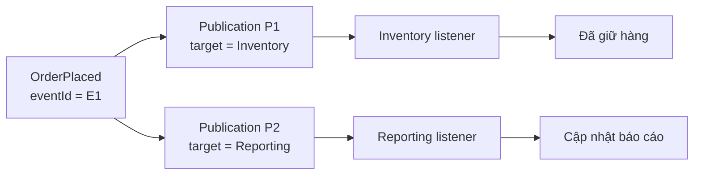
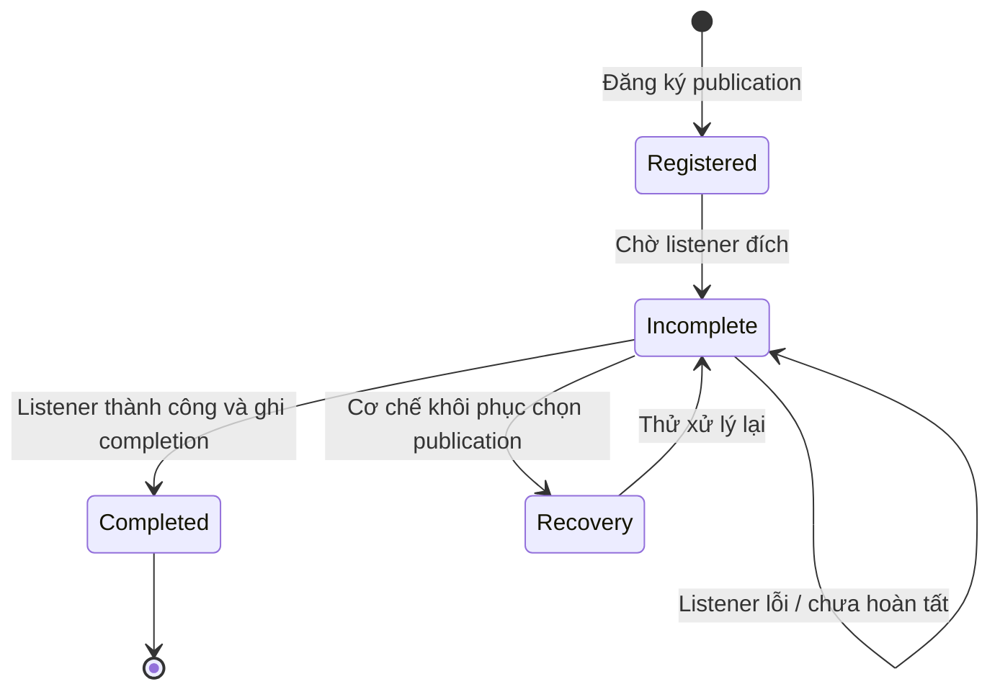
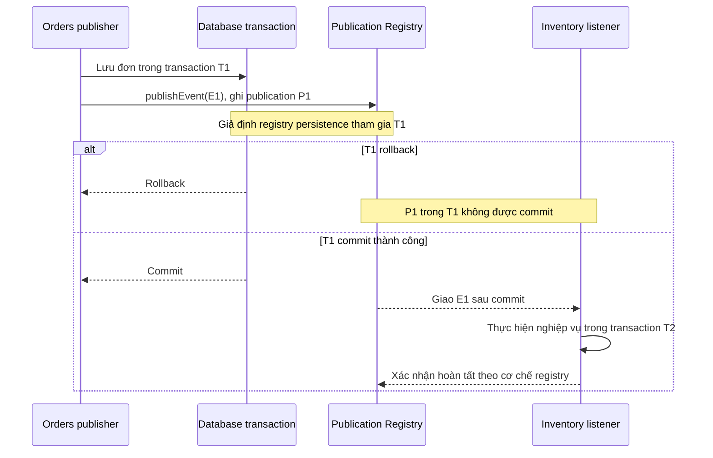
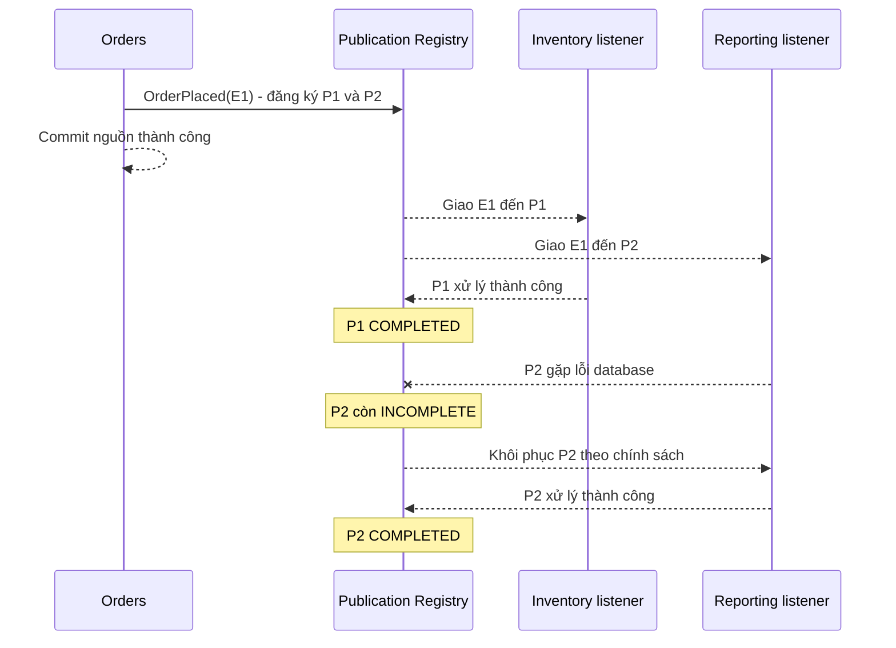

# Trạng thái hoàn tất của Event Publication Registry trong Spring Modulith

## 1. Vì sao cần theo dõi trạng thái hoàn tất?

Trong một ứng dụng Spring Boot tổ chức theo **Spring Modulith**, module `orders` có thể lưu đơn hàng rồi phát `OrderPlaced`. Module `inventory` nhận event để giữ hàng, còn `reporting` nhận cùng event để cập nhật báo cáo. Hai module này có thời gian xử lý, transaction và lỗi riêng.

Giả sử đơn hàng đã được commit. Listener của `inventory` xử lý thành công nhưng listener `reporting` gặp lỗi kết nối database. Câu hỏi vận hành không phải “`OrderPlaced` đã publish chưa?” mà là:

- **Publication nào** đã được xử lý hoàn tất?
- **Listener nào** vẫn còn publication chưa hoàn tất?
- Nếu hệ thống restart, có thể tìm lại công việc dang dở không?
- Khi xử lý lại, làm sao tránh giữ hàng hoặc ghi báo cáo trùng?

**Event Publication Registry** của Spring Modulith hỗ trợ theo dõi những publication được đăng ký cho các transactional event listener phù hợp. Khi sử dụng cơ chế lưu trữ phù hợp, registry có thể ghi nhận publication, theo dõi việc xử lý thành công và giúp ứng dụng xác định những publication chưa hoàn tất để khôi phục theo chính sách.

Trong lộ trình `SPRING_MODULITH_APPLICATION_EVENTS`, chủ đề **trạng thái hoàn tất** kết nối trực tiếp publisher, listener sau commit, transaction riêng, registry, retry, kiểm thử và quan sát độ tin cậy của giao sự kiện.

> **Nguyên tắc trung tâm:** “Publication đã hoàn tất” là kết luận về việc xử lý **một event đối với một listener đích**, theo cơ chế xác nhận của registry. Nó không tự chứng minh toàn bộ quy trình đặt hàng đã hoàn tất, và không đồng nghĩa một dịch vụ bên ngoài đã thực hiện chính xác một lần.

## 2. Phân biệt event, publication, listener và business outcome

Để hiểu đúng trạng thái, cần phân biệt bốn đối tượng:

| Khái niệm | Ý nghĩa | Ví dụ |
| --- | --- | --- |
| **Business event** | Một sự thật nghiệp vụ đã xảy ra | `OrderPlaced(eventId=E1, orderId=O1)` |
| **Listener đích** | Thành phần chịu trách nhiệm phản ứng với event | `InventoryOnOrderPlaced`, `ReportingOnOrderPlaced` |
| **Event publication** | Công việc giao một event cụ thể tới một listener đích được registry theo dõi | Publication của `E1 → Inventory` |
| **Business outcome** | Kết quả nghiệp vụ do listener tạo ra hoặc góp phần tạo ra | Reservation đã được lưu, báo cáo đã cập nhật |

**Một event có thể dẫn đến nhiều publication.** Nếu `OrderPlaced` có hai transactional listener thuộc diện registry quản lý, registry có thể theo dõi hai publication độc lập.



Trong trường hợp minh họa:

| Publication | Event | Listener đích | Trạng thái registry | Kết quả cần theo dõi |
| --- | --- | --- | --- | --- |
| P1 | E1 | Inventory | **Hoàn tất** | Reservation được ghi thành công |
| P2 | E1 | Reporting | **Chưa hoàn tất** | Lỗi cập nhật báo cáo, cần xử lý lại |

Không nên dùng **một boolean `eventProcessed` chung cho mọi module**. Listener kho hoàn thành không có nghĩa listener báo cáo đã hoàn thành. Tương tự, một consumer không nên dùng dấu “event E1 đã xử lý ở kho” để bỏ qua tác vụ báo cáo hợp lệ.

### 2.1. ID của event không nhất thiết là ID của publication

`eventId` thường là giá trị do ứng dụng khai báo trong record sự kiện, giúp liên kết log và chống xử lý trùng. Registry có thể sử dụng ID của bản ghi publication, thông tin listener đích và metadata lưu trữ riêng. **Không mặc định `eventId` trong payload trùng với ID record của registry.**

Vì vậy, các câu hỏi “event nào?” và “publication nào tới consumer nào?” nên được truy vết bằng những trường có ý nghĩa tương ứng, không lấy một ID rồi coi nó bao quát mọi trách nhiệm.

## 3. Vòng đời cơ bản của một publication

Ở mức khái niệm, một publication được theo dõi thường trải qua các bước:

1. **Đăng ký:** Khi ứng dụng phát event trong phạm vi transaction và registry đã được cấu hình, một publication được ghi nhận cho listener đích phù hợp.
2. **Chờ xử lý / chưa hoàn tất:** Publication còn công việc cần được listener thực hiện hoặc cần được xác nhận hoàn tất.
3. **Listener xử lý:** Listener được kích hoạt theo ngữ nghĩa đã chọn, ví dụ `AFTER_COMMIT` và xử lý trong transaction riêng.
4. **Ghi nhận hoàn tất:** Khi cơ chế xử lý coi listener đã thành công, registry ghi nhận publication hoàn tất.
5. **Khôi phục nếu chưa hoàn tất:** Các publication còn dang dở được quan sát hoặc phát lại theo API, phiên bản và cấu hình đã chọn.



**Đây là sơ đồ trạng thái logic để học**, không phải tên enum, cột database hay tập trạng thái công khai cố định của mọi phiên bản Spring Modulith. Triển khai lưu trữ có thể biểu diễn việc hoàn tất bằng thời điểm completion, cờ hoặc các metadata khác, và có thể có chính sách lưu lịch sử hay dọn dữ liệu hoàn tất.

### 3.1. Hoàn tất là trạng thái được ghi nhận, không chỉ là một dòng log

Log “Received OrderPlaced” chỉ chứng minh listener **đã bắt đầu**. Log “Saving reservation” chỉ chứng minh listener **định thực hiện** thao tác. Ngay cả log “Saved successfully” cũng không thay cho một transaction commit được xác nhận và cơ chế ghi nhận completion tương ứng.

Ngược lại, bản ghi publication được đánh dấu hoàn tất theo quy tắc của registry có ý nghĩa vận hành lớn hơn một lời log: nó thể hiện rằng hạ tầng xử lý đã xác nhận **listener đích hoàn thành theo semantics được thiết lập**. Tuy nhiên, nếu code listener trả về trước khi công việc thật sự hoàn thành hoặc nuốt exception, dấu completion vẫn có thể không phản ánh kết quả nghiệp vụ mong muốn.

## 4. Quan hệ giữa transaction publisher và publication registry

Một publisher điển hình:

```java
// orders/events/OrderPlaced.java
package com.example.shop.orders.events;

import java.time.Instant;
import java.util.Objects;
import java.util.UUID;

public record OrderPlaced(
        UUID eventId,
        UUID orderId,
        Instant occurredAt) {

    public OrderPlaced {
        Objects.requireNonNull(eventId, "eventId");
        Objects.requireNonNull(orderId, "orderId");
        Objects.requireNonNull(occurredAt, "occurredAt");
    }
}
```

```java
// orders/internal/OrderService.java (trích đoạn)
@Transactional
public UUID placeOrder(PlaceOrderCommand command) {
    Order order = orderRepository.create(command);

    var event = new OrderPlaced(
        UUID.randomUUID(),
        order.id(),
        clock.instant()
    );

    publisher.publishEvent(event);
    return order.id();
}
```

Trong đoạn này, `publisher` là `ApplicationEventPublisher`; `Order`, repository, command và `clock` là thành phần ứng dụng giả định. `@Transactional` cần được áp dụng thực sự qua hạ tầng Spring và transaction manager phù hợp; đây là ví dụ minh họa, không phải service đầy đủ.

Khi registry được tích hợp với persistence phù hợp, mục tiêu quan trọng là **ghi nhận publication trong transaction nghiệp vụ nguồn** để tránh khoảng hở “đơn đã commit nhưng không còn dấu vết công việc cần giao”.



Nếu transaction publisher rollback thì listener `AFTER_COMMIT` không được thực thi cho transaction đó. Đừng suy ra rằng `ApplicationEventPublisher.publishEvent(...)` đơn lẻ bảo đảm việc lưu publication bền vững; cần **registry, storage và transaction tích hợp đúng**.

### 4.1. Không nhầm publish và commit

| Mốc | Điều chắc chắn trong phạm vi ví dụ | Điều chưa thể kết luận |
| --- | --- | --- |
| Gọi `publishEvent(E1)` | Publisher đã yêu cầu công bố event | Transaction nguồn đã commit; mọi listener đã xong |
| Transaction T1 commit | Thay đổi nghiệp vụ của T1 đã commit | Listener T2 hoàn tất hay chưa |
| Listener bắt đầu | Consumer đã nhận event để xử lý | Business effect đã commit |
| Business effect trong T2 commit | Dữ liệu do T2 quản lý đã được lưu | Completion marker của registry đã được ghi bền vững |
| Publication hoàn tất | Registry đã ghi nhận target được xử lý thành công | Các target khác và hệ thống ngoài cũng đã xong |

Với listener chỉ chạy sau commit, **transaction T1 không thể rollback trở lại** chỉ vì listener T2 gặp lỗi. Hệ thống có thể ở trạng thái tạm thời chưa nhất quán giữa các module, vì vậy cần theo dõi publication đang chờ và quy trình bù trừ nếu nghiệp vụ yêu cầu.

## 5. Khi nào publication được coi là hoàn tất?

Một publication chỉ nên được ghi nhận **hoàn tất** khi listener đích đã xử lý thành công theo hợp đồng xử lý được framework và ứng dụng thiết lập. Với cơ chế publication tracking của Spring Modulith, hạ tầng theo dõi việc gọi listener và đánh dấu completion khi xử lý được coi thành công; trường hợp xử lý lỗi thì publication có thể tiếp tục ở trạng thái chưa hoàn tất.

Đây không phải một lời hứa độc lập với **ranh giới transaction**, **cách listener báo lỗi**, **hành vi async** hoặc **nơi lưu completion**. Cần kiểm tra bằng integration test với đúng phiên bản và cấu hình triển khai.

### 5.1. Listener đồng bộ, listener sau commit và transaction riêng

| Cách listener được khai báo | Ngữ nghĩa xử lý | Liên hệ với publication registry |
| --- | --- | --- |
| `@EventListener` thông thường | Thường chạy đồng bộ khi dispatch, có thể trước commit | Không mặc định có publication bền vững được theo dõi |
| `ApplicationListener<E>` thông thường | Theo multicaster, mặc định thường đồng bộ | Không mặc định nằm trong phạm vi registry cho transactional listener |
| `@TransactionalEventListener(AFTER_COMMIT)` | Chỉ kích hoạt khi transaction nguồn commit, trừ cấu hình fallback | Có thể thuộc phạm vi registry khi cơ chế phù hợp được cấu hình |
| `@ApplicationModuleListener` | Mẫu Spring Modulith cho listener sau commit, bất đồng bộ, transaction riêng | Phù hợp với cơ chế theo dõi publication của Spring Modulith khi được cấu hình |

Ví dụ hai listener khác trách nhiệm, cùng tiêu thụ một hợp đồng `OrderPlaced`:

```java
// inventory/internal/InventoryOnOrderPlaced.java
package com.example.shop.inventory.internal;

import com.example.shop.orders.events.OrderPlaced;
import org.springframework.modulith.events.ApplicationModuleListener;
import org.springframework.stereotype.Component;

@Component
class InventoryOnOrderPlaced {

    private final StockReservationService reservations;

    InventoryOnOrderPlaced(StockReservationService reservations) {
        this.reservations = reservations;
    }

    @ApplicationModuleListener
    void on(OrderPlaced event) {
        reservations.reserveOnce(event.eventId(), event.orderId());
    }
}
```

```java
// reporting/internal/ReportingOnOrderPlaced.java
package com.example.shop.reporting.internal;

import com.example.shop.orders.events.OrderPlaced;
import org.springframework.modulith.events.ApplicationModuleListener;
import org.springframework.stereotype.Component;

@Component
class ReportingOnOrderPlaced {

    private final OrderReportProjection reports;

    ReportingOnOrderPlaced(OrderReportProjection reports) {
        this.reports = reports;
    }

    @ApplicationModuleListener
    void on(OrderPlaced event) {
        reports.upsertForOrder(event.orderId());
    }
}
```

Các `Service`/`Projection` ở ví dụ là thành phần **do ứng dụng xây dựng**, không phải API Spring Modulith. Khi một listener thành công, publication ứng với chính listener đó có thể được đánh dấu hoàn tất, ngay cả khi publication của listener khác vẫn chưa hoàn tất.

### 5.2. Đừng che giấu lỗi rồi vô tình ghi completion

Đây là anti-pattern nguy hiểm:

```java
@ApplicationModuleListener
void on(OrderPlaced event) {
    try {
        reservations.reserveOnce(event.eventId(), event.orderId());
    } catch (Exception ex) {
        logger.error("Reservation failed", ex);
        // Nuốt lỗi và return như xử lý thành công.
    }
}
```

Nếu handler **trả về bình thường**, hạ tầng có thể coi việc xử lý đã thành công và đánh dấu publication hoàn tất, dù reservation chưa có. Sau đó registry không còn publication chưa hoàn tất này để tự động/được cấu hình khôi phục.

Hướng xử lý tùy bản chất lỗi:

- **Lỗi hạ tầng tạm thời** (database timeout, mạng, deadlock): để lỗi được báo theo cơ chế listener/transaction phù hợp để publication vẫn cần được xử lý lại.
- **Lỗi nghiệp vụ kết thúc có chủ đích** (ví dụ hết hàng và quy trình phải chuyển `REJECTED`): lưu **kết quả thất bại nghiệp vụ** hoặc phát event bù trừ đúng hợp đồng, sau đó cho listener hoàn tất nếu công việc nhận event thực sự đã được xử lý.
- **Lỗi không thể tự phục hồi** (payload không tương thích): duy trì dấu vết/cảnh báo và quy trình can thiệp. Không retry vô hạn cùng lỗi mà không có cách giải quyết.

**Phân biệt hoàn tất publication với thành công nghiệp vụ:** Một listener ghi nhận `ReservationRejected` hợp lệ có thể hoàn tất việc **xử lý sự kiện đầu vào**, dù bước giữ hàng của nghiệp vụ không thành công. Completion không phải lúc nào cũng là trạng thái `SUCCESS` của toàn bộ đơn.

### 5.3. Không trả về trước khi công việc cần xác nhận hoàn thành

Một anti-pattern khác là handler bắt đầu việc ngoài luồng rồi trả về:

```java
@ApplicationModuleListener
void on(OrderPlaced event) {
    externalExecutor.submit(() ->
        reservations.reserveOnce(event.eventId(), event.orderId()));
    // Method đã trả về; công việc thực sự còn đang chạy.
}
```

Hạ tầng theo dõi listener có thể đánh dấu hoàn tất khi invocation trên trở về thành công, trong khi tác vụ ngoài luồng vẫn chưa chạy hoặc sẽ thất bại sau đó. **Không tự tách công việc bắt buộc khỏi phạm vi thành công được registry quan sát.**

Nếu cần xử lý dài hoặc gọi hệ thống ngoài, hãy thiết kế một bước **chuyển giao bền vững** (ví dụ ghi job/outbox vào database trong transaction phù hợp), rồi coi việc ghi nhận bền vững đó là công việc hoàn tất của listener. Worker khác xử lý job/outbox cần có trạng thái, retry và idempotency riêng.

## 6. Trạng thái hoàn tất theo từng listener đích

Giả sử một event `E1` được phát và registry tạo hai publication phù hợp. Hai listener có thể kết thúc ở thời điểm khác nhau:



Sơ đồ dùng **P1/P2** như tên minh họa của những publication độc lập; không phải trạng thái hoặc ID framework bắt buộc. Các lệnh giao và khôi phục chỉ có khả năng xảy ra khi registry, hạ tầng listener và cơ chế phục hồi đã được cấu hình.

Đừng viết logic kiểm soát nghiệp vụ kiểu:

```text
if (registry says event E1 is completed) {
    assume inventory, reporting, billing and email all finished;
}
```

Registry quản lý **publication theo target** và trạng thái xử lý tại mỗi target. Còn việc toàn bộ quy trình được xác nhận hay chưa phải dựa vào **trạng thái nghiệp vụ** của module sở hữu quy trình, chẳng hạn `OrderStatus.PENDING` / `CONFIRMED` và các điều kiện thật sự đã được chấp thuận.

### 6.1. Không tự nhân bản listener để replay

Nếu một publication đến `reporting` chưa hoàn tất, phương án khôi phục phải nhắm đúng **công việc còn dang dở**. Phát một `OrderPlaced` mới với `eventId` mới chỉ để “thử lại” có thể tạo thêm publication cho các listener vốn đã hoàn tất, tăng nguy cơ thực thi trùng.

Khi thực hiện replay publication đã lưu, cần bảo toàn nội dung và danh tính event nguồn theo hợp đồng. Đối với application event tự định nghĩa, `eventId` **giữ nguyên khi giao lại chính sự kiện đó**. Một sự kiện nghiệp vụ mới hợp lệ về cùng `orderId` phải có ID mới và được tiêu thụ theo quy tắc khác.

## 7. Những cửa sổ lỗi quanh completion

Với một publication đã tồn tại sau commit, có ít nhất bốn mốc:

1. `T1`: transaction publisher commit thành công.
2. `T2-start`: listener bắt đầu xử lý.
3. `T2-commit`: tác dụng phụ được lưu trong transaction consumer.
4. `completion`: registry ghi nhận publication hoàn tất.

Các mốc này không nhất thiết thuộc **một** transaction. Xét những trường hợp tiêu biểu:

| Thời điểm lỗi | Trạng thái nghiệp vụ | Trạng thái publication có thể thấy | Cách xử lý an toàn |
| --- | --- | --- | --- |
| T1 rollback trước commit | Đơn không được commit | Publication tham gia T1 cũng rollback | Listener `AFTER_COMMIT` không thực hiện nghiệp vụ |
| T1 commit, crash trước khi listener bắt đầu | Đơn tồn tại, consumer chưa làm | Chưa hoàn tất | Khôi phục publication bền vững theo cấu hình |
| Listener lỗi trước khi T2 commit | T2 rollback; chưa có kết quả hợp lệ | Chưa hoàn tất | Retry, phân loại lỗi và giám sát |
| T2 commit, crash trước khi ghi completion | Kết quả nghiệp vụ **đã có** | Có thể vẫn chưa hoàn tất | Replay có thể lặp; consumer phải idempotent |
| Completion đã được ghi nhưng hệ thống ngoài chưa nhận | Registry có thể coi listener hoàn tất | Hoàn tất | Cần outbox/ack/retry riêng cho công việc bên ngoài |
| Completion đã được ghi, listener khác còn lỗi | Một consumer đã xong | Một publication hoàn tất, cái khác chưa | Xử lý đúng publication đích còn dở dang |

Đặc biệt, trường hợp **T2 đã commit nhưng completion chưa được ghi bền vững** là lý do registry không được hiểu là cơ chế exactly-once end-to-end. Khi xử lý lại publication đó, handler phải phát hiện rằng tác dụng phụ nghiệp vụ đã có, rồi trả về thành công mà không lặp thay đổi.

## 8. Idempotency và completion bổ trợ nhau như thế nào?

**Completion tracking** giúp trả lời “publication nào chưa được xử lý đến mức được công nhận hoàn tất?”. **Idempotency** giúp trả lời “nếu listener được gọi lại, tác dụng phụ có bị thực hiện lặp không?”.

Hai lớp phải hoạt động cùng nhau:

| Lớp | Nhiệm vụ | Nếu thiếu |
| --- | --- | --- |
| Registry bền vững | Không mất dấu publication đang chờ và hỗ trợ khôi phục | Có thể mất việc khi tiến trình dừng sau commit |
| Dedup theo event + consumer | Phát hiện xử lý lại cùng một business event ở cùng listener | Retry có thể chạy lại nghiệp vụ |
| Bất biến nghiệp vụ theo business ID | Bảo đảm trạng thái cuối không bị trùng/sai bởi event khác | Event ID mới nhưng cùng hiệu lực có thể gây trùng kết quả |
| Transaction của consumer | Ghi dấu xử lý và cập nhật nghiệp vụ nguyên tử trong phạm vi DB | Crash giữa hai ghi chép làm thiếu hoặc trùng tác dụng phụ |

Ví dụ lược đồ **minh họa của module inventory**, không phải schema Spring Modulith:

```sql
-- PostgreSQL; tên bảng/column do ứng dụng định nghĩa.
CREATE TABLE inventory_processed_event (
    consumer_name VARCHAR(80) NOT NULL,
    event_id UUID NOT NULL,
    order_id UUID NOT NULL,
    processed_at TIMESTAMP WITH TIME ZONE NOT NULL,
    PRIMARY KEY (consumer_name, event_id)
);

CREATE TABLE inventory_reservation (
    order_id UUID PRIMARY KEY,
    status VARCHAR(24) NOT NULL,
    reserved_at TIMESTAMP WITH TIME ZONE NOT NULL
);
```

Handler ghi dedup và reservation trong cùng transaction, với unique constraint ngăn race khi nhiều instance xử lý song song:

```java
// inventory/internal/StockReservationService.java (phác thảo)
@Service
class StockReservationService {

    private final ProcessedEventStore events;
    private final ReservationStore reservations;

    StockReservationService(
            ProcessedEventStore events, ReservationStore reservations) {
        this.events = events;
        this.reservations = reservations;
    }

    @Transactional // REQUIRED: tham gia transaction đã mở bởi module listener.
    public void reserveOnce(UUID eventId, UUID orderId) {
        if (!events.insertIfAbsent("inventory-order-placed", eventId, orderId)) {
            return;
        }

        // Phải có kiểm tra trạng thái và cập nhật nguyên tử phù hợp.
        reservations.reserveForOrderIfAbsent(orderId);
    }
}
```

`ProcessedEventStore`, `ReservationStore` và các phương thức trong ví dụ **không phải API có sẵn của Spring Modulith**; dự án tự hiện thực chúng. `insertIfAbsent` cần được bảo vệ bằng unique key/atomic insert của database. `reserveForOrderIfAbsent` phải tuân thủ quy tắc nghiệp vụ và không được tự trừ hàng hai lần.

Nếu thao tác reservation ném exception khiến transaction rollback, dấu processed-event được ghi trong cùng transaction cũng phải rollback. Nếu lỗi bị bắt và code vẫn commit dấu processed-event, registry có thể được đánh dấu hoàn tất dù tác dụng phụ chưa thành công.

**Lưu ý:** Khi sử dụng `@ApplicationModuleListener`, listener được thiết kế chạy trong transaction riêng; method service bên trong có `@Transactional` với propagation `REQUIRED` sẽ tham gia transaction đó trong cấu hình thông thường. Không tự thêm `REQUIRES_NEW` cho mọi method vì như vậy dễ tách hai thao tác cần nguyên tử ra các transaction khác nhau.

## 9. Quan sát trạng thái hoàn tất từ persistence

Registry có thể sử dụng một kho lưu trữ publication như JDBC, JPA hoặc cơ chế lưu trữ khác được hỗ trợ theo **phiên bản Spring Modulith và dependency cấu hình**. Mục đích là có bằng chứng về công việc đã đăng ký và còn dang dở, không phụ thuộc vào bộ nhớ của một JVM.

Về mặt **mô hình**, một publication thường cần những thông tin tương đương:

| Thông tin khái niệm | Giá trị minh họa | Cần để làm gì? |
| --- | --- | --- |
| Publication identifier | `P1` | Phân biệt publication, hỗ trợ điều tra |
| Event content/type | `OrderPlaced(E1, O1)` | Có dữ liệu để xử lý lại |
| Target identifier | `InventoryOnOrderPlaced` | Biết chính xác listener đích |
| Publication date | `2026-01-01T10:00:00Z` | Đo tuổi publication và độ trễ |
| Completion date / completion state | Chưa có hoặc đã có giá trị | Xác định công việc còn dang dở |

**Bảng trên không phải tên column/schema chính thức của Spring Modulith.** Tên cột, serializer, cách lưu target và quy tắc hoàn tất tùy backend và phiên bản. Khi triển khai thực tế phải dựa vào API public, migration/schema và tài liệu tương ứng; không viết truy vấn production dựa trên tên cột do bài học minh họa.

### 9.1. Completed có thể được lưu hoặc dọn khỏi bảng

Tùy cách cấu hình và chính sách hoàn tất, hệ thống có thể giữ publication với metadata hoàn tất, chuyển sang kho lịch sử hoặc dọn bản ghi hoàn tất. Vì thế:

- **Publication còn trong kho ở trạng thái chưa hoàn tất**: có thể là công việc cần kiểm tra/xử lý lại.
- **Publication có metadata hoàn tất**: registry đã ghi nhận target hoàn tất theo semantics của nó.
- **Không còn thấy record trong bảng đang truy vấn**: **không tự kết luận** event chưa từng được phát, hoặc chắc chắn đã xử lý thành công. Có thể bản ghi đã được dọn, lưu nơi khác hoặc chưa từng được tạo do transaction rollback/cấu hình.

Trong báo cáo vận hành, hãy tách **số publication chưa hoàn tất hiện tại** khỏi **số completion trong một khoảng thời gian**, và xác định chính sách lưu trữ lịch sử. Đây là hai loại chỉ số khác nhau.

### 9.2. Completion timestamp khác thời điểm nghiệp vụ

`OrderPlaced.occurredAt` là thời điểm publisher ghi nhận đơn được đặt; `publishedAt` (nếu có) là mốc công bố. Timestamp hoàn tất publication cho biết **khi nào registry ghi nhận xử lý xong ở listener đích**. Với async/retry, ba mốc có thể cách nhau rất lâu.

Ví dụ:

```text
10:00:00  orders tạo OrderPlaced(E1)
10:00:01  transaction orders commit
10:00:02  inventory xử lý xong, publication P1 hoàn tất
10:00:02  reporting lỗi database, P2 chưa hoàn tất
10:15:00  reporting xử lý lại P2 thành công
10:15:01  publication P2 được ghi nhận hoàn tất
```

Không được thay `occurredAt` của event gốc thành thời điểm retry. Nếu cần đo độ trễ, dùng các mốc đã được định nghĩa và lưu trữ nhất quán, không giả định hai timestamp đến từ các đồng hồ luôn đồng bộ tuyệt đối.

## 10. Khi nào không nên đánh dấu hoàn tất?

Trong một listener được registry theo dõi, cần phân biệt ba kiểu kết quả:

| Tình huống xử lý | Có nên coi xử lý event đã hoàn tất? | Lý do |
| --- | --- | --- |
| Cập nhật dữ liệu thành công, transaction commit | Có, theo cơ chế registry | Trách nhiệm của listener đã đạt |
| Lỗi kết nối tạm thời, cập nhật chưa được commit | Không | Cần giữ khả năng xử lý lại |
| Dữ liệu hợp lệ nhưng nghiệp vụ từ chối, đã lưu `REJECTED` đúng quy tắc | Có thể có | Listener đã xử lý event và lưu **kết quả nghiệp vụ hợp lệ**, dù kết quả không phải thành công |
| Thả exception sau khi side effect bên ngoài đã xảy ra | Chưa thể kết luận end-to-end | Cần idempotency hoặc bù trừ vì lần thử sau có thể lặp side effect |
| Chỉ đưa công việc vào một executor trong bộ nhớ rồi return | Không nên coi công việc thực sự hoàn tất | Tác vụ có thể mất khi JVM dừng |
| Ghi một outbox job **bền vững** trong transaction thành công | Có thể coi listener đã hoàn tất trách nhiệm **chuyển giao** | Việc relay job ra ngoài có trạng thái và retry riêng |

Trường hợp cuối rất quan trọng: “Hoàn tất listener” có thể được định nghĩa là **đã chuyển giao công việc sang một cơ chế bền vững khác**, không phải “toàn bộ email, broker, báo cáo bên ngoài đã xong”. Muốn nói chính xác, cần ghi rõ contract của listener là “persist notification job” hay “send notification to provider”.

### 10.1. Completion không thay thế trạng thái nghiệp vụ

Ví dụ đơn hàng có `OrderStatus.PENDING`, `CONFIRMED`, `REJECTED`. Một publication `OrderPlaced → InventoryListener` được đánh dấu hoàn tất vì listener đã quyết định không đủ hàng và ghi `InventoryReservationRejected`. Điều đó không làm đơn tự chuyển `CONFIRMED`.

Quy trình nghiệp vụ có thể cần fan-in `InventoryReserved` + `PaymentAuthorized` hoặc process manager điều phối trạng thái nhiều bước. Registry không tự hiểu điều kiện này; nó không phải saga orchestration engine.

### 10.2. Completion không tự xác nhận email hoặc HTTP đã được bên ngoài xử lý

Xét listener gọi HTTP rồi nhận timeout:

```text
InventoryListener -> ExternalProvider: request X
ExternalProvider: đã thực hiện X
Network: response bị mất
InventoryListener: exception/timeout
Registry: publication có thể chưa hoàn tất
Retry: X được gọi lần nữa
```

Để tránh trùng kết quả, API bên ngoài nên hỗ trợ `idempotencyKey` ổn định, hoặc hệ thống cần outbox và một quy trình đối chiếu/bù trừ. **Không có transaction database cục bộ nào tự rollback hành động đã được dịch vụ ngoài thực thi.**

Nếu một listener được đánh dấu hoàn tất ngay khi gọi API gửi không đồng bộ mà chưa kiểm tra cơ chế xác nhận của transport, đó chỉ là bằng chứng **đã gọi API**, không chắc là message đã được broker hoặc consumer cuối cùng xử lý.

## 11. Khôi phục publication chưa hoàn tất

Một publication chưa hoàn tất là **ứng viên cần điều tra/khôi phục**, nhưng không có nghĩa phải gọi lại vô hạn ngay lập tức. Cơ chế xử lý lại phụ thuộc vào phiên bản Spring Modulith, backend lưu trữ và chính sách ứng dụng được thiết lập.

Quy trình vận hành nên bao gồm:

1. **Phát hiện** publication chưa hoàn tất qua khả năng của registry và các công cụ quan sát được hỗ trợ.
2. **Phân loại** nguyên nhân: tạm thời (mạng, deadlock), cấu hình (mất bean listener), hợp đồng (không đọc được payload cũ) hoặc nghiệp vụ (dữ kiện không hợp lệ).
3. **Quyết định khôi phục**: retry tự động theo lịch giới hạn, khôi phục sau deploy, hoặc thao tác có kiểm soát khi đã xử lý nguyên nhân.
4. **Giao lại đúng công việc**: dùng thông tin event và target đã lưu, không phát một business event mới giả để replay.
5. **Kiểm chứng hoàn tất**: sau khi retry, publication tương ứng được ghi nhận completion; business state và metric cũng nhất quán.

```mermaid
flowchart TD
    A["Publication chưa hoàn tất"] --> B{"Phân loại nguyên nhân"}
    B -->|"Lỗi tạm thời"| C["Retry theo chính sách"]
    B -->|"Lỗi dữ liệu/schema"| D["Sửa tương thích / can thiệp"]
    B -->|"Lỗi nghiệp vụ"| E["Ghi outcome hoặc bù trừ"]
    C --> F{"Consumer hoàn tất?"}
    D --> F
    E --> F
    F -->|"Có"| G["Registry ghi completion"]
    F -->|"Không"| H["Theo dõi, cảnh báo, giới hạn retry"]
    H --> B
```



Đây là **luồng vận hành khái niệm**, không phải một scheduler mặc định có đầy đủ các nhánh trên trong Spring Modulith.

### 11.1. Không giả định tự động retry đã bật

Registry cung cấp khả năng lưu vết publication; **cách phát lại publication tồn đọng** cần cấu hình theo phiên bản và hạ tầng thực tế. Không được mặc định một ứng dụng có registry sẽ tự có exponential backoff, jitter, dead-letter queue hoặc chế độ retry vô hạn.

Khi cấu hình, cần quy định rõ số lần thử, khoảng cách, giới hạn thời gian, tiêu chí bỏ qua lỗi và cách can thiệp. Nếu retry một poison event có payload không thể deserialize, retry y nguyên sẽ lặp lỗi mà không đem lại tiến bộ.

### 11.2. Chú ý khi triển khai phiên bản mới

Registry có thể giữ **event đã được serialize và thông tin định danh target listener** trong thời gian chưa hoàn tất. Thay đổi class, package, cấu trúc record, serializer hoặc cách định danh listener trong lúc còn publication cũ có thể ảnh hưởng việc khôi phục.

Trước khi triển khai thay đổi phá vỡ hợp đồng, hãy kiểm tra:

- Còn publication nào chưa hoàn tất theo loại event này?
- Bản ghi cũ có được deserialize bởi code mới không?
- Target listener cũ có còn được nhận diện không?
- Có cần hỗ trợ song song, adapter version hoặc migration dữ liệu publication không?
- Kịch bản xử lý lại sau restart có được kiểm thử với dữ liệu cũ không?

Không nên đơn giản xóa sạch publication chưa hoàn tất để “làm sạch trạng thái” khi nâng cấp. Làm vậy có thể xóa dấu vết của công việc nghiệp vụ chưa được xử lý.

## 12. Kiểm thử trạng thái hoàn tất và cửa sổ lỗi

Một bài test chỉ gọi trực tiếp `listener.on(event)` rồi assert dữ liệu đã lưu **không kiểm chứng** cơ chế registration/completion của Event Publication Registry. Cần đặt các kiểm thử ở ranh giới tương ứng:

| Cấp kiểm thử | Điều cần chứng minh |
| --- | --- |
| Unit test handler | Consumer dùng đúng `eventId`/`orderId`, không nuốt lỗi tạm thời, không gây tác dụng phụ trùng |
| Transaction test | Publisher rollback thì listener `AFTER_COMMIT` không chạy; transaction consumer lỗi phải rollback |
| Registry integration test | Publication cho từng listener được đăng ký, hoàn tất riêng hoặc còn dang dở theo outcome |
| Recovery test | Publication dang dở còn sau restart và được xử lý lại theo cơ chế đã cấu hình |
| Concurrency test | Hai lần xử lý cùng event không tạo hai reservation hoặc hai dấu processed-event |
| Migration test | Publication cũ vẫn được đọc/khôi phục sau đổi phiên bản, hoặc có migration tương ứng |
| Failure-injection test | Crash ở các mốc commit/completion không gây mất nghiệp vụ hoặc tác dụng phụ không hợp lệ |

### 12.1. Tình huống bắt buộc: hai listener, một listener lỗi

Với `OrderPlaced(E1, O1)`, đăng ký hai listener có thể kiểm soát kết quả trong test:

```text
Tiền điều kiện:
  - Spring Modulith event publication persistence đã được cấu hình.
  - Inventory listener xử lý thành công.
  - Reporting listener được cấu hình giả lập lỗi.
  - Publisher phát OrderPlaced(E1, O1) trong transaction và commit thật.

Kiểm chứng:
  - Publication hướng đến Inventory đạt trạng thái hoàn tất
    hoặc không còn nằm trong tập publication chưa hoàn tất.
  - Publication hướng đến Reporting vẫn chưa hoàn tất.
  - Inventory đã có đúng một reservation cho O1.

Khôi phục:
  - Bỏ lỗi giả lập ở Reporting.
  - Kích hoạt phục hồi publication còn dang dở theo API/cấu hình phiên bản.
  - Kiểm chứng Reporting xử lý thành công và publication được hoàn tất.
  - Inventory không tạo reservation thứ hai.
```

Không nên assert bắt buộc có “một hàng `COMPLETED`” vì backend hoặc chính sách completion có thể xóa/chuyển hàng đã hoàn tất. **Định nghĩa assertion theo contract của storage đang chạy**, đặc biệt là việc publication có còn nằm trong tập **chưa hoàn tất** hay không.

### 12.2. Cần commit thật ở publisher

Một listener gắn `@TransactionalEventListener(AFTER_COMMIT)` thường không được kích hoạt nếu test tự rollback transaction khi kết thúc. Có thể kiểm soát commit bằng `TransactionTemplate`:

```java
// Trích đoạn integration test, giả định đã có transactionManager và publisher.
var transaction = new TransactionTemplate(transactionManager);

UUID eventId = UUID.randomUUID();
UUID orderId = UUID.randomUUID();

transaction.executeWithoutResult(status ->
    publisher.publishEvent(new OrderPlaced(
        eventId, orderId,
        Instant.parse("2026-01-01T10:00:00Z")
    ))
);

// Với listener async, chờ theo điều kiện cho đến khi thấy
// trạng thái publication/kết quả consumer mong đợi.
// Không dùng Thread.sleep cố định thay cho kiểm chứng.
```

Đây là **trích đoạn kiểm thử**, không phải class test độc lập: test thực tế cần Spring context, import tương ứng và cơ chế truy vấn/quan sát registry của phiên bản được dùng. Phát một event trong transaction rồi **commit thật** là điều kiện cần để kiểm tra listener sau commit theo đúng semantics.

### 12.3. Mô phỏng crash sau commit consumer, trước completion

Đây là trường hợp quan trọng nhất đối với tính đáng tin cậy:

```text
1. Publisher T1 commit OrderPlaced(E1).
2. Inventory T2 lưu reservation cho O1 và COMMIT.
3. Giả lập ứng dụng dừng trước khi registry ghi completion cho P1.
4. Khởi động lại, tìm publication P1 chưa hoàn tất.
5. Phát lại theo cơ chế phục hồi đã cấu hình.
6. Consumer thấy E1/O1 đã có kết quả và không giữ hàng lần nữa.
7. Publication P1 cuối cùng được ghi nhận hoàn tất.
```

Trong môi trường test, nếu không thể cưỡng bức crash chính xác ở bước 3, có thể mô phỏng **cùng một event được giao lại** sau khi đã commit nghiệp vụ, rồi kiểm tra bất biến. Đây là phép kiểm tra idempotency cần thiết, nhưng **không thay thế** kiểm thử khôi phục registry có persistence qua restart.

### 12.4. Không tự suy trạng thái registry từ số lần callback

Một listener có thể được gọi hai lần: lần đầu lỗi, lần sau thành công. Cũng có thể chỉ một lần gọi nhưng completion không được lưu bền vững. Vì vậy:

- Số lần handler được gọi **không phải** số publication hoàn tất.
- Business effect đã commit **không chắc** đồng nghĩa publication đã hoàn tất.
- Một publication hoàn tất **không chứng minh** những consumer khác cũng xong.
- Thiếu hàng trong bảng publication đang truy vấn **không đủ** kết luận, vì retention/cleanup có thể khác nhau.

## 13. Quan sát và cảnh báo trạng thái hoàn tất

Registry hữu ích khi trạng thái của nó được theo dõi. Các chỉ số nên tập trung vào **backlog chưa hoàn tất**, **tuổi publication**, **thời gian xử lý** và **những listener đích thường xuyên lỗi**.

| Chỉ số hoặc log | Ý nghĩa vận hành |
| --- | --- |
| Số publication chưa hoàn tất theo listener/target | Consumer nào đang có backlog? |
| Tuổi publication chưa hoàn tất lâu nhất | Có công việc bị kẹt quá lâu không? |
| Độ trễ từ publish/commit đến completion | Sự kiện mất bao lâu để được xử lý xong? |
| Số publication hoàn tất trong khoảng thời gian | Tốc độ giải quyết công việc |
| Số lần thử lại và nguyên nhân lỗi | Lỗi tạm thời hay poison event liên tục? |
| Số event trùng được consumer bỏ qua | Replay có xảy ra và idempotency hoạt động không? |
| `eventId`, `orderId`, target listener | Đối chiếu từng publication với tình trạng nghiệp vụ |
| Trạng thái đơn `PENDING` quá hạn | Quy trình nghiệp vụ có bị kẹt dù publication đã hoàn tất? |

Ví dụ, tồn đọng của `ReportingOnOrderPlaced` có thể chấp nhận trễ vài phút, trong khi `InventoryOnOrderPlaced` vượt hạn lại khiến đơn không thể đi tiếp. Ngưỡng cảnh báo phải do SLA và bất biến nghiệp vụ quyết định; không nên áp một thời gian cố định cho mọi listener.

Một hướng xây dashboard:

```text
Event delivery / Publication Registry

inventory:
    incomplete publications: 3
    oldest incomplete: 2m 15s
    recent completion rate: 99.9%

reporting:
    incomplete publications: 84
    oldest incomplete: 28m
    last error: database unavailable
```

**Tất cả số trên chỉ là dữ liệu giả định để minh họa**, không phải metric mặc định có sẵn với tên cố định. Tùy triển khai, phải xây truy vấn/metric hoặc sử dụng công cụ quan sát được hỗ trợ của phiên bản Spring Modulith.

Khi log, chỉ ghi những dữ kiện cần thiết như event ID, business ID, target, thời gian và lỗi đã được làm sạch. Đừng đưa entity JPA, token, mật khẩu hoặc payload chứa thông tin cá nhân không cần thiết vào log hay metric.

## 14. Các nhầm lẫn phổ biến về trạng thái hoàn tất

| Nhầm lẫn | Cách hiểu đúng |
| --- | --- |
| “`publishEvent` thành công nghĩa là publication đã hoàn tất.” | Publish mới đăng ký/phân phối event; listener có thể chưa xử lý |
| “Một event có một cờ completion chung.” | Registry theo dõi publication hướng đến từng listener đích phù hợp |
| “Inventory hoàn tất thì reporting cũng hoàn tất.” | Mỗi target có kết quả và lỗi riêng |
| “Method listener return là chắc chắn gửi được email.” | Method có thể nuốt lỗi, fire-and-forget hoặc chưa nhận xác nhận từ bên ngoài |
| “Completion đảm bảo exactly-once.” | Crash giữa business commit và completion có thể dẫn tới retry; cần idempotency |
| “Không thấy record trong bảng là chưa từng có event.” | Retention/completion policy, rollback hoặc cleanup có thể ảnh hưởng |
| “Registry tự quản lý trạng thái đơn.” | Registry theo dõi publication, không thay thế business state machine |
| “Có registry là tự bật retry và DLQ.” | Phụ thuộc persistence, phiên bản, cấu hình khôi phục và chính sách ứng dụng |
| “Nuốt lỗi để tránh backlog là ổn.” | Có thể làm mất dấu công việc nghiệp vụ thất bại |
| “Replay nên tạo eventId mới.” | Replay **cùng event** phải giữ ID và dữ liệu gốc theo hợp đồng |
| “Di chuyển listener sang package mới không ảnh hưởng publication cũ.” | Thông tin target được lưu có thể cần tương thích/migration |

## 15. Checklist và bài tập vận dụng

Trước khi đưa một listener được registry theo dõi vào production:

1. **Xác định rõ công việc của listener:** Cần commit business effect, ghi outbox hay chỉ tạo trạng thái từ chối hợp lệ?
2. **Công bố event trong transaction nguồn thích hợp:** Bảo đảm transaction thật sự được mở và commit; không phát tín hiệu thành công của nghiệp vụ chưa commit.
3. **Bật persistence registry phù hợp:** Xác minh publication cần theo dõi được lưu bền vững và tham gia transaction theo thiết kế.
4. **Xác định target:** Có thể phân biệt publication theo từng listener và tránh phụ thuộc vào implementation nội bộ giữa module.
5. **Định nghĩa thành công/lỗi:** Không nuốt lỗi tạm thời hoặc return sớm khi công việc bắt buộc vẫn đang chạy.
6. **Giữ transaction consumer nguyên tử:** Dấu dedup và thay đổi nghiệp vụ cần commit/rollback cùng nhau trong phạm vi DB có thể kiểm soát.
7. **Thiết kế phục hồi:** Cấu hình phát hiện publication chưa hoàn tất, retry, backoff và cách xử lý poison event.
8. **Cẩn thận với hệ thống ngoài:** Nếu listener gửi broker/email/HTTP, cần outbox/idempotency key hoặc chính sách bù trừ phù hợp.
9. **Kiểm thử thực tế:** Commit, rollback, một listener lỗi, crash trước completion, replay, concurrency và triển khai code/schema mới.
10. **Có thể quan sát:** Đo backlog, tuổi publication, lỗi theo target và so sánh với trạng thái nghiệp vụ.

### Bài tập

Một đơn hàng `O42` phát `OrderPlaced(E42)`. `InventoryListener` commit reservation thành công; `ReportingListener` lỗi database. Sau đó ứng dụng bị dừng trước khi registry đánh dấu publication của `InventoryListener` hoàn tất.

Hãy trả lời:

1. Có bao nhiêu publication logic cần được theo dõi nếu hai listener đều thuộc phạm vi registry? Mỗi publication đang ở trạng thái nào **có thể** xảy ra sau crash?
2. Sau restart, tại sao `InventoryListener` có thể nhận lại `E42` dù reservation đã tồn tại?
3. Khóa nào giúp `InventoryListener` tránh tạo reservation trùng, và vì sao phải ghi dedup cùng transaction nghiệp vụ?
4. Nếu `ReportingListener` bắt exception rồi return bình thường, registry có thể hiểu trạng thái như thế nào? Thiết kế đó có đúng không?
5. Nếu listener chuyển sang ghi một notification outbox rồi hoàn tất, điều kiện nào giúp coi publication đã hoàn tất mà vẫn duy trì khả năng gửi message bên ngoài về sau?
6. Nếu một phiên bản mới đổi tên record event và package của listener, cần kiểm tra những gì trước khi replay publication cũ?

**Ghi nhớ:** **Trạng thái hoàn tất của Event Publication Registry là trạng thái xử lý publication cho một listener đích**, không phải trạng thái thành công của toàn bộ hệ thống. Một publication có thể chưa hoàn tất dù consumer đã commit dữ liệu, hoặc đã được ghi nhận hoàn tất trong khi một quy trình nghiệp vụ khác vẫn đang chờ. Kết hợp registry bền vững, xử lý sau commit, transaction riêng, event ID ổn định, idempotency, chiến lược retry, kiểm thử cửa sổ lỗi và quan sát backlog để giao sự kiện giữa các module Spring Modulith một cách đáng tin cậy.
