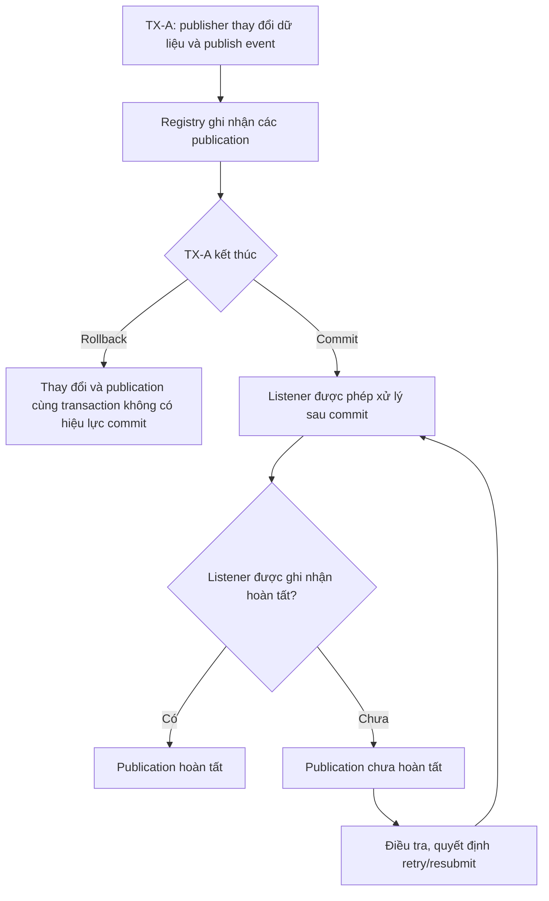
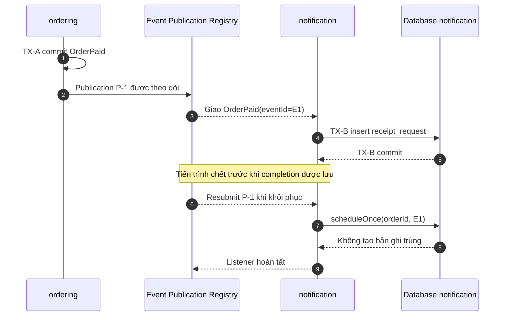
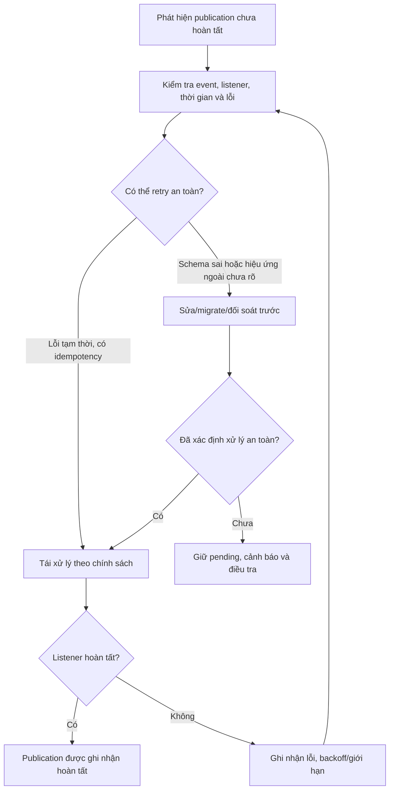
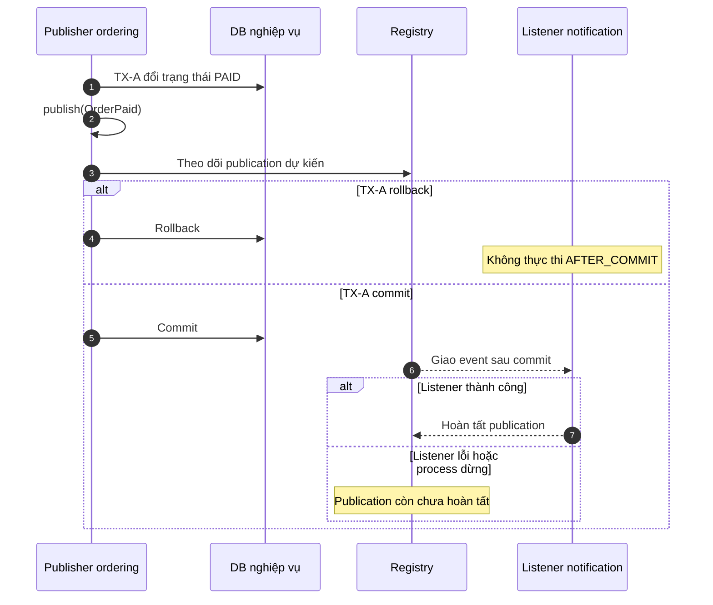

# Publication thất bại trong Spring Modulith Event Publication Registry

## 1. Bài toán: publisher đã commit nhưng listener chưa hoàn tất

Trong ứng dụng **Spring Modulith**, các application module phối hợp qua application events để giảm phụ thuộc trực tiếp và bảo vệ ranh giới nghiệp vụ. Ví dụ, module `ordering` ghi nhận đơn hàng đã thanh toán, phát `OrderPaid`; module `notification` nhận sự kiện để tạo yêu cầu gửi biên nhận; module `loyalty` cộng điểm thành viên. Những hoạt động sau thanh toán có thể chạy bất đồng bộ và độc lập với transaction chính.

Điều gì xảy ra nếu `ordering` đã commit thành công, nhưng `notification` ném exception, executor bị quá tải hoặc tiến trình ứng dụng dừng trước khi công việc hoàn tất? Nếu chỉ tin rằng việc gọi `publishEvent(...)` đồng nghĩa tất cả listener đã xử lý, hệ thống có thể mất tác vụ nghiệp vụ mà không ai biết.

**Event Publication Registry** của Spring Modulith giúp theo dõi **việc công bố sự kiện tới transactional event listeners**. Trong cấu hình có lưu trữ bền vững phù hợp, registry có thể ghi nhận publication được dự kiến giao, đánh dấu những publication xử lý hoàn tất và cho phép phát hiện những publication **chưa hoàn tất** để vận hành hoặc tái xử lý.

Ở chương **Publication Registry**, “publication thất bại” là tình huống một publication không hoàn thành đúng như kỳ vọng. Cần phân biệt **thất bại của listener**, **publication chưa hoàn tất**, **thất bại khi ghi publication** và **thất bại nghiệp vụ**: đó không luôn là một trạng thái giống nhau hay một loại lỗi có thể retry vô điều kiện.

Trong phạm vi học **SPRING_MODULITH_APPLICATION_EVENTS**, chủ đề này kết nối publisher, listener sau commit, Event Publication Registry, retry, kiểm thử và quan sát giao sự kiện đáng tin cậy. Đích đến không phải “không bao giờ có lỗi”, mà là **biết điều gì đã commit, publication nào còn việc, và xử lý lại mà không làm sai dữ liệu nghiệp vụ**.

## 2. Event khác publication như thế nào?

Giả sử `ordering` công bố **một** sự kiện `OrderPaid`, được **hai** listener ở hai module khác nhau quan tâm:

```text
OrderPaid(eventId=E-100, orderId=O-99)
    |
    +-- notification.on(OrderPaid) --> publication P-1
    |
    +-- loyalty.on(OrderPaid)      --> publication P-2
```

- **Event**: một sự thật nghiệp vụ, ví dụ “đơn O-99 đã thanh toán”. `eventId` được ứng dụng gán để nhận diện lần xảy ra đó.
- **Publication**: một đơn vị theo dõi việc giao/xử lý sự kiện đối với **một listener đích**. Cùng event có thể tạo nhiều publication.
- **Listener completion**: hạ tầng nhận biết listener đã xử lý thành công và ghi nhận publication tương ứng hoàn tất.
- **Publication chưa hoàn tất**: hạ tầng chưa có bằng chứng completion cho publication, nhưng **không nhất thiết** đã chứng minh rằng tác vụ nghiệp vụ chưa từng được thực hiện.

| Thuộc tính | Event nghiệp vụ | Publication trong registry |
| --- | --- | --- |
| Nhận diện | `eventId` do hợp đồng ứng dụng quy định | Định danh bản ghi publication do hạ tầng quản lý |
| Phạm vi | Một sự thật đã xảy ra | Sự kiện đó đối với một listener cụ thể |
| Số lượng | Một `OrderPaid` | Có thể nhiều publication cho nhiều listener |
| Thời điểm tạo | Publisher xác lập event | Registry ghi nhận việc giao event theo transaction phù hợp |
| Tiêu chí hoàn tất | Sự thật nghiệp vụ đã được xác lập/commit | Listener được ghi nhận đã xử lý thành công |
| Khi retry | Cùng event giữ **cùng `eventId`** | Publication còn dang dở được xử lý theo chính sách |

**Không dùng ID publication để thay thế `eventId` trong hợp đồng nghiệp vụ**. Schema, trạng thái và định danh nội bộ registry phụ thuộc cách lưu trữ và phiên bản Spring Modulith. Nếu consumer cần idempotency theo event, hãy thiết kế khóa từ payload nghiệp vụ, không dựa vào một cột nội bộ chưa được công bố làm API.

## 3. Vòng đời khái niệm của một publication

Khi được cấu hình đúng với transactional event listeners và adapter lưu trữ thích hợp, vòng đời khái quát:



Đây là **mô hình kiến trúc**, không khẳng định tên bảng, enum trạng thái hoặc API resubmission cố định của mọi bản Spring Modulith. Một số triển khai có thể phân biệt thêm trạng thái “failed”, “in progress”, số lần thử hoặc thời gian hoàn tất. **Chưa hoàn tất** là cách diễn đạt an toàn cho publication không có dấu completion, không phải kết luận chính xác về mức độ đã thực hiện của tác động nghiệp vụ.

### 3.1. Đâu là ranh giới transaction quan trọng?

Nếu publisher ghi trạng thái `PAID` và công bố `OrderPaid` trong **TX-A**, hệ thống cần bảo đảm rằng publication được theo dõi gắn đúng với việc transaction nguồn commit. Với adapter bền vững được hỗ trợ và cấu hình transaction phù hợp, registry được thiết kế để hỗ trợ ranh giới này.

Nếu TX-A **rollback**, listener `AFTER_COMMIT` không được chạy. Trường hợp đó khác với việc TX-A commit nhưng listener nhận event rồi thất bại. Không được gọi cả hai là “publication thất bại, cứ retry” mà không xem xét dữ liệu thực tế đã commit hay chưa.

## 4. Phân loại những thất bại cần xử lý khác nhau

| Tình huống | Dữ liệu publisher | Tình trạng listener | Hướng xử lý chính |
| --- | --- | --- | --- |
| **A. TX publisher rollback** | Không commit | Listener sau commit không được xử lý | Sửa command/transaction nguồn; **không** resubmit một event chưa thực sự xảy ra |
| **B. Listener ném exception** | Đã commit | Không được ghi nhận hoàn tất | Phân loại lỗi, retry an toàn và quan sát publication |
| **C. Process dừng trước khi listener chạy** | Có thể đã commit | Chưa chạy | Kiểm tra publication tồn tại bền vững, khôi phục theo cơ chế hỗ trợ |
| **D. Process dừng sau khi listener làm xong, trước khi completion được lưu** | Đã commit | **Có thể đã làm xong** nhưng registry còn pending | Idempotency/đối soát, rồi resubmit an toàn |
| **E. Hệ thống ngoài đã nhận yêu cầu nhưng response bị mất** | Đã commit | Chưa biết hiệu ứng ngoài thành công hay chưa | Tra cứu bằng idempotency key, không gọi lại mù quáng |
| **F. Payload không deserialize được sau nâng cấp** | Đã commit | Không khôi phục được event để xử lý | Xử lý tương thích schema/migration, không retry nóng liên tục |
| **G. Thiếu/misconfigure adapter registry** | Tùy hệ thống | Không có dữ liệu pending bền vững như kỳ vọng | Sửa cấu hình và đánh giá thiếu sót dữ liệu; không hứa khôi phục tự động |

**Các nhóm B–F không tương đương nhau.** Nếu lỗi là thiếu kết nối database tạm thời, retry có thể có ích. Nếu payload chứa loại event mà phiên bản ứng dụng mới không đọc được, retry mãi trên payload cũ không thay đổi kết quả. Nếu bên ngoài đã gửi email, retry không có khóa chống trùng còn làm tình hình xấu hơn.

## 5. Ví dụ xuyên suốt: OrderPaid và hai listener độc lập

Ứng dụng có ba application module:

- `ordering` sở hữu trạng thái thanh toán đơn hàng, phát `OrderPaid`.
- `notification` ghi yêu cầu gửi biên nhận và quản lý lần gửi thật.
- `loyalty` ghi ledger điểm thưởng cho đơn đã thanh toán.

```text
com.example.shop
├── ShopApplication.java
├── ordering
│   ├── OrderPaid.java                    # API public của ordering
│   └── internal
│       ├── PaymentService.java
│       └── OrderRepository.java
├── notification
│   └── internal
│       ├── PaidReceiptListener.java
│       └── ReceiptRequests.java
└── loyalty
    └── internal
        ├── PaidOrderPointsListener.java
        └── RewardLedger.java
```

### 5.1. Event contract có ID ổn định

```java
// com/example/shop/ordering/OrderPaid.java
package com.example.shop.ordering;

import java.time.Instant;
import java.util.Objects;
import java.util.UUID;

public record OrderPaid(
        UUID eventId,
        UUID orderId,
        UUID customerId,
        UUID correlationId,
        Instant occurredAt) {

    public OrderPaid {
        Objects.requireNonNull(eventId, "eventId");
        Objects.requireNonNull(orderId, "orderId");
        Objects.requireNonNull(customerId, "customerId");
        Objects.requireNonNull(correlationId, "correlationId");
        Objects.requireNonNull(occurredAt, "occurredAt");
    }
}
```

Record bất biến giảm phụ thuộc vào JPA entity và persistence context của publisher. `eventId` cần được **giữ nguyên khi cùng event được xử lý lại**; `orderId` nhận diện đơn, còn `correlationId` giúp nối nhiều bước của workflow. Không tự sinh một `eventId` mới ở listener mỗi khi nhận lại event cũ.

### 5.2. Publisher ghi thay đổi và phát event trong transaction

```java
// com/example/shop/ordering/internal/PaymentService.java
package com.example.shop.ordering.internal;

import com.example.shop.ordering.OrderPaid;
import java.time.Instant;
import java.util.UUID;
import org.springframework.context.ApplicationEventPublisher;
import org.springframework.stereotype.Service;
import org.springframework.transaction.annotation.Transactional;

@Service
class PaymentService {

    private final OrderRepository orders;
    private final ApplicationEventPublisher events;

    PaymentService(OrderRepository orders, ApplicationEventPublisher events) {
        this.orders = orders;
        this.events = events;
    }

    @Transactional
    public void recordPaid(UUID orderId, UUID correlationId) {
        PaymentResult result = orders.markPaidIfEligible(orderId);

        if (result == PaymentResult.ALREADY_PAID) {
            return; // Cùng nghiệp vụ đã hoàn tất, không phát event mới.
        }
        if (result != PaymentResult.CHANGED_TO_PAID) {
            throw new IllegalStateException("Cannot record paid order");
        }

        events.publishEvent(new OrderPaid(
                UUID.randomUUID(),
                orderId,
                orders.customerIdOf(orderId),
                correlationId,
                Instant.now()));
    }
}
```

`OrderRepository` và `PaymentResult` là các kiểu **nội bộ minh họa cần triển khai**. Phương thức cập nhật phải có điều kiện và bảo vệ race bằng transaction/ràng buộc dữ liệu. Việc xác nhận thanh toán thật phải dựa trên bằng chứng hợp lệ từ cổng thanh toán, không chỉ từ HTTP request. Ví dụ tập trung vào quan hệ giữa transaction, sự kiện và publication.

### 5.3. Hai listener có kết quả hoàn tất độc lập

```java
// com/example/shop/notification/internal/PaidReceiptListener.java
package com.example.shop.notification.internal;

import com.example.shop.ordering.OrderPaid;
import org.springframework.modulith.events.ApplicationModuleListener;
import org.springframework.stereotype.Component;

@Component
class PaidReceiptListener {

    private final ReceiptRequests requests;

    PaidReceiptListener(ReceiptRequests requests) {
        this.requests = requests;
    }

    @ApplicationModuleListener
    public void on(OrderPaid event) {
        requests.scheduleOnce(event.orderId(), event.eventId());
    }
}
```

```java
// com/example/shop/loyalty/internal/PaidOrderPointsListener.java
package com.example.shop.loyalty.internal;

import com.example.shop.ordering.OrderPaid;
import org.springframework.modulith.events.ApplicationModuleListener;
import org.springframework.stereotype.Component;

@Component
class PaidOrderPointsListener {

    private final RewardLedger ledger;

    PaidOrderPointsListener(RewardLedger ledger) {
        this.ledger = ledger;
    }

    @ApplicationModuleListener
    public void on(OrderPaid event) {
        ledger.awardForOrderOnce(
                event.orderId(), event.customerId(), event.eventId());
    }
}
```

`ReceiptRequests` và `RewardLedger` là các thành phần nội bộ **cần cài đặt** với quy tắc chống lặp và database phù hợp. `@ApplicationModuleListener` là shortcut cho listener transactional sau commit, bất đồng bộ, thực hiện trong transaction riêng theo thiết kế Spring Modulith. Không tự suy ra rằng dữ liệu sẽ được gửi qua broker hoặc registry đã có adapter bền vững chỉ vì có annotation này.

**Kịch bản:** `loyalty` cộng điểm thành công nhưng `notification` ném exception. Kết quả đúng:

1. Đơn ở `ordering` vẫn `PAID` vì transaction gốc đã commit.
2. Publication dành cho `loyalty` có thể được ghi nhận hoàn tất.
3. Publication dành cho `notification` chưa hoàn tất và cần kiểm tra/khôi phục.
4. Không phát lại command thanh toán hay ép cộng điểm lần nữa để “retry cả quy trình”.

## 6. Listener ném exception: đừng biến thất bại thành thành công giả

Một listener có thể gặp lỗi tại repository, tích hợp HTTP hoặc validation. Khi lỗi chưa được giải quyết, việc **trả về bình thường** khiến hạ tầng có thể coi listener đã xử lý thành công:

```java
// Phản ví dụ: nuốt lỗi rồi kết thúc method.
@ApplicationModuleListener
public void on(OrderPaid event) {
    try {
        receiptRequests.scheduleOnce(event.orderId(), event.eventId());
    } catch (Exception ex) {
        log.warn("Cannot schedule receipt", ex);
        // Không ném ra: hạ tầng có thể đánh dấu publication completed!
    }
}
```

Nếu tác vụ “lên lịch biên nhận” là trách nhiệm chính của listener và chưa có giải pháp lưu lỗi bền vững khác, cần **để exception kỹ thuật chưa xử lý đi lên** để transaction consumer rollback và publication không được xem là hoàn tất.

```java
// Hướng triển khai: để lỗi chưa được xử lý nổi lên.
@ApplicationModuleListener
public void on(OrderPaid event) {
    receiptRequests.scheduleOnce(event.orderId(), event.eventId());
}
```

Tuy nhiên, không phải mọi trường hợp “không tạo dữ liệu” là lỗi cần retry. Nếu biên nhận đã được tạo ở lần trước, thao tác idempotent trả về bình thường là **xử lý thành công của lần nhận trùng**. Nếu nghiệp vụ không cho phép gửi biên nhận đối với một loại đơn, cần xác định rõ kết quả miền hoặc chính sách từ chối, không biến nó thành exception tạm thời để retry vô hạn.

## 7. Crash window: hiệu ứng thành công nhưng completion thất bại

Đây là tình huống quan trọng nhất để hiểu vì sao registry **không đủ cho exactly once**.



Điểm mấu chốt: **publication “chưa hoàn tất” không chứng minh side effect chưa xảy ra**. Khi process chết sau commit TX-B nhưng trước bước đánh dấu hoàn tất, lần retry có thể lặp lại tác động. Vì thế:

- Listener phải biết cách nhận lại **cùng event ID**.
- Database nghiệp vụ phải có **unique constraint hoặc cập nhật có điều kiện** cho tác động không được nhân đôi.
- Nếu gọi hệ thống ngoài, phải có **idempotency key phía provider** hoặc quy trình đối soát.
- Hoàn tất registry chỉ là dấu đã xử lý của hạ tầng, không thay thế bất biến nghiệp vụ.

### 7.1. Hai lớp idempotency bổ sung cho nhau

| Khóa | Nhận diện | Lỗi được ngăn |
| --- | --- | --- |
| `(consumerName, eventId)` | Một consumer đã xử lý một lần xảy ra event | Cùng event được giao lại |
| `(orderId, receiptType)` | Cùng hiệu ứng nghiệp vụ | Hai event **khác ID** cùng yêu cầu gửi một biên nhận |
| `(orderId, rewardType)` | Một lần cộng điểm theo chính sách | Hai event hoặc hai thread gây cộng điểm trùng |

Việc dùng chỉ `eventId` không ngăn hai event khác nhau với cùng `orderId` gây cùng một hiệu ứng. Ngược lại, chỉ khóa nghiệp vụ có thể không đủ để điều tra một event cụ thể đã được consumer nào xử lý. Hai lớp đáp ứng hai câu hỏi khác nhau.

## 8. Cài đặt idempotency local bằng unique constraint

Ví dụ PostgreSQL cho module `notification`:

```sql
CREATE TABLE receipt_request (
    request_id UUID PRIMARY KEY,
    order_id UUID NOT NULL,
    receipt_type VARCHAR(40) NOT NULL,
    source_event_id UUID NOT NULL,
    status VARCHAR(24) NOT NULL,
    UNIQUE (order_id, receipt_type)
);
```

Repository có thể dùng JDBC với thao tác chèn nguyên tử:

```java
// com/example/shop/notification/internal/ReceiptRequests.java
package com.example.shop.notification.internal;

import java.util.UUID;
import org.springframework.jdbc.core.JdbcTemplate;
import org.springframework.stereotype.Repository;

@Repository
class ReceiptRequests {

    private final JdbcTemplate jdbc;

    ReceiptRequests(JdbcTemplate jdbc) {
        this.jdbc = jdbc;
    }

    public void scheduleOnce(UUID orderId, UUID eventId) {
        jdbc.update("""
            INSERT INTO receipt_request (
                request_id, order_id, receipt_type, source_event_id, status
            )
            VALUES (?, ?, 'PAID_RECEIPT', ?, 'PENDING')
            ON CONFLICT (order_id, receipt_type) DO NOTHING
            """, UUID.randomUUID(), orderId, eventId);
    }
}
```

`ON CONFLICT ... DO NOTHING` là cú pháp PostgreSQL; hệ cơ sở dữ liệu khác cần phương thức tương đương. `UNIQUE (order_id, receipt_type)` ngăn việc tạo thêm biên nhận cho cùng nghiệp vụ, kể cả khi hai listener chạy cạnh tranh. Đây là ví dụ chính sách **mỗi đơn một biên nhận thanh toán**; nếu nghiệp vụ cho phép nhiều lần phát hành hoặc loại biên nhận, cần điều chỉnh khóa.

Trong `@ApplicationModuleListener`, listener có transaction riêng để ghi dữ liệu local; nếu ghi thành công và transaction commit, xử lý lại có thể bỏ qua thao tác nhờ unique constraint. **Chưa gửi email thật** ở bước này: một worker khác có thể đọc `receipt_request` để xử lý I/O ngoài, vì email không thể rollback cùng SQL.

### 8.1. Inbox theo event ID

Nếu cần biết một consumer đã xử lý event cụ thể nào, có thể thêm:

```sql
CREATE TABLE consumed_event (
    consumer_name VARCHAR(120) NOT NULL,
    event_id UUID NOT NULL,
    processed_at TIMESTAMPTZ NOT NULL DEFAULT CURRENT_TIMESTAMP,
    PRIMARY KEY (consumer_name, event_id)
);
```

Khi consumer bắt đầu xử lý, nó có thể cố ghi dấu theo khóa này bằng thao tác nguyên tử. **Dấu đã xử lý phải nằm trong cùng transaction với cập nhật nghiệp vụ**. Nếu transaction thất bại, cả dấu và dữ liệu nghiệp vụ phải rollback để lần retry sau không bỏ qua một hiệu ứng chưa thực sự được commit.

Đừng đánh dấu event “đã xử lý” trong transaction độc lập trước khi gọi nghiệp vụ chính. Nếu nghiệp vụ thất bại, registry có thể retry nhưng inbox lại chặn sai.

## 9. Các loại lỗi: retry, không retry và cần can thiệp

**Không phải publication chưa hoàn tất nào cũng nên được tự động gửi lại ngay.** Phân loại lỗi theo khả năng hồi phục:

| Loại lỗi | Ví dụ | Hướng xử lý |
| --- | --- | --- |
| Tạm thời, retryable | Database timeout, HTTP 503, deadlock có thể thử lại | Retry có backoff, jitter và giới hạn |
| Quá tải hệ thống | Executor đầy, downstream áp dụng rate limit | Giảm tốc, chờ capacity, điều chỉnh concurrency |
| Dữ liệu không hợp lệ nhưng có thể sửa | Payload thiếu trường do bug publisher | Sửa nguồn/migrate dữ liệu, resubmit sau khi bảo đảm hợp lệ |
| Schema/serializer không tương thích | Event lưu trước deploy không deserialize được | Xử lý backward compatibility và versioning |
| Kết quả nghiệp vụ từ chối | Đơn không đủ điều kiện cộng thưởng | Ghi nhận kết quả miền; không retry như lỗi network |
| Lỗi ngoài có kết quả không chắc chắn | Provider timeout sau khi nhận yêu cầu | Đối soát bằng external idempotency key |
| Lỗi kéo dài | Downstream bị ngừng lâu hoặc data poison | Cảnh báo, tạm dừng/thủ công, điều tra nguyên nhân |

**Retry liên tục không giới hạn** với lỗi cố định có thể gây bão request, giữ chặt connection pool hoặc tạo backlog. Với lỗi tạm thời, một kế hoạch minh họa có thể dùng backoff tăng dần cùng jitter và giới hạn số lần, nhưng các giá trị phải được điều chỉnh theo SLA và đặc tính downstream; không có con số mặc định chung cho mọi hệ thống.

Trong một số hệ thống, cần cơ chế cô lập publication “poison” để không ảnh hưởng các publication hợp lệ. Các khái niệm như **dead-letter**, quarantine, last error, next retry time hay dashboard manual action là **chính sách hoặc hạ tầng bổ sung**; không giả định Event Publication Registry mặc định cung cấp trọn bộ tính năng này ở mọi phiên bản.

## 10. Khôi phục publication chưa hoàn tất

Với adapter registry bền vững và cơ chế resubmission được cấu hình, luồng phục hồi có thể như sau:



### 10.1. Quy trình vận hành có thể áp dụng

1. **Xác định phạm vi:** event type, listener đích, khoảng thời gian lỗi, số publication chưa hoàn tất, số bản ghi quá SLA.
2. **Đối chiếu transaction nguồn:** publisher có commit thật không? Dữ liệu nguồn có hợp lệ không? Nếu nguồn rollback, không tự biến publication thành một sự thật nghiệp vụ.
3. **Phân tích lần thử gần nhất:** stack trace, loại exception, có mất kết nối hoặc deploy thay đổi schema không?
4. **Xác minh hiệu ứng consumer:** bản ghi invoice, loyalty ledger, receipt outbox hoặc giao dịch ngoài đã được tạo chưa?
5. **Bảo vệ idempotency:** unique business key, event ID, trạng thái ngoài hoặc khóa từ provider có đủ để retry không?
6. **Quyết định resubmit:** thao tác qua API/công cụ được phiên bản Spring Modulith hỗ trợ hoặc quy trình vận hành của dự án, theo tốc độ có giới hạn.
7. **Quan sát sau retry:** publication nào hoàn tất, còn bản ghi nào lỗi, có tạo dữ liệu trùng hoặc tác động ngoài bất thường không?
8. **Ghi nhận hậu kiểm:** nguyên nhân gốc, cách sửa, regression test và cảnh báo cần bổ sung.

**Không chạy câu lệnh SQL tùy tiện xóa hoặc ép completion hàng loạt trong bảng nội bộ registry.** Làm như vậy có thể khiến tác vụ còn chưa hoàn thành biến mất khỏi luồng phục hồi. Nếu buộc phải thao tác thủ công, cần hiểu chính xác adapter, schema và chính sách vận hành của phiên bản đang chạy.

### 10.2. Có phải registry tự retry sau khi restart?

Không nên nói “luôn có”. Khả năng khôi phục cần **hai lớp độc lập**:

- **Lưu bền vững publication:** adapter có thực sự ghi các publication cần theo dõi và giữ dữ liệu sau process crash không?
- **Điều phối tái xử lý:** hệ thống có bật/sử dụng cơ chế resubmission khi khởi động, lịch chạy hoặc thao tác manual được hỗ trợ hay không?

Có publication chưa hoàn tất trong database **không đồng nghĩa** có một job đang tự động retry đúng lịch. Tên API, thuộc tính cấu hình, cách lưu trạng thái và behavior thay đổi giữa các phiên bản; phải kiểm tra tài liệu tương ứng dependency thực tế của dự án trước khi viết production code.

## 11. Những điểm yếu khi chỉ bật registry mà không thiết kế tác động

Registry theo dõi **publication**, không biết đầy đủ invariant của từng module nhận.

### 11.1. Hai consumer xử lý độc lập

Nếu `notification` lỗi trong khi `loyalty` thành công, không nên phát lại toàn bộ command thanh toán để kích hoạt cả hai. Cần tìm **publication của listener còn dang dở** và xử lý riêng theo chính sách, trong khi từng consumer vẫn chống trùng để an toàn nếu hạ tầng giao lại nhiều lần.

### 11.2. Gọi hệ thống ngoài không tự rollback

Đoạn mã này có rủi ro:

```java
@ApplicationModuleListener
public void on(OrderPaid event) {
    emailGateway.sendReceipt(event.orderId());  // I/O bên ngoài
    localDatabase.markReceiptSent(event.orderId());
}
```

Nếu email đã được gửi nhưng `markReceiptSent(...)` lỗi, transaction local rollback còn email không thể thu hồi. Lần resubmit gửi lại email có thể nhân đôi. Một cách giảm rủi ro là listener **ghi một yêu cầu bền vững** và worker riêng xử lý gửi với idempotency key/provider semantics hoặc đối soát.

Ngay cả outbox cũng không tạo phép màu exactly once cho email: nếu provider không hỗ trợ idempotency hay truy vấn kết quả, ứng dụng vẫn phải có chính sách nghiệp vụ cho trường hợp không biết email đã được nhận chưa.

### 11.3. Độ trễ và thứ tự

Publication được resubmit muộn có thể đến sau những event mới. Consumer giữ projection trạng thái mới nhất nên cần `aggregateVersion` hoặc quy tắc xử lý thứ tự, không được ghi lùi dữ liệu. Consumer audit lại có thể cần lưu cả event cũ sau khi chống trùng, thay vì đơn giản bỏ qua.

## 12. Phân biệt lỗi ở publisher, listener và hạ tầng registry

Một sơ đồ tổng hợp giúp tránh chẩn đoán nhầm:



Sơ đồ không nhằm mô tả thứ tự các câu SQL nội bộ của từng adapter. Mục tiêu là phân biệt ranh giới commit của publisher với transaction riêng của consumer và hạ tầng ghi nhận completion. Các thao tác thực tế có thể liên quan listener bất đồng bộ, executor và một adapter JDBC/JPA cụ thể.

**Ba câu hỏi điều tra quan trọng:** dữ liệu publisher đã commit chưa? consumer có thể đã tạo tác động gì rồi? registry có đang giữ publication chưa hoàn tất và có cơ chế retry thích hợp không?

## 13. Kiểm thử publication thất bại có kiểm soát

Unit test cho một handler đơn lẻ chưa chứng minh registry sẽ phục hồi đúng. Cần kiểm thử **transaction**, **adapter lưu trữ thật** (hoặc môi trường tương đương), **lỗi listener** và **resubmission**.

| Tình huống | Kỳ vọng |
| --- | --- |
| Publisher commit, listener thành công | Publication được ghi nhận hoàn tất |
| Publisher rollback | Listener `AFTER_COMMIT` không chạy; không xử lý event chưa commit |
| Listener ném exception | Publication tương ứng còn chưa hoàn tất |
| Hai listener, một thành công một thất bại | Trạng thái hoàn tất được theo dõi **riêng từng listener** |
| Retry cùng `eventId` | Consumer chỉ áp dụng một tác động nghiệp vụ |
| Hai event khác ID cùng `orderId` | Unique business key vẫn ngăn tác động trùng |
| Lỗi sau khi consumer commit nhưng trước completion | Resubmit không tạo bản ghi trùng |
| Process restart khi còn pending | Publication vẫn tồn tại khi dùng adapter bền vững |
| Event payload phiên bản cũ | Có thể deserialize hoặc có quy trình migration rõ |
| Downstream trả lỗi nghiệp vụ vĩnh viễn | Không retry vô hạn; có trạng thái/cảnh báo phù hợp |

### 13.1. Test với Spring Modulith

Spring Modulith có `@ApplicationModuleTest` để khởi tạo phạm vi module, cùng các công cụ kiểm thử event/`Scenario` tùy phiên bản. Ví dụ khung kiểm thử:

```java
import org.junit.jupiter.api.Test;
import org.springframework.modulith.test.ApplicationModuleTest;

@ApplicationModuleTest
class NotificationModuleTests {

    @Test
    void retriesOrderPaidWithoutDuplicateReceipt() {
        // Arrange: có event OrderPaid và listener được cấu hình.
        // First attempt: mô phỏng lỗi trước hoặc sau một mốc đã xác định.
        // Assert: publication tương ứng chưa hoàn tất khi listener lỗi.
        // Replay: kích hoạt qua API resubmission mà phiên bản hỗ trợ.
        // Assert: đúng một receipt_request theo (orderId, receiptType).
    }
}
```

Đây là **khung** chứ không phải test runnable: còn cần fixture, database, bean thực, cách tạo transaction nguồn, assertion và API registry phù hợp phiên bản. Không nên bịa tên phương thức recovery trong tài liệu nếu chưa xác định phiên bản dependency.

### 13.2. Test ranh giới commit và rollback

Một listener sau commit sẽ **không** chạy nếu transaction publisher rollback. Trong Spring Test, `@Transactional` gắn trên test thường khiến transaction test rollback khi kết thúc; điều đó có thể làm listener `AFTER_COMMIT` không bao giờ được gọi. Đừng sửa production listener để “chữa” một test không commit.

Có thể cho application service tự mở transaction và commit ngoài transaction bao của test, hoặc điều khiển transaction test bằng công cụ thích hợp. Khi test async, chờ điều kiện có **timeout rõ ràng** thay vì dùng `Thread.sleep(...)` cố định.

### 13.3. Giả lập lỗi đúng điểm

Để chứng minh failure window, có thể chọn các mốc:

1. Ném exception **trước** khi consumer thay đổi database: retry phải làm được công việc từ đầu.
2. Ném exception **trong cùng transaction** trước commit: thay đổi local rollback cùng exception, retry không bị dấu inbox chặn sai.
3. Mô phỏng việc **consumer đã commit nhưng completion chưa được ghi nhận** qua test/hạ tầng phù hợp: retry phải đi qua idempotency và không tạo dữ liệu trùng.
4. Mô phỏng lỗi từ provider ngoài đã có khả năng thực hiện thao tác nhưng không trả response: test đối soát hoặc idempotency key.

Không mặc định một exception tại dòng cuối của listener sẽ tái tạo đúng tình huống “consumer đã commit nhưng completion chưa lưu”: với `@ApplicationModuleListener`, exception có thể làm transaction listener **rollback toàn bộ**. Muốn kiểm thử crash window phải xác định ranh giới commit thật, hoặc dùng fault injection ở điểm completion/hạ tầng tương ứng.

## 14. Quan sát, cảnh báo và SLA

Vì các module có thể xử lý hậu quả của event ở thời điểm khác nhau, HTTP trả thành công chỉ chứng minh **bước publisher** đã hoàn tất, không chứng minh mọi listener đã hoàn thành.

Nên theo dõi tối thiểu:

| Chỉ số/trường | Câu hỏi cần trả lời |
| --- | --- |
| Số publication chưa hoàn tất theo listener | Consumer nào đang backlog hoặc lỗi? |
| Tuổi của publication cũ nhất | Có vượt SLA xử lý hậu sự kiện? |
| Lần thử gần nhất và loại exception | Retry có tiến triển hay lỗi cố định? |
| Tỷ lệ completion theo listener | Listener nào có xu hướng thất bại? |
| Thời gian từ commit tới completion | Độ trễ thực của giao tiếp sau commit |
| Idempotency skip count | Event nào bị giao lại, consumer có chống trùng không? |
| Nghiệp vụ nguồn so với kết quả consumer | Có đơn `PAID` nhưng chưa có biên nhận? |
| Executor queue/concurrency và kết nối DB | Có nghẽn tài nguyên tạo publication pending? |

Ví dụ log consumer (không chứa thông tin cá nhân):

```json
{
  "module": "notification",
  "listener": "PaidReceiptListener",
  "eventType": "OrderPaid",
  "eventId": "5b06d1a9-9d09-4d6a-a7cc-6275e6299235",
  "orderId": "f66113b4-eb82-4cd3-a500-52c035c721a8",
  "correlationId": "ca636755-7bb4-40c9-b2db-79fc9599225c",
  "outcome": "RETRYABLE_ERROR",
  "errorType": "DatabaseTimeout"
}
```

Các trường này là **đề xuất instrumentation của ứng dụng**, không khẳng định mọi adapter Spring Modulith mặc định lưu đủ `errorType`, retry count hay correlation ID. Có thể kết hợp Spring Boot Actuator, Micrometer/Tracing, dashboard và alert khi được cấu hình.

### 14.1. Cảnh báo theo cả publication và nghiệp vụ

Một publication có thể đã hoàn tất vì listener chỉ ghi công việc `PENDING` vào outbox, nhưng email thực tế chưa gửi. Ngược lại, một publication còn pending có thể ứng với hiệu ứng đã hoàn tất trước crash. Do đó phải quan sát **cả registry lẫn dữ liệu nghiệp vụ**:

- Registry cho biết **hạ tầng đã xác nhận listener hoàn tất hay chưa**.
- Database nghiệp vụ cho biết **hành vi mà listener sở hữu đã đạt kết quả gì**.
- Hệ thống ngoài, nếu có, cung cấp bằng chứng/đối soát cho các hiệu ứng không thể rollback bằng transaction local.

Đây là cơ sở để cảnh báo đúng SLA thay vì chỉ đếm số record pending.

## 15. Lỗi phổ biến khi xử lý publication thất bại

| Sai lầm | Hậu quả | Cách xử lý đúng |
| --- | --- | --- |
| Coi pending là “listener chắc chắn chưa chạy” | Retry có thể nhân đôi hiệu ứng đã commit | Kiểm tra trạng thái nghiệp vụ, thiết kế idempotency |
| Coi registry bảo đảm exactly once | Giao lại có thể áp dụng trùng | Dedup event ID và khóa nghiệp vụ |
| Retry cả command publisher khi một listener lỗi | Phát thêm event hoặc kích hoạt consumer khác | Xử lý riêng publication của listener thất bại |
| Nuốt exception rồi return bình thường | Publication có thể bị coi đã hoàn tất | Để lỗi chưa khôi phục nổi lên, hoặc lưu work bền vững riêng |
| Xóa publication pending để “dọn bảng” | Mất dấu công việc chưa hoàn thành | Dùng quy trình điều tra/resubmit có kiểm soát |
| Chỉ dùng unique `eventId` | Hai event khác ID vẫn gây cùng tác động | Unique business key bổ sung |
| Không có transaction chung giữa inbox và dữ liệu | Đã đánh dấu xử lý nhưng dữ liệu rollback | Cùng transaction cho các thao tác local |
| Retry vô hạn với payload lỗi schema | Tạo backlog và spam log | Sửa version/serializer hoặc migrate |
| Coi lỗi 503 và “không đủ điểm” như nhau | Retry kết quả nghiệp vụ cố định | Phân loại lỗi kỹ thuật/nghiệp vụ |
| Gọi email/HTTP rồi tin SQL rollback sẽ thu hồi | Hiệu ứng ngoài có thể đã xảy ra | Outbox, idempotency phía provider, đối soát |
| Không có adapter registry bền vững nhưng kỳ vọng recover sau crash | Có thể không có publication để khôi phục | Xác minh storage và cấu hình, test restart |
| Không cấu hình cơ chế resubmit nhưng tưởng tự retry | Pending tích lũy vô thời hạn | Xác định rõ lịch/công cụ resubmission |
| Dùng API registry của một phiên bản khác | Sai behavior hoặc không compile | Kiểm tra API thật theo dependency dự án |

## 16. Bài tập thực hành

**Bối cảnh:** `ordering` phát `OrderPaid` sau khi commit. Hai listener `notification` và `loyalty` hoạt động trong Spring Modulith. `notification` ghi `receipt_request`; `loyalty` ghi ledger điểm thưởng. Registry được cấu hình bằng adapter lưu trữ bền vững phù hợp với dự án.

**Yêu cầu:**

1. Tạo record public `OrderPaid(eventId, orderId, customerId, correlationId, occurredAt)`; giải thích vì sao cùng event replay phải giữ event ID.
2. Viết publisher `@Transactional` chỉ phát `OrderPaid` sau chuyển trạng thái thanh toán thật sự, không phát mới khi command retry đã thành công.
3. Viết hai `@ApplicationModuleListener` trong hai module nhận, chỉ truy cập dữ liệu thuộc module mình.
4. Bổ sung ràng buộc unique `(orderId, receiptType)` và `(orderId, rewardType)` để bảo vệ hiệu ứng nghiệp vụ.
5. Gây lỗi tạm thời ở `notification`, để `loyalty` thành công; quan sát publication nào hoàn tất và publication nào chưa.
6. Tái xử lý publication của `notification` theo API/cấu hình **đúng phiên bản** Spring Modulith dự án; chứng minh không phải chạy lại command thanh toán.
7. Mô phỏng hai lần giao cùng event ID; kiểm tra chỉ một biên nhận được tạo. Tiếp tục thử hai event khác ID nhưng cùng order ID.
8. Mô phỏng crash/đứt kết nối ở các mốc trước và sau transaction consumer; phân biệt thao tác đã rollback với thao tác đã commit.
9. Mô phỏng không deserialize được payload từ version cũ; đề xuất migration, không retry lặp vô hạn.
10. Viết checklist vận hành: đếm pending, SLA, last error, cảnh báo, quyết định retry/manual intervention và đối soát với nghiệp vụ.
11. Chạy kiểm tra ranh giới `ApplicationModules.of(ShopApplication.class).verify()` để bảo đảm consumer dùng public event contract, không import `ordering.internal`.

**Câu hỏi tự kiểm tra:** Nếu publication `notification` còn incomplete nhưng bảng biên nhận đã có record, liệu listener chắc chắn chưa chạy không? Nếu chỉ `loyalty` bị lỗi, vì sao không phát lại `OrderPaid` như một nghiệp vụ mới? Nếu sau khi deploy bản mới không deserialize được event cũ, retry ngay 1.000 lần có giải quyết được vấn đề không? Khi nào nên coi một exception là lỗi kỹ thuật để retry, khi nào là kết quả nghiệp vụ cần được mô hình hóa?

**Tiêu chí hoàn thành:** Người học phân biệt được event và publication, publisher rollback với listener sau commit thất bại, incomplete với tác động nghiệp vụ chưa thực hiện; thực hành kiểm tra lỗi, resubmission theo cấu hình, transaction idempotent và unique key; biết thiết kế quan sát publication theo từng listener và có quy trình khôi phục an toàn.

## 17. Ghi nhớ

**Publication thất bại** không chỉ có một nguyên nhân: transaction publisher có thể rollback, listener có thể ném lỗi, process có thể dừng trước hoặc sau side effect, hoặc payload cũ không còn deserialize được. Event Publication Registry của Spring Modulith giúp theo dõi **publication đến từng transactional listener** và xác định công việc chưa được ghi nhận hoàn tất khi được cấu hình lưu trữ phù hợp. Nhưng **incomplete không đồng nghĩa chưa từng thực hiện**, và registry không tự bảo đảm exactly once. Thiết kế đáng tin cậy cần transaction đúng ranh giới, event ID ổn định, idempotency theo event và khóa nghiệp vụ, retry được kiểm soát, phân loại lỗi, khả năng đối soát, kiểm thử failure window cùng quan sát cả trạng thái publication lẫn kết quả nghiệp vụ.
