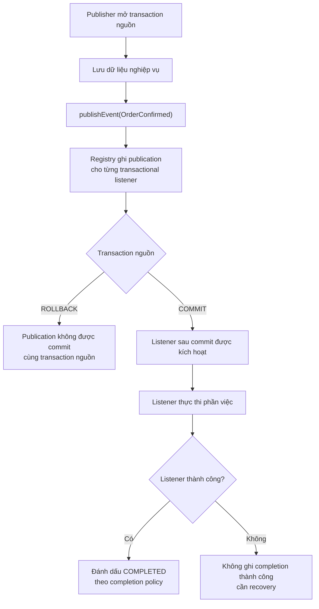
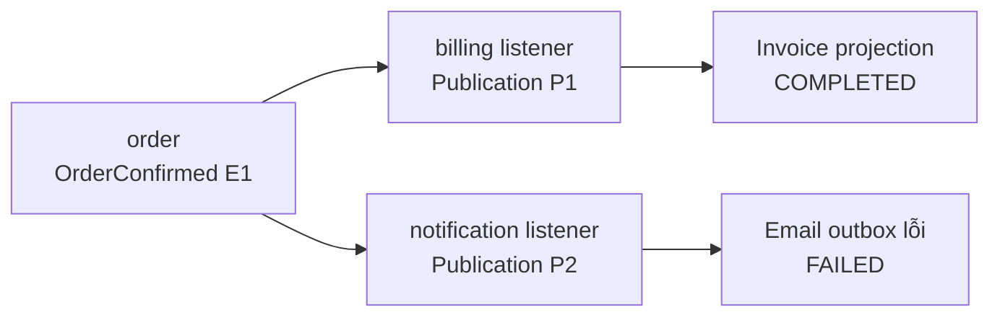
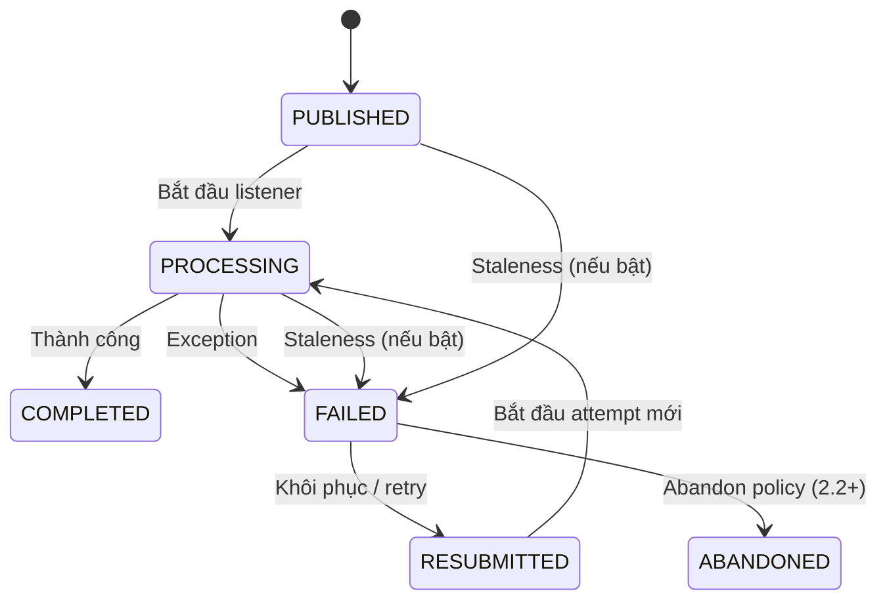
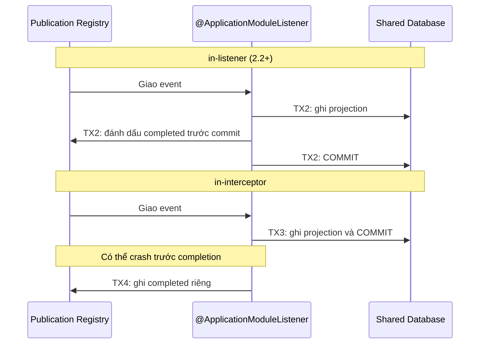

# Đánh dấu event hoàn tất trong Spring Modulith Event Publication Registry

## 1. “Event hoàn tất” thực chất có nghĩa là gì?

Trong một **modular monolith**, module `order` có thể công bố `OrderConfirmed` để module `billing` tạo hóa đơn và module `notification` chuẩn bị email. Nhờ application events, `order` không phải gọi trực tiếp các bean của hai module nhận. Đổi lại, khi các listener xử lý bất đồng bộ sau commit, ứng dụng phải biết **từng phần việc đã thành công hay chưa**.

Đây là mục tiêu của **Event Publication Registry** trong Spring Modulith: ghi nhận những lần giao event đến các transactional event listener được quản lý và đánh dấu một publication **hoàn tất** khi listener đích xử lý thành công.

Ba khái niệm cần phân biệt:

- **Domain event:** `OrderConfirmed(E1)` là một sự thật nghiệp vụ do `order` tạo ra.
- **Event publication:** `P1` là phần việc giao E1 cho `BillingOnOrderConfirmed`; `P2` là phần việc giao **cũng E1** cho `NotificationOnOrderConfirmed`.
- **Completion:** trạng thái hạ tầng cho biết **publication của một listener cụ thể** được ghi nhận xử lý thành công. Không mặc nhiên có “một cờ hoàn tất cho toàn bộ event”.

Ví dụ:

| Publication | Event | Listener đích | Kết quả |
| --- | --- | --- | --- |
| `P1` | `OrderConfirmed(E1)` | `BillingOnOrderConfirmed` | `COMPLETED` |
| `P2` | `OrderConfirmed(E1)` | `NotificationOnOrderConfirmed` | `FAILED` |

Kết luận chính xác: **billing đã hoàn tất publication của mình, notification chưa hoàn tất**. Không thể trả lời “mọi việc của E1 đã xong” khi mới biết P1 thành công.

Bài học thuộc chương **Publication Registry** của dịch vụ **SPRING_MODULITH_APPLICATION_EVENTS**: thiết kế giao tiếp module bằng publisher/listener, bảo vệ ranh giới nghiệp vụ, xử lý sau commit, registry persistence, retry, kiểm thử và quan sát giao sự kiện đáng tin cậy. Trọng tâm cụ thể là **thời điểm, điều kiện, cơ chế và cách kiểm chứng việc đánh dấu completed**.

> **Nguyên tắc nền tảng:** với listener thông thường đã được Spring Modulith registry quản lý, bạn **không cần tự gọi `markCompleted()` sau mỗi handler**. Framework ghi completion khi lời gọi listener được coi là thành công. Điều ứng dụng phải làm là thiết kế handler để “trả về thành công” thực sự có nghĩa phần việc thuộc trách nhiệm của handler đã hoàn tất.

## 2. Nhìn đúng vòng đời của một publication

Một publication có thể trải qua luồng:



Trong Spring Modulith, registry móc vào cơ chế công bố event của Spring Framework. Khi event được phát, nó xác định **những transactional listener đủ điều kiện** và lưu publication tương ứng trong transaction nguồn. Mỗi listener được quản lý có interceptor/advice để đánh dấu thành công hoặc xử lý thất bại theo phiên bản đang sử dụng.

Khi không có registry persistence, `ApplicationEventPublisher.publishEvent(...)` **không tự trở thành hàng đợi bền vững**. Nếu ứng dụng bị dừng sau commit mà trước lúc listener bất đồng bộ xử lý, không có cơ sở để khẳng định công việc sẽ được phục hồi.

### 2.1. Bốn thời điểm không được gộp làm một

| Thời điểm | Điều đã biết | Điều **chưa** được bảo đảm |
| --- | --- | --- |
| `publishEvent(...)` được gọi | Publisher đã công bố event trong JVM | Dữ liệu nguồn đã commit; consumer đã chạy |
| Transaction nguồn commit | Thay đổi nguồn được chốt, publication có thể được ghi bền cùng nguồn | Consumer đã hoàn thành |
| Listener được bắt đầu | Có attempt xử lý publication | Side effect thành công |
| Completion được ghi bền | Hạ tầng ghi nhận listener xử lý thành công theo contract | Toàn bộ workflow nghiệp vụ, ví dụ email đã tới inbox |

Đặc biệt, `publishEvent(...)` thường trả về trước khi `@ApplicationModuleListener` kết thúc vì listener này xử lý bất đồng bộ sau commit. Chỉ từ một dòng log “event published” không thể suy luận “event completed”.

### 2.2. Listener nào được registry theo dõi?

Mặc định Spring Modulith xem xét các listener (kể cả meta-annotation) dùng `@TransactionalEventListener`. `@ApplicationModuleListener` là annotation tiện lợi được cấu thành từ transactional listener sau commit, asynchronous handling và transaction riêng. Vì thế loại listener này thường thuộc phạm vi registry.

Thuộc tính `spring.modulith.events.registry-trigger-annotation` cho phép tùy chỉnh tập annotation kích hoạt việc đăng ký publication. Nếu cấu hình loại trừ một handler, handler ấy **không được theo dõi** như các listener đủ điều kiện khác.

Listener đơn thuần `@EventListener` không tự mang ý nghĩa “publication bền vững sau commit” giống `@ApplicationModuleListener`. Để lựa chọn đúng, luôn xác minh annotation, cấu hình registry, transaction nguồn và persistence backend.

## 3. Điều kiện thực sự để tự động đánh dấu COMPLETED

Với một transactional listener được Spring Modulith quản lý, quy trình thường là:

1. Framework xác định publication cụ thể dựa trên event và listener target.
2. Listener được gọi theo phase/transaction đã cấu hình.
3. Logic handler thực thi; nếu hoàn tất bình thường theo cơ chế interception, framework đánh dấu publication hoàn tất.
4. Nếu lỗi được phát hiện, **không được coi publication là completed**; publication giữ khả năng được xử lý lại tùy trạng thái và chính sách recovery.

### 3.1. Thành công kỹ thuật khác với thành công nghiệp vụ

Giả sử handler có trách nhiệm **lưu yêu cầu gửi email vào outbox**:

```java
@ApplicationModuleListener
void on(OrderConfirmed event) {
    emailOutbox.queueOnce(event.eventId(), event.orderId());
}
```

Khi `queueOnce(...)` commit thành công, publication có thể được đánh dấu completed. **Điều này chỉ có nghĩa yêu cầu gửi email đã được xếp hàng**, không có nghĩa SMTP provider đã chấp nhận email hoặc người nhận đã mở thư.

Nếu một listener cam kết “thanh toán thành công” nhưng chỉ gọi API bên ngoài không kiểm tra kết quả, lời gọi return bình thường vẫn có thể khiến registry ghi completed **sai với ý nghĩa nghiệp vụ**. Cần định nghĩa chính xác điều kiện hoàn thành của handler và chỉ để method kết thúc bình thường khi đạt điều kiện ấy.

### 3.2. Anti-pattern: nuốt exception

```java
@ApplicationModuleListener
void on(OrderConfirmed event) {
    try {
        invoiceService.issueInvoice(event.orderId());
    } catch (RuntimeException failure) {
        log.error("Invoice failed", failure);
        // Sai nếu nghiệp vụ chưa thành công mà method vẫn return bình thường.
    }
}
```

Vì handler không còn ném exception, framework có thể kết luận **listener đã thành công** và đánh dấu publication completed. Khi ấy công việc có thể bị bỏ sót khỏi tập cần retry.

Hướng xử lý:

- Lỗi hạ tầng tạm thời như database timeout → để exception lan ra, hoặc ném exception phù hợp sau khi ghi log; có cơ chế recovery riêng.
- Kết quả nghiệp vụ hợp lệ như “không cần tạo hóa đơn cho đơn miễn phí” → ghi nhận đó là một **quyết định hoàn thành hợp đồng handler**, có thể return thành công.
- Lỗi nghiệp vụ không thể khắc phục bằng retry → mô hình trạng thái rejection/compensation hoặc quy trình chuyển sang xử lý thủ công; không để loop retry vô hạn mà không có chính sách.

## 4. Ví dụ: một event được hai module tiếp nhận



Mô hình **fan-out** này là trường hợp phổ biến. Mỗi listener có:

- Định danh **target** của riêng nó.
- Trạng thái publication riêng và số lần thử riêng.
- Transaction thực thi riêng nếu dùng `@ApplicationModuleListener`.
- Điều kiện hoàn thành khác nhau: `billing` ghi invoice projection, `notification` ghi email outbox.

Hệ thống có thể resubmit P2 mà **không cần tạo lại một domain event E1 mới**. Event E1 cần giữ cùng `eventId`; việc replay E1 không có nghĩa tái thực thi toàn bộ HTTP request ban đầu.

### 4.1. Phân biệt các ID

| Định danh | Chủ sở hữu | Mục đích |
| --- | --- | --- |
| `orderId` | Domain `order` | Xác định đơn hàng |
| `eventId` | Domain event contract | Phân biệt các domain event mới và nhận diện redelivery |
| `publicationId` | Registry persistence | Phân biệt một bản giao event đến một listener |
| `targetIdentifier` | Infrastructure/listener | Xác định listener đích cần xử lý publication |
| `correlationId` | Event/workflow metadata ứng dụng tự thiết kế | Gom các event thuộc cùng một quy trình |

Một `OrderConfirmed(E1)` có thể có **hai publication ID khác nhau**. Vì vậy không dùng `publicationId` thay `eventId` trong hợp đồng nghiệp vụ, và không coi `eventId` là ID duy nhất của publication.

## 5. Các trạng thái publication và nhánh kết thúc

Spring Modulith **2.0 trở lên** đưa vào `EventPublication.Status` để mô tả trạng thái vòng đời; **2.2 trở lên** bổ sung `ABANDONED`. Nếu dự án chạy 1.x, API và mô hình status có thể khác; không áp toàn bộ tên trạng thái 2.x vào database phiên bản cũ.

| Trạng thái | Ý nghĩa | Đã hoàn thành thành công? |
| --- | --- | --- |
| `PUBLISHED` | Publication đã được đăng ký, chờ/chuẩn bị xử lý | Chưa |
| `PROCESSING` | Listener đã bắt đầu attempt xử lý | Chưa |
| `COMPLETED` | Listener xử lý thành công và completion được ghi theo policy | **Có**, trong phạm vi listener |
| `FAILED` | Attempt thất bại hoặc staleness monitor xác định bị kẹt | Chưa |
| `RESUBMITTED` | Publication lỗi được gửi vào quy trình xử lý lại | Chưa |
| `ABANDONED` *(2.2+)* | Publication bị từ bỏ theo chính sách, không tiếp tục resubmit thông thường | **Không**; chỉ là quyết định ngừng thử |



Đây là sơ đồ khái niệm; từng transition chịu ảnh hưởng phiên bản, backend và cấu hình. `ABANDONED` **không** phải từ đồng nghĩa của `COMPLETED`. Nếu một publication không còn có thể xử lý được, cần quy trình điều tra/bù trừ và lưu dấu quyết định ngừng retry.

### 5.1. Sau khi trạng thái COMPLETED được ghi, bản ghi có còn tồn tại?

**Không nhất thiết.** `COMPLETED` biểu thị kết quả logic của listener, nhưng **completion mode** quy định registry sẽ cập nhật, xóa hay lưu trữ bản ghi. Vì thế một publication đã hoàn tất vẫn có thể không còn được tìm thấy trong bảng active.

Chi tiết ba chế độ ở mục 10. Đừng dùng câu “bản ghi publication không còn” để kết luận “đã thành công”; đó có thể là mode `DELETE`, retention, lỗi lưu trữ, hoặc đơn giản listener không nằm trong phạm vi registry.

## 6. Chuẩn bị ví dụ Spring Boot và JDBC registry

Giả sử ứng dụng Spring Boot có ba module theo package con trực tiếp:

```text
src/main/java/com/example/shop/
├── ShopApplication.java
├── order/
│   ├── OrderConfirmed.java              [public event API]
│   └── OrderManagement.java             [publisher]
├── billing/
│   └── internal/
│       └── BillingOnOrderConfirmed.java [listener]
└── notification/
    └── internal/
        └── EmailOnOrderConfirmed.java   [listener]
```

`OrderConfirmed` là API của module `order`; `billing` và `notification` có thể import type công khai ở package gốc này. Không cho module nhận import repository/entity ở `order.internal`. Có thể dùng `ApplicationModules.verify()` để kiểm tra ranh giới.

### 6.1. Dependencies

Ví dụ Gradle (dependency versions cần quản lý bằng BOM hoặc cơ chế tương thích Spring Boot/Spring Modulith đang chạy):

```groovy
dependencies {
    implementation 'org.springframework.boot:spring-boot-starter-jdbc'
    implementation 'org.springframework.modulith:spring-modulith-starter-jdbc'
    implementation 'org.springframework.modulith:spring-modulith-events-api'

    runtimeOnly 'org.postgresql:postgresql'

    testImplementation 'org.springframework.boot:spring-boot-starter-test'
    testImplementation 'org.springframework.modulith:spring-modulith-starter-test'
    testImplementation 'org.awaitility:awaitility'
}
```

Spring Modulith JDBC starter cung cấp Event Publication Registry persistence qua JDBC khi các thành phần cần thiết đã được cấu hình. Dự án phải có datasource, transaction manager, serializer phù hợp và schema publication tương thích version (mặc định việc khởi tạo schema JDBC phụ thuộc thuộc tính/cấu hình triển khai). Không tự tạo một bảng “event_publication” theo suy đoán rồi xem như schema chính thức của framework.

File `ShopApplication.java`:

```java
package com.example.shop;

import org.springframework.boot.SpringApplication;
import org.springframework.boot.autoconfigure.SpringBootApplication;

@SpringBootApplication
public class ShopApplication {
    public static void main(String[] args) {
        SpringApplication.run(ShopApplication.class, args);
    }
}
```

### 6.2. Domain tables dùng để chứng minh side effects

SQL dưới đây chỉ là **các bảng nghiệp vụ minh họa**, **không phải schema registry**:

```sql
CREATE TABLE shop_order (
    id UUID PRIMARY KEY,
    state VARCHAR(40) NOT NULL
);

CREATE TABLE invoice_projection (
    source_event_id UUID PRIMARY KEY,
    order_id UUID NOT NULL,
    created_at TIMESTAMPTZ NOT NULL
);

CREATE TABLE email_outbox (
    source_event_id UUID PRIMARY KEY,
    order_id UUID NOT NULL,
    state VARCHAR(30) NOT NULL,
    created_at TIMESTAMPTZ NOT NULL
);
```

`source_event_id` là `eventId` của domain event được listener xử lý. Khóa `PRIMARY KEY` ngăn cùng listener tạo trùng một tác vụ khi nhận lại cùng event. Đây là idempotency của **ứng dụng**, tách biệt với trạng thái completion trong registry.

Ví dụ dùng PostgreSQL `ON CONFLICT`; với hệ quản trị khác cần cơ chế UPSERT/unique constraint tương ứng.

## 7. Publisher: chỉ tạo event trong transaction nguồn

File `src/main/java/com/example/shop/order/OrderConfirmed.java`:

```java
package com.example.shop.order;

import java.util.UUID;

public record OrderConfirmed(UUID eventId, UUID orderId) {}
```

File `src/main/java/com/example/shop/order/OrderManagement.java`:

```java
package com.example.shop.order;

import java.util.UUID;
import org.springframework.context.ApplicationEventPublisher;
import org.springframework.jdbc.core.JdbcTemplate;
import org.springframework.stereotype.Service;
import org.springframework.transaction.annotation.Transactional;

@Service
public class OrderManagement {

    private final JdbcTemplate jdbc;
    private final ApplicationEventPublisher events;

    public OrderManagement(JdbcTemplate jdbc, ApplicationEventPublisher events) {
        this.jdbc = jdbc;
        this.events = events;
    }

    @Transactional
    public OrderConfirmed confirmOrder(UUID orderId) {
        jdbc.update(
                "INSERT INTO shop_order (id, state) VALUES (?, ?)",
                orderId, "CONFIRMED");

        var event = new OrderConfirmed(UUID.randomUUID(), orderId);
        events.publishEvent(event);

        return event;
    }
}
```

Đường xử lý:

1. `confirmOrder(...)` được gọi qua Spring bean proxy nên transaction thực sự được mở.
2. `INSERT` và việc ghi publication cho các transactional listeners cùng nằm trong transaction nguồn ở cấu hình registry phù hợp.
3. Nếu source transaction rollback, các publication tương ứng cũng không được commit; listener `AFTER_COMMIT` không chạy như với transaction thành công.
4. Nếu commit, listener `@ApplicationModuleListener` có thể chạy sau commit và tự kết thúc publication của nó khi hoàn tất.

**Điểm cần nhớ:** phương thức trả về `OrderConfirmed` chỉ để test dễ truy vết event ID. **Việc return từ phương thức không chứng minh listener đã completed**, đặc biệt khi listener chạy bất đồng bộ.

Ví dụ chưa xử lý trường hợp client gửi lại yêu cầu tạo **cùng đơn**: đó là idempotency của API command. Production cần business key/command ID và quy tắc retry riêng, không chỉ dựa vào `eventId` được sinh mỗi lần gọi.

## 8. Consumer: để framework đánh dấu completion tự động

Hai listener minh họa bên dưới thực hiện các tác vụ **độc lập** với cùng `OrderConfirmed`. Mỗi listener chỉ trả về bình thường nếu công việc mà nó cam kết đã được ghi vào database thành công.

### 8.1. Billing: ghi invoice projection

File `src/main/java/com/example/shop/billing/internal/BillingOnOrderConfirmed.java`:

```java
package com.example.shop.billing.internal;

import com.example.shop.order.OrderConfirmed;
import java.time.OffsetDateTime;
import java.time.ZoneOffset;
import org.springframework.jdbc.core.JdbcTemplate;
import org.springframework.modulith.events.ApplicationModuleListener;
import org.springframework.stereotype.Component;

@Component
class BillingOnOrderConfirmed {

    private final JdbcTemplate jdbc;

    BillingOnOrderConfirmed(JdbcTemplate jdbc) {
        this.jdbc = jdbc;
    }

    @ApplicationModuleListener
    void on(OrderConfirmed event) {
        jdbc.update("""
            INSERT INTO invoice_projection
                (source_event_id, order_id, created_at)
            VALUES (?, ?, ?)
            ON CONFLICT (source_event_id) DO NOTHING
            """,
            event.eventId(),
            event.orderId(),
            OffsetDateTime.now(ZoneOffset.UTC));
    }
}
```

Giải thích:

1. `@ApplicationModuleListener` nhận `OrderConfirmed` sau khi transaction nguồn commit.
2. Phương thức chạy bất đồng bộ với transaction riêng theo ngữ nghĩa annotation.
3. UPSERT bảo vệ khỏi duplicate delivery: nếu event `E1` đã tạo projection, lần xử lý lại không chèn thêm hàng thứ hai.
4. Nếu JDBC gặp lỗi, exception lan ra; completion **không nên được ghi thành công**.
5. Nếu insert thành công hoặc record đã tồn tại và thao tác idempotent kết thúc hợp lệ, method return bình thường; hạ tầng đánh dấu publication đã xử lý.

**Không cần gọi `registry.markCompleted(...)` trong `on(...)`.** Việc đánh dấu đã được Spring Modulith bố trí quanh listener. Tự gọi sớm có thể tạo khoảng nguy hiểm khi registry nghĩ rằng việc đã xong nhưng database chưa commit.

### 8.2. Notification: completion chỉ có nghĩa “email được xếp hàng”

File `src/main/java/com/example/shop/notification/internal/EmailOnOrderConfirmed.java`:

```java
package com.example.shop.notification.internal;

import com.example.shop.order.OrderConfirmed;
import java.time.OffsetDateTime;
import java.time.ZoneOffset;
import org.springframework.jdbc.core.JdbcTemplate;
import org.springframework.modulith.events.ApplicationModuleListener;
import org.springframework.stereotype.Component;

@Component
class EmailOnOrderConfirmed {

    private final JdbcTemplate jdbc;

    EmailOnOrderConfirmed(JdbcTemplate jdbc) {
        this.jdbc = jdbc;
    }

    @ApplicationModuleListener
    void on(OrderConfirmed event) {
        jdbc.update("""
            INSERT INTO email_outbox
                (source_event_id, order_id, state, created_at)
            VALUES (?, ?, ?, ?)
            ON CONFLICT (source_event_id) DO NOTHING
            """,
            event.eventId(),
            event.orderId(),
            "PENDING",
            OffsetDateTime.now(ZoneOffset.UTC));
    }
}
```

Khi listener này completed, điều chắc chắn theo **hợp đồng của ví dụ** là có một bản ghi outbox hoặc một lần xử lý lặp đã được nhận diện. **Chưa thể khẳng định email được giao tới provider hoặc tới inbox**.

Nếu hệ thống cần đảm bảo “đã gửi email”, một worker riêng phải lấy các bản `PENDING`, gửi tới provider, cập nhật trạng thái và đối soát. Worker đó có transaction, retry và idempotency riêng. Event Publication Registry của Spring Modulith theo dõi **phần việc giao event cho listener**, không tự thay thế toàn bộ mô hình giao email ngoài JVM.

### 8.3. Hai handler có hai kết quả độc lập

Sau `OrderConfirmed(E1)`, có thể quan sát:

```text
TX source: order CONFIRMED, E1 đã publish

Publication P-billing(E1): COMPLETED
  └── invoice_projection đã được ghi

Publication P-email(E1): FAILED
  └── outbox chưa được ghi; cần retry/điều tra
```

Không thực hiện lại `OrderManagement.confirmOrder()` chỉ để thử gửi email. Việc đó có thể sinh domain event mới hoặc vi phạm unique key của order. Cần **resubmit đúng publication lỗi tới đúng listener**, giữ nguyên event và payload.

## 9. API markCompleted dùng khi nào?

Spring Modulith có API hạ tầng:

```java
package org.springframework.modulith.events.core;

// Chữ ký được rút gọn để giải thích, không phải khai báo đầy đủ interface.
interface EventPublicationRegistry {
    void markCompleted(
            Object event,
            PublicationTargetIdentifier targetIdentifier);
}
```

Phương thức này cho biết registry **publication của event nào** được đánh dấu hoàn tất **đối với listener target nào**. Nó không mang nghĩa “đánh dấu mọi người nhận event này đã xong”. `PublicationTargetIdentifier` là ID hạ tầng của listener đích, khác với `eventId` và `publicationId`.

### 9.1. Không gọi thủ công trong handler thông thường

Code **không nên viết**:

```java
@ApplicationModuleListener
void on(OrderConfirmed event) {
    registry.markCompleted(event, someTargetIdentifier); // Không cần!
    performBusinessWork(event);                         // Có thể lỗi sau đó.
}
```

Lý do: completion được ghi trước khi `performBusinessWork(...)` đạt mục tiêu. Nếu lỗi xảy ra sau đó, publication có thể không còn cơ hội được hồi phục theo luồng thông thường. Ngay cả khi chuyển lời gọi xuống cuối method, vẫn dễ sai vì transaction chứa phần việc nghiệp vụ **chưa chắc đã commit**.

### 9.2. Trường hợp nâng cao: tích hợp một cơ chế hoàn tất riêng

Một adapter hạ tầng tự quản lý lifecycle có thể cần truy cập API này, ví dụ khi **không sử dụng advice mặc định cho việc giao một publication** và ứng dụng phải phản ánh kết quả xử lý đã được xác nhận. Khi đó cần:

- Tìm publication thực sự tồn tại và đúng **targetIdentifier**.
- Bảo đảm việc nghiệp vụ đã commit/thành công theo đúng contract và timing.
- Tránh đánh dấu trùng hoặc đánh dấu nhầm publication của listener khác.
- Kiểm soát concurrency, retry, transaction và idempotency của adapter.
- Kiểm thử trên **phiên bản framework/backend đang sử dụng**, vì giao diện registry cấp core là API hạ tầng, không phải mô hình sự kiện nghiệp vụ tùy ý.

Ví dụ chỉ để nhận diện chữ ký gọi:

```java
import org.springframework.modulith.events.core.EventPublicationRegistry;
import org.springframework.modulith.events.core.PublicationTargetIdentifier;

void recordSuccess(
        EventPublicationRegistry registry,
        Object originalEvent,
        String persistedTargetIdentifier) {

    // Chỉ áp dụng trong adapter chủ động tự quản lý completion,
    // SAU khi xác thực đúng publication và công việc đã thành công.
    var target = PublicationTargetIdentifier.of(persistedTargetIdentifier);
    registry.markCompleted(originalEvent, target);
}
```

Đoạn trên **không phải một handler hoàn chỉnh** và không nên copy vào `@ApplicationModuleListener`. `persistedTargetIdentifier` phải là giá trị **thực tế** đã được registry ghi nhận; không tự đoán từ tên class, tên bean hoặc method. Dùng `eventId` để tự chế `targetIdentifier` là sai vì hai loại ID có vai trò khác nhau.

### 9.3. Khi tự làm một event listener tùy chỉnh

Nếu chỉ dùng `ApplicationEventPublisher` và một `@EventListener` đồng bộ, đừng tự gọi `markCompleted` mà không có publication đăng ký hợp lệ: không phải mọi event Spring đều có một record trong Event Publication Registry.

Với custom integration, trình tự hợp lý là **đăng ký công việc**, **thực thi**, **xác nhận kết quả** và **đánh dấu đúng publication**, nhưng phải thống nhất rõ ai sở hữu việc đăng ký và completion. Ưu tiên sử dụng hạ tầng mặc định của Spring Modulith trước khi tự xây cơ chế thay thế.

## 10. Completion mode: UPDATE, DELETE và ARCHIVE

Spring Modulith hỗ trợ cấu hình:

```properties
spring.modulith.events.completion-mode=update
```

Mặc định là `UPDATE`. Từ Spring Modulith **1.3**, còn có `DELETE` và `ARCHIVE`. Đây là quyết định về **cách lưu kết quả sau khi handler thành công**, không thay đổi điều kiện nghiệp vụ để listener được xem là hoàn tất.

| Completion mode | Điều gì xảy ra khi completed? | `CompletedEventPublications.findAll()` có xem được? |
| --- | --- | --- |
| `UPDATE` | Cập nhật bản ghi hiện tại, ghi completion date | Có, cho những publication chưa bị retention xóa |
| `DELETE` | Xóa publication khỏi registry khi completed | Không; bản ghi completed đã được xóa |
| `ARCHIVE` | Chuyển bản completed sang vùng archive, ghi completion date | Có, qua abstraction completed phù hợp |

### 10.1. UPDATE — giữ lịch sử ngay trong registry

```properties
spring.modulith.events.completion-mode=update
```

Khi listener thành công, publication được cập nhật với thông tin completed. Trong hệ thống hỗ trợ status (2.0+), có thể xem `COMPLETED`. Đây là chế độ hữu ích khi cần truy vấn và đối soát công việc đã xong.

**Rủi ro:** nếu không dọn theo retention, số lượng completed records tăng liên tục. Query, index, backup và thao tác ghi/đọc registry có thể chậm dần.

### 10.2. DELETE — không giữ completed trong registry

```properties
spring.modulith.events.completion-mode=delete
```

Registry xóa bản ghi sau khi listener thành công, nên không thể dùng `CompletedEventPublications.findAll()` để hỏi lịch sử đó nữa. Đây **không** phải bảo đảm “sự kiện không bao giờ chạy lại”, cũng không chứng minh side effect bên ngoài exactly-once.

Nếu cần audit nghiệp vụ lâu dài nhưng vẫn chọn `DELETE`, phải lưu audit/event history ở nơi **khác**. Không dùng “không tìm thấy publication trong DB” để tuyên bố thành công nếu không biết completion mode và retention.

### 10.3. ARCHIVE — giảm tải kho active và giữ lịch sử

```properties
spring.modulith.events.completion-mode=archive
```

Khi listener thành công, registry chuyển entry sang archive (bảng/collection/node tùy backend), lưu completion date và xóa khỏi phần active. Những bản completed có thể được đọc qua `CompletedEventPublications` trong cấu hình hỗ trợ.

Archive vẫn cần có **retention, index, backup và chính sách truy cập**. Không nên giả định archive là kho event sourcing hoặc audit pháp lý đầy đủ. Publication log chỉ mô tả việc giao event cho listener, không phải mọi chuyển đổi trạng thái domain.

### 10.4. Trường hợp ABANDONED trong phiên bản mới

Từ Spring Modulith 2.2, completion mode còn ảnh hưởng cách lưu những publication được đánh dấu `ABANDONED`. Đây là nhánh kết thúc **không thành công**, cần quản lý/điều tra riêng. Đặc biệt, với `DELETE`, hãy kiểm tra kỳ vọng lưu lịch sử các quyết định từ bỏ: không được cho rằng bản ghi luôn còn để audit.

### 10.5. Chọn mode như thế nào?

| Yêu cầu | Lựa chọn có thể phù hợp | Bổ sung cần thiết |
| --- | --- | --- |
| Cần điều tra completed publication trong vài tuần | `UPDATE` | Dọn completed hết hạn |
| Không cần lịch sử completed trong registry | `DELETE` | Log/metrics/audit khác nếu cần |
| Nhiều completed records, cần giữ lịch sử dài hơn | `ARCHIVE` | Retention archive và truy vấn |
| Phải biết các bước kinh doanh nào đã thành công | Bất kỳ mode phù hợp + business audit/state | Registry không thay domain state |

Vì thế **đánh dấu completed** là quyết định của lifecycle, còn **lưu lại bản ghi completed bao lâu** là quyết định retention. Đừng trộn hai việc trong logic listener.

## 11. Completion timing: trong transaction listener hay sau listener?

Spring Modulith **2.2** đưa ra lựa chọn thời điểm completion:

```properties
# Mặc định của Spring Modulith 2.2:
spring.modulith.events.completion=in-listener
```

`IN_LISTENER` đánh dấu completed **ngay trước khi transaction listener commit**, trong transaction listener đang hoạt động. Khi thay đổi nghiệp vụ và publication registry dùng cùng resource/transaction manager được hỗ trợ, việc ghi side effect cùng completion có thể **nguyên tử trong cùng transaction**.

Một lựa chọn khác:

```properties
spring.modulith.events.completion=in-interceptor
```

`IN_INTERCEPTOR` ghi completion trong **transaction riêng sau khi listener và transaction của nó hoàn tất**. Điều này làm xuất hiện cửa sổ lỗi giữa việc commit công việc nghiệp vụ và việc commit dấu completion.

| Tình huống | `in-listener` | `in-interceptor` |
| --- | --- | --- |
| Completion được ghi khi nào? | Trước commit transaction listener | Sau khi listener kết thúc, transaction riêng |
| Nếu nghiệp vụ và registry cùng DB/TX | Có thể commit business work + completion nguyên tử | Hai transaction, có cửa sổ ở giữa |
| Nếu ghi completion lỗi | Có thể khiến transaction listener rollback | Business work có thể đã commit |
| Nếu process crash ở khoảng cuối | Phạm vi rủi ro nhỏ hơn khi cùng resource | Publication có thể được giao lại dù business đã xong |
| Có cần idempotency? | **Có** | **Có** |

### 11.1. Timeline so sánh



Đây là timeline lý tưởng hóa; exact advice order, transaction manager, persistence technology và version phải được kiểm tra bằng integration test. `in-listener` chỉ nguyên tử với những thao tác thực sự cùng transaction/resource. Nếu handler gọi cổng thanh toán hoặc SMTP ngoài, **local transaction không thể rollback hành động bên ngoài** khi registry ghi completion thất bại.

### 11.2. Đừng nhầm completion timing với completion mode

Hai thuộc tính khác vai trò:

```properties
spring.modulith.events.completion=in-listener
spring.modulith.events.completion-mode=archive
```

- `completion` trả lời “**ghi completion lúc nào và trong transaction nào?**”
- `completion-mode` trả lời “**sau completion, bản ghi được giữ/cập nhật/chuyển lưu/xóa ra sao?**”

Chúng là hai trục cấu hình khác nhau. Các giá trị và mặc định phải đối chiếu với Spring Modulith version thực tế; không sao chép cấu hình 2.2 vào ứng dụng 1.x mà không kiểm tra compatibility.

## 12. Khi listener thất bại: không đánh dấu completed giả

Phần khó nhất của việc đánh dấu event hoàn tất không phải lời gọi API, mà là **xác định đúng ranh giới thành công**, đặc biệt khi sự cố có thể xảy ra ở bất kỳ thời điểm nào.

### 12.1. Các cửa sổ lỗi thường gặp

| Thời điểm lỗi | Nguồn đã commit? | Công việc listener đã commit? | Publication nên xử lý thế nào? |
| --- | --- | --- | --- |
| Trước khi transaction nguồn commit | Chưa | Chưa | Publication không được commit cùng nguồn |
| Sau source commit, trước lúc listener bắt đầu | Rồi | Chưa | Còn outstanding; cần cơ chế phục hồi |
| Listener lỗi SQL trước khi ghi xong | Rồi | Chưa | Không đánh dấu completed; retry theo chính sách |
| Listener đã commit projection nhưng chưa ghi completion riêng | Rồi | Rồi | Có nguy cơ retry; handler phải idempotent |
| Listener gửi email ngoài rồi crash | Rồi | Có thể đã gửi | Retry có thể gửi trùng; cần idempotency/đối soát |
| Listener trả về bình thường sau khi nuốt lỗi | Rồi | Có thể chưa | **Nguy hiểm:** registry có thể đánh dấu completed giả |
| Registry completion đã commit; archive/delete theo mode | Rồi | Có theo contract | Quan sát bằng abstraction/side effect tùy mode |

Mấu chốt: **không nên đánh dấu completed ngay khi công việc mới “bắt đầu”**. Nếu workflow có nhiều tác vụ cần hoàn thành, hãy làm rõ listener cam kết hoàn thành đến đâu.

### 12.2. FAILED và RESUBMITTED

Từ Spring Modulith 2.0, registry hỗ trợ nhóm publication lỗi tường minh với `FailedEventPublications` và `ResubmissionOptions`.

Ví dụ một service vận hành:

```java
package com.example.shop;

import org.springframework.modulith.events.FailedEventPublications;
import org.springframework.modulith.events.ResubmissionOptions;
import org.springframework.stereotype.Component;

@Component
class PublicationRecovery {

    private final FailedEventPublications failed;

    PublicationRecovery(FailedEventPublications failed) {
        this.failed = failed;
    }

    void retryFailedWithDefaultOptions() {
        // Chỉ gọi từ job/admin workflow đã giới hạn tần suất.
        failed.resubmit(ResubmissionOptions.defaults());
    }
}
```

Đây là ví dụ API được hỗ trợ ở dòng **2.0+**. Với 1.x, cần đối chiếu API `IncompleteEventPublications` phù hợp; không sao chép nguyên mẫu này khi chạy phiên bản không có `FailedEventPublications`.

Trong production phải quy định batch size, min age, số tác vụ concurrent, số attempt và lọc loại lỗi. Không nên gọi `retryFailedWithDefaultOptions()` theo mỗi HTTP request hoặc lặp vô hạn; một database đang quá tải càng dễ bị quá tải thêm nếu resubmit quá nhanh.

### 12.3. Staleness và crash giữa chừng

Process có thể chết khi publication đang `PUBLISHED`, `PROCESSING` hoặc `RESUBMITTED`. Với Spring Modulith 2.0+, **Staleness Monitor** có thể xác định những publication nằm quá lâu ở các trạng thái trên và chuyển sang `FAILED` để recovery.

Ví dụ cấu hình minh họa:

```properties
spring.modulith.events.staleness.published=PT10M
spring.modulith.events.staleness.processing=PT30M
spring.modulith.events.staleness.resubmitted=PT10M
spring.modulith.events.staleness.check-interval=PT1M
```

Các threshold này là **giả định bài học**, không phải khuyến nghị mặc định áp dụng mọi hệ thống. Theo tài liệu Spring Modulith 2.0+, khi cả ba khoảng staleness vẫn bằng zero (mặc định), monitor không tự đăng ký tác vụ kiểm tra.

Nếu thời gian xử lý hợp lệ của listener có thể vượt `processing=PT30M`, việc đánh dấu stale và resubmit có thể khiến **hai attempt cùng chạy**. Do đó staleness threshold cần dựa trên tải, tail latency và giới hạn thật của listener. Không coi monitor là substitute cho timeout/locking/idempotency.

### 12.4. Lỗi vĩnh viễn và ABANDONED

Từ Spring Modulith 2.2, hệ thống có `AbandonPolicy` và trạng thái `ABANDONED` cho publication đã lỗi mà không nên tiếp tục retry. Ví dụ: một payload cũ không thể giải mã hoặc một consumer báo lỗi nghiệp vụ không thể khắc phục.

```properties
# Ví dụ chính sách giới hạn số attempt, không phải mặc định:
spring.modulith.events.resubmission.abandon-after-attempts=5
```

Theo dòng 2.2, mặc định `-1` tức **không tự abandon theo số attempt** khi không có chính sách khác. Quyết định abandon trong luồng xử lý bình thường được xét khi listener thực sự thất bại; những bản đã FAILED từ trước không tự động bị chuyển hồi tố chỉ vì bạn mới đổi cấu hình. Có API quản trị chủ động để áp dụng policy lên các bản lỗi cũ khi cần, nhưng phải được kiểm soát.

**Không bao giờ ghi “đã thành công” cho ABANDONED.** Đây là kết thúc vì chính sách ngừng retry, có thể cần thông báo vận hành, xử lý thủ công, bù trừ hoặc đối soát.

## 13. Completion và idempotency là hai bài toán khác nhau

Một publication có thể được giao lại dù tác vụ nghiệp vụ đã hoàn tất, ví dụ:

```mermaid
sequenceDiagram
    participant R as Registry
    participant L as Billing listener
    participant D as Database

    R->>L: Giao OrderConfirmed(E1)
    L->>D: INSERT invoice_projection(E1)
    D-->>L: COMMIT thành công
    Note over L,R: Crash trước completion được ghi (in-interceptor)
    R->>L: Recovery: giao lại E1
    L->>D: INSERT ON CONFLICT(E1) DO NOTHING
    D-->>L: Đã có projection; không nhân đôi
    L-->>R: Listener hoàn tất thành công
```

**Completion** trả lời: “registry đã ghi nhận consumer xử lý publication này xong chưa?”  
**Idempotency** trả lời: “nếu cùng event bị giao lại, công việc có tạo tác dụng phụ trùng hay không?”

Không thể suy từ hoàn thành thành “đã được giao đúng một lần”. Một registry giúp phục hồi công việc chưa completed nhưng không bảo đảm **exactly-once** cho mọi side effect ngoài JVM.

### 13.1. Thiết kế khóa chống xử lý trùng

Với mỗi consumer, một khóa thường dùng là:

```text
consumerIdentity + eventId
```

Nếu có hai consumer, mỗi consumer cần độc lập được nhận cùng event E1. Vì vậy deduplicate **trên phạm vi consumer**, không chặn tất cả consumer chỉ vì có một consumer đã xử lý E1.

Ví dụ bảng marker khái niệm:

```sql
CREATE TABLE processed_event (
    consumer_name VARCHAR(150) NOT NULL,
    event_id UUID NOT NULL,
    processed_at TIMESTAMPTZ NOT NULL,
    PRIMARY KEY (consumer_name, event_id)
);
```

Khi side effect và marker ở cùng DB, cần đặt trong cùng transaction phù hợp. Khóa unique xử lý race tốt hơn mẫu `SELECT` rồi `INSERT` không có ràng buộc. Nếu dùng một bảng projection với `source_event_id` unique như phần 8, đó cũng là một cách thể hiện idempotency cho một loại công việc cụ thể.

### 13.2. Khi side effect nằm ngoài database

Một listener gửi HTTP request tới payment gateway, SMTP provider hoặc broker có thể hoàn thành thao tác ngoài ngay trước khi process crash. Dù completion được ghi `in-listener`, transaction cục bộ vẫn không rollback thao tác ngoài đã diễn ra.

Hướng triển khai:

1. Dùng idempotency key ổn định bên hệ thống đích nếu nhà cung cấp hỗ trợ.
2. Lưu outbox/job bền vững trong transaction cục bộ; worker xử lý việc ngoài riêng.
3. Lưu trạng thái đối soát với provider để xác minh kết quả khi không rõ lần gọi trước đã thành công hay chưa.
4. Thiết kế retry có giới hạn, exponential backoff khi phù hợp và luồng xử lý lỗi vĩnh viễn.

Đừng biến trạng thái registry thành nguồn chân lý duy nhất của một giao dịch tài chính hoặc email delivery. Domain cần trạng thái/biên nhận nghiệp vụ riêng.

## 14. Truy vấn publication đã completed và dọn dữ liệu

Spring Modulith công bố API `CompletedEventPublications` (module `spring-modulith-events-api`) để truy vấn và xóa các bản completed còn được giữ theo policy:

- `findAll()`: trả về tập publication đã completed.
- `deletePublicationsOlderThan(Duration)`: xóa các bản có **completion date** cũ hơn ngưỡng thời gian chỉ định.
- `deletePublications(Predicate<EventPublication>)`: lọc/xóa completed theo predicate, cần cân nhắc khối lượng dữ liệu vì implementation có thể lọc trong memory.

### 14.1. Xem một bản completed theo eventId

Một service read-only minh họa:

```java
package com.example.shop;

import com.example.shop.order.OrderConfirmed;
import java.util.UUID;
import org.springframework.modulith.events.CompletedEventPublications;
import org.springframework.stereotype.Component;

@Component
class PublicationInspector {

    private final CompletedEventPublications completed;

    PublicationInspector(CompletedEventPublications completed) {
        this.completed = completed;
    }

    long countCompletedFor(UUID eventId) {
        return completed.findAll().stream()
                .map(publication -> publication.getEvent())
                .filter(OrderConfirmed.class::isInstance)
                .map(OrderConfirmed.class::cast)
                .filter(event -> event.eventId().equals(eventId))
                .count();
    }
}
```

Với cấu hình `completion-mode=update` (và chưa dọn record), nếu **hai listener đủ điều kiện** của ví dụ đều completed, `countCompletedFor(E1)` có thể trả `2`. Nếu một listener failed, chỉ publication completed của listener còn lại xuất hiện trong tập.

**Chú ý phạm vi:** đây là demo để quan sát, không phải truy vấn hiệu quả cho production có hàng triệu publication. `findAll()` có thể duyệt một số lượng lớn record. Nên dùng metric/adapter/query được thiết kế riêng và giới hạn truy cập khi cần vận hành ở quy mô lớn.

### 14.2. Dọn completed entries sau 30 ngày

File `src/main/java/com/example/shop/CompletedPublicationCleanup.java`:

```java
package com.example.shop;

import java.time.Duration;
import org.springframework.modulith.events.CompletedEventPublications;
import org.springframework.scheduling.annotation.Scheduled;
import org.springframework.stereotype.Component;

@Component
class CompletedPublicationCleanup {

    private final CompletedEventPublications completed;

    CompletedPublicationCleanup(CompletedEventPublications completed) {
        this.completed = completed;
    }

    @Scheduled(cron = "0 0 3 * * *", zone = "UTC")
    void purgeOldCompleted() {
        completed.deletePublicationsOlderThan(Duration.ofDays(30));
    }
}
```

Để chạy scheduled method, bật scheduling ở app:

```java
@org.springframework.boot.autoconfigure.SpringBootApplication
@org.springframework.scheduling.annotation.EnableScheduling
public class ShopApplication {
    public static void main(String[] args) {
        org.springframework.boot.SpringApplication.run(
                ShopApplication.class, args);
    }
}
```

Snippet `ShopApplication` trên là **phiên bản thay thế** cho lớp khởi động ở mục 6, không tạo class thứ hai cùng tên trong dự án. Dùng một trong hai và thêm `@EnableScheduling` khi cần job.

### 14.3. Dọn theo completion date, không theo publication date

Một publication được publish ngày 1 nhưng chỉ completed sau retry vào ngày 10. Nếu retention là **30 ngày sau completion**, thời gian tính từ ngày 10, không phải ngày 1.

Xóa publication chỉ vì “đã được tạo hơn 30 ngày” có thể làm mất công việc **vẫn đang FAILED hoặc chưa hoàn tất**. API `deletePublicationsOlderThan(Duration)` của `CompletedEventPublications` dành riêng cho tập **completed**, không phải lệnh xóa mọi publication cũ.

Với `DELETE` mode, bản ghi completed đã bị xóa ngay nên job thường không có completed record để dọn. Với `ARCHIVE`, cần xác minh backend hỗ trợ xóa archive đúng cách và retention policy đáp ứng audit. Trong triển khai nhiều instance, `@Scheduled` có thể chạy trên nhiều node; nên có job owner/distributed lock hoặc cơ chế scheduling phù hợp.

### 14.4. Đo completion latency

Khi completed record còn được lưu, duration có thể tính từ:

```text
publication.getCompletionDate() - publication.getPublicationDate()
```

Kết quả là **thời gian từ đăng ký publication đến khi ghi nhận completion**, gồm chờ thread, xử lý, lỗi và retry. Không đồng nhất với thời gian thuần túy chạy code listener hoặc SLA giao email thực tế.

`EventPublication` còn cung cấp `getCompletionAttempts()` và `getLastResubmissionDate()` trong Spring Modulith 2.0+ để hỗ trợ điều tra số lần thử và lần retry gần nhất.

## 15. Kiểm thử completion bằng dữ liệu thật

Unit test gọi trực tiếp `BillingOnOrderConfirmed.on(event)` chỉ chứng minh method xử lý; nó không chứng minh registry đã đăng ký publication, listener chạy đúng phase hay completion được ghi thành công. Cần integration test trên Spring context và persistence backend thật hoặc database test phù hợp.

### 15.1. Kiểm thử đường thành công với UPDATE mode

Giả sử đã cấu hình PostgreSQL test, schema domain và publication registry theo các ví dụ trước. File `src/test/java/com/example/shop/PublicationCompletionIntegrationTests.java`:

```java
package com.example.shop;

import static org.junit.jupiter.api.Assertions.assertEquals;
import static org.awaitility.Awaitility.await;

import com.example.shop.order.OrderConfirmed;
import com.example.shop.order.OrderManagement;
import java.time.Duration;
import java.util.UUID;
import org.junit.jupiter.api.Test;
import org.springframework.beans.factory.annotation.Autowired;
import org.springframework.boot.test.context.SpringBootTest;
import org.springframework.jdbc.core.JdbcTemplate;
import org.springframework.modulith.events.CompletedEventPublications;
import org.springframework.test.context.TestPropertySource;

@SpringBootTest
@TestPropertySource(properties =
        "spring.modulith.events.completion-mode=update")
class PublicationCompletionIntegrationTests {

    @Autowired OrderManagement orders;
    @Autowired JdbcTemplate jdbc;
    @Autowired CompletedEventPublications completed;

    @Test
    void eachListenerIsMarkedCompletedAfterItsWorkSucceeds() {
        UUID orderId = UUID.randomUUID();
        OrderConfirmed event = orders.confirmOrder(orderId);

        await().atMost(Duration.ofSeconds(20))
                .untilAsserted(() -> {
                    Integer invoices = jdbc.queryForObject("""
                        SELECT COUNT(*) FROM invoice_projection
                        WHERE order_id = ?
                        """, Integer.class, orderId);

                    Integer emails = jdbc.queryForObject("""
                        SELECT COUNT(*) FROM email_outbox
                        WHERE order_id = ? AND state = 'PENDING'
                        """, Integer.class, orderId);

                    long completedCount = completed.findAll().stream()
                            .map(p -> p.getEvent())
                            .filter(OrderConfirmed.class::isInstance)
                            .map(OrderConfirmed.class::cast)
                            .filter(e -> e.eventId().equals(event.eventId()))
                            .count();

                    assertEquals(1, invoices);
                    assertEquals(1, emails);
                    assertEquals(2L, completedCount);
                });
    }
}
```

Test trên có chủ đích **không** gắn `@Transactional` lên test method. Nếu Spring test giữ transaction mở và rollback cuối test, các listener `AFTER_COMMIT` có thể không bao giờ được gọi. Phương thức service tạo transaction riêng, commit khi hoàn tất; Awaitility chờ các listener bất đồng bộ đạt trạng thái mong đợi.

**Giới hạn:** số `2` là đúng **khi chỉ có hai transactional listener đủ điều kiện của ví dụ** đăng ký cho `OrderConfirmed`, không có listener thứ ba hoặc cấu hình registry loại trừ một listener. Đừng dùng số cố định đó ở một ứng dụng đang có thêm consumer.

Test cũng giả định registry có persistence và serializer phù hợp; cần dependency management Spring Boot/Spring Modulith cùng PostgreSQL schema đúng phiên bản. Chạy trên database test riêng (có thể dùng Testcontainers); không dùng database production.

### 15.2. Kiểm thử thất bại

Để chứng minh một publication **không bị completed giả**, có thể tạo một listener test có thể bật chế độ ném exception sau khi nhận `OrderConfirmed`:

1. Publish trong transaction nguồn và commit.
2. Cho listener của `notification` throw khi ghi outbox, còn `billing` xử lý bình thường.
3. Với `UPDATE` mode, kiểm tra publication billing completed; publication notification **không nằm trong tập completed**.
4. Trên Spring Modulith 2.0+, kiểm tra publication lỗi qua API thích hợp. Nếu chưa vào `FAILED` do một lỗi crash, cần staleness/recovery theo cấu hình.
5. Tắt fault injection, resubmit publication lỗi theo chính sách, đợi notification hoàn thành và xác nhận outbox **chỉ một hàng**.
6. Giao lại cùng `eventId` để kiểm tra idempotency vẫn đúng.

Để kiểm tra tình huống process crash **trước khi completion được lưu**, cần database có persistence giữa các lần khởi động lại ứng dụng. Một unit test gọi handler hai lần không mô phỏng được transaction/registry recovery.

### 15.3. Kiểm thử mode DELETE và ARCHIVE

Với `DELETE`, không thể assert “completed count bằng 2” vì completed record đã bị xóa. Kỳ vọng:

- Hai side effects nghiệp vụ có mặt và không nhân đôi.
- Publication của hai listener không còn outstanding theo cơ chế backend thích hợp.
- `CompletedEventPublications.findAll()` không trả các completed record đã bị xóa.

Với `ARCHIVE`, cần kiểm tra publication hoàn tất xuất hiện qua abstraction completed và không còn ở bảng active, theo schema/backend đang dùng. Chỉ đổi cấu hình trong test mà **không chuẩn bị schema archive** phù hợp có thể gây lỗi; cần migration hoặc initialization đúng version.

### 15.4. Ma trận kiểm thử thiết yếu

| Kịch bản | Kỳ vọng |
| --- | --- |
| Source transaction rollback | Không có publication commit để listener sau commit xử lý |
| Listener xử lý thành công | Completion được ghi đúng cho listener đó |
| Hai listeners, một lỗi | Chỉ publication của listener thành công completed |
| Handler nuốt exception | Test phát hiện “completed giả” nếu công việc thực không xong |
| Lỗi tạm thời và resubmit | Cùng event ID được xử lý lại; thành công rồi completed |
| Crash sau business commit trước completion | Duplicate processing không làm side effect trùng |
| `completion-mode=update` | Completed record còn, có completion date |
| `completion-mode=delete` | Record completed bị xóa, không còn query history |
| `completion-mode=archive` | Completed record chuyển archive và có thể truy vấn |
| `completion=in-listener` (2.2+) | Transaction đồng bộ work/completion theo resource hỗ trợ |
| `completion=in-interceptor` (2.2+) | Kiểm tra cửa sổ xử lý xong nhưng chưa ghi completion |
| Registry không có persistence | Không được tuyên bố đảm bảo khôi phục sau crash |
| Listener không thuộc trigger annotation | Không xuất hiện publication được theo dõi như handler đủ điều kiện |
| Event contract đổi khi còn publication cũ | Có khả năng deserialize/recovery event lịch sử |

## 16. Quan sát completion trong production

Đánh dấu publication hoàn tất là một thao tác hạ tầng; **khả năng quan sát** mới giúp vận hành biết event còn bị kẹt ở đâu và có đáp ứng SLA hay không.

Các thông tin nên thu thập:

| Metric hoặc tín hiệu | Câu hỏi vận hành | Cần phân biệt |
| --- | --- | --- |
| Outstanding publications theo listener | Listener nào còn việc chưa làm? | Backlog bình thường và stuck |
| Tuổi publication chưa completed lâu nhất | Có việc nào vượt SLA? | Publication date với completion date |
| `COMPLETED` count/rate | Mỗi handler xử lý thành công bao nhiêu lần? | Mode DELETE có thể không giữ lịch sử |
| `FAILED` count và tuổi lỗi | Bao nhiêu publication cần recovery? | Lỗi tạm thời và poison event |
| `RESUBMITTED` count | Có bao nhiêu retry? | Retry không đồng nghĩa event nghiệp vụ mới |
| `ABANDONED` count (2.2+) | Công việc nào đã bị từ bỏ? | **Không** coi là completed |
| Completion latency p50/p95/p99 | Mất bao lâu từ publish đến completed? | Không phải duration duy nhất của handler |
| Attempts per publication | Listener cần bao nhiêu lần thử? | Cần tránh lặp vô hạn |
| Event deserialization failures | Event cũ có còn đọc được? | Breaking change khi đổi event type/schema |
| Completed/archived storage growth | Retention có hoạt động? | UPDATE/ARCHIVE không dọn sẽ phình |

Những tên metric trên là **gợi ý xây dựng monitoring**, không khẳng định Spring Modulith tự xuất tất cả metric theo đúng tên đó. Có thể dùng Micrometer/Actuator, logging, API registry và truy vấn/metrics của persistence backend, tùy nhu cầu triển khai.

### 16.1. Logging truy vết

Một log tự thiết kế có thể có:

```json
{
  "module": "billing",
  "listener": "BillingOnOrderConfirmed",
  "eventType": "OrderConfirmed",
  "eventId": "a425a017-fd28-4e3d-80e5-94bef2ec8d58",
  "publicationId": "f9f69e9e-13ba-4c8d-b24a-bc06aee6402c",
  "status": "COMPLETED",
  "completionAttempts": 2,
  "completionLatencyMs": 1847
}
```

Đây **không phải schema log mặc định của Spring Modulith**. Các field được ứng dụng/observability adapter gắn từ metadata hợp lệ. `eventId` là ID nghiệp vụ thuộc domain event; `publicationId` là ID của registry entry, và cả hai không nên bị nhập làm một.

### 16.2. Runbook khi một publication không completed

Một quy trình điều tra có thể là:

1. **Xác minh transaction nguồn** thực sự đã commit. Nếu rollback, không tìm publication sau commit là điều bình thường.
2. **Xác minh listener đích** có được đăng ký và thuộc phạm vi `registry-trigger-annotation`.
3. **Kiểm tra backend registry** đang bật, schema/migration tương thích và không có lỗi ghi publication.
4. **Tìm publication theo event/target** và xem trạng thái, thời gian đăng ký, thời gian thử gần nhất, số attempts.
5. **Kiểm tra lỗi thực tế** của listener: database, quyền truy cập, event serialization, Java class đã đổi, timeout, concurrency.
6. **Phân biệt lỗi có thể retry** với lỗi cần bù trừ hoặc xử lý thủ công.
7. **Khôi phục có kiểm soát**, tránh hàng loạt retries khi tài nguyên đích vẫn hỏng.
8. **Đối soát side effect** trước và sau retry, kiểm tra idempotency.
9. **Theo dõi completion** đúng target, ghi lại nguyên nhân gốc và quyết định vận hành.

Không nên “chữa nhanh” bằng cách xóa mọi publication lỗi hoặc gọi `markCompleted()` thủ công để dashboard đẹp. Hai hành động ấy có thể làm mất dấu công việc chưa xử lý.

## 17. Những sai lầm phổ biến

| Sai lầm | Hậu quả | Giải pháp |
| --- | --- | --- |
| Gọi `markCompleted()` ngay đầu listener | Registry nghĩ công việc xong dù side effect có thể fail | Để framework tự đánh dấu khi handler thành công |
| Nuốt exception rồi return bình thường | Completion giả, không retry được theo trạng thái lỗi | Throw exception khi hợp đồng xử lý chưa thành công |
| Lẫn `eventId` với `publicationId` | Deduplicate/đối soát sai | Domain event ID riêng, registry ID riêng |
| Một event có hai consumer nhưng chỉ quan sát một completed | Tưởng cả workflow đã xong | Theo dõi từng publication/target |
| Ghi `COMPLETED` khi chỉ bắt đầu gửi email | Báo sai trạng thái nghiệp vụ | Xác định listener chỉ cam kết “email queued” |
| Đổi sang `DELETE` mà vẫn query completed history | Báo cáo sai do completed đã bị xóa | Đổi query/retention hoặc dùng UPDATE/ARCHIVE |
| Chọn `UPDATE` và quên cleanup | Registry phình không giới hạn | Có job dọn completed theo completion date |
| Dùng transaction khác DB rồi nghĩ `in-listener` luôn atomic | Có thể mất tính nguyên tử giữa business và completion | Kiểm tra resource, transaction manager, outbox |
| Coi completed là delivery exactly-once tới API ngoài | Retry sau crash có thể tạo duplicate | Idempotency key và đối soát ngoài |
| Gọi lại HTTP command thay vì resubmit publication lỗi | Có thể tạo event/đơn mới | Resubmit đúng event/target đã lưu |
| Cho rằng `@EventListener` thường cũng có durable registry log | Không có publication được theo dõi nếu không thuộc trigger | Chọn transactional listener/cấu hình phù hợp |
| Publish từ code không có transaction nhưng chờ after-commit | Listener mặc định có thể không chạy | Đặt transaction boundary đúng |
| Staleness threshold quá ngắn | Resubmit khi listener còn chạy | Tính worst-case runtime và dùng idempotency |
| Bật retry không giới hạn với lỗi schema | Poison event gây tải và backlog | Cơ chế chuyển lỗi vĩnh viễn/abandon có kiểm soát |
| Thay đổi Java event class/package mà quên registry dữ liệu cũ | Publication cũ không deserialize để recover | Kiểm thử tương thích dữ liệu và migration |
| Dọn record theo publication date thay vì completion date | Có thể xóa nhầm việc chưa xong | Dùng API completed và retention rõ ràng |
| Kiểm thử handler thuần nhưng tuyên bố đã test registry | Không kiểm tra aspect, transaction, persistence | Integration test có commit/rollback và DB thật |

## 18. Bài thực hành: đánh dấu completion cho hai listeners độc lập

**Bối cảnh:** ứng dụng `com.example.booking` có module `reservation` phát `ReservationConfirmed` đến hai module:

- `billing`: ghi invoice projection.
- `email`: ghi yêu cầu email vào outbox.

Registry đã được cấu hình với persistence, hai listeners là `@ApplicationModuleListener`.

### Nhiệm vụ

1. **Phân biệt ID:** tạo `eventId` cho `ReservationConfirmed`; giải thích vì sao có hai publication ID khác nhau và hai target identifiers khác nhau.
2. **Tạo transaction nguồn:** `reservation` ghi booking và publish event trong một `@Transactional` method.
3. **Viết listener billing:** dùng `source_event_id` làm unique key và chỉ return bình thường khi projection được ghi hoặc xử lý lặp được nhận diện.
4. **Viết listener email:** ghi outbox idempotent; không khẳng định email đã được gửi khi outbox mới có hàng.
5. **Đường thành công:** dùng `completion-mode=update`, chờ hai listeners xử lý và kiểm chứng có **hai completed publications** cho event trong ví dụ, cùng hai side effects tương ứng.
6. **Đường thất bại:** gây lỗi database cho email listener nhưng giữ billing thành công. Chứng minh publication billing completed mà email **chưa completed**.
7. **Recovery:** xử lý lại publication email đã failed theo API phiên bản phù hợp. Chứng minh outbox không bị nhân đôi khi redelivery.
8. **Timing:** với Spring Modulith 2.2+, thử `in-listener` và `in-interceptor`. Mô tả cửa sổ crash có thể xảy ra và vì sao idempotency vẫn cần trong cả hai mode.
9. **Retention:** đổi `completion-mode` sang `DELETE` rồi `ARCHIVE`; điều chỉnh assertion của test cho từng mode, kiểm tra cách đọc completed.
10. **Vận hành:** thiết kế một alert khi email publication chưa completed vượt 5 phút và một job dọn completed sau 30 ngày.
11. **Bảo vệ API module:** xác nhận `email` và `billing` chỉ import public event của `reservation`; chạy `ApplicationModules.verify()` trong bài test kiến trúc nếu môi trường hỗ trợ.
12. **Kết quả nghiệp vụ:** xác định một cách riêng khi nào booking đã được thanh toán/gửi email thật và không dùng trạng thái publication thay thế các quyết định domain.

### Đáp án định hướng

```text
ReservationConfirmed E1
    ├── P1 -> BillingListener       COMPLETED
    └── P2 -> EmailListener         FAILED
                                  |
                                  └─ resubmit E1 cho EmailListener
                                      -> COMPLETED
```

- `E1.eventId` không đổi trong mọi attempt.
- `P1` không cần bị xử lý lại chỉ vì P2 gặp lỗi.
- `P2` completed **khi công việc email listener theo hợp đồng đạt**, ví dụ ghi outbox thành công; email delivery thật là công việc tiếp theo.
- `UPDATE` để lại completed record, `DELETE` xóa completed record, `ARCHIVE` chuyển vào archive.
- Nếu listener ném lỗi, publication không được đánh dấu completed như một lần xử lý thành công.
- Nếu một attempt đã tạo side effect trước khi crash, unique key giúp attempt tiếp theo không tạo bản ghi trùng.

## 19. Checklist trước khi đưa vào production

- [ ] Đã xác định **mỗi listener cam kết hoàn thành điều gì**?
- [ ] Phân biệt đúng domain `eventId`, `publicationId` và `targetIdentifier`?
- [ ] Publisher phát event trong transaction nguồn hợp lệ?
- [ ] Có Event Publication Registry persistence và schema phù hợp với version?
- [ ] Listener thuộc phạm vi registry trigger annotation?
- [ ] Listener dùng `@ApplicationModuleListener`/`@TransactionalEventListener` đúng transaction phase?
- [ ] Không gọi `markCompleted(...)` sớm hoặc thủ công trong handler mặc định?
- [ ] Handler cho exception lan ra khi phần việc chưa thành công?
- [ ] Đã kiểm tra transaction ghi business side effect và completion có nguyên tử theo resource không?
- [ ] Chọn rõ `completion-mode=update/delete/archive` theo yêu cầu retention/audit?
- [ ] Nếu dùng Spring Modulith 2.2+, hiểu `completion=in-listener/in-interceptor`?
- [ ] Có idempotency cho retry và khả năng xử lý hai attempts cạnh tranh?
- [ ] Có recovery plan cho `FAILED`/stale và quy trình riêng cho `ABANDONED`?
- [ ] Có monitoring backlog, oldest outstanding, attempts, completion latency và lỗi serialization?
- [ ] Có kế hoạch dọn completed theo **completion date**; không dọn nhầm incomplete?
- [ ] Test đã bao phủ commit, rollback, failure, redelivery, completion modes và restart?
- [ ] Không đồng nhất “publication completed” với “workflow nghiệp vụ completed” hoặc “giao ngoài exactly-once”?

**Kết luận:** **đánh dấu event hoàn tất** trong Spring Modulith chính xác hơn là **đánh dấu hoàn tất một event publication ứng với một listener**. Framework tự thực hiện thao tác khi transactional listener được quản lý hoàn thành thành công. Việc ứng dụng cần làm là bảo đảm contract của handler đúng, exception thể hiện thất bại thật, side effect có idempotency, transaction và persistence nhất quán. Completion mode và completion timing quyết định cách/dịp ghi nhận kết quả; retry, observability và retention giúp duy trì độ tin cậy khi hệ thống gặp lỗi hoặc chạy lâu dài.

### Tài liệu tham khảo

- [Spring Modulith 2.2 Reference — Working with Application Events](https://docs.spring.io/spring-modulith/reference/events.html): registry, completion, state machine, resubmission và lưu trữ.
- [Spring Modulith Reference — Configuration Properties](https://docs.spring.io/spring-modulith/reference/appendix.html): `completion-mode`, `completion`, staleness và registry trigger.
- [Spring Modulith API — EventPublicationRegistry](https://docs.spring.io/spring-modulith/docs/2.2.0/api/org/springframework/modulith/events/core/EventPublicationRegistry.html): `markCompleted(event, targetIdentifier)` và các thao tác registry.
- [Spring Modulith API — CompletedEventPublications](https://docs.spring.io/spring-modulith/docs/2.2.0/api/org/springframework/modulith/events/CompletedEventPublications.html): `findAll()`, `deletePublicationsOlderThan(Duration)` và maintenance.
- [Spring Modulith API — CompletionTiming](https://docs.spring.io/spring-modulith/docs/2.2.0/api/org/springframework/modulith/events/support/CompletionTiming.html): `IN_LISTENER` và `IN_INTERCEPTOR`.
- [Spring Modulith API — FailedEventPublications](https://docs.spring.io/spring-modulith/docs/2.2.0/api/org/springframework/modulith/events/FailedEventPublications.html): recovery/resubmission của publication lỗi.
- [Spring Framework Reference — Transaction-bound Events](https://docs.spring.io/spring-framework/reference/data-access/transaction/event.html): phase của `@TransactionalEventListener` và transaction source.
