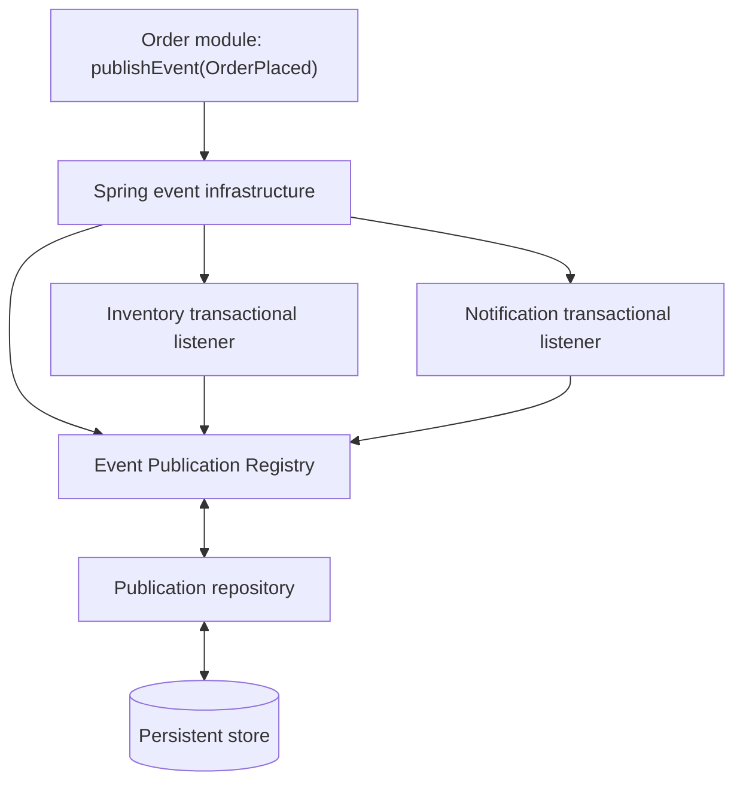
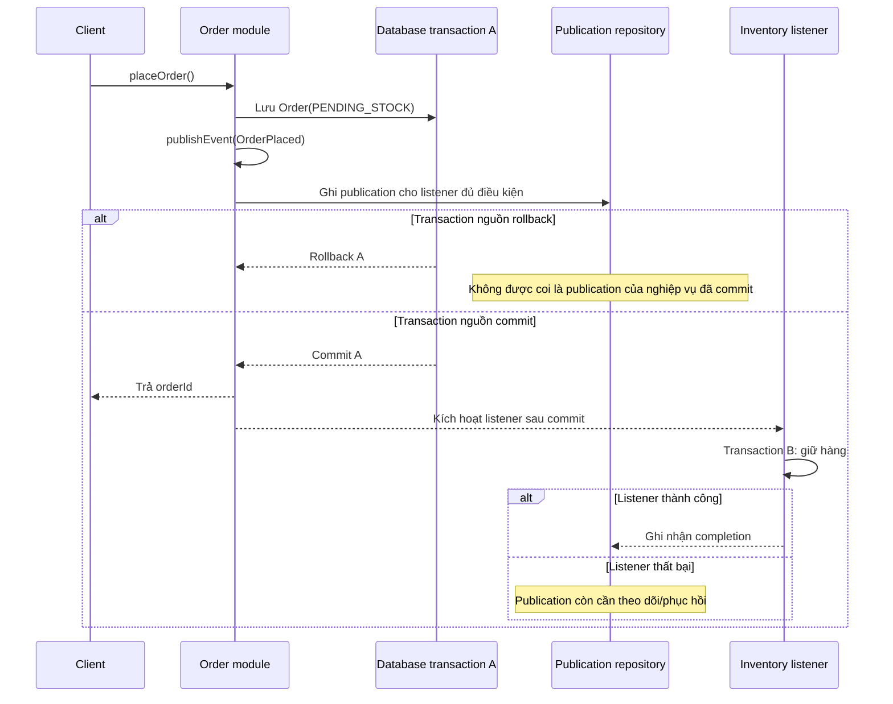
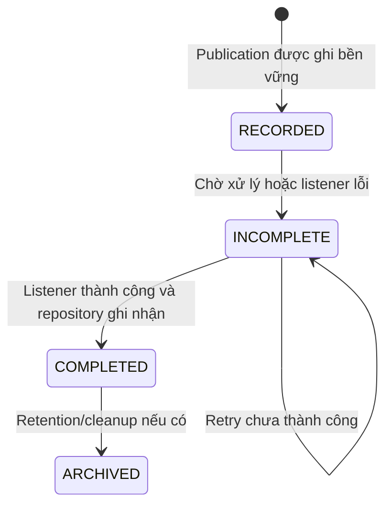
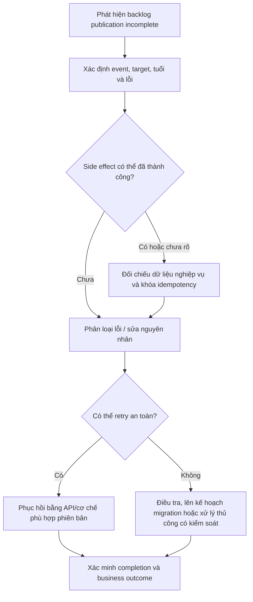

# Repository của publication trong Spring Modulith Event Publication Registry

## 1. Vì sao publication cần repository?

Trong ứng dụng **SPRING_MODULITH_APPLICATION_EVENTS**, module `order` có thể phát `OrderPlaced` khi đơn hàng được ghi nhận. Hai module `inventory` và `notification` phản ứng bằng listener sau commit, lần lượt giữ hàng và gửi thông báo tiếp nhận. Giao tiếp bằng application events giúp publisher không phụ thuộc trực tiếp vào implementation của những module nhận, đồng thời giữ ranh giới nghiệp vụ.

Tuy nhiên, nếu listener chạy bất đồng bộ, một khoảng thời gian tồn tại giữa **transaction tạo đơn đã commit** và **consumer xử lý xong**. Máy chủ có thể restart trong khoảng này, database của consumer có thể bị lỗi, hoặc listener có thể hoàn tất nghiệp vụ nhưng hạ tầng chưa ghi nhận được kết quả. Một event chỉ tồn tại trong bộ nhớ không cung cấp đủ dấu vết để biết còn công việc nào phải phục hồi.

**Event Publication Registry** của Spring Modulith giải quyết một phần bài toán đó bằng cách theo dõi các **publication đến từng transactional listener đủ điều kiện**. **Publication repository** là thành phần lưu trữ phục vụ registry: lưu thông tin publication, tìm các publication còn chưa hoàn tất và ghi nhận completion theo cách triển khai được cấu hình.

Bài thuộc chương **Publication Registry**, chủ đề **Repository của publication**. Mục tiêu là hiểu **dữ liệu và ranh giới transaction của repository**, không chỉ biết tên annotation. Sau bài này, bạn có thể:

1. Phân biệt event, publication, registry và repository của publication.
2. Giải thích tại sao một event có thể tương ứng với nhiều bản ghi publication.
3. Mô tả vòng đời ghi nhận publication, commit nguồn, hoàn tất listener và phục hồi.
4. Lựa chọn, cấu hình và kiểm tra một backend lưu trữ phù hợp với phiên bản Spring Modulith đang dùng.
5. Phân tích tính nguyên tử, schema, serialization, idempotency, retention và vận hành dữ liệu publication.
6. Thiết kế kiểm thử chứng minh repository lưu dữ liệu bền vững và hỗ trợ xử lý lại an toàn.

## 2. Năm đối tượng phải phân biệt

| Đối tượng | Định nghĩa | Ví dụ |
| --- | --- | --- |
| **Application event** | Sự thật nghiệp vụ đã xảy ra, được publisher công bố | `OrderPlaced(eventId, orderId, occurredAt)` |
| **Listener** | Thành phần nhận event và thực hiện trách nhiệm riêng | `ReserveStockWhenOrderPlaced.on(...)` |
| **Event publication** | Việc giao **một event đến một listener đích** cần theo dõi | Publication của `OrderPlaced` đến listener `inventory` |
| **Event Publication Registry** | Thành phần hạ tầng theo dõi, hoàn tất và hỗ trợ quản lý những publication được ghi nhận | Registry biết publication nào còn incomplete |
| **Publication repository** | Adapter lưu trữ dữ liệu để registry ghi, truy vấn và cập nhật trạng thái publication | JDBC/JPA hoặc backend tương ứng được ứng dụng cấu hình |

**Điều rất dễ nhầm:** `OrderRepository` lưu **đơn hàng** của nghiệp vụ; publication repository lưu **tiến trình giao sự kiện** của hạ tầng. Chúng không có cùng trách nhiệm, không cần dùng chung entity và không nên để module `inventory` truy cập trực tiếp các bảng của publication registry nhằm thay thế nghiệp vụ reservation.

Ví dụ:

```text
OrderPlaced(eventId=E1, orderId=O42)
    |
    +--> Publication P1: target = inventory.OrderPlacedListener
    |
    +--> Publication P2: target = notification.OrderPlacedListener
```

Nếu `inventory` xử lý thành công còn `notification` lỗi, **P1 có thể hoàn tất trong khi P2 vẫn chưa hoàn tất**. Một cờ `processed=true` đặt trực tiếp trên event E1 không đủ để biểu diễn trạng thái độc lập của hai listener.

## 3. Repository nằm ở đâu trong kiến trúc?



Các mũi tên đến registry biểu diễn quan hệ **ghi nhận và theo dõi publication**, không phải listener buộc phải gọi một API repository trong business code. Ở cách dùng Spring Modulith thông thường, lớp infrastructure đảm nhiệm ghi nhận completion khi listener thuộc diện được theo dõi thực thi thành công theo cơ chế tương ứng.

### 3.1. Hạ tầng quản lý repository, module sở hữu nghiệp vụ

Phân chia trách nhiệm:

- `order` quyết định **khi nào** đơn được ghi nhận và event mang thông tin gì.
- `inventory` quyết định có giữ hàng được không và bảo vệ transaction reservation.
- `notification` quyết định cách gửi thông báo và chống gửi lặp.
- Spring Modulith registry/repository lưu dấu vết **publication đến các listener**.
- Vận hành quan sát publication incomplete và quyết định cơ chế phục hồi an toàn.

Không biến `PublicationRepository` thành API công khai để các module tùy tiện đọc/ghi trạng thái nghiệp vụ. Thao tác thủ công sửa publication trong database có thể che khuất lỗi thật hoặc khiến consumer bị bỏ qua vĩnh viễn.

### 3.2. Repository không tự biến event thành message broker

Một bản ghi publication trong database **không đồng nghĩa** đã có Kafka, RabbitMQ hoặc một message queue có consumer group, partition và acknowledgement riêng. Spring Modulith application events vẫn có thể chạy giữa các module **trong một JVM**. Repository hỗ trợ theo dõi và phục hồi các listener được hạ tầng hỗ trợ; khi cần xuất event sang broker hoặc hệ thống khác, còn phải thiết kế rõ luồng externalization, outbox và ranh giới acknowledgement liên quan.

## 4. Bản ghi publication cần biểu diễn những gì?

Không có một schema SQL duy nhất áp dụng cho mọi repository. Nhưng về mặt khái niệm, một publication cần đủ thông tin để trả lời: **event nào, dành cho listener nào, được công bố khi nào và đã hoàn tất hay chưa?**

| Thuộc tính khái niệm | Công dụng | Lưu ý |
| --- | --- | --- |
| `publicationId` | Định danh bản ghi publication | Khác `eventId` nghiệp vụ; cách sinh phụ thuộc implementation |
| `eventPayload` | Dữ liệu event hoặc biểu diễn có thể khôi phục | Phải serialize/deserialize tương thích |
| `eventType` hoặc type hint | Xác định kiểu event khi phục hồi | Có thể phụ thuộc tên class/package Java |
| `targetListener` | Chỉ listener đích cần xử lý | Ảnh hưởng replay và refactor class/method |
| `publicationDate` | Mốc publication được ghi nhận | Không nhất thiết trùng `occurredAt` của domain |
| `completionDate` hoặc trạng thái hoàn tất | Biết publication đã được ghi nhận thành công | Hình thức đánh dấu/xóa tùy implementation và retention |
| Thông tin lỗi/lần thử, **nếu có** | Hỗ trợ chẩn đoán và retry | Không phải mọi backend đều lưu cùng metadata |

Ví dụ dữ liệu **minh họa logic**, không phải entity/DDL chính thức:

```json
[
  {
    "publicationId": "P1",
    "eventType": "OrderPlaced",
    "eventId": "E1",
    "targetListener": "inventory.OrderPlacedListener",
    "publicationDate": "2026-11-25T08:00:00Z",
    "completionDate": "2026-11-25T08:00:02Z"
  },
  {
    "publicationId": "P2",
    "eventType": "OrderPlaced",
    "eventId": "E1",
    "targetListener": "notification.OrderPlacedListener",
    "publicationDate": "2026-11-25T08:00:00Z",
    "completionDate": null
  }
]
```

`P1` và `P2` có thể cùng payload E1 nhưng khác **target listener**. Khi quan sát registry, việc một publication có `completionDate=null` là hình minh họa “chưa hoàn tất”; một số repository có thể lưu trạng thái theo cách khác hoặc di chuyển/xóa publication hoàn tất, nên phải đọc đúng mô hình của bản đang sử dụng.

### `occurredAt` khác `publicationDate` và `completionDate`

- `occurredAt`: sự thật nghiệp vụ xảy ra, do publisher xác định trong event.
- `publicationDate`: hạ tầng ghi nhận việc cần giao đến listener.
- `completionDate`: hạ tầng ghi nhận đã xử lý thành công publication tương ứng.
- `receivedAt`/`processedAt`: telemetry của consumer; không nhất thiết là field repository.

Đừng lấy `completionDate` làm thời điểm đơn hàng được đặt, hoặc lấy `occurredAt` suy ra thứ tự các listener hoàn tất. Listener bất đồng bộ có thể xử lý trễ hoặc được retry nhiều lần.

## 5. Vòng đời lưu trữ của một publication



Sơ đồ diễn tả **ý định nguyên tử và luồng xử lý**. Hình thức ghi publication, thời điểm đăng ký target, completion và phục hồi tùy phiên bản Spring Modulith cùng loại store. Đặc biệt, với kho lưu trữ không cùng transaction manager/database với dữ liệu nguồn, không được mặc nhiên coi các thao tác **ghi đơn + ghi publication** là một commit nguyên tử.

### 5.1. Ba trạng thái cần phân biệt

| Giai đoạn | Ý nghĩa | Điều có thể xảy ra |
| --- | --- | --- |
| Publication được ghi nhận trong transaction nguồn | Hạ tầng biết có công việc cần giao đến listener | Transaction nguồn vẫn có thể rollback |
| Transaction nguồn commit và listener chưa hoàn tất | Nghiệp vụ nguồn đã commit, công việc ở consumer chưa xong | Cần quan sát, retry hoặc phục hồi |
| Listener hoàn tất và repository ghi nhận thành công | Publication đích đã được đánh dấu xử lý xong theo semantics của registry | Side effect ngoài hệ thống vẫn có thể có vòng đời riêng |

**Quy tắc an toàn:** Khả năng phục hồi phụ thuộc vào việc **lưu publication đúng ranh giới transaction**, không chỉ việc có một bảng chứa các bản ghi.

## 6. Tính nguyên tử giữa nghiệp vụ nguồn và publication repository

Giả sử `order` tạo đơn trong transaction A, sau đó phát `OrderPlaced`. Để tránh trường hợp **đơn được commit nhưng dấu vết publication không được lưu** hoặc ngược lại, thiết kế cần làm rõ mức độ nguyên tử giữa:

1. Thay đổi nghiệp vụ của publisher.
2. Ghi nhận publication tương ứng tới listener có thể xử lý sau commit.

### 6.1. Khi cùng một local transaction có thể bảo vệ cả hai

Với một cơ sở dữ liệu quan hệ và một transaction manager được cấu hình phù hợp, việc lưu publication bằng adapter transaction-aware vào **cùng tài nguyên** có thể tham gia transaction nguồn:

```text
Transaction A:
  INSERT order(id=O42, status=PENDING_STOCK)
  INSERT tracked_publication(event=E1, target=inventory)    [khái niệm]
  INSERT tracked_publication(event=E1, target=notification) [khái niệm]
  COMMIT A
```

Nếu transaction A rollback, cả dữ liệu order lẫn các publication được ghi **trong transaction ấy** phải rollback. Nếu A commit, các publication tương ứng có dấu vết bền vững để phục hồi dù tiến trình ứng dụng dừng trước khi listener chạy.

Đây là yêu cầu thiết kế **atomicity trong cùng transaction**; không phải lời cam kết rằng mọi loại repository và mọi cách cấu hình Spring Modulith đều tự bảo đảm điều đó. Trong môi trường nhiều database, nhiều transaction manager hoặc một kho ghi nhận publication độc lập, cần kiểm chứng cơ chế atomicity hoặc chọn một phương án như transactional outbox phù hợp với ràng buộc hệ thống.

### 6.2. Những khoảng lỗi nếu không có atomicity

| Thứ tự không an toàn | Kết quả nguy hiểm |
| --- | --- |
| Commit đơn trước, ghi publication sau | Crash giữa hai bước khiến **đơn tồn tại nhưng không có publication** để phục hồi |
| Ghi publication ở kho độc lập trước, commit đơn sau | Nếu đơn rollback nhưng publication vẫn tồn tại, consumer có thể nhận **sự kiện của nghiệp vụ không thành công** |
| Phát vào memory executor trước khi commit | Task có thể chạy sớm; nếu crash thì mất công việc chưa có lưu trữ |
| Listener cập nhật database xong rồi đánh dấu hoàn tất riêng | Crash giữa hai bước khiến publication chưa hoàn tất và listener được gọi lại |

Điều kiện cuối cùng không thể loại bỏ chỉ bằng cách ghi publication cùng A: transaction B của consumer và bước xác nhận completion có thể là hai thao tác riêng. Đó là lý do listener phải **idempotent**.

### 6.3. Không giả định mọi event đều được repository lưu

Việc Spring có `ApplicationEventPublisher` và một `@EventListener` không có nghĩa mọi lần publish đều tạo bản ghi publication. Theo cơ chế registry, đối tượng được theo dõi là các **publication cho listener thuộc diện hỗ trợ**, thường là transactional listener. Sự kiện chỉ có plain `@EventListener` đồng bộ hoặc được phát ngoài ngữ cảnh transaction phù hợp có thể không có cùng cam kết ghi nhận.

Nếu nghiệp vụ bắt buộc không mất tác vụ khi crash, hãy xác định **listener nào được registry theo dõi**, từ đó kiểm thử số publication và tình trạng commit/rollback thực tế. Không suy luận độ bền từ mỗi tên class hoặc annotation riêng lẻ.

## 7. Những lựa chọn implementation cho publication repository

Spring Modulith có các module/starter để tích hợp Event Publication Registry với nhiều kiểu lưu trữ tùy phiên bản phát hành. Trong ứng dụng Spring Boot phổ biến dùng database quan hệ, hai hướng đáng cân nhắc là **JDBC** và **JPA**.

| Tiêu chí | Repository dựa trên JDBC | Repository dựa trên JPA |
| --- | --- | --- |
| Cách truy cập | SQL/JDBC qua infrastructure | Mapping/persistence của JPA |
| Phù hợp khi | Ứng dụng dùng JDBC, muốn thao tác lưu publication gần SQL | Ứng dụng đã dùng JPA và transaction manager phù hợp |
| Transaction nguồn | Phải dùng cùng tài nguyên và transaction manager thích hợp để đạt atomicity | Phải kiểm tra publication và business write thực sự cùng transaction |
| Schema | Cần đúng DDL/index do phiên bản adapter yêu cầu | Cần schema phù hợp với cách mapping/DDL của adapter |
| Tối ưu & vận hành | Theo dõi số row, query/index và connection pool | Theo dõi thêm flush, mapping và vấn đề entity manager |
| Khả năng đổi backend | Không thể coi dữ liệu đã lưu tự tương thích sang adapter khác | Migration cần xét schema và dữ liệu publication chưa hoàn tất |

Các loại store khác có thể được hỗ trợ tùy phiên bản, nhưng không nên suy ra rằng chúng có semantics transaction giống JDBC/JPA. Chọn **backend có tài liệu hỗ trợ đúng phiên bản** và kiểm chứng khả năng atomicity/recovery trong kiến trúc thực tế.

### 7.1. Ví dụ khai báo starter JDBC

Với một dự án Maven đã quản lý version Spring Modulith bằng cơ chế phù hợp:

```xml
<!-- Ví dụ: kiểm tra compatibility của starter với bản Spring Modulith đang dùng. -->
<dependency>
    <groupId>org.springframework.modulith</groupId>
    <artifactId>spring-modulith-starter-jdbc</artifactId>
</dependency>
```

Đây là **minh họa dependency**, không phải cấu hình đầy đủ. Ứng dụng còn cần datasource, driver, transaction manager, schema phù hợp, migrations và version tương thích của Spring Boot/Spring Modulith. Không tự thêm đồng thời nhiều starter repository chỉ để “dự phòng”: cần hiểu việc auto-configuration lựa chọn backend và tránh các bean cạnh tranh.

### 7.2. Ví dụ khai báo starter JPA

```xml
<dependency>
    <groupId>org.springframework.modulith</groupId>
    <artifactId>spring-modulith-starter-jpa</artifactId>
</dependency>
```

Với JPA, phải kiểm tra entity manager/transaction manager và cơ chế tạo schema. Việc ứng dụng **đã dùng Spring Data JPA cho nghiệp vụ** không bảo đảm một publication repository JPA đang hoạt động, hoặc storage đã có bảng/collection cần thiết.

**Lưu ý phiên bản:** Tên starter/API và tùy chọn khởi tạo schema có thể khác nhau theo release; trước khi triển khai production, đối chiếu documentation và dependency thật của phiên bản đang dùng. Tránh copy property cấu hình không được bản đang dùng hỗ trợ.

## 8. Schema và migration: xem repository như dữ liệu hạ tầng quan trọng

Publication repository lưu **trạng thái vận hành có ý nghĩa nghiệp vụ gián tiếp**: một publication chưa hoàn tất đại diện cho công việc có thể cần được thực thi. Vì thế việc thay schema hoặc xóa bảng không thể xử lý như cache có thể tạo lại tùy ý.

### 8.1. Một schema minh họa để học tư duy

```sql
-- ĐÂY KHÔNG PHẢI DDL CHÍNH THỨC CỦA SPRING MODULITH.
-- Chỉ dùng để hiểu dữ liệu tối thiểu cần thiết của một publication.
CREATE TABLE illustrative_event_publication (
    publication_id   VARCHAR(36) PRIMARY KEY,
    event_type       VARCHAR(300) NOT NULL,
    serialized_event TEXT NOT NULL,
    target_listener  VARCHAR(400) NOT NULL,
    published_at     TIMESTAMP WITH TIME ZONE NOT NULL,
    completed_at     TIMESTAMP WITH TIME ZONE NULL
);

CREATE INDEX idx_example_publication_incomplete
    ON illustrative_event_publication (completed_at, published_at);
```

Không chạy DDL này thay cho migration của thư viện: **tên bảng, cột, kiểu dữ liệu, index, chính sách xóa/lưu completed và cách định danh target listener thực tế phải lấy từ adapter/version đang triển khai**. Với JPA/JDBC, dùng migration Flyway hoặc Liquibase (nếu dự án sử dụng) để kiểm soát schema thống nhất giữa môi trường, tránh để production tự trôi theo thay đổi thư viện không được review.

### 8.2. Các quy tắc khi quản trị schema

- **Không xóa dữ liệu incomplete khi deploy.** Các bản ghi này có thể là công việc còn dở, cần phục hồi sau khi lỗi được khắc phục.
- **Không đổi kiểu dữ liệu serialized event một cách mù quáng.** Publication cũ có thể cần được deserialize bởi phiên bản ứng dụng mới.
- **Không đổi identifier của listener mà quên publication cũ.** Nếu adapter lưu định danh dựa trên class/method/target, việc refactor có thể khiến khôi phục mất đích.
- **Tối ưu query quan sát:** thường cần lọc publication chưa hoàn tất và sắp theo thời điểm ghi nhận, nhưng index phù hợp phụ thuộc SQL thực tế.
- **Phân biệt retention:** dữ liệu hoàn tất có thể có cơ chế lưu/xóa riêng; dữ liệu chưa hoàn tất cần chính sách điều tra và phục hồi trước khi dọn.
- **Sao lưu phục hồi:** backup cả publication data và dữ liệu nghiệp vụ liên quan để tránh kết quả restore thiếu đồng bộ.

### 8.3. Kiểm tra migration trước khi nâng phiên bản

1. Liệt kê publication chưa hoàn tất theo listener và event type.
2. Đối chiếu schema hiện tại với yêu cầu adapter mới.
3. Thử deserialize payload cũ bằng version mới trong môi trường staging.
4. Xác minh target listener cũ vẫn được nhận diện hoặc có kế hoạch chuyển đổi.
5. Xác minh việc hoàn tất và recovery không làm side effect lặp.
6. Chỉ sau đó mới thực hiện migration/cleanup có phương án rollback.

Khi đổi storage từ JDBC sang JPA hoặc sang backend khác, không được nghĩ đổi dependency là toàn bộ dữ liệu publication cũ tự xuất hiện trong kho mới. Cần một kế hoạch chuyển dữ liệu hoặc xử lý dứt điểm publication còn tồn trước khi chuyển.

## 9. Serialization: làm sao repository khôi phục đúng event?

Để replay một publication, infrastructure cần có cách khôi phục **payload và kiểu Java đúng** cho target listener. Việc serializer từng hoạt động lúc ghi **không bảo đảm** phiên bản ứng dụng mới sẽ đọc được mọi publication cũ.

Ví dụ contract công khai từ module `order`:

```java
// com/example/shop/order/OrderPlaced.java
package com.example.shop.order;

import java.time.Instant;
import java.util.List;
import java.util.Objects;
import java.util.UUID;

public record OrderPlaced(
        UUID eventId,
        UUID orderId,
        Instant occurredAt,
        List<Line> lines
) {
    public OrderPlaced {
        Objects.requireNonNull(eventId, "eventId");
        Objects.requireNonNull(orderId, "orderId");
        Objects.requireNonNull(occurredAt, "occurredAt");
        lines = List.copyOf(Objects.requireNonNull(lines, "lines"));
    }

    public record Line(UUID skuId, int quantity) {
        public Line {
            Objects.requireNonNull(skuId, "skuId");
            if (quantity <= 0) {
                throw new IllegalArgumentException("quantity must be positive");
            }
        }
    }
}
```

Các định danh sự kiện và `Instant` đều có ý nghĩa ổn định. `Line` là record, không truyền entity `Order`/`OrderLine` JPA ra module khác. `List.copyOf` bảo vệ cấu trúc snapshot, còn consumer có thể dùng dữ liệu này để tự tạo DTO nội bộ.

Biểu diễn JSON *minh họa*:

```json
{
  "eventId": "bd074a21-08d8-45a1-baa1-3948ac7b229a",
  "orderId": "4a8e8fa7-aad5-4f62-ac2e-c46a0dd17625",
  "occurredAt": "2026-11-25T08:00:00Z",
  "lines": [
    { "skuId": "b6c86fe8-f299-4170-96f4-4cfba1a8437f", "quantity": 2 }
  ]
}
```

Payload này **không phải cam kết** rằng repository mặc định xuất chính xác JSON như trên; cách serialize và metadata kèm theo phụ thuộc adapter/serializer. Nếu tích hợp Jackson, phải bảo đảm `java.time.Instant` được hỗ trợ và không vô tình chuyển từ chuỗi ISO có offset sang một định dạng số không thống nhất.

### 9.1. Thay đổi contract có thể phá publication đang lưu

| Thay đổi | Rủi ro phục hồi | Cách phòng tránh |
| --- | --- | --- |
| Đổi package hoặc tên `OrderPlaced` | Metadata kiểu cũ có thể không phân giải được | Kiểm tra type alias/serialization và migration có kiểm thử |
| Thêm component vào Java record | Constructor/deserializer có thể yêu cầu field mới | Xem xét default, compatibility hoặc event phiên bản mới |
| Đổi `orderId` từ `UUID` thành kiểu khác | Payload cũ không deserialize đúng | Chiến lược version hóa rõ ràng |
| Đổi tên `lines` hoặc nested record | JSON field/structure cũ không còn tương thích | Compatibility test với payload cũ |
| Thay ý nghĩa `occurredAt` thành thời gian xử lý | Dữ liệu đọc được nhưng sai nghiệp vụ | Giữ ngữ nghĩa bất biến, thêm field mới nếu cần |
| Đưa entity JPA có lazy relation vào event | Nổ lỗi serialization hoặc truy cập ngoài transaction | Chỉ chứa snapshot/value objects |

Đối với Java record, “thêm field tùy chọn trong JSON” không mặc nhiên tương thích với **constructor/API Java**. Cần xem cả producer, consumer và publication cũ mà repository sẽ dùng khi replay.

## 10. Repository làm gì khi listener hoàn tất hoặc thất bại?

Ở mức trừu tượng, registry cần hai khả năng:

1. **Ghi nhận hoàn tất** cho publication đến một listener khi callback được coi là thành công.
2. **Giữ dấu vết unfinished/incomplete** khi callback chưa xử lý xong hoặc báo lỗi, phục vụ tìm kiếm và khôi phục.



**Các nhãn trên là state machine khái niệm**, không phải enum/trạng thái persisted chính thức của Spring Modulith. Một số backend có thể biểu diễn complete bằng completion timestamp, di chuyển bản ghi hoặc xóa khi đủ điều kiện. Điều cần hiểu là trạng thái hoàn tất gắn với **publication của từng listener**, không phải một cờ duy nhất trên toàn event.

### 10.1. Callback trả về bình thường có thể tạo “thành công giả”

```java
@ApplicationModuleListener
void on(OrderPlaced event) {
    try {
        reservationService.reserveOnce(event.orderId(), event.lines());
    } catch (RuntimeException failure) {
        log.error("Cannot reserve stock", failure);
        // Nuốt lỗi, callback vẫn kết thúc bình thường.
    }
}
```

Đây là **anti-pattern minh họa**; `reservationService` và `log` là biến/bean giả định. Nếu listener nuốt exception, infrastructure có thể ghi publication hoàn tất trong khi transaction nghiệp vụ chưa đạt kết quả đúng. Trạng thái repository lúc ấy không thể tự nhận biết business side effect thất bại.

### 10.2. Lỗi xảy ra *sau* khi consumer đã commit

```text
1. Inventory nhận publication P1.
2. Transaction B giữ hàng commit Reservation(O42).
3. Ứng dụng crash trước khi repository ghi completion(P1).
4. Repository vẫn xem P1 chưa hoàn tất.
5. Khôi phục P1 -> listener được gọi lại.
```

Không có cách nào chỉ dựa vào một transaction riêng của registry mà suy ra chắc chắn tác dụng phụ trong B đã chạy đúng một lần. Nếu xử lý lại làm giảm tồn thêm lần nữa, hệ thống sai nghiệp vụ. Vì vậy **repository giúp không bỏ quên công việc, còn idempotency ở consumer giúp không làm trùng tác dụng phụ**.

## 11. Thiết kế consumer an toàn khi repository phát lại publication

Một module nhận event phải coi việc xử lý cùng một publication nhiều lần là tình huống có thể xảy ra, ngay cả khi có storage bền vững. Chọn khóa idempotency theo **tác dụng phụ cần bảo vệ**:

| Tác vụ consumer | Khóa chống trùng có thể dùng | Bất biến cần bảo vệ |
| --- | --- | --- |
| Ghi nhận event đã xử lý | `(consumerId, eventId)` | Một consumer không áp dụng cùng event hai lần |
| Giữ tồn kho ban đầu | `(orderId, reservationPurpose)` | Một đơn không có hai reservation cho cùng mục đích |
| Gửi thư tiếp nhận | `(orderId, notificationType)` | Một yêu cầu thông báo không tạo nhiều bản gửi không mong muốn |
| Tạo lệnh thanh toán | Idempotency key được provider hỗ trợ | Retry không tạo khoản thu thứ hai |
| Xử lý thay đổi phiên bản aggregate | `(aggregateId, aggregateVersion)` và trạng thái | Không áp dụng sự kiện cũ sau trạng thái mới hơn |

`eventId` và `publicationId` khác nhau. Một event đến hai listener tạo hai publication; dùng duy nhất `eventId` trong bảng dedup **chung cho tất cả listener** có thể khiến listener B bị coi là đã xử lý chỉ vì listener A hoàn tất. Do đó khóa chống trùng thường cần kèm **định danh consumer** hoặc dùng một business key thuộc dữ liệu của chính module nhận.

### 11.1. Một service `reserveOnce` minh họa

```java
// Pseudocode application service thuộc inventory.internal.
@Service
class StockReservationService {
    private final ReservationRepository reservations;
    private final StockAllocator allocator;

    StockReservationService(ReservationRepository reservations,
                            StockAllocator allocator) {
        this.reservations = reservations;
        this.allocator = allocator;
    }

    @Transactional
    public void reserveOnce(UUID orderId, List<ReservationLine> lines) {
        var purpose = ReservationPurpose.INITIAL_HOLD;

        if (reservations.existsByOrderIdAndPurpose(orderId, purpose)) {
            return;
        }

        StockReservation reservation =
                allocator.reserve(orderId, purpose, lines);
        reservations.save(reservation);
    }
}
```

`ReservationRepository`, `StockAllocator`, `ReservationLine` và `StockReservation` là các kiểu minh họa của ứng dụng. Đoạn code **chưa đủ** chống concurrent replay vì hai transaction có thể cùng kiểm tra `exists... == false`. Trong thực tế cần:

1. Ràng buộc unique trên business key hợp lệ.
2. Transaction bảo vệ reservation và cập nhật số lượng tồn.
3. Locking hoặc cập nhật có điều kiện để tránh cấp phát vượt tồn.
4. Khi gặp unique conflict, đọc lại kết quả đã commit và xác minh nó thực sự tương ứng yêu cầu cũ.
5. Nếu payload cũ và dữ liệu hiện tại mâu thuẫn, xử lý như sự cố nghiệp vụ thay vì nuốt exception.

Ở phía listener, chỉ chuyển dữ liệu event công khai của `order` sang DTO nội bộ:

```java
@Component
class ReserveStockWhenOrderPlaced {
    private final StockReservationService reservations;

    ReserveStockWhenOrderPlaced(StockReservationService reservations) {
        this.reservations = reservations;
    }

    @ApplicationModuleListener
    void on(OrderPlaced event) {
        var lines = event.lines().stream()
                .map(line -> new ReservationLine(
                        line.skuId(), line.quantity()))
                .toList();
        reservations.reserveOnce(event.orderId(), lines);
    }
}
```

`@ApplicationModuleListener` trong cách dùng phổ biến của Spring Modulith thể hiện xử lý bất đồng bộ sau commit với transaction riêng của listener. Điều này không loại bỏ yêu cầu ghi dữ liệu bền vững và idempotency ở service.

### 11.2. Không retry vô hạn lỗi nghiệp vụ cố định

Nếu `inventory` không đủ hàng, đây có thể là một **kết quả nghiệp vụ hợp lệ**: lưu trạng thái `REJECTED_OUT_OF_STOCK`, thông báo qua luồng kết quả hợp lệ và cho listener kết thúc thành công. Nếu ném một exception chung và cứ replay publication, hệ thống có thể không bao giờ tiến triển.

Phân biệt:

- **Technical failure**: timeout database, mất kết nối, lỗi transient; thường phù hợp để retry sau khi kiểm soát nguyên nhân.
- **Business rejection**: thiếu hàng, hạn đặt bị vượt, yêu cầu không hợp lệ theo domain; cần một trạng thái hoặc sự kiện kết quả, không phải retry vô hạn.
- **Poison publication**: payload cũ không thể deserialize hoặc contract không còn tương thích; cần điều tra/migration thay vì sửa trực tiếp dữ liệu production tùy tiện.

Repository ghi lại publication chưa hoàn tất **không tự quyết định đúng chính sách nghiệp vụ** cho mọi loại lỗi.

## 12. Các chức năng dữ liệu cốt lõi và ranh giới API

Ở mức logic, publication repository phải phục vụ nhóm thao tác sau:

| Thao tác logic | Khi nào cần | Điều cần bảo vệ |
| --- | --- | --- |
| `record(event, target)` | Publisher công bố một event có listener cần theo dõi | Đảm bảo ghi cùng transaction nguồn nếu yêu cầu atomicity |
| `findIncomplete(...)` | Vận hành/tác vụ phục hồi tìm publication chưa hoàn tất | Không bỏ sót hoặc đọc nhầm completed là incomplete |
| `markCompleted(publicationId)` | Listener được coi là thực hiện thành công | Chỉ đánh dấu đúng listener target và publication |
| `listCompleted(...)` nếu store hỗ trợ | Audit hoặc cleanup có kiểm soát | Retention, hiệu năng truy vấn và dữ liệu riêng tư |
| `delete/expire(...)` theo chính sách store | Quản lý dung lượng lâu dài | Không xóa công việc unfinished một cách mù quáng |

**Các tên hàm trong bảng là pseudocode**, không phải chữ ký API bắt buộc của `EventPublicationRepository`. Spring Modulith có các abstraction/triển khai repository và registry khác nhau theo phiên bản. Tầng ứng dụng nên ưu tiên **hợp đồng quản lý publication được Spring Modulith hỗ trợ công khai**, không gọi trực tiếp các implementation persistence hoặc tự sửa trạng thái SQL trừ khi một quy trình vận hành đã kiểm chứng yêu cầu việc đó.

### 12.1. Vì sao không cho consumer tự đánh dấu publication?

Giả sử `inventory` gọi thủ công `markCompleted` ngay khi bắt đầu:

```text
1. Registry lưu publication P1 cần giao tới inventory.
2. Inventory đánh dấu P1 completed.
3. Inventory chưa commit reservation thì ứng dụng crash.
4. P1 không còn xuất hiện trong danh sách unfinished.
```

Việc đánh dấu quá sớm tạo “thành công giả” và có thể đánh mất tác vụ cần phục hồi. Đúng hơn, infrastructure/registry ghi completion **sau khi listener được xác định thành công theo semantics cấu hình**. Với tác vụ ngoài transaction, cần thay đổi thiết kế trách nhiệm (ví dụ listener ghi outbox bền vững rồi phần gửi thực được quản lý ở vòng đời khác).

### 12.2. Repository và API vận hành không phải cùng một thứ

Một API để người vận hành “retry incomplete publication” không đơn giản là lặp lại thao tác `SELECT` rồi gọi mọi callback theo thứ tự. Cần bảo đảm:

- Chọn đúng listener target và đúng payload/kiểu event.
- Không khởi chạy nhiều worker tranh cùng một publication nếu hạ tầng không hỗ trợ coordination.
- Kiểm tra khả năng idempotency và tác dụng phụ trước replay.
- Phân loại lỗi cố định cần điều tra thay vì tự động retry vô hạn.
- Không đổi timestamp/id nguồn chỉ để đánh dấu một lần thử mới.

Khả năng resubmission/republication và API truy vấn có thể khác nhau theo release; không nên tự chế hàm gọi trực tiếp listener rồi tuyên bố đã hoàn tất publication theo registry.

## 13. Nhiều instance và concurrency: repository cần bảo vệ gì?

Trong môi trường chạy nhiều instance cùng truy cập một database, có thể xảy ra:

```text
Instance A: tìm publication P1 chưa hoàn tất
Instance B: cũng tìm publication P1 chưa hoàn tất
Instance A: thực thi listener inventory cho P1
Instance B: thực thi listener inventory cho P1
```

Không phải mọi bản ghi incomplete đều đồng nghĩa có một **lease/lock tự động chống nhận trùng**. Cơ chế claim/locking và resubmission phải được xác minh theo implementation/version. Kể cả có khóa phân phối, vẫn có khả năng xảy ra lỗi giữa commit side effect và completion, nên consumer vẫn phải idempotent.

### Biện pháp thiết kế

1. **Một đầu mối recovery hoặc distributed coordination** khi vận hành nhiều instance, nếu cơ chế hỗ trợ mặc định chưa đủ.
2. **Giới hạn concurrency** dựa trên connection pool, executor và tài nguyên consumer.
3. **Unique constraint + transaction** ở dữ liệu nghiệp vụ bảo vệ nhiều lượt chạy song song.
4. **Có log/tracing** để phân biệt publication ID, consumer, event ID và các lần thử.
5. **Test chạy đồng thời** thay vì chỉ test hai lượt gọi tuần tự.

Một publication repository lưu trữ tốt giúp biết **công việc nào còn mở**, nhưng bản thân sự tồn tại của repository không thay thế bộ điều phối, transaction và khóa nghiệp vụ.

## 14. Bảo mật, dữ liệu cá nhân và retention

Payload được lưu để phục hồi có thể tồn tại **lâu hơn vòng đời của HTTP request**. Vì thế nội dung event có thể trở thành dữ liệu được lưu trữ ở một hạ tầng độc lập với bảng nghiệp vụ nguồn.

### 14.1. Payload tối thiểu

Không đưa thẳng entity JPA hoặc toàn bộ thông tin người mua vào event khi listener chỉ cần `orderId`, mã sản phẩm và số lượng. Tránh mật khẩu, access token, số thẻ, dữ liệu cá nhân nhạy cảm nếu không cần thiết. Một publication chưa hoàn tất có thể được lưu rất lâu và được tiếp cận trong quá trình debug.

### 14.2. Quyền truy cập

- Phân quyền truy vấn/ghi publication theo nguyên tắc tối thiểu cho application và nhân sự vận hành.
- Không cho consumer tự sửa bản ghi registry hoặc bảng của module khác.
- Áp dụng mã hóa truyền tải và lưu trữ theo yêu cầu bảo mật hệ thống.
- Giới hạn log payload khi có dữ liệu cá nhân; ưu tiên event ID, aggregate ID và mã lỗi.
- Theo dõi mọi thao tác recovery, retention hoặc xóa dữ liệu có tác động.

### 14.3. Retention có điều kiện

Mỗi kho có thể hỗ trợ giữ completed publications để audit hoặc dọn sau thời gian nhất định. Cần phân biệt:

| Loại dữ liệu | Cách xử lý đề xuất |
| --- | --- |
| Completed publication | Có thể dọn theo retention sau khi xem nhu cầu audit/đối soát |
| Incomplete publication còn hợp lệ | Tiếp tục theo dõi, phục hồi hoặc xử lý nguyên nhân |
| Incomplete bị lỗi schema/dữ liệu | Cách ly/điều tra có kiểm soát, không xóa để làm đẹp dashboard |
| Publication của event bị deprecated | Chỉ dọn/chuyển đổi khi xác minh consumer không còn cần replay |

**Độ tuổi lớn không tự đồng nghĩa “có thể xóa”.** Một publication cũ vẫn có thể là việc đang nợ khách hàng, ví dụ gửi yêu cầu hoàn tiền hoặc hoàn tất trạng thái đơn hàng.

## 15. Vận hành repository: biết publication nào đang bị kẹt

Một repository chỉ có ý nghĩa thực tiễn khi nhóm vận hành trả lời được:

1. Có bao nhiêu publication chưa hoàn tất?
2. Listener nào đang tạo backlog lớn?
3. Publication lâu nhất đã đợi bao lâu?
4. Những lần thất bại gần nhất thuộc nhóm lỗi gì?
5. Tác dụng phụ của lần xử lý trước có thể đã thành công chưa?
6. Sau khi sửa lỗi, ai và bằng cơ chế nào được phép phục hồi an toàn?

### 15.1. Số liệu nên quan sát

| Metric hoặc thông tin | Công dụng | Cảnh báo |
| --- | --- | --- |
| Số publication incomplete theo listener | Phát hiện module nhận đang tụt lại | Xu hướng tăng kéo dài |
| Tuổi của publication incomplete lâu nhất | Phát hiện sự kiện bị kẹt lâu | Vượt SLA phục hồi |
| Tốc độ publication mới và completion | Đo khả năng đáp ứng tải | Input liên tục lớn hơn output |
| Số lần retry/processing failure | Phân loại lỗi hệ thống | Tăng đột biến hoặc lặp cố định |
| Độ trễ từ publication đến completion | Theo dõi thời gian hoàn tất đầu-cuối | Percentile cao kéo dài |
| Connection pool/lock/DB latency | Đánh giá điểm nghẽn repository | Cạn connection, lock wait, timeout |
| Số đơn `PENDING_STOCK` quá hạn | Đối chiếu **trạng thái nghiệp vụ** | Có thể publication đã xong nhưng quy trình chưa xong |

Metric name cụ thể do ứng dụng/hạ tầng quyết định, không được coi các tên trong bảng là metric tự động của Spring Modulith. Không dùng `eventId` hoặc `publicationId` làm tag metric có cardinality quá cao; chúng phù hợp hơn cho **log và trace**.

### 15.2. Ví dụ log có cấu trúc

```text
eventType=OrderPlaced
eventId=bd074a21-08d8-45a1-baa1-3948ac7b229a
aggregateId=4a8e8fa7-aad5-4f62-ac2e-c46a0dd17625
publicationId=P1
targetListener=inventory.ReserveStockWhenOrderPlaced
outcome=RETRYABLE_FAILURE
cause=DATABASE_TIMEOUT
publicationState=INCOMPLETE
```

Các trường này là **ví dụ định dạng telemetry**, không phải bộ field bắt buộc trong repository. Đặc biệt, trạng thái “incomplete” phải lấy từ dữ liệu thật hoặc API quan sát đã được xác minh; không viết một giá trị suy đoán vào log rồi coi đó là trạng thái database.

### 15.3. Runbook xử lý publication incomplete



Một quy trình thực tế nên ghi nhận ai thực hiện, publication nào được tác động, dữ liệu trước/sau xử lý và có bao nhiêu consumer liên quan. **Không cập nhật trực tiếp cột completion** bằng SQL để “xử lý” một sự cố nếu chưa chứng minh công việc nghiệp vụ đã xong; thao tác đó có thể làm mất dấu một nhiệm vụ chưa được thực hiện.

## 16. Kiểm thử publication repository: từ transaction đến crash/recovery

Kiểm thử tốt cần chứng minh cả **dữ liệu publication** và **hành vi nghiệp vụ**. Chỉ unit test `OrderPlacedListener.on(event)` không chứng minh adapter repository đã ghi publication, hoặc việc ghi nhận hoàn tất có tồn tại bền vững sau khi ứng dụng restart.

### 16.1. Test ghi publication đúng transaction nguồn

Với một integration test có datasource, transaction manager và registry thực tế:

1. Khởi động Spring context có đúng **một backend repository** được chọn.
2. Gọi publisher trong transaction A, tạo `OrderPlaced` hợp lệ.
3. Khi A chưa commit, xác minh expectation về transaction visibility bằng một kết nối/transaction độc lập nếu phù hợp.
4. Cho A rollback và xác minh **không có công việc được coi là đã commit** cần phát sau commit.
5. Cho A commit và xác minh publication của listener thuộc diện theo dõi được lưu bền vững theo backend.
6. Nếu có hai listener, kiểm tra trạng thái của **từng target** chứ không chỉ tổng số event.

Không dùng `@Transactional` trên method test rồi mặc định mong có callback `AFTER_COMMIT`: Spring test có thể tự rollback ở cuối test. `TransactionTemplate` giúp chủ động xác định commit/rollback, ví dụ:

```java
// Đoạn minh họa cách tạo transaction thật trong integration test.
@Autowired TransactionTemplate transactionTemplate;
@Autowired ApplicationEventPublisher publisher;

@Test
void publicationFollowsSourceCommit() {
    OrderPlaced event = testOrderPlaced();

    transactionTemplate.executeWithoutResult(status -> {
        publisher.publishEvent(event);
        // Cho transaction nguồn hoàn tất bình thường sau lambda.
    });

    // Kiểm tra publication/side effect bằng repository hoặc API quan sát
    // đúng phiên bản, từ transaction độc lập.
}
```

`testOrderPlaced()` là fixture do dự án định nghĩa. Đoạn này **chỉ là cấu trúc kiểm thử transaction**; để chạy được phải có bean, các import, publisher đúng contract và cơ chế kiểm tra cụ thể. Nếu listener xử lý quá nhanh, publication đã có thể được ghi nhận hoàn tất trước lần quan sát đầu tiên; vì vậy muốn test trạng thái “incomplete”, phải có listener test **cố ý lỗi hoặc bị giữ lại có kiểm soát**, chứ không đọc danh sách unfinished rồi kết luận “registry không ghi”.

### 16.2. Test transaction rollback

```java
@Test
void rollbackDoesNotProduceCommittedAfterCommitWork() {
    OrderPlaced event = testOrderPlaced();

    transactionTemplate.executeWithoutResult(status -> {
        publisher.publishEvent(event);
        status.setRollbackOnly();
    });

    // Xác minh listener AFTER_COMMIT không thực hiện tác vụ nguồn đã rollback.
    // Đối chiếu trạng thái publication theo cấu hình backend đang dùng.
}
```

Với phương án publication và dữ liệu nguồn cùng transaction, ghi nhận publication phải tuân theo rollback. Nếu test cho thấy bản ghi publication của transaction đã rollback vẫn tồn tại, cần xem lại transaction manager, store hoặc cách publisher phát event.

### 16.3. Test lỗi kỹ thuật và completion

Tạo một listener transactional có thể điều khiển thất bại, ví dụ ném exception vào lần đầu sau khi transaction A commit. Xác minh:

| Kịch bản | Kỳ vọng |
| --- | --- |
| A commit, listener lỗi trước khi ghi nghiệp vụ | Có publication chưa hoàn tất để phục hồi nếu registry theo dõi |
| A commit, listener xử lý thành công | Publication đích được ghi nhận hoàn tất theo chính sách repository |
| Hai listener cùng event, một lỗi | Trạng thái publication phân biệt theo target |
| Replay sau khi lỗi được sửa | Business outcome chính xác và publication được hoàn tất |
| Side effect commit, completion ghi nhận lỗi | Replay không làm business side effect trùng |
| Consumer chạy lại đồng thời | Unique constraint/locking tiếp tục giữ bất biến |
| Event payload cũ vẫn nằm trong repository | Phiên bản ứng dụng mới deserialize và định tuyến đúng |
| Đổi tên method/class listener | Khả năng phục hồi publication cũ được kiểm chứng hoặc có migration |

Không mặc định “retry chạy tự động sau mỗi N giây”. Cơ chế phát lại/cấu hình scheduling và API quản lý phụ thuộc phiên bản Spring Modulith; integration test cần dùng cơ chế được hỗ trợ thực sự thay vì tự tạo retry loop làm sai semantics của registry.

### 16.4. Test xử lý bất đồng bộ và dữ liệu bền vững

Với `@ApplicationModuleListener`, hãy chờ một điều kiện nghiệp vụ có giới hạn thời gian thay vì `Thread.sleep(...)` cố định:

```java
// Ví dụ với Awaitility, nếu dự án có dependency này.
await().atMost(Duration.ofSeconds(10))
        .untilAsserted(() ->
            assertThat(reservationQueries.countByOrderId(orderId))
                    .isEqualTo(1));
```

`await()` ở đây thuộc Awaitility, không phải API mặc định của Spring Modulith. `reservationQueries` phải đọc **trạng thái database đã commit**, không chỉ biến Java tạm thời trong listener.

### 16.5. Test kiến trúc để không phá ranh giới module

```java
package com.example.shop;

import org.junit.jupiter.api.Test;
import org.springframework.modulith.core.ApplicationModules;

class ModuleArchitectureTests {

    @Test
    void modulesRespectBoundaries() {
        ApplicationModules.of(ShopApplication.class).verify();
    }
}
```

`ShopApplication` là class `@SpringBootApplication` giả định ở package gốc. Phép `verify()` kiểm tra các quy tắc phụ thuộc module nhưng **không** chứng minh persistence của publication hoạt động. Phải kết hợp architecture test, transaction test, recovery test và schema compatibility test.

## 17. Checklist lựa chọn và triển khai publication repository

Trước khi đưa repository vào production, hãy xác nhận:

1. **Phiên bản:** Spring Boot, Spring Modulith và starter được quản lý tương thích; sử dụng API được phiên bản đó hỗ trợ.
2. **Backend:** Đã chọn đúng một triển khai persistence registry (JDBC/JPA hoặc backend được hỗ trợ tương ứng).
3. **Schema:** Migration/DDL và index đúng implementation, đã thử startup trên database sạch và database nâng cấp.
4. **Transaction:** Ghi publication có đi cùng local transaction của publisher khi yêu cầu atomicity không?
5. **Listener target:** Những listener nào được registry theo dõi? Một event đến nhiều listener có được phân biệt rõ không?
6. **Serialization:** Payload đã lưu có đọc được sau nâng phiên bản? Có test cho các event cũ chưa hoàn tất không?
7. **Completion:** Định nghĩa thành công của listener có gắn với một tác vụ bền vững, không chỉ “đã đẩy việc vào thread”?
8. **Retry:** Có cơ chế quản lý unfinished publication và resubmission phù hợp không; đã thử lỗi thật chưa?
9. **Idempotency:** Consumer có unique business key/transaction khi xử lý lại không?
10. **Concurrency:** Có kiểm soát đa instance, executor, connection pool và replay đồng thời không?
11. **Observability:** Có số lượng/tuổi publication incomplete, lỗi theo target listener và chỉ số nghiệp vụ không?
12. **Retention:** Có chính sách giữ/xóa completed, bảo vệ incomplete, backup và kiểm soát truy cập không?
13. **Upgrade:** Có kế hoạch cho publication cũ khi đổi package, event type, listener method hoặc backend storage không?
14. **Review ranh giới:** Module tiêu thụ event công khai, không đọc trực tiếp repository nội bộ của module khác hay bảng registry.

## 18. Bài tập thực hành: từ JDBC repository đến phục hồi

**Bối cảnh:** Ứng dụng Spring Modulith có `order`, `inventory`, `notification`. Module `order` lưu đơn ở `PENDING_STOCK`, phát `OrderPlaced` trong transaction A. Hai module còn lại dùng `@ApplicationModuleListener`. Ứng dụng lựa chọn một publication repository được lưu bền vững trong database.

**Nhiệm vụ:**

1. Vẽ sơ đồ giữa `ApplicationEventPublisher`, Event Publication Registry, publication repository, database, hai listener và các transaction A/B.
2. Thêm một backend persistence của registry phù hợp phiên bản thư viện và database đang sử dụng. Xác minh schema chính thức của implementation đã được tạo bằng cơ chế migration/khởi tạo được dự án lựa chọn.
3. Phát một event khi transaction A commit; ghi nhận rằng có thể tồn tại **hai publication cho hai target listener**, không phải một cờ xử lý duy nhất.
4. Phát event khi transaction A rollback; giải thích vì sao không được tồn tại một công việc sau commit từ một đơn chưa được ghi nhận.
5. Cho listener `inventory` ném lỗi kỹ thuật có kiểm soát, còn `notification` thành công; đối chiếu trạng thái publication riêng của từng target.
6. Chạy phương án phục hồi được phiên bản Spring Modulith đang dùng hỗ trợ; sửa lỗi và xác minh `inventory` hoàn tất mà không làm `notification` gửi thêm thông báo ngoài ý muốn.
7. Giả lập reservation đã commit nhưng completion chưa ghi nhận; retry và xác minh chỉ có một reservation cho business key phù hợp.
8. Thử thay package/tên Java class `OrderPlaced` hoặc method listener trên nhánh thử nghiệm; phân tích vì sao các publication cũ có thể cần compatibility/migration.
9. Giả lập tăng số lượng incomplete publication; bổ sung cảnh báo độ tuổi lớn nhất, số lượng theo listener và mức sử dụng connection pool.
10. Viết runbook vận hành xử lý một publication “poison” không deserialize được, nêu rõ vì sao không được xóa trực tiếp để làm sạch bảng.

### Câu hỏi tự kiểm tra

**Câu 1.** Một event có hai listener. Listener A đã thành công, B thất bại. Có thể xóa toàn bộ bản ghi của event không?

**Gợi ý:** Không được coi event như một đơn vị hoàn tất chung. Cần xem các **publication theo target**, chính sách store và nghĩa vụ còn dang dở của B.

**Câu 2.** Đã có JDBC publication repository, vậy mọi side effect đều exactly-once?

**Gợi ý:** Không. Nếu consumer commit rồi completion chưa được ghi nhận, cùng publication có thể được phát lại. Consumer phải idempotent và các tác vụ bên ngoài cần deduplication/đối soát.

**Câu 3.** Database order ở PostgreSQL, publication ở một kho khác với transaction manager khác. Chỉ thêm starter có đủ bảo đảm atomicity không?

**Gợi ý:** Không thể giả định. Cần kiểm chứng ranh giới giao dịch giữa hai kho và, nếu không có cơ chế phối hợp, thiết kế outbox/giải pháp nhất quán phù hợp.

**Câu 4.** Đổi tên listener nhưng vẫn cùng nội dung method. Điều gì cần kiểm tra trước khi deploy?

**Gợi ý:** Tên/identifier target đang được repository lưu, publication incomplete của bản cũ và khả năng migration hoặc replay tương thích với phiên bản mới.

**Câu 5.** Cần làm gì nếu số lượng publication incomplete giảm về 0 nhưng đơn hàng vẫn kẹt `PENDING_STOCK`?

**Gợi ý:** Đối chiếu **kết quả nghiệp vụ**. Có thể listener chỉ ghi log, nuốt lỗi hoặc đã hoàn tất một nhiệm vụ hẹp hơn; publication completion không tự chứng minh trạng thái kinh doanh cuối cùng.

## 19. Ghi nhớ

- **Publication repository lưu dấu vết giao sự kiện đến từng listener**, không phải repository của entity nghiệp vụ và không phải message broker.
- Ghi publication cần có **ranh giới transaction rõ ràng**. Nếu muốn nguyên tử với dữ liệu nguồn, phải kiểm chứng cùng resource và transaction manager phù hợp.
- Một event có thể có **nhiều publication độc lập**; completion của `inventory` không đồng nghĩa `notification` cũng hoàn tất.
- **Schema, serialized payload và target listener identifier** là dữ liệu cần được bảo vệ khi nâng phiên bản hoặc refactor code.
- Registry/repository giúp nhận biết publication chưa hoàn tất, nhưng **không bảo đảm exactly-once side effects**; replay cần idempotency ở consumer.
- Đừng xóa/sửa trực tiếp dữ liệu incomplete để che lỗi. Cần runbook phục hồi, retention, quyền truy cập và quan sát backlog.
- Kiểm thử phải chứng minh commit/rollback, lưu publication bền vững, listener thất bại, phục hồi, xử lý trùng và tương thích sau upgrade.

Khi hiểu đúng repository của publication, bạn có thể thiết kế các module Spring Modulith trao đổi qua application events với dấu vết xử lý đáng tin cậy hơn, đồng thời tách bạch trách nhiệm giữa **hạ tầng giao sự kiện** và **trạng thái nghiệp vụ** của từng module.
