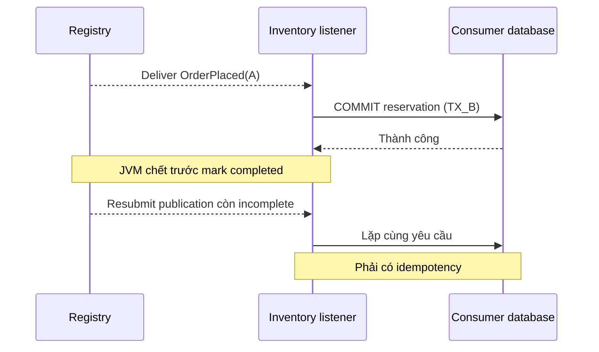

# Publication Registry tích hợp với transaction trong Spring Modulith

## 1. Vấn đề: dữ liệu nghiệp vụ đã commit nhưng sự kiện bị bỏ lỡ

Trong kiến trúc **Spring Modulith**, module `orders` tạo đơn hàng và phát `OrderPlaced`, trong khi `inventory` giữ hàng và `notifications` lập tác vụ gửi thông báo. Giao tiếp bằng application events cho phép module phát không cần gọi trực tiếp service nội bộ của module nhận. Tuy nhiên, đây là một tình huống cần xử lý nghiêm túc:

1. Module `orders` commit đơn hàng thành công.
2. Ứng dụng chuẩn bị chạy listener sau commit.
3. JVM bị dừng hoặc máy chủ mất kết nối trước khi listener hoàn thành.
4. Đơn đã tồn tại, nhưng công việc hậu xử lý có thể chưa được thực hiện.

Nếu mọi event chỉ nằm trong bộ nhớ, restart ứng dụng không tự khôi phục những tác vụ đã bị mất. **Event Publication Registry** của Spring Modulith giúp theo dõi việc công bố event tới các listener giao dịch; khi được cấu hình với cơ chế persistence phù hợp, registry có thể ghi lại các publication chưa hoàn thành để quan sát và khôi phục.

Chủ đề **“Tích hợp với transaction”** thuộc chương **“Publication Registry”** giải thích cách ràng buộc việc *ghi nhận publication* với transaction nghiệp vụ, phân biệt transaction của publisher và consumer, rồi phân tích các khoảng lỗi còn lại. Đây là phần quan trọng của **SPRING_MODULITH_APPLICATION_EVENTS**: thực hành publisher, listener, xử lý sau commit, registry, retry, kiểm thử và quan sát sự kiện đáng tin cậy giữa các module mà không làm mất ranh giới nghiệp vụ.

### Mục tiêu sau bài học

Bạn sẽ có khả năng:

- Giải thích vì sao `publishEvent(...)`, ghi publication, commit, giao listener và mark completed là các hành động khác nhau.
- Hiểu điều kiện để **business write và publication record** cùng thành công hoặc cùng rollback trong một transaction.
- Chọn `@ApplicationModuleListener`, `@TransactionalEventListener` và propagation phù hợp với cơ chế ghi nhận publication.
- Biết registry giải quyết những khoảng lỗi nào và **không** giải quyết exactly-once side effect ra sao.
- Thiết kế listener idempotent, chính sách recovery/resubmission và theo dõi publication chưa hoàn thành.
- Kiểm thử transaction commit/rollback, listener lỗi, restart/replay, schema cũ và lỗi giữa side effect với completion.

> **Điểm then chốt:** Registry chỉ đáng tin cậy theo mức độ transaction và persistence thực sự được cấu hình. Không thể chỉ thêm một dependency rồi khẳng định mọi event đều được ghi nguyên tử, tự retry hoặc được giao chính xác một lần.

## 2. Bức tranh tổng thể: hai transaction và một bản ghi publication

Xét ví dụ một đơn hàng và listener lập notification job. Mô hình mong muốn là:

- **TX_A – transaction của publisher:** tạo đơn và đăng ký publication tương ứng cho các transactional listener.
- **Sau TX_A commit:** listener được phép bắt đầu xử lý fact đã được xác lập.
- **TX_B – transaction của consumer:** ghi notification job hoặc thay đổi trạng thái thuộc module notifications.
- **Completion:** khi listener hoàn thành thành công theo hợp đồng và hạ tầng ghi nhận kết quả, publication không còn nằm trong nhóm cần khôi phục.

```mermaid
sequenceDiagram
    autonumber
    participant C as Client
    participant O as Orders service
    participant DB as Database
    participant R as Event publication registry
    participant L as Notification listener
    C->>O: placeOrder(command)
    O->>DB: BEGIN TX_A; insert Order
    O->>R: publishEvent(OrderPlaced)
    R->>DB: Ghi publication trong TX_A theo cấu hình
    alt TX_A commit thành công
        O->>DB: COMMIT TX_A
        DB-->>L: Sau commit, bắt đầu xử lý
        L->>DB: BEGIN TX_B; insert notification job
        L->>DB: COMMIT TX_B
        L-->>R: Xử lý thành công
        R->>DB: Ghi nhận completed
    else TX_A rollback
        O->>DB: ROLLBACK TX_A
        Note over DB,L: Không xử lý fact như đã commit
    end
```

Đây là **sơ đồ khái niệm**, không phải thông số bắt buộc của mọi phiên bản Spring Modulith. Thời điểm cập nhật completion, transaction dùng để cập nhật publication và lịch giao listener phụ thuộc vào release, loại listener và cấu hình hạ tầng. Cần kiểm chứng những điểm này trên chính ứng dụng đang triển khai.

### 2.1. Năm thời điểm thường bị gộp thành một

| Mốc | Việc xảy ra | Ý nghĩa | Không nên suy ra |
|---|---|---|---|
| T1 | Service tạo trạng thái nghiệp vụ hợp lệ | Fact có thể được công bố theo quy tắc domain | Database đã commit |
| T2 | `ApplicationEventPublisher.publishEvent(event)` | Event vào cơ chế Spring và có thể được ghi nhận cho listener | Consumer đã xử lý |
| T3 | Transaction publisher commit | Dữ liệu nguồn được xác lập; publication bền vững nếu cùng transaction và persistence phù hợp | Mọi listener đã hoàn tất |
| T4 | Listener bắt đầu và xử lý | Consumer thực thi use case sau commit | Side effect ngoài đã chắc chắn xảy ra đúng một lần |
| T5 | Publication được đánh dấu hoàn thành | Registry biết công việc listener đã hoàn tất theo cơ chế đang dùng | Toàn bộ workflow nhiều module đã hoàn tất |

Một logger ghi “`OrderPlaced published`” ở T2 không đủ chứng minh commit T3. Một bản ghi publication completed ở T5 không nhất thiết chứng minh email đã tới tay khách hàng nếu listener chỉ lập một job gửi email.

## 3. Vì sao cần ghi publication trong cùng transaction nghiệp vụ?

Hãy so sánh ba cách triển khai.

### Cách A — Commit trước, publish thủ công sau

```java
// Có khoảng lỗi giữa business commit và publish.
public UUID createAndPublish(PlaceOrderCommand command) {
    UUID id = orderService.placeOrderInOwnTransaction(command);
    publisher.publishEvent(new OrderPlaced(
            UUID.randomUUID(), id, clock.instant()
    ));
    return id;
}
```

Nếu transaction trong `placeOrderInOwnTransaction(...)` commit và JVM chết trước `publisher.publishEvent(...)`, đơn đã lưu nhưng không có publication. Hơn nữa, việc publish bên ngoài transaction có thể không kích hoạt `@TransactionalEventListener` khi không bật `fallbackExecution`.

### Cách B — Publish trong transaction nhưng chỉ giữ event trong bộ nhớ

```java
@Transactional
public UUID placeOrder(PlaceOrderCommand command) {
    Order order = orders.save(Order.place(command));
    publisher.publishEvent(new OrderPlaced(
            UUID.randomUUID(), order.id(), clock.instant()
    ));
    return order.id();
}
```

Cách này có thể kết hợp tốt với listener `AFTER_COMMIT` để không xử lý fact khi transaction rollback. Nhưng nếu không có cơ chế ghi nhận publication bền vững, ứng dụng vẫn có thể chết sau commit và trước khi listener hoàn tất; event trong bộ nhớ không đủ phục hồi.

### Cách C — Publish trong transaction và có registry bền vững cùng transaction

Với cơ chế đăng ký publication được kết nối đúng vào **TX_A** và lưu trong cùng tài nguyên transaction phù hợp:

- Business commit thành công → dữ liệu nghiệp vụ và bản ghi publication cần giao được xác lập cùng nhau.
- Business rollback → cả thay đổi nghiệp vụ và bản ghi publication tương ứng cũng rollback.
- Crash sau commit trước consumer → bản ghi chưa hoàn thành vẫn có thể được tìm thấy để xử lý lại.

**Đây là bảo đảm quan trọng nhất cần kiểm thử của việc tích hợp registry với transaction.** Nếu việc ghi business và ghi publication đi qua **hai database hoặc hai transaction manager không phối hợp**, không được mặc định chúng commit nguyên tử.

### 3.1. Tại sao “cùng database” chưa phải câu trả lời đủ?

Hai repository cùng kết nối đến một server database chưa chắc đang tham gia **cùng Spring transaction**. Cần xem:

1. Publisher thực sự có transaction hoạt động khi gọi `publishEvent(...)` không?
2. Registry persistence có dùng đúng `DataSource`, `EntityManagerFactory` và transaction manager không?
3. Có cấu hình `REQUIRES_NEW` hoặc async nào làm phần ghi publication thoát khỏi TX_A không?
4. Schema registry có hiện diện và quyền ghi có đầy đủ không?
5. Test rollback có xác nhận **không còn publication** tương ứng sau khi TX_A rollback không?
6. Test commit có xác nhận publication có thể được khôi phục sau tiến trình dừng không?

Nếu có nhiều datasource, việc cùng tên server/host chưa chứng minh atomicity. Muốn đảm bảo giao nguyên tử giữa hai tài nguyên độc lập, cần cơ chế phối hợp transaction thích hợp hoặc đổi thiết kế, chẳng hạn ghi outbox trong cùng database nghiệp vụ.

## 4. Registry theo dõi “event đã phát” hay “listener đã hoàn thành”?

Một event có thể được giao cho nhiều listener. Vì thế trạng thái có ý nghĩa thường là **publication dành cho từng listener**, không chỉ một cờ chung trên toàn event.

Ví dụ `OrderPlaced(eventId=A)` được ba module xử lý:

| Event | Listener | Trạng thái logic | Ý nghĩa |
|---|---|---|---|
| `OrderPlaced(A)` | `inventory` | Completed | Giữ hàng hoặc tác vụ được định nghĩa đã hoàn tất |
| `OrderPlaced(A)` | `notifications` | Incomplete | Lỗi DB/email; còn cần điều tra/khôi phục |
| `OrderPlaced(A)` | `analytics` | Completed | Consumer analytics hoàn tất theo hợp đồng |

Bảng minh họa **trạng thái logic**, không phải tên table, enum, column hay trạng thái chính thức của mọi phiên bản Modulith.

Nếu notifications lỗi nhưng inventory đã hoàn tất, không nên phát lại toàn bộ command đặt đơn để “thử lại email”. Registry giúp xác định publication chưa hoàn thành; một cơ chế resubmission phù hợp sẽ hướng đến consumer còn cần xử lý.

### 4.1. Registry không thay thế ranh giới module

Module `orders` vẫn chỉ phát `OrderPlaced` và không cần import class `NotificationService` hoặc `InventoryRepository`. Modulith bảo vệ module boundary qua API/kiểm tra phụ thuộc; registry bảo vệ **khả năng quan sát và phục hồi publication**. Hai trách nhiệm bổ sung nhau nhưng không giống nhau.

Kiểm thử kiến trúc có thể dùng:

```java
package com.example.shop;

import org.junit.jupiter.api.Test;
import org.springframework.modulith.core.ApplicationModules;

class ModuleArchitectureTests {

    @Test
    void respectsModuleBoundaries() {
        ApplicationModules.of(ShopApplication.class).verify();
    }
}
```

`verify()` giúp phát hiện phụ thuộc module sai theo quy tắc đã cấu hình; nó **không kiểm chứng transaction của registry** hay bảo đảm listener chạy thành công.

## 5. Publisher: tạo fact và publish bên trong transaction nguồn

Xây dựng public event không chứa nội bộ JPA entity:

```java
// orders/OrderPlaced.java
package com.example.shop.orders;

import java.time.Instant;
import java.util.UUID;

public record OrderPlaced(
        UUID eventId,
        UUID orderId,
        Instant occurredAt
) {
    public OrderPlaced {
        if (eventId == null || orderId == null || occurredAt == null) {
            throw new IllegalArgumentException("Required event fields are missing");
        }
    }
}
```

Publisher nằm trong module `orders`:

```java
// orders/internal/OrderService.java
package com.example.shop.orders.internal;

import com.example.shop.orders.OrderPlaced;
import java.time.Clock;
import java.util.UUID;
import org.springframework.context.ApplicationEventPublisher;
import org.springframework.stereotype.Service;
import org.springframework.transaction.annotation.Transactional;

@Service
public class OrderService {

    private final OrderRepository orders;
    private final ApplicationEventPublisher publisher;
    private final Clock clock;

    public OrderService(
            OrderRepository orders,
            ApplicationEventPublisher publisher,
            Clock clock
    ) {
        this.orders = orders;
        this.publisher = publisher;
        this.clock = clock;
    }

    @Transactional
    public UUID placeOrder(PlaceOrderCommand command) {
        Order saved = orders.save(Order.place(command));

        // Publish khi TX_A đang hoạt động, sau khi đã có fact hợp lệ.
        publisher.publishEvent(new OrderPlaced(
                UUID.randomUUID(),
                saved.id(),
                clock.instant()
        ));

        return saved.id();
    }
}
```

`Order`, `OrderRepository` và `PlaceOrderCommand` là domain/application types do dự án tự định nghĩa. Ví dụ chỉ minh họa điểm đặt lời gọi publisher; cần bean `Clock`, datasource và Spring transaction manager để chạy.

**Hai nguyên tắc:**

- **Publish sau khi domain xác lập fact:** Không phát `OrderPlaced` trước validation nếu lệnh có thể bị từ chối mà chưa có order.
- **Publish trước khi transaction kết thúc:** Cho phép hạ tầng theo dõi transactional listener và ghi publication phù hợp trong TX_A, nếu registry persistence đã được cấu hình đúng.

Không nhầm `orders.save(...)` hoặc `saveAndFlush(...)` với commit: flush có thể đẩy SQL xuống database nhưng transaction vẫn có thể rollback.

### 5.1. Ý nghĩa transaction rollback

Nếu `orders.save(...)` thành công ở persistence context nhưng một thao tác sau `publishEvent(...)` ném exception dẫn đến rollback, event đã được tạo trong bộ nhớ nhưng không đại diện cho một **fact đã commit**.

Với listener `AFTER_COMMIT`, listener không nên xử lý một transaction đã rollback. Với registry được ghi trong TX_A, bản ghi publication tương ứng cũng không nên còn như một tác vụ đã commit.

Chính tính chất này làm khác biệt giữa application event được phát **trong transaction** và một message được gửi ngay ra hệ thống ngoài trước commit.

## 6. Cấu hình persistence của Publication Registry

Spring Modulith cung cấp các cách lưu publication, ví dụ dựa trên JDBC hoặc JPA, tùy phiên bản Spring Modulith và stack persistence. Cần chọn **một giải pháp phù hợp** với datasource, transaction manager, migration và nhu cầu vận hành.

Ví dụ Maven khi chọn JDBC:

```xml
<!-- Phiên bản nên được quản lý qua Spring Modulith BOM phù hợp với Spring Boot. -->
<dependency>
    <groupId>org.springframework.modulith</groupId>
    <artifactId>spring-modulith-starter-jdbc</artifactId>
</dependency>
```

Hoặc chọn starter JPA tương ứng **nếu phiên bản đang dùng cung cấp và hỗ trợ theo cấu hình đó**. Không mặc định đưa cả hai starter vào cùng ứng dụng nếu không chủ ý thiết kế cách chọn implementation.

### 6.1. Các bước cấu hình cần xác nhận trên hệ thống thực

| Hạng mục | Cần xác minh |
|---|---|
| Dependency | Release Spring Boot/Modulith tương thích và đúng starter persistence |
| Schema | Bảng/DDL/migration cho registry đã được tạo theo cơ chế release sử dụng |
| DataSource | Publication và business được ghi vào nguồn dữ liệu có bảo đảm transaction mong muốn |
| Transaction manager | Registry thực sự tham gia transaction publisher, không tự dùng transaction không liên quan |
| Serializer | Event lưu được và đọc lại được, gồm `UUID`, `Instant` và class name/type |
| Listener eligibility | Những listener cần theo dõi được đăng ký bằng annotation/kiểu mà registry hỗ trợ |
| Recovery | Có cơ chế tìm incomplete publication và resubmit khi cần |
| Retention | Quy tắc lưu/cleanup publication completed, incomplete và backup |
| Quyền truy cập | DBA, dashboard, log và job vận hành chỉ xem dữ liệu được phép |

**Không dùng một thuộc tính cấu hình hoặc schema đoán theo phiên bản khác** để kết luận registry đã chạy. Tên bảng, API query, tham số resubmission và cách khởi tạo schema có thể thay đổi giữa các release.

### 6.2. Đừng nhầm “đã bật registry” với “đã cấu hình retry”

Persistence cho phép **nhớ rằng publication chưa hoàn thành**. Muốn xử lý lại sau lỗi còn cần cơ chế recovery phù hợp với release:

- Có phiên bản hỗ trợ resubmission theo lịch, lúc khởi động hoặc qua API điều hành.
- Có cách chủ động chọn hoặc giới hạn các publication cần thử lại.
- Có chính sách số lần thử, backoff, timeout và quan sát khi lỗi kéo dài.
- Có xử lý riêng cho event cũ không deserialize được hoặc đã hết giá trị nghiệp vụ.

Đừng giả định Spring Modulith tự cung cấp lịch retry vô hạn hoặc backoff an toàn trong mọi cấu hình. Hãy kiểm thử một failure thật và quy trình resubmit thật.

## 7. Listener: xử lý sau commit trong transaction khác

`@ApplicationModuleListener` của Spring Modulith hướng tới mẫu xử lý **transactional after-commit, bất đồng bộ và một transaction xử lý riêng** theo semantics của release đang dùng.

Ví dụ listener mỏng:

```java
// notifications/internal/OrderPlacedListener.java
package com.example.shop.notifications.internal;

import com.example.shop.orders.OrderPlaced;
import org.springframework.modulith.events.ApplicationModuleListener;
import org.springframework.stereotype.Component;

@Component
class OrderPlacedListener {

    private final ConfirmationService confirmations;

    OrderPlacedListener(ConfirmationService confirmations) {
        this.confirmations = confirmations;
    }

    @ApplicationModuleListener
    void on(OrderPlaced event) {
        confirmations.schedule(new ScheduleConfirmation(
                event.orderId(),
                event.eventId()
        ));
    }
}
```

Use-case input do module notifications sở hữu:

```java
// notifications/internal/ScheduleConfirmation.java
package com.example.shop.notifications.internal;

import java.util.UUID;

record ScheduleConfirmation(UUID orderId, UUID sourceEventId) {
    ScheduleConfirmation {
        if (orderId == null || sourceEventId == null) {
            throw new IllegalArgumentException("IDs are required");
        }
    }
}
```

Service thực hiện công việc thuộc quyền sở hữu module notifications:

```java
// notifications/internal/ConfirmationService.java
package com.example.shop.notifications.internal;

import org.springframework.stereotype.Service;
import org.springframework.transaction.annotation.Transactional;

@Service
class ConfirmationService {

    private final NotificationJobRepository jobs;

    ConfirmationService(NotificationJobRepository jobs) {
        this.jobs = jobs;
    }

    @Transactional
    public void schedule(ScheduleConfirmation command) {
        jobs.insertIfAbsent(
                command.orderId(),
                "ORDER_RECEIVED",
                command.sourceEventId()
        );
    }
}
```

`NotificationJobRepository.insertIfAbsent(...)` là **hợp đồng ứng dụng tự triển khai** bằng truy vấn nguyên tử/unique constraint phù hợp; nó không phải API chuẩn Spring Data. Service này cần chạy trong transaction và lưu job bền vững.

### 7.1. Tại sao TX_B phải độc lập TX_A?

TX_A đã commit trước khi listener được kích hoạt. Khi service notifications ghi job:

- Nếu ghi thành công và commit TX_B, publication có thể được coi là hoàn thành theo contract “job đã được lập”.
- Nếu TX_B rollback vì lỗi database, **đơn hàng từ TX_A vẫn tồn tại**.
- Lỗi consumer cần được giữ lại để publication chưa hoàn thành có cơ hội được phục hồi.
- Không nên gọi lại cả command tạo đơn chỉ để lập lại notification job.

Một application event nối các module không biến database transaction của chúng thành một **distributed transaction**. Những bước hậu xử lý có thể cần chính sách business state và compensation nếu chúng không thành công.

### 7.2. `@TransactionalEventListener(AFTER_COMMIT)` thuần và bẫy tài nguyên cũ

Nếu dùng listener Spring Framework:

```java
package com.example.shop.notifications.internal;

import com.example.shop.orders.OrderPlaced;
import org.springframework.stereotype.Component;
import org.springframework.transaction.event.TransactionPhase;
import org.springframework.transaction.event.TransactionalEventListener;

@Component
class OrderNotificationListener {

    private final NotificationJobService jobs;

    OrderNotificationListener(NotificationJobService jobs) {
        this.jobs = jobs;
    }

    @TransactionalEventListener(phase = TransactionPhase.AFTER_COMMIT)
    void on(OrderPlaced event) {
        jobs.scheduleOnce(event.orderId(), event.eventId());
    }
}
```

Callback `AFTER_COMMIT` được gọi sau commit, nhưng transaction resources có thể vẫn gắn với thread đến khi cleanup. Một method persistence với propagation `REQUIRED` có thể trông như tham gia tài nguyên transaction cũ, trong khi **không có commit tiếp theo** cho thao tác ghi mới.

Để ghi database từ **callback sau commit thuần**, nên gọi service mở transaction mới:

```java
package com.example.shop.notifications.internal;

import java.util.UUID;
import org.springframework.stereotype.Service;
import org.springframework.transaction.annotation.Propagation;
import org.springframework.transaction.annotation.Transactional;

@Service
class NotificationJobService {

    private final NotificationJobRepository jobs;

    NotificationJobService(NotificationJobRepository jobs) {
        this.jobs = jobs;
    }

    @Transactional(propagation = Propagation.REQUIRES_NEW)
    public void scheduleOnce(UUID orderId, UUID eventId) {
        jobs.insertIfAbsent(orderId, "ORDER_RECEIVED", eventId);
    }
}
```

**Không áp dụng `REQUIRES_NEW` máy móc ở mọi tầng.** Với `@ApplicationModuleListener` đang tạo transaction xử lý riêng, service có `@Transactional` propagation `REQUIRED` có thể tham gia transaction listener đã mở. Việc thêm `REQUIRES_NEW` không cần thiết tạo thêm điểm commit và làm phức tạp trạng thái.

### 7.3. Cấu hình async cần được kiểm chứng

Với listener bất đồng bộ, hãy xác nhận:

- Application đã cấu hình hạ tầng async thích hợp, chẳng hạn `@EnableAsync` khi cần.
- Executor có giới hạn queue/concurrency hợp lý và xử lý tình huống rejected tasks.
- Transaction manager/propagation hoạt động như kỳ vọng trên listener thread.
- Exception của listener được báo cho hạ tầng/registry thay vì bị nuốt.
- Registry có cách tìm publication chưa hoàn thành khi process tắt đột ngột.

Không giả định các thread async giữ nguyên transaction context hoặc MDC/tracing từ request HTTP; chúng là hai ngữ cảnh khác nhau cần phối hợp đúng.

## 8. Transaction propagation có thể phá bảo đảm nếu dùng sai

### 8.1. `REQUIRED` trong publisher

Một phương thức `@Transactional` mặc định dùng propagation `REQUIRED`, tham gia transaction hiện hành hoặc tạo mới nếu chưa có. Khi `publishEvent(...)` xảy ra, nó gắn với **transaction thực tế đang hoạt động**.

Nếu một tầng bên trong đánh dấu rollback-only, publication cần được coi là thuộc **transaction bị rollback**, kể cả khi method publish đã chạy xong trước đó.

### 8.2. `REQUIRES_NEW` trong publisher: nguy cơ fact commit “sớm”

Giả sử một outer workflow gọi service con bằng `REQUIRES_NEW` rồi publish event trong transaction con:

```java
@Transactional
public void checkout() {
    orderCreationService.createInRequiresNew(...);
    // Đoạn sau có thể thất bại và rollback outer TX.
    finalizeCheckoutOrThrow();
}
```

Nếu transaction con commit, `OrderPlaced` có thể trở thành fact bền vững trước khi outer transaction hoàn thành. Điều này có thể đúng **nếu hai bước là hai business fact độc lập**, nhưng sẽ sai nếu sự kiện mang ý nghĩa “toàn bộ checkout đã thành công”.

Registry gắn publication với transaction **phát event**, không tự đợi transaction bên ngoài hoặc phối hợp nhiều transaction thành một atomic workflow. Đặt ranh giới transaction theo **quy tắc domain**, không theo thói quen thêm annotation.

### 8.3. `REQUIRES_NEW` trong consumer

Với listener `@TransactionalEventListener(AFTER_COMMIT)` thuần, transaction mới cần thiết cho persistence write như đã phân tích. Nhưng với `@ApplicationModuleListener`, hãy xem transaction listener mở sẵn và service có thể tham gia.

Nếu một service tự mở nhiều `REQUIRES_NEW` tách biệt, có thể xảy ra:

1. Job đã commit trong TX_B1.
2. Phần xử lý tiếp theo thất bại trong TX_B2.
3. Publication bị xem là chưa hoàn thành.
4. Replay thực hiện lại, gặp job đã tồn tại.

Do đó mỗi thao tác cần idempotency và contract rõ. Hãy ưu tiên một **transaction nhất quán cho một bước use case** nếu domain cho phép.

### 8.4. Publish ngoài transaction

`@TransactionalEventListener` mặc định không xử lý event nếu không có transaction phù hợp, trừ khi cấu hình `fallbackExecution=true`. Trong trường hợp đó, không còn bảo đảm “đợi commit” như nhánh có transaction.

Vì vậy, **mất transaction ở publisher** (ví dụ self-invocation với Spring proxy hoặc method được gọi qua instance tạo bằng `new`) có thể khiến listener im lặng không chạy. Không nên bật fallback chỉ để che thiếu transaction, vì nó làm thay đổi semantics của sự kiện.

Đối với business event quan trọng, test cần xác nhận khi lời gọi chạy thật có transaction hoạt động và registry/persistence thực sự ghi publication cùng TX mong muốn.

## 9. Transaction rollback: điều phải và không phải xảy ra

Một test hoặc log có thể quan sát `publishEvent(...)` được gọi dù transaction cuối cùng rollback. Đó **không phải** một event nghiệp vụ đã commit.

| Tình huống | TX_A | Publication bền vững theo cùng TX_A | Listener after-commit |
|---|---|---|---|
| Command hợp lệ và commit | Commit | Được ghi nhận cho listener phù hợp | Được phép xử lý |
| Validation thất bại trước publish | Không có commit thay đổi | Không có publication cho fact chưa xảy ra | Không xử lý |
| Lỗi sau publish làm rollback | Rollback | Không còn publication đã commit thuộc TX_A | Không xử lý |
| Database commit thất bại | Không commit thành công | Không có publication hợp lệ đã commit cùng TX_A | Không xử lý như fact thành công |
| Publisher không có transaction | Không có TX_A | Không thể mặc định atomicity/eligibility | Phụ thuộc listener và fallback |
| Registry dùng transaction/tài nguyên khác | Có thể commit business riêng | Không thể tự bảo đảm cùng commit/rollback | Phải đánh giá và test kiến trúc |

Bảng phản ánh **mục tiêu bảo đảm của cấu hình transactional đúng**. Nếu đang dùng nhiều transaction manager, starter persistence khác datasource hoặc callback sai phase, kết quả thực tế có thể không đáp ứng.

### 9.1. Tránh đoán dựa trên `saveAndFlush()`

`saveAndFlush()` thường khiến ORM gửi SQL trong transaction, nhưng còn có thể rollback. Vì vậy không được quyết định side effect chỉ dựa vào “đã flush”. Registry/publisher cần đồng bộ với **commit**, không chỉ với thời điểm gửi SQL xuống database.

### 9.2. Nếu ghi publication lỗi thì sao?

Khi registry đã nằm trong transaction publisher, lỗi ghi publication (ví dụ DB không ghi được, serialization hoặc ràng buộc schema có vấn đề) có thể khiến transaction không thể hoàn thành như bình thường. Đây thường là hành vi hợp lý nếu ứng dụng cam kết “không tạo đơn mà không đăng ký công việc hậu xử lý”.

Tuy nhiên, cách exception lan truyền và rollback phụ thuộc implementation. Cần test lỗi ghi publication trên cấu hình thực; đừng catch lỗi rồi bỏ qua, sau đó tuyên bố cả business lẫn publication đã commit nguyên tử.

## 10. Completion là một lần ghi bền vững khác

Ngay cả khi TX_A và publication được commit cùng nhau, vẫn có khoảng cách giữa **consumer thực thi** và **registry đánh dấu completed**.



Phân tích các cửa sổ lỗi:

| Thời điểm lỗi | Business TX_A | Consumer TX_B/side effect | Registry | Nguy cơ |
|---|---|---|---|---|
| Trước TX_A commit | Chưa commit | Không được xử lý như fact đã commit | Rollback cùng TX_A nếu đúng cấu hình | Không có việc cần giao |
| Sau TX_A commit, trước listener | Đã commit | Chưa chạy | Incomplete còn lưu | Có thể khôi phục |
| Trong listener trước TX_B commit | Đã commit | TX_B rollback | Incomplete | Thử lại sau khi sửa nguyên nhân |
| Sau TX_B commit, trước completion | Đã commit | Đã thành công | Có thể còn incomplete | **Duplicate khi resubmit** |
| Sau completion | Đã commit | Hoàn thành theo listener contract | Completed | Không cần tự động resubmit bước đó |

**Publication registry không tự biến hai transaction thành một giao dịch exactly-once.** Thiết kế đáng tin cậy thường dựa trên việc cho phép thử lại **và** làm cho consumer idempotent.

### 10.1. Định nghĩa “listener hoàn thành” theo contract của consumer

Giả sử notifications listener chỉ **lập job gửi email**:

- Publication hoàn thành khi job được ghi bền vững theo transaction của notifications.
- Worker gửi email là một quy trình khác với trạng thái `PENDING/SENT/FAILED` riêng.
- Registry báo hoàn thành **không** có nghĩa email đã được gửi.

Nếu listener gọi trực tiếp mail provider, completion gần hơn với kết quả từ provider, nhưng vẫn có rủi ro timeout hoặc crash sau khi provider đã thực hiện mà chưa ghi completion. Cần chọn **điểm hoàn thành có ý nghĩa nghiệp vụ**, không chỉ là nơi method return.

## 11. Idempotency: phần bắt buộc khi tích hợp registry với transaction

Vì resubmission có thể phát lại cùng publication, mỗi consumer nên định nghĩa khóa chống lặp tương ứng với tác động của nó.

| Hành động | Khóa đề xuất theo nghiệp vụ | Giải thích |
|---|---|---|
| Một consumer xử lý một fact | `(consumerName, eventId)` | Phân biệt nhiều listener của cùng event |
| Mỗi đơn một email xác nhận | `(orderId, notificationType)` | Hai event khác nhau có thể tạo cùng yêu cầu gửi |
| Một lần giữ hàng cụ thể | `reservationRequestId` | Một đơn có thể có nhiều lần giữ hàng hợp lệ |
| Thanh toán tại provider | Idempotency key theo contract provider | Chống lặp ở hệ thống ngoài |

Không chỉ dùng `orderId` cho mọi event; `OrderPlaced`, `OrderCancelled`, `PaymentCaptured` có thể là các fact khác nhau của một đơn.

### 11.1. Ràng buộc nguyên tử cho consumer persistence

Một schema ví dụ dùng cú pháp PostgreSQL:

```sql
CREATE TABLE notification_jobs (
    id UUID PRIMARY KEY,
    order_id UUID NOT NULL,
    notification_type VARCHAR(40) NOT NULL,
    source_event_id UUID NOT NULL,
    status VARCHAR(20) NOT NULL,
    CONSTRAINT uq_notification_order_type UNIQUE (order_id, notification_type)
);
```

Để service tạo một job theo business key, dùng thao tác nguyên tử:

```sql
INSERT INTO notification_jobs (
    id, order_id, notification_type, source_event_id, status
) VALUES (
    :jobId, :orderId, 'ORDER_RECEIVED', :eventId, 'PENDING'
)
ON CONFLICT (order_id, notification_type) DO NOTHING;
```

Đây là ví dụ **PostgreSQL**, không phải cú pháp portable cho mọi DB. Ràng buộc unique chỉ đúng nếu nghiệp vụ quy định một job loại `ORDER_RECEIVED` cho mỗi đơn; nếu có thông báo lặp hợp lệ, cần khóa khác.

**Phản mẫu:**

```java
// Không an toàn nếu các thread/transaction chạy đồng thời.
if (!jobs.existsByOrderIdAndType(orderId, type)) {
    jobs.save(new NotificationJob(orderId, type));
}
```

Hai transaction có thể cùng thấy “chưa tồn tại” rồi cùng insert. Việc kiểm tra trước không thay được unique constraint hoặc operation atomic. Nếu DB báo unique conflict, cách xử lý phải phù hợp trạng thái transaction của database, không chỉ catch exception rồi ghi tiếp trên transaction đang lỗi.

### 11.2. Transaction consumer và completion của registry là hai bằng chứng khác nhau

Test cần xác minh cả:

1. Notification job/reservation được commit thật trong TX_B.
2. Registry đã nhận diện listener hoàn thành theo cơ chế của release.
3. Nếu giả lập crash giữa hai bước, replay vẫn không tạo thêm job không hợp lệ.

Một test mock service rồi `verify(schedule)` chỉ chứng minh lời gọi phương thức; **không kiểm tra ràng buộc DB và transaction**.

### 11.3. Hệ thống ngoài cần đối soát

Một idempotent database insert không bảo đảm email provider hoặc payment provider cũng idempotent. Nếu mạng timeout sau khi provider có thể đã nhận request, consumer phải:

- Gửi **idempotency key ổn định** nếu provider hỗ trợ.
- Lưu provider request/receipt ID để đối soát.
- Kiểm tra kết quả trước khi thực hiện lại khi trạng thái không rõ.
- Phân biệt “provider đã chấp nhận” với “khách đã nhận/đọc”.
- Giới hạn retry, không phát lại vô điều kiện.

Registry quản lý publication tới listener; nó không tự kiểm soát giao dịch của các dịch vụ bên ngoài.

## 12. Recovery/resubmission: khi registry đã lưu công việc chưa hoàn thành

Khi listener ném lỗi hoặc ứng dụng chết trước completion, một publication có thể nằm trong tập **incomplete**. Quy trình phục hồi nên có các bước sau:

1. **Phát hiện:** xác định publication còn thiếu completion, listener đích và tuổi publication.
2. **Phân loại:** lỗi transient, dữ liệu nghiệp vụ sai, schema/serialization lỗi, cấu hình/quyền truy cập hay crash.
3. **Kiểm tra tác động trước đó:** xem consumer database và hệ thống ngoài đã thực hiện side effect chưa.
4. **Đảm bảo idempotency:** khóa business, unique constraint, provider key hoặc đối soát hoạt động.
5. **Khắc phục nguyên nhân:** sửa bug, khôi phục tài nguyên, migration/upcaster hoặc sửa configuration.
6. **Resubmit có kiểm soát:** sử dụng cơ chế chính thức tương ứng với release đang chạy.
7. **Xác nhận completion:** publication không còn ở trạng thái cần khôi phục theo contract và nghiệp vụ đạt kết quả đúng.
8. **Lưu dấu vết vận hành:** reason, attempt, correlation và cách xử lý lỗi.

### 12.1. Không có “retry tự động mãi mãi” mặc định

Một số release/cấu hình cung cấp lựa chọn resubmit lúc khởi động, theo lịch hoặc chủ động. Nhưng **chỉ có persistence không có nghĩa scheduler đã chạy**. Hãy xác định rõ:

- Ai khởi chạy recovery, với lịch nào?
- Lần thử được giới hạn ra sao?
- Backoff/jitter và timeout thế nào?
- Xử lý executor quá tải ra sao?
- Poison event được cách ly thế nào?
- Sau khi nâng cấp schema/class, event cũ có deserialize được không?

Ví dụ chính sách **do ứng dụng tự chọn**, không phải mặc định của Modulith:

| Lần retry | Độ trễ tham khảo | Khi nào tiếp tục? |
|---|---|---|
| 1 | 10 giây | Timeout hoặc lỗi transient |
| 2 | 1 phút | Consumer và provider vẫn khả dụng |
| 3 | 5 phút | Còn trong SLA |
| 4 | 30 phút | Lỗi vẫn retryable và không vượt giới hạn |
| Sau giới hạn | Alert/cách ly/xử lý thủ công | Không retry mù |

Sử dụng backoff có jitter khi nhiều publication lỗi cùng lúc để tránh tạo bão request. Nếu service bị rate limit, tôn trọng tín hiệu chờ từ provider khi phù hợp.

### 12.2. Poison event không được “dọn sạch” bằng cách xóa bản ghi

Nếu publication chứa event cũ không đọc được sau đổi package/class, gọi lại cùng mã sẽ thất bại mãi. Cần nâng cấp serializer/mapping, upcast hoặc migration, rồi thử phục hồi có kiểm soát. Không xóa pending publication chỉ để số lượng trên dashboard về 0 khi nghiệp vụ chưa được hoàn tất.

### 12.3. Dữ liệu thay đổi khi retry

Event có thể được xử lý nhiều giờ hoặc nhiều ngày sau fact. Nếu consumer đọc trạng thái hiện tại từ public API:

- Đơn có thể đã hủy.
- Email liên hệ có thể đã đổi.
- Quyền nhận thông báo có thể bị thu hồi.
- Dữ liệu đã được xóa theo chính sách.

Contract phải xác định dùng **snapshot quá khứ** hay **trạng thái hiện tại**, và liệu tác vụ còn hợp lệ. Idempotency không thể thay thế business validity check.

## 13. So sánh Event Publication Registry với transactional outbox

Hai cơ chế có mục tiêu gần nhau: lưu công việc sự kiện một cách bền vững gắn với transaction nghiệp vụ. Tuy nhiên chúng thường phục vụ ranh giới khác nhau.

| Tiêu chí | Spring Modulith Event Publication Registry | Transactional outbox truyền thống |
|---|---|---|
| Mục tiêu điển hình | Theo dõi publication tới transactional listener trong ứng dụng/module | Ghi bản tin cần đưa ra broker/hệ thống ngoài |
| Đầu vào | Spring application event | Outbox record hoặc integration event |
| Người nhận | Listener trong ứng dụng theo cấu hình; có thể kết hợp adapter | Broker dispatcher và consumer ngoài tiến trình |
| Transaction mong muốn | Publication được ghi đúng TX của publisher | Outbox insert cùng TX với business write |
| Phục hồi | Tìm incomplete publication và resubmit tới listener tương ứng | Poll/CDC lấy outbox record và giao lại broker |
| Tránh lặp | Consumer vẫn phải idempotent | Consumer ngoài cũng phải idempotent |
| Đảm bảo gửi mạng | Không tự động gửi mọi event lên Kafka/RabbitMQ | Cần dispatcher, ack/retry và broker semantics |
| Vận hành | Monitor publication và listener completion | Monitor outbox, dispatcher, broker lag/DLQ |

Nếu mục tiêu là giao tiếp **giữa các module của cùng một Spring Boot application**, Modulith registry có thể phù hợp. Khi cần gửi ra hệ thống khác, có thể thêm một integration adapter/outbox riêng với hợp đồng bên ngoài. Không mặc định một domain event Java nội bộ đồng thời là integration event bất biến cho mọi đối tác.

### 13.1. Khi nào cần thiết kế lại transaction boundary?

Nếu business write ở DB_A, publication ở DB_B và consumer nhận qua broker C, một cấu hình Spring transaction manager đơn giản không tạo atomic transaction xuyên tất cả tài nguyên. Cần xem xét:

- Đưa publication/outbox về cùng DB_A và transaction nghiệp vụ.
- Dùng dispatcher sau commit để giao broker.
- Chấp nhận at-least-once và idempotent consumer.
- Mô hình hóa trạng thái workflow, compensation, timeout phù hợp.
- Kiểm thử crash tại từng ranh giới, không chỉ happy path.

**Không sử dụng Event Publication Registry để tuyên bố bảo đảm distributed exactly-once không có thật.**

## 14. Contract event và serialization có ảnh hưởng trực tiếp đến transaction recovery

Để registry khôi phục publication sau restart, dữ liệu đã lưu phải **đọc lại được**.

Ví dụ hợp đồng hiện tại:

```java
package com.example.shop.orders;

import java.time.Instant;
import java.util.UUID;

public record OrderPlaced(
        UUID eventId,
        UUID orderId,
        Instant occurredAt
) {
}
```

Nếu code đổi package `com.example.shop.orders` sang package mới, hoặc thay `orderId` từ `UUID` sang kiểu không tương thích, publication cũ có thể không deserialize được tùy serializer/type mapping đang dùng.

Các quy tắc:

1. Đối xử với public event như một **hợp đồng có thể tồn tại bền vững**.
2. Test serialize/deserialize bằng serializer cấu hình **giống registry thật**.
3. Giữ fixture payload cũ khi cần bảo đảm upgrade/recovery.
4. Khi đổi class, version hoặc cấu trúc, thiết kế migration/upcaster/mapping có kiểm soát.
5. Không bỏ đường đọc event cũ trước khi các publication cần phục hồi đã được xử lý theo chính sách.
6. Đánh giá thay đổi ý nghĩa nghiệp vụ, không chỉ khả năng parse JSON.

Một round-trip test `serialize(new OrderPlaced(...))` rồi deserialize bằng **cùng code mới** có thể PASS dù payload từ phiên bản trước không còn đọc được. Test compatibility phải chứa **old payload → new reader**; khi có deployment lệch phiên bản, cần thêm chiều mới → cũ.

### 14.1. Tối thiểu dữ liệu nhạy cảm trong event

Registry có thể lưu serialized payload, do đó những field nhạy cảm đưa vào event có thể xuất hiện trong database, backup, dump và log. Đừng nhét email, địa chỉ, token hoặc nguyên JPA entity vào `OrderPlaced` chỉ vì một listener cần dùng.

Dùng `orderId` rồi truy vấn qua API công khai có kiểm soát khi nghiệp vụ cho phép; nếu cần snapshot tại thời điểm fact, chỉ lưu những dữ liệu cần thiết với retention, authorization và mã hóa phù hợp. Một ID cũng có thể liên kết tới cá nhân; cần đánh giá dữ liệu và quyền truy cập theo thực tế.

## 15. Kiểm thử tích hợp registry với transaction: cần test những gì?

Một test publisher bình thường có thể chứng minh event đã được phát, nhưng không chứng minh publication được ghi bền vững hoặc transaction rollback được bảo toàn. Nên thiết kế **test matrix nhiều lớp**.

| Test | Điều cần xác minh | Loại test |
|---|---|---|
| Publisher phát event đúng khi business hợp lệ | `OrderPlaced` chứa đúng IDs và được publish | Module test |
| Publisher không phát fact khi command bị từ chối | Không ghi fact sai | Unit/module test |
| TX_A commit | Business data + publication được ghi đúng boundary | Integration với registry persistence |
| TX_A rollback sau publish | Business data và publication đều không commit | Integration với transaction thật |
| Listener thành công | Consumer side effect được commit, publication được completed | Integration |
| Listener ném lỗi | Consumer TX_B rollback; publication còn incomplete | Integration |
| Process crash trước listener | Sau restart có thể phát hiện publication chưa hoàn thành | Recovery/restart test |
| Crash sau consumer side effect | Resubmit không tạo side effect trùng | Integration + idempotency |
| Nhiều listener có kết quả khác nhau | Chỉ publication thất bại còn incomplete | Registry integration |
| Event cũ | Đọc lại payload cũ hoặc migration có kiểm soát | Compatibility test |
| Publish ngoài transaction | Không âm thầm coi như đã bảo đảm giao bền vững | Negative integration test |

### 15.1. Kiểm thử publisher bằng `@ApplicationModuleTest`

Spring Modulith cung cấp `@ApplicationModuleTest` và `PublishedEvents` để quan sát event do module phát. Ví dụ:

```java
// src/test/java/com/example/shop/orders/internal/OrderPublisherTests.java
package com.example.shop.orders.internal;

import static org.assertj.core.api.Assertions.assertThat;

import com.example.shop.orders.OrderPlaced;
import org.junit.jupiter.api.Test;
import org.springframework.beans.factory.annotation.Autowired;
import org.springframework.modulith.test.ApplicationModuleTest;
import org.springframework.modulith.test.PublishedEvents;

@ApplicationModuleTest
class OrderPublisherTests {

    @Autowired OrderService orders;
    @Autowired PublishedEvents events;

    @Test
    void publishesOrderPlacedWhenOrderIsCreated() {
        // Fixture của dự án; không phải API Spring Modulith.
        PlaceOrderCommand command = OrderFixtures.validCommand();
        var id = orders.placeOrder(command);

        assertThat(events.ofType(OrderPlaced.class))
                .anySatisfy(event -> {
                    assertThat(event.orderId()).isEqualTo(id);
                    assertThat(event.eventId()).isNotNull();
                });
    }
}
```

`OrderFixtures` là helper minh họa; domain model/repository và datasource cần được dự án triển khai. Test này **chỉ** chứng minh publish call theo ngữ nghĩa test context. Không lấy kết quả `PublishedEvents` làm bằng chứng publication đã nằm trong DB hoặc listener đã hoàn tất.

### 15.2. Test transaction commit/rollback theo phase

Để kiểm tra trực tiếp ý nghĩa `AFTER_COMMIT`, dùng một test probe đồng bộ thay vì dựa ngay vào async listener. Ví dụ test fixture tự chứa ở mức minh họa:

```java
package com.example.shop;

import static org.assertj.core.api.Assertions.assertThat;

import com.example.shop.orders.OrderPlaced;
import java.time.Instant;
import java.util.List;
import java.util.UUID;
import java.util.concurrent.CopyOnWriteArrayList;
import org.junit.jupiter.api.Test;
import org.springframework.beans.factory.annotation.Autowired;
import org.springframework.boot.test.context.SpringBootTest;
import org.springframework.boot.test.context.TestConfiguration;
import org.springframework.context.ApplicationEventPublisher;
import org.springframework.context.annotation.Bean;
import org.springframework.context.annotation.Import;
import org.springframework.transaction.event.TransactionPhase;
import org.springframework.transaction.event.TransactionalEventListener;
import org.springframework.transaction.support.TransactionTemplate;

@SpringBootTest
@Import(TransactionPhaseTests.ProbeConfiguration.class)
class TransactionPhaseTests {

    @Autowired TransactionTemplate transactions;
    @Autowired ApplicationEventPublisher publisher;
    @Autowired Probe probe;

    @Test
    void invokesAfterCommitOnlyForCommittedTransaction() {
        probe.clear();
        var committed = new OrderPlaced(
                UUID.randomUUID(), UUID.randomUUID(), Instant.now()
        );

        transactions.executeWithoutResult(status ->
                publisher.publishEvent(committed));

        assertThat(probe.received()).contains(committed);

        probe.clear();
        var rolledBack = new OrderPlaced(
                UUID.randomUUID(), UUID.randomUUID(), Instant.now()
        );

        transactions.executeWithoutResult(status -> {
            publisher.publishEvent(rolledBack);
            status.setRollbackOnly();
        });

        assertThat(probe.received()).doesNotContain(rolledBack);
    }

    @TestConfiguration
    static class ProbeConfiguration {

        @Bean Probe probe() {
            return new Probe();
        }
    }

    static class Probe {
        private final List<OrderPlaced> events = new CopyOnWriteArrayList<>();

        @TransactionalEventListener(phase = TransactionPhase.AFTER_COMMIT)
        public void on(OrderPlaced event) {
            events.add(event);
        }

        void clear() {
            events.clear();
        }

        List<OrderPlaced> received() {
            return List.copyOf(events);
        }
    }
}
```

Test này dùng **synchronous transactional listener** để chứng minh phase của Spring Framework. Nó **không** test registry persistence, không chứng minh async executor đã chạy và không đảm bảo consumer job được commit. Cần cấu hình application test để probe bean được nạp, đồng thời tránh các production listeners gây side effect ngoài ý muốn trong test context.

### 15.3. Test riêng khả năng ghi publication nguyên tử

Đây là phép thử cốt lõi của bài này. Trên datasource/schema registry thật:

1. Tạo một transaction qua application service và ghi order.
2. Publish `OrderPlaced` trong TX_A.
3. **Commit thật**.
4. Dùng API/query registry tương ứng với release để xác nhận publication cho transactional listener được ghi nhận.
5. Tạo một trường hợp khác, publish rồi **rollback TX_A**.
6. Xác minh DB order không có bản ghi của transaction rollback **và** không có publication đã commit cho event đó.
7. Lặp lại với listener đã đăng ký thực sự; nếu không có subscriber phù hợp, một test “không có publication” có thể PASS sai nguyên nhân.

**Lưu ý quan trọng:** API và schema của Event Publication Registry có thể khác theo version/persistence starter. Vì thế đây là **kịch bản test chính xác về mặt hành vi**, không bịa tên method truy vấn registry khi không biết release của dự án.

### 15.4. Tránh lỗi test do `@Transactional` trên method test

Spring Test thường tự rollback transaction của test method gắn `@Transactional`. Vì vậy một test mong listener sau commit chạy có thể thất bại chỉ vì **không có commit thật**.

Dùng `TransactionTemplate` để kiểm soát commit/rollback tường minh, hoặc `TestTransaction` khi bối cảnh phù hợp. Nếu listener bất đồng bộ, hãy chờ **trạng thái có điều kiện và timeout**, không dùng `Thread.sleep(1000)` rồi kết luận.

### 15.5. Test listener thất bại và resubmission

Sau khi cấu hình registry persistence:

1. Cho `ConfirmationService.schedule(...)` ném lỗi có kiểm soát.
2. Commit publisher transaction thật.
3. Xác nhận listener đã thử xử lý và publication cho notifications vẫn incomplete.
4. Bỏ nguyên nhân lỗi.
5. Kích hoạt resubmission theo API/chính sách release đang chạy.
6. Chờ consumer job được commit; publication hoàn thành.
7. Replay cùng event để xác nhận unique business key ngăn tạo thêm job.

Khi giả lập crash sau TX_B commit nhưng trước completion, việc tự động tái hiện chính xác điểm chết có thể khó. Có thể dùng test hook phù hợp hoặc thực hiện một lần replay có kiểm soát sau khi job đã tồn tại để kiểm tra **idempotent outcome**. Không tuyên bố một test unit mock đủ chứng minh recovery qua restart.

### 15.6. Đừng quên lỗi khi **ghi publication**

Ngoài lỗi listener, hãy kiểm tra lỗi registry write: serializer không xử lý payload, schema chưa có hoặc database từ chối insert. Với một cấu hình bắt buộc business + publication atomic, kỳ vọng phù hợp thường là transaction nguồn không được commit như thể publication đã bảo đảm thành công. Phải xác nhận cách transaction rollback/lỗi propagate trên implementation đang dùng.

## 16. Observability và vận hành registry theo transaction

Có persistence mà không quan sát publication tồn đọng thì nghiệp vụ vẫn có thể âm thầm bị dừng. Theo dõi các giai đoạn riêng:

| Tín hiệu | Ý nghĩa | Tình huống cảnh báo |
|---|---|---|
| Số publication incomplete | Còn listener chưa hoàn thành | Backlog vượt ngưỡng |
| Tuổi incomplete lâu nhất | Có tác vụ vượt SLA | Một consumer bị kẹt lâu |
| Publication theo listener | Xác định module gây backlog | notifications lỗi, inventory bình thường |
| Số attempts/resubmission | Retry có hiệu quả không | Một poison event lặp vô hạn |
| Lỗi serialize/deserialize | Schema cũ không đọc được | Sau triển khai phiên bản mới |
| Transaction rollback tại publisher | Có fact bị hủy trước commit | Publication không nên được xử lý như fact hợp lệ |
| Listener duration, error type | Lỗi transient hay logic | Timeout/DB 503 tăng |
| Executor queue/rejected task | Hậu xử lý async có nghẽn không | Thread pool đầy |
| Số notification jobs `PENDING` | Business workflow còn chờ delivery | Registry đã completed nhưng email vẫn chưa gửi |

Metric nào có sẵn và metric nào cần tự triển khai tùy phiên bản/Actuator/instrumentation đang dùng. Không tự khẳng định Spring Modulith xuất mọi metric kể trên theo mặc định.

### 16.1. Log theo loại event và ID được phép

```java
@ApplicationModuleListener
void on(OrderPlaced event) {
    log.info(
            "event-start type={} eventId={} listener={}",
            "OrderPlaced", event.eventId(), "OrderPlacedListener"
    );

    try {
        confirmations.schedule(new ScheduleConfirmation(
                event.orderId(), event.eventId()
        ));
        log.info("event-completed eventId={}", event.eventId());
    } catch (RuntimeException ex) {
        log.error(
                "event-failed eventId={} listener={}",
                event.eventId(), "OrderPlacedListener", ex
        );
        throw ex;
    }
}
```

Đây là fragment minh họa thuộc listener đã khai báo logger và dependencies. Chỉ log trường allowlist: không ghi nguyên event hoặc exception chứa token/email/địa chỉ nếu có thể rò dữ liệu. Một ID có thể liên kết với cá nhân nên vẫn cần chính sách quyền đọc log.

**Nuốt exception rồi return** sau khi lỗi ghi job có thể khiến registry ghi completion dù việc nghiệp vụ không hoàn thành. Chỉ kết thúc bình thường khi đã thực sự đạt use-case contract hoặc có một quyết định “skip” hợp lệ được ghi nhận.

### 16.2. Quy trình điều tra publication incomplete

Khi cảnh báo xuất hiện, thứ tự thực dụng:

1. Tìm event ID, listener và thời điểm tạo; hạn chế truy cập payload nhạy cảm.
2. Xác minh business TX_A đã commit bằng business state.
3. Tìm dấu vết TX_B và side effect của consumer; kiểm tra đã thực hiện một phần chưa.
4. Xác định lỗi nguồn: DB, schema, dependency, provider, executor hay dữ liệu hết hạn.
5. Kiểm tra khóa idempotency/đối soát trước khi replay.
6. Khắc phục lỗi, giới hạn concurrent resubmission và đánh giá SLA.
7. Resubmit qua cơ chế chính thức của phiên bản đang sử dụng.
8. Kiểm tra publication completion **và** business outcome.
9. Bổ sung regression test/alert/runbook để tránh tái diễn.

Không xóa các publication tồn đọng chỉ để che cảnh báo; có thể khiến một đơn hàng bị bỏ qua bước cần thiết mà không còn dấu vết phục hồi.

## 17. Những sai lầm phổ biến khi tích hợp transaction

| Sai lầm | Vì sao nguy hiểm | Cách sửa |
|---|---|---|
| Chỉ dùng `publishEvent` và tưởng đã có persistent queue | Event có thể chỉ nằm trong bộ nhớ | Cấu hình registry persistence và kiểm tra DB thật |
| Publish thủ công sau khi transaction service trả về | Crash giữa commit và publish làm mất công việc | Publish trong TX + registry/outbox bền vững |
| Cho rằng `saveAndFlush` là commit | Vẫn rollback được | Thiết kế theo boundary commit thật |
| Business và registry ghi ở các tài nguyên/transaction không phối hợp | Không có bảo đảm atomic | Cùng TX/DB hoặc thiết kế outbox, kiểm thử rõ |
| Dùng `REQUIRES_NEW` cho phần publication độc lập mà không hiểu semantics | Record publication có thể commit khi business rollback | Đặt đúng transaction boundary của publisher |
| Publish ngoài transaction nhưng mong `@TransactionalEventListener` chạy | Không có synchronization để listener AFTER_COMMIT hoạt động mặc định | Sửa transaction proxy/boundary, tránh bật fallback tùy tiện |
| Listener callback sau commit thuần ghi DB bằng `REQUIRED` | Có thể dùng tài nguyên TX cũ nhưng không có commit mới | Dùng service `REQUIRES_NEW` khi cần |
| Thêm `REQUIRES_NEW` khắp consumer | Nhiều điểm commit, dễ replay một phần | Một use case/transaction rõ, test propagation |
| Nuốt exception trong listener | Publication có thể được mark completed sai | Giữ lỗi cần phục hồi, phân biệt skip hợp lệ |
| Registry completed được hiểu là email đã gửi | Listener có thể chỉ tạo notification job | Theo dõi trạng thái delivery độc lập |
| Retry mà không có idempotency | Side effect trùng khi completion thất bại | Unique business key, provider key, đối soát |
| Dùng registry nhưng không có recovery policy | Incomplete publication tồn tại mãi | Resubmission, giới hạn, backoff, alert |
| Đổi tên event mà không kiểm tra dữ liệu cũ | Publication tồn đọng không deserialize được | Fixture, migration/upcaster và versioning |
| Log toàn payload registry/event | Dữ liệu nhạy cảm lan vào observability | Minimization, redaction, phân quyền và retention |

## 18. Bài tập thực hành

### Bài tập 1 – Atomicity giữa order và publication

Giả sử `orders` có transaction TX_A và registry JDBC trên cùng datasource. Xây dựng kế hoạch test hai nhánh:

- **Commit:** đơn và publication cho listener đều tồn tại sau commit.
- **Rollback sau publish:** đơn và publication đều không commit.

Giải thích tại sao phải xác nhận listener đã đăng ký trong test: nếu không có subscriber, không có publication ở cả hai nhánh có thể bị hiểu sai là PASS.

### Bài tập 2 – Sai transaction manager

Một ứng dụng dùng database A cho orders và database B cho registry. `OrderService` commit A trước, registry B bị lỗi. Hãy mô tả những trạng thái bất nhất có thể xảy ra và đề xuất kiến trúc transactional outbox hoặc một cơ chế phối hợp đúng. Vì sao hai bean `@Transactional` riêng không tự tạo atomic commit giữa A và B?

### Bài tập 3 – After-commit database write

Một consumer dùng:

```java
@TransactionalEventListener(phase = TransactionPhase.AFTER_COMMIT)
void on(OrderPlaced event) {
    jobs.save(new NotificationJob(event.orderId()));
}
```

Phân tích chuyện transaction resources có thể vẫn bound sau commit. Thiết kế một application service `REQUIRES_NEW` thích hợp, sau đó viết integration test chứng minh job được commit và rollback nếu service throw. So sánh với `@ApplicationModuleListener` có transaction xử lý riêng.

### Bài tập 4 – Crash giữa TX_B và completion

`notifications` đã commit job cho `OrderPlaced(eventId=A, orderId=O)` nhưng JVM chết trước khi registry mark completed. Sau restart, publication A được resubmit. Hãy chọn khóa unique, mô tả cách kiểm tra trạng thái đã có và thiết kế test tránh tạo hai job. Vì sao registry vẫn incomplete là trạng thái hợp lý ở thời điểm crash?

### Bài tập 5 – Migration event cũ

Publication đã lưu từ bản cũ có `orderId` dưới dạng một cấu trúc khác. Release mới thay class/package và listener không thể deserialize. Hãy lập chiến lược kiểm chứng payload cũ, migration/upcaster, giới hạn retry, kiểm thử trước replay và xử lý publication chưa khôi phục được.

## 19. Checklist trước khi đưa vào production

- [ ] Event là fact nghiệp vụ có chủ sở hữu rõ và public contract tối thiểu.
- [ ] `publishEvent(...)` diễn ra bên trong transaction nguồn phù hợp.
- [ ] Business write và publication persistence thực sự tham gia transaction mong muốn.
- [ ] Có test commit và rollback với datasource/transaction manager như production.
- [ ] Registry starter/schema/serializer phù hợp release hiện tại.
- [ ] Không dùng nhiều datasource mà tự khẳng định atomic commit.
- [ ] Listener được registry theo dõi thuộc loại/annotation hỗ trợ.
- [ ] Consumer chạy sau commit và có transaction riêng phù hợp.
- [ ] Không lạm dụng `REQUIRES_NEW` hoặc `fallbackExecution`.
- [ ] Đã xác định “listener completed” nghĩa là gì đối với từng use case.
- [ ] Retry/resubmission được cấu hình, kiểm thử sau lỗi và restart.
- [ ] Consumer có business idempotency và atomic unique constraint.
- [ ] Side effect ngoài có idempotency key hoặc cơ chế đối soát.
- [ ] Event cũ từ registry còn deserialize được hoặc có migration.
- [ ] Có metric incomplete, tuổi backlog, lỗi listener và SLA theo module.
- [ ] Có quy trình xử lý poison event và cleanup/retention được kiểm soát.
- [ ] Payload, log, database backup và công cụ vận hành được bảo vệ theo phân loại dữ liệu.

## 20. Tổng kết

**Tích hợp Publication Registry với transaction** giải quyết một yêu cầu cốt lõi: khi module publisher commit một sự thật nghiệp vụ, hệ thống cần giữ được dấu vết bền vững về công việc phải giao cho các transactional listener; khi publisher rollback, công việc ấy không được xem như một fact đã commit. Thiết kế thường là **publish trong TX_A**, ghi nhận publication theo cơ chế persistence tham gia đúng transaction, rồi **xử lý sau commit trong TX_B** của consumer.

Bảo đảm đó **không loại bỏ khoảng lỗi** giữa consumer side effect và ghi nhận publication hoàn thành. Vì thế event delivery tin cậy trong Spring Modulith cần đồng thời có **registry persistence, ranh giới transaction chính xác, retry/resubmission, idempotency, compatibility, kiểm thử và observability**. Khi mỗi module chỉ chia sẻ event contract công khai và tự sở hữu trạng thái xử lý, hệ thống vừa giảm phụ thuộc kiến trúc vừa có con đường phục hồi rõ ràng khi sự kiện không được xử lý trọn vẹn.

