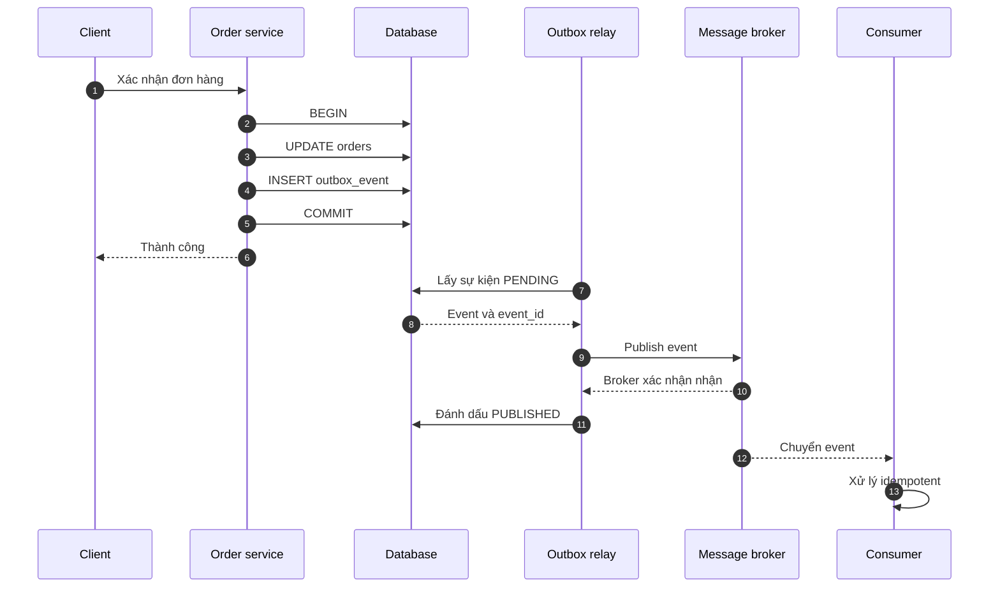

# Outbox pattern

## Mục tiêu

Trong một ứng dụng Spring Modulith, một nghiệp vụ có thể phát sinh sự kiện để các module khác tiếp tục xử lý. Ví dụ, module Đơn hàng xác nhận đơn và phát `OrderPlaced`; module Thanh toán tạo yêu cầu thu tiền, module Kho giữ hàng, còn một hệ thống bên ngoài nhận thông báo để gửi email. Các module nên giao tiếp qua sự kiện để không phải gọi trực tiếp vào chi tiết triển khai của nhau.

Khi sự kiện cần được chuyển tới message broker hoặc một hệ thống bên ngoài, việc ghi dữ liệu nghiệp vụ và gửi thông điệp tạo ra một bài toán nhất quán. **Outbox pattern** giải quyết bài toán đó bằng cách ghi sự kiện cần gửi vào cùng cơ sở dữ liệu và cùng transaction với thay đổi nghiệp vụ. Một tiến trình chuyển tiếp (relay) đọc các bản ghi đang chờ, gửi chúng tới đích và cập nhật trạng thái.

Sau bài học, bạn có thể:

- Giải thích vì sao ghi database rồi publish message trực tiếp có thể làm mất hoặc gửi trùng sự kiện.
- Thiết kế bảng outbox và ghi sự kiện nguyên tử với dữ liệu nghiệp vụ.
- Xây dựng relay có khả năng retry, xử lý nhiều worker và giữ thứ tự khi cần.
- Kết hợp tư duy outbox với Application Event, Event Publication Registry và event externalization của Spring Modulith.
- Thiết kế consumer idempotent, kiểm thử các tình huống commit, rollback và lỗi truyền tin, đồng thời theo dõi tình trạng giao sự kiện.

## 1. Bài toán dual write

Giả sử một service xác nhận đơn hàng. Nó phải cập nhật trạng thái đơn trong database và gửi `OrderPlaced` tới broker. Hai thao tác này thường thuộc hai hệ thống tài nguyên khác nhau, vì vậy một transaction database thông thường không thể tự bảo đảm chúng cùng thành công hoặc cùng thất bại.

```java
@Transactional
public void placeOrder(UUID orderId) {
    Order order = orders.getRequired(orderId);
    order.place();
    orders.save(order);

    // Không an toàn nếu lời gọi này gửi thẳng tới broker.
    messageBroker.publish(new OrderPlaced(order.getId()));
}
```

Có hai cửa sổ lỗi quan trọng:

1. Database commit thành công nhưng broker không nhận được message. Đơn hàng đã ở trạng thái `PLACED`, nhưng module Kho hoặc hệ thống bên ngoài không biết để xử lý tiếp.
2. Broker nhận message nhưng database transaction rollback. Consumer có thể xử lý một `OrderPlaced` cho đơn hàng chưa từng được xác nhận.

Đưa lệnh publish vào trong hoặc sau transaction không tự loại bỏ được hai cửa sổ này. `@TransactionalEventListener(phase = AFTER_COMMIT)` bảo đảm listener chỉ được gọi sau khi transaction commit, nhưng nếu tiến trình dừng giữa commit và lúc gửi message thì sự kiện vẫn có thể mất. Nếu gửi trước commit, consumer lại có thể nhìn thấy sự kiện của một transaction sau đó rollback.

Đây là vấn đề *dual write*: ứng dụng cần ghi vào hai nơi nhưng không có một cơ chế commit nguyên tử chung cho cả hai.

## 2. Outbox hoạt động như thế nào?

Outbox thêm một bảng lưu các sự kiện chờ gửi vào chính database đang lưu dữ liệu nghiệp vụ. Trong một transaction, ứng dụng cập nhật aggregate và thêm một bản ghi outbox. Relay chạy độc lập, lấy các bản ghi chưa gửi, publish chúng tới broker rồi đánh dấu đã gửi.



Điểm quyết định là hai câu lệnh `UPDATE orders` và `INSERT outbox_event` cùng nằm trong một transaction database:

- Nếu transaction commit, cả dữ liệu nghiệp vụ và bản ghi outbox đều tồn tại.
- Nếu transaction rollback, cả hai đều không tồn tại.
- Nếu broker tạm thời không sẵn sàng, bản ghi outbox vẫn nằm trong database để relay thử lại sau.

Outbox không làm cho database và broker trở thành một transaction phân tán. Nó chuyển trách nhiệm giao message sang một tiến trình bền vững, nhờ đó ứng dụng có thể khôi phục sau lỗi và thường cung cấp ngữ nghĩa **at-least-once delivery**.

## 3. Thiết kế bản ghi outbox

Một bảng outbox thường cần định danh message, loại sự kiện, aggregate nguồn, payload và trạng thái chuyển tiếp. Các cột vận hành giúp relay có thể retry và giúp người vận hành tìm nguyên nhân lỗi.

Ví dụ schema khái niệm dưới đây dùng kiểu `JSON` và `UUID` để minh họa; cú pháp, kiểu thời gian và cách đánh chỉ mục cần điều chỉnh theo database thực tế.

```sql
CREATE TABLE outbox_event (
    id                 UUID PRIMARY KEY,
    aggregate_type     VARCHAR(120) NOT NULL,
    aggregate_id       VARCHAR(160) NOT NULL,
    aggregate_version  BIGINT,
    event_type         VARCHAR(200) NOT NULL,
    event_version      INTEGER NOT NULL DEFAULT 1,
    payload            JSON NOT NULL,
    occurred_at        TIMESTAMP WITH TIME ZONE NOT NULL,
    status             VARCHAR(20) NOT NULL DEFAULT 'PENDING',
    attempts           INTEGER NOT NULL DEFAULT 0,
    next_attempt_at    TIMESTAMP WITH TIME ZONE,
    published_at       TIMESTAMP WITH TIME ZONE,
    lease_owner        VARCHAR(120),
    lease_until        TIMESTAMP WITH TIME ZONE,
    last_error         TEXT
);

CREATE INDEX ix_outbox_pending
    ON outbox_event (status, next_attempt_at, occurred_at);
```

Ý nghĩa của các trường chính:

| Trường | Mục đích |
| --- | --- |
| `id` | Khóa duy nhất và idempotency key của sự kiện. |
| `aggregate_type`, `aggregate_id` | Xác định aggregate phát sinh sự kiện. |
| `aggregate_version` | Hỗ trợ phát hiện thứ tự hoặc phiên bản thay đổi của aggregate. |
| `event_type`, `event_version` | Cho consumer biết loại và phiên bản schema của payload. |
| `payload` | Dữ liệu sự kiện đã được serialize tại thời điểm nghiệp vụ xảy ra. |
| `occurred_at` | Thời điểm nghiệp vụ phát sinh sự kiện. |
| `status`, `attempts`, `next_attempt_at` | Theo dõi trạng thái và lịch retry. |
| `published_at` | Thời điểm relay ghi nhận broker đã xác nhận nhận message. |
| `lease_owner`, `lease_until` | Cho biết worker đang tạm giữ bản ghi để xử lý. |
| `last_error` | Lưu thông tin lỗi gần nhất phục vụ điều tra. |

Không phải hệ thống nào cũng cần toàn bộ cột trên. Có thể bắt đầu với `id`, `event_type`, `payload`, `occurred_at`, `status`, `attempts` và bổ sung lease, phiên bản hoặc lịch retry khi yêu cầu vận hành xuất hiện. Tránh lưu đối tượng Java đã serialize theo định dạng phụ thuộc class nội bộ; payload nên là hợp đồng sự kiện có thể tiến hóa độc lập với implementation.

## 4. Ghi outbox trong transaction nghiệp vụ

Service nên tạo payload từ trạng thái nghiệp vụ đã được xác nhận và ghi bản ghi outbox bằng cùng transaction quản lý aggregate. Ví dụ dưới đây lược bỏ phần truy vấn, ánh xạ và xử lý lỗi serialize để tập trung vào ranh giới transaction.

```java
@Service
class OrderApplicationService {

    private final OrderRepository orders;
    private final OutboxRepository outbox;
    private final ObjectMapper objectMapper;

    OrderApplicationService(
            OrderRepository orders,
            OutboxRepository outbox,
            ObjectMapper objectMapper) {
        this.orders = orders;
        this.outbox = outbox;
        this.objectMapper = objectMapper;
    }

    @Transactional
    public void placeOrder(UUID orderId) {
        Order order = orders.findById(orderId)
                .orElseThrow(() -> new OrderNotFoundException(orderId));

        order.place();
        orders.save(order);

        OrderPlaced event = new OrderPlaced(
                UUID.randomUUID(),
                order.getId(),
                order.getVersion(),
                Instant.now());

        outbox.save(OutboxMessage.pending(
                event.eventId(),
                "Order",
                order.getId().toString(),
                event.aggregateVersion(),
                "OrderPlaced",
                1,
                objectMapper.valueToTree(event),
                event.occurredAt()));
    }
}
```

Ví dụ này giả định `OrderRepository` và `OutboxRepository` tham gia cùng transaction manager và cùng database transaction. Nếu repository outbox mở một transaction độc lập hoặc ghi sang một database khác, tính nguyên tử sẽ mất. Hãy kiểm tra cấu hình transaction manager, propagation và datasource khi triển khai.

Một số nguyên tắc thiết kế:

- Tạo `event_id` ổn định ngay khi tạo sự kiện; relay không sinh ID mới mỗi lần retry.
- Lưu payload bất biến tại thời điểm commit. Không dựng lại payload từ aggregate hiện tại khi relay chạy, vì aggregate có thể đã thay đổi.
- Chỉ đưa dữ liệu consumer cần vào payload; cân nhắc dữ liệu nhạy cảm, thời hạn lưu trữ và quyền truy cập.
- Định nghĩa rõ event name, schema version, timestamp và aggregate version nếu thứ tự có ý nghĩa.
- Không bắt service nghiệp vụ chờ broker phản hồi. Service chỉ cần commit dữ liệu và outbox.

## 5. Relay đọc và chuyển tiếp sự kiện

Relay là tiến trình nền chịu trách nhiệm chuyển các bản ghi outbox sang broker. Một vòng xử lý thường có các bước:

1. Tìm một nhóm bản ghi đến hạn gửi, thường là `status = 'PENDING'` và `next_attempt_at` đã đến hạn.
2. Claim bản ghi trong thời gian giới hạn để nhiều worker không đồng thời xử lý cùng một bản ghi.
3. Publish payload với `event_id` làm message key hoặc header định danh.
4. Chờ broker xác nhận theo semantics của client và broker đã cấu hình.
5. Sau khi có xác nhận, cập nhật `status = 'PUBLISHED'`, `published_at` và giải phóng lease.
6. Nếu gửi thất bại, tăng `attempts`, lưu `last_error`, đặt `next_attempt_at` theo chính sách retry và giải phóng lease.

Pseudocode:

```text
while service is running:
    events = claimDueEvents(batchSize, leaseDuration)

    for event in events:
        try:
            broker.publish(
                destination = destinationFor(event.eventType),
                key = event.aggregateId,
                messageId = event.id,
                payload = event.payload
            ).awaitAcknowledgement()

            markPublished(event.id, now())
        catch error:
            scheduleRetry(
                event.id,
                attempts = event.attempts + 1,
                nextAttemptAt = retryTime(event.attempts + 1),
                lastError = error
            )
```

### Claim an toàn khi chạy nhiều worker

Nếu nhiều instance relay cùng đọc `PENDING`, chúng có thể publish trùng đồng thời. Cần cơ chế claim nguyên tử. Tùy database, có thể dùng `SELECT ... FOR UPDATE SKIP LOCKED`, cập nhật trạng thái sang `PROCESSING`, hoặc lease với `lease_owner` và `lease_until`. `SKIP LOCKED` là tính năng phụ thuộc database, không phải SQL portable.

Lease phải có thời hạn. Nếu worker chết sau khi claim, worker khác có thể nhận lại bản ghi sau khi lease hết hạn. Thời hạn nên lớn hơn thời gian xử lý thông thường, đồng thời có cơ chế gia hạn nếu publish lâu. Việc claim và chuyển trạng thái cần được thực hiện trong transaction ngắn; không giữ row lock trong lúc chờ mạng broker.

Một cách triển khai là claim một batch rồi commit, publish từng event, sau đó cập nhật kết quả theo từng event. Cách khác là dùng bảng lease riêng hoặc một câu lệnh cập nhật có điều kiện. Dù chọn cách nào, cập nhật kết quả phải kiểm tra worker vẫn sở hữu lease để worker cũ không ghi đè trạng thái do worker mới xử lý.

### Polling hay CDC?

| Cách chuyển tiếp | Khi phù hợp | Điểm cần cân nhắc |
| --- | --- | --- |
| Polling | Lưu lượng vừa phải, muốn triển khai đơn giản và dễ kiểm soát retry. | Có độ trễ theo chu kỳ poll; cần quản lý claim, batch, chỉ mục và tải truy vấn. |
| Change Data Capture (CDC) | Lưu lượng lớn hoặc cần luồng thay đổi liên tục từ database log. | Cần hạ tầng CDC, cấu hình log retention, schema routing và vận hành connector. |

Với CDC, connector đọc thay đổi từ transaction log rồi chuyển bản ghi outbox tới broker. Ứng dụng vẫn phải ghi outbox cùng transaction nghiệp vụ. CDC thay thế cách relay polling, không thay thế yêu cầu ghi nguyên tử.

## 6. Kết hợp Outbox với Spring Modulith

Spring Modulith tổ chức ứng dụng thành các module có ranh giới rõ ràng. Application event cho phép module phát thông tin về điều đã xảy ra; module khác có thể lắng nghe mà không cần module phát sự kiện gọi trực tiếp implementation của consumer.

### Event nội bộ và listener của module

Với giao tiếp nội bộ, service phát application event trong transaction nghiệp vụ:

```java
public record OrderPlaced(
        UUID eventId,
        UUID orderId,
        Instant occurredAt) {}
```

```java
@Service
class OrderManagement {

    private final ApplicationEventPublisher events;
    private final OrderRepository orders;

    OrderManagement(
            ApplicationEventPublisher events,
            OrderRepository orders) {
        this.events = events;
        this.orders = orders;
    }

    @Transactional
    public void place(UUID orderId) {
        Order order = orders.findById(orderId).orElseThrow();
        order.place();
        orders.save(order);

        events.publishEvent(new OrderPlaced(
                UUID.randomUUID(), orderId, Instant.now()));
    }
}
```

Module nhận sự kiện có thể dùng `@ApplicationModuleListener`:

```java
@Component
class InventoryOnOrderPlaced {

    @ApplicationModuleListener
    void reserveItems(OrderPlaced event) {
        // Thực hiện nghiệp vụ giữ hàng trong module Inventory.
    }
}
```

`@ApplicationModuleListener` cung cấp mô hình xử lý bất đồng bộ sau commit phù hợp cho listener của module. Spring Modulith Event Publication Registry theo dõi publication tới các listener được quản lý: publication được ghi nhận, và được đánh dấu hoàn tất khi listener xử lý thành công. Khi listener lỗi, publication chưa hoàn tất có thể được phát hiện và gửi xử lý lại theo cơ chế retry/resubmission được cấu hình.

Registry đặc biệt hữu ích cho giao sự kiện **giữa các module trong cùng ứng dụng**. Hãy cấu hình implementation lưu trữ bền vững phù hợp với database của ứng dụng và bật các khả năng quan sát, retry cần thiết. Nếu dùng lưu trữ trong bộ nhớ, trạng thái publication sẽ không tồn tại qua lần khởi động lại tiến trình.

### Event đi ra hệ thống bên ngoài

Khi cần externalize một application event, Spring Modulith cung cấp `@Externalized` để đánh dấu event cần được chuyển tới một đích bên ngoài. Ví dụ:

```java
@Externalized("orders")
public record OrderPlaced(
        UUID eventId,
        UUID orderId,
        Instant occurredAt) {}
```

Đích `orders` được ánh xạ qua cấu hình và integration module tương ứng với hạ tầng messaging đang dùng. Event Publication Registry có thể theo dõi publication externalization như các publication khác, hỗ trợ quan sát và xử lý lại publication chưa hoàn tất theo cấu hình của ứng dụng.

Khi thiết kế, cần phân biệt ba lớp trách nhiệm:

- **Application event** mô tả điều đã xảy ra trong miền nghiệp vụ và giúp các module giao tiếp qua hợp đồng ổn định.
- **Event Publication Registry** ghi nhận publication và trạng thái xử lý của listener/externalization được Spring Modulith quản lý.
- **Outbox relay hoặc broker integration** chịu trách nhiệm chuyển message ra hạ tầng ngoài, xử lý xác nhận, retry và các đặc tính riêng của transport.

Registry cung cấp nền tảng lưu vết publication đáng tin cậy cho các event listener mà Spring Modulith quản lý. Nếu hệ thống cần một hợp đồng tích hợp riêng, CDC, routing phức tạp, partition key, chính sách retention hoặc khả năng vận hành độc lập với listener nội bộ, có thể cần một outbox table và relay chuyên biệt. Không nên mặc định rằng chỉ gọi `ApplicationEventPublisher` là message đã được broker xác nhận.

### Chọn cơ chế nào?

| Nhu cầu | Hướng triển khai |
| --- | --- |
| Một module phát event cho module khác trong cùng ứng dụng | Application event và `@ApplicationModuleListener`; dùng Event Publication Registry bền vững để theo dõi publication. |
| Đưa application event ra broker qua tích hợp Spring Modulith | `@Externalized` cùng integration module, cấu hình registry và retry/quan sát phù hợp. |
| Cần outbox schema, CDC, routing hoặc quy trình retry riêng | Ghi outbox cùng transaction nghiệp vụ và triển khai relay/CDC theo yêu cầu. |
| Chỉ cần gọi một hàm nội bộ đồng bộ trong cùng module | Gọi service phù hợp; không cần tạo event chỉ để tăng số lớp trung gian. |

Các cơ chế có thể bổ trợ nhau. Ví dụ, module Đơn hàng phát application event để các module nội bộ xử lý, đồng thời tạo integration event cho đối tác bên ngoài. Hãy xác định rõ event nào là hợp đồng nội bộ, event nào là hợp đồng tích hợp; tránh để payload nội bộ vô tình trở thành API công khai.

## 7. Retry, duplicate và thứ tự sự kiện

### At-least-once là giả định an toàn

Giả sử relay publish thành công và broker đã xác nhận nhận message. Ngay sau đó, relay bị dừng trước khi cập nhật `PUBLISHED` vào database. Khi chạy lại, relay thấy bản ghi vẫn đang chờ và gửi lần nữa. Đây là duplicate hợp lệ trong thiết kế at-least-once.

Đánh dấu `PUBLISHED` trước khi broker xác nhận sẽ tạo ra nguy cơ mất message. Vì vậy, thứ tự an toàn là **đợi broker xác nhận rồi mới đánh dấu đã gửi**, đồng thời chấp nhận rằng có thể gửi trùng trong khoảng giữa hai thao tác.

Không nên tuyên bố hệ thống có exactly-once chỉ vì broker hoặc database có tính năng giao dịch riêng. Exactly-once end-to-end đòi hỏi mọi bước và mọi side effect đều tham gia một giao thức nhất quán. Trong phần lớn ứng dụng, at-least-once kết hợp consumer idempotent là lựa chọn thực tế hơn.

### Consumer idempotent

Consumer nên lưu `event_id` đã xử lý và bảo đảm việc ghi dấu cùng transaction với side effect nghiệp vụ. Một bảng inbox có thể dùng khóa duy nhất trên `event_id`:

```sql
CREATE TABLE processed_message (
    consumer_name VARCHAR(120) NOT NULL,
    event_id      UUID NOT NULL,
    processed_at  TIMESTAMP WITH TIME ZONE NOT NULL,
    PRIMARY KEY (consumer_name, event_id)
);
```

Luồng xử lý:

```text
BEGIN
    INSERT processed_message(consumer_name, event_id, processed_at)
    nếu khóa đã tồn tại:
        kết thúc như một duplicate đã xử lý
    nếu insert thành công:
        thực hiện thay đổi nghiệp vụ của consumer
COMMIT
```

Nếu insert inbox và side effect cùng transaction, rollback sẽ xóa cả hai; retry có thể xử lý lại. Nếu side effect gọi một hệ thống ngoài, transaction database không thể tự bao phủ lời gọi đó. Consumer cần một outbox tiếp theo, idempotency key mà hệ thống đích hỗ trợ, hoặc một quy trình bù trừ phù hợp.

### Retry và sự kiện lỗi kéo dài

Không retry liên tục với khoảng cách cố định khi broker đang lỗi. Exponential backoff có jitter giúp giảm tải dồn dập:

\[
  delay_n = \min(delay_{max}, delay_{base} \times 2^{n-1}) + jitter
\]

Đặt giới hạn số lần thử hoặc khoảng thời gian retry theo yêu cầu nghiệp vụ. Khi vượt ngưỡng, chuyển event sang trạng thái cần can thiệp (ví dụ `FAILED` hoặc dead-letter), giữ nguyên payload và thông tin lỗi để điều tra. Chỉ xóa hoặc bỏ qua event khi có quyết định nghiệp vụ rõ ràng; không âm thầm loại bỏ bản ghi lỗi.

### Giữ thứ tự theo aggregate

Nhiều worker và nhiều partition có thể làm các event của cùng một aggregate đến consumer sai thứ tự. Nếu thứ tự quan trọng:

- Dùng `aggregate_id` làm message key để broker đưa các event của một aggregate vào cùng partition khi transport hỗ trợ semantics đó.
- Ghi `aggregate_version` hoặc sequence tăng đơn điệu; consumer phát hiện event đến thiếu hoặc sai thứ tự.
- Claim và publish theo thứ tự trong từng aggregate, hoặc chỉ cho phép một event đang xử lý trên mỗi aggregate.
- Xác định cách xử lý event cũ, event đến muộn và khoảng trống version.

Thứ tự toàn cục thường tốn kém và không cần thiết. Chỉ bảo đảm thứ tự ở phạm vi nghiệp vụ thực sự yêu cầu, thường là từng aggregate hoặc từng khóa phân vùng.

## 8. Kiểm thử Outbox và giao sự kiện

Kiểm thử nên chứng minh các bất biến quan trọng và mô phỏng các cửa sổ lỗi. Có thể dùng database thật qua Testcontainers khi cần xác minh locking, kiểu dữ liệu hoặc SQL đặc thù; dùng broker giả lập ở các bài test relay đơn vị và broker container ở bài test tích hợp transport.

| Tình huống | Điều cần xác minh |
| --- | --- |
| Nghiệp vụ thành công | Aggregate được cập nhật và đúng một outbox event được ghi trong cùng transaction. |
| Nghiệp vụ rollback | Không có thay đổi aggregate và không có outbox event tương ứng. |
| Broker tạm thời lỗi | Event vẫn chưa được đánh dấu `PUBLISHED`; attempts, lỗi và lịch retry được cập nhật. |
| Broker xác nhận thành công | Event được đánh dấu `PUBLISHED` sau xác nhận. |
| Relay dừng sau publish, trước khi cập nhật DB | Event có thể được gửi lại; consumer chỉ tạo một side effect. |
| Hai relay chạy đồng thời | Cơ chế claim ngăn xử lý đồng thời cùng bản ghi trong thời gian lease hợp lệ. |
| Consumer nhận lại cùng event | Khóa inbox ngăn side effect lặp lại. |
| Event không thể xử lý | Event được giữ lại để điều tra hoặc chuyển dead-letter theo chính sách. |

Ví dụ kiểm thử service ở mức tích hợp:

```java
@Test
void writesOutboxTogetherWithOrderChange() {
    orderApplicationService.placeOrder(orderId);

    assertThat(orderRepository.findById(orderId))
            .get()
            .extracting(Order::getStatus)
            .isEqualTo(OrderStatus.PLACED);

    assertThat(outboxRepository.findByAggregateId(orderId.toString()))
            .singleElement()
            .satisfies(event -> {
                assertThat(event.eventType()).isEqualTo("OrderPlaced");
                assertThat(event.status()).isEqualTo(OutboxStatus.PENDING);
            });
}
```

Với kiểm thử rollback, tạo một lỗi sau khi lưu aggregate và outbox nhưng trước commit; sau transaction phải xác minh cả hai đều không tồn tại. Bài test phải thực sự chạy qua transaction boundary của ứng dụng. Một test được gắn `@Transactional` và rollback mặc định ở cuối test có thể không kích hoạt listener `AFTER_COMMIT`; khi kiểm thử Spring Modulith listener sau commit, hãy kết thúc một transaction được commit rõ ràng, chẳng hạn dùng `TestTransaction` trong Spring Test, hoặc gọi service từ một transaction độc lập.

Đối với Event Publication Registry, kiểm tra publication được tạo cho listener phù hợp, được đánh dấu hoàn tất khi listener thành công, và vẫn ở trạng thái chưa hoàn tất khi listener ném lỗi. Kiểm tra thêm luồng resubmission/retry theo cơ chế mà ứng dụng bật. Các bài test module của Spring Modulith có thể bổ sung kiểm tra rằng module phụ thuộc qua application event theo đúng ranh giới đã khai báo.

## 9. Quan sát và vận hành

Outbox là một hàng đợi bền vững nằm trong database. Nếu không quan sát, nó có thể tích tụ âm thầm trong khi request nghiệp vụ vẫn trả thành công. Nên theo dõi ít nhất:

- Số event đang `PENDING`, `PROCESSING`, `FAILED` và `PUBLISHED`.
- Tuổi của event chưa gửi lâu nhất và độ trễ từ `occurred_at` đến `published_at`.
- Tốc độ event được tạo, publish và retry; kích thước batch và thời gian publish.
- Tỷ lệ lỗi theo destination/event type, số lần retry và số event vào dead-letter.
- Số lease hết hạn, worker đang hoạt động và thời gian claim.
- Kích thước bảng outbox, tốc độ tăng dữ liệu và thời gian dọn dữ liệu đã gửi.

Đặt cảnh báo theo ngưỡng gắn với SLO nghiệp vụ, chẳng hạn tuổi event `PENDING` vượt quá thời gian cho phép hoặc số event `FAILED` tăng liên tục. Log nên có `event_id`, `aggregate_id`, `event_type`, relay/consumer name và attempt number để nối dấu vết giữa service, relay và consumer. Tránh log toàn bộ payload nếu có dữ liệu nhạy cảm.

Đặt chính sách retention và archive rõ ràng. Chỉ dọn event đã gửi sau khoảng thời gian đủ để điều tra và replay theo yêu cầu; không xóa event đang chờ hoặc lỗi. Với bảng lớn, cân nhắc phân vùng theo thời gian, batch delete và index phù hợp để tránh ảnh hưởng transaction nghiệp vụ.

Khi triển khai phiên bản payload mới, consumer cũ có thể vẫn đang chạy hoặc event cũ còn nằm trong outbox. Vì vậy, schema event nên tương thích ngược trong giai đoạn chuyển đổi, có `event_version`, và có chiến lược nâng cấp consumer trước hoặc đồng thời với producer. Thay đổi tên field, kiểu dữ liệu hoặc ý nghĩa nghiệp vụ cần được xem như thay đổi hợp đồng tích hợp.

## 10. Những lỗi thiết kế thường gặp

| Lỗi | Hậu quả | Cách xử lý |
| --- | --- | --- |
| Ghi outbox bằng transaction khác transaction nghiệp vụ | Có thể có đơn hàng nhưng thiếu event, hoặc event cho thay đổi đã rollback. | Dùng chung transaction manager và database transaction. |
| Đánh dấu `PUBLISHED` trước khi broker xác nhận | Message có thể mất nếu publish thất bại. | Chỉ đánh dấu sau xác nhận; consumer xử lý duplicate. |
| Giả định publish chỉ xảy ra một lần | Crash ở giữa publish và cập nhật trạng thái tạo duplicate. | Dùng `event_id` ổn định và consumer idempotent. |
| Giữ database lock trong lúc gọi broker | Tăng contention và làm transaction kéo dài khi mạng chậm. | Claim ngắn bằng lease rồi publish ngoài transaction claim. |
| Không có retry giới hạn hoặc dead-letter | Event lỗi có thể bị bỏ quên hoặc retry vô hạn. | Có backoff, ngưỡng, cảnh báo và quy trình xử lý thủ công. |
| Không version hóa payload | Consumer có thể lỗi khi producer thay đổi schema. | Định nghĩa hợp đồng và quy tắc tương thích. |
| Chỉ nhìn số lượng event đã gửi | Không phát hiện được backlog cũ hoặc độ trễ tăng. | Theo dõi tuổi event lâu nhất và end-to-end lag. |

## 11. Quy trình áp dụng

Khi đưa Outbox pattern vào một module Spring Modulith, có thể đi theo trình tự sau:

1. Xác định sự kiện nghiệp vụ và consumer; phân biệt listener nội bộ với hệ thống bên ngoài.
2. Xác định hợp đồng event: ID, aggregate ID, event type, timestamp, version và payload tối thiểu.
3. Chọn Event Publication Registry cho publication do Spring Modulith quản lý, event externalization, hoặc outbox chuyên biệt nếu cần relay/CDC và chính sách vận hành riêng.
4. Đảm bảo aggregate và publication/outbox record được ghi trong cùng transaction cần bảo vệ.
5. Xây dựng relay hoặc cấu hình integration, gồm claim, broker acknowledgement, retry, lease và dead-letter.
6. Làm consumer idempotent bằng event ID; xác định rõ side effect nằm trong transaction nào.
7. Kiểm thử commit, rollback, lỗi broker, crash window, duplicate, retry và concurrency.
8. Thiết lập metric, log, alert, retention, replay và quy trình xử lý event lỗi trước khi đưa vào production.

Outbox pattern biến việc giao sự kiện thành một quy trình có trạng thái, có thể khôi phục và quan sát được. Khi kết hợp với application event và ranh giới module của Spring Modulith, nó giúp module phát biểu điều đã xảy ra qua hợp đồng rõ ràng, trong khi việc chuyển tiếp và xử lý lỗi được quản lý bằng các cơ chế bền vững.
