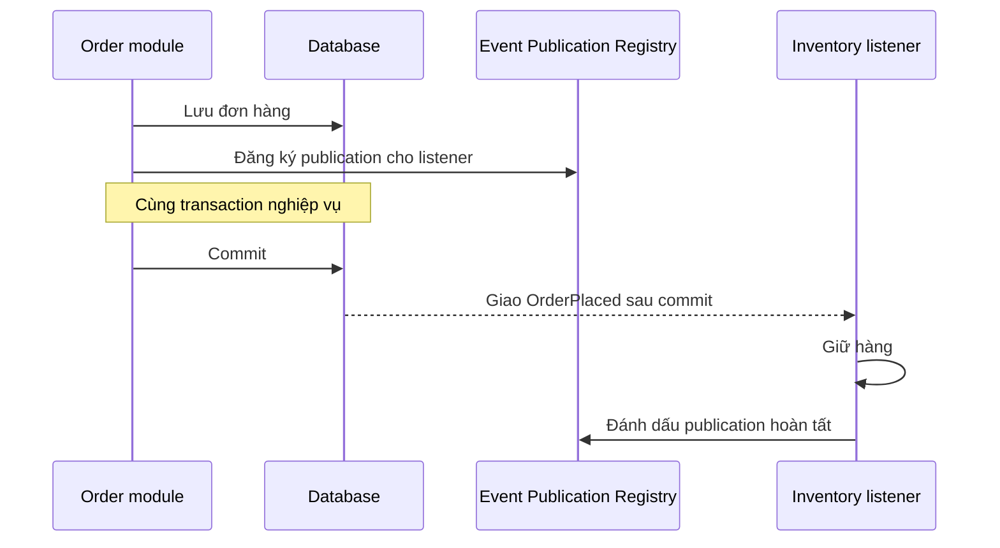

# Bảng outbox

Trong một ứng dụng Spring Modulith, một module thường phát application event để thông báo rằng một nghiệp vụ đã xảy ra. Các module khác đăng ký listener để phản ứng với sự kiện đó. Cách tổ chức này giảm phụ thuộc trực tiếp giữa các module, nhưng đặt ra một yêu cầu về độ tin cậy: nếu tiến trình dừng ngay sau khi giao dịch nghiệp vụ commit, ứng dụng phải có cách biết listener nào chưa xử lý xong.

Bảng outbox giải quyết bài toán lưu lại ý định giao sự kiện cùng với dữ liệu nghiệp vụ. Spring Modulith cung cấp **Event Publication Registry** để theo dõi các lần giao event tới transactional listener. Với cấu hình lưu trữ quan hệ, registry ghi các publication vào bảng `EVENT_PUBLICATION`. Đây là sổ theo dõi bền vững cho việc giao application event trong ứng dụng; nó không mặc nhiên là một message broker hay một hàng đợi dùng chung cho nhiều hệ thống.

## 1. Vì sao cần lưu publication trong database?

Giả sử module `orders` lưu đơn hàng rồi phát `OrderPlaced` để module `inventory` giữ hàng và module `notifications` gửi thông báo. Nếu ứng dụng chỉ phát event trong bộ nhớ, có một khoảng thời gian dễ mất sự kiện:

1. Giao dịch lưu đơn hàng đã commit.
2. Ứng dụng chuẩn bị gọi listener hoặc chuyển event sang một executor bất đồng bộ.
3. Tiến trình bị dừng trước khi listener xử lý xong.

Khi ứng dụng khởi động lại, dữ liệu đơn hàng vẫn còn nhưng không có bản ghi bền vững cho biết công việc giao event còn dang dở. Listener có thể không bao giờ được gọi lại.

Một cách làm thủ công thường gặp là ghi dữ liệu nghiệp vụ và gửi message tới broker trong cùng một luồng. Hai thao tác này thuộc hai tài nguyên khác nhau, nên không thể mặc nhiên có một transaction ACID bao trùm cả hai. Nếu database commit nhưng việc gửi message thất bại, hệ thống mất message. Nếu message được gửi nhưng transaction database rollback, hệ thống có thể nhận một thông báo về nghiệp vụ chưa tồn tại.

Mẫu transactional outbox xử lý điểm này bằng cách ghi một bản ghi sự kiện vào cùng database và cùng transaction với thay đổi nghiệp vụ. Sau khi transaction commit, một thành phần khác đọc bản ghi và thực hiện việc giao sự kiện. Nhờ đó, dữ liệu nghiệp vụ và dấu vết cần xử lý cùng thành công hoặc cùng rollback.

Trong Spring Modulith, Event Publication Registry đảm nhiệm phần theo dõi publication cho các transactional listener của application event. Khi dùng registry, ứng dụng không cần tự tạo một bảng trạng thái riêng chỉ để biết listener nào đã hoàn tất publication nội bộ.

## 2. Bảng `EVENT_PUBLICATION` lưu những gì?

Registry theo dõi một publication cho từng cặp **event và listener**. Nếu một event có ba transactional listener, registry có thể quản lý ba publication độc lập. Điều này quan trọng vì một listener có thể hoàn tất trong khi listener khác vẫn đang chờ hoặc gặp lỗi.

Ở mức khái niệm, một dòng publication chứa các thông tin sau:

| Thông tin | Ý nghĩa |
| --- | --- |
| Publication ID | Định danh duy nhất của lần giao event tới một listener. |
| Listener ID | Định danh listener nhận event. Registry dùng thông tin này để xác định đích cần xử lý lại. |
| Event type | Kiểu Java của event được lưu, thường được biểu diễn bằng tên kiểu đầy đủ. |
| Serialized event | Nội dung event đã được chuyển thành dạng lưu trữ để có thể khôi phục khi cần. |
| Publication date | Thời điểm publication được đăng ký. |
| Completion date | Thời điểm listener hoàn tất; giá trị chưa có biểu thị publication chưa được đánh dấu hoàn tất. |

Với relational event publication registry, bảng mặc định thường có tên `EVENT_PUBLICATION`. Tên bảng, kiểu dữ liệu, độ dài cột và cách đặt tên cột cụ thể phụ thuộc persistence adapter và phiên bản Spring Modulith. Hãy xem migration/schema do đúng adapter đang dùng cung cấp trước khi viết SQL phụ thuộc vào cấu trúc vật lý.

Có thể đọc trạng thái theo cách đơn giản:

- Publication chưa có `completion date`: listener chưa được registry ghi nhận là hoàn tất. Đây là nhóm cần được theo dõi và có thể cần xử lý lại.
- Publication đã có `completion date`: listener đã hoàn tất lần giao event đó.
- Publication của các listener khác nhau được theo dõi độc lập; không suy ra toàn bộ event đã xử lý xong chỉ từ trạng thái của một listener.

Registry cũng có thể được cấu hình để lưu trữ các publication đã hoàn tất vào vùng archive thay vì giữ chúng trong bảng đang hoạt động. Chính sách hoàn tất và lưu trữ cần được chọn phù hợp với phiên bản, adapter và yêu cầu lưu vết của ứng dụng.

## 3. Vòng đời publication và transaction

Một luồng điển hình với event được xử lý sau commit diễn ra như sau:



Các bước cần hiểu rõ:

1. **Module nguồn phát event trong transaction nghiệp vụ.** Event nên mô tả một sự kiện đã xảy ra, chẳng hạn `OrderPlaced`, thay vì yêu cầu module nhận gọi ngược vào module nguồn để hỏi trạng thái.
2. **Registry đăng ký publication cho các transactional listener phù hợp.** Bản ghi publication được tham gia vào transaction đang phát event. Vì vậy, nếu transaction nghiệp vụ rollback, bản ghi publication tương ứng cũng không được commit.
3. **Transaction commit.** Dữ liệu nghiệp vụ và thông tin publication trở nên bền vững cùng nhau.
4. **Listener được gọi theo thời điểm transaction đã commit.** Với `@ApplicationModuleListener`, Spring Modulith cung cấp cách khai báo listener chạy bất đồng bộ và trong transaction riêng.
5. **Listener xử lý thành công.** Registry ghi nhận publication hoàn tất. Nếu listener thất bại trước khi được đánh dấu hoàn tất, publication vẫn còn trạng thái chưa hoàn tất để có thể được xem xét xử lý lại.

`@ApplicationModuleListener` là lựa chọn thuận tiện cho listener giữa các module cần xử lý sau commit. Một listener thông thường không có cơ chế transactional tương ứng sẽ không tự động có cùng bảo đảm theo dõi publication. Vì vậy, cần kiểm tra annotation và cấu hình thực tế của listener thay vì cho rằng mọi `@EventListener` đều được ghi vào registry.

## 4. Ví dụ phát event và nhận event

Ví dụ dưới đây minh họa module đơn hàng lưu đơn hàng và phát `OrderPlaced`. Các kiểu `Order`, `OrderRepository` và thao tác giữ hàng là phần nghiệp vụ minh họa; chúng cần được thay bằng mô hình của ứng dụng.

Đầu tiên, khai báo event mang dữ liệu cần thiết cho module nhận:

```java
import java.time.Instant;
import java.util.UUID;

public record OrderPlaced(UUID orderId, Instant occurredAt) {
}
```

Module nguồn lưu đơn hàng và phát event trong cùng transaction:

```java
import org.springframework.context.ApplicationEventPublisher;
import org.springframework.stereotype.Service;
import org.springframework.transaction.annotation.Transactional;

@Service
class OrderApplicationService {

    private final OrderRepository orders;
    private final ApplicationEventPublisher events;

    OrderApplicationService(
            OrderRepository orders,
            ApplicationEventPublisher events) {
        this.orders = orders;
        this.events = events;
    }

    @Transactional
    public UUID placeOrder(OrderRequest request) {
        Order order = orders.save(Order.create(request));

        events.publishEvent(
                new OrderPlaced(order.getId(), Instant.now()));

        return order.getId();
    }
}
```

Module kho đăng ký listener:

```java
import org.springframework.modulith.events.ApplicationModuleListener;
import org.springframework.stereotype.Component;

@Component
class InventoryOnOrderPlaced {

    private final InventoryService inventory;

    InventoryOnOrderPlaced(InventoryService inventory) {
        this.inventory = inventory;
    }

    @ApplicationModuleListener
    void reserveInventory(OrderPlaced event) {
        inventory.reserveFor(event.orderId());
    }
}
```

Khi cấu hình relational Event Publication Registry phù hợp với persistence stack, Spring Modulith quản lý các publication cho listener này. Ứng dụng cần khai báo starter/adapter lưu trữ tương ứng với phiên bản đang sử dụng, chẳng hạn adapter JPA hoặc JDBC, và bảo đảm schema của adapter được khởi tạo bằng migration hoặc cơ chế schema initialization đã chọn. Không nên tự tạo một bảng cùng tên với schema của framework bằng cấu trúc phỏng đoán.

Event nên chứa dữ liệu bất biến và đủ để listener thực hiện công việc. Tránh đưa trực tiếp entity đang được quản lý bởi JPA, proxy lazy hoặc một object phụ thuộc vào session database vào payload. Khi event được serialize để lưu, listener có thể được gọi lại ở một tiến trình hoặc thời điểm khác; payload cần có thể khôi phục độc lập với persistence context ban đầu.

## 5. Quan sát các publication đang chờ

Khi điều tra một listener không chạy hoặc chạy chưa xong, câu hỏi đầu tiên là còn publication nào chưa được đánh dấu hoàn tất hay không. Với schema relational mặc định có các cột tương ứng, một truy vấn minh họa có thể là:

```sql
SELECT
    ID,
    LISTENER_ID,
    EVENT_TYPE,
    PUBLICATION_DATE,
    COMPLETION_DATE
FROM EVENT_PUBLICATION
WHERE COMPLETION_DATE IS NULL
ORDER BY PUBLICATION_DATE;
```

Truy vấn trên chỉ là ví dụ theo tên bảng/cột thường gặp. Hãy điều chỉnh theo schema thực tế được tạo bởi adapter và phiên bản của dự án. Không cập nhật thủ công `COMPLETION_DATE` để làm cho một dòng có vẻ đã hoàn tất: thao tác đó có thể khiến registry bỏ qua một công việc chưa thực sự chạy xong.

Một số câu hỏi hữu ích khi quan sát bảng:

- Có publication chưa hoàn tất nào tồn tại lâu hơn ngưỡng vận hành bình thường không?
- Publication tập trung ở một `LISTENER_ID` hay phân bố ở nhiều listener?
- Số publication chưa hoàn tất tăng liên tục hay chỉ tăng trong một khoảng thời gian ngắn?
- Thời điểm publication cũ nhất có vượt quá thời gian gián đoạn mà nghiệp vụ chấp nhận không?

Trong môi trường vận hành, nên theo dõi ít nhất số lượng publication chưa hoàn tất, tuổi của publication cũ nhất và tỷ lệ hoàn tất theo listener. Cảnh báo dựa trên tuổi và xu hướng backlog thường hữu ích hơn việc chỉ cảnh báo khi bảng có một dòng chưa hoàn tất, vì listener bất đồng bộ có thể cần một khoảng thời gian ngắn để xử lý bình thường.

## 6. Khôi phục, retry và xử lý trùng lặp

Publication còn dang dở là thông tin để registry khôi phục công việc. Spring Modulith hỗ trợ xử lý lại các publication chưa hoàn tất theo cơ chế của event publication registry; hành vi tự động khi ứng dụng khởi động và cách cấu hình cụ thể cần được xác nhận theo phiên bản, adapter và cấu hình runtime của ứng dụng. Khi thiết kế vận hành, cần biết rõ publication nào được tự động gửi lại, khi nào cần kích hoạt xử lý lại có chủ đích và cách quan sát lỗi kéo dài.

Retry có nghĩa listener có thể được gọi nhiều hơn một lần cho cùng một nghiệp vụ. Ví dụ, listener đã gọi dịch vụ thanh toán thành công nhưng tiến trình dừng trước khi registry ghi nhận publication hoàn tất. Khi xử lý lại, listener có thể gọi dịch vụ thanh toán lần nữa. Vì thế, không nên dựa vào giả định “listener chỉ chạy đúng một lần”.

Hãy thiết kế thao tác của listener theo hướng idempotent: nhận cùng một event nhiều lần vẫn tạo ra một kết quả nghiệp vụ đúng. Một số cách thường dùng:

- Dùng `orderId` hoặc event ID làm khóa nghiệp vụ duy nhất cho thao tác đã thực hiện.
- Đặt unique constraint cho bản ghi như reservation hoặc notification delivery để ngăn tạo kết quả trùng.
- Truyền idempotency key khi gọi API bên ngoài nếu nhà cung cấp hỗ trợ.
- Kiểm tra trạng thái hiện tại trước khi thực hiện chuyển trạng thái, đồng thời giữ việc kiểm tra và cập nhật trong cùng transaction phù hợp.

Idempotency cần bao phủ cả tác dụng phụ bên ngoài. Một transaction database riêng trong listener không thể tự làm cho lệnh gọi HTTP tới hệ thống khác trở thành atomic với việc đánh dấu publication hoàn tất.

Nếu một publication liên tục thất bại, cần giữ lại thông tin đủ để điều tra: listener đích, loại event, thời điểm phát, nguyên nhân lỗi và số lần thử nếu ứng dụng có cơ chế ghi nhận số lần thử riêng. Sau khi sửa nguyên nhân, chỉ xử lý lại theo quy trình đã kiểm soát và bảo đảm listener an toàn khi chạy lặp. Không xóa publication chưa hoàn tất chỉ để làm sạch backlog.

## 7. Quản lý vòng đời dữ liệu trong bảng

Publication đã hoàn tất vẫn có thể chiếm dung lượng nếu được giữ lại lâu dài. Tùy yêu cầu truy vết và cấu hình registry, ứng dụng có thể xóa publication đã hoàn tất hoặc chuyển chúng sang vùng archive. Chính sách này cần trả lời ba câu hỏi:

1. Cần giữ lịch sử publication đã hoàn tất trong bao lâu?
2. Nhóm nào được phép truy vấn dữ liệu archive khi điều tra sự cố?
3. Có quy trình retention/cleanup nào bảo đảm không xóa nhầm publication chưa hoàn tất?

Payload event có thể chứa dữ liệu nghiệp vụ nhạy cảm. Chỉ đưa vào event những trường listener thực sự cần, áp dụng quyền truy cập database phù hợp và cân nhắc thời hạn lưu payload. Việc lưu event lâu dài cũng tạo ra yêu cầu tương thích ngược: nếu đổi package, đổi tên class hoặc thay đổi cấu trúc event, các payload cũ vẫn có thể cần được deserialize để retry. Nên có chiến lược version hóa event hoặc duy trì khả năng đọc payload cũ trong thời gian retention.

Ưu tiên schema và index do adapter cung cấp. Nếu cần tối ưu truy vấn backlog, hãy đo trên dữ liệu thực tế và thay đổi schema theo hướng dẫn của adapter; tránh sửa trực tiếp bảng framework mà không có migration và kế hoạch nâng cấp tương ứng.

## 8. Kiểm thử hành vi của outbox

Kiểm thử nên xác nhận cả tính nguyên tử của việc ghi publication và hành vi của listener:

- **Transaction commit:** lưu đơn hàng và phát event; sau commit, publication của transactional listener được ghi nhận và listener có thể xử lý.
- **Transaction rollback:** nếu transaction lưu đơn hàng rollback, publication được đăng ký trong transaction đó cũng không được để lại như một công việc đã commit.
- **Listener thất bại:** khi listener ném exception trước khi hoàn tất, publication không được đánh dấu hoàn tất một cách sai lệch.
- **Xử lý lại:** sau khi nguyên nhân lỗi được khắc phục, publication dang dở có thể được xử lý lại và nghiệp vụ vẫn đúng khi listener chạy lặp.
- **Nhiều listener:** trạng thái hoàn tất của listener này không che khuất publication chưa hoàn tất của listener khác.

Lưu ý khi viết integration test: test được bọc trong `@Transactional` và kết thúc bằng rollback thường không tạo ra commit thật, do đó listener chạy sau commit có thể không được kích hoạt như kỳ vọng. Hãy thiết kế test có ranh giới transaction rõ ràng, để transaction cần kiểm tra thực sự commit trước khi xác minh listener và trạng thái publication.

## 9. Khi nào cần một outbox riêng?

Event Publication Registry phù hợp để theo dõi việc giao application event tới transactional listener trong ứng dụng Spring Modulith. Bảng registry thể hiện trạng thái publication theo listener; mục tiêu chính của nó là giúp việc xử lý event nội bộ có thể được theo dõi và khôi phục.

Nếu yêu cầu là phát message tới Kafka, RabbitMQ hoặc một hệ thống bên ngoài với hợp đồng message, partition key, lịch retry, dead-letter queue và quy mô riêng, cần thiết kế rõ phần tích hợp đó. Có thể cần một relay hoặc outbox dành riêng cho message broker, tùy cách externalize event và bảo đảm của hạ tầng. Không nên xem việc có `EVENT_PUBLICATION` là bằng chứng rằng mọi message bên ngoài đã được broker xác nhận.

Ranh giới này giúp chọn đúng công cụ: dùng registry cho publication nội bộ mà Spring Modulith quản lý; dùng cơ chế tích hợp broker phù hợp khi cần giao tiếp qua hạ tầng messaging; và luôn thiết kế listener/consumer có khả năng xử lý trùng lặp.

## Checklist thiết kế và vận hành

- [ ] Persistence adapter của Spring Modulith đã được khai báo và schema tương ứng đã được quản lý bằng migration hoặc cấu hình khởi tạo phù hợp.
- [ ] Listener cần theo dõi publication được khai báo theo cơ chế transactional, chẳng hạn `@ApplicationModuleListener`.
- [ ] Event mang dữ liệu bất biến, có thể serialize/deserialize và đủ để listener xử lý độc lập.
- [ ] Event được phát trong transaction nghiệp vụ cần bảo vệ.
- [ ] Listener có tính idempotent và xử lý được trường hợp được gọi lại.
- [ ] Có cách quan sát số lượng và tuổi của publication chưa hoàn tất theo listener.
- [ ] Có chính sách retry, điều tra lỗi và retention cho publication đã hoàn tất.
- [ ] Có integration test bao phủ commit, rollback, listener lỗi, xử lý lại và nhiều listener.

Khi các điểm trên được đáp ứng, bảng publication trở thành dấu vết bền vững giúp nhóm phát hiện và khôi phục công việc giao event còn dang dở, đồng thời giữ cho giao tiếp giữa các module ít phụ thuộc trực tiếp vào nhau.
