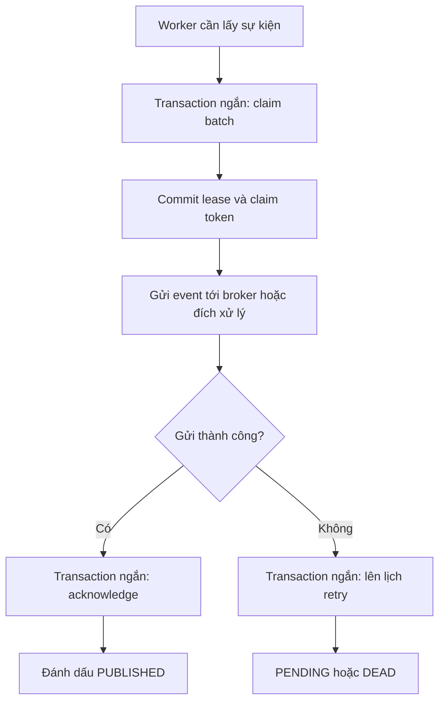

# Khóa và cạnh tranh trong Outbox và lưu trữ application events

Khi một ứng dụng chạy trên nhiều instance, cùng một thời điểm có thể có nhiều luồng xử lý muốn đọc, gửi hoặc hoàn tất cùng một bản ghi sự kiện. Nếu không phối hợp, hai worker có thể cùng gửi một sự kiện; một worker chậm có thể ghi đè trạng thái do worker khác cập nhật; hoặc một tiến trình chết giữa lúc gửi và lúc đánh dấu hoàn tất có thể khiến sự kiện được gửi lại. Đây là bài toán **khóa và cạnh tranh** trong Outbox và kho lưu trữ event publication.

Mục tiêu của cơ chế phối hợp không phải là làm cho mọi thao tác diễn ra tuần tự. Ta muốn nhiều worker xử lý song song các sự kiện khác nhau, trong khi mỗi sự kiện có một chủ sở hữu xử lý tại một thời điểm, trạng thái được chuyển đổi an toàn và việc gửi lại không làm sai dữ liệu nghiệp vụ.

## 1. Xác định đúng điểm cạnh tranh

Một luồng phát sự kiện bền vững thường có các bước sau:

1. Giao dịch nghiệp vụ cập nhật dữ liệu và ghi bản ghi sự kiện cần phát.
2. Một hoặc nhiều worker tìm các bản ghi đang chờ.
3. Worker nhận quyền xử lý một nhóm bản ghi.
4. Worker gửi sự kiện tới broker hoặc gọi bộ xử lý đích.
5. Khi gửi thành công, worker đánh dấu bản ghi đã hoàn tất; khi thất bại, worker lên lịch thử lại.

Mỗi bước có một dạng cạnh tranh riêng:

| Điểm cạnh tranh | Tình huống | Hậu quả nếu không kiểm soát |
|---|---|---|
| Ghi dữ liệu | Hai giao dịch cùng tạo hoặc cập nhật dữ liệu liên quan tới một sự kiện | Mất cập nhật, vi phạm ràng buộc hoặc tạo sự kiện không nhất quán |
| Nhận việc | Nhiều worker cùng đọc một bản ghi `PENDING` | Gửi trùng đồng thời |
| Gia hạn quyền xử lý | Worker cũ bị treo, lease hết hạn và worker mới nhận lại bản ghi | Hai worker có thể cùng tiếp tục xử lý |
| Hoàn tất | Worker cũ ghi trạng thái sau khi quyền xử lý đã chuyển sang worker khác | Trạng thái mới bị ghi đè hoặc bản ghi bị hoàn tất sai chủ sở hữu |
| Xử lý ở phía nhận | Broker hoặc listener nhận lại cùng một event sau timeout hay retry | Tác động nghiệp vụ bị thực hiện nhiều lần |

Trước khi chọn kỹ thuật khóa, cần thống nhất các bất biến sau:

- Thay đổi dữ liệu nghiệp vụ và việc tạo bản ghi Outbox phải nằm trong cùng một giao dịch cơ sở dữ liệu.
- Một bản ghi chỉ có một quyền xử lý còn hiệu lực tại một thời điểm.
- Quyền xử lý phải tự hết hạn nếu worker chết hoặc mất kết nối.
- Chỉ worker đang giữ quyền hợp lệ mới được cập nhật trạng thái của lần nhận việc đó.
- Việc gửi có thể được thực hiện lại. Consumer phải xử lý được event trùng bằng cơ chế idempotency.
- Khóa cơ sở dữ liệu chỉ được giữ trong thời gian ngắn; không giữ transaction và row lock trong lúc chờ mạng hoặc chờ broker.

Những bất biến này giúp phân biệt hai việc thường bị nhầm lẫn: **độc quyền nhận việc** và **không bao giờ gửi trùng**. Khóa có thể giúp một worker nhận việc tại một thời điểm, nhưng không thể tự bảo đảm không gửi trùng khi tiến trình bị dừng đúng lúc giữa thao tác gửi và thao tác ghi nhận kết quả.

## 2. Khóa bi quan với row lock

Khóa bi quan phù hợp khi nhiều worker thường xuyên tranh chấp một tập bản ghi đang chờ. Worker khóa các hàng mà nó chuẩn bị nhận, cập nhật trạng thái nhận việc rồi commit. Những worker khác bỏ qua hàng đang bị khóa để tiếp tục lấy các hàng khác.

Với PostgreSQL, `FOR UPDATE SKIP LOCKED` là một cách phổ biến để xây dựng hàng đợi lấy việc từ bảng Outbox. Ví dụ dưới đây minh họa một bảng Outbox do ứng dụng tự quản lý; tên bảng và các cột là thiết kế minh họa, không phải cam kết về schema nội bộ của Spring Modulith.

```sql
WITH candidates AS (
    SELECT id
    FROM outbox_event
    WHERE available_at <= CURRENT_TIMESTAMP
      AND (
          status = 'PENDING'
          OR (
              status = 'PROCESSING'
              AND locked_until < CURRENT_TIMESTAMP
          )
      )
    ORDER BY occurred_at, id
    LIMIT :batch_size
    FOR UPDATE SKIP LOCKED
)
UPDATE outbox_event AS event
SET status = 'PROCESSING',
    locked_by = :worker_id,
    locked_until = CURRENT_TIMESTAMP + (:lease_seconds * INTERVAL '1 second'),
    claim_version = event.claim_version + 1,
    attempts = event.attempts + 1
FROM candidates
WHERE event.id = candidates.id
RETURNING event.*;
```

Transaction này chọn các hàng đủ điều kiện, khóa chúng, chuyển sang `PROCESSING`, gắn worker sở hữu và trả về các bản ghi đã nhận. `SKIP LOCKED` cho phép worker khác bỏ qua những hàng đang được worker trước giữ khóa thay vì chờ cùng một hàng. Nhờ đó, nhiều worker có thể lấy các nhóm sự kiện khác nhau song song.

Các điểm cần lưu ý khi áp dụng:

- Cú pháp `SKIP LOCKED`, cách biểu diễn thời gian và mức hỗ trợ phụ thuộc hệ quản trị cơ sở dữ liệu. Hãy dùng cú pháp tương ứng với database đang chạy.
- Luôn giới hạn kích thước batch. Một batch quá lớn có thể chiếm nhiều kết nối, tạo nhiều lease đang mở và làm tăng thời gian chờ.
- Thứ tự `occurred_at, id` giúp kết quả lấy việc ổn định hơn, nhưng không tự bảo đảm thứ tự hoàn tất hoặc thứ tự gửi tới broker.
- Điều kiện nhận lại bản ghi `PROCESSING` chỉ cho phép lấy lại khi lease đã hết hạn. Worker cũ có thể vẫn đang chạy; vì vậy row lock trong transaction nhận việc chưa đủ để kiểm soát toàn bộ thời gian gửi.
- Không mở transaction rồi giữ `FOR UPDATE` trong khi thực hiện HTTP call hoặc gửi broker. Hãy commit quyền nhận việc trước, sau đó mới thực hiện I/O.

`SKIP LOCKED` giải quyết cạnh tranh trong lúc chọn và nhận bản ghi. Nó không thay thế cơ chế lease, kiểm tra quyền sở hữu khi cập nhật kết quả hoặc idempotency ở consumer.

## 3. Lease và quyền sở hữu có thời hạn

Sau khi transaction nhận việc commit, row lock được giải phóng. Worker cần một dấu hiệu bền vững để thể hiện rằng nó đang xử lý bản ghi. Một lease thường gồm:

| Trường | Ý nghĩa |
|---|---|
| `locked_by` | ID của worker nhận việc |
| `locked_until` | Thời điểm quyền xử lý hết hạn |
| `claim_version` | Số phiên nhận việc tăng sau mỗi lần claim |
| `attempts` | Số lần đã thử xử lý |

Lease cho phép hệ thống phục hồi khi worker bị dừng đột ngột. Khi `locked_until` đã qua, worker khác có thể nhận lại bản ghi. Nếu tác vụ thường kéo dài hơn thời hạn lease, worker đang xử lý có thể gia hạn lease theo chu kỳ, với điều kiện bản ghi vẫn thuộc về worker và phiên claim của nó.

Ví dụ, sau khi gửi thành công, worker chỉ được đánh dấu hoàn tất nếu ID worker và phiên claim vẫn khớp:

```sql
UPDATE outbox_event
SET status = 'PUBLISHED',
    published_at = CURRENT_TIMESTAMP,
    locked_by = NULL,
    locked_until = NULL
WHERE id = :event_id
  AND status = 'PROCESSING'
  AND locked_by = :worker_id
  AND claim_version = :claim_version;
```

Ứng dụng phải kiểm tra số hàng được cập nhật. Nếu kết quả bằng `0`, quyền xử lý đã hết hạn, đã được chuyển cho worker khác hoặc trạng thái không còn phù hợp. Worker cũ không được tự ý ghi đè trạng thái hiện tại.

`claim_version` đóng vai trò token phiên nhận việc, đôi khi được gọi là fencing token. Nó ngăn worker cũ cập nhật bản ghi sau khi một phiên claim mới đã được cấp. Tuy nhiên, token này chỉ bảo vệ những tài nguyên có kiểm tra token. Nếu worker cũ đã gửi một thông điệp ra broker trước khi nhận ra lease hết hạn, database không thể thu hồi thông điệp đó. Vì vậy event vẫn cần một ID ổn định và consumer vẫn phải idempotent.

Chọn thời hạn lease dựa trên thời gian xử lý thực tế, thời gian timeout của broker và độ trễ có thể gặp. Lease quá ngắn làm tăng khả năng hai worker cùng gửi khi tác vụ chậm; lease quá dài làm chậm phục hồi sau khi worker chết. Với tác vụ dài, nên có heartbeat gia hạn lease và giới hạn thời gian xử lý tối đa.

## 4. Khóa lạc quan và cập nhật có điều kiện

Khóa lạc quan phù hợp khi xung đột ít hoặc khi muốn tránh giữ row lock trong lúc đọc và tính toán. Bản ghi có một cột phiên bản, chẳng hạn `version`. Worker đọc phiên bản hiện tại rồi cập nhật với điều kiện phiên bản chưa đổi:

```sql
UPDATE outbox_event
SET status = 'PROCESSING',
    locked_by = :worker_id,
    version = version + 1
WHERE id = :event_id
  AND status = 'PENDING'
  AND version = :expected_version;
```

Nếu số hàng được cập nhật bằng `1`, worker đã nhận được bản ghi. Nếu bằng `0`, một worker khác đã thay đổi nó hoặc bản ghi không còn ở trạng thái có thể nhận. Worker cần đọc lại hoặc bỏ qua bản ghi đó.

Trong JPA, một entity tự quản lý có thể dùng `@Version` để phát hiện cập nhật đồng thời. Ví dụ:

```java
@Entity
class OutboxEvent {

    @Id
    private UUID id;

    @Version
    private long version;

    private String status;
}
```

`@Version` giúp phát hiện xung đột khi ghi entity, nhưng không tự tạo ra một hàng đợi claim an toàn. Ứng dụng vẫn phải xác định trạng thái nào được phép chuyển, xử lý optimistic locking exception và có chiến lược nhận lại bản ghi khi worker chết. Với polling nhiều worker, một câu lệnh cập nhật có điều kiện hoặc row lock thường dễ kiểm soát batch hơn việc đọc entity rồi cập nhật từng hàng.

## 5. Tách claim, gửi và acknowledge

Một thiết kế dễ vận hành chia quá trình xử lý thành ba transaction hoặc vùng trách nhiệm riêng:



**Claim:** chọn và đánh dấu các bản ghi trong một transaction ngắn. Transaction trả về event ID, payload và token claim. Sau khi commit, worker đã có lease để xử lý.

**Send:** gửi payload ra broker hoặc gọi hệ thống đích bên ngoài transaction claim. Event phải mang một ID ổn định, ví dụ `event_id`, để phía nhận nhận diện lần gửi lặp. Nếu gửi thất bại hoặc timeout, cần xem kết quả là chưa xác định: broker có thể đã nhận thông điệp dù worker không nhận được phản hồi.

**Acknowledge:** sau khi nhận xác nhận thành công, mở transaction mới và cập nhật `PUBLISHED` với điều kiện `event_id`, `locked_by` và `claim_version` vẫn khớp. Nếu không cập nhật được hàng nào, worker đã mất quyền sở hữu; không được ghi đè kết quả của worker khác.

Luồng lỗi cũng cần kiểm tra quyền sở hữu. Nếu worker vẫn là chủ sở hữu, nó có thể chuyển bản ghi về `PENDING`, đặt `available_at` ở thời điểm thử lại và lưu thông tin lỗi. Nếu vượt quá số lần thử, chuyển sang `DEAD` hoặc trạng thái cần can thiệp. Không để một lỗi gửi làm worker giữ lease vô thời hạn.

Một worker có thể được tổ chức bằng các service riêng để ranh giới transaction rõ ràng:

```java
public class OutboxDispatcher {

    private final OutboxClaimer claimer;
    private final EventSender sender;
    private final OutboxAcknowledger acknowledger;

    public void dispatchBatch() {
        var claimedEvents = claimer.claimBatch();

        for (var claimed : claimedEvents) {
            try {
                sender.send(claimed.eventId(), claimed.payload());
                acknowledger.markPublished(
                    claimed.eventId(),
                    claimed.workerId(),
                    claimed.claimVersion()
                );
            } catch (Exception exception) {
                acknowledger.scheduleRetry(claimed, exception);
            }
        }
    }
}
```

Đây là skeleton minh họa ranh giới trách nhiệm. `claimBatch`, `markPublished` và `scheduleRetry` nên được triển khai ở các bean hoặc transaction boundary phù hợp để mỗi thao tác cơ sở dữ liệu có transaction ngắn riêng. Không đặt `@Transactional` bao trùm toàn bộ `dispatchBatch()` nếu điều đó khiến transaction claim còn mở trong suốt thời gian gửi.

## 6. Retry, lease hết hạn và worker cũ

Khi worker không hoàn tất trước thời hạn lease, có thể xảy ra trình tự sau:

1. Worker A claim event với `claim_version = 4`.
2. Worker A bị treo trong lúc chờ broker; lease hết hạn.
3. Worker B claim lại event với `claim_version = 5`.
4. Worker A tiếp tục chạy và nhận được phản hồi gửi thành công.
5. Worker A cố đánh dấu event hoàn tất bằng token phiên `4`.

Điều kiện `claim_version = 4` không còn khớp nên thao tác acknowledge của A cập nhật `0` hàng. Điều này bảo vệ trạng thái database. Nhưng nếu A và B đều đã gửi thông điệp, phía nhận vẫn có thể thấy hai bản sao. Event ID ổn định và xử lý idempotent ở consumer là lớp bảo vệ cuối cùng.

Khi lên lịch retry, nên dùng exponential backoff có jitter để tránh nhiều worker cùng thử lại tại một thời điểm:

```text
delay = min(max_delay, base_delay * 2^attempt) + random_jitter
available_at = now + delay
```

Giới hạn số lần thử và thời gian retry. Lưu `last_error`, thời điểm thử gần nhất và số lần thử để có thể điều tra. Những event không thể xử lý sau ngưỡng quy định nên chuyển sang dead-letter hoặc trạng thái chờ can thiệp, kèm khả năng phát lại có kiểm soát. Khi phát lại, giữ nguyên event ID nếu đó vẫn là cùng một sự kiện nghiệp vụ; chỉ tạo ID mới khi thực sự tạo một sự kiện mới.

## 7. Idempotency ở phía nhận

Khóa phía Outbox không thể loại bỏ mọi bản gửi lặp. Ví dụ worker gửi thành công nhưng mất kết nối trước khi ghi `PUBLISHED`; sau khi lease hết hạn, worker khác gửi lại. Đây là đặc tính thường gặp của giao nhận at-least-once.

Consumer cần nhận diện event đã xử lý. Một cách phổ biến là dùng bảng Inbox với ràng buộc duy nhất theo consumer và event:

```sql
CREATE TABLE processed_event (
    consumer_name VARCHAR(200) NOT NULL,
    event_id UUID NOT NULL,
    processed_at TIMESTAMP NOT NULL,
    PRIMARY KEY (consumer_name, event_id)
);
```

Trong cùng transaction với thay đổi nghiệp vụ của consumer, consumer ghi nhận `event_id`. Nếu khóa duy nhất đã tồn tại, event đã được xử lý và consumer có thể bỏ qua tác động lặp. Nếu chưa tồn tại, consumer thực hiện thay đổi nghiệp vụ rồi commit cả thay đổi lẫn dấu Inbox.

```text
BEGIN
  thử INSERT (consumer_name, event_id) vào processed_event
  nếu event đã tồn tại:
      bỏ qua xử lý nghiệp vụ
  nếu insert thành công:
      thực hiện thay đổi nghiệp vụ
COMMIT
```

Việc ghi Inbox và cập nhật nghiệp vụ phải nguyên tử. Nếu ghi Inbox commit trước nhưng xử lý nghiệp vụ thất bại ở transaction khác, lần retry sau có thể bị coi nhầm là đã xử lý. Ngược lại, nếu tác động nghiệp vụ commit trước khi ghi Inbox, lần gửi lại có thể thực hiện tác động lần thứ hai.

Với tác động không thể đưa vào cùng transaction database, chẳng hạn gọi API thanh toán hoặc gửi email, hãy truyền idempotency key nếu hệ thống đích hỗ trợ và lưu kết quả theo event ID. Nếu hệ thống đích không hỗ trợ idempotency, cần thiết kế quy trình đối soát hoặc bù trừ phù hợp; khóa database cục bộ không thể tạo ra bảo đảm exactly-once cho một hệ thống bên ngoài.

## 8. Thứ tự xử lý và phân vùng khóa

`SKIP LOCKED` ưu tiên thông lượng, nên worker có thể bỏ qua event cũ đang bị khóa và xử lý event mới hơn trước. Nhiều worker cũng có thể hoàn tất các event theo thứ tự khác với thứ tự tạo. Nếu nghiệp vụ yêu cầu thứ tự theo một aggregate, ví dụ mọi thay đổi của cùng một đơn hàng phải được áp dụng theo trình tự, cần biểu diễn ràng buộc đó rõ ràng.

Một số cách thường dùng:

- Gắn `aggregate_id` và `aggregate_sequence` vào event. Consumer chỉ áp dụng sequence kế tiếp, hoặc giữ event đến sau ở trạng thái chờ.
- Chia partition theo `aggregate_id` để các event cùng aggregate đi qua cùng một luồng xử lý.
- Claim theo nhóm aggregate và chỉ cho phép một worker xử lý một aggregate tại một thời điểm.
- Dùng unique constraint hoặc điều kiện cập nhật để ngăn áp dụng sequence đã xử lý hoặc vượt thứ tự.

Tránh khóa toàn bộ bảng chỉ để giữ thứ tự cho một aggregate. Khóa quá rộng làm giảm khả năng song song và khiến một event chậm chặn các event không liên quan. Hãy chọn phạm vi khóa nhỏ nhất đáp ứng quy tắc nghiệp vụ.

## 9. Áp dụng cùng Spring Modulith

Spring Modulith cung cấp Event Publication Registry để theo dõi publication của application event tới từng listener. Với registry có lưu trữ bền vững, ứng dụng có thể biết publication nào đã hoàn tất và publication nào còn dang dở để phục hồi hoặc gửi lại. Đây là cơ chế quan trọng khi listener không hoàn tất do lỗi hoặc ứng dụng dừng giữa quá trình xử lý.

`@ApplicationModuleListener` hỗ trợ xử lý module listener theo hướng bất đồng bộ và có transaction riêng cho listener. Việc chạy listener bất đồng bộ làm tăng khả năng có nhiều tác vụ đang thực thi cùng lúc, vì vậy handler vẫn cần thiết kế an toàn trước retry và event trùng. Không nên suy ra rằng việc dùng annotation này tự động tạo ra một hàng đợi Outbox phân tán có cơ chế claim độc quyền cho mọi replica.

Khi sử dụng Spring Modulith, cần phân biệt rõ hai lớp:

1. **Event Publication Registry:** theo dõi trạng thái publication của application event tới listener trong ứng dụng. Registry giúp phát hiện publication chưa hoàn tất và hỗ trợ xử lý lại theo cơ chế mà phiên bản và implementation đang dùng cung cấp.
2. **Outbox dispatcher tới hệ thống ngoài:** nếu ứng dụng tự xây dựng worker polling để gửi event tới broker hoặc dịch vụ khác, worker cần cơ chế claim, lease, fencing token, retry và idempotency như các phần trên. Không mặc định schema hoặc API nội bộ của registry là bảng Outbox tùy biến của ứng dụng.

Registry và cách cấu hình lưu trữ có thể khác nhau theo phiên bản Spring Modulith và loại persistence được chọn. Hãy kiểm tra đúng phiên bản đang sử dụng trước khi dựa vào chi tiết schema, transaction hoặc khả năng phối hợp giữa nhiều instance. Nếu dùng registry chuẩn, ưu tiên API công khai của registry thay vì cập nhật trực tiếp bảng nội bộ. Nếu có worker Outbox riêng, đặt bảng và quy tắc khóa trong phần hạ tầng do ứng dụng sở hữu.

Một listener vẫn nên idempotent ngay cả khi registry lưu được publication chưa hoàn tất. Khi listener gọi hệ thống bên ngoài, timeout có thể làm kết quả không rõ ràng; khi publication được gửi lại, cùng một tác động có thể được yêu cầu lần nữa. Có thể dùng event ID làm khóa chống trùng, hoặc ghi Inbox cùng transaction với cập nhật nghiệp vụ của listener.

## 10. Kiểm thử cạnh tranh

Kiểm thử khóa cần chạy trên hệ quản trị cơ sở dữ liệu thực tế mà ứng dụng sử dụng, bởi cú pháp locking, isolation và hành vi `SKIP LOCKED` khác nhau giữa các database. Kiểm thử chỉ dựa trên mock repository thường không phát hiện được tranh chấp transaction thật.

Các tình huống nên kiểm tra:

| Tình huống | Điều cần xác minh |
|---|---|
| Hai worker claim đồng thời | Một event chỉ được cấp cho một phiên claim còn hiệu lực |
| Batch lớn hơn số event có thể nhận | Worker không nhận trùng và không giữ khóa vô ích |
| Worker chết sau claim | Event có thể được nhận lại sau khi lease hết hạn |
| Worker cũ chạy tiếp sau khi bị claim lại | Token cũ không thể acknowledge hoặc gia hạn lease của phiên mới |
| Gửi thành công nhưng acknowledge thất bại | Event có thể được gửi lại và consumer không lặp tác động nghiệp vụ |
| Gửi thất bại liên tiếp | `available_at`, số lần thử và trạng thái dead-letter được cập nhật đúng |
| Hai event cùng aggregate | Quy tắc thứ tự được giữ nếu nghiệp vụ yêu cầu |
| Database rollback khi tạo event | Không tồn tại event Outbox mồ côi khi thay đổi nghiệp vụ rollback |

Một bài kiểm thử cạnh tranh có thể mở hai transaction hoặc hai worker độc lập, đồng bộ chúng bằng latch/barrier để cùng claim một tập event, sau đó xác minh tập ID được cấp không giao nhau. Với lease, kiểm thử thêm trường hợp thời gian hết hạn và worker cũ gửi acknowledge bằng token cũ. Tránh dùng `sleep` tùy ý làm cơ chế đồng bộ chính vì nó dễ gây flaky test.

## 11. Quan sát khi chạy thật

Khóa và lease chỉ hữu ích khi có thể quan sát được tình trạng của chúng. Nên theo dõi ít nhất:

- Số event theo trạng thái `PENDING`, `PROCESSING`, `PUBLISHED` và `DEAD`.
- Tuổi của event `PENDING` lâu nhất và thời gian từ lúc tạo đến lúc publish.
- Số lease hết hạn, số lần claim lại và số lần retry theo nhóm lỗi.
- Thời gian claim, tỷ lệ claim thất bại do xung đột và thời gian chờ khóa database.
- Số event bị gửi lại, số event bị consumer loại bỏ do đã xử lý và số lỗi idempotency.
- Số event ở trạng thái dead-letter và thời gian tồn tại của chúng.

Log nên có `event_id`, `aggregate_id` nếu có, `worker_id`, `claim_version`, `attempts` và correlation/trace ID. Không ghi payload nhạy cảm vào log chỉ để điều tra cạnh tranh. Khi có một event bị xử lý chậm, các trường này giúp nối được lần tạo event, lần claim, lần gửi và lần acknowledge.

## 12. Checklist thiết kế

Trước khi đưa worker Outbox chạy trên nhiều instance, hãy xác nhận:

- [ ] Bản ghi event được tạo cùng transaction với thay đổi nghiệp vụ.
- [ ] Câu lệnh claim là nguyên tử và phù hợp với hệ quản trị database.
- [ ] Batch có giới hạn và transaction claim được commit trước khi gửi.
- [ ] Lease có thời hạn, có thể phục hồi sau khi worker chết và có quy tắc gia hạn.
- [ ] Mỗi lần claim có token phiên; mọi thao tác acknowledge/retry đều kiểm tra quyền sở hữu.
- [ ] Worker cũ không thể ghi đè trạng thái của phiên claim mới.
- [ ] Consumer chống trùng bằng Inbox hoặc idempotency key ổn định.
- [ ] Quy tắc ordering được xác định theo aggregate nếu nghiệp vụ yêu cầu.
- [ ] Retry có backoff, jitter, giới hạn và trạng thái dead-letter.
- [ ] Có metric và log để tìm event bị kẹt, lease hết hạn và tranh chấp.
- [ ] Kiểm thử cạnh tranh chạy trên database tương ứng với môi trường triển khai.

Khóa bi quan giúp nhiều worker phân chia bản ghi hiệu quả; lease giúp phục hồi khi worker mất khả năng xử lý; token phiên ngăn worker cũ cập nhật trạng thái mới; còn idempotency bảo vệ nghiệp vụ khi việc gửi được thực hiện lại. Kết hợp các lớp này tạo ra một quy trình xử lý event có thể mở rộng song song mà vẫn giữ được tính nhất quán cần thiết.
