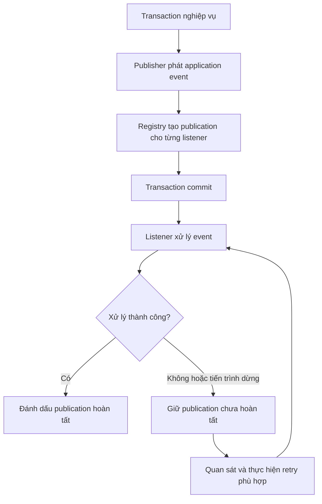

# Lưu trữ publication trong Spring Modulith

Khi một module phát application event để thông báo cho module khác, việc gọi `publishEvent()` mới chỉ bắt đầu quá trình giao sự kiện. Listener có thể chạy sau khi transaction nghiệp vụ đã commit, chạy bất đồng bộ, hoặc thất bại do cơ sở dữ liệu, dịch vụ bên ngoài hay tiến trình ứng dụng gặp sự cố. Nếu ứng dụng chỉ giữ trạng thái xử lý trong bộ nhớ, một lần khởi động lại có thể làm mất dấu những listener chưa hoàn tất. Spring Modulith giải quyết phần theo dõi này bằng **Event Publication Registry**: registry ghi nhận publication cần giao cho từng listener và cập nhật trạng thái khi listener hoàn thành.

Trong module `SPRING_MODULITH_APPLICATION_EVENTS`, lưu trữ publication là một phần của cách tổ chức giao tiếp giữa các module. Mục tiêu là giữ ranh giới nghiệp vụ rõ ràng, giảm phụ thuộc trực tiếp giữa publisher và listener, đồng thời có dữ liệu đủ tin cậy để phát hiện và khôi phục những lần giao sự kiện chưa hoàn tất.

## 1. Phân biệt event, publication và listener

Ba khái niệm này liên quan chặt chẽ nhưng có ý nghĩa khác nhau:

| Khái niệm | Ý nghĩa | Ví dụ |
| --- | --- | --- |
| **Event** | Sự kiện nghiệp vụ được publisher phát ra, mô tả điều đã xảy ra | `OrderCompleted` |
| **Listener** | Thành phần đăng ký nhận và xử lý một loại event | Module kho cập nhật lượng hàng đã cam kết |
| **Publication** | Một lần giao một event cụ thể tới một listener cụ thể | Giao `OrderCompleted` có mã `eventId` tới listener cập nhật kho |

Một event có thể được nhiều listener quan tâm. Vì vậy, registry theo dõi publication theo từng listener. Nếu event `OrderCompleted` được giao cho listener kho và listener hóa đơn, trạng thái hoàn thành của hai publication độc lập: listener kho thành công không có nghĩa listener hóa đơn cũng đã thành công.

Publication cũng không đồng nghĩa với event log nghiệp vụ. Event mô tả sự kiện đã xảy ra; publication ghi nhận tiến trình giao event tới listener. Registry không thay thế lịch sử nghiệp vụ mà ứng dụng cần lưu cho mục đích kiểm toán, tra cứu hoặc báo cáo.

## 2. Vòng đời của một publication

Với listener có ranh giới transaction, Spring Modulith phối hợp việc phát event và registry theo một vòng đời có thể theo dõi:

1. **Publisher phát event trong transaction nghiệp vụ.** Module nguồn thay đổi trạng thái của aggregate rồi gọi `ApplicationEventPublisher.publishEvent()`.
2. **Registry ghi nhận publication cần xử lý.** Mỗi listener transactional phù hợp có một publication riêng. Với persistent repository được cấu hình đúng, bản ghi publication được lưu bền vững cùng ngữ cảnh transaction phát event.
3. **Listener được gọi ở thời điểm phù hợp.** Listener dùng `@TransactionalEventListener` có thể xử lý sau commit. `@ApplicationModuleListener` là lựa chọn tiện dụng của Spring Modulith cho listener ở ranh giới module và hỗ trợ cách xử lý sau commit theo cấu hình của annotation.
4. **Registry đánh dấu hoàn thành.** Khi listener kết thúc thành công, publication tương ứng được ghi nhận là hoàn tất.
5. **Publication còn dang dở được giữ lại.** Nếu listener ném exception hoặc tiến trình dừng trước khi registry ghi nhận hoàn tất, publication vẫn ở trạng thái chưa hoàn tất để có thể được quan sát và xử lý lại.

Điểm quan trọng là registry theo dõi từng lần giao. Ví dụ, nếu một event có ba listener và chỉ listener thứ ba thất bại, hai publication đã hoàn tất vẫn giữ trạng thái hoàn tất; publication thứ ba tiếp tục là mục cần xử lý.



### Vì sao thời điểm commit quan trọng?

Giả sử module đơn hàng lưu trạng thái `COMPLETED` rồi phát `OrderCompleted`. Module kho chỉ nên phản ứng với một đơn hàng đã được commit. Nếu listener chạy trước commit và transaction nguồn sau đó rollback, module kho có thể cập nhật dựa trên một thay đổi chưa từng trở thành dữ liệu chính thức.

`@TransactionalEventListener` cho phép gắn thời điểm xử lý với transaction, thường là `TransactionPhase.AFTER_COMMIT`. Spring Modulith cung cấp `@ApplicationModuleListener` để khai báo listener theo cách phù hợp với giao tiếp giữa các module. Khi dùng listener sau commit, cần nhớ rằng transaction nguồn đã kết thúc; nếu listener cần ghi dữ liệu, nó phải có transaction xử lý riêng theo cấu hình ứng dụng.

Nếu event được phát ngoài một transaction đang hoạt động, listener gắn với transaction có thể không được gọi theo mặc định. Do đó, event đại diện cho thay đổi nghiệp vụ cần được phát từ transaction sở hữu thay đổi đó. Không nên dựa vào registry để biến một lời gọi phát event ngoài transaction thành một giao dịch nghiệp vụ nguyên tử.

## 3. Event Publication Registry lưu những gì?

Registry cần giữ đủ thông tin để xác định event nào đang được giao cho listener nào và publication đang ở trạng thái nào. Về mặt khái niệm, một bản ghi thường có các thông tin sau:

- **Định danh publication:** phân biệt từng lần giao.
- **Định danh listener:** xác định listener nhận event.
- **Thời điểm phát hành:** cho biết publication được tạo khi nào.
- **Nội dung event đã tuần tự hóa:** dữ liệu cần thiết để tái tạo event khi lưu trữ bền vững.
- **Thời điểm hoàn tất:** có giá trị khi listener xử lý thành công; publication chưa hoàn tất chưa có thời điểm này.

Tên bảng, tên cột và cấu trúc vật lý phụ thuộc implementation lưu trữ cùng phiên bản Spring Modulith. Hãy để integration tương ứng quản lý schema theo hướng dẫn của phiên bản đang dùng, hoặc đưa schema vào quy trình migration của dự án nếu dự án quản lý schema tập trung. Không tự giả định cấu trúc nội bộ là API ổn định để các module nghiệp vụ truy vấn trực tiếp.

`EventPublicationRegistry` là thành phần điều phối việc ghi nhận và hoàn tất publication. `EventPublicationRepository` là abstraction lưu trữ phía dưới. Nhờ tách hai vai trò, ứng dụng có thể dùng repository phù hợp với hạ tầng dữ liệu mà không buộc publisher hoặc listener biết chi tiết cách lưu bản ghi.

## 4. Chọn nơi lưu publication

### Lưu trong bộ nhớ

Repository trong bộ nhớ hữu ích cho thử nghiệm đơn giản hoặc ứng dụng chấp nhận mất trạng thái theo dõi khi tiến trình dừng. Nó không phải lựa chọn phù hợp nếu yêu cầu là phục hồi publication sau restart: dữ liệu trong RAM mất cùng tiến trình.

### Lưu bền vững bằng cơ sở dữ liệu

Với ứng dụng cần giao sự kiện đáng tin cậy, hãy cấu hình integration lưu trữ bền vững tương thích với Spring Modulith và nền tảng dữ liệu của ứng dụng. Spring Modulith có các integration cho những lựa chọn như JPA, JDBC và MongoDB; dependency và cấu hình cụ thể cần khớp với BOM, Spring Boot và phiên bản Spring Modulith mà dự án đang sử dụng.

Ví dụ, với ứng dụng dùng JPA, dependency integration có thể được khai báo như sau khi phiên bản dự án cung cấp starter tương ứng:

```xml
<dependency>
    <groupId>org.springframework.modulith</groupId>
    <artifactId>spring-modulith-starter-jpa</artifactId>
</dependency>
```

Hãy quản lý phiên bản thông qua Spring Modulith BOM của dự án thay vì tự chọn một phiên bản starter không đồng bộ. Với JDBC hoặc MongoDB, chọn integration tương ứng. Chỉ thêm integration mà ứng dụng thực sự sử dụng và xác nhận schema, quyền truy cập cùng transaction manager hoạt động trong môi trường triển khai.

Lưu publication bền vững đem lại hai lợi ích chính:

- Trạng thái publication còn lại sau khi ứng dụng restart, vì vậy có thể tìm lại những lần giao chưa hoàn tất.
- Việc ghi nhận event và publication có thể tham gia cùng transaction nghiệp vụ khi repository và cấu hình transaction được tích hợp đúng. Nếu transaction rollback, dữ liệu nghiệp vụ và publication tương ứng không bị tách rời ngoài ý muốn.

Lợi ích thứ hai phụ thuộc cấu hình thực tế. Cần xác minh repository dùng đúng cơ sở dữ liệu và transaction manager, đặc biệt khi ứng dụng có nhiều datasource hoặc nhiều transaction manager.

### Bật xử lý lại publication còn dang dở khi khởi động

Với persistent event publication registry, ứng dụng có thể yêu cầu Spring Modulith phát lại những publication còn dang dở khi khởi động. Ví dụ cấu hình thường dùng:

```yaml
spring:
  modulith:
    events:
      republish-outstanding-events-on-restart: true
```

Hãy kiểm tra property theo đúng phiên bản Spring Modulith của ứng dụng. Bật cơ chế này có nghĩa ứng dụng sẽ thử giao lại publication chưa hoàn tất khi khởi động; nó không tự sửa lỗi nghiệp vụ khiến listener thất bại và cũng không tạo ra bảo đảm xử lý đúng một lần.

## 5. Ví dụ publisher và listener

Publisher chỉ phát một event nghiệp vụ mang dữ liệu cần thiết. Nó không cần biết module kho hay module hóa đơn sẽ xử lý event như thế nào.

```java
public record OrderCompleted(
        UUID eventId,
        UUID orderId,
        Instant completedAt
) {}
```

```java
@Service
class OrderApplicationService {

    private final ApplicationEventPublisher events;
    private final OrderRepository orders;

    OrderApplicationService(
            ApplicationEventPublisher events,
            OrderRepository orders
    ) {
        this.events = events;
        this.orders = orders;
    }

    @Transactional
    public void complete(UUID orderId) {
        Order order = orders.findById(orderId).orElseThrow();
        order.complete();

        events.publishEvent(new OrderCompleted(
                UUID.randomUUID(),
                order.getId(),
                Instant.now()
        ));
    }
}
```

Listener ở module khác chỉ phụ thuộc vào hợp đồng event:

```java
@Component
class InventoryOnOrderCompleted {

    private final InventoryService inventory;

    InventoryOnOrderCompleted(InventoryService inventory) {
        this.inventory = inventory;
    }

    @ApplicationModuleListener
    void on(OrderCompleted event) {
        inventory.confirmOrder(event.orderId());
    }
}
```

Trong ví dụ này, publisher phát event bên trong transaction cập nhật đơn hàng. Listener được khai báo bằng `@ApplicationModuleListener`; Spring Modulith có thể theo dõi publication của listener transactional đó. Khi listener hoàn tất, registry cập nhật publication tương ứng. Nếu xử lý thất bại, publication còn dang dở có thể được quan sát và phát lại theo cơ chế đã cấu hình.

`eventId` trong ví dụ là định danh nghiệp vụ hữu ích cho idempotency và truy vết. Định danh publication của registry và định danh event trong payload phục vụ hai mục đích khác nhau: một event có thể có nhiều publication, mỗi publication gắn với một listener. Không nên đồng nhất hai loại định danh này.

## 6. Retry và xử lý publication chưa hoàn tất

Một publication chưa hoàn tất có thể xuất hiện do nhiều nguyên nhân: listener ném exception, database tạm thời không sẵn sàng, dịch vụ bên ngoài timeout, hoặc tiến trình bị dừng sau khi listener đã thực hiện một phần công việc. Cách khôi phục cần dựa trên nguyên nhân cụ thể.

Quy trình vận hành nên gồm các bước:

1. Xác định publication chưa hoàn tất, loại event, listener và thời điểm phát hành.
2. Đọc log hoặc trace tương ứng để tìm nguyên nhân listener thất bại.
3. Khắc phục lỗi gốc, chẳng hạn phục hồi dịch vụ phụ thuộc hoặc sửa dữ liệu đầu vào không hợp lệ.
4. Phát lại publication bằng cơ chế hỗ trợ của Spring Modulith hoặc công cụ vận hành mà ứng dụng cung cấp.
5. Xác nhận listener đã xử lý thành công và registry đã ghi nhận publication hoàn tất.

Spring Modulith cung cấp API để làm việc với các publication chưa hoàn tất, trong đó có abstraction `IncompleteEventPublications`. Có thể dùng API này để xây dựng màn hình vận hành hoặc luồng phục hồi có kiểm soát. Cách gọi cụ thể nên theo Javadoc của phiên bản đang dùng; không nên tự cập nhật hoặc xóa bản ghi registry bằng SQL để ép trạng thái hoàn tất.

### Retry không đồng nghĩa với exactly-once

Giả sử listener đã gửi yêu cầu thành công tới một dịch vụ thanh toán, nhưng tiến trình dừng trước khi registry kịp ghi nhận publication hoàn tất. Sau khi restart, publication có thể được gửi lại. Dịch vụ thanh toán khi đó có thể nhận cùng yêu cầu lần thứ hai.

Vì vậy, listener cần được thiết kế idempotent: xử lý lặp lại cùng một event không tạo thêm tác động nghiệp vụ ngoài ý muốn. Một cách phổ biến là lưu `eventId` đã xử lý trong cùng transaction với thay đổi dữ liệu nội bộ:

```java
@Transactional
public void confirm(OrderCompleted event) {
    if (processedEventRepository.existsById(event.eventId())) {
        return;
    }

    inventoryRepository.confirmOrder(event.orderId());
    processedEventRepository.save(
            new ProcessedEvent(event.eventId())
    );
}
```

Ví dụ trên minh họa ý tưởng; cần bảo đảm thao tác kiểm tra và ghi nhận `eventId` có ràng buộc duy nhất để hai lần xử lý đồng thời không cùng vượt qua bước kiểm tra. Với side effect ở hệ thống ngoài, hãy dùng idempotency key mà hệ thống đó hỗ trợ hoặc một quy trình đối soát phù hợp. Chỉ lưu `eventId` sau khi gọi dịch vụ ngoài không tự tạo ra tính nguyên tử giữa hai hệ thống.

Không nên retry vô hạn với một publication luôn thất bại vì dữ liệu không hợp lệ. Hãy giới hạn tốc độ retry, phân loại lỗi có thể phục hồi và lỗi cần can thiệp, đồng thời tạo quy trình xử lý thủ công cho trường hợp cần thiết.

## 7. Publication Registry và Transactional Outbox

Event Publication Registry và Transactional Outbox có điểm chung: cả hai đều lưu trạng thái cần thiết để việc giao thông điệp không phụ thuộc hoàn toàn vào bộ nhớ của một tiến trình. Tuy nhiên, phạm vi sử dụng của chúng khác nhau.

| Cơ chế | Trọng tâm | Nơi nhận điển hình |
| --- | --- | --- |
| Event Publication Registry | Theo dõi publication của application event tới transactional listener trong ứng dụng | Listener của các module Spring Modulith |
| Transactional Outbox | Lưu thông điệp cần chuyển ra ngoài trong cùng transaction nghiệp vụ, sau đó có tiến trình chuyển tiếp | Message broker hoặc hệ thống bên ngoài |

Registry có thể hỗ trợ một listener chuyển tiếp event tới broker: listener gửi thông điệp ra ngoài, sau đó hoàn tất publication khi thao tác gửi được xác nhận theo giao thức của broker. Dù vậy, vẫn có khoảng thời gian giữa việc broker nhận thông điệp và việc registry ghi nhận listener hoàn tất. Nếu tiến trình dừng trong khoảng này, lần gửi có thể lặp lại. Consumer bên ngoài vẫn cần idempotency hoặc cơ chế deduplication.

Nếu yêu cầu là lưu hàng đợi thông điệp để nhiều tiến trình độc lập chuyển tiếp tới broker, cần đánh giá Transactional Outbox và khả năng của broker. Không nên mặc định Event Publication Registry là một distributed queue tổng quát, có lease, phân phối tải hoặc bảo đảm exactly-once cho mọi side effect.

## 8. Kiểm thử việc lưu trữ publication

Kiểm thử listener riêng lẻ giúp xác minh logic nghiệp vụ, nhưng chưa đủ để xác nhận registry lưu và phục hồi publication đúng cách. Với integration lưu trữ bền vững, nên có kiểm thử tích hợp sử dụng cùng loại repository và transaction manager như môi trường chạy thật.

Các tình huống quan trọng gồm:

- **Commit thành công:** phát event trong transaction, xác nhận publication được tạo và listener được gọi theo phase mong đợi.
- **Listener hoàn tất:** xác nhận publication chuyển sang trạng thái hoàn tất sau khi listener xử lý thành công.
- **Listener thất bại:** làm listener ném exception có kiểm soát, xác nhận publication còn dang dở và có thể được tìm thấy qua API phù hợp.
- **Khởi động lại:** với persistent store, xác nhận publication chưa hoàn tất vẫn tồn tại sau khi tạo lại application context hoặc tiến trình kiểm thử.
- **Retry:** phát lại publication sau khi đã khắc phục lỗi, xác nhận trạng thái cuối cùng và tác động nghiệp vụ không bị nhân đôi.
- **Rollback:** làm transaction nghiệp vụ rollback và xác nhận không để lại publication mồ côi cho thay đổi chưa commit, trong phạm vi bảo đảm của cấu hình transaction đã chọn.
- **Nhiều listener:** xác nhận trạng thái của từng publication được theo dõi độc lập.

Khi kiểm thử với `@ApplicationModuleTest` hoặc Spring Boot integration test, hãy giữ đúng ranh giới module và dùng transaction thực khi cần kiểm tra tính bền vững. Một test chỉ dùng repository trong bộ nhớ không chứng minh rằng cấu hình JPA, JDBC hay MongoDB có thể phục hồi dữ liệu sau restart.

## 9. Quan sát và vận hành

Registry cung cấp dữ liệu về trạng thái giao event, nhưng ứng dụng vẫn cần biến dữ liệu đó thành tín hiệu vận hành dễ hiểu. Những thông tin hữu ích gồm:

- Số lượng publication chưa hoàn tất, phân theo listener và loại event.
- Tuổi của publication chưa hoàn tất lâu nhất; một publication tồn tại quá lâu thường cần được điều tra.
- Thời điểm phát event, thời điểm listener bắt đầu và thời điểm hoàn tất nếu ứng dụng có thể ghi nhận các mốc này.
- Exception, correlation ID và định danh event trong log hoặc trace.
- Kết quả của mỗi lần phục hồi để người vận hành biết publication đã được xử lý hay vẫn tiếp tục lỗi.

Nên cảnh báo khi số publication chưa hoàn tất tăng bất thường hoặc có publication vượt quá ngưỡng thời gian xử lý dự kiến. Một listener chậm liên tục có thể cho thấy dịch vụ phụ thuộc đang gặp sự cố; một nhóm event lỗi cố định có thể cho thấy thay đổi schema hoặc dữ liệu không tương thích.

Không ghi toàn bộ payload event vào log nếu payload có dữ liệu nhạy cảm. Hãy ưu tiên định danh event, loại event, listener và correlation ID. Registry cần giữ dữ liệu đủ để phục hồi; log và metric chỉ nên cung cấp thông tin cần thiết cho quan sát.

Publication đã hoàn tất có thể được lưu lâu hơn thời gian vận hành cần thiết để phục vụ điều tra. Tuy nhiên, cần có chính sách retention phù hợp với dung lượng database và yêu cầu kiểm toán. Chỉ dọn dẹp publication đã hoàn tất theo API hoặc cơ chế được integration hỗ trợ; tuyệt đối tránh xóa publication chưa hoàn tất chỉ để làm giảm số liệu cảnh báo.

## 10. Những lỗi thiết kế thường gặp

| Lỗi | Hệ quả | Cách xử lý |
| --- | --- | --- |
| Chỉ dùng lưu trữ trong bộ nhớ cho luồng cần phục hồi | Publication mất khi tiến trình dừng | Cấu hình persistent repository |
| Phát event ngoài transaction cho thay đổi nghiệp vụ | Trạng thái nghiệp vụ và publication có thể không đồng bộ | Phát event trong transaction sở hữu thay đổi |
| Coi retry là xử lý đúng một lần | Side effect có thể bị thực hiện lặp | Thiết kế listener idempotent |
| Dùng event chứa toàn bộ entity hoặc object graph lớn | Payload khó tuần tự hóa, khó tương thích khi thay đổi model | Dùng event bất biến, gọn và chứa định danh/dữ liệu cần thiết |
| Đổi tên listener hoặc cấu trúc event mà không xem xét dữ liệu đang lưu | Publication cũ có thể khó được tái tạo hoặc định tuyến | Quản lý tương thích event và listener trong quá trình nâng cấp |
| Xóa publication lỗi bằng SQL | Mất dấu lần giao chưa hoàn tất, che giấu lỗi | Điều tra và phục hồi qua API vận hành |
| Xem registry như message broker phân tán | Kỳ vọng sai về phân phối tải và bảo đảm giao nhận | Chọn Outbox/broker khi yêu cầu cần hàng đợi bên ngoài |

Đặc biệt, event có thể còn nằm trong database qua nhiều lần triển khai. Khi thay đổi tên lớp, package, kiểu trường hoặc định dạng tuần tự hóa, hãy xem xét khả năng đọc lại event cũ. Có thể cần giữ constructor hoặc serializer tương thích, cung cấp chiến lược chuyển đổi dữ liệu, hoặc xử lý có kiểm soát các publication cũ trước khi xóa code tương ứng.

## 11. Quy trình áp dụng trong một module

Khi đưa lưu trữ publication vào một luồng nghiệp vụ, có thể triển khai theo thứ tự sau:

1. Xác định event biểu diễn một sự kiện nghiệp vụ đã xảy ra và module nào sở hữu transaction phát event.
2. Khai báo event bất biến, có định danh và chỉ chứa dữ liệu cần cho consumer.
3. Phát event trong transaction nghiệp vụ bằng `ApplicationEventPublisher`.
4. Khai báo listener transactional phù hợp, thường dùng `@ApplicationModuleListener` cho giao tiếp giữa các module.
5. Chọn integration lưu trữ bền vững tương ứng với database và cấu hình transaction manager.
6. Cấu hình phục hồi publication chưa hoàn tất sau restart nếu yêu cầu vận hành cần điều đó.
7. Bảo đảm listener idempotent và xác định cách xử lý lỗi lâu dài.
8. Viết kiểm thử tích hợp cho commit, rollback, listener thất bại, restart và retry.
9. Theo dõi publication chưa hoàn tất, thời gian tồn tại và kết quả phục hồi trong môi trường chạy thật.

Lưu trữ publication giúp Spring Modulith làm cho việc giao application event có thể quan sát và phục hồi. Khi kết hợp publisher phát event trong transaction, listener xử lý sau commit, persistent Event Publication Registry và logic idempotent, các module có thể trao đổi qua event với mức tin cậy cao hơn mà vẫn giữ được ranh giới nghiệp vụ độc lập. Cơ chế này tạo nền tảng cho giao sự kiện đáng tin cậy; chất lượng cuối cùng vẫn phụ thuộc vào cấu hình transaction, khả năng tương thích của payload và cách từng listener xử lý retry.
