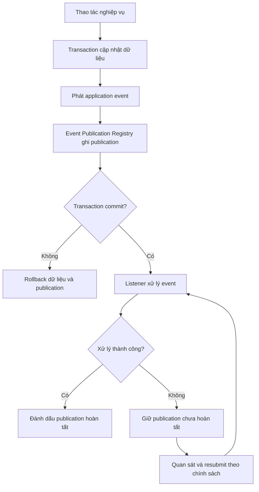

# Chọn database

Trong module **SPRING_MODULITH_APPLICATION_EVENTS**, application events giúp các module Spring Modulith giao tiếp qua sự kiện và giảm phụ thuộc trực tiếp. Khi cần giao sự kiện đáng tin cậy, ứng dụng còn phải lưu trạng thái publication để có thể nhận biết listener nào đã xử lý, listener nào còn dang dở và sự kiện nào cần được gửi lại. Vì vậy, lựa chọn database ảnh hưởng trực tiếp đến tính nhất quán, khả năng phục hồi và chi phí vận hành của cơ chế lưu trữ sự kiện.

Quyết định quan trọng nhất là chọn nơi lưu publication sao cho phù hợp với transaction đang ghi dữ liệu nghiệp vụ. Sau đó mới tối ưu theo thông lượng, kiểu dữ liệu, khả năng truy vấn và năng lực vận hành.

## 1. Xác định đúng dữ liệu cần lưu

Hai khái niệm thường được nhắc cùng nhau nhưng có mục tiêu khác nhau:

- **Event Publication Registry của Spring Modulith** theo dõi việc giao một application event đến từng listener. Registry lưu publication đang chờ xử lý và trạng thái hoàn tất để ứng dụng có thể phát hiện, quan sát và phục hồi các publication chưa hoàn tất.
- **Transactional Outbox** là một mẫu kiến trúc lưu ý định gửi message vào database cùng transaction với thay đổi dữ liệu nghiệp vụ. Một tiến trình relay hoặc cơ chế Change Data Capture (CDC) đọc outbox rồi chuyển message đến broker hay hệ thống bên ngoài.

Event Publication Registry hỗ trợ giao sự kiện giữa các listener trong ứng dụng Spring Modulith. Nó có thể đóng vai trò lưu trữ bền vững cho quá trình xử lý application event. Tuy nhiên, registry không phải event store phục vụ event sourcing và cũng không tự biến việc gửi message đến broker bên ngoài thành một transaction phân tán nguyên tử.

Trước khi chọn database, hãy xác định chính xác luồng cần bảo vệ:

| Nhu cầu | Dữ liệu cần lưu | Câu hỏi quyết định |
|---|---|---|
| Giao application event đến listener trong ứng dụng | Publication, listener nhận sự kiện, thời điểm và trạng thái xử lý | Registry nào được phiên bản Spring Modulith đang dùng hỗ trợ? |
| Chuyển message ra broker hoặc dịch vụ bên ngoài | Bản ghi outbox, payload, trạng thái relay và thông tin thử lại | Có thể ghi outbox cùng transaction với dữ liệu nghiệp vụ không? |
| Lưu lịch sử nghiệp vụ để dựng lại trạng thái | Event log có mô hình và chính sách lưu trữ riêng | Ứng dụng có thực sự cần event sourcing không? |

Không nên dùng một bảng outbox tự thiết kế để thay thế Event Publication Registry nếu yêu cầu thực tế chỉ là theo dõi publication của listener. Ngược lại, nếu cần bảo đảm ý định gửi message ra hệ thống bên ngoài, hãy thiết kế outbox và relay cho luồng đó một cách tường minh.

## 2. Ưu tiên database nằm trong cùng transaction boundary

Nếu một thao tác nghiệp vụ vừa cập nhật dữ liệu vừa phát application event, cơ chế lưu publication nên tham gia cùng transaction cục bộ với thay đổi nghiệp vụ khi kiến trúc và implementation được chọn hỗ trợ điều đó.

Ví dụ, khi xác nhận đơn hàng, ứng dụng cập nhật trạng thái đơn và phát **OrderConfirmed**. Nếu thay đổi đơn hàng được commit nhưng publication không được lưu vì hai thao tác dùng hai database độc lập, hệ thống có thể rơi vào trạng thái đơn hàng đã xác nhận nhưng không có bản ghi để phục hồi việc giao sự kiện.

Khi dữ liệu nghiệp vụ và publication cùng được commit trong một transaction, kết quả có tính nguyên tử ở ranh giới database đó:

- Transaction commit: thay đổi nghiệp vụ và publication cùng tồn tại.
- Transaction rollback: cả thay đổi nghiệp vụ và publication thuộc transaction đó đều bị rollback.
- Sau commit, listener có thể xử lý publication theo cơ chế đồng bộ hoặc bất đồng bộ đã cấu hình.
- Khi listener hoàn tất thành công, registry cập nhật trạng thái hoàn tất. Nếu xử lý thất bại, publication chưa hoàn tất có thể được quan sát và gửi lại theo chính sách phục hồi.

Điều này phụ thuộc vào việc hai thao tác thực sự dùng chung transaction manager và cùng tài nguyên giao dịch. Chỉ dùng chung tên database hoặc cùng máy chủ chưa đủ để bảo đảm tính nguyên tử.

Nếu dữ liệu nghiệp vụ nằm ở một database nhưng registry hoặc outbox nằm ở database khác, hai transaction thông thường không thể tự động commit hoặc rollback như một đơn vị. Khi đó cần chọn rõ một giải pháp:

1. Đặt outbox trong database sở hữu dữ liệu nghiệp vụ và dùng relay hoặc CDC để chuyển message.
2. Chấp nhận nhất quán cuối cùng, thiết kế cơ chế đối soát và xử lý bù phù hợp.
3. Dùng giao dịch phân tán chỉ khi hạ tầng, driver và yêu cầu nghiệp vụ thực sự cần, đồng thời chấp nhận độ phức tạp vận hành.

Với phần lớn hệ thống module, lựa chọn đầu tiên thường dễ kiểm soát và dễ phục hồi hơn.

## 3. Các tiêu chí cần đánh giá

### 3.1. Hỗ trợ transaction và khả năng đồng thời

Kiểm tra database có đáp ứng được các đặc tính sau hay không:

- Ghi dữ liệu nghiệp vụ và publication trong cùng transaction.
- Bảo đảm transaction isolation phù hợp với cách listener và tiến trình phục hồi đọc, cập nhật publication.
- Hỗ trợ nhiều instance ứng dụng cùng xử lý mà không làm mất trạng thái hoặc xử lý xung đột ngoài dự kiến.
- Có cơ chế khóa, cập nhật có điều kiện hoặc điều phối phù hợp cho các bản ghi đang chờ.
- Phục hồi được sau khi tiến trình ứng dụng dừng đột ngột giữa lúc nhận sự kiện và lúc ghi nhận hoàn tất.

Không chọn database chỉ vì tốc độ ghi đơn lẻ cao. Với publication registry, tính đúng đắn của commit, cập nhật trạng thái và khả năng xử lý đồng thời thường quan trọng hơn một phép đo benchmark riêng lẻ.

### 3.2. Khối lượng ghi, đọc và backlog

Publication registry thường có một số kiểu truy cập chính: thêm publication khi phát sự kiện, đánh dấu hoàn tất sau khi listener xử lý, tìm publication chưa hoàn tất để phục hồi và xóa dữ liệu đã hết thời hạn lưu.

Hãy ước lượng:

- Số application event được phát mỗi giây và số listener trung bình nhận mỗi event.
- Tỷ lệ listener xử lý thành công, số lần thử lại và kích thước backlog khi một downstream bị lỗi.
- Thời gian giữ publication đã hoàn tất.
- Số instance ứng dụng cùng đọc hoặc cập nhật trạng thái.
- Kích thước payload và tốc độ tăng trưởng của bảng lưu trữ.

Một event có nhiều listener có thể tạo ra nhiều publication record. Vì vậy, dung lượng cần dự tính theo số lần giao đến listener, không chỉ theo số event được phát.

### 3.3. Kiểu dữ liệu và khả năng truy vấn

Payload thường được tuần tự hóa để lưu trữ rồi tái tạo thành event khi phục hồi. Database cần lưu được payload một cách ổn định, giữ nguyên nội dung cần thiết và hỗ trợ truy vấn các publication theo trạng thái, listener hoặc thời điểm.

Nếu dùng JSON, hãy kiểm tra khả năng lưu JSON, giới hạn kích thước, cách mã hóa ký tự và khả năng truy vấn khi cần. Không nên chọn một database chỉ vì nó có kiểu JSON phong phú nếu ứng dụng hầu như không truy vấn bên trong payload.

Ưu tiên event payload nhỏ, có cấu trúc ổn định và chứa dữ liệu cần cho listener. Thường nên truyền định danh cùng các thuộc tính nghiệp vụ bất biến thay vì tuần tự hóa toàn bộ entity ORM, object có lazy-loading hoặc graph đối tượng lớn.

### 3.4. Vận hành và vòng đời dữ liệu

Database được chọn cần phù hợp với năng lực vận hành hiện có:

- Có backup, restore và phục hồi theo thời điểm.
- Có migration schema được quản lý cùng vòng đời ứng dụng.
- Có metric, log và cảnh báo cho kết nối, transaction, lock, dung lượng và truy vấn chậm.
- Có thể phân quyền để ứng dụng chỉ đọc hoặc cập nhật những bảng cần thiết.
- Có chính sách retention và cleanup rõ ràng cho publication đã hoàn tất.
- Có khả năng mở rộng dung lượng khi backlog tăng hoặc downstream ngừng hoạt động lâu.

Khi khôi phục backup, cần xem xét dữ liệu nghiệp vụ và trạng thái publication như một tập hợp liên quan. Nếu khôi phục chúng về hai thời điểm khác nhau, hệ thống có thể bỏ sót hoặc gửi lặp sự kiện.

## 4. So sánh các lựa chọn phổ biến

| Database | Phù hợp khi | Điểm cần kiểm tra |
|---|---|---|
| PostgreSQL | Dữ liệu nghiệp vụ chính đã ở PostgreSQL; cần transaction quan hệ, index linh hoạt và khả năng lưu payload JSON | Chọn kiểu cột và index theo truy vấn thực tế; theo dõi lock, vacuum, dung lượng và thời gian cleanup |
| MySQL hoặc MariaDB với InnoDB | Hệ thống đang vận hành trên MySQL/MariaDB và muốn giữ publication trong transaction hiện có | Bảo đảm bảng dùng engine hỗ trợ transaction; xem xét isolation, row lock, index và tải ghi đồng thời |
| SQL Server hoặc Oracle | Tổ chức đã chuẩn hóa nền tảng quan hệ này và có năng lực vận hành tương ứng | Kiểm tra driver, transaction manager, kiểu dữ liệu payload, migration và giới hạn của cấu hình triển khai |
| MongoDB | Dữ liệu nghiệp vụ chính đã lưu trong MongoDB và implementation registry tương thích với phiên bản Spring Modulith đang dùng | Cần transaction support phù hợp, cấu hình triển khai đáp ứng transaction và cùng session/transaction boundary cho các thao tác liên quan |
| SQLite | Phát triển cục bộ, thử nghiệm hoặc ứng dụng đơn tiến trình có tải ghi thấp | Không mặc định dùng cho nhiều instance ứng dụng hoặc tải ghi đồng thời cao trong production |

### PostgreSQL

PostgreSQL là lựa chọn phù hợp khi hệ thống đã dùng PostgreSQL cho dữ liệu nghiệp vụ. Transaction quan hệ giúp lưu thay đổi nghiệp vụ và publication trong cùng ranh giới giao dịch. Kiểu JSON có thể hữu ích nếu payload cần được lưu dưới dạng tài liệu, nhưng không nên biến payload thành nơi chứa toàn bộ dữ liệu có thể truy vấn của domain.

Hãy tạo và giữ index dựa trên các truy vấn mà registry thực hiện. Với bảng tăng nhanh, cần theo dõi kích thước bảng, index, hoạt động dọn dữ liệu và thời gian truy vấn publication chưa hoàn tất.

### MySQL và MariaDB

Nếu ứng dụng đang dùng MySQL hoặc MariaDB với InnoDB, tiếp tục dùng database hiện tại thường là phương án hợp lý. Điều cần xác nhận là mọi bảng liên quan đều dùng engine hỗ trợ transaction và cấu hình transaction phù hợp.

Khi số publication tăng, theo dõi row lock, transaction kéo dài, deadlock và truy vấn cleanup. Không nên chạy một transaction lớn để xóa lượng lớn publication đã hoàn tất vì việc đó có thể ảnh hưởng đến luồng ghi đang hoạt động.

### SQL Server và Oracle

Đây là những lựa chọn phù hợp khi chúng đã là nền tảng dữ liệu được tổ chức vận hành. Hãy ưu tiên khả năng tương thích của implementation Spring Modulith, JDBC driver, transaction manager và kiểu dữ liệu lưu payload. Các tính năng đặc thù của nhà cung cấp có thể giúp tối ưu, nhưng nên giới hạn chúng trong phần cấu hình và migration có kiểm soát để việc nâng cấp dễ dự đoán.

### MongoDB

MongoDB có thể phù hợp khi domain đã sử dụng MongoDB và ứng dụng có thể đặt thao tác ghi dữ liệu cùng publication trong transaction được hỗ trợ. Cần xác minh topology triển khai, cấu hình transaction, driver và implementation registry theo đúng phiên bản đang sử dụng.

Nếu dữ liệu nghiệp vụ ở MongoDB còn publication ở một database quan hệ độc lập, việc ghi thành công ở database thứ nhất không bảo đảm database thứ hai cũng commit. Khi đó vẫn tồn tại bài toán dual-write và cần một thiết kế relay, CDC hoặc đối soát.

### Những công nghệ không nên xem là database thay thế trực tiếp

Redis và message broker như Kafka hoặc RabbitMQ có thể đảm nhiệm cache, truyền message hoặc lưu message theo cơ chế riêng. Tuy nhiên, chúng không tự tạo ra transaction nguyên tử với một database nghiệp vụ độc lập. Gửi message thành công rồi transaction nghiệp vụ rollback, hoặc transaction nghiệp vụ commit nhưng gửi message thất bại, đều là các tình huống cần xử lý.

Nếu dùng broker làm đích phát message, hãy lưu ý định gửi trong outbox cùng transaction với dữ liệu nghiệp vụ, sau đó relay hoặc CDC chuyển dữ liệu sang broker. Consumer vẫn cần xử lý message trùng lặp an toàn.

## 5. Chọn theo bối cảnh kiến trúc

Có thể áp dụng thứ tự quyết định sau:

1. **Domain dùng database quan hệ:** ưu tiên implementation JDBC được phiên bản Spring Modulith hỗ trợ và lưu publication trong cùng database, transaction boundary với dữ liệu nghiệp vụ.
2. **Domain dùng MongoDB:** cân nhắc implementation registry tương thích với MongoDB nếu phiên bản và cấu hình triển khai hỗ trợ transaction cần thiết.
3. **Cần gửi sự kiện ra broker:** đặt outbox trong database sở hữu thay đổi nghiệp vụ; dùng relay hoặc CDC để chuyển message. Registry của Spring Modulith và outbox tích hợp broker có thể phục vụ hai chặng khác nhau.
4. **Các module dùng nhiều database:** xác định module nào sở hữu dữ liệu nguồn và nơi nào có thể ghi ý định phát sự kiện nguyên tử. Tránh tạo thêm database chỉ để tách bảng publication nếu việc đó làm mất transaction boundary mà không đem lại lợi ích vận hành rõ ràng.
5. **Thông lượng tăng cao:** đo tải và tối ưu index, batch cleanup, retention, connection pool và truy vấn trước khi chuyển sang một kho lưu trữ khác.

Khi so sánh hai database, hãy dùng cùng workload: cùng số event, số listener, payload, số instance và tỷ lệ retry. Đo thời gian commit, độ trễ cập nhật trạng thái, thời gian tìm publication chưa hoàn tất, lock contention và tốc độ tăng dung lượng. Một benchmark chỉ đo tốc độ insert không phản ánh đầy đủ hành vi production.

## 6. Thiết kế payload để lưu trữ lâu dài

Database tốt không thể bù cho payload khó tương thích. Event đã được ghi có thể tồn tại lâu hơn một phiên bản ứng dụng. Vì vậy:

- Dùng event DTO hoặc record bất biến, không lưu trực tiếp entity ORM hay đối tượng phụ thuộc vào session.
- Mang theo định danh event ổn định nếu cần chống xử lý trùng lặp ở listener hoặc consumer.
- Chỉ đưa vào payload dữ liệu listener thực sự cần; nếu cần dữ liệu mới nhất, listener có thể tải theo định danh từ module sở hữu.
- Có chiến lược tương thích khi đổi tên class, package, field hoặc kiểu dữ liệu.
- Cân nhắc thêm version cho schema event nếu payload có thể tồn tại qua nhiều lần triển khai.
- Không đưa bí mật, thông tin xác thực hoặc dữ liệu nhạy cảm không cần thiết vào payload.
- Giữ khả năng đọc các publication cũ trong thời gian chúng còn được phép phục hồi.

Ví dụ event nhỏ, mang dữ liệu đủ để listener định danh công việc:

```java
public record OrderConfirmed(
    UUID eventId,
    UUID orderId,
    Instant occurredAt,
    int schemaVersion
) {}
```

Ví dụ publisher cập nhật domain và phát event trong cùng luồng nghiệp vụ:

```java
@Service
class ConfirmOrder {

    private final OrderRepository orders;
    private final ApplicationEventPublisher events;

    ConfirmOrder(OrderRepository orders, ApplicationEventPublisher events) {
        this.orders = orders;
        this.events = events;
    }

    @Transactional
    public void confirm(UUID orderId) {
        Order order = orders.findById(orderId).orElseThrow();
        order.confirm();

        events.publishEvent(new OrderConfirmed(
            UUID.randomUUID(),
            orderId,
            Instant.now(),
            1
        ));
    }
}
```

Đoạn mã minh họa ranh giới nghiệp vụ và cách phát event. Để có khả năng phục hồi bền vững, ứng dụng vẫn phải cấu hình Event Publication Registry tương thích và bảo đảm registry tham gia đúng transaction boundary. Chỉ gọi **publishEvent** không tự bảo đảm event đã được lưu bền vững.

## 7. Lập chỉ mục, retention và phục hồi

Với registry hoặc outbox tự xây dựng, các truy vấn vận hành thường tập trung vào publication chưa hoàn tất, publication theo listener và bản ghi cũ cần cleanup. Index phải phản ánh đúng các truy vấn đó.

Một outbox tự thiết kế có thể có các thuộc tính như định danh event, loại event, payload, thời điểm tạo, thời điểm gửi, số lần thử và lỗi gần nhất. Đây chỉ là mô hình minh họa cho custom outbox; không tự ý thêm cột hoặc sửa schema nội bộ do Spring Modulith quản lý.

Một số nguyên tắc vận hành:

- Đặt retention riêng cho publication đã hoàn tất và publication chưa hoàn tất.
- Không xóa publication đang lỗi chỉ để giảm dung lượng; cần phân biệt lỗi tạm thời, lỗi dữ liệu và lỗi cấu hình.
- Giới hạn kích thước batch cleanup để tránh transaction dài và lock kéo dài.
- Theo dõi tuổi của publication chưa hoàn tất, không chỉ đếm số lượng.
- Có quy trình resubmit hoặc xử lý thủ công được kiểm soát cho publication lỗi kéo dài.
- Kiểm tra tính tương thích của payload trước khi triển khai phiên bản ứng dụng mới.
- Kiểm thử phục hồi sau khi ứng dụng dừng ở các thời điểm khác nhau trong vòng đời xử lý.

Số lần listener chạy có thể lớn hơn một. Ví dụ listener đã thực hiện một tác dụng phụ nhưng tiến trình dừng trước khi registry ghi nhận hoàn tất; khi phục hồi, cùng publication có thể được gửi lại. Vì vậy, listener cần idempotent: xử lý lặp cùng một event không được tạo ra tác dụng phụ nghiệp vụ ngoài ý muốn. Với tác dụng phụ trong database, có thể ghi nhận event đã xử lý bằng khóa duy nhất trong cùng transaction với thay đổi nghiệp vụ. Với API bên ngoài, nên truyền idempotency key nếu dịch vụ đích hỗ trợ.

## 8. Sơ đồ luồng lưu trữ và phục hồi



Sơ đồ mô tả luồng khái niệm khi registry tham gia transaction phù hợp. Thời điểm thực thi listener và cách listener chạy đồng bộ hay bất đồng bộ phụ thuộc cấu hình ứng dụng. Với custom outbox gửi ra broker, thay listener trong sơ đồ bằng relay/CDC và trạng thái gửi đến broker; consumer ở phía nhận vẫn cần hỗ trợ xử lý lặp.

## 9. Quan sát và kiểm tra trước production

Database được chọn chỉ thực sự phù hợp khi nhóm vận hành nhận biết được publication bị tắc và có thể phục hồi an toàn. Nên theo dõi tối thiểu:

| Chỉ số | Ý nghĩa |
|---|---|
| Số publication chưa hoàn tất | Phát hiện backlog đang tăng |
| Tuổi của publication cũ nhất | Phát hiện listener bị treo hoặc lỗi kéo dài |
| Tỷ lệ và số lần resubmit | Phân biệt lỗi tạm thời với lỗi lặp lại |
| Thời gian xử lý theo listener | Xác định listener hoặc downstream gây chậm |
| Tỷ lệ lỗi theo event type/listener | Khoanh vùng lỗi dữ liệu hoặc logic |
| Kích thước bảng và index | Dự báo nhu cầu dung lượng và cleanup |
| Lock wait, deadlock và thời gian commit | Phát hiện database trở thành nút thắt |

Trước khi đưa vào production, hãy kiểm tra các tình huống: transaction nghiệp vụ rollback; ứng dụng dừng sau commit; listener ném exception; nhiều instance cùng hoạt động; payload cũ được đọc bởi phiên bản mới; publication được gửi lại; database tạm thời mất kết nối; và cleanup chạy khi hệ thống đang có tải.

Không ghi toàn bộ payload vào log chỉ để hỗ trợ quan sát. Hãy dùng event ID, listener ID, correlation ID, loại event và thời điểm xử lý để liên kết log, trace và metric mà không làm lộ dữ liệu nghiệp vụ.

## 10. Kết luận lựa chọn

Với Spring Modulith Application Events, hãy bắt đầu từ database đang sở hữu dữ liệu nghiệp vụ và xác minh implementation registry tương thích với phiên bản Spring Modulith của ứng dụng. Nếu có thể ghi publication cùng transaction với thay đổi nghiệp vụ, đó thường là lựa chọn đơn giản và đáng tin cậy nhất.

Chỉ cân nhắc một database riêng khi có lý do vận hành hoặc tải cụ thể, đồng thời phải thiết kế rõ cách xử lý dual-write và phục hồi. Nếu mục tiêu là chuyển message ra broker, hãy đặt transactional outbox tại database sở hữu dữ liệu nguồn rồi dùng relay hoặc CDC. Dù chọn PostgreSQL, MySQL, SQL Server, Oracle hay MongoDB, hệ thống vẫn cần payload tương thích qua phiên bản, listener idempotent, retention có kiểm soát và metric cho publication chưa hoàn tất.
