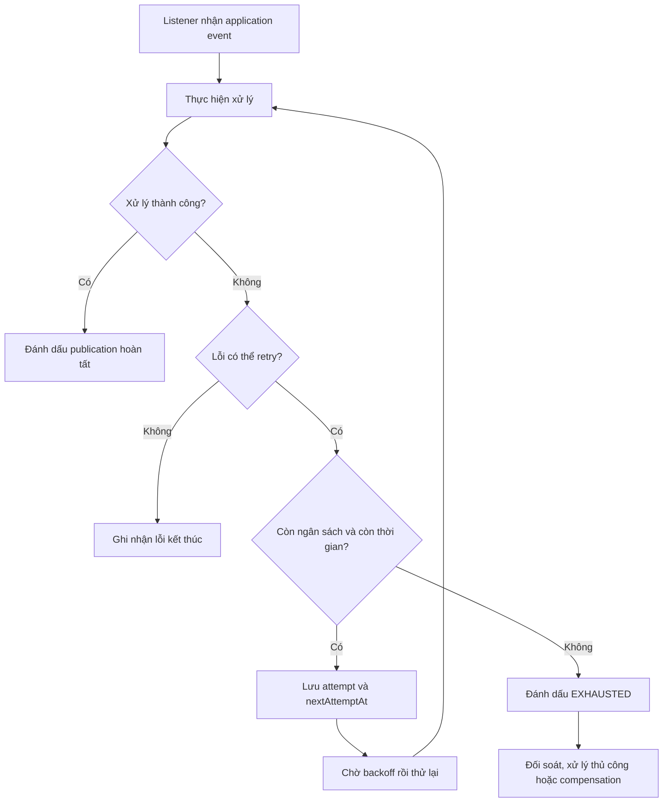

# Giới hạn số lần thử

Khi một listener xử lý application event thất bại, hệ thống cần quyết định có nên thử lại hay chuyển sự kiện sang trạng thái cần xử lý riêng. Nếu thử lại vô hạn, một sự cố kéo dài có thể tạo ra vòng lặp lỗi, chiếm hết worker, làm tăng tải lên dịch vụ đang gặp sự cố và giữ các publication ở trạng thái chưa hoàn tất trong thời gian dài. Nếu dừng quá sớm, lỗi tạm thời có thể làm gián đoạn một quy trình nghiệp vụ vốn có thể tự phục hồi.

Trong Spring Modulith, application event giúp các module giao tiếp qua hợp đồng sự kiện. Event Publication Registry theo dõi publication tương ứng với từng listener và có thể lưu các publication chưa hoàn tất khi ứng dụng được cấu hình với kho lưu trữ phù hợp. Registry cung cấp nền tảng để khôi phục việc xử lý; chính sách giới hạn số lần thử vẫn cần được thiết kế rõ ràng ở cấp ứng dụng.

## Mục tiêu

Sau bài này, bạn có thể:

- Xác định lỗi nào có thể thử lại và lỗi nào cần kết thúc ngay.
- Đặt giới hạn tổng số lần thực thi, bao gồm lần đầu tiên.
- Chọn khoảng chờ tăng dần, giới hạn thời gian chờ và tránh nhiều consumer thử lại đồng thời.
- Kết hợp retry của listener với Event Publication Registry mà không vô tình tạo retry vô hạn.
- Lưu trạng thái thử lại, xử lý publication hết lượt và bảo đảm thao tác nghiệp vụ có tính idempotent.
- Kiểm thử và quan sát vòng đời của một publication từ lúc phát sinh lỗi đến khi hoàn tất hoặc chuyển sang xử lý bù trừ.

## 1. Vì sao phải giới hạn số lần thử?

Một listener có thể thất bại vì nhiều nguyên nhân: dịch vụ bên ngoài tạm thời không truy cập được, giới hạn tốc độ bị vượt, cơ sở dữ liệu đang bận, dữ liệu đầu vào không hợp lệ hoặc một quy tắc nghiệp vụ bị vi phạm. Những nguyên nhân này không có cùng cách xử lý.

Retry phù hợp với lỗi có khả năng biến mất theo thời gian. Nó không thể sửa một yêu cầu sai, một tài khoản không tồn tại hay một trạng thái nghiệp vụ bị cấm. Khi hệ thống lặp lại một thao tác không thể thành công, mỗi lần thử chỉ tiêu tốn thêm tài nguyên và có thể làm tình trạng quá tải nghiêm trọng hơn.

Giới hạn số lần thử tạo ra một điểm kết thúc xác định. Khi đạt giới hạn, hệ thống có thể ghi nhận publication cần can thiệp, phát cảnh báo hoặc khởi chạy quy trình bù trừ đã được thiết kế cho nghiệp vụ đó.

### Phân loại lỗi trước khi retry

| Nhóm lỗi | Ví dụ | Hướng xử lý |
|---|---|---|
| Tạm thời | Timeout, kết nối bị ngắt, HTTP 503, giới hạn tốc độ tạm thời | Có thể retry với backoff; tôn trọng thời gian chờ do dịch vụ trả về nếu có |
| Vĩnh viễn hoặc do dữ liệu | Payload thiếu trường bắt buộc, mã khách hàng không tồn tại, dữ liệu không qua validation | Không retry tự động; ghi nhận lỗi và chuyển sang xử lý dữ liệu hoặc nghiệp vụ |
| Xung đột có thể tự hết | Optimistic locking conflict, tài nguyên đang được cập nhật | Chỉ retry nếu thao tác có thể chạy lại an toàn và xung đột có khả năng biến mất |
| Chưa phân loại | Exception chưa rõ nguyên nhân | Mặc định xử lý thận trọng; bổ sung phân loại trước khi cho phép retry rộng |

Không nên phân loại chỉ dựa trên việc exception có phải `RuntimeException` hay không. Hãy dùng loại exception, mã phản hồi và ngữ cảnh nghiệp vụ để quyết định. Ví dụ, HTTP 429 thường có thể thử lại sau một khoảng chờ; HTTP 400 thường chỉ nên thử lại sau khi dữ liệu hoặc yêu cầu được sửa.

## 2. Xác định ngân sách retry

`maxAttempts` là tổng số lần thực thi tối đa cho một publication tại một listener, tính cả lần đầu. Vì vậy, `maxAttempts = 3` có nghĩa là một lần chạy ban đầu và tối đa hai lần chạy lại.

Ngân sách nên được xác định theo khả năng phục hồi của phụ thuộc và thời gian nghiệp vụ cho phép chờ. Một thao tác cập nhật trạng thái đơn giản có thể dùng ngân sách ngắn. Một tích hợp bên ngoài có thời gian gián đoạn dài hơn có thể cần khoảng chờ lớn hơn, nhưng vẫn phải có giới hạn tổng thời gian.

Một chính sách thường gồm các tham số sau:

| Tham số | Ý nghĩa |
|---|---|
| `maxAttempts` | Tổng số lần thực thi tối đa, tính cả lần đầu |
| `initialDelay` | Thời gian chờ sau lần thất bại đầu tiên |
| `multiplier` | Hệ số tăng thời gian chờ sau mỗi lần thất bại |
| `maxDelay` | Mức chờ tối đa cho một lần retry |
| `maxElapsedTime` | Tổng khoảng thời gian tối đa dành cho retry |
| `jitter` | Độ ngẫu nhiên thêm vào thời gian chờ để tránh nhiều worker retry cùng lúc |

Với exponential backoff, khoảng chờ cơ sở sau lần thất bại thứ `k` có thể tính như sau:

\[
d_k = \min(d_{max}, d_0 \times m^{k-1})
\]

Trong đó `d0` là `initialDelay`, `m` là `multiplier` và `dmax` là `maxDelay`. Có thể thêm jitter vào khoảng chờ cơ sở để phân tán các lần retry. Jitter đặc biệt hữu ích khi nhiều publication cùng thất bại vì một dịch vụ chung.

Ví dụ, với `maxAttempts = 4`, `initialDelay = 1 giây`, `multiplier = 2` và `maxDelay = 10 giây`, lịch chạy dự kiến là:

| Lần thực thi | Thời điểm tương đối | Nếu thất bại |
|---|---:|---|
| 1 — lần đầu | 0 giây | Chờ khoảng 1 giây |
| 2 — retry thứ nhất | Sau khoảng 1 giây | Chờ khoảng 2 giây |
| 3 — retry thứ hai | Sau khoảng 3 giây | Chờ khoảng 4 giây |
| 4 — retry thứ ba | Sau khoảng 7 giây | Hết ngân sách; chuyển sang xử lý kết thúc |

Thời gian thực tế có thể dài hơn do jitter, thời gian thực thi và lịch của worker. Vì vậy, cần kiểm tra cả `maxElapsedTime`; số lần thử thấp vẫn có thể gây chờ quá lâu nếu mỗi lần thực thi có timeout lớn.

## 3. Áp dụng retry có giới hạn cho listener

Ví dụ dưới đây mô phỏng module thanh toán phát application event sau khi ghi nhận yêu cầu thanh toán. Listener gọi một bean tích hợp cổng thanh toán. Bean tích hợp chỉ retry exception tạm thời và giới hạn tổng số lần gọi.

```java
import java.util.UUID;

public record PaymentRequested(UUID eventId, UUID paymentId) {}
```

Module phát sự kiện qua `ApplicationEventPublisher`:

```java
applicationEventPublisher.publishEvent(
    new PaymentRequested(eventId, paymentId)
);
```

Bean tích hợp sử dụng Spring Retry. Ví dụ giả định ứng dụng đã thêm dependency Spring Retry và bật `@EnableRetry`:

```java
import org.springframework.retry.annotation.Backoff;
import org.springframework.retry.annotation.Retryable;
import org.springframework.stereotype.Service;

@Service
class PaymentGatewayClient {

    private final PaymentGateway gateway;

    PaymentGatewayClient(PaymentGateway gateway) {
        this.gateway = gateway;
    }

    @Retryable(
        retryFor = TemporaryGatewayException.class,
        maxAttempts = 3,
        backoff = @Backoff(
            delay = 500,
            multiplier = 2.0,
            maxDelay = 5_000
        )
    )
    Receipt charge(UUID paymentId, UUID eventId) {
        return gateway.charge(paymentId, eventId.toString());
    }
}
```

Listener gọi bean tích hợp qua proxy Spring:

```java
import org.springframework.modulith.events.ApplicationModuleListener;
import org.springframework.stereotype.Component;

@Component
class PaymentRequestedListener {

    private final PaymentGatewayClient paymentGatewayClient;

    PaymentRequestedListener(PaymentGatewayClient paymentGatewayClient) {
        this.paymentGatewayClient = paymentGatewayClient;
    }

    @ApplicationModuleListener
    void on(PaymentRequested event) {
        paymentGatewayClient.charge(event.paymentId(), event.eventId());
    }
}
```

Trong ví dụ này, `maxAttempts = 3` giới hạn một lần gọi `charge` ở tối đa ba lần thực thi. Chỉ `TemporaryGatewayException` được retry. Khi ngân sách cạn, exception cuối cùng truyền ra khỏi listener để cơ chế theo dõi publication ghi nhận rằng listener chưa hoàn tất. Nếu thêm một phương thức xử lý kết quả cuối cùng, không được âm thầm nuốt exception khi nghiệp vụ vẫn chưa được xử lý; nếu listener trả về bình thường, publication có thể được đánh dấu hoàn tất.

`eventId` được truyền sang cổng thanh toán làm idempotency key. Nếu lần gọi đầu đã được cổng thanh toán chấp nhận nhưng phản hồi bị mất, lần retry có thể đến sau khi thao tác thực tế đã thành công. Idempotency key giúp cổng thanh toán nhận diện các yêu cầu lặp và tránh tạo nhiều giao dịch cho cùng một sự kiện. Nếu dịch vụ ngoài không hỗ trợ idempotency, cần thiết kế bước đối soát trước khi gửi lại thao tác có tác động tài chính.

## 4. Kết hợp Event Publication Registry với ngân sách retry

Spring Modulith theo dõi publication theo listener. Khi listener xử lý thành công, publication tương ứng được đánh dấu hoàn tất. Khi listener thất bại, publication có thể còn ở trạng thái chưa hoàn tất để ứng dụng kiểm tra và gửi xử lý lại. Để khôi phục sau khi tiến trình dừng, cần cấu hình một implementation lưu publication bền vững, chẳng hạn kho lưu trữ JDBC, JPA hoặc MongoDB phù hợp với ứng dụng.

Spring Modulith cung cấp `IncompleteEventPublications` để thao tác với các publication chưa hoàn tất. Ví dụ sau yêu cầu gửi lại những publication đã chưa hoàn tất lâu hơn hai phút:

```java
import java.time.Duration;

import org.springframework.modulith.events.IncompleteEventPublications;
import org.springframework.stereotype.Component;

@Component
class IncompletePublicationRecovery {

    private final IncompleteEventPublications incompleteEventPublications;

    IncompletePublicationRecovery(
            IncompleteEventPublications incompleteEventPublications) {
        this.incompleteEventPublications = incompleteEventPublications;
    }

    void resubmitOldPublications() {
        incompleteEventPublications
            .resubmitIncompletePublicationsOlderThan(Duration.ofMinutes(2));
    }
}
```

Lệnh gửi lại theo độ tuổi là cơ chế phục hồi publication; bản thân thao tác này không phải ngân sách retry xuyên suốt. Nếu một job gọi lại nó sau mỗi khoảng thời gian, cùng một publication có thể được gửi lại nhiều đợt. Mỗi đợt lại chạy listener và có thể kích hoạt thêm số lần retry bên trong listener. Vì vậy, chỉ dùng `maxAttempts` của Spring Retry là chưa đủ nếu yêu cầu nghiệp vụ là giới hạn tổng số lần thực thi qua nhiều lần resubmit, lần khởi động lại hoặc nhiều instance ứng dụng.

Khi cần giới hạn xuyên suốt, hãy lưu retry state bền vững theo định danh publication và listener đích. Một bản ghi retry có thể chứa:

- `publicationKey`: định danh ổn định của publication cùng listener đích.
- `attemptCount`: số lần thực thi đã được cấp phép hoặc đã bắt đầu.
- `nextAttemptAt`: thời điểm sớm nhất được phép retry.
- `lastFailureType` và `lastFailureMessage`: thông tin lỗi gần nhất đã được chuẩn hóa.
- `state`: `RETRY_WAIT`, `COMPLETED`, `EXHAUSTED` hoặc trạng thái nghiệp vụ tương ứng.
- `updatedAt`: thời điểm cập nhật gần nhất để hỗ trợ giám sát và đối soát.

Luồng điều phối có thể mô tả bằng mã giả sau. Các tên `RetryLedger`, `PublicationReader` và `PublicationResubmitter` là abstraction do ứng dụng định nghĩa, không phải tên API của Spring Modulith:

```java
for (IncompletePublication publication : publicationReader.findIncomplete()) {
    RetryState state = retryLedger.findOrCreate(publication.key());

    if (state.isExhausted()) {
        terminalHandler.recordForManualReview(publication, state);
        continue;
    }

    if (state.isDue(clock.instant())
            && retryLedger.claimNextAttempt(publication.key())) {
        publicationResubmitter.resubmit(publication);
    }
}
```

`claimNextAttempt` cần cập nhật nguyên tử để hai instance không cùng cấp một lượt retry cho một publication. Có thể dùng transaction, khóa bản ghi hoặc cập nhật có điều kiện theo `attemptCount` hiện tại. Nếu worker chết sau khi nhận lượt nhưng trước khi xử lý, lease hoặc thời hạn claim giúp hệ thống thu hồi lượt bị bỏ dở. Việc tăng bộ đếm trước khi gọi listener là lựa chọn bảo thủ: một lần crash có thể tiêu tốn một lượt, nhưng không làm ngân sách bị vượt do lần thực thi không được ghi nhận.

Trong mô hình coordinator này, `attemptCount` đếm số lượt coordinator cấp cho publication. Nếu mỗi lượt lại kích hoạt retry nội bộ bằng Spring Retry, cần tính số lần gọi nội bộ vào cùng ngân sách hoặc tắt retry nội bộ để coordinator là nơi duy nhất quyết định lượt chạy. Nếu không, bộ đếm trong ledger sẽ thấp hơn số lần gọi thực tế.

Hãy thống nhất một nơi chịu trách nhiệm đếm số lần thử. Nếu cả listener, job resubmit và một lớp client đều có retry riêng, số lần gọi thực tế có thể nhân lên. Ví dụ, ba lần thử ở listener nhân với bốn lần resubmit có thể tạo ra tối đa mười hai lần gọi đến phụ thuộc. Ngân sách toàn cục phải tính tất cả các tầng retry hoặc chỉ định một tầng duy nhất được quyền thực hiện retry.

## 5. Xử lý khi đã hết lượt

Khi publication đã đạt `maxAttempts`, không tiếp tục đưa nó vào lịch retry thông thường. Hãy chuyển nó sang một trạng thái kết thúc có thể quan sát và xử lý. Tùy nghiệp vụ, bước này có thể:

1. Lưu publication cùng lỗi cuối, số lần thử và thông tin tương quan vào nơi chờ xử lý thủ công.
2. Phát cảnh báo cho nhóm vận hành hoặc nhóm sở hữu module.
3. Tạo tác vụ đối soát để xác minh trạng thái ở hệ thống bên ngoài.
4. Phát một compensation event nếu nghiệp vụ đã định nghĩa rõ hành động bù trừ.

Retry và compensation giải quyết hai vấn đề khác nhau. Retry lặp lại cùng một thao tác với kỳ vọng lỗi tạm thời sẽ biến mất. Compensation thực hiện một hành động nghiệp vụ mới để đưa hệ thống về trạng thái chấp nhận được, ví dụ giải phóng hạn mức đã giữ hoặc hoàn tác một đặt chỗ. Không nên tự động bù trừ chỉ vì một exception xuất hiện; trước tiên phải xác định thao tác ban đầu đã tạo tác động ở hệ thống ngoài hay chưa.

Nếu một listener đã gọi thành công hệ thống ngoài nhưng thất bại trước khi hoàn tất transaction nội bộ, lần chạy lại có thể lặp tác động ngoài. Vì vậy, hãy thiết kế idempotency ở ranh giới tích hợp, lưu mã tham chiếu của thao tác ngoài và hỗ trợ đối soát. Việc đánh dấu `EXHAUSTED` cũng cần giữ đủ dữ liệu để người xử lý có thể quyết định tiếp tục, bỏ qua có kiểm soát hoặc phát sự kiện bù trừ.

## 6. Giữ retry an toàn trong môi trường nhiều instance

Trong triển khai nhiều instance, các quy tắc sau giúp ngân sách retry có hiệu lực nhất quán:

- Lưu bộ đếm và thời điểm retry trong kho dùng chung, không giữ trong bộ nhớ của một instance.
- Claim lượt retry bằng thao tác nguyên tử để tránh hai scheduler cùng gửi một publication.
- Dùng lease có thời hạn để thu hồi claim của worker đã dừng bất thường.
- Tách giới hạn concurrency của listener khỏi `maxAttempts`; giới hạn số lần thử không tự giới hạn số listener chạy đồng thời.
- Dùng backoff và jitter để giảm hiện tượng nhiều worker cùng gọi lại dịch vụ vừa phục hồi.
- Đặt timeout cho từng lần gọi và giới hạn tổng thời gian retry để một worker không bị chiếm giữ vô thời hạn.
- Giữ retry state theo từng listener đích. Một event có thể được nhiều module xử lý; listener thành công không nên làm mất trạng thái lỗi của listener khác.

Ranh giới transaction cũng cần được xác định rõ. Với listener xử lý dữ liệu trong cùng cơ sở dữ liệu, transaction có thể giúp rollback thay đổi nội bộ khi xử lý thất bại. Transaction đó không thể rollback một HTTP request hoặc một giao dịch đã được hệ thống bên ngoài chấp nhận. Dùng idempotency, transactional outbox/inbox hoặc bước đối soát phù hợp với ranh giới hệ thống để xử lý phần tác động nằm ngoài transaction.

## 7. Kiểm thử chính sách giới hạn

Kiểm thử nên xác nhận hành vi ở cả cấp chính sách retry và cấp luồng publication:

| Tình huống | Điều cần xác nhận |
|---|---|
| Phụ thuộc thành công ngay | Listener chỉ chạy một lần và publication hoàn tất |
| Thất bại tạm thời rồi thành công | Số lần gọi đúng với số lần cần thiết; khoảng chờ tuân theo policy |
| Thất bại liên tục | Tổng số lần thực thi không vượt `maxAttempts` |
| Lỗi vĩnh viễn | Không retry; lỗi được ghi nhận để xử lý phù hợp |
| Đạt giới hạn | Publication được chuyển sang trạng thái kết thúc và phát tín hiệu vận hành cần thiết |
| Ứng dụng khởi động lại | Bộ đếm và `nextAttemptAt` được khôi phục từ kho bền vững |
| Hai instance cùng quét | Một publication chỉ được claim một lần cho mỗi lượt |
| Tác động ngoài đã thành công nhưng phản hồi bị mất | Retry không tạo giao dịch hoặc tác động nghiệp vụ trùng lặp |
| Event có nhiều listener | Trạng thái hoàn tất và ngân sách retry được theo dõi riêng cho từng listener |

Ở unit test, kiểm tra trực tiếp phép tính backoff, điều kiện hết lượt và phân loại exception. Ở integration test, phát event qua application context, làm cho listener thất bại theo kịch bản xác định, rồi xác minh publication được hoàn tất hoặc còn chưa hoàn tất đúng như mong đợi. Với retry state bền vững, cần có kiểm thử khởi động lại hoặc tái tạo coordinator để chứng minh bộ đếm không bị đặt lại khi instance thay đổi.

## 8. Quan sát và vận hành

Một chính sách retry chỉ hữu ích khi đội ngũ có thể nhận biết nó đang hoạt động như thế nào. Nên theo dõi tối thiểu:

- Số publication chưa hoàn tất và tuổi của publication chưa hoàn tất lâu nhất.
- Số lần retry theo listener và nhóm lỗi.
- Số publication đã hết ngân sách và đang chờ xử lý.
- Thời gian từ lần thất bại đầu tiên đến khi hoàn tất hoặc chuyển trạng thái kết thúc.
- Tỷ lệ thành công sau retry và tỷ lệ lỗi lặp lại theo phụ thuộc.

Log nên có event ID, publication key, listener đích, attempt hiện tại, `maxAttempts`, thời điểm retry tiếp theo và correlation ID. Tránh dùng event ID hoặc publication key làm nhãn metric có cardinality cao; các giá trị này phù hợp hơn với log và trace. Metric nên nhóm theo tên listener, nhóm lỗi hoặc phụ thuộc.

Khi vận hành, cần phân biệt publication đang chờ backoff với publication bị kẹt do worker, lỗi cấu hình hoặc lỗi dữ liệu. Không nên tăng `maxAttempts` ngay khi thấy hàng đợi chưa hoàn tất tăng lên. Trước hết hãy xem tuổi publication, nhóm exception, tình trạng phụ thuộc và tỷ lệ retry thành công để chọn biện pháp phù hợp.

## 9. Quy trình quyết định



Trước khi đưa chính sách vào vận hành, hãy trả lời được bốn câu hỏi: một publication được thử tối đa bao nhiêu lần; exception nào được phép retry; bộ đếm có tồn tại qua lần resubmit và khởi động lại hay không; và hệ thống làm gì khi hết lượt. Khi các câu trả lời này rõ ràng, Event Publication Registry có thể đảm nhiệm vai trò theo dõi publication chưa hoàn tất, còn chính sách retry giữ cho quá trình phục hồi có giới hạn, có thể dự đoán và có thể vận hành.
