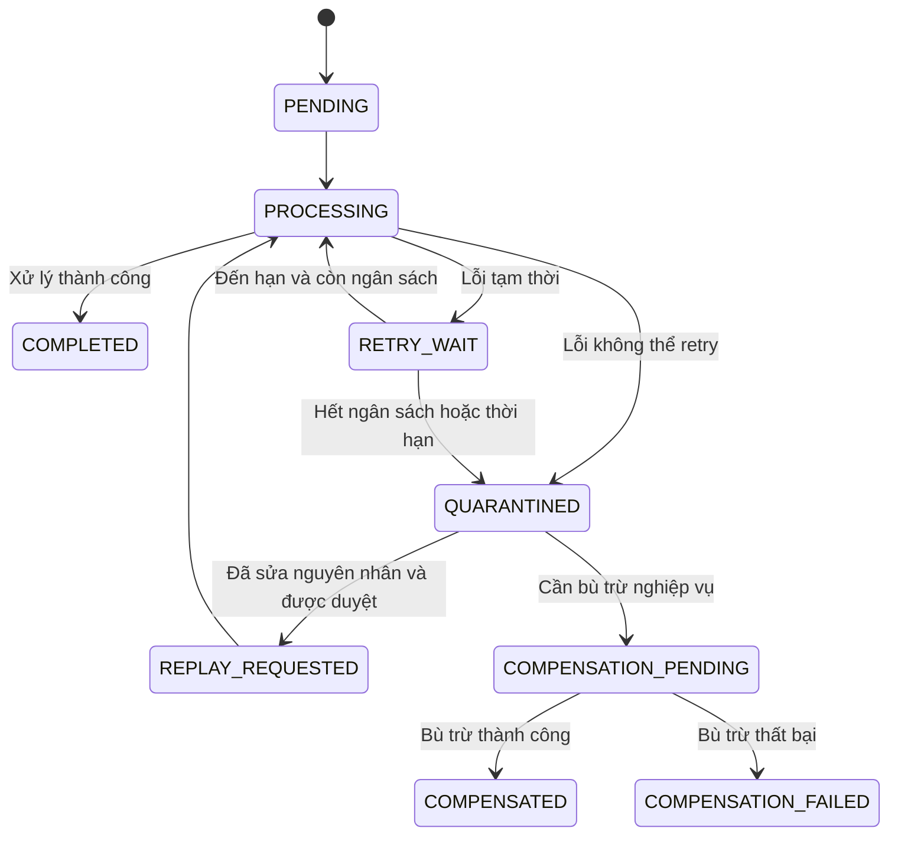
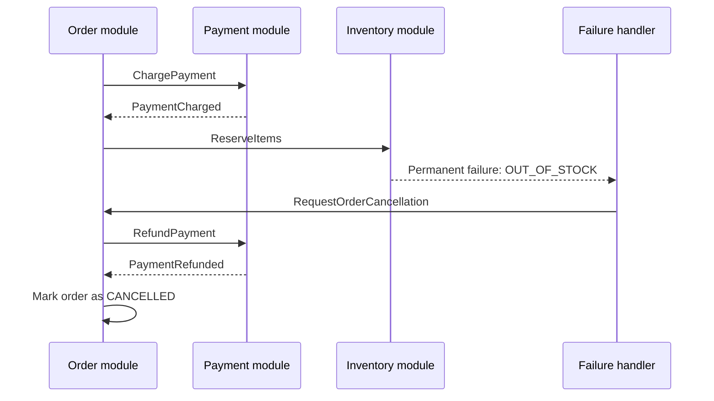

# Đánh dấu lỗi vĩnh viễn

## Mục tiêu

Khi một module Spring Modulith xử lý application event, listener có thể gặp lỗi tạm thời hoặc lỗi không thể tự khắc phục bằng cách thử lại. Nếu mọi lỗi đều được retry vô hạn, một sự kiện có dữ liệu sai hoặc vi phạm quy tắc nghiệp vụ có thể liên tục chiếm tài nguyên, tạo log nhiễu và che khuất các sự kiện đang chờ xử lý bình thường.

**Đánh dấu lỗi vĩnh viễn** là quyết định đưa một lần giao sự kiện vào trạng thái kết thúc cần can thiệp, sau khi hệ thống đã phân loại lỗi và áp dụng chính sách retry. Bản ghi lỗi vẫn phải được lưu để điều tra, replay có kiểm soát hoặc thực hiện hành động bù trừ.

Sau bài học, bạn có thể:

- Phân biệt lỗi tạm thời, lỗi không thể retry và lỗi chưa đủ thông tin để phân loại.
- Thiết kế trạng thái terminal/quarantine cho publication hoặc event delivery.
- Kết hợp trạng thái nghiệp vụ với Spring Modulith Event Publication Registry.
- Ngăn tự động retry một event đã được cách ly, nhưng vẫn giữ khả năng replay có kiểm soát.
- Phân biệt retry với compensation và kiểm thử các nhánh xử lý lỗi.

## 1. Vì sao cần trạng thái lỗi vĩnh viễn?

Giả sử module Đơn hàng phát `OrderPlaced` và module Kho nhận sự kiện để giữ hàng. Listener có thể thất bại vì database Kho tạm mất kết nối. Đây là lỗi có khả năng tự hết: chờ một khoảng thời gian rồi thử lại có thể thành công.

Một tình huống khác là payload chứa mã sản phẩm không tồn tại, phiên bản schema không được hỗ trợ hoặc dữ liệu vi phạm quy tắc nghiệp vụ. Nếu listener lặp lại cùng một thao tác mà không có thay đổi đầu vào hay cấu hình, kết quả nhiều khả năng vẫn thất bại. Retry vô hạn không làm dữ liệu hợp lệ hơn.

Một chính sách giao sự kiện cần trả lời ba câu hỏi:

1. Lỗi có khả năng tự hết khi thử lại hay cần thay đổi dữ liệu, code hoặc quyết định nghiệp vụ?
2. Khi nào hệ thống dừng retry tự động và chuyển event sang vùng cách ly?
3. Ai có thể quyết định sửa dữ liệu, replay hoặc bù trừ, và quyết định đó được lưu ở đâu?

Không nên coi mọi lỗi sau một số lần thử là lỗi vĩnh viễn theo nghĩa nghiệp vụ. Hết ngân sách retry chỉ có nghĩa là hệ thống dừng thử tự động và cần xem xét. Ví dụ, một broker mất kết nối nhiều giờ vẫn là lỗi hạ tầng có thể phục hồi, dù event đã vượt ngưỡng retry. Vì vậy, trạng thái terminal cần ghi rõ lý do: lỗi không thể retry, hết thời hạn xử lý, vượt ngân sách thử lại hay cần quyết định của người vận hành.

## 2. Phân loại lỗi trước khi quyết định

Việc phân loại nên dựa trên loại lỗi, ngữ cảnh và khả năng khắc phục. Không nên chỉ dựa vào tên exception chung như `RuntimeException` hoặc `DataAccessException`.

| Nhóm lỗi | Ví dụ | Hành động phù hợp |
| --- | --- | --- |
| Tạm thời (transient) | Timeout, mất kết nối database/broker trong thời gian ngắn, HTTP 503, deadlock có thể thử lại. | Retry với backoff và jitter. |
| Không thể retry với cùng đầu vào (non-retryable) | Payload sai cấu trúc, thiếu trường bắt buộc, phiên bản event không được hỗ trợ, mã tham chiếu không hợp lệ. | Cách ly để sửa dữ liệu, nâng cấp consumer hoặc xử lý thủ công. |
| Từ chối nghiệp vụ | Đơn đã hủy, trạng thái hiện tại không cho phép giữ hàng, khách hàng không đủ điều kiện. | Ghi nhận kết quả nghiệp vụ; phát event kết quả hoặc bắt đầu quy trình bù trừ nếu cần. |
| Chưa xác định | Lỗi không phân loại được, lỗi code mới hoặc lỗi bất ngờ. | Retry có giới hạn, giữ đầy đủ dấu vết và chuyển xem xét khi hết ngân sách. |

Lỗi từ chối nghiệp vụ không nhất thiết là lỗi kỹ thuật. Nếu listener đã xử lý đúng hợp đồng và xác định yêu cầu không được chấp nhận, đó có thể là kết quả hợp lệ của nghiệp vụ. Hãy mô hình hóa kết quả này rõ ràng thay vì biến mọi trường hợp từ chối thành exception rồi để hệ thống retry.

Một chính sách phân loại nên ổn định và có thể kiểm thử. Có thể dùng các loại exception chuyên biệt như `TransientEventException`, `NonRetryableEventException` và `BusinessRejectionException`, hoặc trả về một kết quả có mã lỗi rõ ràng. Tránh suy đoán rằng mọi lỗi 4xx đều vĩnh viễn hoặc mọi lỗi 5xx đều tạm thời; ý nghĩa phụ thuộc vào hợp đồng của hệ thống đích.

## 3. Vòng đời của một event

Một mô hình trạng thái đơn giản giúp phân biệt xử lý bình thường, retry và cách ly:



Ý nghĩa các trạng thái:

- `PENDING`: event đã được ghi nhận và đang chờ listener hoặc worker xử lý.
- `PROCESSING`: một worker đang xử lý event; nếu có claim/lease, trạng thái phải gắn với thời hạn sở hữu.
- `RETRY_WAIT`: lần xử lý trước thất bại do lỗi có khả năng phục hồi; event có thời điểm thử lại tiếp theo.
- `COMPLETED`: listener đã hoàn tất trách nhiệm được giao.
- `QUARANTINED`: hệ thống dừng retry tự động; event và nguyên nhân được lưu để xem xét.
- `REPLAY_REQUESTED`: có yêu cầu xử lý lại sau khi nguyên nhân đã được khắc phục và đã kiểm tra side effect trước đó.
- `COMPENSATION_PENDING`, `COMPENSATED`, `COMPENSATION_FAILED`: theo dõi hành động bù trừ nghiệp vụ.

Đây là mô hình trạng thái ở cấp ứng dụng. Một triển khai có thể dùng ít trạng thái hơn hoặc tách trạng thái publication, trạng thái quarantine và trạng thái compensation thành các bảng riêng. Điều quan trọng là không dùng một giá trị trạng thái để biểu diễn nhiều ý nghĩa khác nhau.

## 4. Lưu dấu vết lỗi và quyết định terminal

Một bản ghi quarantine nên cho phép trả lời: event nào lỗi, listener nào xử lý, lỗi gì, đã thử bao nhiêu lần, tại sao dừng retry và ai quyết định xử lý tiếp. Ví dụ schema khái niệm:

```sql
CREATE TABLE event_failure (
    id                  UUID PRIMARY KEY,
    event_id            UUID NOT NULL,
    listener_id         VARCHAR(200) NOT NULL,
    event_type          VARCHAR(200) NOT NULL,
    failure_status      VARCHAR(30) NOT NULL,
    failure_category    VARCHAR(40) NOT NULL,
    error_code          VARCHAR(120),
    error_message       TEXT,
    attempts            INTEGER NOT NULL,
    first_failed_at     TIMESTAMP WITH TIME ZONE NOT NULL,
    last_failed_at      TIMESTAMP WITH TIME ZONE NOT NULL,
    quarantined_at      TIMESTAMP WITH TIME ZONE,
    resolution          VARCHAR(40),
    resolved_by         VARCHAR(160),
    resolved_at         TIMESTAMP WITH TIME ZONE,
    resolution_note     TEXT,
    UNIQUE (event_id, listener_id)
);
```

Schema thực tế có thể lưu payload trong bảng riêng hoặc tham chiếu tới bản ghi publication/outbox đang được lưu trữ. Nếu lưu payload trực tiếp, cần giới hạn kích thước, bảo vệ dữ liệu nhạy cảm và đặt chính sách retention. `error_message` nên được làm sạch để không chứa token, mật khẩu hoặc dữ liệu cá nhân không cần thiết.

Các trường quan trọng:

| Trường | Ý nghĩa |
| --- | --- |
| `event_id`, `listener_id` | Định danh event và consumer cụ thể; một event có thể được nhiều listener xử lý độc lập. |
| `failure_status` | Trạng thái như `QUARANTINED`, `REPLAY_REQUESTED` hoặc trạng thái bù trừ. |
| `failure_category`, `error_code` | Phân loại nguyên nhân để lọc và thống kê. |
| `attempts` | Tổng số lần xử lý hoặc retry đã thực hiện theo định nghĩa thống nhất. |
| `first_failed_at`, `last_failed_at` | Thời điểm lỗi đầu tiên và gần nhất. |
| `quarantined_at` | Thời điểm hệ thống quyết định dừng retry tự động. |
| `resolution`, `resolved_by`, `resolved_at` | Cách xử lý cuối cùng và người/tiến trình thực hiện quyết định. |

Ràng buộc duy nhất theo `(event_id, listener_id)` giúp cập nhật cùng một failure record thay vì tạo nhiều bản ghi rời rạc cho mỗi lần retry. Nếu cần lịch sử đầy đủ từng lần thử, bổ sung bảng `event_failure_attempt` có một dòng cho mỗi attempt; không ghi đè mất dấu vết cũ.

### Khi nào đánh dấu lỗi vĩnh viễn?

Có thể chuyển sang `QUARANTINED` khi gặp lỗi được xác định rõ là không thể retry với cùng payload, hoặc khi event vượt quá số lần thử/thời hạn đã định. Quyết định cần ghi:

- Mã phân loại và nguyên nhân cụ thể.
- Số lần thử, thời điểm lỗi cuối và chính sách đã áp dụng.
- Phiên bản consumer/schema và listener liên quan nếu có.
- Dấu vết tương quan như `event_id`, `correlation_id`, `aggregate_id`.
- Hướng xử lý tiếp theo: sửa dữ liệu, nâng cấp consumer, replay, bỏ qua có phê duyệt hoặc compensation.

Đối với lỗi chưa xác định, nên chuyển sang trạng thái cần xem xét sau ngân sách retry thay vì gắn nhãn `NON_RETRYABLE` một cách thiếu căn cứ. Việc dừng tự động là quyết định vận hành; nguyên nhân gốc có thể vẫn là lỗi hạ tầng.

## 5. Kết hợp với Spring Modulith Event Publication Registry

Spring Modulith Event Publication Registry theo dõi publication của application event tới các listener mà framework quản lý. Registry lưu dấu vết publication và việc hoàn tất listener; publication của listener chưa hoàn tất có thể được tìm và resubmit theo cơ chế được cấu hình.

Điểm cần phân biệt là **trạng thái publication của listener** và **trạng thái xử lý nghiệp vụ**. Registry giúp biết listener đã hoàn thành lời gọi xử lý hay publication vẫn còn dang dở. Nó không tự thay thế toàn bộ mô hình phân loại lỗi, lý do quarantine, phê duyệt replay hay trạng thái bù trừ của miền nghiệp vụ.

Ví dụ listener phân loại lỗi:

```java
@Component
class InventoryOnOrderPlaced {

    private final InventoryProcessor processor;
    private final EventFailureRecorder failures;

    InventoryOnOrderPlaced(
            InventoryProcessor processor,
            EventFailureRecorder failures) {
        this.processor = processor;
        this.failures = failures;
    }

    @ApplicationModuleListener
    void reserveItems(OrderPlaced event) {
        try {
            processor.reserve(event);
        } catch (NonRetryableEventException exception) {
            // Chỉ trả về sau khi bản ghi quarantine được lưu bền vững.
            failures.quarantine(event, "inventory-reservation", exception);
        }
        // Lỗi tạm thời hoặc lỗi chưa phân loại được tiếp tục được ném ra.
    }
}
```

```java
@Service
class EventFailureRecorder {

    private final EventFailureRepository repository;

    EventFailureRecorder(EventFailureRepository repository) {
        this.repository = repository;
    }

    @Transactional
    public void quarantine(
            OrderPlaced event,
            String listenerId,
            NonRetryableEventException exception) {
        repository.upsertQuarantined(
                event.eventId(),
                listenerId,
                "OrderPlaced",
                "NON_RETRYABLE",
                exception.getCode(),
                exception.getMessage());
    }
}
```

Ví dụ minh họa một chiến lược: listener bắt lỗi đã được xác định là không thể retry, ghi một bản ghi quarantine bền vững rồi kết thúc thành công việc chuyển giao trách nhiệm sang quy trình xử lý lỗi. Khi listener hoàn tất bình thường, registry có thể ghi nhận publication đã hoàn tất. Bản ghi quarantine lúc này vẫn phải giữ trạng thái thất bại nghiệp vụ riêng; không được diễn giải publication hoàn tất thành nghiệp vụ đã thành công.

Với lỗi tạm thời hoặc lỗi chưa phân loại, listener nên để exception truyền ra để cơ chế publication/retry có thể nhận biết lần xử lý chưa hoàn tất. Nếu việc ghi quarantine thất bại, lỗi lưu trữ cũng phải được truyền ra; không được nuốt exception rồi để publication được coi là đã bàn giao.

Nếu ứng dụng chọn giữ publication ở trạng thái chưa hoàn tất trong registry để chờ xử lý, cần bảo đảm cơ chế resubmission không liên tục gọi lại một event đã bị cách ly. Có thể áp dụng bộ lọc resubmission, lịch retry riêng hoặc một quy trình điều phối dựa trên failure record. Chi tiết API và cấu hình phụ thuộc phiên bản Spring Modulith; hãy dùng API của phiên bản dự án đang chạy khi triển khai.

### Không đánh dấu hoàn tất để che lỗi

Chỉ đánh dấu listener hoàn tất sau khi listener đã hoàn thành trách nhiệm của nó, bao gồm cả việc chuyển giao bền vững sang quarantine nếu đó là chính sách được thiết kế. Không cập nhật trạng thái thành công chỉ để loại event khỏi danh sách incomplete. Nếu không có failure record bền vững, hệ thống sẽ mất khả năng giải thích vì sao event không được xử lý.

Event Publication Registry nên được cấu hình với kho lưu trữ bền vững phù hợp khi cần khôi phục qua lần khởi động lại. Cần theo dõi publication chưa hoàn tất, tuổi publication và các lần resubmission. Không giả định mọi listener đều có cùng chính sách retry; listener xử lý nghiệp vụ khác nhau có thể cần ngân sách và hướng giải quyết khác nhau.

## 6. Retry có giới hạn trước khi quarantine

Retry phù hợp với lỗi có khả năng tự phục hồi. Một chính sách phổ biến là exponential backoff có jitter:

\[
  delay_n = \min(delay_{max}, delay_{base} \times 2^{n-1}) + jitter
\]

Ví dụ, hệ thống thử lại sau khoảng 2 giây, 4 giây, 8 giây rồi tăng dần đến giới hạn 5 phút. Giá trị thực tế cần căn cứ vào latency của dependency và SLO của nghiệp vụ. Jitter giúp nhiều worker không đồng loạt retry sau cùng một sự cố.

Chính sách nên giới hạn ít nhất một trong các yếu tố sau:

- Số lần thử tối đa.
- Tổng thời gian từ lần thất bại đầu tiên.
- Deadline nghiệp vụ mà sau đó event không còn giá trị xử lý.
- Ngưỡng lỗi liên tiếp hoặc circuit breaker của dependency.

Khi đạt giới hạn, chuyển event sang quarantine với lý do `RETRY_EXHAUSTED` hoặc `DEADLINE_EXCEEDED`. Những lý do này khác với `NON_RETRYABLE_INPUT`: event có thể vẫn hợp lệ nhưng dependency chưa phục hồi kịp. Người vận hành có thể quyết định replay sau khi hệ thống ổn định.

Không đặt retry lồng nhau một cách không kiểm soát. Nếu HTTP client retry 3 lần, listener retry 5 lần và job scheduler lại retry 5 lần, một event có thể tạo rất nhiều request ngoài dự kiến. Hãy xác định một nơi chịu trách nhiệm ngân sách retry chính và tính tổng số lần gọi xuyên suốt các lớp.

## 7. Replay sau khi đã cách ly

Replay là yêu cầu xử lý lại event đã được quarantine. Chỉ nên replay khi nguyên nhân đã được khắc phục, ví dụ dữ liệu tham chiếu đã được sửa, consumer đã hỗ trợ schema version mới hoặc dependency đã phục hồi.

Một quy trình replay có kiểm soát:

1. Tìm event theo `event_id`, listener, loại lỗi và thời điểm quarantine.
2. Kiểm tra payload gốc, lịch sử attempt và side effect đã xảy ra trước khi thất bại.
3. Xác định nguyên nhân đã được sửa và phiên bản consumer sẽ xử lý replay.
4. Ghi người yêu cầu, lý do, thời điểm và phạm vi replay.
5. Chuyển trạng thái sang `REPLAY_REQUESTED`, sau đó đưa vào hàng đợi xử lý với chính sách retry được xác định lại.
6. Theo dõi kết quả và giữ liên kết tới failure record ban đầu.

Không tạo một `event_id` mới chỉ để replay cùng một sự kiện; giữ ID gốc giúp consumer idempotent nhận diện lần giao trùng. Nếu nghiệp vụ thực sự tạo ra một hành động mới sau khi dữ liệu được sửa, hãy phát một event mới với ID mới và liên kết tới event gốc bằng correlation/causation ID.

Replay không đồng nghĩa xóa lịch sử lỗi. Hãy lưu số lần replay, người phê duyệt, ghi chú xử lý và kết quả. Nếu event đã thực hiện một phần side effect trước khi thất bại, phải xác minh trạng thái thực tế trước khi chạy lại để tránh thu tiền, giữ hàng hoặc gửi thông báo hai lần.

## 8. Khi nào cần compensation?

Retry cố gắng hoàn thành hành động ban đầu. Compensation là một hành động nghiệp vụ mới nhằm đưa hệ thống về trạng thái chấp nhận được khi quy trình nhiều bước đã thực hiện một phần và không thể tiếp tục theo kế hoạch.

Ví dụ quy trình đặt hàng:

- Thanh toán đã được thu thành công.
- Module Kho không thể giữ hàng do sản phẩm đã hết.
- Retry giữ hàng không thể giải quyết vấn đề tồn kho.
- Nghiệp vụ quyết định hủy đơn và hoàn tiền.

Trong tình huống này, hoàn tiền là compensation. Không nên chỉ đổi event ban đầu thành `COMPLETED` hoặc xóa nó khỏi registry để kết thúc quy trình. Cần phát lệnh/event bù trừ có định danh riêng, lưu trạng thái thực hiện và bảo đảm thao tác hoàn tiền idempotent.



Compensation cần có các đặc tính:

- Có event/command riêng, ID riêng và liên kết tới quy trình hoặc event gốc.
- Idempotent để retry không hoàn tiền hoặc giải phóng tài nguyên nhiều lần.
- Có trạng thái riêng như `COMPENSATION_PENDING`, `COMPENSATED`, `COMPENSATION_FAILED`.
- Có timeout, retry và quarantine riêng; compensation cũng có thể thất bại.
- Được định nghĩa bởi nghiệp vụ; không phải mọi lỗi listener đều có một hành động bù trừ hợp lệ.

Không phải lúc nào cũng có thể đảo ngược một side effect. Email đã gửi không thể thu hồi; một thông báo có thể cần gửi đính chính. Vì vậy, compensation có thể là hành động mới khôi phục trạng thái nghiệp vụ hoặc thông báo kết quả, không nhất thiết là phép nghịch đảo kỹ thuật của thao tác trước đó.

## 9. Quan sát và quy trình vận hành

Trạng thái quarantine chỉ hữu ích khi nhóm vận hành có thể phát hiện và giải quyết nó. Nên theo dõi:

- Số event trong `QUARANTINED`, phân nhóm theo event type, listener, error code và failure category.
- Tuổi event lâu nhất trong quarantine và thời gian trung bình từ quarantine đến resolution.
- Tỷ lệ lỗi không thể retry, lỗi hết ngân sách retry và lỗi chưa phân loại.
- Số lần replay, tỷ lệ replay thành công và số event bị quarantine lại.
- Số compensation đang chờ, thất bại và thời gian hoàn thành bù trừ.
- Số publication chưa hoàn tất trong Event Publication Registry và tuổi publication lâu nhất.

Log và trace nên mang các định danh `event_id`, `listener_id`, `aggregate_id`, `correlation_id`, `causation_id`, `attempt` và `failure_category`. Không ghi toàn bộ payload hoặc thông tin xác thực vào log. Với dashboard, cho phép truy vấn theo event ID và xem lịch sử các lần thử cùng quyết định xử lý.

Quy trình vận hành cần xác định người/nhóm chịu trách nhiệm cho từng loại event, thời gian phản hồi, điều kiện phê duyệt replay và trường hợp phải chuyển sang compensation. Các thao tác replay hoặc bỏ qua event nên yêu cầu lý do và được audit. Quyền truy cập cần giới hạn vì replay có thể tạo side effect thực tế.

## 10. Kiểm thử chính sách lỗi vĩnh viễn

Kiểm thử phải chứng minh cả hành vi kỹ thuật và trạng thái nghiệp vụ. Các trường hợp nên có:

| Tình huống | Kết quả cần xác minh |
| --- | --- |
| Lỗi tạm thời, lần thử sau thành công | Event được xử lý hoàn tất; retry có backoff. |
| Lỗi non-retryable | Failure record được lưu; event chuyển quarantine theo chính sách; không tiếp tục retry tự động. |
| Lỗi chưa phân loại | Có retry giới hạn; khi hết ngân sách chuyển trạng thái cần xem xét với nguyên nhân phù hợp. |
| Ghi quarantine thất bại | Listener không bị coi là đã bàn giao thành công; lỗi được truyền để publication còn có thể phục hồi. |
| Listener đã ghi quarantine thành công | Registry có thể ghi nhận listener hoàn tất; failure record vẫn thể hiện nghiệp vụ thất bại. |
| Replay sau khi sửa nguyên nhân | Event gốc được xử lý lại có kiểm soát, lịch sử replay được lưu. |
| Replay bị gửi trùng | Idempotency ngăn side effect lặp lại. |
| Compensation thất bại | Trạng thái compensation còn theo dõi được và có retry/quarantine riêng. |
| Nhiều worker xử lý cùng failure record | Claim hoặc optimistic locking ngăn quyết định replay/compensation bị thực hiện đồng thời. |

Ví dụ kiểm thử một listener với lỗi không thể retry:

```java
@Test
void quarantinesNonRetryableEvent() {
    given(processor.reserve(orderPlaced))
            .willThrow(new NonRetryableEventException(
                    "UNKNOWN_PRODUCT", "Product reference is invalid"));

    listener.reserveItems(orderPlaced);

    verify(failureRecorder).quarantine(
            orderPlaced,
            "inventory-reservation",
            any(NonRetryableEventException.class));
}
```

Trong bài test tích hợp, cần xác minh failure record đã commit bền vững trước khi publication được đánh dấu hoàn tất. Đồng thời kiểm thử nhánh ghi quarantine lỗi để bảo đảm exception không bị nuốt. Khi dùng transaction test, hãy chú ý transaction rollback mặc định của test có thể làm thay đổi thời điểm commit và hành vi listener sau commit.

Với Spring Modulith, kiểm tra publication registry sau các nhánh listener thành công, listener ném lỗi và listener đã chuyển giao sang quarantine. Kiểm tra cả hành vi resubmission theo cấu hình thực tế để chắc chắn event đã cách ly không bị một job retry chung gửi lại ngoài ý muốn.

## 11. Những sai lầm thường gặp

| Sai lầm | Hậu quả | Cách xử lý |
| --- | --- | --- |
| Retry vô hạn mọi exception | Một event lỗi chặn tài nguyên và tạo log liên tục. | Phân loại lỗi, giới hạn retry và có quarantine. |
| Coi hết số lần retry là lỗi dữ liệu vĩnh viễn | Che khuất sự cố hạ tầng có thể phục hồi. | Ghi đúng lý do như `RETRY_EXHAUSTED`; cho phép xem xét/replay. |
| Bắt exception rồi bỏ qua | Registry có thể coi listener đã hoàn tất trong khi không có dấu vết lỗi. | Ghi failure record bền vững hoặc để exception truyền ra. |
| Đánh dấu publication hoàn tất để xóa khỏi danh sách lỗi | Mất khả năng phân biệt listener hoàn tất với nghiệp vụ thất bại. | Tách publication status và business failure status. |
| Replay ngay khi chưa sửa nguyên nhân | Event thất bại lặp lại và tạo tải không cần thiết. | Xác nhận điều kiện khắc phục trước khi replay. |
| Compensation không idempotent | Có thể hoàn tiền hoặc giải phóng tài nguyên nhiều lần. | Dùng ID ổn định, inbox/outbox và trạng thái compensation riêng. |
| Xóa payload/lịch sử khi quarantine | Không thể điều tra hoặc replay an toàn. | Đặt retention có kiểm soát và bảo vệ dữ liệu. |

## 12. Quy trình áp dụng

Khi triển khai đánh dấu lỗi vĩnh viễn cho một listener trong Spring Modulith:

1. Xác định event, listener và side effect mà listener chịu trách nhiệm.
2. Phân loại lỗi tạm thời, không thể retry, từ chối nghiệp vụ và chưa xác định.
3. Đặt ngân sách retry, backoff, deadline và điều kiện chuyển quarantine.
4. Thiết kế failure record để lưu event/listener, nguyên nhân, attempt và lịch sử resolution.
5. Chọn cách phối hợp với Event Publication Registry: giữ publication incomplete để retry/resubmit, hoặc hoàn tất listener sau khi đã bàn giao bền vững sang quarantine.
6. Bảo đảm resubmission không xử lý lại event đã quarantine ngoài chính sách đã định.
7. Thiết kế quy trình replay sau khi sửa nguyên nhân và compensation khi nghiệp vụ cần hoàn tác một phần.
8. Kiểm thử lỗi ở từng ranh giới transaction, duplicate, replay và compensation; thiết lập dashboard, cảnh báo và audit.

Đánh dấu lỗi vĩnh viễn giúp hệ thống dừng lặp lại một thao tác không còn khả năng tự thành công, đồng thời giữ đầy đủ thông tin để con người hoặc một quy trình có kiểm soát quyết định bước tiếp theo. Khi tách rõ publication status, failure status và compensation status, các module có thể giao tiếp qua application events mà vẫn duy trì khả năng quan sát và phục hồi khi xử lý sự kiện gặp lỗi.
