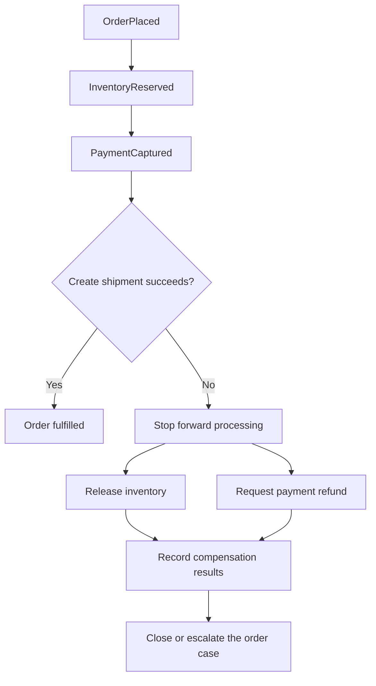

# Xử lý thủ công

Trong một hệ thống Spring Modulith, application event có thể được giao tới nhiều listener thuộc các module khác nhau. Event Publication Registry lưu trạng thái publication để ứng dụng nhận biết listener nào đã hoàn tất và publication nào còn dang dở. Khi một listener lỗi kéo dài, dữ liệu nghiệp vụ thay đổi hoặc một tác dụng phụ bên ngoài đã xảy ra một phần, nhóm vận hành đôi khi cần can thiệp thủ công để khôi phục đúng trạng thái nghiệp vụ.

Xử lý thủ công là một thao tác vận hành có chủ đích trên một publication hoặc một nghiệp vụ đã xác định. Người xử lý cần tìm đúng listener và event, hiểu tác dụng phụ đã xảy ra, rồi chọn retry hoặc thực hiện một hành động bù trừ. Mục tiêu là khôi phục tính nhất quán nghiệp vụ và giữ được dấu vết kiểm toán của quyết định.

## 1. Khi nào cần xử lý thủ công?

Phần lớn lỗi tạm thời nên được xử lý bằng cơ chế retry tự động. Ví dụ, database hoặc dịch vụ nội bộ gián đoạn trong thời gian ngắn có thể hồi phục mà không cần người vận hành can thiệp. Xử lý thủ công phù hợp khi cơ chế tự động không thể tự quyết định bước tiếp theo hoặc khi cần người có thẩm quyền đánh giá tác động nghiệp vụ.

Một số tình huống thường gặp:

- **Lỗi kéo dài:** listener liên tục thất bại do dịch vụ phụ thuộc ngừng hoạt động, hết quota hoặc cấu hình sai.
- **Dữ liệu không còn hợp lệ:** event cũ tham chiếu tới dữ liệu đã thay đổi, mã nghiệp vụ đã bị vô hiệu hóa hoặc một quy tắc mới khiến thao tác ban đầu không còn được phép.
- **Lỗi tương thích payload:** listener mới không đọc được payload được lưu bởi phiên bản ứng dụng trước đó.
- **Tác dụng phụ xảy ra một phần:** dịch vụ bên ngoài đã nhận yêu cầu nhưng ứng dụng mất kết nối trước khi nhận phản hồi hoặc trước khi publication được đánh dấu hoàn tất.
- **Nghiệp vụ cần quyết định:** đơn hàng phải được hủy, khoản thanh toán cần hoàn tiền hoặc hàng đã giữ cần được giải phóng sau khi một bước khác không thể tiếp tục.

Không phải mọi publication chưa hoàn tất đều cần thao tác của con người. Một publication vừa được tạo có thể đang chờ listener bất đồng bộ xử lý. Hãy dùng tuổi publication, trạng thái hệ thống phụ thuộc và ngưỡng thời gian của nghiệp vụ để phân biệt độ trễ bình thường với sự cố cần điều tra.

## 2. Phân biệt retry và compensation

Retry và compensation giải quyết hai tình huống khác nhau. Chọn sai thao tác có thể tạo ra tác dụng phụ trùng lặp hoặc làm sai trạng thái nghiệp vụ.

| Tiêu chí | Retry | Compensation |
| --- | --- | --- |
| Mục đích | Thực hiện lại công việc chưa hoàn tất. | Tạo một hành động nghiệp vụ mới để bù lại tác động đã xảy ra. |
| Điều kiện phù hợp | Nguyên nhân lỗi đã được khắc phục và thao tác có thể chạy lại an toàn. | Quy trình ban đầu không thể hoặc không nên tiếp tục; cần đưa nghiệp vụ về trạng thái được chấp nhận. |
| Ví dụ | Gửi lại yêu cầu giữ hàng sau khi dịch vụ kho hoạt động trở lại. | Giải phóng hàng đã giữ khi đơn hàng bị hủy. |
| Kết quả | Listener có cơ hội hoàn tất publication còn dang dở. | Một giao dịch hoặc sự kiện mới ghi nhận hành động bù trừ. |

Retry không có nghĩa là chạy lại toàn bộ transaction tạo đơn hàng. Với Event Publication Registry, publication được theo dõi theo từng listener. Khi chỉ listener kho thất bại, thao tác xử lý lại publication đó nhắm tới listener tương ứng; listener thông báo đã hoàn tất không cần bị gọi lại chỉ vì một listener khác gặp lỗi.

Compensation cũng không phải rollback transaction đã commit. Khi một khoản thanh toán đã được thu hoặc một lô hàng đã được gửi, hệ thống không thể làm như sự kiện đó chưa từng xảy ra. Nó cần ghi nhận một hành động mới, chẳng hạn yêu cầu hoàn tiền hoặc yêu cầu hủy giao hàng, có trạng thái và lịch sử riêng.

## 3. Quy trình điều tra trước khi thao tác

Trước khi retry hoặc bù trừ, hãy thu thập đủ thông tin để liên kết publication với trạng thái nghiệp vụ hiện tại.

1. **Xác định publication:** lấy mã publication, loại event, listener đích và thời điểm phát. Với relational registry, có thể tra cứu các publication chưa hoàn tất bằng công cụ quan sát được cấp quyền.
2. **Đọc nguyên nhân lỗi:** đối chiếu log của listener, trace/correlation ID, lỗi từ hệ thống phụ thuộc và phiên bản ứng dụng xử lý event.
3. **Kiểm tra trạng thái nghiệp vụ:** xác minh đơn hàng, khoản thanh toán, reservation hoặc shipment đã ở trạng thái nào. Không suy ra trạng thái nghiệp vụ chỉ từ việc publication chưa hoàn tất.
4. **Kiểm tra tác dụng phụ bên ngoài:** xác định API hoặc broker đã nhận yêu cầu chưa, dùng idempotency key nào và có mã giao dịch từ hệ thống đối tác hay không.
5. **Chọn hành động:** retry nếu công việc còn hợp lệ và có thể lặp an toàn; compensation nếu cần một chuyển đổi nghiệp vụ mới; tiếp tục điều tra nếu chưa xác định được tác dụng phụ.
6. **Ghi nhận quyết định:** lưu người thực hiện, lý do, đối tượng được chọn, thời điểm, mã tham chiếu và kết quả xác minh.

Thông tin payload có thể chứa dữ liệu cá nhân hoặc bí mật nghiệp vụ. Chỉ hiển thị những trường cần cho việc điều tra, giới hạn quyền truy cập và tránh đưa toàn bộ payload vào log hoặc thông báo cảnh báo.

## 4. Retry có chọn lọc bằng Event Publication Registry

Spring Modulith cung cấp `IncompleteEventPublications` để ứng dụng truy vấn và gửi lại các publication thất bại. Trong các phiên bản có API này, `resubmitFailedPublications(Predicate<EventPublication>)` cho phép chọn publication theo điều kiện thay vì gửi lại toàn bộ nhóm lỗi.

Ví dụ sau minh họa một dịch vụ nội bộ chỉ chọn publication của `OrderPlaced` thuộc một đơn hàng cụ thể:

```java
import java.util.UUID;

import org.springframework.modulith.events.IncompleteEventPublications;
import org.springframework.stereotype.Service;

@Service
class PublicationRecoveryService {

    private final IncompleteEventPublications publications;

    PublicationRecoveryService(IncompleteEventPublications publications) {
        this.publications = publications;
    }

    public void retryOrder(UUID orderId) {
        publications.resubmitFailedPublications(publication ->
                publication.getEvent() instanceof OrderPlaced event
                        && event.orderId().equals(orderId));
    }
}
```

Đây là ví dụ về cách chọn publication theo event. Trong ứng dụng thực tế, cần giới hạn thêm listener đích nếu nghiệp vụ yêu cầu, xác thực rằng nguyên nhân lỗi đã được khắc phục và đặt thao tác sau một lớp phân quyền dành cho người vận hành. API và cách cấu hình cụ thể phải khớp phiên bản Spring Modulith đang dùng.

Trước khi cung cấp thao tác retry trong giao diện quản trị hoặc endpoint nội bộ, nên có bước xem trước danh sách publication khớp điều kiện. Người vận hành cần thấy event type, listener ID, thời điểm phát và mã nghiệp vụ liên quan để xác nhận đúng đối tượng. Với thao tác hàng loạt, giới hạn số lượng mỗi lần và cho phép chia nhỏ theo listener hoặc khoảng thời gian.

Không dùng SQL để sửa `COMPLETION_DATE`, đổi listener ID hoặc xóa dòng chưa hoàn tất nhằm ép registry chuyển trạng thái. Những cột này thuộc cơ chế quản lý publication của framework; thay đổi trực tiếp có thể khiến event bị bỏ qua, được giao sai hoặc mất dấu vết phục hồi. Hãy dùng API công khai của registry và migration/schema do adapter cung cấp.

## 5. Thiết kế thao tác retry an toàn

Retry có thể gọi listener nhiều lần cho cùng một event. Có một khoảng trống quan trọng: listener có thể hoàn tất tác dụng phụ nhưng tiến trình dừng trước khi registry ghi nhận publication hoàn tất. Khi gửi lại, listener được gọi lần nữa dù lần trước đã làm xong một phần hoặc toàn bộ công việc.

Vì vậy, listener và hệ thống đích cần hỗ trợ idempotency:

- Dùng event ID hoặc khóa nghiệp vụ ổn định làm idempotency key.
- Đặt ràng buộc duy nhất cho thao tác tạo reservation, payment capture hoặc notification delivery nếu phù hợp.
- Khi gọi API bên ngoài, gửi cùng idempotency key cho các lần thử của cùng một thao tác.
- Kiểm tra trạng thái trước khi chuyển đổi và thực hiện kiểm tra/cập nhật trong một transaction phù hợp.
- Ghi nhận mã giao dịch của đối tác để đối chiếu khi timeout không cho biết yêu cầu đã thành công hay chưa.

Không tạo một event ID mới cho mỗi lần retry nếu điều đó khiến hệ thống đích xem mỗi lần thử là một nghiệp vụ khác nhau. Cần phân biệt định danh event gốc với định danh của một hành động bù trừ mới.

Nếu lỗi bắt nguồn từ payload không còn tương thích, hãy sửa hoặc triển khai khả năng đọc payload cũ trước khi retry. Nếu lỗi là dữ liệu nghiệp vụ không hợp lệ, gửi lại cùng một payload thường chỉ tạo thêm log lỗi và tải cho hệ thống. Khi đó cần quyết định sửa dữ liệu theo quy trình có kiểm soát, tạo một event mới phù hợp hoặc thực hiện compensation.

## 6. Compensation là một nghiệp vụ mới

Trong quy trình nhiều bước, mỗi module có thể đã commit dữ liệu và tác dụng phụ riêng. Khi một bước sau không thể tiếp tục, hệ thống cần phát hành các hành động bù trừ tương ứng với những bước đã hoàn tất.

Ví dụ một đơn hàng đã giữ hàng và thu tiền, nhưng không thể tạo shipment:



Module điều phối có thể phát các event bù trừ như `InventoryReleaseRequested` và `PaymentRefundRequested`. Các module sở hữu hàng tồn kho và thanh toán tự xác thực trạng thái, thực hiện thao tác của mình và phát event kết quả như `InventoryReleased` hoặc `PaymentRefunded`.

Ví dụ event yêu cầu hoàn tiền:

```java
import java.time.Instant;
import java.util.UUID;

public record PaymentRefundRequested(
        UUID orderId,
        UUID paymentId,
        UUID compensationId,
        String reason,
        Instant requestedAt) {
}
```

`compensationId` giúp nhận diện duy nhất hành động bù trừ. Nếu cùng yêu cầu được gửi lại, module thanh toán có thể phát hiện hành động đó đã được tiếp nhận hoặc hoàn tất và tránh hoàn tiền hai lần. Event kết quả nên tham chiếu `compensationId` để module điều phối xác định chính xác bước nào đã hoàn tất.

Compensation có thể thất bại giống một thao tác bình thường. Ví dụ, yêu cầu hoàn tiền bị từ chối hoặc dịch vụ kho ngừng hoạt động. Khi đó, chính publication của event bù trừ cũng cần được theo dõi, retry hoặc xử lý thủ công. Không đánh dấu toàn bộ quy trình đã khôi phục chỉ vì đã phát event yêu cầu bù trừ; cần chờ kết quả xác nhận và kiểm tra trạng thái cuối cùng.

## 7. Ghi nhận và kiểm soát thao tác quản trị

Một công cụ vận hành tốt nên thể hiện rõ đối tượng và hậu quả trước khi thực hiện thao tác. Tùy quy mô hệ thống, công cụ có thể là màn hình quản trị nội bộ, command dành cho operator hoặc endpoint chỉ truy cập qua mạng quản trị.

Các thông tin và kiểm soát nên có:

| Thành phần | Mục đích |
| --- | --- |
| Publication ID / Compensation ID | Xác định chính xác công việc hoặc hành động bù trừ. |
| Event type và listener ID | Biết loại event và module nhận đang xử lý. |
| Business reference | Liên kết với đơn hàng, payment, reservation hoặc shipment. |
| Failure reason và last attempt | Hiểu nguyên nhân và thời điểm lỗi gần nhất. |
| Preview trước thao tác | Hiển thị số lượng và danh sách mục tiêu sẽ bị tác động. |
| Operator và reason | Lưu ai thực hiện và vì sao cần can thiệp. |
| Result | Ghi nhận đã gửi lại, đã hoàn tất, vẫn thất bại hay cần escalation. |

Thao tác retry hoặc compensation cần được bảo vệ bằng xác thực và phân quyền. Nên giới hạn quyền theo vai trò, yêu cầu lý do cho thao tác có ảnh hưởng dữ liệu, chống gửi lặp do người dùng bấm nhiều lần và giữ audit log độc lập với log kỹ thuật. Với compensation tài chính hoặc hành động khó đảo ngược, áp dụng bước phê duyệt theo chính sách nghiệp vụ của tổ chức.

Không cung cấp một endpoint công khai cho phép retry mọi publication tùy ý. Nếu cần endpoint vận hành, hãy giới hạn theo publication ID hoặc bộ lọc được kiểm soát, xác thực dữ liệu đầu vào, giới hạn tốc độ và ghi nhận kết quả. Tránh cho phép người gọi truyền tên class tùy ý để chọn event hoặc listener.

## 8. Runbook xử lý một publication lỗi

Quy trình dưới đây có thể dùng làm khung cho tài liệu trực ca. Các ngưỡng thời gian và vai trò phê duyệt phải được đội sở hữu nghiệp vụ xác định.

### Bước 1: Xác định phạm vi

- Tìm publication chưa hoàn tất vượt ngưỡng cảnh báo.
- Xác định event type, listener ID, publication ID và business reference.
- Kiểm tra các publication khác của cùng event để biết module nào đã hoàn tất.

### Bước 2: Xác định nguyên nhân

- Đối chiếu log, trace và lỗi từ dịch vụ phụ thuộc.
- Kiểm tra phiên bản ứng dụng, schema và khả năng deserialize payload.
- Xác minh hệ thống đích đã nhận tác dụng phụ hay chưa bằng idempotency key hoặc mã giao dịch.

### Bước 3: Chọn cách khôi phục

- Chọn retry khi lỗi tạm thời đã được sửa và listener có thể chạy lặp an toàn.
- Chọn compensation khi bước nghiệp vụ không thể tiếp tục hoặc cần đảo tác động đã hoàn tất.
- Chuyển cấp xử lý khi không thể xác định tác dụng phụ hoặc có rủi ro tạo giao dịch trùng.

### Bước 4: Thực hiện có kiểm soát

- Xem trước chính xác publication hoặc nghiệp vụ được chọn.
- Ghi lại lý do, operator và mã tham chiếu của sự cố.
- Thực hiện retry cho publication phù hợp hoặc phát lệnh compensation mới.
- Với batch, chia nhỏ và quan sát kết quả từng nhóm trước khi tiếp tục.

### Bước 5: Xác minh và đóng sự cố

- Xác nhận publication đã được registry đánh dấu hoàn tất sau khi listener thành công.
- Kiểm tra trạng thái nghiệp vụ và tác dụng phụ tại hệ thống đích.
- Xác nhận tất cả bước compensation cần thiết đã có kết quả cuối cùng.
- Ghi lại nguyên nhân gốc, quyết định, người thực hiện và bài học cần đưa vào cảnh báo hoặc kiểm thử.

## 9. Kiểm thử khả năng vận hành thủ công

Ngoài kiểm thử listener, nên kiểm tra đường xử lý sự cố để bảo đảm operator có thể chọn đúng đối tượng và không làm lặp tác dụng phụ.

- **Chọn đúng publication:** bộ lọc theo event type, business reference và listener ID chỉ chọn những publication dự kiến.
- **Retry sau khi sửa lỗi:** listener hoàn tất, registry cập nhật trạng thái và các listener đã hoàn tất trước đó không bị gọi lại ngoài ý muốn.
- **Retry lặp:** cùng một event được gửi lại nhiều lần nhưng chỉ tạo một kết quả nghiệp vụ theo khóa idempotency.
- **Compensation:** hành động bù trừ tạo một giao dịch/event mới và không xóa lịch sử của hành động gốc.
- **Compensation thất bại:** trạng thái vẫn thể hiện bước bù trừ còn dang dở và có thể tiếp tục xử lý.
- **Phân quyền và audit:** người không đủ quyền không thể thực hiện thao tác; mọi lần can thiệp hợp lệ đều có người thực hiện và lý do.
- **Tình huống timeout:** khi không rõ hệ thống ngoài đã nhận yêu cầu hay chưa, quy trình đối chiếu trạng thái được thực hiện trước khi gửi lại.

Integration test cần tạo ranh giới transaction thật cho các listener xử lý sau commit. Một test bị bọc trong transaction rồi rollback có thể không kích hoạt luồng after-commit như môi trường chạy thực tế.

## 10. Những sai lầm cần tránh

- Retry hàng loạt mà chưa kiểm tra nguyên nhân lỗi, khiến backlog và tải hệ thống tăng nhanh.
- Gửi lại event nguồn để khôi phục một listener duy nhất, làm các listener khác thực hiện lại tác dụng phụ đã hoàn tất.
- Chỉnh sửa hoặc xóa trực tiếp dòng publication chưa hoàn tất trong database.
- Xem compensation là rollback và xóa lịch sử giao dịch gốc.
- Gửi yêu cầu hoàn tiền, giải phóng hàng hoặc hủy shipment mà không kiểm tra trạng thái và idempotency.
- Đóng sự cố ngay sau khi phát lệnh bù trừ mà chưa xác minh kết quả cuối cùng.
- Ghi toàn bộ payload nhạy cảm vào log quản trị hoặc trao quyền retry không giới hạn.

## Checklist cho người vận hành

- [ ] Đã xác định publication, event type, listener đích và nghiệp vụ liên quan.
- [ ] Đã đọc nguyên nhân lỗi và xác minh tác dụng phụ tại hệ thống bên ngoài.
- [ ] Đã quyết định retry hay compensation dựa trên trạng thái nghiệp vụ.
- [ ] Đã xác nhận listener hoặc hành động đích có cơ chế idempotency.
- [ ] Đã xem trước phạm vi, có quyền thực hiện và ghi rõ lý do can thiệp.
- [ ] Đã theo dõi kết quả registry và trạng thái nghiệp vụ sau thao tác.
- [ ] Đã lưu audit trail và chỉ đóng sự cố khi trạng thái cuối cùng được xác minh.

Xử lý thủ công là một phần của thiết kế độ tin cậy cho giao tiếp giữa các module. Khi publication được chọn chính xác, retry có kiểm soát và compensation được mô hình hóa như nghiệp vụ mới, đội vận hành có thể khôi phục hệ thống mà vẫn giữ được lịch sử và ranh giới trách nhiệm của từng module.
