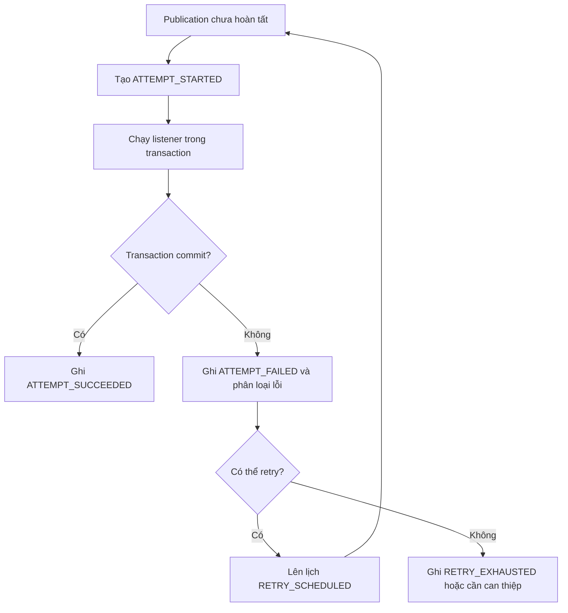

# Audit lần thử

Khi một application event được giao đến listener, cùng một publication có thể được thực thi nhiều lần do lỗi tạm thời, tiến trình dừng giữa chừng hoặc thao tác gửi lại có chủ đích. Muốn vận hành đáng tin cậy, hệ thống cần biết lần nào đã bắt đầu, lần nào thành công, lần nào thất bại, nguyên nhân là gì và lần tiếp theo được lên lịch khi nào. **Audit lần thử** ghi lại lịch sử đó theo từng publication và listener.

Trong Spring Modulith, Event Publication Registry theo dõi vòng đời giao application event đến listener: publication nào còn chưa hoàn tất và publication nào đã được listener hoàn tất. Registry là nền tảng để phát hiện và phục hồi publication chưa xong theo cấu hình và phiên bản ứng dụng. Nhật ký audit chi tiết từng lần thực thi là một mối quan tâm riêng của ứng dụng. Không nên mặc định registry tự lưu đầy đủ số lần thử, thời lượng, mã lỗi, lịch retry và lịch sử compensation theo định dạng mà nghiệp vụ cần.

Audit lần thử giúp trả lời các câu hỏi vận hành cụ thể:

- Event nào đang được xử lý hoặc bị kẹt lâu hơn ngưỡng cho phép?
- Listener nào đã thử bao nhiêu lần và lần gần nhất thất bại vì lý do gì?
- Lần thử tiếp theo được lên lịch lúc nào, bởi chính sách nào?
- Publication đã được xử lý thành công, bị từ chối vĩnh viễn hay cần can thiệp thủ công?
- Có hành động bù trừ nào đã chạy để đảo ngược tác động một phần của lần xử lý trước không?

## 1. Phân biệt event, publication và attempt

Ba định danh này có vai trò khác nhau và cần được giữ ổn định trong suốt quá trình xử lý.

| Khái niệm | Ý nghĩa | Ví dụ |
| --- | --- | --- |
| Event | Sự kiện nghiệp vụ đã xảy ra; định danh không đổi khi giao lại. | `OrderConfirmed`, `eventId=evt-81` |
| Publication | Một lần giao event đến một listener cụ thể. Một event có thể có nhiều publication. | `evt-81` được giao đến `InventoryListener` và `BillingListener` |
| Attempt | Một lần listener thực sự bắt đầu thực thi publication đó. | Lần 1 timeout, lần 2 thành công |

Không dùng một bộ đếm chung cho toàn event nếu event được giao đến nhiều listener. `InventoryListener` có thể thành công trong khi `BillingListener` vẫn đang retry. Số lần thử nên tăng theo từng cặp publication và listener.

Một khóa publication ổn định có thể được tạo từ event ID cùng định danh listener, hoặc lấy từ định danh publication mà ứng dụng có thể truy cập qua API công khai của framework. Không phụ thuộc trực tiếp vào khóa nội bộ hay schema bảng của Event Publication Registry. Nếu một listener được đổi tên, cần có chiến lược giữ hoặc ánh xạ định danh ổn định để lịch sử trước và sau triển khai vẫn có thể đối chiếu.

Các trường liên kết thường hữu ích gồm:

- `event_id`: định danh event gốc, giữ nguyên qua mọi lần giao lại.
- `publication_key`: định danh ổn định của lần giao event đến một listener.
- `listener_id`: tên logic của listener, ví dụ `inventory.order-confirmed`.
- `attempt_no`: số thứ tự lần thực thi trong publication đó.
- `correlation_id`, `causation_id`, `trace_id`: liên kết event với use case khởi tạo và trace phân tán.
- `worker_id`: instance hoặc worker thực hiện attempt, phục vụ điều tra sự cố.

## 2. Ghi lịch sử audit theo kiểu append-only

Audit nên là lịch sử chỉ bổ sung. Khi attempt đã thất bại, hệ thống ghi thêm một sự kiện retry hoặc một attempt mới; không sửa bản ghi thất bại thành thành công. Cách này giữ lại bằng chứng về những gì thực sự đã xảy ra và giúp dựng lại dòng thời gian khi điều tra.

Một thiết kế phổ biến là lưu mỗi hành động audit thành một dòng. Các loại hành động có thể gồm:

| Hành động | Thời điểm ghi | Thông tin cần có |
| --- | --- | --- |
| `ATTEMPT_STARTED` | Ngay trước khi gọi logic listener | attempt number, thời điểm bắt đầu, worker, trace |
| `ATTEMPT_SUCCEEDED` | Sau khi transaction nghiệp vụ commit thành công | thời điểm hoàn tất, thời lượng, kết quả |
| `ATTEMPT_FAILED` | Khi attempt thất bại và lỗi đã được phân loại | loại lỗi, mã lỗi, thông điệp đã làm sạch, thời lượng |
| `RETRY_SCHEDULED` | Khi chính sách quyết định thử lại | thời điểm thử tiếp theo, số lần thử tối đa, lý do |
| `RETRY_EXHAUSTED` | Khi đã hết ngân sách retry | chính sách, số lần đã thử, trạng thái cần xử lý |
| `MANUAL_REPLAY_REQUESTED` | Khi người vận hành yêu cầu gửi lại | người yêu cầu, lý do, mã ticket hoặc tham chiếu phê duyệt |
| `COMPENSATION_STARTED` / `COMPENSATION_COMPLETED` | Khi chạy hành động bù trừ | compensation ID, hành động gốc, kết quả |

Ví dụ schema SQL dưới đây là thiết kế do ứng dụng sở hữu, không phải schema nội bộ của Spring Modulith:

```sql
CREATE TABLE event_attempt_audit (
    audit_id          UUID PRIMARY KEY,
    idempotency_key   VARCHAR(240) NOT NULL UNIQUE,
    publication_key   VARCHAR(240) NOT NULL,
    event_id          UUID NOT NULL,
    listener_id       VARCHAR(200) NOT NULL,
    attempt_no        INTEGER,
    action            VARCHAR(40) NOT NULL,
    recorded_at       TIMESTAMP WITH TIME ZONE NOT NULL,
    duration_ms       BIGINT,
    error_type        VARCHAR(300),
    error_code        VARCHAR(100),
    error_message     VARCHAR(1000),
    retry_at          TIMESTAMP WITH TIME ZONE,
    correlation_id    VARCHAR(200),
    causation_id      VARCHAR(200),
    trace_id          VARCHAR(100),
    worker_id         VARCHAR(150),
    compensation_id   UUID
);

CREATE INDEX idx_attempt_audit_publication_time
    ON event_attempt_audit (publication_key, recorded_at);

CREATE INDEX idx_attempt_audit_event_time
    ON event_attempt_audit (event_id, recorded_at);
```

`idempotency_key` ngăn cùng một thao tác audit bị ghi hai lần khi lời gọi lưu audit được retry. Ví dụ, khóa này có thể được tạo từ `publication_key`, `attempt_no` và `action`. Nếu một action có thể phát sinh nhiều bản ghi hợp lệ, bổ sung số thứ tự hoặc định danh riêng vào khóa.

Không nhất thiết phải đưa toàn bộ payload event vào bảng audit. Thông thường chỉ cần định danh, loại event và các khóa liên kết để truy vấn dữ liệu gốc theo quyền truy cập phù hợp. Lưu payload, stack trace hoặc thông điệp lỗi thô có thể làm lộ dữ liệu cá nhân, token, thông tin thanh toán hoặc bí mật vận hành.

## 3. Vòng đời một lần thử

Một attempt có thể được mô tả bằng luồng sau:



Điểm quan trọng là **listener trả về bình thường** và **transaction nghiệp vụ đã commit** không phải lúc nào cũng là cùng một thời điểm. Nếu audit đánh dấu thành công ngay khi method kết thúc nhưng transaction sau đó rollback, lịch sử sẽ báo thành công sai. Với listener có transaction, chỉ ghi `ATTEMPT_SUCCEEDED` trong cùng transaction nghiệp vụ hoặc sau khi xác nhận commit.

Một attempt chỉ có `ATTEMPT_STARTED` mà chưa có kết quả có thể là dấu hiệu tiến trình đã dừng, timeout hoặc transaction commit chưa được xác nhận. Không tự suy luận rằng nó thất bại hay thành công. Một tiến trình đối soát có thể tìm các attempt bắt đầu quá lâu, so sánh với trạng thái publication và lease, rồi ghi thêm một action như `ATTEMPT_ABANDONED` hoặc tạo attempt tiếp theo theo chính sách phục hồi.

## 4. Phối hợp với Event Publication Registry

Trong Spring Modulith, có thể dùng listener theo mô hình module:

```java
@Component
public class InventoryEventListener {

    private final AuditedAttemptExecutor attempts;
    private final InventoryService inventory;

    public InventoryEventListener(
            AuditedAttemptExecutor attempts,
            InventoryService inventory) {
        this.attempts = attempts;
        this.inventory = inventory;
    }

    @ApplicationModuleListener
    public void on(OrderConfirmed event) {
        attempts.execute(
                EventDelivery.of(
                        event.eventId(),
                        "inventory.order-confirmed"
                ),
                () -> inventory.reserveFor(event.orderId())
        );
    }
}
```

`EventDelivery`, `AuditedAttemptExecutor` và các cổng audit trong ví dụ là abstraction do ứng dụng định nghĩa. `@ApplicationModuleListener` thể hiện listener theo convention của Spring Modulith; registry theo dõi publication tương ứng. Mỗi lần listener thực sự được thực thi, executor tạo một attempt audit mới cho publication đó.

Hai lớp dữ liệu trả lời hai câu hỏi khác nhau:

| Thành phần | Câu hỏi được trả lời |
| --- | --- |
| Event Publication Registry | Publication đã được listener hoàn tất chưa? Publication nào còn dang dở và cần phục hồi? |
| Attempt audit của ứng dụng | Mỗi lần thực thi diễn ra khi nào, ở worker nào, mất bao lâu, lỗi gì và đã lên lịch retry ra sao? |

Khi cần kiểm tra hoặc phục hồi publication, dùng API công khai của Event Publication Registry và cơ chế vận hành được hỗ trợ bởi phiên bản Spring Modulith đang dùng. Không cập nhật trực tiếp bảng registry để ép hoàn tất hoặc xóa publication lỗi. Bảng audit cũng không thay thế registry: một dòng `ATTEMPT_SUCCEEDED` được ghi sai thời điểm không thể tự làm registry hoàn tất publication.

Nếu listener bắt exception rồi trả về bình thường, framework có thể xem lần gọi đó là hoàn tất dù nghiệp vụ chưa thành công. Vì vậy, khi muốn registry nhận biết thất bại và giữ publication ở trạng thái cần phục hồi, hãy ghi audit rồi truyền lỗi trở lại cơ chế gọi listener. Chỉ chuyển lỗi thành kết quả thành công khi nghiệp vụ đã có quyết định rõ ràng rằng lỗi đó được xử lý như một kết quả hợp lệ.

## 5. Bảo đảm audit tồn tại qua commit và rollback

Audit thường nằm cùng cơ sở dữ liệu với nghiệp vụ, nhưng không phải mọi bản ghi audit đều nên tham gia cùng transaction. Cần xác định rõ bản ghi nào phải sống sót sau rollback.

Một cách tổ chức có thể áp dụng:

1. Ghi `ATTEMPT_STARTED` trong transaction độc lập và commit trước khi chạy listener. Nếu listener rollback, dấu vết bắt đầu vẫn còn.
2. Ghi `ATTEMPT_SUCCEEDED` trong transaction nghiệp vụ khi mọi thay đổi đã sẵn sàng commit. Nếu transaction rollback, bản ghi thành công cũng rollback.
3. Khi listener thất bại, ghi `ATTEMPT_FAILED` trong transaction độc lập rồi ném lại exception để transaction nghiệp vụ rollback và publication vẫn được xem là chưa hoàn tất.
4. Ghi `RETRY_SCHEDULED` cùng quyết định retry, gồm `retry_at` và lý do. Nếu lịch retry do một scheduler riêng quản lý, audit phải liên kết với bản ghi lịch đó.

Trong Spring, các thao tác audit độc lập có thể được triển khai qua một bean riêng dùng propagation `REQUIRES_NEW`; thao tác ghi thành công có thể tham gia transaction nghiệp vụ hiện tại. Gọi qua bean được Spring quản lý để transaction proxy có hiệu lực. Khi dùng `REQUIRES_NEW`, cần tính đến connection pool vì transaction ngoài có thể đang giữ một connection trong khi transaction audit cần connection khác.

Ví dụ dưới đây minh họa ranh giới trách nhiệm; các phương thức repository và phân loại lỗi là phần triển khai của ứng dụng:

```java
@Component
public class AuditedAttemptExecutor {

    private final AttemptAuditWriter audit;
    private final Clock clock;

    public AuditedAttemptExecutor(
            AttemptAuditWriter audit,
            Clock clock) {
        this.audit = audit;
        this.clock = clock;
    }

    public void execute(EventDelivery delivery, Runnable work) {
        AttemptHandle attempt = audit.startInNewTransaction(
                delivery,
                clock.instant()
        );

        Instant startedAt = attempt.startedAt();
        try {
            work.run();

            // Ghi trong transaction listener hiện tại. Bản ghi thành công
            // chỉ commit nếu transaction nghiệp vụ commit.
            audit.succeedInCurrentTransaction(
                    attempt,
                    Duration.between(startedAt, clock.instant())
            );
        } catch (RuntimeException exception) {
            // Ghi độc lập để dấu vết lỗi vẫn còn sau khi transaction ngoài rollback.
            try {
                audit.failInNewTransaction(
                        attempt,
                        ErrorDescriptor.from(exception),
                        Duration.between(startedAt, clock.instant())
                );
            } catch (RuntimeException auditFailure) {
                // Giữ exception nghiệp vụ làm lỗi chính; hệ thống cần log/cảnh báo
                // auditFailure qua kênh dự phòng đã cấu hình.
                exception.addSuppressed(auditFailure);
            }
            throw exception;
        }
    }
}
```

Đây là ví dụ về cách phân chia transaction, không phải API có sẵn của Spring Modulith. `startInNewTransaction` và `failInNewTransaction` cần được triển khai ở bean transaction riêng; `succeedInCurrentTransaction` tham gia transaction listener. Nếu lỗi xảy ra sau khi method trả về nhưng trong lúc commit, attempt có thể chỉ còn `ATTEMPT_STARTED`; tiến trình đối soát cần nhận diện trường hợp này. Với side effect bên ngoài cơ sở dữ liệu, cần idempotency key hoặc outbox/inbox vì transaction cơ sở dữ liệu không thể tự rollback lời gọi HTTP hay message đã gửi.

Nếu hệ thống audit không khả dụng, cần có chính sách rõ ràng: có cho phép listener tiếp tục, có giữ publication chưa hoàn tất để retry, hay chuyển sang cơ chế log dự phòng. Không được âm thầm bỏ lỗi audit rồi ghi nhận nghiệp vụ thành công nếu yêu cầu kiểm toán đòi hỏi lịch sử đầy đủ.

## 6. Phân loại lỗi và lập lịch retry

Không phải lỗi nào cũng nên retry. Chính sách cần phân biệt lỗi tạm thời, lỗi dữ liệu/hợp đồng và lỗi đã hết ngân sách thử lại.

| Nhóm lỗi | Ví dụ | Hướng xử lý |
| --- | --- | --- |
| Tạm thời | Timeout, mất kết nối ngắn hạn, broker hoặc dịch vụ phụ thuộc tạm ngừng | Ghi `ATTEMPT_FAILED`, tính backoff và lên lịch retry. |
| Có thể khắc phục sau khi sửa dữ liệu | Payload thiếu trường bắt buộc, tham chiếu nghiệp vụ chưa tồn tại | Ghi mã lỗi, chuyển sang hàng chờ xử lý hoặc yêu cầu sửa dữ liệu; retry sau khi có điều kiện. |
| Vĩnh viễn theo hợp đồng | Event type không được hỗ trợ, phiên bản payload không thể đọc | Ghi trạng thái cần can thiệp; không retry vô hạn. |
| Hết ngân sách retry | Đã đạt giới hạn attempt hoặc vượt thời gian tối đa | Ghi `RETRY_EXHAUSTED`, cảnh báo và yêu cầu quyết định vận hành. |

Một chính sách retry thường gồm số lần thử tối đa, khoảng backoff cơ sở, khoảng backoff tối đa, jitter, deadline tổng và nhóm lỗi được phép retry. Ví dụ, exponential backoff có thể tăng khoảng chờ theo cấp số nhân, nhưng phải giới hạn mức tối đa và thêm jitter để tránh nhiều publication cùng retry vào một thời điểm.

Mỗi lần lên lịch nên ghi lại:

- attempt vừa thất bại và phân loại lỗi;
- `retry_at` được tính theo đồng hồ thống nhất;
- tên hoặc phiên bản chính sách retry;
- số lần đã thử và số lần tối đa;
- thành phần chịu trách nhiệm kích hoạt lần tiếp theo.

Chọn một nơi làm chủ retry cho mỗi luồng. Nếu cả listener, Spring Retry, scheduler và thao tác resubmit của registry cùng retry mà không phối hợp, số lần thực thi thực tế có thể nhân lên ngoài dự kiến. Nếu cần nhiều lớp retry, ghi thêm `retry_layer` để phân biệt lần retry ở listener với lần retry ở client HTTP hoặc message broker.

Khi một publication được gửi lại qua registry hoặc cơ chế điều phối khác, executor cần cấp `attempt_no` tiếp theo. Không tạo event ID mới chỉ để biểu diễn retry; event ID mới sẽ khiến consumer khó nhận diện bản tin trùng và làm đứt liên kết với lịch sử gốc.

## 7. Audit hành động bù trừ

Retry và compensation là hai loại hành động khác nhau. Retry thực hiện lại cùng một công việc vì lần trước chưa đạt kết quả mong muốn. Compensation thực hiện một hành động nghiệp vụ mới để đảo ngược hoặc cân bằng một tác động đã xảy ra.

Ví dụ, listener đã giữ chỗ tồn kho nhưng bước ghi nhận thanh toán thất bại. Nếu hệ thống quyết định hủy đơn và giải phóng chỗ đã giữ, thao tác giải phóng là compensation; nó không phải attempt thứ hai của `OrderConfirmed`.

Mỗi compensation nên có định danh riêng và liên kết với event, publication hoặc hành động gốc:

| Trường | Ý nghĩa |
| --- | --- |
| `compensation_id` | Định danh ổn định của yêu cầu bù trừ. |
| `caused_by_event_id` | Event dẫn đến chuỗi xử lý cần bù trừ. |
| `original_attempt_no` | Attempt tạo ra tác động cần được bù trừ. |
| `compensation_type` | Tên hành động, ví dụ `ReleaseInventoryReservation`. |
| `status` | `REQUESTED`, `STARTED`, `COMPLETED` hoặc `FAILED`. |
| `reason` | Lý do nghiệp vụ và quyết định thực hiện compensation. |

Ghi `COMPENSATION_STARTED`, `COMPENSATION_COMPLETED` hoặc `COMPENSATION_FAILED` như các action riêng. Nếu compensation thất bại và cần retry, tạo attempt cho chính compensation đó, có thể dùng `compensation_id` làm khóa publication của luồng bù trừ. Không sửa attempt gốc thành thành công: lịch sử cần thể hiện cả lỗi ban đầu lẫn việc khôi phục sau đó.

Compensation cũng phải idempotent. Nếu lệnh giải phóng tồn kho được gửi hai lần, hệ thống không được giải phóng nhiều hơn số lượng đã giữ. Hãy dùng khóa idempotency, ràng buộc dữ liệu hoặc trạng thái nghiệp vụ để bảo vệ thao tác.

## 8. Truy vấn và quan sát lịch sử

Với bảng audit tùy biến, có thể truy vấn timeline của một publication như sau:

```sql
SELECT recorded_at,
       attempt_no,
       action,
       duration_ms,
       error_type,
       error_code,
       retry_at,
       worker_id,
       compensation_id
FROM event_attempt_audit
WHERE publication_key = :publication_key
ORDER BY recorded_at, audit_id;
```

Truy vấn để tìm các attempt bắt đầu lâu nhưng chưa có kết quả cần đối chiếu action bắt đầu với action kết thúc theo `publication_key` và `attempt_no`. Không chỉ dựa vào một dòng `ATTEMPT_STARTED` cũ để kết luận worker vẫn đang chạy; worker có thể đã dừng hoặc lease đã hết hạn.

Các chỉ số hữu ích cho dashboard và cảnh báo:

- số publication đang chờ, đang xử lý, thất bại và đã hết ngân sách retry;
- số attempt theo listener, event type, nhóm lỗi và retry layer;
- tỷ lệ thành công ở lần đầu và tỷ lệ thành công sau retry;
- độ trễ từ lúc event phát sinh đến khi listener commit thành công;
- tuổi của publication chưa hoàn tất lâu nhất;
- số compensation đang chờ, thất bại hoặc vượt thời hạn;
- số attempt không có action kết thúc và số lần ghi audit thất bại.

Log nên dùng chung `event_id`, `publication_key`, `attempt_no`, `listener_id` và `trace_id` để nối với trace và log của dịch vụ phụ thuộc. Tránh dùng event ID hoặc correlation ID làm metric label có cardinality cao; các định danh này phù hợp để tra cứu log và trace hơn là nhãn metric.

## 9. Kiểm thử audit lần thử

Kiểm thử nên xác nhận cả lịch sử lẫn trạng thái publication, đặc biệt ở ranh giới transaction:

1. Khi listener bắt đầu, audit ghi `ATTEMPT_STARTED` với publication key và attempt number đúng.
2. Khi nghiệp vụ commit, audit có `ATTEMPT_SUCCEEDED` và thời lượng hợp lệ.
3. Khi listener ném exception, `ATTEMPT_FAILED` vẫn tồn tại sau khi transaction nghiệp vụ rollback.
4. Khi commit thất bại sau khi method trả về, audit không để lại kết quả thành công giả; attempt chưa kết thúc được nhận diện để đối soát.
5. Khi cùng một publication được giao lại, attempt number tăng và event ID giữ nguyên.
6. Khi cùng action audit được gửi lại, `idempotency_key` ngăn ghi trùng.
7. Khi lỗi vĩnh viễn hoặc hết ngân sách retry, không có lịch retry mới ngoài chính sách.
8. Khi retry thành công, lịch sử vẫn giữ lại các lần thất bại trước đó.
9. Khi compensation được chạy, compensation ID liên kết đúng với tác động gốc và có trạng thái riêng.
10. Khi audit store tạm thời không khả dụng, hành vi của listener tuân theo chính sách dự phòng đã chọn và không nuốt exception gốc.

Kiểm thử tích hợp với transaction manager và cơ sở dữ liệu thực tế hữu ích để xác minh `REQUIRES_NEW`, rollback và ràng buộc unique. Kiểm thử listener theo Spring Modulith cần xác nhận publication chỉ được xem là hoàn tất khi listener xử lý thành công theo cấu hình ứng dụng. Không dùng mock đơn thuần để kết luận rằng ranh giới transaction hoạt động đúng.

## 10. Checklist triển khai

- [ ] Phân biệt event ID, publication key, listener ID và attempt number.
- [ ] Một event được giao đến nhiều listener có lịch sử attempt độc lập.
- [ ] Audit ghi lịch sử theo kiểu append-only và có idempotency key.
- [ ] Bản ghi thành công chỉ được xác nhận sau khi transaction nghiệp vụ commit.
- [ ] Bản ghi thất bại vẫn tồn tại sau rollback nếu yêu cầu audit đòi hỏi.
- [ ] Listener truyền lỗi trở lại framework khi publication thực sự thất bại.
- [ ] Retry có phân loại lỗi, backoff, jitter, deadline và giới hạn số lần.
- [ ] Chỉ định rõ thành phần làm chủ retry và phân biệt retry layer.
- [ ] Compensation có định danh, trạng thái và lịch sử attempt riêng.
- [ ] Có đối soát attempt bị bỏ dở, cảnh báo backlog và chỉ số độ trễ.
- [ ] Dữ liệu audit được bảo vệ, giới hạn quyền truy cập và có chính sách retention.

Audit lần thử tạo ra một dòng thời gian đáng tin cậy cho từng lần giao application event. Khi liên kết đúng event, publication, listener, attempt và compensation; đồng thời ghi nhận kết quả theo ranh giới transaction, nhóm vận hành có thể hiểu vì sao một publication bị kẹt, lần retry nào đã chạy và hành động khôi phục đã hoàn tất đến đâu. Event Publication Registry tiếp tục quản lý trạng thái giao publication của Spring Modulith, còn audit của ứng dụng cung cấp chi tiết lịch sử cần thiết để điều tra và cải thiện độ tin cậy.
