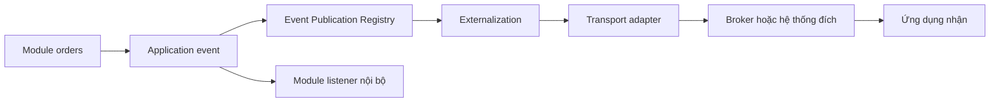
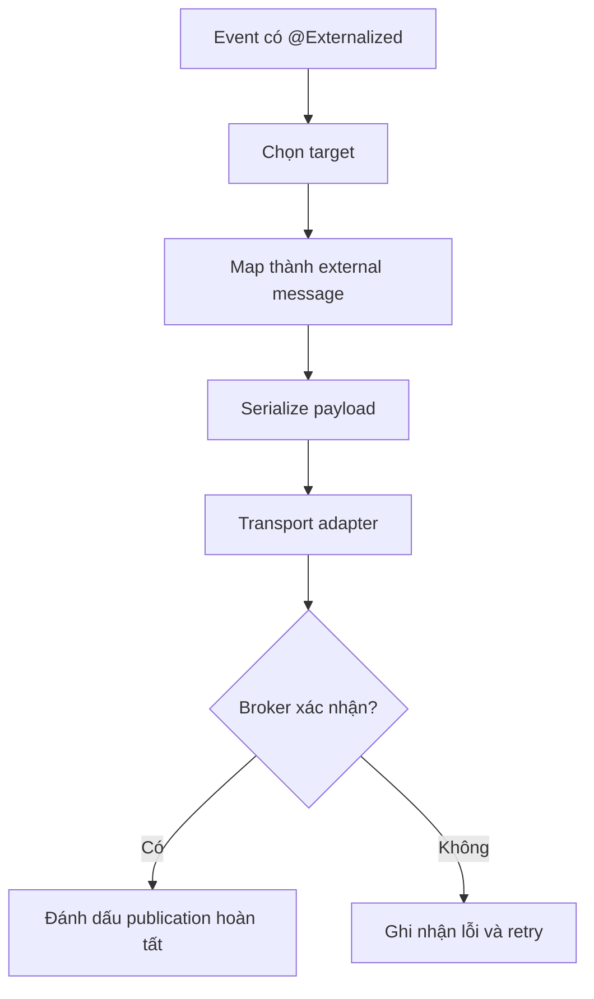

# `@Externalized` trong Spring Modulith

Trong một ứng dụng Spring Modulith, application event giúp các module giao tiếp mà không cần gọi trực tiếp service của nhau. Khi một sự kiện cần được chuyển tới hệ thống bên ngoài hoặc một ứng dụng khác, ta cần thêm một ranh giới externalization: xác định sự kiện nào được công bố, công bố tới đích nào, dữ liệu nào trở thành hợp đồng tích hợp và cách xử lý khi việc gửi thất bại.

Spring Modulith cung cấp annotation `@Externalized` để đánh dấu event type cần được externalize. Annotation diễn đạt ý định ở ngay nơi khai báo sự kiện; phần cấu hình externalization và adapter vận chuyển chịu trách nhiệm ánh xạ sự kiện sang thông điệp bên ngoài. Nhờ vậy, module nghiệp vụ có thể phát một sự kiện có ý nghĩa nghiệp vụ mà không cần biết broker, topic hay chi tiết kết nối của hệ thống nhận.

## 1. Externalization giải quyết vấn đề gì?

Giả sử module `orders` hoàn tất một đơn hàng. Module `billing` trong cùng ứng dụng có thể lắng nghe application event để cập nhật trạng thái thanh toán. Một hệ thống phân tích hoặc dịch vụ fulfillment bên ngoài cũng cần biết đơn hàng đã hoàn tất.

Nếu module `orders` trực tiếp gọi HTTP hoặc Kafka client, mã nghiệp vụ sẽ phụ thuộc vào giao thức và cấu hình hạ tầng. Nếu nó gọi service của từng module nhận, các module trở nên gắn chặt với nhau. Externalization tạo ra một đường đi riêng cho thông điệp đi qua ranh giới ứng dụng:



Application event vẫn là cơ chế giao tiếp nội bộ giữa các module. Externalization chọn một phần các event đó để chuyển ra ngoài. Hai luồng có thể cùng xuất phát từ một sự kiện, nhưng có vòng đời, hợp đồng dữ liệu và yêu cầu vận hành khác nhau.

Externalization hữu ích khi cần:

- Thông báo cho ứng dụng khác về một sự kiện nghiệp vụ đã xảy ra.
- Tích hợp với message broker hoặc nền tảng xử lý dữ liệu.
- Giữ module phát sự kiện độc lập với chi tiết vận chuyển.
- Theo dõi publication, phục hồi khi gửi lỗi và kiểm soát việc phát lại.
- Duy trì hợp đồng tích hợp ổn định dù cấu trúc nội bộ của module thay đổi.

## 2. Đánh dấu event bằng `@Externalized`

Đặt `@Externalized` trên kiểu sự kiện muốn công bố ra ngoài. Ví dụ:

```java
import java.time.Instant;
import java.util.UUID;

import org.springframework.modulith.events.Externalized;

@Externalized("orders")
public record OrderCompleted(
    UUID eventId,
    UUID orderId,
    Instant occurredAt,
    int schemaVersion
) {}
```

Giá trị trong annotation khai báo target mà cấu hình externalization sử dụng để định tuyến sự kiện. Target là thông tin định danh đích ở tầng tích hợp; cách target được ánh xạ thành exchange, topic, queue, destination hoặc endpoint phụ thuộc vào transport adapter và cấu hình của ứng dụng. Không nên mặc định tên target luôn là tên topic vật lý trong mọi môi trường.

Chỉ đánh dấu những event thực sự thuộc hợp đồng bên ngoài. Một event dùng riêng cho module nội bộ thường không cần externalize. Nếu mọi event đều được chuyển ra ngoài, ứng dụng sẽ làm lộ chi tiết triển khai, tăng lưu lượng và khiến hệ thống nhận phụ thuộc vào những thay đổi không có ý nghĩa với chúng.

Tên event và target nên ổn định, dễ hiểu và gắn với ngôn ngữ nghiệp vụ. Ví dụ `orders` hoặc `order-completed` có ý nghĩa hơn một tên dựa trên package Java hoặc tên class nội bộ. Việc đổi tên target có thể ảnh hưởng cấu hình broker, quyền truy cập và consumer; hãy xem đó là một thay đổi hợp đồng tích hợp.

## 3. Phát sự kiện từ module nghiệp vụ

Module phát sự kiện thông qua `ApplicationEventPublisher`. Event nên mô tả một điều đã xảy ra, chẳng hạn `OrderCompleted`, thay vì yêu cầu một hành động như `CompleteOrder`. Sự kiện dạng quá khứ giúp consumer hiểu đây là thông tin về một thay đổi đã được xác nhận.

```java
import java.time.Instant;
import java.util.UUID;

import org.springframework.context.ApplicationEventPublisher;
import org.springframework.stereotype.Service;
import org.springframework.transaction.annotation.Transactional;

@Service
class OrderApplicationService {

    private final OrderRepository orders;
    private final ApplicationEventPublisher events;

    OrderApplicationService(
        OrderRepository orders,
        ApplicationEventPublisher events
    ) {
        this.orders = orders;
        this.events = events;
    }

    @Transactional
    public void complete(UUID orderId) {
        var order = orders.findById(orderId).orElseThrow();
        order.complete();

        events.publishEvent(new OrderCompleted(
            UUID.randomUUID(),
            order.getId(),
            Instant.now(),
            1
        ));
    }
}
```

Ví dụ tập trung vào luồng phát event; repository và entity là thành phần của ứng dụng. Việc phát application event bên trong transaction cho phép hạ tầng event publication phối hợp việc ghi nhận publication với transaction nghiệp vụ theo cấu hình persistence đang sử dụng. Consumer bên ngoài chỉ nên quan sát sự kiện khi thay đổi nghiệp vụ đã commit thành công.

Không đưa toàn bộ JPA entity vào payload chỉ vì nó đã có sẵn trong service. Entity có thể chứa quan hệ lazy, dữ liệu nội bộ, thông tin nhạy cảm hoặc cấu trúc thường xuyên thay đổi. Hãy tạo một payload tích hợp có các trường consumer thực sự cần. Payload nên là snapshot đủ dùng tại thời điểm sự kiện xảy ra, không buộc consumer phải gọi ngược module phát để tái dựng trạng thái cũ.

## 4. Tách event nội bộ và hợp đồng tích hợp

Một application event có thể chứa thông tin phù hợp cho các listener trong cùng ứng dụng nhưng quá chi tiết hoặc không ổn định để công bố ra ngoài. Có thể dùng một kiểu event chuyên biệt cho hợp đồng tích hợp, hoặc ánh xạ event nội bộ sang một external event trong cấu hình externalization.

Ví dụ, event nội bộ có thể chứa entity hoặc thông tin phục vụ nhiều bước xử lý. External event chỉ công bố những trường ổn định:

```java
public record OrderCompletedIntegrationEvent(
    UUID eventId,
    UUID orderId,
    String orderNumber,
    Instant completedAt,
    int schemaVersion
) {}
```

Khi chọn payload, hãy trả lời các câu hỏi:

- Consumer cần dữ liệu gì để xử lý mà không phải truy vấn ngược module phát?
- Trường nào là định danh ổn định và trường nào chỉ phục vụ hiển thị?
- Dữ liệu nào không được phép rời khỏi ứng dụng?
- Kiểu dữ liệu và định dạng thời gian có thể được consumer ở ngôn ngữ khác đọc không?
- Có cần phiên bản schema để mở rộng hợp đồng trong tương lai không?

Không công bố password, access token, thông tin xác thực, dữ liệu thanh toán nhạy cảm hoặc dữ liệu cá nhân vượt quá mục đích tích hợp. Việc che dữ liệu trong log không thay thế việc giới hạn payload ngay từ đầu.

## 5. Cấu hình đường đi externalization

`@Externalized` thể hiện event type và target cần externalize. Để thông điệp thực sự tới hệ thống khác, ứng dụng vẫn cần cấu hình externalization và transport phù hợp. Tùy phiên bản Spring Modulith, dependency và hạ tầng được chọn, phần này có thể dùng integration module được cung cấp hoặc adapter do ứng dụng triển khai.

Khi cấu hình, cần xác định rõ các trách nhiệm:

| Trách nhiệm | Câu hỏi cần trả lời |
|---|---|
| Chọn event | Event type nào được phép externalize? Có dùng `@Externalized` làm tiêu chí chọn không? |
| Xác định target | Target trong annotation được ánh xạ sang destination nào ở từng môi trường? |
| Mapping | Payload Java được chuyển thành cấu trúc message nào? |
| Serialization | Dùng JSON, Avro hay định dạng khác? Schema được quản lý ra sao? |
| Transport | Gửi qua Kafka, AMQP, JMS hay giao thức khác? |
| Xác nhận | Khi nào publication được xem là hoàn tất? Adapter xác định send success như thế nào? |
| Lỗi | Exception được ghi nhận, retry và đưa vào trạng thái cần can thiệp ra sao? |

Không nên để module nghiệp vụ tự tạo broker client hoặc tự chọn topic. Hãy giữ cấu hình transport trong lớp hạ tầng. Nếu thay broker, module phát vẫn chỉ công bố cùng một event contract; phần adapter chịu trách nhiệm thay đổi cách gửi.

Ví dụ sau mô tả ranh giới thành phần, không phải API cụ thể của một adapter:



Tên bean, dependency và API cấu hình cụ thể cần khớp phiên bản Spring Modulith cùng adapter đang dùng. Tránh sao chép cấu hình từ một phiên bản khác mà không kiểm tra compatibility, đặc biệt khi nâng cấp module event hoặc thay đổi cơ chế persistence.

## 6. Target và định tuyến thông điệp

Target trong `@Externalized` giúp tách ý định công bố khỏi địa chỉ vật lý. Một target có thể được ánh xạ sang destination riêng theo môi trường:

| Môi trường | Target logic | Destination minh họa |
|---|---|---|
| Local | `orders` | Topic hoặc queue local |
| Staging | `orders` | Destination staging |
| Production | `orders` | Destination production có ACL riêng |

Tên destination trong bảng chỉ là ví dụ. Giá trị target không nên chứa credential, hostname hoặc địa chỉ phụ thuộc môi trường. Những thông tin này thuộc cấu hình deployment hoặc secret management.

Nếu cần định tuyến theo tenant, loại đơn hàng hoặc vùng dữ liệu, hãy xác định rõ quy tắc routing và giới hạn giá trị được phép. Không ghép dữ liệu tùy ý từ payload vào tên destination vì có thể tạo ra số lượng topic/queue không kiểm soát hoặc mở đường gửi message tới đích ngoài dự kiến. Với broker hỗ trợ partition key hoặc routing key, hãy dùng cơ chế tương ứng của adapter và kiểm tra rằng thứ tự chỉ được đảm bảo trong đúng phạm vi broker cam kết.

Một target ổn định cũng giúp quyền truy cập dễ quản lý. Mỗi producer chỉ nên có quyền gửi tới các destination cần thiết; mỗi consumer chỉ nên đọc các destination phục vụ trách nhiệm của nó. Không cấp quyền rộng chỉ để làm cấu hình externalization đơn giản hơn.

## 7. Thiết kế message contract và serialization

Thông điệp bên ngoài là hợp đồng giữa các hệ thống. Không nên để hợp đồng phụ thuộc trực tiếp vào tên package, tên class Java, proxy của Hibernate hoặc cách Jackson hiện đang serialize một object tùy ý.

Một envelope có thể chứa metadata chung và payload nghiệp vụ:

```json
{
  "eventId": "b3b2f49d-0f7d-4b8d-a22a-4bfbf93fda10",
  "eventType": "order.completed",
  "schemaVersion": 1,
  "occurredAt": "2026-11-25T12:30:00Z",
  "producer": "order-service",
  "correlationId": "a3b5d82e-7f31-4f24-8cc8-9e3bcb9e7b55",
  "payload": {
    "orderId": "1fd6e0ea-3f30-46ca-bf7b-08ed0d8863c0",
    "orderNumber": "ORD-2026-1042"
  }
}
```

Đây là ví dụ về cấu trúc hợp đồng, không phải định dạng envelope bắt buộc do `@Externalized` tự sinh. Ứng dụng và consumer phải thống nhất format thực tế thông qua adapter và serializer.

Các trường thường có ích:

- `eventId`: định danh duy nhất, ổn định qua các lần retry và replay.
- `eventType`: tên loại sự kiện ở cấp hợp đồng, độc lập với tên class Java.
- `schemaVersion`: phiên bản cấu trúc payload.
- `occurredAt`: thời điểm nghiệp vụ xảy ra, theo một quy ước timezone rõ ràng.
- `producer`: hệ thống phát event.
- `correlationId` hoặc `traceId`: liên kết các bước xử lý trong nhiều dịch vụ.
- `payload`: dữ liệu nghiệp vụ đã được chọn lọc.

Khi serialize, cần kiểm tra định dạng UUID, enum, số thập phân, thời gian, null và encoding. Tránh dựa vào thứ tự thuộc tính JSON. Consumer nên bỏ qua trường chưa biết nếu hợp đồng cho phép, đồng thời xử lý rõ trường bắt buộc bị thiếu hoặc sai kiểu.

## 8. Tiến hóa schema mà không làm hỏng consumer

Producer và consumer thường được triển khai ở các thời điểm khác nhau. Một thay đổi payload có thể tới consumer cũ trước khi consumer được nâng cấp. Vì vậy, ưu tiên các thay đổi tương thích:

- Thêm trường optional có default hợp lý thường dễ tương thích hơn đổi kiểu hoặc xóa trường.
- Không đổi ý nghĩa của trường hiện có trong cùng schema version.
- Giữ event ID và event type ổn định qua retry.
- Khi thay đổi không tương thích, phát hành schema version mới và lập kế hoạch chuyển consumer.
- Duy trì khả năng đọc message cũ trong khoảng thời gian còn replay hoặc còn message tồn đọng.

Không tái sử dụng cùng một event type cho hai ý nghĩa nghiệp vụ khác nhau. Nếu một sự kiện cũ cần thay đổi ý nghĩa, hãy tạo event type mới để consumer có thể phân biệt.

## 9. Transaction, publication registry và độ tin cậy

Khi event được phát trong transaction nghiệp vụ, có hai kết quả cần phối hợp: dữ liệu nghiệp vụ commit và publication được ghi nhận. Nếu ứng dụng gửi message ra ngoài trước khi transaction commit rồi transaction rollback, consumer có thể nhìn thấy một sự kiện mô tả thay đổi chưa từng được lưu. Ngược lại, nếu dữ liệu commit nhưng việc gửi bị bỏ qua hoàn toàn, hệ thống ngoài không nhận được thông tin cần thiết.

Spring Modulith Event Publication Registry theo dõi publication của application event tới các listener liên quan. Với cấu hình persistence phù hợp, registry lưu trạng thái publication để ứng dụng có thể nhận biết những publication chưa hoàn tất và hỗ trợ phục hồi. Externalization tham gia vào cơ chế event publication này theo cấu hình và integration được sử dụng.

Một số nguyên tắc cần giữ:

- Ghi nhận event/publication phải phối hợp với transaction nghiệp vụ theo cơ chế persistence đang cấu hình.
- Chỉ xem publication là hoàn tất khi adapter xác nhận gửi theo semantics mà nó cung cấp.
- Nếu tiến trình dừng sau khi broker nhận message nhưng trước khi registry ghi nhận hoàn tất, lần xử lý lại có thể gửi message lần nữa.
- Retry publication không đồng nghĩa với exactly-once delivery.
- Consumer phải chống xử lý trùng bằng event ID hoặc idempotency key.

Registry không thay thế mọi cơ chế của broker. Nó theo dõi publication ở phía ứng dụng; broker vẫn có cơ chế acknowledgement, retention, partition, consumer offset và delivery semantics riêng. Khi thiết kế luồng đầu-cuối, cần hiểu cả hai lớp và xác định điểm nào chịu trách nhiệm retry.

## 10. Retry và xử lý lỗi externalization

Lỗi gửi có thể đến từ broker tạm thời không sẵn sàng, timeout mạng, lỗi xác thực, destination chưa tồn tại, payload không serialize được hoặc schema không tương thích. Cần phân loại lỗi để chọn cách phục hồi:

| Nhóm lỗi | Hướng xử lý |
|---|---|
| Lỗi mạng hoặc broker tạm thời | Retry có backoff và jitter |
| Rate limit hoặc broker quá tải | Giảm tốc độ gửi, retry theo chính sách giới hạn |
| Credential hết hạn hoặc ACL sai | Báo động và sửa cấu hình; tránh retry dày đặc |
| Payload không hợp lệ | Đưa vào vùng cách ly hoặc trạng thái cần can thiệp; không retry vô hạn |
| Schema không tương thích | Sửa contract/serializer hoặc triển khai consumer tương thích |
| Destination sai | Sửa mapping target và kiểm tra quyền gửi |

Exponential backoff có jitter giúp tránh nhiều instance cùng retry theo một nhịp:

```text
delay = min(max_delay, base_delay * 2^attempt) + random_jitter
next_attempt_at = now + delay
```

Giới hạn số lần thử hoặc thời gian retry cho từng nhóm lỗi. Ghi lại loại lỗi, thời điểm, số lần thử và event ID để có thể điều tra. Khi publication không thể tự phục hồi, cần một quy trình can thiệp hoặc replay có kiểm soát; không xóa dấu vết lỗi chỉ để làm hàng đợi trông sạch.

Tránh tạo vòng lặp retry ở nhiều tầng mà không có giới hạn. Ví dụ, application có thể retry gửi, broker có thể redeliver, và consumer cũng có thể retry xử lý. Nếu cả ba tầng đều retry độc lập, số lần giao thực tế có thể tăng nhanh. Hãy quy định rõ trách nhiệm retry của producer, broker và consumer.

## 11. Idempotency ở consumer

Externalization thường phải chấp nhận khả năng giao message nhiều lần. Một tình huống điển hình là broker đã nhận message, nhưng producer bị dừng trước khi ghi nhận publication thành công. Khi ứng dụng phục hồi và gửi lại, consumer nhận cùng một event lần thứ hai.

Consumer nên lưu event ID đã xử lý cùng transaction với thay đổi nghiệp vụ. Ví dụ, một bảng Inbox có khóa duy nhất theo consumer và event:

```sql
CREATE TABLE processed_event (
    consumer_name VARCHAR(200) NOT NULL,
    event_id UUID NOT NULL,
    processed_at TIMESTAMP NOT NULL,
    PRIMARY KEY (consumer_name, event_id)
);
```

Luồng xử lý khái quát:

```text
BEGIN
  thử ghi (consumer_name, event_id) vào processed_event
  nếu event ID đã tồn tại:
      bỏ qua tác động nghiệp vụ lặp
  nếu ghi thành công:
      thực hiện thay đổi nghiệp vụ
COMMIT
```

Nếu ghi Inbox và cập nhật nghiệp vụ nằm ở hai transaction khác nhau, consumer có thể đánh dấu đã xử lý dù thay đổi nghiệp vụ thất bại, hoặc thực hiện thay đổi hai lần khi message được giao lại. Với tác động ngoài database, như gọi API thanh toán, hãy dùng idempotency key mà hệ thống đích hỗ trợ hoặc lưu trạng thái yêu cầu để đối soát.

Không dùng timestamp hoặc nội dung payload làm khóa chống trùng nếu chúng không duy nhất. Event ID phải được tạo một lần cho sự kiện nghiệp vụ và giữ nguyên qua mọi lần retry, redelivery và replay của cùng sự kiện.

## 12. Giữ ranh giới module và hợp đồng ổn định

Externalization không nên biến module nghiệp vụ thành nơi quản lý chi tiết của hệ thống ngoài. Module phát chỉ cần biết rằng một sự kiện tích hợp đã xảy ra. Adapter chịu trách nhiệm giao thức, serialization, xác thực, retry transport và ánh xạ destination.

Một số quy tắc thiết kế:

- Dùng event contract có ý nghĩa nghiệp vụ, không công bố trực tiếp entity hoặc repository model.
- Chỉ externalize event được consumer ngoài thực sự cần.
- Không để module phát import Kafka, AMQP hoặc client của hệ thống đích chỉ để gửi event.
- Quản lý target và mapping tập trung ở cấu hình tích hợp.
- Giữ backward compatibility cho consumer trong thời gian triển khai rolling hoặc replay.
- Xác định owner của từng event contract và quy trình thông báo khi thay đổi.

Nếu nhiều consumer cần cùng một sự kiện, producer không cần biết danh sách consumer. Hãy để broker hoặc lớp tích hợp phân phối theo subscription. Điều này giảm phụ thuộc giữa producer và vòng đời triển khai của từng consumer.

## 13. Bảo mật và vận hành

External event có thể đi qua broker dùng chung hoặc rời khỏi vùng tin cậy của ứng dụng. Hãy dùng TLS, xác thực service-to-service, ACL theo target và quản lý credential qua secret management. Phân quyền gửi và nhận theo nguyên tắc tối thiểu.

Đối với dữ liệu nhạy cảm, cần quyết định rõ có được phép gửi ra ngoài hay không, consumer nào được nhận và message được lưu bao lâu. Retention của broker, bản sao dead-letter và log đều có thể kéo dài thời gian tồn tại của dữ liệu. Cần tính đến việc xóa hoặc ẩn dữ liệu theo chính sách của hệ thống.

Quan sát luồng externalization bằng các chỉ số như:

- Số publication đang chờ và số publication hoàn tất.
- Tuổi của publication chờ lâu nhất.
- Tỷ lệ gửi thành công, timeout và lỗi theo target.
- Số lần retry, số publication cần can thiệp và thời gian phục hồi.
- Độ trễ từ `occurredAt` tới lúc consumer nhận hoặc xử lý.
- Số message trùng được consumer phát hiện và bỏ qua.

Log nên có `eventId`, event type, target, producer, correlation/trace ID, attempt và loại lỗi. Không log toàn bộ payload nếu payload chứa dữ liệu nhạy cảm. Dùng metric có nhãn giới hạn; tránh đưa order ID hoặc user ID làm nhãn metric có cardinality cao.

## 14. Kiểm thử externalization

Kiểm thử cần xác nhận cả ý định externalize lẫn kết quả ở ranh giới transport. Không nên chỉ kiểm tra rằng application event đã được publish nội bộ.

Các tình huống nên có:

| Tình huống | Điều cần xác minh |
|---|---|
| Event có `@Externalized` | Event được chọn bởi cấu hình externalization |
| Event không được đánh dấu | Event không vô tình đi ra ngoài |
| Target khác nhau | Message được ánh xạ đúng destination |
| Transaction commit | Publication được xử lý theo cấu hình sau commit |
| Transaction rollback | Không có message công bố thay đổi đã rollback |
| Lỗi transport | Publication được ghi nhận lỗi và retry theo chính sách |
| Broker nhận nhưng producer mất phản hồi | Gửi lại không gây tác động nghiệp vụ trùng ở consumer |
| Payload thay đổi | Consumer tương thích với schema version được phát hành |
| Quyền truy cập sai | Lỗi xác thực/ACL được quan sát và xử lý phù hợp |

Ở unit test, có thể kiểm tra event type, target và mapping bằng adapter giả. Ở integration test, dùng broker test hoặc container tương ứng để xác minh serialization, routing và acknowledgement thực tế. Kiểm thử transaction cần dùng database/persistence phù hợp để xác nhận publication registry được ghi nhận đúng. Không dùng mock để kết luận về semantics của broker hoặc transaction.

## 15. Checklist trước khi đưa vào production

- [ ] Chỉ event cần tích hợp mới được đánh dấu `@Externalized`.
- [ ] Target có tên ổn định và được ánh xạ sang destination theo môi trường.
- [ ] Payload là hợp đồng tích hợp độc lập với entity và package nội bộ.
- [ ] Có event ID ổn định, event type và schema version.
- [ ] Serialization được kiểm tra với consumer hoặc schema registry tương ứng.
- [ ] Externalization chỉ công bố thay đổi nghiệp vụ đã commit.
- [ ] Persistence và Event Publication Registry được cấu hình phù hợp.
- [ ] Transport adapter xác định rõ điều kiện gửi thành công và retry.
- [ ] Consumer có idempotency để xử lý redelivery và replay.
- [ ] Có giới hạn retry, backoff, jitter và quy trình xử lý publication lỗi kéo dài.
- [ ] TLS, authentication, ACL và quản lý secret được cấu hình theo target.
- [ ] Có metric, log và cảnh báo cho publication bị kẹt hoặc lỗi liên tục.
- [ ] Có kiểm thử transaction, routing, serialization và lỗi transport.

`@Externalized` giúp khai báo rõ event nào được đưa qua ranh giới ứng dụng và target logic của nó. Để externalization đáng tin cậy, cần kết hợp annotation với hợp đồng message ổn định, cấu hình adapter đúng phiên bản, publication persistence, retry có giới hạn và consumer idempotent. Khi các trách nhiệm này được đặt đúng lớp, module nghiệp vụ có thể công bố sự kiện mà không bị gắn chặt với broker hoặc hệ thống nhận.
