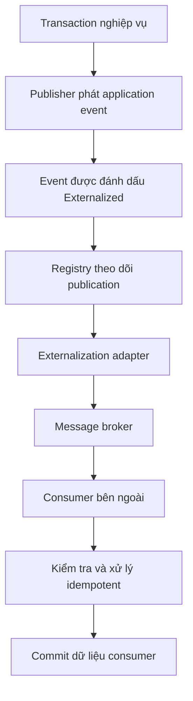

# Công khai event ra ngoài với Spring Modulith

Application event giúp các module trong cùng ứng dụng trao đổi thông tin mà không cần gọi trực tiếp service của nhau. Tuy nhiên, một số sự kiện cần được chuyển tới hệ thống nằm ngoài ứng dụng: message broker, dịch vụ xử lý dữ liệu, hệ thống thông báo hoặc một ứng dụng khác. **Event externalization** là cách đưa những application event được chọn ra khỏi ranh giới tiến trình để các hệ thống bên ngoài có thể tiêu thụ.

Trong module `SPRING_MODULITH_APPLICATION_EVENTS`, công khai event ra ngoài mở rộng mô hình publisher/listener sang giao tiếp giữa các hệ thống. Spring Modulith cung cấp annotation và hạ tầng tích hợp để đánh dấu event cần externalize, theo dõi quá trình giao publication và kết nối với công nghệ truyền thông điệp phù hợp. Thiết kế tốt cần giữ hợp đồng sự kiện ổn định, kiểm soát dữ liệu được chia sẻ và xử lý được trường hợp thông điệp được giao lại.

## 1. Khi nào cần externalize application event?

Một application event thường bắt đầu từ một thay đổi nghiệp vụ đã xảy ra. Ví dụ, module đơn hàng phát `OrderCompleted` khi một đơn hàng hoàn tất. Module kho và module hóa đơn trong cùng ứng dụng có thể đăng ký listener để phản ứng với event đó. Khi một hệ thống khác cũng cần biết đơn hàng đã hoàn tất, ứng dụng có thể externalize event tới broker để hệ thống đó nhận thông điệp độc lập.

Một số tình huống thường gặp:

- Chuyển sự kiện đơn hàng sang hệ thống giao vận để tạo yêu cầu vận chuyển.
- Gửi sự kiện thanh toán tới hệ thống phân tích để cập nhật báo cáo.
- Thông báo thay đổi hồ sơ khách hàng tới dịch vụ tìm kiếm hoặc cache riêng.
- Chuyển sự kiện nghiệp vụ tới một ứng dụng khác do nhóm khác phát triển và vận hành.
- Tích hợp với nền tảng thông báo, kiểm toán hoặc xử lý dữ liệu mà không để module nguồn phụ thuộc trực tiếp vào API của chúng.

Externalization phù hợp khi hệ thống nhận có thể xử lý thông điệp độc lập và chấp nhận giao tiếp bất đồng bộ. Nếu thao tác cần kết quả ngay để quyết định transaction hiện tại có được tiếp tục hay không, một lời gọi đồng bộ với hợp đồng lỗi rõ ràng có thể phù hợp hơn.

## 2. Phân biệt application event và integration event

Application event mô tả điều xảy ra bên trong ứng dụng. Integration event là hợp đồng mà ứng dụng công bố cho hệ thống bên ngoài. Hai khái niệm có thể dùng chung một lớp event trong ứng dụng nhỏ, nhưng không nên mặc định mọi chi tiết nội bộ đều phù hợp để chia sẻ ra ngoài.

| Loại event | Người tiêu thụ | Mục đích | Mức độ ổn định |
| --- | --- | --- | --- |
| Application event | Module trong cùng ứng dụng | Phối hợp hành vi giữa các module | Có thể thay đổi cùng codebase, nhưng vẫn cần quan tâm listener đang hoạt động |
| Integration event | Ứng dụng hoặc hệ thống bên ngoài | Công bố một sự kiện nghiệp vụ qua ranh giới hệ thống | Cần quản lý tương thích và phiên bản hợp đồng |

Ví dụ, entity `Order` có thể chứa trạng thái nội bộ, ghi chú vận hành, quan hệ lazy-loading và dữ liệu chỉ dùng cho quy trình của module đơn hàng. Không nên gửi nguyên entity đó qua broker. Hãy tạo một payload nhỏ, bất biến, thể hiện đúng thông tin mà consumer được phép biết.

Integration event nên diễn tả điều đã xảy ra, chẳng hạn `OrderCompleted`, thay vì ra lệnh cho hệ thống khác thực hiện một hành động tùy ý. Cách đặt tên theo sự kiện giúp consumer hiểu thông điệp là một sự thật nghiệp vụ đã được công bố và tự quyết định phản ứng.

## 3. Luồng externalization

Một luồng phổ biến gồm các bước sau:

1. Module nguồn cập nhật trạng thái nghiệp vụ trong transaction.
2. Publisher phát application event sau khi thay đổi nghiệp vụ được xác định.
3. Hạ tầng Spring Modulith nhận diện event được đánh dấu để externalize và tạo publication cần giao.
4. Khi điều kiện transaction phù hợp đã được đáp ứng, hạ tầng externalization chuyển payload tới đích đã cấu hình thông qua integration tương ứng.
5. Message broker lưu hoặc chuyển tiếp thông điệp theo bảo đảm của broker.
6. Consumer nhận thông điệp, kiểm tra hợp đồng và xử lý theo transaction riêng của nó.



Việc dùng broker tạo ra một ranh giới thời gian giữa publisher và consumer. Publisher không cần biết consumer đang chạy hay đang bảo trì tại thời điểm phát event. Consumer có thể tiếp tục xử lý khi nhận được thông điệp theo chính sách của broker.

Điều này cũng có nghĩa publisher không nhận được kết quả nghiệp vụ tức thời từ consumer. Nếu cần biết consumer đã hoàn thành một công việc, hãy thiết kế một event phản hồi hoặc một giao thức xác nhận riêng thay vì suy luận từ việc publisher gửi được message.

## 4. Đánh dấu event bằng `@Externalized`

Spring Modulith cung cấp annotation `@Externalized` để chỉ ra event nào cần được đưa ra ngoài. Có thể đặt annotation trên kiểu event được công bố. Ví dụ:

```java
import java.time.Instant;
import java.util.UUID;

import org.springframework.modulith.events.Externalized;

@Externalized("orders")
public record OrderCompleted(
        UUID eventId,
        UUID orderId,
        Instant occurredAt,
        int schemaVersion
) {}
```

Giá trị `orders` là thông tin định tuyến/đích externalization được integration sử dụng theo cách ánh xạ của công nghệ đang cấu hình. Với Kafka, đích thường được ánh xạ tới topic; với AMQP, việc gửi có thể liên quan tới exchange và routing key. Cần kiểm tra cách adapter của phiên bản Spring Modulith đang dùng diễn giải giá trị này và cấu hình broker tương ứng.

Annotation giúp khai báo ý định externalization ngay trên hợp đồng event. Publisher vẫn chỉ phát application event thông qua Spring event publisher:

```java
@Service
class OrderApplicationService {

    private final ApplicationEventPublisher events;
    private final OrderRepository orders;

    OrderApplicationService(
            ApplicationEventPublisher events,
            OrderRepository orders
    ) {
        this.events = events;
        this.orders = orders;
    }

    @Transactional
    public void complete(UUID orderId) {
        Order order = orders.findById(orderId).orElseThrow();
        order.complete();

        events.publishEvent(new OrderCompleted(
                UUID.randomUUID(),
                order.getId(),
                Instant.now(),
                1
        ));
    }
}
```

Publisher không cần gọi Kafka template, Rabbit template hoặc API HTTP của consumer. Nó phát một event nghiệp vụ; cấu hình externalization chịu trách nhiệm chuyển event được chọn ra ngoài. Nhờ vậy, logic nghiệp vụ của module nguồn ít phụ thuộc vào hạ tầng truyền thông điệp.

Không phải mọi application event đều cần gắn `@Externalized`. Chỉ đánh dấu những event đã được xác định là hợp đồng chia sẻ. Event nội bộ phục vụ phối hợp giữa các module có thể tiếp tục ở trong ứng dụng.

## 5. Thiết kế payload cho hệ thống bên ngoài

Payload là hợp đồng giữa producer và consumer. Một hợp đồng hữu ích thường có các đặc điểm sau:

- **Bất biến:** sau khi phát hành, ý nghĩa của event không thay đổi.
- **Có định danh:** `eventId` giúp consumer nhận diện một sự kiện khi cần chống xử lý lặp.
- **Có thời điểm:** `occurredAt` biểu thị thời điểm nghiệp vụ xảy ra, không nhất thiết là thời điểm broker nhận message.
- **Có phiên bản:** `schemaVersion` hoặc cơ chế versioning tương đương giúp consumer diễn giải payload theo hợp đồng.
- **Đủ dùng:** chỉ chứa dữ liệu cần cho consumer, tránh gửi toàn bộ entity hoặc object graph.
- **Không phụ thuộc nội bộ:** tránh đưa tên package, tên bảng, proxy ORM hoặc kiểu dữ liệu nội bộ vào hợp đồng công khai.

Ví dụ `OrderCompleted` có thể chứa `orderId`, thời điểm hoàn tất và một số thông tin giao hàng đã được phép chia sẻ. Consumer cần thêm dữ liệu khác có thể gọi API được công bố hoặc nhận một event riêng. Không nên mở rộng payload thành bản sao đầy đủ của database chỉ để giảm một lần truy vấn.

### Envelope và metadata

Trong hệ thống có nhiều loại event, nhóm phát triển có thể thống nhất một envelope gồm metadata và payload:

```json
{
  "eventId": "d1b2c3d4-1111-4222-8333-123456789abc",
  "eventType": "OrderCompleted",
  "schemaVersion": 1,
  "occurredAt": "2026-11-25T09:30:00Z",
  "correlationId": "workflow-72",
  "payload": {
    "orderId": "a1b2c3d4-1111-4222-8333-123456789abc"
  }
}
```

Đây là ví dụ về một hợp đồng envelope do ứng dụng quy ước; không phải khẳng định rằng Spring Modulith tự động tạo đúng cấu trúc JSON này. Tùy integration và serializer, message thực tế có thể được đóng gói hoặc gắn metadata theo cách khác. Hãy thống nhất định dạng giữa producer và consumer, đồng thời kiểm tra payload thực tế trong integration test.

Không đưa thông tin bí mật, token, thông tin xác thực, dữ liệu cá nhân không cần thiết hoặc nội dung nội bộ vào message. Message broker thường lưu message, sao chép message giữa node và có thể giữ bản sao trong log hoặc công cụ quan sát. Quyền truy cập broker không thay thế chính sách phân loại và giảm thiểu dữ liệu.

## 6. Kết nối với message broker

Spring Modulith có các integration để externalize event tới công nghệ nhắn tin như Apache Kafka và AMQP. Tên artifact, cách cấu hình và mức độ tự động cấu hình phụ thuộc phiên bản Spring Modulith và Spring Boot đang dùng. Hãy chọn integration tương ứng với broker của hệ thống, quản lý phiên bản qua BOM tương thích và làm theo cấu hình chính thức của phiên bản đó.

Ví dụ dependency cho các dòng integration thường được sử dụng:

```xml
<!-- Kafka integration -->
<dependency>
    <groupId>org.springframework.modulith</groupId>
    <artifactId>spring-modulith-events-kafka</artifactId>
</dependency>

<!-- Hoặc AMQP integration khi ứng dụng dùng broker AMQP -->
<dependency>
    <groupId>org.springframework.modulith</groupId>
    <artifactId>spring-modulith-events-amqp</artifactId>
</dependency>
```

Đây là hai lựa chọn theo broker; một ứng dụng chỉ thêm integration mà nó thực sự sử dụng. Cần xác nhận artifact tồn tại trong dòng phiên bản đang quản lý và không khai báo đồng thời các adapter chỉ vì muốn thử nhiều cấu hình.

### Cấu hình broker

Ngoài integration của Spring Modulith, ứng dụng cần cấu hình client và kết nối broker. Với Kafka, cấu hình thường bao gồm địa chỉ bootstrap server, serializer, cơ chế xác thực, TLS và các thuộc tính producer cần thiết. Với AMQP, cấu hình thường bao gồm địa chỉ broker, thông tin xác thực, virtual host, exchange, queue và binding theo topology của hệ thống.

Ví dụ cấu hình kết nối Kafka ở mức khái quát:

```yaml
spring:
  kafka:
    bootstrap-servers: ${KAFKA_BOOTSTRAP_SERVERS}
    producer:
      acks: all
```

Đây chỉ là phần cấu hình client minh họa. Tên topic hoặc đích externalization, serializer, bảo mật, retry, timeout và chính sách lưu trữ cần được cấu hình theo môi trường triển khai. Không commit password, private key hoặc token vào file cấu hình trong repository; dùng secret manager hoặc biến môi trường được quản lý an toàn.

### Chọn broker theo nhu cầu

| Tiêu chí | Kafka | AMQP broker |
| --- | --- | --- |
| Mô hình phổ biến | Topic và partition, consumer group | Exchange, queue và binding |
| Phù hợp với | Luồng sự kiện lớn, nhiều consumer, replay theo retention | Định tuyến message linh hoạt, queue công việc và xác nhận giao nhận |
| Cần quan tâm | Partition key, thứ tự trong partition, retention, consumer offset | Exchange type, routing key, queue durability, acknowledgement |
| Tính năng cần xác minh | Producer acknowledgement, idempotence, retry và DLQ | Publisher confirms, consumer ack, dead-letter exchange và retry queue |

Không có broker nào tự động giải quyết mọi vấn đề giao sự kiện. Hãy chọn theo lưu lượng, mô hình consumer, yêu cầu thứ tự, khả năng vận hành và mức độ sẵn có của nền tảng trong tổ chức.

## 7. Transaction và độ tin cậy khi externalize

Một rủi ro phổ biến là cập nhật database thành công nhưng gửi message thất bại, hoặc gửi message thành công trong khi transaction nghiệp vụ rollback. Nếu hai thao tác không được phối hợp đúng, consumer có thể nhìn thấy một sự kiện không phản ánh trạng thái đã commit, hoặc không nhận được sự kiện cho một thay đổi đã commit.

Với event được theo dõi bằng Event Publication Registry, Spring Modulith lưu trạng thái publication để có thể xác định những lần giao chưa hoàn tất. Khi dùng persistent registry tương thích và cấu hình transaction đúng, việc ghi nhận publication có thể tham gia cùng transaction nghiệp vụ. Sau đó, externalization xử lý việc chuyển message tới hệ thống đích và cập nhật trạng thái publication tương ứng.

Để có khả năng phục hồi sau khi tiến trình dừng, ứng dụng cần repository lưu trữ bền vững phù hợp. Repository chỉ ở bộ nhớ không thể giữ publication qua restart. Cần xác nhận transaction manager, datasource và repository mà registry sử dụng thực sự được phối hợp trong cùng ranh giới transaction dự kiến.

### Vì sao vẫn có thể có message trùng?

Giả sử broker đã nhận message, nhưng ứng dụng dừng trước khi registry ghi nhận publication hoàn tất. Khi ứng dụng phục hồi, publication còn dang dở có thể được gửi lại. Broker hoặc consumer vì vậy có thể nhìn thấy cùng một event nhiều hơn một lần.

Đây là lý do cần thiết kế theo hướng **at-least-once** ở những chặng có thể retry và làm consumer idempotent. Không nên hứa hẹn exactly-once xuyên suốt database của producer, broker và database của consumer chỉ dựa trên việc dùng annotation externalization.

Một consumer có thể dùng bảng inbox để ghi nhận event đã xử lý:

```java
@Transactional
public void handle(OrderCompleted event) {
    if (inboxRepository.existsById(event.eventId())) {
        return;
    }

    shippingService.createShipment(event.orderId());
    inboxRepository.save(new InboxEntry(event.eventId()));
}
```

Đoạn mã minh họa cần được hoàn thiện theo mô hình dữ liệu thực tế. Việc kiểm tra và ghi inbox phải được bảo vệ bằng ràng buộc duy nhất trên `eventId` và transaction phù hợp để hai consumer đồng thời không xử lý cùng event thành công hai lần. Nếu `shippingService` gọi hệ thống ngoài, cần idempotency key hoặc một quy trình phối hợp riêng; transaction database của consumer không thể tự làm lời gọi HTTP trở thành nguyên tử.

## 8. Consumer và ranh giới hệ thống

Consumer nên xử lý message như một hợp đồng đến từ một hệ thống độc lập. Không nên giả định producer và consumer được triển khai cùng lúc hoặc luôn chạy cùng phiên bản.

Một consumer vững chắc thường thực hiện các bước:

1. Xác thực cấu trúc message và kiểm tra phiên bản hợp đồng được hỗ trợ.
2. Kiểm tra định danh event để phát hiện message đã xử lý.
3. Ánh xạ payload sang command hoặc model nội bộ của consumer.
4. Thực hiện thay đổi nghiệp vụ trong transaction riêng.
5. Ghi nhận event đã xử lý trong cùng transaction nếu dùng inbox.
6. Chỉ xác nhận message với broker sau khi xử lý đạt điều kiện thành công theo adapter.
7. Đưa message không thể xử lý vào luồng lỗi hoặc dead-letter theo chính sách đã thống nhất.

Consumer không nên phụ thuộc vào class Java của producer như một thư viện chia sẻ nếu điều đó buộc hai ứng dụng phát hành đồng thời. Có thể chia sẻ schema hoặc hợp đồng được version hóa, nhưng mỗi hệ thống vẫn cần kiểm soát cách deserialize và ánh xạ sang model riêng.

### Thứ tự và tính nhất quán

Broker có thể bảo đảm thứ tự trong một phạm vi cụ thể, chẳng hạn trong một partition hoặc một queue, nhưng không nhất thiết bảo đảm thứ tự toàn cục giữa mọi event. Nếu thứ tự theo đơn hàng quan trọng, hãy dùng `orderId` làm partition key hoặc routing key theo khả năng của broker và xác định consumer xử lý tuần tự trong phạm vi đó.

Ngay cả khi broker giữ thứ tự, nhiều consumer hoặc retry có thể làm thời điểm hoàn tất khác với thứ tự nhận. Nếu một consumer nhận `OrderCancelled` trước khi hoàn tất xử lý `OrderCompleted`, logic nghiệp vụ phải xác định cách xử lý trạng thái đến muộn, event lặp và event sai thứ tự.

## 9. Quản lý phiên bản và tương thích hợp đồng

Integration event có thể được lưu trong broker lâu hơn một lần triển khai. Consumer cũ có thể vẫn đọc message được phát bởi producer mới, hoặc consumer mới có thể phải đọc lại message cũ. Vì vậy, thay đổi payload cần được xem là thay đổi hợp đồng.

Các nguyên tắc thực tế:

- Ưu tiên thêm trường tùy chọn có giá trị mặc định hợp lý thay vì đổi kiểu hoặc đổi ý nghĩa trường hiện có.
- Không đổi ý nghĩa của một trường nhưng giữ nguyên tên.
- Xác định rõ cách consumer xử lý trường chưa biết và trường bị thiếu.
- Giữ tương thích serializer/deserializer trong khoảng thời gian message cũ còn tồn tại.
- Dùng `schemaVersion`, event type version hoặc schema registry theo chuẩn của nền tảng nếu hệ thống cần quản lý nhiều phiên bản.
- Lập kế hoạch triển khai producer và consumer theo thứ tự cho phép hai phiên bản cùng tồn tại.

Ví dụ, nếu `OrderCompleted` ban đầu chỉ có `orderId`, việc thêm `completedAt` có thể tương thích nếu consumer cũ bỏ qua trường không biết và consumer mới chấp nhận message cũ thiếu trường đó. Đổi `orderId` từ UUID sang cấu trúc object hoặc đổi ý nghĩa `completedAt` sang thời điểm giao hàng là thay đổi lớn hơn và cần chiến lược chuyển đổi.

Không nên dùng tên class Java hoặc tên package nội bộ làm hợp đồng versioning duy nhất. Những chi tiết đó có thể thay đổi trong quá trình tái cấu trúc module, trong khi consumer bên ngoài cần một định danh event ổn định.

## 10. Kiểm thử externalization

Kiểm thử publisher đơn thuần chỉ chứng minh event được phát trong application context. Nó chưa chứng minh message có thể được serialize, định tuyến, gửi tới broker và tiêu thụ bởi hệ thống khác.

Nên tổ chức kiểm thử theo nhiều lớp:

| Loại kiểm thử | Điều cần xác nhận |
| --- | --- |
| Unit test publisher | Khi nghiệp vụ hoàn tất, publisher phát đúng loại event với dữ liệu đúng |
| Kiểm thử annotation/selection | Chỉ event được đánh dấu externalize mới được chuyển ra ngoài |
| Serialization test | Payload có thể serialize và deserialize theo hợp đồng đã công bố |
| Adapter integration test | Event được gửi tới đúng topic, exchange hoặc đích đã cấu hình |
| Broker integration test | Broker nhận message và consumer test có thể đọc được |
| Transaction test | Rollback không để lại message sai lệch; commit tạo publication cần giao theo cấu hình |
| Failure/retry test | Khi broker tạm thời không sẵn sàng, publication còn được theo dõi và có thể phục hồi |
| Consumer idempotency test | Giao cùng event nhiều lần không tạo tác động nghiệp vụ trùng |
| Compatibility test | Consumer xử lý được payload của các phiên bản hợp đồng còn được hỗ trợ |

Với kiểm thử broker, có thể dùng container test hoặc broker thử nghiệm do dự án cung cấp. Kiểm thử cần xác nhận cấu hình thực tế của adapter, serializer và transaction manager; một test mock producer không thay thế được kiểm thử tích hợp.

Khi kiểm thử retry, hãy tạo tình huống có thể quan sát: broker từ chối kết nối, consumer ném exception hoặc tiến trình dừng ở một điểm xác định. Sau khi phục hồi, xác nhận message cuối cùng được xử lý và không gây tác động trùng. Tránh chỉ kiểm tra rằng một phương thức gửi message đã được gọi.

## 11. Quan sát và vận hành

Externalization kéo dài luồng xử lý qua nhiều tiến trình. Để tìm lỗi, cần liên kết log của publisher, broker và consumer bằng các định danh chung.

Những tín hiệu nên theo dõi:

- Số publication chưa hoàn tất và tuổi của publication lâu nhất.
- Tỷ lệ externalization thành công, thất bại và retry theo đích hoặc loại event.
- Độ trễ từ lúc event xảy ra tới lúc broker nhận message.
- Độ trễ từ lúc broker nhận message tới lúc consumer hoàn tất xử lý.
- Số message trong queue hoặc consumer lag theo khả năng quan sát của broker.
- Số message chuyển vào dead-letter queue và nguyên nhân tương ứng.
- Tỷ lệ message trùng hoặc message không tương thích schema.

Mỗi log nên có các trường có ích như `eventId`, event type, destination, `correlationId`, publication ID nếu có và tên consumer. Tránh ghi payload đầy đủ khi payload có dữ liệu nhạy cảm. Metric nên dùng nhãn có cardinality được kiểm soát; không dùng UUID của từng event làm nhãn metric vì sẽ tạo số lượng chuỗi thời gian quá lớn.

Khi một publication bị kẹt, người vận hành cần xác định lỗi nằm ở producer, kết nối broker, cấu hình định tuyến hay consumer. Chỉ retry sau khi đã hiểu điều kiện lỗi và đánh giá khả năng xử lý lặp. Với message không hợp lệ hoặc không tương thích schema, cần quy trình cách ly, sửa consumer hoặc chuyển đổi message có kiểm soát.

## 12. Bảo mật khi công bố event

Khi event rời khỏi ứng dụng, dữ liệu đi qua một ranh giới tin cậy mới. Thiết kế externalization cần tính tới:

- **Xác thực kết nối:** producer và consumer dùng danh tính riêng, không chia sẻ credential rộng giữa các ứng dụng.
- **Phân quyền:** chỉ producer được phép ghi vào đích cần thiết; consumer chỉ được đọc những topic hoặc queue mà nó cần.
- **Mã hóa đường truyền:** bật TLS theo tiêu chuẩn của broker và môi trường triển khai.
- **Quản lý bí mật:** lưu credential trong secret manager hoặc cơ chế cấu hình an toàn.
- **Giảm thiểu dữ liệu:** chỉ phát trường cần thiết cho mục đích tích hợp.
- **Retention:** xác định thời gian giữ message và quy trình xóa theo yêu cầu nghiệp vụ, pháp lý và vận hành.
- **Audit:** ghi nhận producer, consumer và thao tác quản trị broker theo khả năng nền tảng.

Một event được externalize có thể được nhiều consumer nhận. Trước khi thêm trường mới, hãy xác định ai có quyền đọc dữ liệu đó và liệu việc chia sẻ có phù hợp với mục đích tích hợp hay không.

## 13. Lỗi thiết kế thường gặp

| Lỗi | Hệ quả | Cách xử lý |
| --- | --- | --- |
| Externalize mọi application event | Lộ chi tiết nội bộ và tạo hợp đồng ngoài không cần thiết | Chỉ đánh dấu event đã được chọn làm integration contract |
| Gửi trực tiếp entity hoặc object graph | Payload lớn, khó serialize và rò rỉ dữ liệu | Tạo DTO event bất biến, tối giản |
| Coi gửi message thành công là consumer đã xử lý | Producer hiểu sai trạng thái nghiệp vụ ở hệ thống nhận | Dùng event phản hồi hoặc cơ chế xác nhận riêng khi cần |
| Giả định message chỉ giao một lần | Consumer có thể tạo side effect trùng | Idempotency key, inbox và ràng buộc duy nhất |
| Không quản lý schema | Triển khai lệch phiên bản gây lỗi deserialize | Versioning và kiểm thử tương thích |
| Chỉ kiểm thử bằng mock | Không phát hiện lỗi adapter, serializer, broker hoặc transaction | Bổ sung kiểm thử tích hợp |
| Dùng một routing key cho mọi loại event mà không có quy ước | Consumer nhận sai luồng hoặc khó phân quyền | Thiết kế destination và routing theo bounded context |
| Ghi toàn bộ payload vào log | Tăng rủi ro lộ dữ liệu và tăng dung lượng log | Log metadata và định danh cần thiết |
| Retry vô hạn message không hợp lệ | Tạo vòng lặp lỗi và tiêu tốn tài nguyên | Phân loại lỗi, giới hạn retry và dead-letter |

Một lỗi khác là để consumer phụ thuộc vào transaction hoặc database của producer. Sau khi event đã qua broker, consumer phải xử lý dựa trên hợp đồng message và dữ liệu thuộc quyền sở hữu của nó. Nếu cần thêm thông tin, consumer dùng API được công bố hoặc nhận event bổ sung, thay vì truy cập trực tiếp database nội bộ của producer.

## 14. Quy trình áp dụng trong module

Khi đưa externalization vào một luồng nghiệp vụ, có thể triển khai theo thứ tự sau:

1. Xác định hệ thống nào cần biết sự kiện và lý do cần giao tiếp bất đồng bộ.
2. Chọn sự kiện nghiệp vụ đã xảy ra, xác định bounded context sở hữu event và consumer dự kiến.
3. Thiết kế integration event bất biến, có định danh, thời điểm và phiên bản hợp đồng.
4. Đánh dấu event cần externalize bằng `@Externalized` với đích định tuyến phù hợp.
5. Thêm integration broker tương ứng và cấu hình kết nối, bảo mật, serializer cùng destination.
6. Dùng persistent Event Publication Registry và transaction manager phù hợp để theo dõi publication cần giao.
7. Thiết kế consumer có kiểm tra schema, idempotency, retry và dead-letter.
8. Kiểm thử serialization, định tuyến, commit/rollback, broker failure và giao message lặp.
9. Thiết lập metric, log, trace, cảnh báo và quy trình phục hồi publication/message lỗi.
10. Quản lý version và retention để producer, broker và consumer có thể được triển khai độc lập.

Spring Modulith giúp đánh dấu và externalize application event theo cách phù hợp với kiến trúc module, trong khi integration broker đảm nhiệm phần giao tiếp với hạ tầng nhắn tin. Khi event được thiết kế như hợp đồng công khai, publication được theo dõi bền vững và consumer có khả năng xử lý lặp an toàn, các hệ thống có thể phối hợp bất đồng bộ mà vẫn giữ quyền sở hữu dữ liệu và ranh giới nghiệp vụ của mình.
