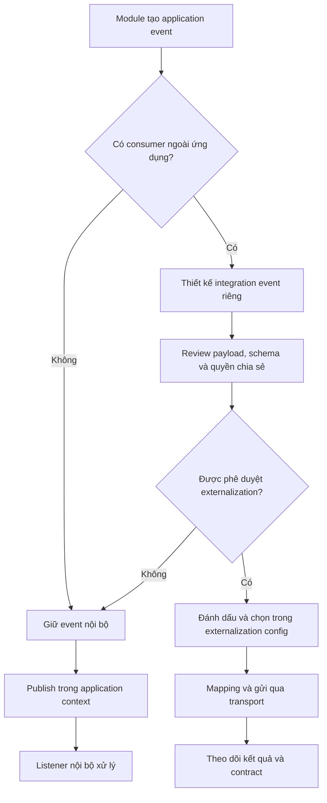

# Event nội bộ không phát tán

Một ứng dụng Spring Modulith có thể dùng application event để các module trao đổi thông tin mà không cần gọi trực tiếp implementation của nhau. Phần lớn sự kiện chỉ phục vụ phối hợp bên trong một ứng dụng: cập nhật projection, ghi audit nội bộ, tính toán tiếp hoặc kích hoạt một bước nghiệp vụ khác. Những sự kiện này không nhất thiết phải trở thành thông điệp gửi đến Kafka, RabbitMQ hay một hệ thống bên ngoài.

Giữ event nội bộ trong phạm vi ứng dụng giúp bảo vệ ranh giới module, giảm số hợp đồng phải duy trì và tránh để chi tiết triển khai nội bộ trở thành API tích hợp ngoài ý muốn. Spring Modulith hỗ trợ externalization cho những event được lựa chọn. Vì vậy, thiết kế cần xác định rõ event nào được phép đi qua ranh giới tiến trình và event nào chỉ được tiêu thụ trong application context hiện tại.

## Mục tiêu

Sau bài này, bạn có thể:

- Phân biệt application event nội bộ với integration event được phát ra ngoài ứng dụng.
- Thiết kế event nội bộ không được externalize và chọn rõ các event được phép phát tán.
- Hiểu vai trò của `@Externalized`, publisher, listener và cấu hình externalization.
- Tránh để một cấu hình chọn event quá rộng làm lộ dữ liệu hoặc chi tiết nội bộ.
- Kiểm thử cả hành vi xử lý nội bộ lẫn việc không tạo thông điệp gửi ra ngoài.
- Theo dõi publication và kiểm soát thay đổi hợp đồng khi có event thực sự cần tích hợp.

## 1. Phân biệt event nội bộ và event tích hợp

Application event là một đối tượng được publish trong Spring application context. Các listener trong cùng ứng dụng có thể nhận event đó theo cơ chế listener đã cấu hình. Bản thân lời gọi `ApplicationEventPublisher.publishEvent(...)` không đồng nghĩa với việc gửi thông điệp qua mạng hoặc đưa dữ liệu lên message broker.

Externalization là bước chuyển một event được chọn thành thông điệp có thể chuyển tới hệ thống khác. Bước này cần cơ chế externalization và hạ tầng vận chuyển tương ứng. Một event nội bộ không cần tham gia bước đó.

| Đặc điểm | Event nội bộ | Event tích hợp bên ngoài |
|---|---|---|
| Phạm vi sử dụng | Các module trong cùng ứng dụng | Ứng dụng, dịch vụ hoặc đối tác khác |
| Mục đích | Phối hợp xử lý bên trong và duy trì ranh giới module | Thông báo một sự kiện có ý nghĩa đối với consumer bên ngoài |
| Hợp đồng | Có thể phản ánh mô hình nội bộ và thay đổi cùng ứng dụng | Cần ổn định, có quy tắc tương thích và quản lý phiên bản |
| Dữ liệu | Có thể chứa dữ liệu phục vụ use case nội bộ | Chỉ chứa dữ liệu được phép chia sẻ và cần thiết cho consumer |
| Vận chuyển | Spring application event mechanism | Externalization mechanism cùng broker hoặc transport adapter |
| Consumer | Listener trong application context | Consumer ở tiến trình hoặc hệ thống khác |

Ví dụ trong module đơn hàng, `OrderPricingCalculated` có thể chỉ dùng để module đơn hàng cập nhật bước xử lý tiếp theo. Một event khác như `OrderConfirmed` có thể mang ý nghĩa nghiệp vụ đủ ổn định để thông báo cho hệ thống vận chuyển hoặc phân tích. Hai event có thể phát sinh trong cùng quy trình nhưng có phạm vi và yêu cầu hợp đồng khác nhau.

Không nên xem mọi event được publish là một thông điệp tích hợp. Nếu mỗi thay đổi trạng thái nội bộ đều được phát ra broker, các module vô tình biến cấu trúc triển khai của mình thành hợp đồng bên ngoài. Consumer sẽ phụ thuộc vào chi tiết không được thiết kế để tồn tại lâu dài.

## 2. Mặc định giữ event trong application context

Một event chỉ cần được xử lý trong ứng dụng có thể là một Java record đơn giản. Không gắn metadata externalization cho event đó:

```java
import java.math.BigDecimal;
import java.util.UUID;

public record OrderPricingCalculated(
    UUID orderId,
    BigDecimal total,
    String currency
) {}
```

Module sở hữu nghiệp vụ phát event qua `ApplicationEventPublisher`:

```java
import org.springframework.context.ApplicationEventPublisher;
import org.springframework.stereotype.Component;

@Component
class OrderPricingService {

    private final ApplicationEventPublisher events;

    OrderPricingService(ApplicationEventPublisher events) {
        this.events = events;
    }

    void publishCalculatedPrice(
            UUID orderId, BigDecimal total, String currency) {
        events.publishEvent(
            new OrderPricingCalculated(orderId, total, currency)
        );
    }
}
```

Một module khác trong cùng ứng dụng có thể lắng nghe event:

```java
import org.springframework.modulith.events.ApplicationModuleListener;
import org.springframework.stereotype.Component;

@Component
class OrderSummaryListener {

    @ApplicationModuleListener
    void on(OrderPricingCalculated event) {
        // Cập nhật dữ liệu tóm tắt trong phạm vi ứng dụng.
    }
}
```

`@ApplicationModuleListener` là lựa chọn phù hợp khi muốn dùng cơ chế listener theo module của Spring Modulith, bao gồm ngữ nghĩa xử lý sau commit và bất đồng bộ mà annotation này cung cấp theo cấu hình của ứng dụng. Dù chọn listener đồng bộ hay listener theo module, event vẫn là application event nội bộ nếu không có cơ chế externalization nào chọn nó.

Điểm quan trọng là event nội bộ không cần triển khai một interface tích hợp chung, không cần tên topic và không cần mang schema dành cho consumer bên ngoài. Hãy giữ kiểu dữ liệu và tên gọi gần với ý nghĩa nghiệp vụ trong ứng dụng.

## 3. Chọn event được phép externalize

Spring Modulith cung cấp annotation `@Externalized` để đánh dấu event cần được externalize trong cấu hình externalization dựa trên annotation. Ví dụ, một event tích hợp có thể được định nghĩa riêng:

```java
import java.time.Instant;
import java.util.UUID;

import org.springframework.modulith.events.Externalized;

@Externalized("orders")
public record OrderConfirmed(
    UUID orderId,
    Instant occurredAt,
    int schemaVersion
) {}
```

Giá trị `orders` là target được dùng bởi cấu hình externalization để định tuyến hoặc xác định đích phát tán. Cách target được ánh xạ sang destination cụ thể phụ thuộc integration và cấu hình vận chuyển của ứng dụng.

Đặt `@Externalized` trên event tích hợp có chủ đích. Event nội bộ như `OrderPricingCalculated` ở phần trước không có annotation này. Khi dùng cơ chế chọn event bằng annotation, nó không được đánh dấu là event cần externalize.

Tuy nhiên, annotation không thay thế việc kiểm tra cấu hình. Ứng dụng có thể tùy biến điều kiện chọn event, mapping hoặc externalization pipeline. Nếu cấu hình chọn tất cả event theo package, superclass hoặc predicate quá rộng, một event nội bộ vẫn có thể bị đưa vào pipeline dù không mang annotation như mong muốn. Vì vậy, hãy kiểm tra cả metadata của event và điều kiện lựa chọn thực tế.

### Dùng allowlist cho ranh giới bên ngoài

Một cách quản trị dễ kiểm soát là duy trì danh sách event tích hợp được phê duyệt. Ví dụ minh họa dưới đây là chính sách ở mức thiết kế, không phải API Spring Modulith:

```java
Set<Class<?>> externalEventTypes = Set.of(
    OrderConfirmed.class,
    ShipmentDispatched.class,
    InvoiceIssued.class
);
```

Khi rà soát cấu hình externalization, đối chiếu các kiểu event được chọn với allowlist này. Nếu ứng dụng dùng `@Externalized`, allowlist nên tương ứng với những event đã được đánh dấu và đã được phê duyệt. Nếu dùng predicate hoặc mapping tùy chỉnh, điều kiện chọn cũng phải thể hiện cùng chính sách.

Không dùng package chung của toàn bộ domain làm điều kiện externalize nếu package đó chứa cả event nội bộ. Không chọn tất cả object được publish chỉ vì muốn giảm cấu hình. Việc chọn rõ loại event giúp thay đổi nội bộ không tự động trở thành thay đổi hợp đồng tích hợp.

## 4. Tách event nội bộ khỏi hợp đồng tích hợp

Một event nội bộ thường phản ánh nhu cầu của module hiện tại. Một integration event phản ánh điều mà consumer bên ngoài cần biết. Hai nhu cầu này thay đổi theo nhịp khác nhau, vì vậy nên cân nhắc dùng hai kiểu dữ liệu riêng.

Ví dụ, `OrderPricingCalculated` có thể chứa `BigDecimal total`, currency và một số trường tính toán trung gian. Consumer bên ngoài chỉ cần biết đơn hàng đã được xác nhận:

```java
@Externalized("orders")
public record OrderConfirmed(
    UUID orderId,
    Instant occurredAt,
    int schemaVersion
) {}
```

Khi nghiệp vụ xác nhận đơn hàng, module có thể publish cả event nội bộ cần cho các bước phối hợp và integration event dành cho hệ thống ngoài. Chỉ event tích hợp được chọn để externalize. Nếu nhiều consumer bên ngoài cần dữ liệu khác nhau, hãy cân nhắc các hợp đồng riêng hoặc một schema có trường tùy chọn được quản lý rõ ràng.

Không nên externalize trực tiếp entity JPA, aggregate hoặc object chứa quan hệ lazy. Những object này thường mang cấu trúc lưu trữ, proxy, dữ liệu nội bộ và quan hệ không phù hợp với wire contract. Hãy tạo payload nhỏ, bất biến, chứa định danh và thông tin nghiệp vụ cần thiết.

Một integration event nên trả lời được:

- Điều gì đã xảy ra trong nghiệp vụ?
- Đối tượng nghiệp vụ nào liên quan?
- Sự kiện xảy ra vào thời điểm nào?
- Consumer cần trường dữ liệu nào để phản ứng?
- Consumer có cách nhận biết phiên bản schema hoặc loại sự kiện hay không?

Đừng đưa thông tin nhạy cảm, token, thông tin xác thực hoặc dữ liệu cá nhân không cần thiết vào event. Khi consumer cần thêm dữ liệu, hãy cân nhắc cung cấp API hoặc cơ chế truy vấn có kiểm soát thay vì phát tán toàn bộ aggregate.

## 5. Kiểm tra pipeline externalization

Một ứng dụng có thể có nhiều bước giữa event được publish và thông điệp tới broker: lựa chọn event, chuyển đổi payload, xác định target, serialize và gửi qua transport. Khi một event nội bộ bị phát tán ngoài ý muốn, cần xác định bước nào đã đưa nó vào pipeline.

Rà soát theo thứ tự sau:

1. **Kiểu event:** Event có được gắn `@Externalized` hay metadata tương đương không?
2. **Điều kiện chọn:** Cấu hình externalization có chọn event theo annotation, package, superclass hoặc predicate nào khác?
3. **Mapping:** Có mapping nào biến event nội bộ thành payload hoặc target bên ngoài không?
4. **Listener phát tán:** Có listener hoặc adapter tùy chỉnh nào nhận event rộng hơn danh sách dự kiến không?
5. **Transport:** Có producer nào gửi payload đến broker hoặc endpoint không?
6. **Kiểm thử:** Có kiểm thử khẳng định event nội bộ không xuất hiện ở đầu ra externalization không?

Đừng suy luận rằng event không có `@Externalized` chắc chắn không thể ra ngoài nếu ứng dụng có cấu hình externalization tùy chỉnh. Cấu hình runtime mới là nơi quyết định event nào thực sự được chọn.

### Phân biệt registry với externalization

Event Publication Registry và externalization có liên quan nhưng đảm nhiệm hai vai trò khác nhau. Registry theo dõi publication của event tới listener trong ứng dụng, giúp biết listener nào đã hoàn tất và publication nào còn chưa hoàn tất. Externalization quyết định event nào được chuyển thành thông điệp bên ngoài và chuyển nó qua transport đã cấu hình.

Việc một event được registry ghi nhận không có nghĩa event đó đã được gửi ra broker. Tương tự, việc event nội bộ không được externalize không đồng nghĩa event đó không có listener hoặc không được theo dõi publication. Hãy quan sát trạng thái listener và đầu ra transport như hai tín hiệu riêng.

## 6. Kiểm thử để bảo vệ ranh giới

Một kiểm thử chỉ xác nhận listener nội bộ đã chạy chưa đủ để chứng minh event không bị externalize. Cần kiểm tra cả đầu ra bên ngoài bằng test double, embedded broker hoặc integration test phù hợp với hạ tầng của ứng dụng.

Các trường hợp nên có trong bộ kiểm thử:

| Tình huống | Kết quả cần xác nhận |
|---|---|
| Publish event nội bộ | Listener nội bộ mong đợi nhận được event |
| Publish event nội bộ | Không có message tương ứng được gửi đến external destination |
| Publish event có `@Externalized` | Pipeline externalization chọn đúng event khi cấu hình được bật |
| Event không nằm trong allowlist | Không được chuyển thành message bên ngoài |
| Thêm một event mới trong package domain | Không tự động được externalize nếu chưa được phê duyệt |
| Thay đổi predicate hoặc mapping | Kiểm thử phát hiện việc mở rộng ngoài ý muốn của tập event được chọn |
| Payload có dữ liệu nhạy cảm | Contract test hoặc kiểm tra payload xác nhận dữ liệu bị loại bỏ |

Ví dụ dưới đây minh họa ý tưởng kiểm thử với một spy cho cổng gửi message. Tên `OutboundMessageGateway` và `outboundGateway` là thành phần giả định của ứng dụng:

```java
@SpringBootTest
class InternalEventExternalizationTests {

    @Autowired
    ApplicationEventPublisher events;

    @MockitoSpyBean
    OutboundMessageGateway outboundGateway;

    @Test
    void internalEventDoesNotReachExternalGateway() {
        events.publishEvent(
            new OrderPricingCalculated(
                UUID.randomUUID(), new BigDecimal("125.00"), "USD"
            )
        );

        verifyNoInteractions(outboundGateway);
    }
}
```

Đây là mẫu minh họa cho ứng dụng có gateway riêng; annotation spy và cách đồng bộ test cần điều chỉnh theo phiên bản Spring Boot, cơ chế gửi message và listener thực tế. Nếu listener chạy bất đồng bộ, bài kiểm thử phải chờ điều kiện hoàn tất phù hợp trước khi xác nhận không có message. Tránh dùng một khoảng `sleep` cố định vì nó làm test chậm và dễ không ổn định.

Ngoài test nội bộ, hãy có contract test cho integration event được externalize. Contract test cần xác nhận tên event, target, schema, định dạng thời gian, quy tắc nullability và khả năng tương thích với consumer. Nhờ vậy, chính sách giữ event nội bộ không phát tán và chính sách duy trì hợp đồng bên ngoài đều có kiểm chứng.

## 7. Những lỗi thiết kế thường gặp

| Lỗi | Hệ quả | Cách khắc phục |
|---|---|---|
| Externalize mọi application event | Lộ chi tiết module và tạo nhiều hợp đồng khó duy trì | Chỉ chọn integration event đã được phê duyệt |
| Chọn event theo package quá rộng | Event nội bộ mới có thể tự động bị phát tán | Dùng allowlist hoặc predicate hẹp, có test |
| Dùng cùng một class cho nội bộ và bên ngoài | Thay đổi nội bộ có thể phá consumer | Tạo payload tích hợp riêng |
| Đưa entity hoặc object lớn vào payload | Schema gắn với persistence và có thể lộ dữ liệu | Dùng DTO/event contract bất biến, tối thiểu |
| Nghĩ rằng registry đồng nghĩa với broker | Quan sát sai vòng đời và khó tìm lỗi | Theo dõi publication registry và transport riêng |
| Chỉ test listener nội bộ | Không phát hiện event bị gửi ra ngoài | Kiểm tra cả outbound gateway hoặc broker |
| Thêm `@Externalized` theo thói quen | Event có thể trở thành hợp đồng ngoài ý muốn | Review mục đích, consumer, dữ liệu và target trước khi đánh dấu |

Một dấu hiệu đáng chú ý là consumer bên ngoài bắt đầu phụ thuộc vào event có tên hoặc payload phản ánh chi tiết thuật toán nội bộ. Khi đó, hãy xem lại ranh giới: có thể event đang được externalize sai, hoặc hệ thống cần một integration event ổn định hơn.

## 8. Quan sát và quản trị thay đổi

Đối với event nội bộ, theo dõi lỗi listener, thời gian xử lý và publication chưa hoàn tất theo module. Đối với externalization, theo dõi số message gửi thành công, số lần gửi lỗi, độ trễ từ lúc event được tạo đến lúc message được chấp nhận, target và nhóm event. Hai nhóm metric giúp phân biệt lỗi xử lý nội bộ với lỗi ở ranh giới tích hợp.

Log và trace nên có event ID hoặc correlation ID, tên loại event, listener hoặc target liên quan và kết quả xử lý. Không dùng định danh từng event làm metric label có cardinality cao. Với event nội bộ, tránh ghi payload đầy đủ nếu có thể chứa dữ liệu nhạy cảm.

Mỗi khi thêm một event vào tập externalized, hãy review các điểm sau:

- Có consumer bên ngoài thực sự cần nhận event này không?
- Ai sở hữu schema và chịu trách nhiệm thông báo thay đổi?
- Payload có chứa đúng dữ liệu tối thiểu cần thiết không?
- Có quy tắc tương thích ngược và kế hoạch nâng phiên bản không?
- Có kiểm thử xác nhận target và payload không?
- Có dashboard, cảnh báo và quy trình xử lý message lỗi không?

Việc bỏ externalization khỏi một event đã được consumer sử dụng cũng là thay đổi hợp đồng. Cần thông báo và chuyển đổi consumer theo kế hoạch, sau đó mới ngừng phát tán. Chính sách allowlist cần được quản lý như một phần của API tích hợp, có người sở hữu và lịch sử thay đổi.

## 9. Quy trình quyết định



Khi một module publish event, hãy bắt đầu bằng câu hỏi ai cần tiêu thụ nó. Nếu chỉ các module trong cùng ứng dụng cần thông tin, giữ event trong application context và không đưa nó vào tập externalization. Chỉ khi có nhu cầu tích hợp rõ ràng mới tạo hoặc chọn một integration event, xác định payload ổn định và kiểm thử đường đi ra ngoài. Ranh giới đó giúp Spring Modulith hỗ trợ giao tiếp nội bộ linh hoạt mà không biến mọi thay đổi trong ứng dụng thành cam kết với hệ thống khác.
