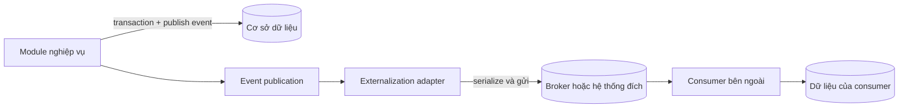

# Chuyển event sang bên ngoài

*Đưa application event từ module Spring Modulith đến broker hoặc hệ thống khác*

Một application event thường bắt đầu như thông điệp nội bộ giữa các module trong cùng ứng dụng. Khi một module cần thông báo cho dịch vụ khác, một tiến trình khác hoặc một ứng dụng bên ngoài, ta cần đưa thông điệp đó qua ranh giới tiến trình. Spring Modulith hỗ trợ cách làm này bằng cơ chế **event externalization**: đánh dấu event cần gửi ra ngoài, xác định đích nhận và sử dụng tích hợp vận chuyển phù hợp để chuyển event thành thông điệp bên ngoài.

Externalization giúp module phát event không cần biết chi tiết hệ thống nhận hoặc giao thức truyền tin. Module nghiệp vụ chỉ công bố sự kiện diễn tả điều đã xảy ra; phần tích hợp chịu trách nhiệm chuyển sự kiện thành thông điệp phù hợp với broker hay hệ thống đích. Nhờ vậy, ranh giới module vẫn rõ ràng khi ứng dụng mở rộng thành nhiều tiến trình.

## 1. Khi nào cần externalize một event?

Giả sử module `orders` hoàn tất một đơn hàng. Trong cùng ứng dụng, module `inventory` có thể nhận `OrderCompleted` để cập nhật dữ liệu nội bộ. Một dịch vụ phân tích chạy riêng cũng cần biết đơn hàng đã hoàn tất để cập nhật báo cáo. Nếu module `orders` gọi trực tiếp API của dịch vụ phân tích, nó phải biết địa chỉ, giao thức, cơ chế xác thực và cách xử lý lỗi của dịch vụ đó. Những chi tiết này tạo phụ thuộc không cần thiết.

Thay vào đó, module `orders` phát một event mô tả sự kiện nghiệp vụ. Spring Modulith xử lý event nội bộ và phần externalization chuyển event được đánh dấu thành thông điệp gửi đến đích đã cấu hình. Dịch vụ phân tích nhận thông điệp theo hợp đồng đã thống nhất mà không cần phụ thuộc vào lớp triển khai của module `orders`.

| Nhu cầu | Cách tiếp cận |
|---|---|
| Module khác trong cùng ứng dụng cần phản ứng với sự kiện | Application event và listener nội bộ |
| Dịch vụ hoặc tiến trình khác cần nhận sự kiện | Externalize event qua broker hoặc adapter tích hợp |
| Module phát cần gọi một dịch vụ và nhận kết quả ngay để quyết định tiếp | Dùng API đồng bộ phù hợp; event không thay thế truy vấn hoặc lệnh cần phản hồi tức thời |
| Một hệ thống cần đọc trạng thái hiện tại thay vì nhận các thay đổi | Cung cấp API truy vấn hoặc bản chiếu dữ liệu; không dùng event như kho dữ liệu truy vấn |

Externalization phù hợp với thông báo bất đồng bộ về sự kiện đã xảy ra. Nó không phải cơ chế RPC và không bảo đảm hệ thống nhận sẽ phản hồi ngay trong transaction của module phát.

## 2. Định nghĩa event như một hợp đồng bên ngoài

Khi event chỉ được dùng nội bộ, cấu trúc của nó thường phản ánh mô hình của module phát. Khi event đi qua ranh giới tiến trình, cấu trúc đó trở thành hợp đồng tích hợp. Vì vậy, hãy thiết kế payload có chủ đích và chỉ đưa vào dữ liệu mà bên nhận cần.

Một event có thể được định nghĩa dưới dạng Java record bất biến:

```java
import java.time.Instant;
import java.util.UUID;

public record OrderCompleted(
    UUID eventId,
    UUID orderId,
    Instant completedAt,
    int schemaVersion
) {}
```

Các trường có vai trò rõ ràng:

- `eventId` là định danh ổn định của lần phát event, hữu ích cho idempotency, đối soát và truy vết.
- `orderId` xác định đối tượng nghiệp vụ liên quan mà không cần gửi toàn bộ entity của đơn hàng.
- `completedAt` biểu thị thời điểm sự kiện xảy ra theo quy ước thời gian đã thống nhất, thường là UTC.
- `schemaVersion` giúp bên nhận nhận biết phiên bản cấu trúc payload khi hợp đồng thay đổi.

Không gửi trực tiếp JPA entity, object có lazy relationship, đối tượng chứa thông tin xác thực hoặc toàn bộ aggregate chỉ vì bên nhận có thể cần một vài trường. Payload nhỏ, ổn định và độc lập với cấu trúc lưu trữ sẽ dễ duy trì hơn. Nếu bên nhận cần thêm thông tin, hãy cân nhắc bổ sung trường tương thích hoặc cung cấp API truy vấn theo định danh nghiệp vụ.

## 3. Đánh dấu event cần chuyển ra ngoài

Spring Modulith cung cấp annotation `@Externalized` để đánh dấu event cần externalize và khai báo target identifier. Ví dụ:

```java
import org.springframework.modulith.events.Externalized;

@Externalized("orders")
public record OrderCompleted(
    UUID eventId,
    UUID orderId,
    Instant completedAt,
    int schemaVersion
) {}
```

Giá trị `orders` là định danh đích externalization. Tích hợp vận chuyển được ứng dụng lựa chọn sẽ diễn giải target này theo cấu hình của nó, chẳng hạn ánh xạ đến destination hoặc topic. Cần thống nhất quy ước target giữa nhóm phát event và nhóm vận hành broker; tên target trong annotation không tự tạo topic hay cấu hình quyền truy cập trên broker.

Module nghiệp vụ tiếp tục phát event qua Spring application event mechanism trong transaction của nó:

```java
import org.springframework.context.ApplicationEventPublisher;
import org.springframework.stereotype.Service;
import org.springframework.transaction.annotation.Transactional;

@Service
class OrderCompletionService {

    private final OrderRepository orders;
    private final ApplicationEventPublisher events;
    private final Clock clock;

    OrderCompletionService(
            OrderRepository orders,
            ApplicationEventPublisher events,
            Clock clock) {
        this.orders = orders;
        this.events = events;
        this.clock = clock;
    }

    @Transactional
    void complete(UUID orderId) {
        Order order = orders.findById(orderId).orElseThrow();
        order.complete();

        events.publishEvent(new OrderCompleted(
            UUID.randomUUID(),
            orderId,
            clock.instant(),
            1
        ));
    }
}
```

Ví dụ minh họa ranh giới trách nhiệm: service nghiệp vụ cập nhật đơn hàng và phát event trong cùng transaction; nó không gọi broker trực tiếp. Cơ chế externalization nhận event được đánh dấu và chuyển tiếp theo target đã khai báo. Các kiểu `Order`, `OrderRepository` và `Clock` đại diện cho thành phần của ứng dụng.

## 4. Luồng externalization và transaction

Externalization cần phối hợp với transaction để tránh gửi thông điệp về một thay đổi nghiệp vụ chưa commit. Luồng tổng quát như sau:

1. Service nghiệp vụ cập nhật aggregate trong transaction.
2. Service phát application event có annotation `@Externalized`.
3. Khi transaction commit, phần tích hợp externalization tiếp nhận publication và chuyển payload thành thông điệp theo cấu hình.
4. Adapter gửi thông điệp đến broker hoặc hệ thống đích.
5. Khi việc giao được ghi nhận hoàn tất, publication tương ứng được cập nhật trạng thái theo cơ chế theo dõi publication đã cấu hình.
6. Consumer độc lập nhận thông điệp, giải mã payload và xử lý theo hợp đồng.



Sơ đồ thể hiện các thành phần logic. Cách lưu publication và adapter cụ thể phụ thuộc phiên bản Spring Modulith, loại persistence và công nghệ truyền tin được ứng dụng tích hợp.

Không nên tự gửi thông điệp ra broker trước khi transaction nghiệp vụ commit. Nếu broker nhận thông điệp nhưng transaction cơ sở dữ liệu rollback, hệ thống bên ngoài sẽ quan sát một sự kiện không tương ứng với trạng thái đã commit. Ngược lại, nếu transaction commit nhưng ứng dụng dừng trước khi gửi, event có thể chưa đến được broker. Event publication registry và cấu hình externalization phù hợp giúp theo dõi các publication đang chờ để có thể phục hồi việc giao.

## 5. Chọn adapter và cấu hình đích nhận

`@Externalized` xác định event nào cần chuyển và target identifier của nó. Ứng dụng vẫn cần tích hợp vận chuyển tương ứng. Tùy kiến trúc, đích nhận có thể là Kafka, AMQP broker hoặc một hệ thống thông điệp khác. Hãy chọn integration module tương thích với phiên bản Spring Modulith đang dùng và cấu hình serializer, destination, kết nối, xác thực cùng chính sách lỗi theo tài liệu của integration đó.

Khi thiết kế cấu hình, cần trả lời các câu hỏi sau:

- Target identifier được ánh xạ thành topic, exchange, queue hay destination nào?
- Event được serialize thành JSON hay định dạng có schema? Quy tắc biểu diễn UUID, thời gian và enum là gì?
- Message key hoặc partition key được chọn ra sao để giữ thứ tự trong phạm vi nghiệp vụ cần thiết?
- Có cần header cho event ID, correlation ID, trace context, content type và schema version không?
- Broker yêu cầu TLS, thông tin xác thực, ACL và giới hạn kích thước message như thế nào?
- Timeout, retry, dead-letter destination và cảnh báo được cấu hình ở adapter hay broker?

Ví dụ, với event `OrderCompleted`, hợp đồng message có thể được biểu diễn bằng JSON như sau:

```json
{
  "eventId": "6d947d20-5b1c-45c6-a6d6-87c7c96d9f12",
  "orderId": "7b0e0d16-37b1-4b77-9a4d-bc7c7a8d8a01",
  "completedAt": "2026-11-25T10:15:30Z",
  "schemaVersion": 1
}
```

Đây là payload minh họa, không phải cấu hình serializer mặc định. Hai bên cần thống nhất tên trường, định dạng thời gian, quy tắc nullability và cách xử lý trường chưa biết. Không giả định rằng mọi adapter đều tự thêm header hoặc chuyển target thành tên topic theo cùng một quy tắc.

## 6. Độ tin cậy: publication registry, retry và idempotency

Gửi message qua mạng có thể gặp timeout, broker tạm ngừng, mất kết nối hoặc consumer xử lý chậm. Một lần gửi có thể đã được broker chấp nhận nhưng ứng dụng chưa kịp ghi nhận kết quả. Khi retry, cùng một event có thể xuất hiện nhiều lần ở phía nhận.

Event publication registry của Spring Modulith theo dõi trạng thái giao publication cho các listener hoặc externalization target được quản lý. Khi tích hợp lưu trữ publication bền vững, ứng dụng có thể xác định publication chưa hoàn tất và phục hồi theo cơ chế retry/resubmission phù hợp. Registry hỗ trợ phát hiện công việc còn dang dở; nó không biến việc truyền tin qua broker thành exactly-once end-to-end.

Consumer cần idempotent. Một mẫu triển khai phổ biến là lưu event ID đã xử lý cùng transaction cập nhật dữ liệu consumer:

```java
import org.springframework.transaction.annotation.Transactional;

@Transactional
public void handle(OrderCompleted event) {
    if (inbox.existsById(event.eventId())) {
        return;
    }

    orderReadModel.markCompleted(
        event.orderId(),
        event.completedAt()
    );
    inbox.save(new ProcessedEvent(event.eventId()));
}
```

Ràng buộc unique trên `eventId` trong inbox giúp chặn hai consumer worker xử lý đồng thời cùng một event. Cập nhật read model và ghi nhận event phải nằm trong cùng transaction. Nếu consumer gọi dịch vụ bên ngoài, cần truyền idempotency key hoặc dùng quy trình đối soát riêng vì transaction cơ sở dữ liệu của consumer không thể bao trùm hệ thống ngoài.

Retry nên phân biệt lỗi tạm thời và lỗi không thể tự phục hồi. Timeout hoặc lỗi kết nối có thể thử lại với backoff và jitter; payload sai schema hoặc vi phạm quy tắc nghiệp vụ cần chuyển sang xử lý có kiểm soát. Đặt giới hạn retry, theo dõi publication quá hạn và xác định rõ cách đưa message vào dead-letter flow nếu broker hoặc adapter hỗ trợ.

## 7. Thiết kế hợp đồng có khả năng tiến hóa

Producer và consumer thường được triển khai ở thời điểm khác nhau. Vì vậy, thay đổi payload phải giữ khả năng tương thích giữa các phiên bản.

- Ưu tiên thêm trường tùy chọn có giá trị mặc định hợp lý thay vì đổi nghĩa trường hiện có.
- Không đổi kiểu dữ liệu, đơn vị đo hoặc ý nghĩa nghiệp vụ của trường mà không có kế hoạch chuyển đổi.
- Giữ consumer có khả năng bỏ qua trường chưa biết nếu định dạng và serializer cho phép.
- Khi cần thay đổi không tương thích, phát hành schema hoặc event version mới và triển khai giai đoạn chuyển tiếp.
- Duy trì ví dụ payload và kiểm thử hợp đồng để producer, consumer cùng xác nhận cách diễn giải.

Không dùng tên lớp Java hoặc package nội bộ làm hợp đồng lâu dài. Consumer ở ngôn ngữ khác cần hiểu message qua schema và quy ước dữ liệu độc lập với classpath của producer.

## 8. Bảo mật và quan sát

Event bên ngoài có thể vượt khỏi vùng tin cậy của ứng dụng. Chỉ gửi các trường cần thiết cho consumer, loại bỏ bí mật và dữ liệu cá nhân không cần thiết, mã hóa kết nối và giới hạn quyền publish/subscribe theo target. Nếu payload chứa dữ liệu nhạy cảm, hãy cân nhắc gửi định danh tham chiếu để consumer truy vấn qua API có kiểm soát.

Để vận hành được, cần quan sát cả phía producer, broker và consumer. Các chỉ số hữu ích gồm:

- Số publication chờ externalize, tuổi của publication lâu nhất và số lần gửi lại.
- Tỷ lệ gửi thành công, lỗi theo target, timeout và độ trễ publish.
- Độ trễ từ thời điểm event xảy ra đến khi consumer xử lý xong.
- Consumer lag, số message retry hoặc dead-letter và tỷ lệ event trùng.
- Event ID, correlation ID và trace ID để nối log giữa producer và consumer.

Không ghi toàn bộ payload vào log theo mặc định. Log định danh, target, trạng thái và nguyên nhân lỗi thường đủ để điều tra mà ít làm lộ dữ liệu hơn. Đồng hồ giữa các hệ thống nên được đồng bộ; thời điểm xảy ra event và thời điểm nhận message là hai khái niệm khác nhau.

## 9. Kiểm thử externalization

Kiểm thử cần bao phủ hợp đồng, thời điểm gửi, lỗi vận chuyển và hành vi consumer. Có thể tổ chức các ca kiểm thử sau:

1. **Event được đánh dấu:** xác nhận event có `@Externalized` được chuyển đến target mong muốn và event nội bộ không được đánh dấu không bị gửi ra ngoài.
2. **Transaction rollback:** làm transaction publisher thất bại và xác nhận không có thông điệp đại diện cho thay đổi chưa commit được phát ra.
3. **Serialization:** xác nhận JSON hoặc định dạng message có đúng trường, kiểu dữ liệu, timestamp và schema version theo hợp đồng.
4. **Broker tạm ngừng:** mô phỏng lỗi kết nối, xác nhận publication được giữ ở trạng thái có thể phục hồi và retry hoạt động theo chính sách.
5. **Consumer nhận trùng:** gửi cùng event ID nhiều lần và xác nhận side effect nghiệp vụ chỉ được áp dụng một lần.
6. **Tương thích schema:** kiểm tra consumer hiện tại xử lý payload phiên bản mới theo quy tắc tương thích đã thống nhất.
7. **Quan sát:** xác nhận log, metric và trace có đủ định danh để lần theo event qua các tiến trình.

Kiểm thử tích hợp nên dùng broker hoặc môi trường mô phỏng tương thích với adapter thực tế. Mock publisher có thể xác nhận logic chọn event, nhưng không chứng minh serializer, kết nối, quyền truy cập, retry hoặc routing trên broker hoạt động đúng.

## 10. Quy trình triển khai và xử lý sự cố

Trước khi bật externalization trong môi trường thật, nhóm phát và nhóm nhận cần thống nhất schema, target, quyền truy cập, chính sách lưu giữ, retry và trách nhiệm xử lý dead-letter. Triển khai consumer có khả năng đọc schema trước, sau đó bật producer phát event; theo dõi số publication chờ và độ trễ để phát hiện sai cấu hình sớm.

Khi message không đến consumer, hãy kiểm tra theo thứ tự: transaction publisher đã commit chưa; event có được đánh dấu externalized không; publication có được registry ghi nhận không; target có ánh xạ đúng không; adapter có kết nối và đủ quyền publish không; broker có nhận message không; consumer có subscribe đúng và xử lý thành công không. Dựa trên event ID và correlation ID để phân biệt message chưa gửi, gửi thất bại và đã gửi nhưng consumer chưa xử lý.

Không phát lại một event bằng cách tạo event mới chỉ để khắc phục lỗi giao vận. Nếu publication gốc còn được lưu và có thể resubmit, hãy dùng cơ chế phục hồi của publication registry hoặc quy trình vận hành đã thiết kế. Nếu phải phát lại dữ liệu nghiệp vụ theo cách thủ công, cần giữ định danh idempotency và ghi nhận rõ thao tác đối soát để consumer không áp dụng side effect hai lần.

## 11. Những điểm cần nhớ

- Application event biểu diễn sự kiện nghiệp vụ; `@Externalized` đánh dấu event cần chuyển qua ranh giới tiến trình và khai báo target identifier.
- Module nghiệp vụ phát event trong transaction; adapter externalization đảm nhận việc chuyển message đến hệ thống ngoài.
- Payload bên ngoài là hợp đồng tích hợp: nhỏ, bất biến, có định danh và có chiến lược tiến hóa schema.
- Publication registry hỗ trợ theo dõi và phục hồi việc giao; retry vẫn có thể tạo message trùng nên consumer phải idempotent.
- Bảo mật, routing, serialization, quan sát và kiểm thử broker là một phần của thiết kế externalization.

Khi tách event contract khỏi mô hình lưu trữ, dùng `@Externalized` để khai báo ý định gửi ra ngoài và vận hành adapter cùng publication registry có kiểm soát, Spring Modulith giúp ứng dụng mở rộng giao tiếp giữa module nội bộ và các hệ thống độc lập mà vẫn giữ ranh giới nghiệp vụ rõ ràng.
