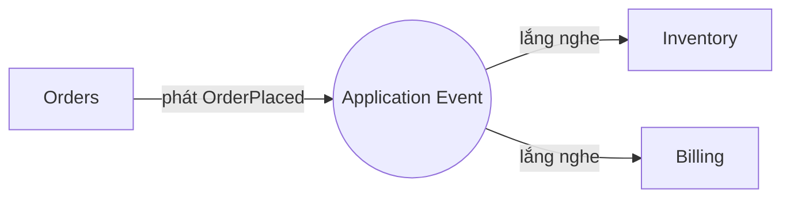

# Mục tiêu của Spring Modulith

Spring Modulith là bộ công cụ hỗ trợ thiết kế, kiểm chứng, tài liệu hóa, kiểm thử và vận hành **ứng dụng Spring Boot dạng modular monolith**: hệ thống được triển khai như một ứng dụng, nhưng bên trong được chia thành những module nghiệp vụ có ranh giới rõ ràng. Mục tiêu chính là giữ cho các phần của hệ thống có thể phát triển tương đối độc lập mà không phải sớm gánh chi phí triển khai và vận hành nhiều microservice.

Trong phạm vi học **Spring Modulith Application Events**, mục tiêu này còn được thể hiện qua cách các module trao đổi thông tin: module phát ra sự kiện nghiệp vụ, các module quan tâm tự xử lý sự kiện, thay vì mọi module gọi trực tiếp và biết chi tiết triển khai của nhau.

## 1. Vì sao một ứng dụng Spring Boot cần ranh giới module?

Một ứng dụng Spring Boot có thể khởi đầu đơn giản với vài package `controller`, `service`, `repository`. Khi nghiệp vụ lớn dần, cách chia theo tầng kỹ thuật dễ khiến một chức năng nằm rải rác ở nhiều nơi; các service gọi chéo nhau, sử dụng repository và entity nội bộ của nhau. Dù ứng dụng vẫn chạy trong cùng một tiến trình, việc thay đổi một chức năng có thể kéo theo sửa nhiều chức năng khác.

Ví dụ, hệ thống bán hàng có ba năng lực nghiệp vụ:

- **Orders (Đơn hàng):** tiếp nhận và xác nhận đơn.
- **Inventory (Kho):** giữ hoặc trừ số lượng tồn.
- **Billing (Thanh toán):** tạo yêu cầu thu tiền.

Nếu `OrderService` trực tiếp gọi `InventoryRepository`, `BillingService` rồi cập nhật dữ liệu nội bộ của các module đó, chức năng đơn hàng sẽ bị phụ thuộc vào cách kho và thanh toán được cài đặt. Lâu dần, ranh giới nghiệp vụ chỉ còn là tên package.

Spring Modulith hướng đến cấu trúc theo *năng lực nghiệp vụ* (business capability). Mỗi module sở hữu logic và dữ liệu của mình, chỉ công bố giao diện cần thiết cho phần còn lại của ứng dụng.

> **Modular monolith không đồng nghĩa microservices.** Các module vẫn cùng một ứng dụng triển khai, thường cùng một tiến trình và có thể dùng chung hạ tầng dữ liệu. Ranh giới module là ranh giới tổ chức mã nguồn và tương tác nghiệp vụ; nó không tự tạo cách ly mạng hay cơ sở dữ liệu độc lập.

## 2. Những mục tiêu kiến trúc cốt lõi

| Mục tiêu | Spring Modulith hỗ trợ thế nào? | Lợi ích mong đợi |
| --- | --- | --- |
| **Chia hệ thống theo nghiệp vụ** | Nhận diện application module từ cấu trúc package, có thể bổ sung metadata khai báo module | Người phát triển biết phần nào sở hữu chức năng nào |
| **Bảo vệ ranh giới** | Phân biệt API được công bố với phần triển khai nội bộ, kiểm tra phụ thuộc giữa các module | Giảm truy cập chéo vào chi tiết cài đặt |
| **Kiểm soát sự phụ thuộc** | Kiểm tra vòng phụ thuộc và những quan hệ gọi không hợp lệ | Thay đổi một module ít gây ảnh hưởng lan truyền |
| **Giao tiếp ít kết dính** | Tận dụng application events để mô tả điều gì đã xảy ra trong nghiệp vụ | Module phát sự kiện không phải biết mọi module tiêu thụ |
| **Kiểm thử theo ranh giới** | Hỗ trợ khởi chạy, kiểm thử tập trung vào một application module | Phát hiện sai ranh giới sớm, kiểm thử nhanh và dễ hiểu hơn |
| **Hiểu và quan sát hệ thống** | Sinh tài liệu quan hệ module và hỗ trợ quan sát tương tác lúc chạy | Dễ đánh giá kiến trúc hiện tại và luồng xử lý thực tế |

Các mục tiêu này hỗ trợ nhau. Chia package mà không kiểm tra phụ thuộc thì ranh giới dễ bị phá vỡ. Phát sự kiện mà không xét thời điểm xử lý, lỗi và khả năng thử lại thì các module chỉ bớt kết dính về mã nguồn, còn luồng nghiệp vụ vẫn có thể thiếu tin cậy.

### 2.1. Module được xác định từ nghiệp vụ

Với cấu trúc mặc định phổ biến, Spring Modulith xem các package con trực tiếp dưới package gốc của ứng dụng Spring Boot là các application module. Ví dụ:

```text
com.example.shop
├── ShopApplication.java
├── orders
│   ├── OrderService.java          // API được công bố của module orders
│   ├── OrderPlaced.java           // Sự kiện để module khác sử dụng
│   └── internal
│       └── OrderRepository.java   // Triển khai nội bộ
├── inventory
│   ├── InventoryEvents.java
│   └── internal
│       └── StockRepository.java
└── billing
    ├── BillingEvents.java
    └── internal
        └── PaymentRepository.java
```

Ở cách nhận diện module mặc định, các kiểu trong package gốc `orders` tạo thành API của module; các subpackage như `orders.internal` được coi là nội bộ, trừ khi được công bố rõ qua cơ chế như `@NamedInterface`. Có thể dùng `@ApplicationModule` để tùy chỉnh khai báo module hoặc các phụ thuộc được cho phép khi thực sự cần.

Điểm cốt lõi là **module khác chỉ phụ thuộc vào hợp đồng công khai của `orders`**, không nhập trực tiếp `OrderRepository` hoặc thao tác lên bảng đơn hàng như thể đó là dữ liệu của mình. Quy tắc này có thể được kiểm chứng tự động, thay vì chỉ ghi trong tài liệu thiết kế.

### 2.2. Xác minh kiến trúc bằng kiểm thử

Spring Modulith cung cấp mô hình `ApplicationModules` để phân tích ứng dụng và kiểm tra các quy tắc kiến trúc:

```java
import org.junit.jupiter.api.Test;
import org.springframework.modulith.core.ApplicationModules;

class ModularityTests {

    @Test
    void verifyModuleBoundaries() {
        ApplicationModules.of(ShopApplication.class).verify();
    }
}
```

Khi chạy, bước kiểm tra giúp phát hiện vòng phụ thuộc giữa module hoặc các phụ thuộc vi phạm API module được công bố. Nếu `inventory` tham chiếu trực tiếp `orders.internal.OrderRepository`, bài kiểm tra sẽ chỉ ra lỗi kiến trúc để sửa ngay từ lúc phát triển. Việc kiểm chứng dựa trên cách ứng dụng được cấu trúc và khai báo; nó không tự phát hiện mọi vấn đề nghiệp vụ hay bảo đảm rằng mọi quyết định phân chia module đều tốt.

## 3. Mục tiêu giao tiếp bằng Application Events

Trong ví dụ bán hàng, sau khi đơn hàng được ghi nhận, kho và thanh toán đều cần phản ứng. Cách gọi trực tiếp khiến `orders` phải biết `inventory` và `billing`:

```text
OrderService
  ├── gọi InventoryService
  └── gọi BillingService
```

Với **application events**, module `orders` chỉ công bố sự kiện `OrderPlaced` biểu thị một sự thật nghiệp vụ. Các module tiêu thụ có thể xử lý độc lập:



Đây là mục tiêu giảm **phụ thuộc về chiều gọi**: `orders` không cần import các service hay repository của `inventory` và `billing`; các module nhận sự kiện cần biết hợp đồng `OrderPlaced` được công bố. Nếu thêm module `notifications`, `orders` thường không cần sửa chỉ vì có thêm một bên tiêu thụ sự kiện.

Sự kiện nên diễn đạt điều **đã xảy ra**, chẳng hạn `OrderPlaced`, không nên đặt tên như câu lệnh `ProcessInventoryNow`. Sự kiện cần có thông tin tối thiểu đủ để bên tiêu thụ xử lý; tránh chứa entity JPA đang quản lý hoặc lộ cấu trúc dữ liệu nội bộ. Khi cần thông tin bổ sung, module tiêu thụ dùng API công khai thích hợp hoặc dữ liệu của chính mình.

### 3.1. Minh họa publisher và listener

Hợp đồng sự kiện đặt trong package API của module `orders`:

```java
package com.example.shop.orders;

import java.util.UUID;

public record OrderPlaced(UUID orderId) {}
```

Trong `orders`, publisher sử dụng `ApplicationEventPublisher` của Spring Framework:

```java
package com.example.shop.orders;

import java.util.UUID;
import org.springframework.context.ApplicationEventPublisher;
import org.springframework.stereotype.Service;
import org.springframework.transaction.annotation.Transactional;

@Service
public class OrderService {

    private final ApplicationEventPublisher events;

    public OrderService(ApplicationEventPublisher events) {
        this.events = events;
    }

    @Transactional
    public void placeOrder(UUID orderId) {
        // Giả định repository đã lưu đơn hàng trong transaction này.
        events.publishEvent(new OrderPlaced(orderId));
    }
}
```

Một listener trong module `inventory` phản ứng sau khi giao dịch tạo đơn hàng được commit thành công:

```java
package com.example.shop.inventory;

import com.example.shop.orders.OrderPlaced;
import org.springframework.modulith.events.ApplicationModuleListener;
import org.springframework.stereotype.Component;

@Component
class InventoryEvents {

    @ApplicationModuleListener
    void on(OrderPlaced event) {
        // Xử lý nghiệp vụ giữ hàng theo event.orderId().
    }
}
```

`@ApplicationModuleListener` là tiện ích của Spring Modulith kết hợp xử lý sự kiện theo transaction, bất đồng bộ và một transaction riêng cho listener. Trong tình huống minh họa, listener được kích hoạt sau commit của giao dịch publisher, tránh việc module kho phản ứng với một đơn hàng cuối cùng bị rollback. Cần có môi trường quản lý transaction phù hợp để phát huy ngữ nghĩa này.

**Phân biệt rõ:** `ApplicationEventPublisher.publishEvent(...)` tự nó không làm mọi listener chạy bất đồng bộ hoặc sau commit. Với `@EventListener` thông thường, cơ chế gọi mặc định là đồng bộ; chính cách khai báo listener và cấu hình xử lý quyết định thời điểm, transaction và khả năng chịu lỗi.

### 3.2. Giảm phụ thuộc không có nghĩa là không có hợp đồng

Giao tiếp bằng sự kiện tạo ra sự phụ thuộc vào **định dạng và ngữ nghĩa của sự kiện**. Vì vậy:

- Sự kiện phải mang tên nghiệp vụ rõ ràng và có dữ liệu ổn định, chẳng hạn `orderId`.
- Module phát xác định chính xác lúc nào được coi là đã xảy ra sự kiện.
- Module nhận xác định cách xử lý trùng sự kiện, chậm sự kiện hoặc thất bại tạm thời.
- Khi cần kết quả tức thời để quyết định có cho phép đặt hàng hay không, một lời gọi qua API module có thể thích hợp hơn sự kiện xử lý sau commit.

Ví dụ, nếu phải xác thực tồn kho **trước khi chấp nhận đơn hàng**, hệ thống cần thiết kế quy trình đồng bộ phù hợp hoặc thay đổi quy trình đặt hàng thành trạng thái chờ xử lý. Một listener sau commit không thể làm cho giao dịch đặt hàng đã commit tự rollback.

## 4. Mục tiêu tin cậy khi giao sự kiện

Sử dụng `@ApplicationModuleListener` mang lại sự tách biệt xử lý, nhưng đặt ra câu hỏi: điều gì xảy ra nếu giao dịch đơn hàng đã commit, còn xử lý kho bị lỗi? Một lời gọi listener thất bại có thể dẫn đến một phần công việc đã hoàn tất và phần còn lại chưa được cập nhật.

Spring Modulith cung cấp cơ chế **Event Publication Registry** để theo dõi những lần công bố sự kiện tới các transactional event listener. Khi tích hợp và cấu hình cơ chế lưu trữ phù hợp, registry giúp ghi nhận publication đang chờ/đã hoàn thành, phục vụ phát hiện và xử lý lại các publication chưa hoàn tất. Các khả năng thử lại hoặc gửi lại phải được thiết lập, vận hành và kiểm thử theo phiên bản, hạ tầng lưu trữ và chính sách của ứng dụng.

```mermaid
sequenceDiagram
    participant O as Orders
    participant R as Publication Registry
    participant I as Inventory Listener
    O->>R: Ghi nhận publication trong transaction
    O-->>O: Commit đơn hàng
    R-->>I: Chuyển sự kiện sau commit
    alt Xử lý thành công
        I-->>R: Ghi nhận hoàn thành
    else Listener thất bại
        Note over R,I: Publication chưa hoàn tất; cần cơ chế xử lý lại
    end
```

Sơ đồ trình bày luồng logic của registry đã được cấu hình; nó không có nghĩa chỉ thêm annotation listener là ứng dụng tự có lưu trữ bền vững và retry trong mọi trường hợp.

Mục tiêu vận hành là **không âm thầm mất dấu một công việc liên module đang dở dang**. Điều này không đồng nghĩa bảo đảm *exactly once*. Listener cần có tính **idempotent**: nếu nhận lại `OrderPlaced(orderId)` thì việc giữ hàng không bị thực hiện hai lần. Có thể dùng khóa nghiệp vụ, ràng buộc duy nhất hoặc bảng ghi nhận sự kiện đã xử lý để hỗ trợ quy tắc này. Cũng cần theo dõi số publication chưa hoàn tất, lỗi lặp lại và độ trễ xử lý.

## 5. Mục tiêu kiểm thử, tài liệu hóa và quan sát

Ranh giới module có ích khi lập trình viên có thể nhìn thấy và kiểm chứng chúng. Spring Modulith hỗ trợ ba nhu cầu bổ sung cho nhau:

1. **Kiểm chứng tĩnh:** `ApplicationModules.of(...).verify()` xác minh các quy tắc phụ thuộc ở mức kiến trúc.
2. **Kiểm thử chức năng theo module:** `@ApplicationModuleTest` cho phép tập trung khởi tạo và kiểm tra một module cùng những phụ thuộc cần thiết; có thể kiểm thử việc phát sự kiện và phản ứng của listener trong tình huống phù hợp.
3. **Tài liệu và quan sát:** các khả năng tạo tài liệu kiến trúc, quan hệ module và quan sát tương tác lúc chạy giúp đội ngũ hiểu hệ thống thực sự liên kết với nhau như thế nào.

Với kịch bản `OrderPlaced`, nên phân biệt các cấp kiểm thử:

| Kiểm thử | Điều cần xác minh |
| --- | --- |
| Unit test publisher | Đặt hàng thành công công bố đúng `OrderPlaced` với `orderId` tương ứng |
| Module/transaction test | Listener sau commit không thực thi nghiệp vụ khi giao dịch đặt hàng bị rollback |
| Integration test | Khi publication được xử lý thành công, kho cập nhật đúng trạng thái |
| Failure/retry test | Lỗi xử lý để lại dấu vết theo cơ chế registry đã cấu hình; gửi lại không làm trùng kết quả |
| Architecture test | Module kho không truy cập `orders.internal`; các phụ thuộc module hợp lệ |

Trong quan sát runtime, ngoài log và trace, các chỉ số nghiệp vụ như sự kiện tồn đọng, thời gian từ commit đến xử lý, số lần thử lại và số lần xử lý trùng là cơ sở để đánh giá hệ thống. Hỗ trợ quan sát của Spring Modulith cần được tích hợp với hạ tầng theo dõi thích hợp; thư viện không tự thay thế hoạt động giám sát của ứng dụng.

## 6. Khi nào đạt được mục tiêu của Spring Modulith?

Có thể dùng các tiêu chí sau để đánh giá một thiết kế modular monolith trước khi mở rộng hệ thống:

| Câu hỏi kiểm tra | Dấu hiệu tốt |
| --- | --- |
| Module được phân chia theo đâu? | Theo chức năng nghiệp vụ như `orders`, `inventory`, `billing` thay vì chỉ theo tầng `service`/`repository` |
| Có thể thay đổi triển khai nội bộ không? | Module khác chỉ dùng API hoặc sự kiện được công bố, không truy cập trực tiếp lớp `internal` |
| Có ngăn được phụ thuộc sai không? | Architecture test chạy trong CI và phát hiện các vi phạm ranh giới |
| Luồng ứng dụng cần đồng bộ hay bất đồng bộ? | Quyết định dựa trên yêu cầu nhất quán, thời điểm commit và phản hồi nghiệp vụ |
| Listener hỏng thì sao? | Có chính sách ghi nhận thất bại, retry, xử lý trùng và theo dõi publication |
| Thành viên mới hiểu hệ thống được không? | Có tài liệu module, hợp đồng sự kiện và kiểm thử minh họa luồng nghiệp vụ |

Spring Modulith không yêu cầu mọi lời gọi giữa module đều chuyển thành sự kiện. API trực tiếp vẫn phù hợp cho tương tác cần kết quả ngay, trong khi sự kiện phù hợp để thông báo một thay đổi đã xảy ra và cho nhiều module phản ứng độc lập. Sự lựa chọn phải đi từ yêu cầu nghiệp vụ và tính nhất quán dữ liệu.

## 7. Liên hệ với lộ trình học Application Events

Đối với module học `SPRING_MODULITH_APPLICATION_EVENTS`, nắm vững mục tiêu kiến trúc ở bài này là nền tảng để đi vào các cơ chế cụ thể:

1. Thiết kế hợp đồng sự kiện và sử dụng publisher/listener để giảm phụ thuộc giữa module.
2. Chọn cách lắng nghe phù hợp với transaction, nhất là xử lý **sau commit**.
3. Tìm hiểu Event Publication Registry và chiến lược retry khi việc giao sự kiện không hoàn tất.
4. Viết kiểm thử cho thành công, rollback, lỗi tạm thời và xử lý sự kiện lặp lại.
5. Quan sát luồng phát/nhận sự kiện để xác định điểm nghẽn và publication tồn đọng.

Điều cần ghi nhớ là **Spring Modulith giúp một ứng dụng Spring Boot duy trì ranh giới nghiệp vụ có thể kiểm chứng**. Application events là một công cụ quan trọng để các ranh giới ấy giao tiếp với nhau; sự tin cậy của luồng sự kiện vẫn cần thiết kế transaction, lưu vết publication, kiểm thử và vận hành cẩn thận.
