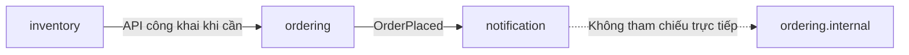
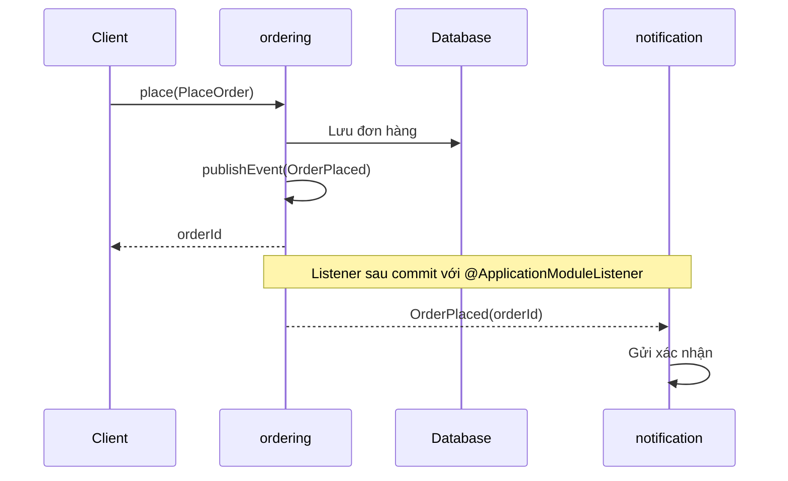

# Application module là gì trong Spring Modulith?

## 1. Từ một ứng dụng Spring Boot đến các module nghiệp vụ

Trong một ứng dụng Spring Boot, các lớp Java thường được tổ chức vào package. Khi số lượng tính năng tăng lên, chỉ chia package thành `controller`, `service`, `repository` là chưa đủ để trả lời những câu hỏi quan trọng: *mã nguồn nào chịu trách nhiệm cho việc đặt hàng, ai được phép gọi vào phần tồn kho, và thay đổi ở một chức năng sẽ ảnh hưởng đến những chức năng nào?*

**Application module** (module ứng dụng) trong **Spring Modulith** là một đơn vị tổ chức **theo năng lực nghiệp vụ** bên trong cùng một ứng dụng. Mỗi module sở hữu mã nguồn và quy tắc của một phần nghiệp vụ, xác định những gì có thể được module khác sử dụng, đồng thời giới hạn các phụ thuộc đi vào chi tiết nội bộ. Các module thường chạy cùng một tiến trình và cùng được đóng gói, triển khai như một ứng dụng Spring Boot.

Ví dụ, một hệ thống bán hàng có các năng lực:

- `catalog`: quản lý sản phẩm và thông tin hiển thị.
- `ordering`: tiếp nhận, xử lý và quản lý đơn hàng.
- `inventory`: quản lý số lượng tồn kho.
- `notification`: gửi thông báo cho khách hàng.

Mỗi năng lực có thể là một application module. Từ đó, hệ thống vẫn là **modular monolith** (một ứng dụng triển khai thống nhất nhưng có ranh giới module rõ ràng), thay vì buộc phải tách thành nhiều microservice chỉ để phân chia trách nhiệm.

> **Điểm cốt lõi:** Application module là ranh giới kiến trúc và nghiệp vụ. Package Java giúp biểu diễn ranh giới ấy; Spring Modulith giúp phát hiện, mô tả, kiểm tra và hỗ trợ cách các module cộng tác với nhau.

## 2. Spring Modulith nhận diện một module như thế nào?

Ở cách tổ chức mặc định, Spring Modulith xem các package con **trực tiếp** nằm dưới package gốc của ứng dụng Spring Boot là các application module. Các package sâu hơn thường thuộc phần nội bộ của module tương ứng.

Ví dụ:

```text
com.example.shop
├── ShopApplication.java                 <- @SpringBootApplication
├── catalog/                             <- application module: catalog
│   ├── ProductCatalog.java              <- API công khai
│   └── internal/
│       └── JpaProductRepository.java    <- triển khai nội bộ
├── ordering/                            <- application module: ordering
│   ├── Ordering.java                    <- API công khai
│   ├── OrderPlaced.java                 <- sự kiện công khai
│   └── internal/
│       ├── OrderApplicationService.java
│       └── OrderRepository.java
├── inventory/                           <- application module: inventory
│   ├── Inventory.java                   <- API công khai
│   └── internal/
│       └── StockManagement.java
└── notification/                        <- application module: notification
    └── internal/
        └── OrderNotificationListener.java
```

Ví dụ về lớp khởi động:

```java
package com.example.shop;

import org.springframework.boot.SpringApplication;
import org.springframework.boot.autoconfigure.SpringBootApplication;

@SpringBootApplication
public class ShopApplication {
    public static void main(String[] args) {
        SpringApplication.run(ShopApplication.class, args);
    }
}
```

Trong cấu trúc này, `com.example.shop.ordering` là module; `com.example.shop.ordering.internal` **không tự động trở thành một module ngang hàng**. Nó là package con của `ordering`.

Điều này dẫn tới hai cấp độ cần phân biệt:

| Khái niệm | Vai trò | Ví dụ |
| --- | --- | --- |
| Application module | Đơn vị kiến trúc theo chức năng nghiệp vụ | `ordering`, `inventory` |
| Package gốc của module | Điểm đặt các kiểu mà module khác có thể sử dụng theo mặc định | `com.example.shop.ordering` |
| Package nội bộ | Chứa triển khai mà module khác không nên tham chiếu trực tiếp | `com.example.shop.ordering.internal` |
| API của module | Hợp đồng mà module chủ động cung cấp cho bên ngoài | `Ordering`, `OrderPlaced` |

Một ứng dụng có thể tùy chỉnh cách xác định module; quy tắc package con trực tiếp ở trên là **cách mặc định dễ bắt đầu nhất**, không phải quy tắc bất biến cho mọi dự án.

## 3. Một application module cần có những gì?

### 3.1. Trách nhiệm nghiệp vụ tập trung

`ordering` chịu trách nhiệm đặt hàng, lưu trạng thái và thực thi các điều kiện liên quan đến đơn hàng. `notification` chịu trách nhiệm gửi thông báo; nó không được tự ý chỉnh sửa trạng thái đơn hàng qua repository của `ordering`.

Khi phân chia theo năng lực nghiệp vụ, những thay đổi thường gặp của một tính năng sẽ nằm trong cùng module. Điều này giảm việc phải chỉnh sửa đồng thời nhiều package kỹ thuật rải rác trong toàn ứng dụng.

### 3.2. API công khai và triển khai nội bộ

Giả sử `ordering` muốn cho các module khác tạo đơn hàng qua một hợp đồng đơn giản:

```java
// com/example/shop/ordering/PlaceOrder.java
package com.example.shop.ordering;

import java.util.UUID;

public record PlaceOrder(UUID productId, int quantity) {}
```

```java
// com/example/shop/ordering/Ordering.java
package com.example.shop.ordering;

import java.util.UUID;

public interface Ordering {
    UUID place(PlaceOrder command);
}
```

Phần triển khai đặt trong package con `internal`:

```java
// com/example/shop/ordering/internal/OrderApplicationService.java
package com.example.shop.ordering.internal;

import com.example.shop.ordering.OrderPlaced;
import com.example.shop.ordering.Ordering;
import com.example.shop.ordering.PlaceOrder;
import java.util.UUID;
import org.springframework.context.ApplicationEventPublisher;
import org.springframework.stereotype.Service;
import org.springframework.transaction.annotation.Transactional;

@Service
class OrderApplicationService implements Ordering {
    private final OrderRepository repository;
    private final ApplicationEventPublisher events;

    OrderApplicationService(OrderRepository repository,
                            ApplicationEventPublisher events) {
        this.repository = repository;
        this.events = events;
    }

    @Override
    @Transactional
    public UUID place(PlaceOrder command) {
        UUID orderId = repository.create(
                command.productId(), command.quantity());
        events.publishEvent(new OrderPlaced(orderId));
        return orderId;
    }
}
```

Trong ví dụ, `OrderRepository` là interface hạ tầng **do module `ordering` tự định nghĩa**; phần cài đặt và cấu hình lưu trữ được lược bỏ để tập trung vào ranh giới module. Các đoạn mã dùng làm minh họa kiến trúc, không phải toàn bộ dự án có thể chạy độc lập.

`Ordering` và `PlaceOrder` nằm ở package gốc nên là các kiểu được đưa ra cho module khác dùng. `OrderApplicationService` và `OrderRepository` ở `internal` nên là chi tiết riêng của `ordering`. Từ khóa `public` của Java và khái niệm *API công khai của application module* là hai điều khác nhau: ngay cả một lớp `public` bên trong `internal` cũng không nên trở thành điểm phụ thuộc từ module khác.

### 3.3. Phụ thuộc có chủ đích

Giả sử `notification` cần đọc thông tin đơn hàng để tạo nội dung email. Nó có thể gọi một API đã công bố của `ordering` hoặc nhận sự kiện nghiệp vụ do `ordering` phát ra. Nó **không nên** gọi trực tiếp `ordering.internal.OrderRepository`.



Mũi tên thể hiện hướng giao tiếp hoặc phụ thuộc ở mức kiến trúc, không đồng nghĩa hai module triển khai độc lập hay gọi qua HTTP. Với ứng dụng Spring Boot đơn khối, lời gọi phương thức và phát sự kiện đều có thể diễn ra trong cùng JVM.

## 4. Module giao tiếp bằng application events

Một trong những lý do nên xác định rõ application module là để **giảm phụ thuộc trực tiếp** giữa các chức năng. Với Spring Modulith, một module có thể công bố một sự kiện cho biết điều đã xảy ra; module quan tâm tự đăng ký listener của mình.

### 4.1. Module phát sự kiện

`ordering` khai báo một kiểu sự kiện ở phần API của module:

```java
// com/example/shop/ordering/OrderPlaced.java
package com.example.shop.ordering;

import java.util.UUID;

public record OrderPlaced(UUID orderId) {}
```

Trong phương thức `place()` ở trên, sau khi ghi đơn hàng, `ordering` gọi:

```java
events.publishEvent(new OrderPlaced(orderId));
```

`OrderPlaced` diễn đạt một **sự kiện đã xảy ra**. Nó mô tả sự thật nghiệp vụ, thay vì đưa ra lệnh cụ thể như `SendConfirmationEmail`. Bởi vậy `ordering` không cần biết có bao nhiêu module sẽ phản ứng với sự kiện đó và từng module xử lý như thế nào.

### 4.2. Module nhận sự kiện

`notification` có thể lắng nghe sự kiện bằng `@ApplicationModuleListener`:

```java
// com/example/shop/notification/internal/OrderNotificationListener.java
package com.example.shop.notification.internal;

import com.example.shop.ordering.OrderPlaced;
import org.springframework.modulith.events.ApplicationModuleListener;
import org.springframework.stereotype.Component;

@Component
class OrderNotificationListener {
    private final ConfirmationSender sender;

    OrderNotificationListener(ConfirmationSender sender) {
        this.sender = sender;
    }

    @ApplicationModuleListener
    void on(OrderPlaced event) {
        sender.sendForOrder(event.orderId());
    }
}
```

`ConfirmationSender` là thành phần riêng của `notification` dùng để gửi thông báo; phần cài đặt được lược bỏ. Listener thuộc **module nhận**, trong khi kiểu sự kiện thuộc **API module phát**.

Luồng xử lý có thể nhìn như sau:



Trong Spring Modulith, `@ApplicationModuleListener` là lựa chọn dành cho lắng nghe sự kiện giữa các module: nó kết hợp xử lý theo sự kiện giao dịch với thực thi bất đồng bộ và giao dịch của listener. Theo mô hình phổ biến ở ví dụ này, listener được kích hoạt **sau khi giao dịch đặt hàng commit thành công**. Nhờ vậy phần gửi thông báo không cần nằm trong cùng giao dịch nghiệp vụ của `ordering`.

Hãy phân biệt ba lựa chọn thường gặp:

| Cơ chế | Đặc điểm chính | Phù hợp khi |
| --- | --- | --- |
| Gọi API module trực tiếp | Bên gọi biết hợp đồng, nhận kết quả hoặc lỗi ngay | Cần thông tin hoặc quyết định ngay để hoàn thành nghiệp vụ |
| `@EventListener` | Lắng nghe application event thông thường, mặc định xử lý đồng bộ theo thời điểm publish nếu không cấu hình khác | Tác vụ đơn giản, không cần tách theo ranh giới transaction |
| `@ApplicationModuleListener` | Listener theo giao dịch, thường chạy bất đồng bộ sau commit trong giao dịch riêng | Phản ứng sau một thay đổi đã hoàn tất, chẳng hạn gửi thông báo |

**Lưu ý về độ tin cậy:** Phát sự kiện nội bộ không tự biến ứng dụng thành một hệ thống giao sự kiện *exactly once*. Nếu tiến trình dừng giữa lúc commit và xử lý listener, hoặc listener gặp lỗi, cần cơ chế theo dõi và hoàn tất lại. Spring Modulith hỗ trợ **Event Publication Registry** để ghi nhận những sự kiện được phát tới transactional listener và theo dõi lần xử lý chưa hoàn tất; việc lưu bền vững, retry/resubmission và tính idempotent phải được cấu hình, thiết kế và kiểm thử theo nhu cầu. Một listener gửi email hoặc cập nhật dữ liệu nên chịu được khả năng xử lý lại.

Đây là nền tảng để đi sâu hơn vào publisher, listener, `AFTER_COMMIT`, registry, retry, kiểm thử và quan sát sự kiện trong các bài tiếp theo của module học.

## 5. Spring Modulith bảo vệ ranh giới module như thế nào?

Việc đặt tên package rõ ràng mới chỉ tạo cấu trúc ban đầu. Khi các lập trình viên vô tình import một lớp `internal` từ module khác, ứng dụng Java có thể vẫn biên dịch. Spring Modulith cung cấp mô hình module để **kiểm tra các quy tắc kiến trúc**.

### 5.1. Kiểm tra phụ thuộc giữa các module

Ví dụ về một phép kiểm tra kiến trúc:

```java
package com.example.shop;

import org.junit.jupiter.api.Test;
import org.springframework.modulith.core.ApplicationModules;

class ModulithArchitectureTest {

    @Test
    void respectsApplicationModuleBoundaries() {
        ApplicationModules.of(ShopApplication.class).verify();
    }
}
```

`ApplicationModules.of(...)` xây dựng mô hình module dựa trên ứng dụng. `verify()` kiểm tra các quy tắc như phụ thuộc vòng giữa các module và truy cập không hợp lệ vào các kiểu nội bộ, cùng những giới hạn đã cấu hình. Bài kiểm tra này cần các dependency của Spring Modulith và JUnit phù hợp trong dự án.

Ví dụ phụ thuộc sai:

```java
// Bên trong notification: không nên làm như sau.
import com.example.shop.ordering.internal.OrderRepository;
```

`notification` sẽ bị buộc chặt vào cách `ordering` lưu trữ dữ liệu. Thay đổi repository có thể kéo theo thay đổi ở module khác; kiểm tra ranh giới module giúp phát hiện vấn đề này sớm.

### 5.2. Giới hạn module được phép phụ thuộc

Có thể dùng `@ApplicationModule` tại `package-info.java` để mô tả thêm module và khai báo các module được phép phụ thuộc:

```java
// com/example/shop/notification/package-info.java
@org.springframework.modulith.ApplicationModule(
        allowedDependencies = {"ordering"})
package com.example.shop.notification;
```

Khi khai báo như vậy, phụ thuộc giữa `notification` và các module khác sẽ được kiểm tra theo danh sách `allowedDependencies`. Đây là cách biến quy ước kiến trúc thành quy tắc có thể xác minh. `allowedDependencies` **không** cấp quyền tự động vào `ordering.internal`; API của module đích vẫn phải được tôn trọng.

Một dự án nên đưa các kiểm tra này vào test/CI để phát hiện vi phạm ngay khi có thay đổi mã nguồn.

### 5.3. Named interface khi cần công bố một phần package con

Mặc định, API công khai chủ yếu nằm ở package gốc của module. Đôi khi module có nhiều nhóm hợp đồng, ví dụ `ordering.events` chuyên chứa sự kiện. Spring Modulith cho phép công bố một **named interface** thay vì buộc tất cả kiểu công khai vào cùng package:

```java
// com/example/shop/ordering/events/package-info.java
@org.springframework.modulith.NamedInterface("events")
package com.example.shop.ordering.events;
```

Khi đó, một module được giới hạn dependency có thể tham chiếu named interface theo tên dạng `ordering::events`. Đây là công cụ thiết kế API, chỉ nên dùng khi cấu trúc hợp đồng thực sự cần tách rõ; đối với module nhỏ, các kiểu công khai ở package gốc thường dễ hiểu hơn.

## 6. Application module khác gì package, Maven module và microservice?

| Khía cạnh | Java package | Maven/Gradle module | Spring Modulith application module | Microservice |
| --- | --- | --- | --- | --- |
| Mục tiêu chính | Nhóm các kiểu Java theo namespace | Tổ chức build và dependency giữa artifact | Xác định ranh giới năng lực nghiệp vụ trong ứng dụng | Tách chức năng thành dịch vụ triển khai độc lập |
| Đơn vị quản lý | Namespace/package | Project hoặc subproject build | Module được Spring Modulith phát hiện/mô tả | Process/service riêng |
| Triển khai | Không quyết định cách deploy | Có thể tạo JAR riêng | Thường chung ứng dụng Spring Boot | Thường deploy riêng |
| Cách cộng tác | Import, gọi phương thức | Dependency giữa artifact | API công khai, named interface, application event | HTTP, messaging, gRPC... |
| Kiểm soát kiến trúc | Chủ yếu qua Java visibility, convention | Build dependency | Kiểm tra quan hệ và ranh giới module | Contract và kiểm soát khi chạy qua mạng |

Các khái niệm này có thể **kết hợp**, không loại trừ lẫn nhau. Một ứng dụng Spring Modulith vẫn dùng package Java; dự án có thể dùng một hoặc nhiều Maven/Gradle module. Nếu sau này một nhóm nghiệp vụ cần tách thành service riêng, ranh giới được xác định rõ sẽ giúp việc đánh giá và tách dịch vụ dễ hơn, nhưng Spring Modulith **không tự động chuyển** module thành microservice.

## 7. Thiết kế module tốt: chọn ranh giới theo thay đổi nghiệp vụ

Xét hai cách sắp xếp cùng một hệ thống:

```text
# Dễ tạo phụ thuộc chéo khi hệ thống mở rộng
com.example.shop
├── controllers/
├── services/
├── repositories/
└── entities/

# Nhóm theo năng lực nghiệp vụ
com.example.shop
├── ordering/
│   └── internal/
├── inventory/
│   └── internal/
└── notification/
    └── internal/
```

Với cách đầu, xử lý đơn hàng có thể trải khắp các package `controllers`, `services`, `repositories` và `entities`. Với cách thứ hai, các thành phần phục vụ riêng cho đơn hàng nằm cùng khu vực `ordering`, dễ nhìn thấy ai sở hữu nghiệp vụ và module nào được phép phụ thuộc.

Tuy nhiên, chỉ đổi tên package là chưa đủ. Cần quyết định rõ:

1. **Ai sở hữu dữ liệu?** Ví dụ, `ordering` sở hữu vòng đời đơn hàng; `inventory` sở hữu lượng tồn kho.
2. **Điều gì phải xảy ra ngay?** Nếu không kiểm tra được tồn kho thì không thể xác nhận đơn hàng, có thể cần API trả lời trực tiếp hoặc thiết kế giao dịch phù hợp.
3. **Điều gì có thể xử lý sau?** Email xác nhận, cập nhật chỉ số hoặc xây dựng báo cáo thường phù hợp với application event.
4. **Các module phải biết đến những kiểu nào?** Chỉ xuất bản các interface, request/result và event cần thiết; giấu entity và repository nội bộ nếu có thể.
5. **Làm thế nào xác minh ranh giới?** Viết bài kiểm tra `ApplicationModules.verify()` và chạy cùng bộ kiểm thử thông thường.

**Không nên dùng event cho mọi lời gọi.** Khi module gọi cần kết quả đồng bộ để quyết định tính hợp lệ của nghiệp vụ, API trực tiếp có thể rõ ràng và phù hợp hơn. Event đặc biệt hữu ích để công bố điều đã xảy ra cho những module tự quyết định phản ứng tiếp theo.

## 8. Những hiểu nhầm thường gặp

| Nhận định dễ nhầm | Cách hiểu đúng |
| --- | --- |
| “Mỗi package Java là một application module.” | Theo cách mặc định, Spring Modulith xem package con trực tiếp của package ứng dụng là module; package con sâu hơn thường là nội bộ. |
| “Lớp `public` nào cũng là API module.” | Java visibility không đồng nghĩa với API kiến trúc; kiểu ở package nội bộ không nên bị module khác phụ thuộc. |
| “Dùng application module nghĩa là phải tách deploy.” | Nhiều application module vẫn có thể chạy chung trong một ứng dụng Spring Boot. |
| “Phát event là chắc chắn người nhận xử lý đúng một lần.” | Phải quan tâm commit, registry, xử lý lỗi, retry và idempotency; không mặc định có đảm bảo exactly once. |
| “Spring Modulith tự ngăn biên dịch mọi phụ thuộc sai.” | Các quy tắc kiến trúc cần được xác minh, thường thông qua `ApplicationModules.verify()` trong test/CI. |
| “Càng nhiều module càng tốt.” | Ranh giới nên phản ánh năng lực và mức độ độc lập thực tế; chia quá nhỏ có thể tạo thêm phụ thuộc khó quản lý. |

## 9. Bài tập áp dụng

Giả sử cần bổ sung chức năng **gửi thông báo sau khi đơn hàng được đặt thành công** cho một ứng dụng Spring Boot có `ordering`, `inventory` và `notification`.

**Yêu cầu:**

1. Đặt interface phục vụ đặt hàng ở package gốc `ordering` và giữ repository trong `ordering.internal`.
2. Định nghĩa `OrderPlaced` như một record bất biến thuộc API `ordering`.
3. Phát `OrderPlaced` trong thao tác đặt hàng có transaction.
4. Đặt listener ở `notification.internal`, sử dụng `@ApplicationModuleListener` để phản ứng sau khi giao dịch đặt hàng hoàn tất.
5. Viết kiểm tra `ApplicationModules.of(ShopApplication.class).verify()`.
6. Thử tạo một tham chiếu từ `notification` đến `ordering.internal` và quan sát kết quả kiểm tra kiến trúc; sau đó sửa bằng API công khai hoặc event.
7. Mô tả cách xử lý nếu gửi thông báo thất bại: hành vi retry, theo dõi event publication chưa hoàn tất và bảo vệ listener khỏi gửi trùng.

**Tiêu chí hoàn thành:** Có thể chỉ ra trách nhiệm của từng module, liệt kê những hợp đồng công khai giữa module, giải thích thời điểm listener được gọi, và xác nhận bằng kiểm thử rằng module không phụ thuộc vào chi tiết nội bộ của module khác.

## 10. Ghi nhớ

Một application module trong Spring Modulith đại diện cho **một phần nghiệp vụ có ranh giới rõ ràng** ngay bên trong ứng dụng Spring Boot. Package gốc là nơi công bố API; package con lưu phần triển khai nội bộ. Các module cộng tác qua hợp đồng trực tiếp khi cần phản hồi ngay hoặc qua application events khi muốn thông báo một sự kiện nghiệp vụ mà không ràng buộc bên phát với bên nhận. Spring Modulith bổ sung khả năng phát hiện, kiểm tra ranh giới, hỗ trợ sự kiện giao dịch, giúp tiến hóa một ứng dụng đơn khối theo hướng có cấu trúc và dễ bảo trì hơn.
