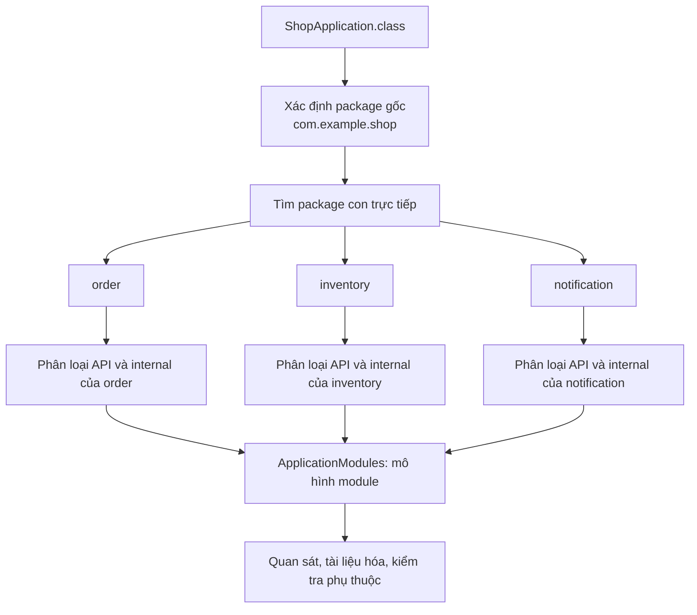

# Tự động phát hiện module trong Spring Modulith

## 1. Vì sao cần phát hiện module?

Trong một ứng dụng Spring Boot lớn, mỗi nhóm chức năng như đặt hàng, quản lý tồn kho, thanh toán hay gửi thông báo thường có quy tắc nghiệp vụ và dữ liệu riêng. Nếu mọi lớp đều có thể gọi trực tiếp mọi lớp khác, ứng dụng dễ xuất hiện phụ thuộc vòng, truy cập vượt ranh giới và khó kiểm thử từng chức năng độc lập.

**Spring Modulith** giúp tổ chức ứng dụng Spring Boot thành các *application module* (module ứng dụng) theo ranh giới nghiệp vụ. Mỗi module có:

- **API công khai:** hợp đồng mà module khác được phép sử dụng, gồm các bean/service và các kiểu sự kiện cần công bố.
- **Phần cài đặt nội bộ:** repository, adapter, helper và quy tắc nghiệp vụ không nên bị module khác phụ thuộc trực tiếp.
- **Các phụ thuộc đầu vào:** lời gọi API hoặc sự kiện mà module cần nhận từ module khác.

Điểm đặc biệt là Spring Modulith có thể **tự suy ra mô hình module từ cấu trúc Java package**. Ta không phải tạo một Maven/Gradle subproject cho mỗi module, không cần một `@Configuration` riêng cho từng module và cũng không nhất thiết phải đánh dấu mọi package bằng annotation.

> Mục tiêu của việc phát hiện là tạo **mô hình kiến trúc logic có thể phân tích và kiểm chứng**. Các module vẫn thuộc cùng một ứng dụng Spring Boot và thường chạy chung một tiến trình. Phát hiện module không tự biến chúng thành microservice hay cô lập mọi phụ thuộc ở mức trình biên dịch Java.

Sau bài này, bạn có thể giải thích quy tắc phát hiện mặc định, thiết kế package đúng ranh giới nghiệp vụ, xem danh sách module qua `ApplicationModules`, xác minh những phụ thuộc không hợp lệ và biết khi nào cần cấu hình chiến lược phát hiện khác.

## 2. Cơ chế phát hiện mặc định: một package con trực tiếp là một module

Giả sử lớp khởi động ứng dụng nằm trong package `com.example.shop`:

```java
package com.example.shop;

import org.springframework.boot.SpringApplication;
import org.springframework.boot.autoconfigure.SpringBootApplication;

@SpringBootApplication
public class ShopApplication {

    public static void main(String[] args) {
        SpringApplication.run(ShopApplication.class, args);
    }
}
```

Với chiến lược mặc định `direct-sub-packages`, Spring Modulith xét **các package con cấp một** của `com.example.shop` để tìm module:

```text
src/main/java/
└── com/example/shop/
    ├── ShopApplication.java
    ├── order/                         ← module "order"
    │   ├── OrderService.java         ← API ở package gốc module
    │   ├── OrderPlaced.java          ← sự kiện công khai
    │   ├── OrderEventsPublisher.java  ← publisher của module
    │   └── internal/
    │       └── OrderRepository.java  ← nội bộ của "order"
    ├── inventory/                     ← module "inventory"
    │   ├── InventoryManagement.java   ← API ở package gốc module
    │   └── internal/
    │       └── InventoryJpaAdapter.java
    └── notification/                  ← module "notification"
        └── OrderNotificationListener.java
```

Kết quả phát hiện:

| Package | Cách Spring Modulith hiểu | Ý nghĩa |
| --- | --- | --- |
| `com.example.shop` | Package gốc của ứng dụng | Điểm bắt đầu quét mô hình module |
| `com.example.shop.order` | Module `order` | Chức năng quản lý đơn hàng |
| `com.example.shop.inventory` | Module `inventory` | Chức năng quản lý tồn kho |
| `com.example.shop.notification` | Module `notification` | Chức năng thông báo |
| `com.example.shop.order.internal` | Package nội bộ thuộc `order` | **Không** tự trở thành module thứ tư |
| `com.example.shop.inventory.internal` | Package nội bộ thuộc `inventory` | **Không** tự trở thành module khác |

Các module được nhận diện từ package của **mã nguồn**, không phải từ tên thư mục tùy ý, tên bean hay tên bảng cơ sở dữ liệu. Ví dụ, file nằm trong thư mục `order` nhưng khai báo `package com.example.shop.inventory;` thì thuộc mô hình `inventory`. Thông thường đường dẫn thư mục và khai báo `package` phải nhất quán.

### 2.1. Sơ đồ quy trình phát hiện



Quy trình này nói về cách Spring Modulith phân tích **kiến trúc**, khác với component scan của Spring Framework:

| Tiêu chí | Spring Boot component scan | Spring Modulith module detection |
| --- | --- | --- |
| Mục đích | Tìm bean để đăng ký với application context | Xác định module logic và ranh giới API/nội bộ |
| Đơn vị chính | Lớp có annotation phù hợp, bean definition | Java package và các kiểu thuộc package |
| Điều kiện mặc định | Quy tắc component scanning của Spring | Package con trực tiếp dưới package ứng dụng |
| Kết quả | Tập bean được quản lý ở runtime | `ApplicationModules` và quan hệ phụ thuộc kiến trúc |
| Tự ngăn gọi code nội bộ? | Không | Có thể **phát hiện vi phạm** bằng kiểm tra cấu trúc |

Vì vậy, `@Service`, `@Repository` hoặc `@Component` có thể giúp Spring tạo bean, nhưng **không phải annotation dùng để công bố một application module**.

## 3. API của module và những package được coi là nội bộ

Khi module có nhiều package con, Spring Modulith mặc định coi **các kiểu public đặt trực tiếp tại package gốc của module** là phần API có thể được module khác tham chiếu. Các package cấp sâu hơn là phần nội bộ.

Ví dụ:

```text
com.example.shop.inventory
├── InventoryManagement.java       ← public API
├── StockReserved.java             ← public event
├── internal/
│   ├── InventoryService.java      ← internal
│   └── InventoryRepository.java   ← internal
└── persistence/
    └── JpaStockEntity.java        ← internal
```

Một lớp `public` ở `inventory.internal` vẫn được Java cho phép import từ package khác. Tuy nhiên, **mô hình kiến trúc Spring Modulith coi đường truy cập đó là vi phạm ranh giới**, trừ khi package được công bố có chủ đích theo cơ chế phù hợp (chẳng hạn `@NamedInterface` hoặc một kiểu module mở).

Để giữ ranh giới rõ ràng, người thiết kế nên:

1. Đặt API ổn định tại package gốc của module, ví dụ `inventory.InventoryManagement`.
2. Đặt chi tiết triển khai tại các package con, ví dụ `inventory.internal` và `inventory.persistence`.
3. Cho module khác sử dụng API công khai hoặc giao tiếp bằng application event, hạn chế phụ thuộc vào triển khai nội bộ.
4. Chạy kiểm tra kiến trúc để phát hiện những import vượt ranh giới mà trình biên dịch Java vẫn cho phép.

**Lưu ý:** `@NamedInterface` có nhiệm vụ **công bố thêm một tập kiểu như API của module hiện có**, không mặc nhiên tạo một module top-level mới. Ví dụ, khai báo `@NamedInterface("spi")` cho package `inventory.spi` để module khác được phép gọi giao diện mở rộng ở đó; `inventory.spi` vẫn thuộc module `inventory`.

## 4. Ví dụ hoàn chỉnh: xem các module mà ứng dụng tự phát hiện

Ta dựng một ứng dụng cửa hàng với ba nhóm nghiệp vụ `order`, `inventory` và `notification` như cây package ở phần 2. Bài học chỉ cần mô hình mã nguồn; không cần kết nối tới database để kiểm tra việc nhận diện module.

### 4.1. Thêm phụ thuộc phù hợp

Ứng dụng cần có Spring Boot và Spring Modulith. Với Maven, một lựa chọn phổ biến để chạy bài kiểm tra mô hình module là thêm starter test của Spring Modulith:

```xml
<dependency>
    <groupId>org.springframework.modulith</groupId>
    <artifactId>spring-modulith-starter-test</artifactId>
    <scope>test</scope>
</dependency>
```

Với Gradle:

```groovy
dependencies {
    testImplementation 'org.springframework.modulith:spring-modulith-starter-test'
}
```

Chọn phiên bản Spring Modulith tương thích với Spring Boot của dự án và quản lý phiên bản nhất quán (chẳng hạn qua BOM). Với mục đích phân tích module bằng API `ApplicationModules` ở mã sản phẩm, thư viện lõi là `org.springframework.modulith:spring-modulith-core`. Không cần thêm cơ chế event registry, database hoặc broker chỉ để phát hiện cấu trúc module.

### 4.2. Xây dựng API và lớp nội bộ đơn giản

File `src/main/java/com/example/shop/inventory/InventoryManagement.java`:

```java
package com.example.shop.inventory;

public interface InventoryManagement {

    boolean isAvailable(String productId, int quantity);
}
```

File `src/main/java/com/example/shop/inventory/internal/InventoryService.java`:

```java
package com.example.shop.inventory.internal;

import com.example.shop.inventory.InventoryManagement;
import org.springframework.stereotype.Service;

@Service
class InventoryService implements InventoryManagement {

    @Override
    public boolean isAvailable(String productId, int quantity) {
        // Logic minh họa: sản phẩm hợp lệ và số lượng dương.
        return productId != null && !productId.isBlank() && quantity > 0;
    }
}
```

File `src/main/java/com/example/shop/order/OrderService.java`:

```java
package com.example.shop.order;

import com.example.shop.inventory.InventoryManagement;
import org.springframework.stereotype.Service;

@Service
public class OrderService {

    private final InventoryManagement inventory;

    public OrderService(InventoryManagement inventory) {
        this.inventory = inventory;
    }

    public boolean canPlaceOrder(String productId, int quantity) {
        return inventory.isAvailable(productId, quantity);
    }
}
```

Ở đây, `order` dùng `InventoryManagement` thuộc API công khai của `inventory`. `InventoryService` là cài đặt nội bộ và không cần bị module `order` import trực tiếp. Spring vẫn có thể tiêm một bean cài đặt giao diện này thông qua dependency injection thông thường.

Tạo một kiểu trong module `notification` để hoàn chỉnh cấu trúc package ví dụ. File `src/main/java/com/example/shop/notification/OrderNotificationListener.java`:

```java
package com.example.shop.notification;

import com.example.shop.order.OrderPlaced;
import org.springframework.context.event.EventListener;
import org.springframework.stereotype.Component;

@Component
class OrderNotificationListener {

    @EventListener
    void on(OrderPlaced event) {
        System.out.println("Notification for order " + event.orderId());
    }
}
```

Kiểu `OrderPlaced` được công bố trong package `order` ở phần 7. Listener này minh họa việc phụ thuộc vào **sự kiện công khai** của module khác mà không cần tham chiếu đến repository nội bộ.

### 4.3. In danh sách module

Tạo `src/test/java/com/example/shop/ModuleDiscoveryTests.java`:

```java
package com.example.shop;

import org.junit.jupiter.api.Test;
import org.springframework.modulith.core.ApplicationModules;

import static org.junit.jupiter.api.Assertions.assertTrue;

class ModuleDiscoveryTests {

    @Test
    void detectsBusinessModules() {
        ApplicationModules modules = ApplicationModules.of(ShopApplication.class);

        modules.forEach(System.out::println);

        assertTrue(modules.getModuleByName("order").isPresent());
        assertTrue(modules.getModuleByName("inventory").isPresent());
        assertTrue(modules.getModuleByName("notification").isPresent());
    }
}
```

Lời gọi `ApplicationModules.of(ShopApplication.class)` sử dụng package chứa `ShopApplication` làm điểm bắt đầu. Đối tượng trả về lưu mô hình của các module, cùng thông tin về các kiểu, bean và mối liên hệ được phân tích. `modules.forEach(System.out::println)` cho phép quan sát tên logic, package nền và các thành phần của mỗi module.

Kết quả in ra phụ thuộc các lớp thực tế trong dự án; phần cần xác nhận ở ví dụ này là có ba module top-level `order`, `inventory` và `notification`. Cần tạo ít nhất một kiểu Java trong package `notification` để Spring Modulith có mã nguồn thực sự mà phân tích.

**Phân biệt:** `ApplicationModules.of(...)` đọc và phân tích code để lập mô hình. Không phải mỗi lần gọi đều khởi động một Spring Boot server, và việc in module không chứng minh các phụ thuộc giữa chúng đã hợp lệ. Việc xác minh kiến trúc là bước riêng ở phần 7.

## 5. Quy tắc package quyết định ranh giới module ra sao?

Hãy so sánh hai cách tổ chức cùng một hệ thống:

**Cách A — chia theo tầng kỹ thuật:**

```text
com.example.shop
├── controller/
│   ├── OrderController.java
│   └── InventoryController.java
├── service/
│   ├── OrderService.java
│   └── InventoryService.java
└── repository/
    ├── OrderRepository.java
    └── InventoryRepository.java
```

Theo quy tắc mặc định, Spring Modulith sẽ nhìn các package cấp một `controller`, `service`, `repository` như những module tiềm năng. Điều đó thường không khớp ranh giới nghiệp vụ mong muốn. Chỉ đổi tên lớp hoặc thêm `@Service` không giải quyết được vấn đề.

**Cách B — chia theo chức năng nghiệp vụ:**

```text
com.example.shop
├── order/
│   ├── OrderService.java
│   ├── web/
│   │   └── OrderController.java
│   └── internal/
│       └── OrderRepository.java
└── inventory/
    ├── InventoryManagement.java
    ├── web/
    │   └── InventoryController.java
    └── internal/
        └── InventoryRepository.java
```

Lúc này, Spring Modulith phát hiện `order` và `inventory` đúng như mục tiêu. Các thành phần controller, service, repository nằm trong module nghiệp vụ tương ứng. Chúng có thể dùng các tầng kỹ thuật **bên trong** từng module mà không làm mất ranh giới chức năng.

Quy tắc chọn tên package gốc có tác động thực tế:

| Thao tác | Mô hình phát hiện thay đổi thế nào? |
| --- | --- |
| Thêm `com.example.shop.payment` | Có thêm module top-level `payment` theo chiến lược mặc định |
| Thêm `com.example.shop.order.internal` | Mở rộng phần nội bộ của `order`; không tạo module top-level |
| Chuyển `order.service` thành `com.example.shop.service` | `service` có thể bị nhận thành module riêng, tách khỏi `order` |
| Đặt `ShopApplication` trong `com.example` thay vì `com.example.shop` | Thay đổi package gốc phân tích, nên tập module có thể khác |
| Thêm `@Component` vào một lớp nội bộ | Ảnh hưởng phát hiện bean, không tự thay đổi module top-level |
| Đặt `@ApplicationModule` ở package con với cơ chế nested module được hỗ trợ | Có thể tạo nested application module có chủ đích; không còn đơn thuần là package nội bộ |

Các package dùng chung như `common`, `shared`, `config` đặt trực tiếp dưới package gốc cũng được xem xét như module trong chế độ mặc định. Nếu một nhóm lớp chỉ là hạ tầng hỗ trợ, hãy chủ động quyết định nó thuộc module nào hoặc cần được cấu hình trong mô hình kiến trúc, thay vì mặc định mọi thư mục ở cấp một đều là “thư mục vô hại”.

## 6. Tùy chỉnh cách Spring Modulith phát hiện module

### 6.1. Chiến lược mặc định: `direct-sub-packages`

Đây là lựa chọn phù hợp khi dự án đã tổ chức package theo nghiệp vụ. Không cần `@ApplicationModule` trên từng module. Ta có thể biểu diễn rõ chiến lược mặc định bằng cấu hình:

```properties
spring.modulith.detection-strategy=direct-sub-packages
```

Lợi ích là khi thêm một package nghiệp vụ cấp một, chẳng hạn `payment`, nó có thể được phát hiện tự động. Mặt trái là các package kỹ thuật cấp một ngoài ý muốn cũng được đưa vào phạm vi mô hình.

### 6.2. Chỉ phát hiện package đã được đánh dấu: `explicitly-annotated`

Trong mã nguồn cũ, ta có thể chưa sắp xếp hết package theo nghiệp vụ. Khi đó, chế độ đánh dấu tường minh hữu ích:

```properties
spring.modulith.detection-strategy=explicitly-annotated
```

Tạo `src/main/java/com/example/shop/order/package-info.java`:

```java
@org.springframework.modulith.ApplicationModule
package com.example.shop.order;
```

Tương tự, tạo `package-info.java` cho `inventory` và `notification` nếu cả hai đều được chọn làm module. Khi chiến lược `explicitly-annotated` có hiệu lực, một package cấp một không có annotation phù hợp sẽ không được tự nhận chỉ vì nằm dưới package ứng dụng. Ngoài `@ApplicationModule` của Spring Modulith, chiến lược này cũng có thể nhận annotation `@Module` của jMolecules khi được dùng đúng cách.

Lưu ý ba điểm:

1. `@ApplicationModule` đặt ở `package-info.java` giúp mô tả chính package module. Nó **không thay thế** `@SpringBootApplication` ở lớp khởi động.
2. Dù trong chiến lược nào, cần kiểm tra lại kết quả bằng `ApplicationModules`; thiếu một annotation trong `explicitly-annotated` có thể làm mất module khỏi mô hình phân tích.
3. Cấu hình chiến lược phát hiện ảnh hưởng việc **dựng mô hình Spring Modulith**, không phải một công tắc bật/tắt component scanning của Spring Boot.

### 6.3. Sử dụng `@ApplicationModule` để mô tả phụ thuộc được phép

Annotation này không chỉ dùng để nhận diện module. Nó cũng giúp định nghĩa giới hạn phụ thuộc. Ví dụ, `order` chỉ được dùng API của `inventory`:

```java
@org.springframework.modulith.ApplicationModule(
    allowedDependencies = "inventory"
)
package com.example.shop.order;
```

Khai báo trên nói tới **tên logic của module** `inventory`, không phải tên lớp `InventoryManagement`. Nếu mã `order` trực tiếp phụ thuộc vào một module khác ngoài danh sách được cho phép, `modules.verify()` có thể phát hiện và báo vi phạm. Không cần đưa phần này vào mọi dự án từ đầu; sử dụng khi nhóm muốn ranh giới phụ thuộc được kiểm soát rõ ràng.

Khi cần công bố thêm API trong package con, có thể sử dụng `@NamedInterface`:

```java
@org.springframework.modulith.NamedInterface("spi")
package com.example.shop.inventory.spi;
```

Một module khác có thể khai báo phụ thuộc vào giao diện được đặt tên bằng cú pháp `"inventory :: spi"`. Giao diện được đặt tên là một **phần API của inventory**, không tạo module `spi` độc lập. Việc tổ chức sự kiện công khai ở package gốc hoặc named interface giúp tránh việc các listener phải import lớp nằm trong `internal` của module phát sự kiện.

### 6.4. Khi nào cần chiến lược tùy chỉnh?

Nếu quy tắc package cấp một và chiến lược annotation đều không khớp dự án, Spring Modulith cung cấp interface `ApplicationModuleDetectionStrategy`. Một chiến lược có thể chọn tập module base package theo quy ước riêng, chẳng hạn bỏ package cấp một `config` khỏi mô hình module.

Ví dụ ý tưởng triển khai:

```java
package com.example.shop;

import java.util.stream.Stream;
import org.springframework.modulith.core.ApplicationModuleDetectionStrategy;
import org.springframework.modulith.core.JavaPackage;

public class BusinessModuleDetectionStrategy
        implements ApplicationModuleDetectionStrategy {

    @Override
    public Stream<JavaPackage> getModuleBasePackages(JavaPackage rootPackage) {
        return ApplicationModuleDetectionStrategy.directSubPackage()
                .getModuleBasePackages(rootPackage)
                .filter(candidate -> !candidate.getName().endsWith(".config"));
    }
}
```

Đăng ký lớp chiến lược thông qua tên đầy đủ:

```properties
spring.modulith.detection-strategy=com.example.shop.BusinessModuleDetectionStrategy
```

Đây là lựa chọn dành cho cấu trúc đặc biệt; nên ưu tiên đặt lại package theo nghiệp vụ nếu có thể. Chiến lược tùy chỉnh cần được dùng nhất quán ở môi trường phát triển, các bài test phân tích cấu trúc và các thành phần runtime của Spring Modulith có sử dụng mô hình module. Đừng dựa vào một test duy nhất để kết luận mọi môi trường đã tải cùng cấu hình.

Nếu bài toán là thêm package **nằm ngoài package gốc ứng dụng**, `@Modulithic(additionalPackages = …)` trên lớp khởi động là một tùy chọn khác. Tùy chọn này bổ sung nơi tìm module; nó không có nghĩa gộp mọi package bên ngoài thành một module duy nhất.

## 7. Kiểm chứng ranh giới sau khi phát hiện

Chỉ phát hiện đủ module chưa đảm bảo các module có quan hệ đúng. Thêm một bài test kiến trúc:

```java
package com.example.shop;

import org.junit.jupiter.api.Test;
import org.springframework.modulith.core.ApplicationModules;

class ModuleArchitectureTests {

    @Test
    void verifiesModuleBoundaries() {
        ApplicationModules.of(ShopApplication.class).verify();
    }
}
```

Trong điều kiện mô hình mặc định (closed module), `verify()` kiểm tra những nhóm vấn đề quan trọng:

- **Phụ thuộc vòng:** ví dụ `order → inventory → order` là chu trình phụ thuộc tĩnh giữa các module.
- **Truy cập vào API không được công bố:** ví dụ `order` import trực tiếp `inventory.internal.InventoryService`.
- **Vi phạm `allowedDependencies`:** ví dụ `order` chỉ được phép phụ thuộc `inventory` nhưng lại gọi mã của `notification`.
- **Các kiểm tra bổ sung do tích hợp phù hợp cung cấp**, chẳng hạn quy tắc của jMolecules nếu có mặt.

Để thấy sự khác biệt, xét hai cách dùng lớp tồn kho trong `order`:

```java
// HỢP LỆ theo ranh giới mặc định:
import com.example.shop.inventory.InventoryManagement;

// VI PHẠM ranh giới mặc định nếu truy cập từ module khác:
import com.example.shop.inventory.internal.InventoryService;
```

Trong ví dụ phần 4, `InventoryService` có phạm vi package-private nên Java đã ngăn import từ bên ngoài. Nếu nó được khai báo `public`, Java vẫn có thể biên dịch lời gọi này, nhưng kiểm tra cấu trúc của Spring Modulith có thể phát hiện việc xâm nhập package nội bộ.

**Điều cần nhớ:** `verify()` phân tích quan hệ phụ thuộc ở mức code. Nó không xác nhận giao dịch database đã commit, event đã được giao thành công, hay listener đã xử lý đúng. Những hành vi đó cần integration test và cơ chế đảm bảo giao sự kiện tương ứng.

### 7.1. Từ phát hiện module đến application events

Module `order` thường cần thông báo sự kiện “đơn hàng đã được tạo” cho `notification` hoặc `inventory` mà không gọi trực tiếp các implementation bên kia. Đặt sự kiện công khai trong package gốc `order`:

```java
package com.example.shop.order;

import java.util.UUID;

public record OrderPlaced(UUID orderId) {}
```

Publisher của module `order` có thể phát sự kiện bằng `ApplicationEventPublisher`. Để không trùng với `OrderService` đã tạo ở phần 4, dùng bean `OrderEventsPublisher` riêng:

```java
package com.example.shop.order;

import java.util.UUID;
import org.springframework.context.ApplicationEventPublisher;
import org.springframework.stereotype.Service;

@Service
public class OrderEventsPublisher {

    private final ApplicationEventPublisher events;

    public OrderEventsPublisher(ApplicationEventPublisher events) {
        this.events = events;
    }

    public void confirmOrder(UUID orderId) {
        // Giả định thao tác nghiệp vụ xác nhận đơn hàng đã hoàn thành.
        events.publishEvent(new OrderPlaced(orderId));
    }
}
```

Module `notification` có thể đăng ký một listener nhận `OrderPlaced`. Module này chỉ cần biết **hợp đồng sự kiện công khai** của `order`. Nhờ Spring Modulith phát hiện được module nguồn và module nhận, ta có thể quan sát, kiểm thử và xác minh quan hệ giữa chúng.

Ở đây `publishEvent(...)` chỉ minh họa cách phát sự kiện trong bộ nhớ. Nó **không tự đảm bảo** chạy sau commit, xử lý bất đồng bộ, retry hay lưu bền sự kiện. Để nhận sau commit có thể dùng `@TransactionalEventListener` hoặc `@ApplicationModuleListener` với cấu hình phù hợp; để chống mất sự kiện và hỗ trợ retry cần tìm hiểu thêm Event Publication Registry và hành vi giao dịch. Đây là các chủ đề tiếp theo của module học **SPRING_MODULITH_APPLICATION_EVENTS**.

### 7.2. Kiểm thử một module độc lập

Sau khi mô hình module được phát hiện, Spring Modulith hỗ trợ `@ApplicationModuleTest` để boot một phạm vi ứng dụng theo module:

```java
package com.example.shop.order;

import org.junit.jupiter.api.Test;
import org.springframework.modulith.test.ApplicationModuleTest;

@ApplicationModuleTest
class OrderModuleTests {

    @Test
    void bootsOrderModule() {
        // Bổ sung assertion nghiệp vụ khi có service/repository thật.
    }
}
```

Mặc định, `@ApplicationModuleTest` sử dụng chế độ `STANDALONE`, nên các bean cần phụ thuộc vào module khác có thể phải được mock. Với ví dụ `OrderService` sử dụng `InventoryManagement`, bạn có thể mock giao diện này hoặc đổi chế độ bootstrap để đưa những module phụ thuộc cần thiết vào context. Điều này thể hiện một lợi ích khác của việc phát hiện module: có thể kiểm thử từng lát chức năng thay vì luôn khởi động toàn bộ ứng dụng.

## 8. Những lỗi thường gặp khi không thấy module như mong đợi

| Hiện tượng | Nguyên nhân thường gặp | Cách kiểm tra/sửa |
| --- | --- | --- |
| Không thấy `order` trong danh sách | Package thực tế không nằm dưới package gốc được phân tích; hoặc chiến lược `explicitly-annotated` thiếu annotation | In `ApplicationModules`, kiểm tra `package` của `ShopApplication` và `package-info.java` |
| Thấy `service`, `controller`, `repository` như module | Đặt package theo tầng kỹ thuật cấp một | Chuyển các tầng vào bên trong package nghiệp vụ `order`, `inventory`… |
| Thấy module `common` không mong muốn | `common` là package con trực tiếp | Định nghĩa lại ranh giới shared code hoặc cấu hình chiến lược phù hợp |
| `internal` bị module khác dùng được dù không hợp lệ | Lớp `public` vẫn được Java cho import | Chạy `ApplicationModules.of(...).verify()` và đổi hướng phụ thuộc sang API |
| Test cấu trúc báo phụ thuộc vòng | Hai module import kiểu/bean của nhau trực tiếp hoặc gián tiếp | Tách hợp đồng API, xem lại ownership, cân nhắc sự kiện để giảm phụ thuộc |
| `explicitly-annotated` làm biến mất module | Package cần nhận diện không có `@ApplicationModule` / annotation được hỗ trợ | Bổ sung annotation đúng package, kiểm tra cấu hình có được nạp |
| Nhầm `order.internal` thành module độc lập | Đánh đồng mọi package con với module | Xem quy tắc direct subpackage; nested module là tính năng được công bố riêng |
| Ứng dụng chạy được nhưng `verify()` thất bại | Runtime dependency injection không đồng nghĩa hợp lệ kiến trúc | Đọc chi tiết vi phạm, sửa import/hợp đồng phụ thuộc |

Một chiến lược phát hiện tùy chỉnh hoặc việc loại một package ra khỏi mô hình cần được dùng có chủ đích: **một package bị bỏ khỏi mô hình không có nghĩa nó đã tuân thủ ranh giới module**. Những lớp còn nằm ngoài mô hình có thể không chịu cùng các quy tắc kiểm chứng liên module.

## 9. Bài thực hành tự kiểm tra

**Bối cảnh:** ứng dụng `com.example.booking` có các chức năng `reservation`, `payment` và `email`. Mỗi chức năng có API công khai và phần cài đặt nội bộ.

1. **Dựng cây package:** Đặt `BookingApplication` trong `com.example.booking`; tạo ba package con cấp một `reservation`, `payment`, `email`; tạo `reservation.internal` để chứa repository. Hãy dự đoán tên module mà `ApplicationModules.of(BookingApplication.class)` phát hiện.
2. **Quan sát mô hình:** Viết JUnit test in danh sách module và khẳng định ba tên dự đoán đều hiện diện. Thêm một lớp trong `payment.internal` rồi xem có thêm module thứ tư hay không.
3. **Tạo lỗi kiến trúc có chủ đích:** Cho một lớp ở `reservation` import một lớp `public` thuộc `payment.internal`. Chạy `verify()` để quan sát vi phạm; sau đó chuyển lời gọi sang interface `payment.PaymentManagement` ở package gốc.
4. **Đổi chiến lược:** Bật `explicitly-annotated`, chỉ khai báo `@ApplicationModule` cho `reservation` và `payment`. Quan sát module `email` còn xuất hiện không; sau đó bổ sung annotation cho nó và kiểm tra lại.
5. **Liên hệ event:** Công bố kiểu `ReservationConfirmed` trong package gốc `reservation` và cho module `email` phụ thuộc vào kiểu sự kiện này. Giải thích tại sao listener không cần phụ thuộc trực tiếp vào repository nội bộ của `reservation`.

Đáp án định hướng: bài 1 phát hiện ba module; bài 2 không tạo module mới cho `payment.internal`; bài 3 chỉ nên truy cập API hợp lệ; bài 4 chỉ chọn các package được đánh dấu khi cấu hình có hiệu lực; bài 5 đặt hợp đồng sự kiện tại API công khai giúp giao tiếp giữa module rõ ràng hơn.

## 10. Các nguyên tắc cần ghi nhớ

- Spring Modulith **tự phát hiện application module theo cấu trúc package**; mặc định mỗi package con trực tiếp của package chứa lớp ứng dụng Spring Boot là một module.
- Các package con sâu hơn, như `order.internal`, thông thường là **nội bộ của module cha**. Có thể mở thêm named interface hoặc nested module khi thật sự cần.
- Public API mặc định nằm ở **package gốc của module**. Kiểu `public` ở package nội bộ không vì thế trở thành API được phép dùng từ module khác.
- `ApplicationModules.of(Application.class)` tạo mô hình để quan sát; `modules.verify()` phát hiện phụ thuộc vòng, truy cập nội bộ và các giới hạn phụ thuộc đã khai báo.
- Có thể chuyển sang `explicitly-annotated` hoặc tự xây dựng `ApplicationModuleDetectionStrategy` nếu quy tắc mặc định không phù hợp.
- Phát hiện module tạo nền tảng để **publisher, listener và application event** giao tiếp qua hợp đồng công khai, giúp giảm phụ thuộc trong một ứng dụng Spring Boot.

### Tài liệu tham khảo

- [Spring Modulith Reference — Fundamentals](https://docs.spring.io/spring-modulith/reference/fundamentals.html): mô hình application module, chiến lược phát hiện, API/nội bộ và named interface.
- [Spring Modulith Reference — Verifying Application Module Structure](https://docs.spring.io/spring-modulith/reference/verification.html): quy tắc kiểm tra phụ thuộc.
- [Spring Modulith Reference — Integration Testing Application Modules](https://docs.spring.io/spring-modulith/reference/testing.html): cách khởi động và kiểm thử một module.
