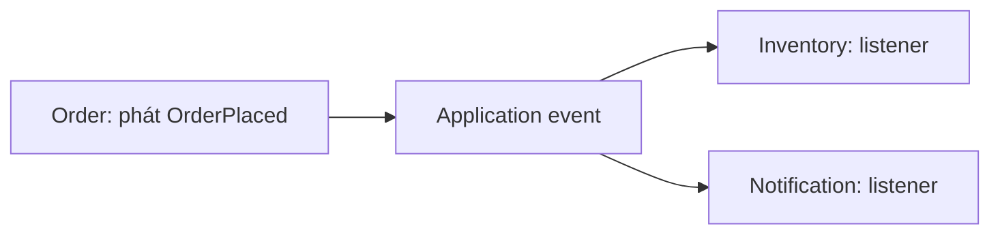
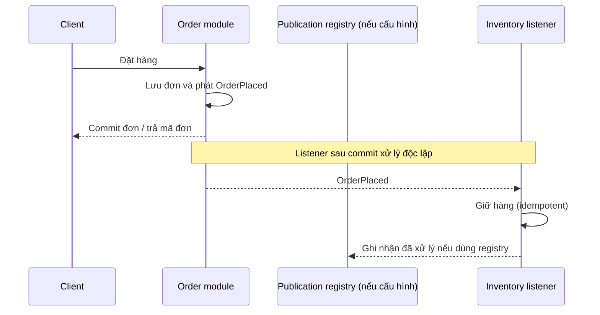

# Ranh giới kiến trúc trong Spring Modulith

## 1. Vì sao cần ranh giới kiến trúc?

Trong một ứng dụng Spring Boot nguyên khối (monolith), các thành phần thường chạy cùng một tiến trình, sử dụng chung cơ sở dữ liệu và có thể gọi nhau bằng Java method. Sự tiện lợi này dễ dẫn đến một hệ thống mà bất kỳ service nào cũng có thể truy cập repository, entity hoặc implementation của bất kỳ phần nghiệp vụ nào khác. Khi đó, một thay đổi nhỏ có thể tác động đến nhiều phần không liên quan.

**Ranh giới kiến trúc** là quy ước có thể kiểm chứng về việc một module **sở hữu dữ liệu và hành vi nào**, **công khai những gì** và **được phép phụ thuộc vào module nào**. Spring Modulith giúp mô hình hóa và kiểm tra các ranh giới ấy ngay trong ứng dụng Spring Boot, không yêu cầu chia hệ thống thành nhiều dịch vụ triển khai độc lập.

Trong module học **SPRING_MODULITH_APPLICATION_EVENTS**, ranh giới kiến trúc là nền tảng để dùng **application events** đúng mục đích: module phát sự kiện công bố một sự thật nghiệp vụ; module nhận tự quyết định cách phản ứng, nhờ vậy bên phát không cần biết lớp xử lý nội bộ của bên nhận. Cách tổ chức này giảm phụ thuộc và bảo vệ ranh giới nghiệp vụ, đồng thời mở đường cho các bài thực hành về publisher, listener sau commit, event publication registry, retry, kiểm thử và quan sát sự kiện.

### Mục tiêu học tập

Sau bài này, bạn có thể:

- Phân biệt package Java, application module và ranh giới nghiệp vụ.
- Chọn API công khai, implementation nội bộ và chiều phụ thuộc giữa các module.
- Giải thích lúc nào nên gọi API đồng bộ và lúc nào nên phát application event.
- Thiết lập quy tắc phụ thuộc, kiểm tra bằng Spring Modulith và nhận diện các trường hợp vượt ranh giới.
- Nhìn ra tác động của ranh giới đến giao dịch, tính nhất quán và độ tin cậy của event listener.

## 2. Module nghiệp vụ là đơn vị sở hữu trách nhiệm

Xét hệ thống bán hàng có ba nhóm năng lực:

| Module | Trách nhiệm chính | Điều không nên để module khác tự làm |
| --- | --- | --- |
| `order` | Tiếp nhận và quản lý vòng đời đơn hàng | Ghi trực tiếp vào bảng đơn hàng hoặc gọi repository nội bộ |
| `inventory` | Quản lý số lượng tồn và việc giữ hàng | Sửa tồn kho bằng repository từ `order` |
| `notification` | Gửi email và các thông báo nghiệp vụ | Đọc entity nội bộ của `order` để suy ra trạng thái gửi |

Trong Spring Modulith, mô hình mặc định thường nhận diện **các package con trực tiếp bên dưới package ứng dụng** là các application module. Ví dụ, nếu `ShopApplication` đặt tại `com.example.shop`, các package `com.example.shop.order`, `com.example.shop.inventory` và `com.example.shop.notification` có thể tạo thành ba module riêng.

```text
com.example.shop
├── ShopApplication.java
├── order/                       # Module Order
│   ├── OrderPlaced.java         # Kiểu sự kiện được công khai
│   ├── OrderOperations.java     # API gọi đồng bộ được công khai
│   └── internal/                # Implementation và kho dữ liệu
│       ├── CheckoutService.java
│       ├── Order.java
│       └── OrderRepository.java
├── inventory/                   # Module Inventory
│   └── internal/
│       ├── StockReservationService.java
│       └── OrderPlacedListener.java
└── notification/                # Module Notification
    └── internal/
        └── OrderNotificationListener.java
```

Một module ở đây **không phải** Maven module, Gradle subproject hay microservice. Các module có thể cùng một artifact triển khai và cùng JVM. Ranh giới của chúng được diễn đạt qua cấu trúc package, các API được công khai và quy tắc phụ thuộc mà Spring Modulith xác minh.

> **Lưu ý:** Java `public` không đồng nghĩa với API kiến trúc được phép sử dụng. Một lớp `public` trong `order.internal` vẫn là chi tiết nội bộ theo mô hình module. Java compiler có thể cho phép import lớp đó, nhưng phép kiểm tra kiến trúc của Spring Modulith có thể phát hiện vi phạm.

## 3. Phân biệt bên ngoài và bên trong ranh giới

Một ranh giới tốt trả lời được ba câu hỏi:

1. **Ai sở hữu thông tin?** `order` sở hữu trạng thái đơn hàng; `inventory` sở hữu việc giữ hàng.
2. **Bên ngoài được biết gì?** Chỉ những hợp đồng có chủ đích như `OrderOperations` hoặc `OrderPlaced`.
3. **Bên ngoài được làm gì?** Gọi nghiệp vụ qua API công khai hoặc xử lý sự kiện đã công bố; không thao tác trực tiếp dữ liệu/implementation bên trong.

### 3.1. Public API và internal implementation

Theo cách tổ chức mặc định, các kiểu đặt **trực tiếp tại package gốc của module** thường thuộc API được công khai; các package con như `internal` được xem là nội bộ, trừ khi được khai báo công khai một cách tường minh.

Ví dụ, `order.OrderOperations` có thể đưa ra `findOrderStatus(orderId)` cho module cần tra cứu trạng thái. Ngược lại, `order.internal.OrderRepository` chỉ phục vụ thực thi nghiệp vụ của `order`. Nếu `notification` truy cập `OrderRepository` để lấy email khách hàng thì nó đã biết cả cấu trúc dữ liệu và quy tắc lưu trữ của `order`.

| Hành vi từ module khác | Đánh giá | Lý do |
| --- | --- | --- |
| Import `order.OrderOperations` | Phù hợp nếu quan hệ phụ thuộc được cho phép | Đi qua hợp đồng công khai |
| Nhận `order.OrderPlaced` | Phù hợp nếu sự kiện là API công khai | Chỉ phụ thuộc vào thông tin sự kiện |
| Import `order.internal.OrderRepository` | Vi phạm ranh giới | Phụ thuộc vào triển khai và dữ liệu riêng |
| Ghi trực tiếp vào bảng `orders` của module `order` | Vi phạm quyền sở hữu dữ liệu | Bỏ qua quy tắc nghiệp vụ dù không có import Java |
| Dùng entity JPA `Order` làm payload phát cho mọi listener | Không nên | Làm lộ mô hình persistence và trạng thái mutable |

### 3.2. Phụ thuộc một chiều

Ranh giới không có nghĩa là các module hoàn toàn không được biết nhau. Điều cần kiểm soát là **chiều và mức độ phụ thuộc**. Nếu `inventory` nhận `order.OrderPlaced` thì `inventory` phụ thuộc vào kiểu sự kiện do `order` công bố. Nhưng `order` không cần tham chiếu `inventory.OrderPlacedListener` hoặc `inventory.StockReservationService`.



Sơ đồ mô tả **luồng sự kiện lúc chạy**. Về **phụ thuộc kiểu Java**, các listener ở `inventory` và `notification` import sự kiện công khai của `order`, còn bên phát không import các listener. Phân biệt hai góc nhìn này rất quan trọng khi đọc biểu đồ phụ thuộc module.

Spring Modulith kiểm tra những quan hệ phụ thuộc có thể quan sát từ mã nguồn. Việc các module dùng chung database **không tự động** khiến truy cập chéo bảng được bảo vệ; đó còn là quy tắc thiết kế và kiểm thử dữ liệu của nhóm phát triển.

## 4. Application events giúp giao tiếp qua ranh giới như thế nào?

Giả sử sau khi đặt hàng, hệ thống cần giữ hàng và gửi thông báo. Một thiết kế liên kết chặt có thể trông như sau:

```java
// Minh họa thiết kế liên kết chặt trong module order
@Transactional
public void placeOrder(PlaceOrder command) {
    // Lưu đơn hàng...
    inventoryService.reserveForOrder(command);
    emailService.sendOrderConfirmation(command);
}
```

Lúc này `order` biết hai tác vụ hậu xử lý, và việc thêm một tác vụ mới có thể buộc chỉnh sửa `order`. Nếu các service hoặc dependency đều nằm trong package nội bộ của module khác, quan hệ này còn vượt ranh giới kiến trúc.

Một thiết kế theo sự kiện là để `order` công bố **sự thật vừa xảy ra**: đơn hàng đã được tạo. Các module khác đăng ký phản ứng tương ứng.

### 4.1. Định nghĩa sự kiện công khai

```java
// com/example/shop/order/OrderPlaced.java
package com.example.shop.order;

import java.util.UUID;

public record OrderPlaced(UUID orderId, UUID customerId) {}
```

Tên sự kiện thường ở **thì quá khứ** (`OrderPlaced`, `PaymentCaptured`) để thể hiện một sự thật đã xảy ra, thay vì một mệnh lệnh như `SendEmailNow`. Payload chỉ nên chứa dữ liệu cần thiết, có định danh ổn định và phù hợp để lưu/đọc lại. Tránh nhét entity JPA có quan hệ lazy, object mutable hoặc dữ liệu nhạy cảm không cần thiết vào sự kiện.

### 4.2. Phát sự kiện trong module sở hữu nghiệp vụ

```java
// com/example/shop/order/internal/CheckoutService.java
package com.example.shop.order.internal;

import com.example.shop.order.OrderPlaced;
import org.springframework.context.ApplicationEventPublisher;
import org.springframework.stereotype.Service;
import org.springframework.transaction.annotation.Transactional;

@Service
class CheckoutService {
    private final OrderRepository orders;
    private final ApplicationEventPublisher events;

    CheckoutService(OrderRepository orders, ApplicationEventPublisher events) {
        this.orders = orders;
        this.events = events;
    }

    @Transactional
    public void placeOrder(PlaceOrder command) {
        Order order = orders.save(Order.from(command));
        events.publishEvent(new OrderPlaced(order.getId(), order.getCustomerId()));
    }
}
```

`Order`, `OrderRepository` và `PlaceOrder` trong đoạn này là các kiểu miền nghiệp vụ minh họa do module `order` tự định nghĩa; đây là ví dụ cách tổ chức code, không phải API có sẵn của Spring Modulith.

Điểm cần chú ý: `CheckoutService` chỉ biết `ApplicationEventPublisher` của Spring và kiểu `OrderPlaced` của chính module mình. Nó không phải import listener của `inventory` hay `notification`.

### 4.3. Lắng nghe sự kiện ở module khác

```java
// com/example/shop/inventory/internal/OrderPlacedListener.java
package com.example.shop.inventory.internal;

import com.example.shop.order.OrderPlaced;
import org.springframework.modulith.events.ApplicationModuleListener;
import org.springframework.stereotype.Component;

@Component
class OrderPlacedListener {
    private final StockReservationService stock;

    OrderPlacedListener(StockReservationService stock) {
        this.stock = stock;
    }

    @ApplicationModuleListener
    void on(OrderPlaced event) {
        stock.reserveForOrder(event.orderId());
    }
}
```

Trong Spring Modulith, `@ApplicationModuleListener` hỗ trợ listener xử lý **bất đồng bộ sau khi transaction phát sự kiện commit thành công**, với transaction riêng cho tác vụ listener. Nhờ đó, việc giữ hàng không làm `order` phụ thuộc trực tiếp vào implementation của `inventory`.

Tuy nhiên, **commit của đơn hàng không có nghĩa là giữ hàng đã hoàn tất**. Nếu `stock.reserveForOrder` thất bại, trạng thái đơn hàng và trạng thái tồn kho có thể tạm thời khác nhau. Quy trình nghiệp vụ cần định nghĩa trạng thái trung gian, ví dụ `PENDING_RESERVATION`, và một cách xử lý sự kiện thất bại hoặc kết quả giữ hàng bị từ chối.

## 5. Chọn lời gọi đồng bộ hay application event

Không phải mọi tương tác giữa module đều nên chuyển thành event. Quyết định phụ thuộc vào hợp đồng nghiệp vụ và yêu cầu nhất quán.

| Tình huống | Cơ chế thường phù hợp | Giải thích |
| --- | --- | --- |
| Cần câu trả lời ngay để quyết định chấp nhận lệnh | Gọi API công khai đồng bộ | Caller phải biết kết quả trước khi hoàn tất thao tác |
| Đơn hàng đã tạo, nhiều module muốn phản ứng độc lập | Phát application event | Bên phát không phải biết danh sách hành động hậu xử lý |
| Gửi email hoặc ghi nhận hoạt động sau khi commit | Listener sau commit | Tránh gửi thông báo cho giao dịch bị rollback |
| Giữ tồn kho là điều kiện bắt buộc trước khi xác nhận đặt hàng | API đồng bộ hoặc thiết kế quy trình nhiều trạng thái | Event sau commit không cung cấp kết quả ngay trong transaction gốc |
| Nghiệp vụ chạy dài, cần phối hợp nhiều bước có thể thất bại | Quy trình trạng thái/Saga có xử lý bù | Một event đơn lẻ không giải quyết toàn bộ vấn đề nhất quán |

Ví dụ: nếu hệ thống chỉ xác nhận đơn hàng sau khi đã bảo đảm còn hàng, cần cân nhắc kiểm tra/giữ tồn bằng API rõ ràng trong một quy trình có kiểm soát. Nếu hệ thống chấp nhận đơn ở trạng thái chờ và giữ hàng sau đó, event sau commit phù hợp hơn. Ranh giới kiến trúc bảo vệ **quyền sở hữu nghiệp vụ**; lựa chọn đồng bộ hay bất đồng bộ bảo vệ **ngữ nghĩa thời gian và nhất quán** của quy trình.

## 6. Khai báo và kiểm chứng ranh giới với Spring Modulith

### 6.1. Kiểm tra cấu trúc module

Spring Modulith cung cấp mô hình `ApplicationModules` để phát hiện phụ thuộc không hợp lệ giữa các module. Một bài kiểm tra JUnit thường có dạng:

```java
import org.junit.jupiter.api.Test;
import org.springframework.modulith.core.ApplicationModules;

class ModularityTests {

    @Test
    void verifyArchitecture() {
        ApplicationModules.of(ShopApplication.class).verify();
    }
}
```

Ở đây, `ShopApplication` là lớp `@SpringBootApplication` thuộc package gốc `com.example.shop`. Phép `verify()` giúp phát hiện những vi phạm như chu trình phụ thuộc và tham chiếu đến thành phần nội bộ của module khác theo quy tắc của Spring Modulith. Nên chạy bài kiểm tra này trong CI để các ranh giới tiếp tục được bảo vệ khi code thay đổi.

Ví dụ, nếu lớp `notification.internal.EmailComposer` import `order.internal.OrderRepository`, việc kiểm tra kiến trúc sẽ chỉ ra tham chiếu không được phép dù Java compiler vẫn biên dịch được.

### 6.2. Công khai có chọn lọc bằng Named Interface

Khi cần nhóm các kiểu sự kiện vào package con `order.events` thay vì package gốc `order`, có thể công khai riêng package này bằng **named interface**:

```java
// com/example/shop/order/events/package-info.java
@org.springframework.modulith.NamedInterface("events")
package com.example.shop.order.events;
```

Khi đó, sự kiện `OrderPlaced` được đặt tại `com.example.shop.order.events.OrderPlaced` và các listener import từ package ấy. Có thể hạn chế `inventory` chỉ phụ thuộc vào named interface này:

```java
// com/example/shop/inventory/package-info.java
@org.springframework.modulith.ApplicationModule(
    allowedDependencies = { "order::events" }
)
package com.example.shop.inventory;
```

`order::events` là cú pháp chỉ module `order` và named interface `events` của nó. Khai báo này minh họa cách giới hạn quan hệ phụ thuộc được phép. Nếu `inventory` còn cần một API đồng bộ khác của `order`, phải thiết kế và khai báo thêm hợp đồng tương ứng; không tùy tiện import `order.internal` để né ràng buộc.

**Hai cách đặt sự kiện ở mục 4 và mục 6.2 là hai phương án tổ chức thay thế nhau:** ví dụ mục 4 công khai tại package gốc, còn mục 6.2 chuyển event vào package con và khai báo named interface. Chọn một phương án nhất quán trong mã nguồn thực tế.

### 6.3. Phân biệt xác minh code và xác minh hành vi

`ApplicationModules.verify()` kiểm tra cấu trúc và các dependency được khai báo trong mã nguồn; nó không tự xác nhận tính đúng đắn của mọi quy trình nghiệp vụ. Chẳng hạn, phép kiểm tra này không chứng minh event được xử lý đúng số lần, email chỉ gửi sau commit, hay tồn kho được khôi phục sau lỗi.

Do đó, nên kết hợp:

- **Kiểm tra kiến trúc:** không có import xuyên vào `internal`, phụ thuộc phù hợp và không tạo chu trình.
- **Kiểm thử module:** xác nhận module phát đúng sự kiện hoặc phản ứng đúng khi nhận event.
- **Kiểm thử tích hợp giao dịch:** xác nhận listener sau commit, rollback, retry và tính idempotent theo yêu cầu nghiệp vụ.
- **Quan sát vận hành:** theo dõi sự kiện đã công bố, listener lỗi và publication chưa hoàn tất khi bật cơ chế theo dõi phù hợp.

## 7. Giao dịch và độ tin cậy không dừng ở ranh giới code

Spring `ApplicationEventPublisher` là cơ chế phát event trong ứng dụng; **bản thân một lệnh `publishEvent(...)` không tự biến event thành thông điệp bền vững**. Việc vận hành an toàn phụ thuộc vào cách listener chạy, thời điểm transaction commit và cơ chế theo dõi publication được cấu hình.

Một số nguyên tắc quan trọng:

1. **Sau commit:** Listener dùng `@ApplicationModuleListener` thường chỉ bắt đầu xử lý khi transaction phát sự kiện đã commit. Transaction nguồn rollback thì tác vụ sau commit không nên được thực thi như thể đơn hàng đã được xác nhận.
2. **Ghi nhận publication:** Spring Modulith có **Event Publication Registry** để theo dõi publication cho các transactional listener khi sử dụng các thành phần lưu trữ/cấu hình tương ứng. Registry hỗ trợ nhận diện publication chưa hoàn tất và việc gửi lại theo cơ chế được cấu hình; cần kiểm tra dependency và cấu hình thực tế của ứng dụng.
3. **Xử lý lặp:** Một listener có thể được thực thi lại sau lỗi hoặc phục hồi. Hãy thiết kế idempotency, chẳng hạn ghi `orderId` đã được giữ hàng, để cùng một sự kiện không tạo hai lượt giữ hàng.
4. **Chấp nhận bất đồng bộ:** Sau khi `order` commit, `inventory` có thể chưa hoàn tất xử lý. Cần trạng thái nghiệp vụ rõ ràng và cơ chế xử lý thất bại, không xem việc gọi `publishEvent` là bảo đảm tất cả tác vụ đã thành công.
5. **Không hứa hẹn exactly-once:** Registry và retry giúp tăng khả năng khôi phục nhưng không loại bỏ mọi kịch bản giao lại hay lỗi giữa thao tác bên ngoài và ghi nhận hoàn tất. Hiệu ứng nghiệp vụ nên có khả năng chống xử lý trùng.

Ví dụ luồng giữ hàng:



Sơ đồ là mô hình khái niệm: **cách registry ghi nhận publication và đánh dấu hoàn tất phụ thuộc module lưu trữ và cấu hình cụ thể**; không nên suy ra một giao thức truyền thông bên ngoài từ sơ đồ. Application events trong cùng tiến trình không mặc nhiên là Kafka, RabbitMQ hay hệ thống thông điệp liên dịch vụ.

## 8. Những dấu hiệu cho thấy ranh giới đang bị phá vỡ

Khi rà soát code, hãy tìm các tình huống sau:

- `order` import `inventory.internal.*` để giữ hàng, thay vì đi qua API công khai hoặc công bố event phù hợp.
- Listener của `notification` lấy entity từ `order.internal` rồi gọi các getter sâu để dựng email.
- Hai module cùng ghi một bảng hoặc dùng chung repository mà không xác định module sở hữu.
- Sự kiện chứa toàn bộ entity JPA hoặc một graph object lớn, khiến module nhận bị ràng buộc vào persistence của module phát.
- Mỗi lần thêm listener, developer phải sửa code publisher để gọi thêm service mới.
- Có vòng lặp phụ thuộc `order → inventory → order`, thường chỉ ra việc đặt trách nhiệm hoặc API chưa hợp lý.
- Event được dùng cho thao tác bắt buộc phải trả kết quả ngay, nhưng trạng thái nghiệp vụ không dự liệu được thành công/thất bại đến muộn.

Khi gặp các dấu hiệu này, hãy kiểm tra lại chủ sở hữu nghiệp vụ trước khi sửa bằng annotation. `@NamedInterface` và `allowedDependencies` hữu ích để **diễn đạt một kiến trúc đã được lựa chọn**, không phải công cụ hợp thức hóa mọi tham chiếu chéo.

## 9. Bài thực hành tự kiểm tra

**Bối cảnh:** `order` phát `OrderPlaced(orderId)` sau khi lưu đơn. `inventory` phải giữ hàng; `notification` phải gửi email. Hệ thống được phép xác nhận đơn ở trạng thái `PENDING_RESERVATION` trước khi giữ hàng hoàn tất.

**Yêu cầu thiết kế:**

1. Đề xuất ba package module và xác định module sở hữu từng repository.
2. Đặt `OrderPlaced` ở package được công khai; bảo đảm publisher không import listener.
3. Đăng ký listener của `inventory` để chạy sau commit, xử lý trùng theo `orderId`.
4. Giải thích hệ thống cần làm gì nếu giữ hàng thất bại nhưng đơn đã commit.
5. Thêm `ApplicationModules.of(ShopApplication.class).verify()` và thử cố tình import `order.internal.OrderRepository` từ `notification` để quan sát vi phạm.

**Tiêu chí đánh giá:** Các module chỉ dùng hợp đồng công khai của nhau; không có chu trình phụ thuộc; quyền sở hữu dữ liệu rõ ràng; phương án xử lý bất đồng bộ, lỗi và sự kiện lặp được mô tả; kiểm tra kiến trúc phát hiện được import vượt ranh giới.

## 10. Ghi nhớ

Ranh giới kiến trúc trong Spring Modulith tách rõ **trách nhiệm nghiệp vụ**, **API được công khai** và **chi tiết triển khai nội bộ**, ngay cả khi mọi module chạy trong cùng một Spring Boot application. Application events giúp module phát một sự kiện mà không phải biết các module nào sẽ phản ứng. Để thiết kế này đáng tin cậy, cần kiểm tra dependency, lựa chọn đúng giao tiếp đồng bộ/bất đồng bộ và bổ sung quản lý giao dịch, publication registry, retry cùng idempotency theo nhu cầu. Ranh giới tốt làm cho thay đổi trong một module ít lan sang các module khác và khiến luồng sự kiện dễ kiểm thử, quan sát hơn.
