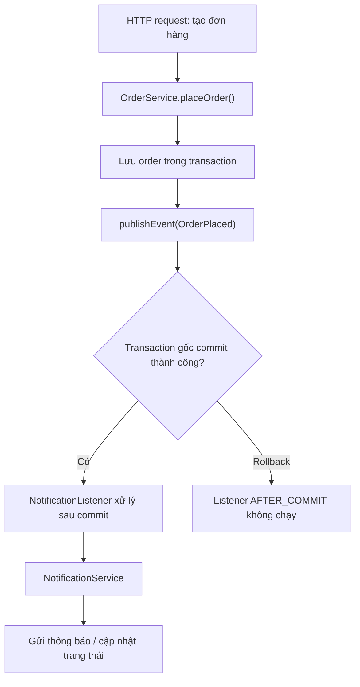

# Tích hợp Spring Modulith với Spring Boot

## 1. Vì sao Spring Modulith tích hợp tự nhiên với Spring Boot?

Spring Boot giúp xây dựng và vận hành ứng dụng Java thông qua cơ chế tự cấu hình, dependency injection, quản lý giao dịch, kiểm thử và giám sát. Spring Modulith bổ sung một lớp tổ chức **module nghiệp vụ bên trong cùng ứng dụng Spring Boot**: phát hiện ranh giới module, xác minh quan hệ phụ thuộc, ghi tài liệu kiến trúc, kiểm thử theo module và hỗ trợ trao đổi bằng application events.

Trong phạm vi **SPRING_MODULITH_APPLICATION_EVENTS**, mục tiêu tích hợp là để các module có thể phát thông báo về sự kiện nghiệp vụ qua Spring, còn module khác lắng nghe và xử lý mà không cần gọi trực tiếp vào implementation của nhau. Ví dụ, module `orders` hoàn tất đơn hàng và phát `OrderPlaced`; module `notifications` nhận sự kiện để gửi thông báo. Hai module vẫn thuộc **một tiến trình triển khai Spring Boot**, nhưng trách nhiệm và phụ thuộc được kiểm soát rõ ràng.

Sau bài này, bạn có thể:

- Khởi tạo ứng dụng Spring Boot có tích hợp Spring Modulith và chọn dependency phù hợp.
- Tổ chức package để Spring Modulith nhận diện các module nghiệp vụ.
- Dùng `ApplicationEventPublisher` và `@ApplicationModuleListener` để giao tiếp sau khi giao dịch được commit.
- Phân biệt cơ chế event trong bộ nhớ với khả năng lưu vết và khôi phục event publication.
- Kiểm tra kiến trúc module, kiểm thử event và nhận diện vấn đề thường gặp khi triển khai.

> **Phạm vi:** Bài học nói về tích hợp trong một ứng dụng Spring Boot, tập trung vào application events. Spring Modulith không tự biến ứng dụng thành hệ thống microservices hoặc bảo đảm việc gửi thông điệp sang broker bên ngoài chỉ bằng thao tác `publishEvent`.

## 2. Quan hệ giữa Spring Boot, Spring Framework và Spring Modulith

| Thành phần | Trách nhiệm | Vai trò đối với giao tiếp bằng event |
|---|---|---|
| Spring Framework | `ApplicationEventPublisher`, `@EventListener`, `@TransactionalEventListener`, giao dịch và `@Async` | Cung cấp hạ tầng phát và xử lý sự kiện trong ứng dụng. |
| Spring Boot | Tự cấu hình bean, transaction manager, datasource, async executor, test context và Actuator | Kết nối các thành phần hạ tầng và cung cấp cấu hình vận hành. |
| Spring Modulith | Nhận diện module, kiểm tra phụ thuộc, kiểm thử module, listener chuyên dụng và event publication registry | Áp dụng quy ước module và hỗ trợ giao sự kiện đáng tin cậy giữa các module. |

Spring Modulith xây dựng trên cơ chế sự kiện sẵn có của Spring; không yêu cầu một “event bus” tách biệt để module cùng tiến trình trao đổi với nhau. Bạn vẫn dùng `ApplicationEventPublisher` như trong Spring Framework. Các tính năng của Spring Modulith giúp làm rõ **đơn vị phát**, **đơn vị tiêu thụ** và **trạng thái xử lý** của sự kiện.

### 2.1. Khi nào nên dùng?

Giả sử ứng dụng thương mại điện tử gồm `orders`, `inventory` và `notifications`:

- `orders` chỉ cần biết một đơn hàng đã được tạo thành công.
- `inventory` cần đặt trước số lượng hàng.
- `notifications` cần gửi email hoặc thông báo.

Nếu `OrderService` gọi trực tiếp `InventoryService` và `NotificationService`, thay đổi ở module tiêu thụ có thể lan sang module tạo đơn hàng. Với application events, `orders` phát `OrderPlaced`, và các module khác tự đăng ký listener xử lý nghiệp vụ của mình. Đây là lựa chọn tốt khi yêu cầu nghiệp vụ cho phép **xử lý sau commit, có thể bất đồng bộ và có độ trễ**. Với thao tác phải có kết quả ngay để quyết định có commit đơn hàng hay không, hãy cân nhắc một lời gọi đồng bộ qua API công khai của module thay vì chuyển toàn bộ sang event.

## 3. Chuẩn bị ứng dụng Spring Boot

### 3.1. Quản lý phiên bản và dependency

Tạo ứng dụng Spring Boot như thông thường (Spring Initializr hoặc dự án sẵn có), sau đó bổ sung **Spring Modulith BOM** để các thư viện Modulith dùng cùng bộ phiên bản. Ví dụ Maven dưới đây chỉ minh họa những mục cần thêm vào `pom.xml`:

```xml
<dependencyManagement>
    <dependencies>
        <dependency>
            <groupId>org.springframework.modulith</groupId>
            <artifactId>spring-modulith-bom</artifactId>
            <version>REPLACE_WITH_COMPATIBLE_MODULITH_VERSION</version>
            <type>pom</type>
            <scope>import</scope>
        </dependency>
    </dependencies>
</dependencyManagement>

<dependencies>
    <!-- Tích hợp các tính năng Modulith cốt lõi -->
    <dependency>
        <groupId>org.springframework.modulith</groupId>
        <artifactId>spring-modulith-starter-core</artifactId>
    </dependency>

    <!-- Hỗ trợ kiểm thử các module và sự kiện -->
    <dependency>
        <groupId>org.springframework.modulith</groupId>
        <artifactId>spring-modulith-starter-test</artifactId>
        <scope>test</scope>
    </dependency>
</dependencies>
```

Phiên bản Spring Modulith phải **tương thích với phiên bản Spring Boot/Spring Framework của dự án**. Chọn cặp phiên bản theo tài liệu tương thích của release đang sử dụng, không sao chép số phiên bản từ ví dụ thuộc release khác. Với Gradle, áp dụng cùng nguyên tắc: import BOM (hoặc cơ chế dependency management tương ứng), sau đó khai báo starter core và starter test.

Khi cần **event publication registry có lưu trữ bền vững**, bổ sung một cơ chế persistence tương ứng với hạ tầng đang dùng, chẳng hạn starter JDBC cho ứng dụng có Spring JDBC và cơ sở dữ liệu quan hệ:

```xml
<!-- Chỉ thêm khi lựa chọn triển khai registry bằng JDBC -->
<dependency>
    <groupId>org.springframework.modulith</groupId>
    <artifactId>spring-modulith-starter-jdbc</artifactId>
</dependency>
```

Spring Modulith còn có những lựa chọn lưu trữ khác tùy release và công nghệ (chẳng hạn JPA). Không phải ứng dụng nào cũng cần mọi starter. Việc khai báo dependency **không thay thế** các bước cấu hình datasource, transaction manager, bảng lưu event publication và cơ chế phục hồi tương ứng.

### 3.2. Đặt lớp khởi động và tổ chức package

Với cấu trúc package theo quy ước, Spring Modulith xem các package con trực tiếp của package gốc ứng dụng là các **application modules**:

```text
com.acme.shop
├── ShopApplication.java
├── orders
│   ├── OrderPlaced.java          // Event công khai cho module khác
│   ├── OrderService.java         // Publisher
│   └── internal
│       └── OrderRepository.java  // Chi tiết triển khai nội bộ
├── inventory
│   ├── InventoryListener.java    // Consumer
│   └── internal
│       └── StockRepository.java
└── notifications
    ├── NotificationListener.java
    └── internal
        └── NotificationSender.java
```

```java
package com.acme.shop;

import org.springframework.boot.SpringApplication;
import org.springframework.boot.autoconfigure.SpringBootApplication;
import org.springframework.scheduling.annotation.EnableAsync;

@SpringBootApplication
@EnableAsync
public class ShopApplication {

    public static void main(String[] args) {
        SpringApplication.run(ShopApplication.class, args);
    }
}
```

`@SpringBootApplication` khởi tạo Spring context và quét component trong các package con. `@EnableAsync` bật xử lý phương thức được đánh dấu `@Async`; cấu hình này quan trọng với listener bất đồng bộ như `@ApplicationModuleListener`. Trong môi trường production, cần cấu hình executor phù hợp thay vì mặc định rằng một lượng công việc bất đồng bộ bất kỳ đều được xử lý an toàn.

**Phân biệt hai khái niệm “module”:** module nghiệp vụ của Spring Modulith chủ yếu được xác định từ cấu trúc package và quy tắc phụ thuộc. Bạn không cần bắt buộc chia mỗi module thành một Maven/Gradle subproject. Việc tách thành nhiều build module là một quyết định kiến trúc khác.

### 3.3. Xác định API công khai của module

Trong cách tổ chức đơn giản, các kiểu cần dùng từ module khác, bao gồm event `OrderPlaced`, đặt ở package gốc `orders`. Những lớp thuộc package `orders.internal` được coi là chi tiết nội bộ và không nên bị module khác phụ thuộc trực tiếp.

Một event nên mang **dữ liệu mô tả việc đã xảy ra** (`orderId`, thời điểm, mã tương quan nếu cần) thay vì mang đối tượng JPA Entity hoặc service. Điều đó giúp tránh truy cập lazy association khi listener chạy sau commit, hạn chế phụ thuộc vào mô hình nội bộ và thuận lợi cho lưu trữ/khôi phục publication.

## 4. Ví dụ end-to-end: đặt hàng rồi phát application event

### 4.1. Định nghĩa event

```java
package com.acme.shop.orders;

import java.time.Instant;
import java.util.UUID;

public record OrderPlaced(UUID orderId, Instant occurredAt) {
}
```

`record` phù hợp để biểu diễn thông tin sự kiện bất biến. Đặt tên ở **thì quá khứ** để thể hiện một sự kiện đã xảy ra. `OrderPlaced` là hợp đồng trao đổi thông tin; listener không nên dựa vào lớp triển khai `OrderService` hoặc `OrderRepository` để biết nội bộ module `orders`.

### 4.2. Publisher nằm trong giao dịch tạo đơn hàng

```java
package com.acme.shop.orders;

import java.time.Instant;
import java.util.UUID;
import org.springframework.context.ApplicationEventPublisher;
import org.springframework.stereotype.Service;
import org.springframework.transaction.annotation.Transactional;

@Service
public class OrderService {

    private final OrderRepository orders;
    private final ApplicationEventPublisher publisher;

    public OrderService(
            OrderRepository orders,
            ApplicationEventPublisher publisher) {
        this.orders = orders;
        this.publisher = publisher;
    }

    @Transactional
    public UUID placeOrder(PlaceOrderCommand command) {
        Order order = orders.save(Order.from(command));
        UUID orderId = order.id();

        publisher.publishEvent(new OrderPlaced(orderId, Instant.now()));
        return orderId;
    }
}
```

Đây là **đoạn minh họa luồng nghiệp vụ**: `OrderRepository`, `Order` và `PlaceOrderCommand` là các kiểu của module `orders` cần được định nghĩa theo mô hình domain thực tế. Phần quan trọng là thao tác lưu đơn hàng và `publishEvent(...)` nằm trong cùng phương thức `@Transactional`.

Gọi `publishEvent(...)` **không có nghĩa database đã commit tại thời điểm gọi**. Spring phát hành sự kiện vào cơ chế lắng nghe của nó; hành vi và thời điểm xử lý phụ thuộc vào loại listener. Listener thường dùng `@EventListener` có thể chạy ngay trong thread hiện tại, còn listener giao dịch mặc định đợi đến sau commit.

### 4.3. Listener ở module khác

```java
package com.acme.shop.notifications;

import com.acme.shop.orders.OrderPlaced;
import org.springframework.modulith.events.ApplicationModuleListener;
import org.springframework.stereotype.Component;

@Component
class NotificationListener {

    private final NotificationService notifications;

    NotificationListener(NotificationService notifications) {
        this.notifications = notifications;
    }

    @ApplicationModuleListener
    void on(OrderPlaced event) {
        notifications.sendOrderConfirmation(event.orderId());
    }
}
```

`NotificationService` là API nội bộ của module `notifications` và chịu trách nhiệm kết nối hệ thống gửi thông báo. `NotificationListener` chỉ phụ thuộc vào kiểu event công khai `orders.OrderPlaced`. Hai module trao đổi mà không cần `OrderService` inject `NotificationService`.

`@ApplicationModuleListener` là annotation tiện ích của Spring Modulith dành cho xử lý event giữa các module. Trong các release hỗ trợ annotation này, nó kết hợp ý tưởng **transactional event listener**, **async execution** và **giao dịch riêng cho quá trình xử lý listener**. Hành vi thực tế còn phụ thuộc việc bật hạ tầng async và transaction manager hợp lệ.



### 4.4. Điều gì xảy ra khi sử dụng từng loại listener?

| Loại listener | Thời điểm xử lý điển hình | Phù hợp với |
|---|---|---|
| `@EventListener` | Khi sự kiện được publish; mặc định đồng bộ trong thread publisher | Xử lý nhanh, cùng luồng; cần thận trọng với giao dịch và ngoại lệ. |
| `@TransactionalEventListener` với `AFTER_COMMIT` | Khi transaction chứa publisher commit thành công | Side effect chỉ được phép chạy sau khi dữ liệu nghiệp vụ đã lưu thành công. |
| `@ApplicationModuleListener` | Listener giao dịch sau commit, tích hợp bất đồng bộ và giao dịch xử lý riêng | Giao tiếp giữa application modules, giảm độ trễ trên luồng tạo đơn. |

`@TransactionalEventListener` mặc định sử dụng phase `AFTER_COMMIT`. Khi sự kiện được phát **ngoài transaction**, listener giao dịch thường không chạy nếu không bật `fallbackExecution`. Vì vậy, cần xác nhận đường gọi phát event luôn có transaction hoạt động nếu thiết kế yêu cầu after-commit.

Với `@EventListener` đồng bộ, ngoại lệ của listener có thể lan về publisher và gây rollback cho transaction hiện tại. Với listener sau commit, transaction tạo đơn đã kết thúc; lỗi gửi thông báo **không thể tự động rollback đơn hàng đã commit**. Đây là điểm khác biệt cần phản ánh trong business flow và chiến lược xử lý lỗi.

## 5. Hệ thống transaction, async và khả năng giao sự kiện

### 5.1. Commit là ranh giới nghiệp vụ

Giả sử `placeOrder` đang giữ transaction:

1. Lưu đơn hàng vào database.
2. Gọi `publishEvent(new OrderPlaced(...))`.
3. Nếu transaction rollback, listener `AFTER_COMMIT` không thực hiện hành động gửi email.
4. Nếu transaction commit, listener có thể được kích hoạt để xử lý.

Điều kiện này ngăn thông báo được gửi cho đơn hàng đã rollback. Tuy nhiên, sau khi commit, process có thể chết, executor có thể quá tải hoặc listener có thể ném ngoại lệ. **After-commit chỉ giải quyết thứ tự xử lý, không tự bảo đảm phục hồi sự kiện sau mọi lỗi.**

### 5.2. Event publication registry giải quyết vấn đề gì?

Spring Modulith cung cấp cơ chế **event publication registry** để theo dõi việc giao sự kiện đến các listener. Khi tích hợp với kho lưu trữ bền vững (chẳng hạn JDBC/JPA theo các lựa chọn được release hỗ trợ), hệ thống có thể lưu các publication cần xử lý và đánh dấu đã hoàn thành sau khi listener xử lý thành công.

Ví dụ về trạng thái logic:

| Thời điểm | Trạng thái cần quan sát | Cách phản ứng |
|---|---|---|
| Giao dịch đặt hàng đã commit, listener chưa chạy | Publication chưa hoàn thành | Giữ để listener có thể được phục hồi/xử lý lại. |
| Listener xử lý thành công | Publication được ghi nhận hoàn thành | Không cần chạy lại publication đã hoàn tất. |
| Listener gặp lỗi hoặc ứng dụng dừng | Publication còn chưa hoàn thành | Điều tra lỗi và dùng cơ chế resubmission/replay được hỗ trợ. |

Cần phân biệt **ghi nhận publication** với **tự động retry**. Cơ chế thử lại khi khởi động, theo lịch hoặc theo điều kiện phụ thuộc phiên bản và cấu hình của ứng dụng; không nên mặc định rằng mọi release sẽ tự chạy lại vô hạn. Hãy kiểm tra chức năng resubmission đang sử dụng, tiêu chí nhận diện publication chưa hoàn thành và cách giám sát backlog.

Việc chọn starter JDBC hay JPA cũng đòi hỏi các điều kiện vận hành:

- Datasource và transaction manager đã được Spring Boot cấu hình đúng.
- Schema lưu event publication tồn tại, do migration quản lý hoặc bằng cơ chế khởi tạo có chủ đích theo release.
- Bảng event và dữ liệu nghiệp vụ thuộc cùng cơ sở dữ liệu/giao dịch phù hợp khi cần bảo đảm tính nguyên tử ở phía publisher.
- Event có thể được lưu và đọc lại theo cơ chế serialization mà release đang dùng; cần xem tác động khi đổi kiểu event hoặc schema dữ liệu.
- Có quy trình kiểm tra và xử lý publication tồn đọng khi triển khai phiên bản mới.

Nếu chỉ dùng event trong bộ nhớ mà không có persistence, ứng dụng **không thể khôi phục đáng tin cậy** các publication đã bị mất khi process dừng đột ngột.

### 5.3. Retry luôn đi kèm idempotency

Một publication có thể được xử lý lại nếu việc thực hiện side effect đã thành công nhưng listener gặp lỗi trước khi đánh dấu hoàn thành. Vì vậy, consumer nên thiết kế theo nguyên tắc **at-least-once có thể dẫn đến xử lý lặp**, không dựa vào giả định “chính xác một lần”.

Ví dụ, listener đặt trước tồn kho nên sử dụng `orderId` làm khóa nghiệp vụ để bảo đảm mỗi đơn chỉ tạo một reservation:

```java
@ApplicationModuleListener
void on(OrderPlaced event) {
    // Phương thức này phải an toàn nếu nhận cùng orderId nhiều lần.
    inventory.reserveIfAbsent(event.orderId());
}
```

Phương thức `reserveIfAbsent` trong ví dụ phải có **ràng buộc duy nhất trong database** (hoặc cơ chế nguyên tử tương đương) và chạy trong transaction phù hợp. Một phép `if (!exists) save(...)` thiếu ràng buộc duy nhất có thể bị race condition. Với dịch vụ ngoài như email, API thanh toán hoặc message broker, ưu tiên truyền idempotency key nếu bên nhận hỗ trợ và lưu trạng thái gửi có thể đối soát.

Lưu ý thêm: “đã gửi email thành công” và “đã lưu trạng thái đã gửi thành công” là hai thao tác khác nhau; không có transaction database thông thường nào tự khiến chúng trở thành một giao dịch nguyên tử.

### 5.4. Cấu hình async executor trong Spring Boot

Listener bất đồng bộ dùng executor của Spring. Với lưu lượng thực tế, cần chọn kích thước thread pool, giới hạn queue và cách xử lý khi queue đầy theo năng lực I/O của consumer. Một executor dùng chung cho email chậm và nghiệp vụ quan trọng có thể gây nghẽn hàng đợi.

Ví dụ tạo executor riêng cho listener có thể cấu hình:

```java
package com.acme.shop;

import java.util.concurrent.Executor;
import org.springframework.context.annotation.Bean;
import org.springframework.context.annotation.Configuration;
import org.springframework.scheduling.concurrent.ThreadPoolTaskExecutor;

@Configuration
class EventExecutorConfig {

    @Bean("eventTaskExecutor")
    Executor eventTaskExecutor() {
        ThreadPoolTaskExecutor executor = new ThreadPoolTaskExecutor();
        executor.setCorePoolSize(4);
        executor.setMaxPoolSize(8);
        executor.setQueueCapacity(200);
        executor.setThreadNamePrefix("modulith-event-");
        executor.initialize();
        return executor;
    }
}
```

Bean `eventTaskExecutor` chỉ có tác dụng khi **được tham chiếu bởi hạ tầng listener/async đang chạy**; tên bean tự chọn không có nghĩa mọi `@ApplicationModuleListener` sẽ tự dùng nó. Khi cần cô lập executor, cấu hình rõ bằng khả năng chỉ định executor của annotation trong release tương ứng hoặc cấu hình `AsyncConfigurer` của Spring. Đồng thời xác định chính sách reject khi queue đầy và giám sát tải để tránh làm mất hoặc trì hoãn công việc.

Không đặt các giả định về thứ tự callback cho hai listener bất đồng bộ cùng nhận một event. Nếu có phụ thuộc trình tự chặt chẽ giữa các bước, hãy mô hình hóa workflow rõ ràng và dùng cơ chế phối hợp phù hợp.

## 6. Kiểm tra ranh giới module trong ứng dụng Boot

Điểm mạnh của Spring Modulith là **phát hiện lỗi phụ thuộc ngay trong kiểm thử**, chẳng hạn `notifications` truy cập trực tiếp `orders.internal.OrderRepository` thay vì chỉ phụ thuộc vào event/API công khai.

```java
package com.acme.shop;

import org.junit.jupiter.api.Test;
import org.springframework.modulith.core.ApplicationModules;

class ModuleArchitectureTests {

    @Test
    void verifiesModuleDependencies() {
        ApplicationModules.of(ShopApplication.class).verify();
    }
}
```

Trong cấu hình theo quy ước, Spring Modulith xác định các module từ package con và kiểm tra những ràng buộc kiến trúc được hỗ trợ. Kiểm thử này nên được đưa vào pipeline CI. Đừng coi việc khởi động Boot thành công là bằng chứng rằng ranh giới module đã đúng: dependency injection có thể vẫn hoạt động dù thiết kế package bị ghép chặt.

Nếu cần điều chỉnh cách hiển thị module hoặc phạm vi API được phép tham chiếu, hãy dùng khai báo metadata Modulith tương ứng với release, thay vì cho tất cả lớp nội bộ trở thành public chỉ để vượt qua lỗi kiến trúc.

## 7. Kiểm thử publisher và listener

### 7.1. Kiểm thử publisher phát đúng event

Spring Modulith cung cấp `@ApplicationModuleTest` để khởi tạo ngữ cảnh kiểm thử quanh một module và `PublishedEvents` để quan sát event được phát. Ví dụ đặt test trong package `com.acme.shop.orders`:

```java
package com.acme.shop.orders;

import static org.assertj.core.api.Assertions.assertThat;
import org.junit.jupiter.api.Test;
import org.springframework.beans.factory.annotation.Autowired;
import org.springframework.modulith.test.ApplicationModuleTest;
import org.springframework.modulith.test.PublishedEvents;

@ApplicationModuleTest
class OrderModuleTests {

    @Autowired OrderService orders;
    @Autowired PublishedEvents publishedEvents;

    @Test
    void publishesOrderPlaced() {
        // Chuẩn bị dữ liệu và command hợp lệ bằng fixture của module.
        PlaceOrderCommand command = TestOrders.validCommand();
        var orderId = orders.placeOrder(command);

        assertThat(publishedEvents.ofType(OrderPlaced.class))
                .anySatisfy(event ->
                        assertThat(event.orderId()).isEqualTo(orderId));
    }
}
```

`TestOrders.validCommand()` là fixture minh họa; dự án thực tế cần cung cấp cách khởi tạo command và cơ sở dữ liệu test phù hợp. Phép kiểm tra này xác nhận **event được publish**, chưa chứng minh listener bất đồng bộ đã hoàn tất side effect.

### 7.2. Kiểm thử listener sau commit

Để xác minh listener và persistence, cần có test có transaction thực sự commit và điều kiện chờ phù hợp khi chạy bất đồng bộ. Tránh khẳng định kết quả ngay sau lệnh `publishEvent` rồi dùng `Thread.sleep(...)` cố định; thời gian lên lịch có thể thay đổi giữa máy phát triển và CI.

Các tình huống đáng kiểm tra:

1. **Commit thành công:** Listener được kích hoạt và cập nhật đúng trạng thái; dùng công cụ `Scenario` của Spring Modulith (nếu release đang dùng hỗ trợ) hoặc chờ điều kiện có timeout.
2. **Rollback:** Listener phase `AFTER_COMMIT` không tạo side effect.
3. **Lỗi tạm thời:** Listener ném exception, publication bền vững vẫn có thể được phát hiện là chưa hoàn thành.
4. **Retry:** Xử lý lại cùng `orderId` không tạo bản ghi reservation trùng.
5. **Kiến trúc:** Test `ApplicationModules.verify()` vẫn thành công sau khi thêm consumer mới.

Trong test sử dụng annotation `@Transactional` ở chính test method, transaction có thể **bị rollback vào cuối test**. Điều này khiến listener after-commit không chạy như mong đợi. Hãy tạo một transaction được commit thật hoặc sử dụng công cụ test quản lý commit phù hợp với Spring Test khi kiểm tra đường xử lý này.

## 8. Tự cấu hình, quan sát và vận hành

Spring Boot tích hợp các phần hạ tầng để Modulith hoạt động, nhưng đội phát triển vẫn phải xác định rõ điều kiện vận hành.

| Hạng mục | Việc cần xác nhận | Nếu bỏ qua |
|---|---|---|
| Dependency/BOM | Spring Boot và Spring Modulith tương thích; starter phù hợp nhu cầu | Lỗi classpath, auto-configuration hoặc hành vi khác giữa các release. |
| Transaction | Method publisher thật sự chạy trong transaction; datasource đúng | Listener after-commit không chạy hoặc chạy sai thời điểm mong muốn. |
| Async | `@EnableAsync` và executor có giới hạn tài nguyên | Listener bị chạy không đúng kỳ vọng hoặc công việc ùn tắc. |
| Registry | Kho lưu publication, schema, transaction và chiến lược replay được kiểm tra | Event có thể thất lạc hoặc tồn đọng mà không ai phát hiện. |
| Observability | Log có `orderId`/correlation ID, metrics độ trễ và publication tồn đọng; Actuator/tracing nếu được cấu hình | Khó xác định ai phát, ai nhận, vì sao listener thất bại. |
| Idempotency | Side effect không tạo kết quả sai khi xử lý lại một event | Trừ hàng hai lần, gửi thông báo lặp hoặc tạo dữ liệu trùng. |

Ví dụ log có cấu trúc tại consumer:

```java
@ApplicationModuleListener
void on(OrderPlaced event) {
    log.info("Processing OrderPlaced orderId={}", event.orderId());
    inventory.reserveIfAbsent(event.orderId());
    log.info("Processed OrderPlaced orderId={}", event.orderId());
}
```

Trong ví dụ trên, `log` là logger của lớp (như SLF4J) và `inventory` là dependency được inject. Không ghi payload nhạy cảm, access token hoặc dữ liệu cá nhân trực tiếp vào log. Có thể bổ sung correlation ID để nối luồng HTTP → publisher → listener → hệ thống ngoài.

Khi tích hợp Boot Actuator và công cụ quan sát, ưu tiên theo dõi **số publication chưa hoàn thành**, **thời gian xử lý listener**, **số lần lỗi**, **độ dài hàng đợi async** và **thời gian retry**. Sự sẵn có của từng metric/tracing span phụ thuộc thư viện và version được bật; khi chưa có instrumentation tự động, cần bổ sung đo lường tại điểm nghiệp vụ.

## 9. Các lỗi thiết kế thường gặp

| Hiện tượng | Nguyên nhân có thể gặp | Cách xử lý |
|---|---|---|
| `@ApplicationModuleListener` không phản hồi event | Publisher không nằm trong transaction hoặc chưa bật async/bean không được scan | Kiểm tra transaction thực, `@EnableAsync`, package scan và annotation listener. |
| Email gửi dù đơn hàng rollback | Dùng listener đồng bộ xử lý side effect quá sớm | Chuyển sang listener sau commit khi nghiệp vụ yêu cầu. |
| Đơn hàng đã commit nhưng thông báo không gửi và không phục hồi | Chỉ phát event trong bộ nhớ; không có registry bền vững hoặc replay | Cấu hình publication registry có persistence và vận hành replay. |
| Listener làm chậm HTTP request | Dùng `@EventListener` đồng bộ hoặc tác vụ nặng trên thread publisher | Đánh giá listener async/after-commit và executor phù hợp. |
| Trừ tồn kho hai lần | Giả định listener chạy đúng một lần | Dùng idempotency key, ràng buộc unique và logic cập nhật nguyên tử. |
| Module `notifications` import repository nội bộ của `orders` | Đặt sai public contract, vi phạm ranh giới module | Công khai event/API cần thiết, xác minh lại bằng `ApplicationModules.verify()`. |
| Test publisher PASS nhưng luồng nghiệp vụ vẫn hỏng | Chỉ kiểm tra event được publish | Thêm test commit, consumer, replay, idempotency và kiểm tra trạng thái dữ liệu. |
| Event mới làm hỏng dữ liệu publication cũ | Thay đổi kiểu event/schema mà không có kế hoạch tương thích | Quản lý tiến hóa schema event và kiểm thử khôi phục khi nâng cấp. |

## 10. Lộ trình áp dụng vào một dự án thực tế

**Bước 1 — Xác định ranh giới nghiệp vụ.** Liệt kê module phát/nhận sự kiện và các tình huống cần phản hồi đồng bộ. Ví dụ, đặt hàng phát `OrderPlaced`, còn cập nhật tồn kho hoặc gửi email là các tác vụ hậu xử lý.

**Bước 2 — Khởi tạo Boot + Modulith.** Thiết lập dependency management, starter core và starter test theo release tương thích; đặt class `@SpringBootApplication` ở package gốc để module được phát hiện đúng.

**Bước 3 — Tạo event contract.** Dùng immutable DTO/record có các trường cần thiết; giữ event ở API công khai của module phát và hạn chế tham chiếu đến Entity nội bộ.

**Bước 4 — Phát event trong transaction.** Sau thao tác thay đổi trạng thái nghiệp vụ, dùng `ApplicationEventPublisher`. Kiểm tra rollback không kích hoạt các consumer sau commit.

**Bước 5 — Tạo listener.** Với nghiệp vụ hậu xử lý giữa module, cân nhắc `@ApplicationModuleListener`; cấu hình async và giao dịch phù hợp.

**Bước 6 — Làm cho việc xử lý đáng tin cậy.** Chọn registry bền vững khi mất event là không chấp nhận được; bổ sung replay có kiểm soát, idempotency và hệ thống quan sát.

**Bước 7 — Kiểm thử và giám sát.** Chạy `ApplicationModules.verify()`, test publisher, test consumer after-commit và tình huống failure/recovery; giám sát publication tồn đọng trong vận hành.

## 11. Tổng kết kiến thức và câu hỏi tự kiểm tra

Tích hợp Spring Modulith với Spring Boot tận dụng lại `ApplicationEventPublisher`, transaction management, dependency injection và công cụ kiểm thử của Spring. Điểm bổ sung là **ranh giới module rõ ràng** và **cơ chế quản lý publication** giúp các module giao tiếp ít phụ thuộc hơn. Khi dùng event sau commit, phải phân biệt ba việc: **đã publish event**, **transaction nghiệp vụ đã commit**, và **listener đã xử lý thành công**. Chúng không xảy ra cùng một thời điểm và không có cùng mức bảo đảm.

Tự kiểm tra bằng các câu hỏi:

1. Vì sao `OrderPlaced` nên nằm trong public API của `orders` thay vì trong `orders.internal`?
2. Khi `placeOrder` rollback, `@EventListener` và `@ApplicationModuleListener` có thể khác nhau thế nào?
3. Tại sao after-commit vẫn chưa đủ để khôi phục email nếu tiến trình bị dừng ngay sau commit?
4. Tại sao event publication registry không loại bỏ yêu cầu idempotency ở consumer?
5. `ApplicationModules.verify()` và `@ApplicationModuleTest` kiểm tra hai khía cạnh nào khác nhau?

**Ghi nhớ:** Spring Modulith giúp tổ chức một ứng dụng Spring Boot thành các module nghiệp vụ dễ kiểm soát và trao đổi qua application events. Độ tin cậy đầu cuối vẫn cần thiết kế giao dịch, persistence cho publication, cơ chế phục hồi, idempotency và quan sát phù hợp với yêu cầu hệ thống.
