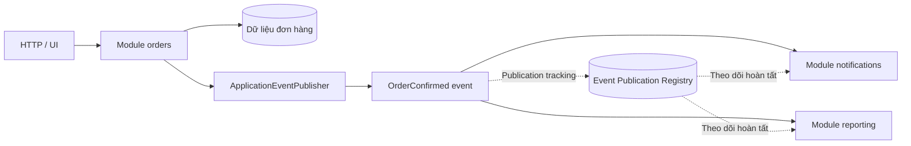
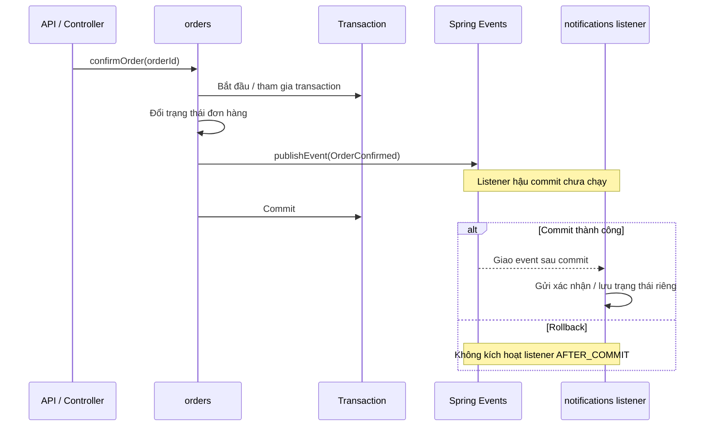
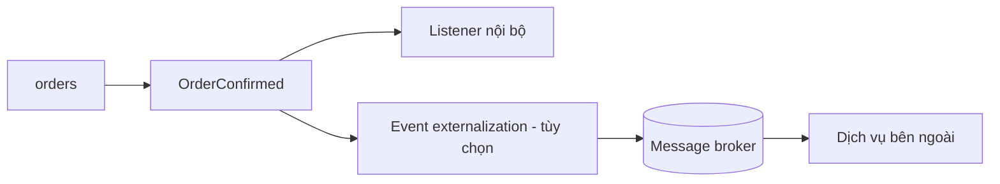

# Các thành phần liên quan trong Spring Modulith

## 1. Bức tranh tổng thể

Spring Modulith hỗ trợ xây dựng **modular monolith**: ứng dụng vẫn được triển khai như một đơn vị, nhưng mã nguồn được tổ chức thành các **module nghiệp vụ có ranh giới rõ ràng**. Mỗi module sở hữu hành vi và dữ liệu của một phần nghiệp vụ; module khác tương tác thông qua API được công bố hoặc thông qua **application events**. Nhờ vậy, hệ thống có thể giảm phụ thuộc trực tiếp giữa các module mà chưa cần chia thành nhiều dịch vụ triển khai độc lập.

Trong phạm vi giao tiếp bằng sự kiện, có thể nhìn Spring Modulith như một tập hợp các thành phần phối hợp:

1. **Application module** định nghĩa ai sở hữu nghiệp vụ và những điểm truy cập được phép.
2. **Domain/application event** diễn đạt một sự kiện nghiệp vụ đã xảy ra.
3. **Event publisher** thông báo sự kiện đến hạ tầng application events của Spring.
4. **Event listener** ở các module quan tâm tiếp nhận và xử lý sự kiện.
5. **Transaction và event publication registry** quyết định khi nào listener được thực thi và hỗ trợ theo dõi những lần xử lý chưa hoàn tất.
6. **Công cụ kiểm thử, kiểm tra kiến trúc và quan sát** giúp phát hiện phụ thuộc sai, kiểm tra luồng sự kiện và vận hành hệ thống.

Ví dụ, khi module `orders` xác nhận một đơn hàng, module `notifications` có thể gửi email xác nhận, còn module `reporting` cập nhật dữ liệu thống kê. Hai module nhận sự kiện không cần gọi trực tiếp vào lớp triển khai nội bộ của `orders`.



Sơ đồ minh họa **trách nhiệm logic**, không có nghĩa mỗi ô là một tiến trình hoặc một message broker. Với application events nội bộ, các thành phần thông thường vẫn chạy trong cùng ứng dụng Spring Boot. Registry là hạ tầng bổ sung khi đã cấu hình khả năng lưu trữ và theo dõi publication.

## 2. Application module và ranh giới nghiệp vụ

### 2.1. Module là một phần của ứng dụng, không phải một microservice

Trong cấu trúc mặc định của Spring Modulith, các package con trực tiếp bên dưới package ứng dụng gốc thường được nhận diện là các application module. Ví dụ:

```text
com.example.shop
├── ShopApplication.java
├── orders
│   ├── OrderService.java
│   ├── events
│   │   ├── package-info.java
│   │   └── OrderConfirmed.java
│   └── internal
│       ├── Order.java
│       └── OrderRepository.java
├── notifications
│   ├── OrderNotificationListener.java
│   └── internal
│       └── MailSenderAdapter.java
└── reporting
    └── OrderReportingListener.java
```

Ở ví dụ này, `orders`, `notifications` và `reporting` là ba module. Chúng vẫn thuộc cùng một ứng dụng Java, nhưng mỗi module có trách nhiệm riêng:

| Thành phần | Trách nhiệm chính | Quan hệ với application events |
| --- | --- | --- |
| `orders` | Tạo, thay đổi trạng thái và quản lý quy tắc đơn hàng | Phát sự kiện khi một sự thật nghiệp vụ được xác lập |
| `notifications` | Tạo và gửi thông báo cho khách hàng | Lắng nghe sự kiện, thực hiện tác vụ phụ trợ |
| `reporting` | Xây dựng dữ liệu phục vụ báo cáo | Lắng nghe sự kiện, cập nhật read model hoặc số liệu |
| `ShopApplication` | Khởi tạo ứng dụng Spring Boot | Là điểm xuất phát để Spring Modulith nhận diện mô hình module |

**Điểm quan trọng:** package không chỉ để phân loại tệp. Ranh giới module có ý nghĩa kiến trúc: module khác nên truy cập những kiểu được công bố, thay vì phụ thuộc trực tiếp vào `orders.internal.OrderRepository` hoặc entity nội bộ.

### 2.2. API công khai, phần nội bộ và named interface

Theo quy ước cơ bản, các kiểu được công bố ở package gốc của module tạo thành API của module; những kiểu trong package con thường được coi là phần nội bộ, trừ khi được khai báo là một **named interface**. Vì vậy, đặt event ở `orders.events` là một quyết định kiến trúc cần chủ động công bố nếu module khác sẽ sử dụng kiểu đó.

Ví dụ trong `orders/events/package-info.java`:

```java
@org.springframework.modulith.NamedInterface("events")
package com.example.shop.orders.events;
```

Event trong package đã công bố:

```java
package com.example.shop.orders.events;

import java.time.Instant;
import java.util.UUID;

public record OrderConfirmed(UUID orderId, Instant occurredAt) {
}
```

Nếu `notifications` chỉ được phép phụ thuộc vào interface sự kiện của `orders`, có thể khai báo `notifications/package-info.java`:

```java
@org.springframework.modulith.ApplicationModule(
    allowedDependencies = "orders::events"
)
package com.example.shop.notifications;
```

`orders::events` là cách chỉ tới named interface `events` của module `orders`. Đây là quy tắc kiểm tra phụ thuộc kiến trúc, không phải tên topic hay địa chỉ hàng đợi. Tùy thiết kế thực tế, module có thể xuất các API khác hoặc điều chỉnh danh sách phụ thuộc được phép.

Việc công bố contract sự kiện giúp người viết listener biết họ có thể phụ thuộc vào dữ liệu nào. Event nên chứa dữ liệu cần thiết và ổn định, chẳng hạn `orderId` và thời điểm xác nhận; không nên chuyển nguyên entity JPA chứa quan hệ lazy, state có thể thay đổi, hoặc các chi tiết nội bộ khác thành API giữa module.

## 3. Các thành phần của luồng application events

### 3.1. Event: mô tả điều đã xảy ra

Event tốt thường đặt tên ở thì quá khứ như `OrderConfirmed`, `PaymentCaptured`, `CustomerRegistered`. Tên thể hiện **sự kiện đã xảy ra**, không ra lệnh module khác phải làm gì. Khác biệt này cho phép bổ sung hoặc bỏ listener mà không cần sửa logic nghiệp vụ của module phát.

Một số nguyên tắc khi thiết kế event:

- Sử dụng giá trị dữ liệu rõ ràng, dễ đọc; record bất biến của Java là một lựa chọn thuận tiện.
- Xác định thời điểm phát: một sự kiện `OrderConfirmed` phải tương ứng với trạng thái đơn hàng đã được xác nhận trong transaction nghiệp vụ.
- Giữ contract đủ ổn định để listener không phải biết cấu trúc entity hoặc repository của module phát.
- Nếu listener có thể nhận lại một event sau retry, cần có khóa nghiệp vụ hoặc event ID phù hợp để chống tác động lặp.
- Không đưa dữ liệu nhạy cảm vào event tràn lan; chỉ chia sẻ thông tin thật sự cần cho các bên nhận.

Ví dụ event chỉ có `orderId` cho phép listener tự truy vấn dữ liệu đã công bố qua API phù hợp; event có thêm dữ liệu cần thiết như `customerId` hoặc loại thông báo giúp listener ít phải gọi ngược hơn. Đây là một lựa chọn thiết kế, cần cân bằng khả năng tự chủ và độ ổn định của contract.

### 3.2. Publisher: phát sự kiện khi xử lý nghiệp vụ

Spring Framework cung cấp `ApplicationEventPublisher`. Spring Modulith sử dụng hạ tầng sự kiện của Spring và bổ sung cách tổ chức theo module cùng các khả năng liên quan.

Ví dụ minh họa phần chính của một application service trong `orders`:

```java
@Service
public class OrderService {

    private final OrderRepository repository;
    private final ApplicationEventPublisher publisher;

    public OrderService(OrderRepository repository,
                        ApplicationEventPublisher publisher) {
        this.repository = repository;
        this.publisher = publisher;
    }

    @Transactional
    public void confirmOrder(UUID orderId) {
        Order order = repository.findById(orderId).orElseThrow();
        order.confirm();

        publisher.publishEvent(
            new OrderConfirmed(orderId, Instant.now())
        );
    }
}
```

Đoạn mã là phần minh họa: `Order`, `OrderRepository` và các `import` thuộc ứng dụng cụ thể. Trong một dự án JPA, sự thay đổi của entity quản lý bởi persistence context có thể được ghi khi flush/commit; các chi tiết lưu trữ do module `orders` quản lý.

`publishEvent(...)` gửi event tới hệ thống phát sự kiện **trong tiến trình**. Bản thân lời gọi này không tự tạo topic Kafka, không bảo đảm event đã được xử lý ở module nhận và không tự biến event thành thông điệp được lưu bền. Hành vi thực tế còn phụ thuộc loại listener, transaction và các thành phần Spring Modulith đã cấu hình.

### 3.3. Listener: phản ứng ở module nhận

Một listener tiêu thụ event có thể nằm trong module khác. Spring Framework và Spring Modulith cung cấp nhiều cách nghe sự kiện, mỗi cách mang ngữ nghĩa thời gian khác nhau:

| Cơ chế | Thời điểm và cách thực thi thường gặp | Thích hợp khi |
| --- | --- | --- |
| `@EventListener` | Mặc định chạy đồng bộ khi phát event, trừ khi cấu hình chạy bất đồng bộ | Xử lý nội bộ đơn giản, chấp nhận kết hợp trực tiếp với luồng phát |
| `@TransactionalEventListener(phase = AFTER_COMMIT)` | Chạy sau khi transaction liên quan commit thành công; yêu cầu có transaction phù hợp theo mặc định | Chỉ tạo tác dụng phụ sau khi dữ liệu nguồn đã commit |
| `@ApplicationModuleListener` | Cách viết gọn của Spring Modulith cho transactional listener chạy bất đồng bộ và dùng transaction xử lý riêng | Module khác xử lý tác vụ hậu commit, cần tách khỏi đường xử lý chính |

Ví dụ `notifications` có thể tiêu thụ `OrderConfirmed` như sau:

```java
@Component
class OrderNotificationListener {

    private final NotificationService notifications;

    OrderNotificationListener(NotificationService notifications) {
        this.notifications = notifications;
    }

    @ApplicationModuleListener
    void on(OrderConfirmed event) {
        notifications.sendOrderConfirmation(event.orderId());
    }
}
```

Ở đây, `NotificationService` thuộc `notifications`; module `orders` hoàn toàn không cần import hoặc gọi service này. Để listener bất đồng bộ hoạt động đúng, ứng dụng cần hạ tầng async và cấu hình phù hợp; những phần đó cần được kiểm tra trong bản Spring Modulith/Spring Boot đang sử dụng.

Khi `orders` bị rollback, transactional listener ở pha `AFTER_COMMIT` sẽ không thực hiện tác vụ hậu commit của đơn hàng. Ngược lại, một `@EventListener` đồng bộ thông thường có thể đã chạy ngay trong transaction còn chưa thành công, nên cần cân nhắc nếu listener gửi email, gọi HTTP hoặc thao tác bên ngoài cơ sở dữ liệu.

### 3.4. Transaction: liên kết sự kiện với trạng thái dữ liệu

Transaction quyết định ranh giới nhất quán. Với luồng đặt hàng, có hai thời điểm cần phân biệt:



Việc nghe sự kiện sau commit giúp tránh tác dụng phụ cho một thay đổi dữ liệu đã rollback. Tuy nhiên, **sau commit không đồng nghĩa với xử lý chắc chắn thành công**: tiến trình có thể dừng trước khi listener làm xong, hệ thống gửi email có thể lỗi hoặc một thao tác ngoài hệ thống có thể bị thực hiện nhiều lần khi retry.

Đối với những bất biến nghiệp vụ bắt buộc phải đúng ngay khi API trả kết quả, chẳng hạn không được bán vượt tồn kho, không nên mặc nhiên chuyển toàn bộ việc kiểm tra hoặc giữ chỗ tồn kho sang listener bất đồng bộ. Những điều kiện nhất quán tức thời cần được xử lý trong cơ chế transaction/phối hợp nghiệp vụ thích hợp. Application events đặc biệt hữu ích cho thông báo, cập nhật projection, audit hoặc các công việc có thể đạt **eventual consistency**.

## 4. Event Publication Registry và giao sự kiện đáng tin cậy

### 4.1. Registry làm nhiệm vụ gì?

Spring Modulith có cơ chế **event publication registry** để theo dõi các publication dành cho transactional event listeners. Khi cấu hình backend lưu trữ phù hợp, hệ thống có thể lưu trạng thái publication chưa hoàn tất và đánh dấu hoàn tất khi listener xử lý thành công.

Hãy phân biệt ba khái niệm:

| Khái niệm | Ý nghĩa |
| --- | --- |
| **Event được phát** | Publisher đã gửi một event tới cơ chế dispatch trong ứng dụng |
| **Publication được ghi nhận** | Hạ tầng registry đã ghi việc giao event cho một listener mục tiêu theo cơ chế cấu hình |
| **Publication hoàn tất** | Listener đã hoàn thành và registry ghi nhận trạng thái xử lý thành công |

Một event có nhiều listener có thể tương ứng với nhiều publication. Chẳng hạn, cùng một `OrderConfirmed` được `notifications` xử lý thành công nhưng `reporting` thất bại; trạng thái cần theo dõi là của **từng listener**, thay vì chỉ một cờ thành công cho toàn bộ event.

Registry thường được tích hợp với transaction để duy trì quan hệ giữa dữ liệu nghiệp vụ đã commit và publication cần được xử lý. Backend lưu trữ có thể dựa trên các lựa chọn persistence mà phiên bản Spring Modulith hỗ trợ; cần thêm dependency và cấu hình đúng, vì chỉ dùng `ApplicationEventPublisher` không tự tạo registry bền vững.

### 4.2. Khi listener thất bại, hệ thống cần làm gì?

Giả sử `orders` đã commit thành công, nhưng dịch vụ email tạm ngừng:

```text
orders: cập nhật đơn hàng      -> COMMITTED
OrderConfirmed                 -> được phát
notifications listener         -> FAILED
registry (nếu đã cấu hình)    -> publication chưa hoàn tất
khôi phục / phát lại phù hợp   -> listener thử xử lý lại
notifications listener         -> COMPLETED
registry                        -> ghi nhận hoàn tất
```

Registry tạo cơ sở để **kiểm tra và tiếp tục xử lý publication còn dang dở**, nhưng chính sách retry/resubmission, thời điểm kích hoạt, bảo đảm lưu bền và cách vận hành phụ thuộc cấu hình, phiên bản cùng backend thực tế. Không nên giả định mọi lỗi đều được tự động khôi phục ngay mà không có thiết lập hoặc cơ chế vận hành tương ứng.

Điều quan trọng hơn: một listener có thể gửi email thành công nhưng bị lỗi trước khi registry ghi dấu hoàn tất. Lần thử tiếp theo có thể gửi email lần nữa. Vì thế luồng tin cậy phải tính đến **khả năng xử lý lặp (at-least-once ở góc nhìn tiêu thụ)**, thay vì mặc định rằng mỗi event chỉ tạo đúng một tác dụng phụ.

Các cách xử lý thường dùng gồm:

- Gắn `eventId` hoặc cặp khóa nghiệp vụ thích hợp để nhận diện một lần phát sự kiện.
- Lưu dấu đã xử lý theo khóa duy nhất trong module nhận, cùng transaction ghi thay đổi nội bộ khi phù hợp.
- Thiết kế thao tác cập nhật theo kiểu idempotent, chẳng hạn đặt trạng thái `CONFIRMED` nếu chưa ở trạng thái đó.
- Nếu tích hợp hệ thống ngoài, dùng idempotency key của API đích (khi hỗ trợ) hoặc cơ chế kiểm soát duplicate tương ứng.
- Theo dõi publication chưa hoàn tất, nguyên nhân lỗi và chính sách retry có giới hạn.

**Một registry không thay thế thiết kế idempotency**, và cũng không biến transaction cục bộ thành transaction phân tán với dịch vụ ngoài.

## 5. Các thành phần nền tảng và công cụ hỗ trợ

Spring Modulith dựa trên một số thành phần của hệ sinh thái Spring. Chúng có vai trò khác nhau và không phải tất cả đều bắt buộc cho mọi ứng dụng.

| Thành phần | Vai trò | Khi nào cần quan tâm |
| --- | --- | --- |
| **Spring Boot** | Khởi chạy, cấu hình ứng dụng và quản lý bean | Có mặt trong hầu hết ứng dụng Spring Modulith |
| **Spring Modulith Core** | Mô hình hóa các application module, ranh giới và phụ thuộc; kiểm tra kiến trúc | Khi thiết kế và xác minh cấu trúc module |
| **Spring Framework Events** | `ApplicationEventPublisher`, `@EventListener`, cơ chế dispatch | Luồng phát và nhận sự kiện nội bộ |
| **Spring Transaction Management** | `@Transactional`, transaction lifecycle, `@TransactionalEventListener` | Khi event phụ thuộc vào kết quả commit của nghiệp vụ |
| **Event Publication Registry** | Theo dõi publication và kết quả listener với backend thích hợp | Khi cần xử lý publication thất bại và phục hồi |
| **Spring Data / JDBC / JPA** | Lưu dữ liệu nghiệp vụ hoặc cung cấp hạ tầng persistence | Phụ thuộc lựa chọn lưu trữ; registry bền vững cần backend tương thích |
| **Spring Modulith Test** | Kiểm thử module theo ranh giới kiến trúc | Khi muốn kiểm thử đơn vị module và tương tác có kiểm soát |
| **Spring Modulith Observability** | Quan sát tương tác giữa các module, tích hợp công cụ đo lường phù hợp | Khi chẩn đoán và vận hành giao tiếp giữa các module |
| **Spring Modulith Documenter** | Tạo tài liệu và biểu đồ cấu trúc module | Khi cần giải thích hoặc rà soát kiến trúc |
| **Event externalization / broker** | Đẩy event được chọn ra Kafka, AMQP hay nền tảng phù hợp qua integration | Khi cần tích hợp với hệ thống ngoài ứng dụng |

### 5.1. Spring Modulith Core: nhận diện và kiểm tra phụ thuộc

Spring Modulith có thể xây dựng mô hình module từ ứng dụng và kiểm tra những vi phạm như module truy cập các kiểu nằm ở phần nội bộ của module khác. Ví dụ kiểm tra cơ bản:

```java
import org.junit.jupiter.api.Test;
import org.springframework.modulith.core.ApplicationModules;

class ModularityTest {

    @Test
    void verifiesArchitecture() {
        ApplicationModules modules =
            ApplicationModules.of(ShopApplication.class);

        modules.verify();
    }
}
```

Việc kiểm tra này phát hiện **phụ thuộc mã nguồn vi phạm ranh giới đã mô hình hóa**. Nó không tự đánh giá toàn bộ tính đúng đắn nghiệp vụ hoặc bảo đảm mọi event được xử lý thành công. Phần cấu hình module như `@ApplicationModule` và `@NamedInterface` góp phần xác định các quan hệ nào là hợp lệ.

### 5.2. Spring Modulith Test: kiểm thử module cùng sự kiện

`@ApplicationModuleTest` hỗ trợ khởi tạo ngữ cảnh kiểm thử theo module, giúp tập trung xác minh hành vi và tương tác của module được chọn. Với một tác vụ liên quan application events, các lớp kiểm thử nên xác minh những điều kiện có ý nghĩa nghiệp vụ:

- `orders` phát `OrderConfirmed` sau khi trạng thái đơn hàng được xác nhận đúng quy tắc.
- `notifications` tạo thông báo cần thiết khi nhận event hợp lệ.
- Listener hậu commit không tạo tác dụng phụ khi transaction nguồn rollback.
- Listener xử lý lặp không tạo kết quả ngoài ý muốn.
- Khi có registry, tình huống publication thất bại và khôi phục được kiểm tra bằng backend thực tế.

Kiểm thử kiến trúc, kiểm thử module và kiểm thử tích hợp transaction giải quyết các vấn đề khác nhau. Một ứng dụng có `modules.verify()` thành công vẫn cần kiểm thử logic listener, transaction và failure recovery.

### 5.3. Observability và tài liệu kiến trúc

Tại thời điểm phát triển, sơ đồ module hữu ích để xem module nào phụ thuộc module nào, API nào đang được công bố và có quan hệ vòng hay không. Ở thời điểm vận hành, log, metric và trace giúp trả lời những câu hỏi khác: event phát lúc nào, listener nào xử lý chậm, publication nào chưa hoàn tất, lỗi có lặp lại không.

Quan sát tốt nên gắn với `eventId`, loại event, module phát, module nhận, thời điểm xử lý và trạng thái hoàn tất. Những giá trị này giúp điều tra sự cố, nhưng cần tránh ghi dữ liệu nhạy cảm vào log. Công cụ observability và documenter bổ trợ khả năng hiểu kiến trúc; chúng không tự thay thế việc kiểm tra kết quả nghiệp vụ.

### 5.4. Broker bên ngoài là thành phần tùy chọn

**Application event nội bộ** và **message gửi ra broker** là hai bước khác nhau. `ApplicationEventPublisher` hỗ trợ sự kiện trong ứng dụng Spring. Khi sự kiện cần tới ứng dụng khác, Spring Modulith có các cơ chế externalization tích hợp với những công nghệ thông điệp được hỗ trợ tùy dependency và phiên bản.



Không cần broker để hai module trong cùng modular monolith dùng application events. Ngược lại, khi đưa event ra hệ thống khác, cần thêm thiết kế message contract, routing, serialization, retry và xử lý lặp ở phía consumer bên ngoài. Đây là vấn đề tích hợp hệ thống, rộng hơn bài toán dispatch event nội bộ.

## 6. Chọn hình thức giao tiếp phù hợp

Không phải mọi tương tác giữa module đều nên dùng event. Có thể dùng các câu hỏi sau để chọn cách giao tiếp:

| Nhu cầu | Cách tiếp cận thường hợp lý | Lý do |
| --- | --- | --- |
| Module A cần câu trả lời ngay để quyết định commit | Gọi API công khai của module B, hoặc thiết kế transaction/phối hợp nghiệp vụ thích hợp | Kết quả cần sẵn trước khi kết thúc luồng xử lý |
| Module B cần biết đơn hàng đã xác nhận để gửi thông báo | Event và listener hậu commit | Bổ sung hành vi không tạo phụ thuộc trực tiếp từ `orders` tới `notifications` |
| Nhiều module cần cập nhật dữ liệu dẫn xuất | Một event với các listener độc lập | Các module nhận tự sở hữu phần cập nhật của mình |
| Một tác vụ hậu commit có thể lỗi tạm thời | Event + registry phù hợp + cơ chế recovery + idempotency | Có thể theo dõi và xử lý lại công việc còn dang dở |
| Ứng dụng khác cần tiếp nhận thông báo | Externalization hoặc integration qua broker | Thông điệp phải đi ra ngoài tiến trình ứng dụng |

Một nguyên tắc thực hành hữu ích là **để module phát chịu trách nhiệm về kết quả nghiệp vụ của chính nó**, còn các module nghe chỉ xử lý những hậu quả mà chúng sở hữu. Chẳng hạn, `orders` chịu trách nhiệm xác nhận đơn hàng; `notifications` chịu trách nhiệm gửi thông báo, và có thể tạm thất bại mà không làm thay đổi kết quả transaction xác nhận đã commit.

## 7. Ví dụ kết nối các thành phần trong một ca sử dụng

Xét yêu cầu: “Khách hàng xác nhận đơn hàng; hệ thống gửi thông báo và cập nhật số liệu bán hàng”.

**Bước 1 — Xác định ranh giới.** `orders` sở hữu trạng thái đơn hàng; `notifications` sở hữu thông báo; `reporting` sở hữu số liệu. Không cho module nhận sửa trực tiếp repository nội bộ của `orders`.

**Bước 2 — Công bố contract sự kiện.** `orders` định nghĩa `OrderConfirmed(orderId, occurredAt)` và công bố qua một named interface, ví dụ `orders::events`.

**Bước 3 — Thay đổi dữ liệu và phát event.** `orders` xác nhận đơn trong `@Transactional`, sau đó gọi `ApplicationEventPublisher.publishEvent(...)` trong cùng luồng xử lý nghiệp vụ.

**Bước 4 — Xử lý hậu commit.** Các listener có ngữ nghĩa sau commit nhận event khi transaction xác nhận thành công. `notifications` gửi xác nhận; `reporting` cập nhật projection hoặc thống kê phù hợp.

**Bước 5 — Phòng lỗi.** Nếu gửi thông báo thất bại, module nhận cần có cơ chế thử lại có kiểm soát; nếu dùng registry bền vững thì kiểm tra publication chưa hoàn tất. Logic xử lý cũng phải an toàn khi cùng event được xử lý nhiều lần.

**Bước 6 — Xác minh kiến trúc và hành vi.** Dùng `ApplicationModules.verify()` để phát hiện phụ thuộc trái phép; dùng kiểm thử nghiệp vụ và kiểm thử tích hợp để xác minh commit, listener và tình huống lỗi.

Các thành phần hợp tác theo một chuỗi rõ ràng:

```text
Module + exposed event contract
             ↓
Business service + transaction
             ↓
ApplicationEventPublisher
             ↓
Transactional / application-module listener
             ↓
Xử lý hậu commit của module nhận
             ↓
Registry, recovery, idempotency, observability (khi cần)
```

## 8. Những nhầm lẫn thường gặp

**“Có application event là các module đã độc lập hoàn toàn.”** Event giúp giảm một loại phụ thuộc, nhưng listener vẫn phụ thuộc vào contract của event; bản thân các module có thể còn chia sẻ database, transaction hoặc môi trường triển khai. Cần tiếp tục quản lý API công khai và các ranh giới nghiệp vụ.

**“Gọi `publishEvent()` nghĩa là event đã được xử lý xong.”** Lời gọi phát event không chứng minh listener hậu commit đã hoàn tất. Phải kiểm tra kết quả thực thi hoặc trạng thái publication bằng cơ chế phù hợp.

**“`@EventListener` và `@ApplicationModuleListener` giống nhau.”** Listener đồng bộ mặc định có ngữ nghĩa khác với listener bất đồng bộ hậu commit. Nhầm lẫn này dễ dẫn đến gửi tác vụ ngoài trước khi transaction thật sự thành công hoặc giả định sai về thời gian phản hồi của API.

**“Registry bảo đảm không bao giờ có xử lý trùng.”** Sau lỗi, retry có thể chạy lại một tác vụ mà hệ thống ngoài đã thực hiện thành công. Phải chủ động thiết kế idempotency và theo dõi quá trình khôi phục.

**“Muốn module giao tiếp qua event phải có Kafka.”** Kafka và broker phục vụ việc giao thông điệp giữa các tiến trình/hệ thống. Application events bên trong Spring Modulith có thể hoạt động hoàn toàn trong một ứng dụng Spring Boot.

**“Bất kỳ bước nghiệp vụ nào cũng nên chuyển thành async event.”** Với những điều kiện buộc phải đạt tính nhất quán ngay, cần giữ cách phối hợp phù hợp với transaction và kết quả nghiệp vụ. Event hậu commit phù hợp hơn cho những công việc chấp nhận hoàn tất sau.

## 9. Tự kiểm tra kiến thức

1. Tại sao `notifications` nên lắng nghe `OrderConfirmed` thay vì gọi trực tiếp repository nội bộ của `orders`?
2. Sự khác biệt nào giữa `@EventListener` mặc định và `@ApplicationModuleListener` ảnh hưởng đến việc gửi email khi transaction rollback?
3. Nếu cùng một event có hai listener và một listener thất bại, vì sao cần theo dõi trạng thái theo từng publication?
4. Registry đã cấu hình có loại bỏ nhu cầu idempotency ở listener không? Vì sao?
5. Trong trường hợp cần kiểm tra còn hàng **trước** khi chấp nhận đơn, nên cân nhắc điều gì trước khi dùng listener bất đồng bộ?
6. Khi nào application event nội bộ là đủ, và khi nào mới cần externalization sang broker?

Nắm được vai trò của module, event contract, publisher, listener, transaction và registry sẽ giúp bạn thiết kế giao tiếp giữa các module Spring Modulith rõ ràng hơn. Các thành phần kiểm thử, kiểm tra kiến trúc và quan sát cung cấp bằng chứng để đánh giá xem thiết kế ấy có hoạt động đúng trong cả tình huống bình thường lẫn khi gặp lỗi hay không.
