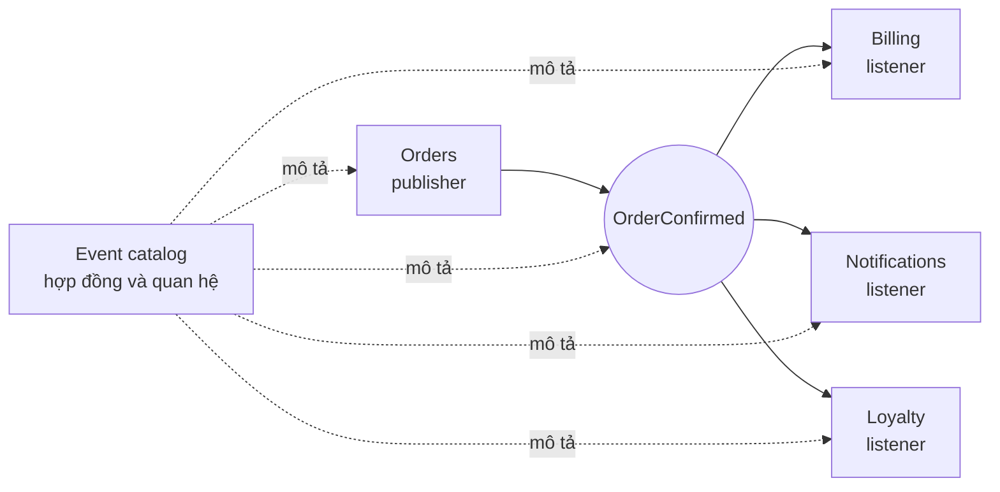
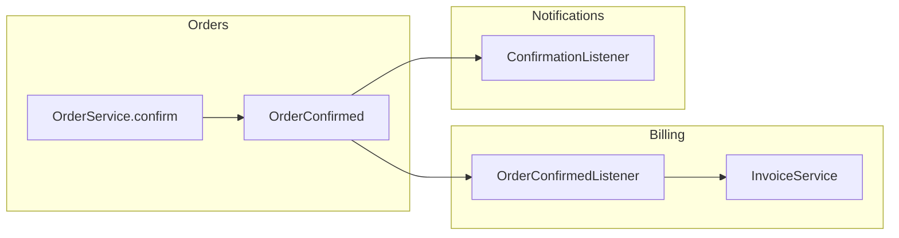
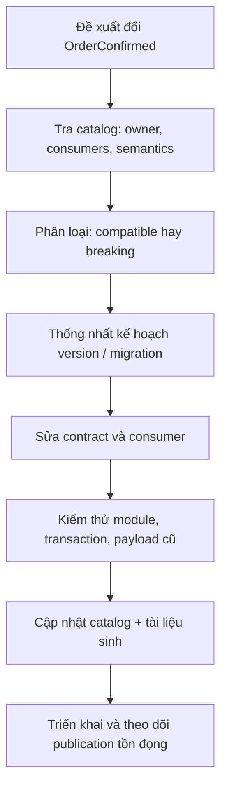

# Vai trò của event catalog

> **Chương:** Spring Modulith  
> **Phạm vi:** `SPRING_MODULITH_APPLICATION_EVENTS` — tổ chức giao tiếp giữa các module Spring Modulith bằng application events để giảm phụ thuộc và bảo vệ ranh giới nghiệp vụ; thực hành publisher, listener, xử lý sau commit, Event Publication Registry, retry, kiểm thử và quan sát luồng sự kiện đáng tin cậy.

## 1. Bài toán: các module trao đổi sự kiện nhưng không ai biết toàn bộ hợp đồng

Giả sử một ứng dụng bán hàng được tổ chức bằng Spring Modulith:

- **Orders** xác nhận đơn hàng và công bố `OrderConfirmed`.
- **Billing** nghe `OrderConfirmed` để lập hóa đơn.
- **Notifications** nghe `OrderConfirmed` để gửi thông báo.
- **Loyalty** nghe `OrderConfirmed` để cộng điểm thưởng.

Mỗi module có thể hoạt động đúng trong phạm vi của mình, nhưng khi hệ thống phát triển, nhóm gặp nhiều câu hỏi:

1. Module nào **sở hữu** sự kiện `OrderConfirmed`?
2. Sự kiện được phát **khi nào**: trước commit, sau commit, hay khi một bước nghiệp vụ khác hoàn tất?
3. Những listener nào đang nhận sự kiện? Nếu thay payload, module nào chịu ảnh hưởng?
4. Event dùng dữ liệu nào, có chứa thông tin nhạy cảm hay không?
5. Nếu listener thất bại, sự kiện có được ghi lại và thử xử lý tiếp không?
6. Có thể kiểm chứng một thay đổi event là an toàn trước khi triển khai không?

Chỉ nhìn từng class `@EventListener` hoặc `@ApplicationModuleListener` sẽ khó trả lời đầy đủ. **Event catalog** giải quyết bài toán bằng cách tạo một bức tranh có cấu trúc về **các loại sự kiện, ngữ nghĩa, chủ sở hữu, nơi phát và nơi sử dụng**, kèm những thông tin cần thiết để phát triển và vận hành.



**Điểm phân biệt cốt lõi:** Trong bài này, *event catalog* là **danh mục tài liệu và quy tắc quản trị hợp đồng sự kiện** của ứng dụng. Spring Modulith có thể **hỗ trợ tạo dữ liệu đầu vào** cho danh mục thông qua mô hình module và `Documenter` (đặc biệt là *Application Module Canvas*); không nên mặc định rằng framework cung cấp một registry runtime tên `EventCatalog` hoặc tự quản lý mọi metadata nghiệp vụ được liệt kê trong bài.

## 2. Event catalog là gì?

Event catalog là nơi tra cứu các **loại sự kiện** mà một ứng dụng công bố hoặc tiếp nhận, cùng định nghĩa về vai trò của chúng trong kiến trúc.

Một bản ghi trong catalog trả lời được câu hỏi: *“`OrderConfirmed` có ý nghĩa gì, module nào phát, module nào nghe, hợp đồng dữ liệu ra sao và phải tuân thủ những bảo đảm nào?”*

Catalog quản lý **loại sự kiện** (`OrderConfirmed`), còn các thông điệp cụ thể xảy ra tại runtime có thể là những **instance** khác nhau:

```text
Loại sự kiện trong catalog: OrderConfirmed
  ├── instance eventId=e-101, orderId=o-10, occurredAt=...
  ├── instance eventId=e-102, orderId=o-11, occurredAt=...
  └── instance eventId=e-103, orderId=o-12, occurredAt=...
```

Catalog mô tả **hợp đồng**; log hoặc Event Publication Registry theo dõi **các lần phát/nhận/hoàn tất cụ thể**. Hai loại dữ liệu bổ trợ nhau nhưng có trách nhiệm khác nhau.

### 2.1. Mục tiêu chính

| Mục tiêu | Catalog giúp gì? | Kết quả thực tế |
|---|---|---|
| **Khám phá** | Tra cứu các sự kiện hiện có và nơi sử dụng | Lập trình viên tìm đúng event trước khi tạo event mới |
| **Làm rõ ownership** | Chỉ định module phát và người chịu trách nhiệm hợp đồng | Tránh module khác tự định nghĩa lại một sự thật nghiệp vụ |
| **Quản trị phụ thuộc** | Nhìn được quan hệ publisher → event → listener | Đánh giá tác động khi đổi event |
| **Hiểu ngữ nghĩa** | Ghi rõ điều kiện phát, ý nghĩa và thời điểm | Không nhầm event với command hoặc tín hiệu kỹ thuật |
| **Thống nhất payload** | Có cấu trúc dữ liệu và quy tắc tương thích | Giảm lỗi khi đổi tên, xóa hoặc đổi nghĩa field |
| **Định nghĩa độ tin cậy** | Ghi rõ transaction, retry, idempotency, độ trễ | Thiết kế listener theo cùng kỳ vọng |
| **Kiểm thử và vận hành** | Gắn event với test, log, metric, dashboard | Truy vết lỗi từ loại event tới từng listener |

Catalog đặc biệt hữu ích khi số lượng module và event tăng. Nó giúp giảm phụ thuộc vào kiến thức truyền miệng, tránh hai nhóm dùng cùng tên event cho hai ý nghĩa khác nhau.

## 3. Thông tin nên có trong một mục catalog

Catalog tốt không cần quá phức tạp, nhưng phải có đủ dữ liệu cho người **phát**, người **nhận** và người **vận hành**.

| Nhóm thông tin | Trường gợi ý | Ý nghĩa |
|---|---|---|
| Nhận diện | `eventType`, `name`, `description`, `version` | Định danh và ngữ nghĩa hợp đồng |
| Chủ sở hữu | `ownerModule`, `maintainer` | Module có thẩm quyền công bố và duy trì |
| Nguồn phát | `publisher`, `trigger`, `businessInvariant` | Điều kiện và vị trí sự kiện được tạo |
| Dữ liệu | `payload`, `requiredFields`, `sensitivity` | Kiểu dữ liệu, ý nghĩa field, dữ liệu cần bảo vệ |
| Bên nhận | `consumers`, `handler`, `purpose` | Module nào lắng nghe và để làm gì |
| Ngữ cảnh giao dịch | `transactionBoundary`, `listenerPhase`, `async` | Khi nào listener được thực thi so với commit |
| Độ tin cậy | `publicationStore`, `retryPolicy`, `idempotencyKey` | Cách phục hồi khi xử lý thất bại hoặc trùng |
| Quan sát | `correlationId`, `metrics`, `alerting` | Nguồn dữ liệu phục vụ chẩn đoán |
| Vòng đời hợp đồng | `status`, `deprecation`, `migrationNotes` | Đang dùng, thay thế hoặc chuẩn bị loại bỏ |

Không phải dự án nào cũng cần tất cả cột ngay từ ngày đầu. Bắt đầu tối thiểu với **tên, ý nghĩa, owner, nơi phát, nơi nhận và payload**, rồi bổ sung **transaction/retry/idempotency** cho các sự kiện quan trọng.

### 3.1. Một ví dụ bản ghi catalog

Đây là **mẫu tài liệu do nhóm tự xây dựng**, không phải định dạng cấu hình chuẩn bắt buộc của Spring Modulith:

```yaml
eventType: OrderConfirmed
ownerModule: orders
description: "Đơn hàng đã chuyển hợp lệ sang CONFIRMED."
version: 1
publishedBy: "OrderService.confirmOrder"
trigger: "Xác nhận đơn thành công trong giao dịch của Orders"
payload:
  eventId: "UUID - nhận diện lần phát sinh sự kiện"
  orderId: "UUID - định danh đơn hàng"
  occurredAt: "Instant - thời điểm nghiệp vụ phát sinh"
consumers:
  - module: billing
    handler: "OrderConfirmedListener.on"
    purpose: "Tạo hóa đơn nếu chưa tồn tại"
  - module: notifications
    handler: "ConfirmationListener.on"
    purpose: "Gửi thông báo xác nhận"
delivery:
  context: "Spring application event trong cùng tiến trình"
  listenerPhase: "AFTER_COMMIT"
  async: true
  registry: "Persistent publication store khi đã cấu hình"
  retry: "Resubmit publication chưa hoàn tất theo chính sách ứng dụng"
  idempotency: "Billing unique theo orderId"
observability:
  correlationKeys: ["eventId", "orderId"]
  alert: "Publication tồn đọng vượt ngưỡng nghiệp vụ"
status: active
```

Tài liệu này phân biệt **những gì framework làm được khi cấu hình** với **cam kết của ứng dụng**. Chẳng hạn `async: true` mô tả cách consumer hiện tại được thiết kế; nó không có nghĩa tất cả Spring application events đều bất đồng bộ. `registry` mô tả kho lưu publication cần cấu hình; nó không tự bật chỉ vì catalog ghi như vậy.

## 4. Catalog làm rõ hợp đồng giữa các application module

Một ứng dụng Spring Modulith tổ chức code theo những application module có ranh giới rõ ràng. Các module sở hữu nghiệp vụ và tài nguyên của mình, còn event là một loại **hợp đồng giao tiếp** giữa các module.

Ví dụ:

```text
com.example.shop
├── ShopApplication.java
├── orders
│   ├── OrderConfirmed.java        # Hợp đồng sự kiện công khai
│   ├── OrderService.java          # Publisher
│   └── internal
│       └── OrderRepository.java   # Chi tiết nội bộ
├── billing
│   └── internal
│       └── OrderConfirmedListener.java
└── notifications
    └── internal
        └── ConfirmationListener.java
```

Theo quy ước module thông dụng của Spring Modulith, class đặt tại **base package** của module có thể là thành phần API công khai; phần nằm trong subpackage thường được coi là nội bộ, trừ khi subpackage được xuất qua **named interface**. Ví dụ, nếu chuyển `OrderConfirmed` vào `orders.api`, có thể khai báo named interface cho package đó thay vì mặc định cho module khác truy cập mọi lớp nội bộ.

Event catalog giúp các nhóm tránh tình huống:

- Billing import trực tiếp `OrderRepository` hoặc entity nội bộ của Orders.
- Notifications tự suy diễn trạng thái đơn hàng từ trường dữ liệu không thuộc hợp đồng.
- Hai module cùng phát `OrderConfirmed` mặc dù chỉ Orders sở hữu quyết định xác nhận.
- Một listener dựa vào field Java nội bộ chưa từng được công bố và cam kết ổn định.

**Catalog không tự thực thi ranh giới module.** Cần dùng kiểm thử kiến trúc của Spring Modulith, ví dụ `ApplicationModules.verify()`, để phát hiện một số phụ thuộc vi phạm và vòng phụ thuộc. Catalog giúp con người hiểu ý định hợp đồng; kiểm thử module giúp kiểm chứng cấu trúc code.

## 5. Spring Modulith hỗ trợ xây dựng catalog như thế nào?

Spring Modulith có **mô hình application module** được biểu diễn qua `ApplicationModules`. Từ mô hình này, `Documenter` có thể tạo:

1. **Component diagram** (ví dụ C4 hoặc UML): thể hiện các module và quan hệ giữa chúng, bao gồm quan hệ lắng nghe sự kiện khi được nhận diện.
2. **Application Module Canvas**: bảng cho từng module với các thành phần như Spring beans, aggregate roots, **published events** và **events listened to**.
3. **Tài liệu tổng hợp**: trang AsciiDoc liên kết các biểu đồ và canvas đã sinh.

Đó là nền tảng thuận lợi để **trích xuất một phần danh mục event từ code**. Nhóm có thể bổ sung các trường do mình quản trị như ý nghĩa nghiệp vụ, bảo mật, chính sách retry, liên hệ owner và quy tắc tương thích.

### 5.1. Sinh Module Canvas bằng Documenter

Thêm thư viện `spring-modulith-docs` trong **test scope** theo bộ quản lý phiên bản (BOM) đang dùng. Ví dụ Gradle:

```groovy
dependencies {
    testImplementation "org.springframework.modulith:spring-modulith-docs"
}
```

Sau đó tạo một kiểm thử sinh tài liệu:

```java
import org.junit.jupiter.api.Test;
import org.springframework.modulith.core.ApplicationModules;
import org.springframework.modulith.docs.Documenter;

class ModulithDocumentationTests {

    private final ApplicationModules modules =
            ApplicationModules.of(ShopApplication.class);

    @Test
    void generateModuleDocumentation() {
        new Documenter(modules)
                .writeModulesAsPlantUml()
                .writeModuleCanvases();
    }
}
```

`ShopApplication` ở đây là lớp Spring Boot application thực tế. Chạy kiểm thử sẽ sinh tài liệu dưới thư mục `spring-modulith-docs` trong **build output** của công cụ build theo cấu hình mặc định. Đây là tác vụ **sinh tài liệu tại build/test time**, không phải API query một “catalog” từ runtime đang chạy.

Một đoạn Canvas minh họa cho Orders:

```text
Application module: orders
Base package: com.example.shop.orders
Published events:
  - com.example.shop.orders.OrderConfirmed
Events listened to:
  - com.example.shop.payments.PaymentCaptured
```

Canvas của Billing có thể cho thấy:

```text
Application module: billing
Events listened to:
  - com.example.shop.orders.OrderConfirmed
```

Nhìn các bảng và sơ đồ cùng nhau, nhóm có thể suy ra một phần quan hệ **Orders → OrderConfirmed → Billing**, xác định module phụ thuộc vào hợp đồng của module nào.

### 5.2. Điều kiện để phát hiện published event

Theo tài liệu chính thức của `Documenter`, phần **Published events** dùng những loại sự kiện được đánh dấu bằng **jMolecules `@DomainEvent`** hoặc triển khai interface `org.jmolecules.event.types.DomainEvent`. Điều đó khác với yêu cầu của `ApplicationEventPublisher`: Spring có thể phát một POJO/`record` thông thường mà không cần marker jMolecules.

Ví dụ khi dự án lựa chọn dùng jMolecules để hỗ trợ nhận diện tài liệu:

```java
package com.example.shop.orders;

import java.time.Instant;
import java.util.UUID;
import org.jmolecules.event.annotation.DomainEvent;

@DomainEvent
public record OrderConfirmed(
        UUID eventId,
        UUID orderId,
        Instant occurredAt
) {}
```

Việc dùng annotation này đòi hỏi thêm dependency jMolecules phù hợp. **Đừng gắn `@DomainEvent` với niềm tin rằng annotation đó tự bật async, transaction, retry hoặc Event Publication Registry.** Nó thể hiện vai trò domain event và được tài liệu hóa theo cơ chế nhận diện của `Documenter`.

Phần **Events listened to** của Canvas được Spring Modulith trích từ các phương thức listener Spring được nhận diện (chẳng hạn `@EventListener`, `@TransactionalEventListener`), jMolecules `@DomainEventHandler` hoặc bean triển khai `ApplicationListener`. `@ApplicationModuleListener` là annotation tiện ích dựa trên transactional event listener nên cũng thuộc loại có thể nhận diện theo cơ chế annotation.

### 5.3. Giới hạn của dữ liệu sinh tự động

| Điều Spring Modulith có thể hỗ trợ trích xuất | Điều catalog vẫn cần người thiết kế bổ sung |
|---|---|
Tên module, package và quan hệ phụ thuộc | Lý do nghiệp vụ vì sao event tồn tại |
| Loại event được nhận diện là đã công bố | Định nghĩa chính xác khi nào event được phép phát |
| Loại event mà listener đăng ký xử lý | Listener có bắt buộc hay chỉ là phản ứng bổ sung |
| Spring components, aggregate và configuration properties | Owner, mức độ ưu tiên và SLA của luồng |
| Sơ đồ kiến trúc và module canvas | Tính tương thích schema, dữ liệu nhạy cảm, chính sách retry |

**Không nên coi Canvas là bằng chứng rằng mọi sự kiện runtime đã được catalog hóa đầy đủ.** Những sự kiện không đáp ứng cơ chế nhận diện, cách đăng ký listener đặc biệt, điều kiện phát chỉ xảy ra khi runtime hoặc hành vi tích hợp bên ngoài có thể đòi hỏi tài liệu và kiểm thử bổ sung.

## 6. Ví dụ đầy đủ: định nghĩa, phát, nghe và ghi vào catalog

### 6.1. Sự kiện và publisher thuộc Orders

```java
package com.example.shop.orders;

import java.time.Instant;
import java.util.UUID;
import org.springframework.context.ApplicationEventPublisher;
import org.springframework.stereotype.Service;
import org.springframework.transaction.annotation.Transactional;

@Service
public class OrderService {

    private final OrderRepository orders;
    private final ApplicationEventPublisher events;

    public OrderService(OrderRepository orders,
                        ApplicationEventPublisher events) {
        this.orders = orders;
        this.events = events;
    }

    @Transactional
    public void confirm(UUID orderId) {
        Order order = orders.findById(orderId).orElseThrow();
        order.confirm(); // Chỉ được gọi khi đơn có thể xác nhận.

        events.publishEvent(new OrderConfirmed(
                UUID.randomUUID(),
                order.getId(),
                Instant.now()
        ));
    }
}
```

Đoạn code giả định `Order.confirm()` kiểm tra trạng thái và thực hiện **đúng một chuyển trạng thái hợp lệ**; với ứng dụng thật phải xác định hành vi khi yêu cầu xác nhận lặp lại để không vô tình phát nhiều event không cần thiết. Nếu dùng JPA, thay đổi entity sẽ được ghi khi transaction đồng bộ và commit.

Trong catalog:

- **Owner:** Orders.
- **Điều kiện:** xác nhận đơn hợp lệ; phát event sau chuyển trạng thái nghiệp vụ trong transaction.
- **Ngữ nghĩa:** đơn đã được xử lý xác nhận thành công theo quy tắc của Orders; kết quả chỉ có hiệu lực bền vững khi transaction nguồn commit.
- **Payload:** `eventId`, `orderId`, `occurredAt`.

### 6.2. Listener của Billing

```java
package com.example.shop.billing.internal;

import com.example.shop.orders.OrderConfirmed;
import org.springframework.modulith.events.ApplicationModuleListener;
import org.springframework.stereotype.Component;

@Component
class OrderConfirmedListener {

    private final InvoiceService invoices;

    OrderConfirmedListener(InvoiceService invoices) {
        this.invoices = invoices;
    }

    @ApplicationModuleListener
    void on(OrderConfirmed event) {
        invoices.createIfAbsent(event.orderId(), event.eventId());
    }
}
```

`@ApplicationModuleListener` là lối viết thuận tiện cho **transactional listener bất đồng bộ trong transaction mới**. Cần thiết lập async execution và nguồn lực executor phù hợp trong ứng dụng. Kết quả của Billing không phải điều kiện để transaction Orders đã commit thành công; giữa hai bước có thể xuất hiện **eventual consistency**.

Trong catalog ghi rõ:

- **Consumer:** Billing.
- **Thời điểm:** sau commit transaction nguồn.
- **Đầu ra:** hóa đơn tương ứng với order.
- **Idempotency:** mỗi order chỉ có một invoice theo bất biến của ví dụ; ràng buộc unique tại database là lớp bảo vệ quan trọng.
- **Khả năng retry:** cần persistent event publication store và chính sách khôi phục sự kiện chưa hoàn tất nếu yêu cầu delivery đáng tin cậy.

### 6.3. Sơ đồ phụ thuộc được nhìn từ catalog



Khi thêm một consumer mới, đội ngũ cập nhật catalog để thể hiện **hành vi mới được kích hoạt**, đồng thời kiểm thử ranh giới module. Catalog trả lời được câu hỏi “đổi `OrderConfirmed` ảnh hưởng đâu?” ngay cả trước khi sửa code.

## 7. Tách event catalog khỏi các loại registry khác

Chữ **registry** thường xuất hiện nhiều trong kiến trúc event-driven nhưng không phải tất cả có cùng trách nhiệm:

| Thành phần | Quản lý gì? | Câu hỏi giải quyết | Ghi chú |
|---|---|---|---|
| **Event catalog** | Danh sách **loại event**, hợp đồng, owner, consumers | “`OrderConfirmed` là gì và ai dùng?” | Tài liệu kiến trúc do nhóm quản trị |
| **Event Publication Registry** | Những lần publication dành cho transactional listener và trạng thái xử lý | “Lần phát này của listener đã xong chưa?” | Cơ chế runtime của Spring Modulith khi được cấu hình |
| **Schema registry** | Schema và quy tắc tương thích serialization, thường ở ranh giới messaging | “Payload version mới có hợp schema không?” | Có thể là hệ thống ngoài, không mặc định do Spring Modulith cung cấp |
| **Event store** trong event sourcing | Chuỗi event nghiệp vụ làm nguồn tái dựng trạng thái | “Tái dựng aggregate từ lịch sử event thế nào?” | Mô hình lưu trữ nghiệp vụ khác |
| **Broker/topic** | Truyền thông điệp giữa producer/consumer, đặc biệt khác tiến trình | “Thông điệp đi qua hạ tầng nào?” | Kafka/RabbitMQ..., không đồng nhất với Spring application event |

Ví dụ cụ thể:

- Catalog mô tả `OrderConfirmed` có ý nghĩa “đơn được xác nhận” và có Billing lắng nghe.
- Event Publication Registry có thể chứa publication tương ứng event instance `eventId=e-101` cho listener Billing, cùng trạng thái tiến trình xử lý.
- Khi publish ra Kafka, schema registry (nếu dùng) có thể lưu định nghĩa schema JSON/Avro/Protobuf và kiểm tra tương thích.
- Nếu ứng dụng theo event sourcing, event store có thể lưu chuỗi các sự việc làm nguồn dữ liệu chính.

**Đừng dùng catalog làm bằng chứng delivery thành công**, cũng đừng dùng publication log để thay thế tài liệu ngữ nghĩa và ownership của event.

## 8. Catalog giúp quản trị transaction và độ tin cậy

Với Spring Modulith, thời điểm listener xử lý là một phần quan trọng của hợp đồng nghiệp vụ. Catalog nên ghi rõ ba trục độc lập:

1. **Cách giao tiếp:** phát event thay vì gọi service đích trực tiếp.
2. **Thời điểm xử lý:** đồng bộ, tại transaction phase cụ thể hoặc bất đồng bộ sau commit.
3. **Khả năng khôi phục:** có persistent publication store, resubmit, idempotency và quan sát hay chưa.

| Listener | Hành vi mặc định đáng chú ý | Thông tin nên ghi vào catalog |
|---|---|---|
| `@EventListener` | Thông thường xử lý đồng bộ ngay khi publish; có thể chạy trước commit | “Cùng lời gọi nguồn, có thể làm thất bại transaction” |
| `@TransactionalEventListener` | Mặc định `AFTER_COMMIT`, không tự động async | Phase và việc có chạy ngoài transaction hay không |
| `@ApplicationModuleListener` | Transactional listener + async + transaction mới | “Phản ứng liên module sau commit, transaction riêng” |

Chú ý: `@TransactionalEventListener` mặc định không thực thi nếu publish ngoài transaction (trừ khi cấu hình `fallbackExecution = true`). Với xử lý sau commit mà cần ghi dữ liệu mới, thường phải mở transaction mới cho phần ghi. Catalog có thể lưu những điều kiện này như quy tắc mà publisher và consumer cùng cam kết.

### 8.1. Publication registry chỉ giải quyết một phần rủi ro

Spring Modulith có Event Publication Registry để ghi nhận publication cho các transactional listener, sử dụng kho lưu phù hợp khi được cấu hình. Bản ghi publication hỗ trợ xác định công việc chưa hoàn tất và thực thi chính sách xử lý lại. Tuy nhiên:

- Sự kiện truyền nội bộ Spring theo cơ chế mặc định không tự có độ bền của message broker.
- Registry phải được cấu hình với persistence và transaction thích hợp; catalog không bật tính năng đó.
- **Retry có thể tạo xử lý lặp**; consumer vẫn cần idempotency.
- Không có bảo đảm nguyên tử giữa transaction nguồn đã commit với mọi side effect xảy ra về sau.
- Những bảo đảm cụ thể (trạng thái publication, chính sách lỗi, tự động resubmit) phụ thuộc phiên bản Spring Modulith và cấu hình ứng dụng.

Catalog nên ghi **bảo đảm thực tế của từng consumer**, ví dụ “hóa đơn được tạo một lần theo `orderId`; publication chưa hoàn tất được theo dõi và resubmit”, thay vì ghi chung chung “exactly once”.

### 8.2. Khi thêm listener mới có cần cập nhật catalog không?

Có. Một listener mới thay đổi sơ đồ trách nhiệm và phạm vi tác động. Khi thêm Loyalty lắng nghe `OrderConfirmed`, cần đánh giá:

1. Loyalty cần snapshot giá trị nào ở thời điểm xác nhận, và payload hiện tại có đủ không?
2. Khi event được phát trong transaction, listener nên chạy ở pha nào?
3. Có yêu cầu cộng điểm chính xác một lần không, kể cả khi retry?
4. Làm sao nhận ra Loyalty đang xử lý chậm hoặc lỗi?
5. Thay đổi này có làm lộ dữ liệu nội bộ Orders hoặc tạo vòng phụ thuộc module không?

Catalog tạo một **điểm kiểm tra thiết kế** cho những câu hỏi trên.

## 9. Vòng đời và thay đổi phiên bản hợp đồng sự kiện

Hợp đồng event thường sống lâu hơn một lần triển khai. Một event có thể được phát theo code mới nhưng có publication cũ chờ xử lý lại. Vì thế thay đổi cấu trúc và ý nghĩa event cần được quản trị có chủ đích.

### 9.1. Các thay đổi thường gặp

| Thay đổi | Rủi ro | Cách quản trị |
|---|---|---|
| Thêm field tùy chọn | Consumer/serializer cũ có thể bỏ qua hoặc từ chối field mới | Kiểm thử serialization và tính tương thích |
| Đổi tên hoặc xóa field | Consumer cũ không đọc được payload | Cân nhắc hợp đồng mới hoặc cơ chế chuyển đổi |
| Đổi kiểu dữ liệu | Deserialization/logic listener có thể lỗi | Tạo migration plan và test payload cũ |
| Giữ tên event nhưng đổi nghĩa nghiệp vụ | Consumer hiểu sai sự việc | Coi là breaking semantic change, cân nhắc event mới |
| Chuyển event từ nội bộ sang broker | Thêm ràng buộc serialization, topic, versioning, security | Phân biệt internal và integration contract |
| Xóa event cũ | Listener cũ và publication còn tồn có thể lỗi | Theo dõi người dùng, ngừng phát, dọn backlog rồi loại bỏ |

**Quan trọng:** Thêm `version` vào catalog giúp quản trị hợp đồng, nhưng version này không nhất thiết phải là field Java trong từng event. Đối với event vẫn được lưu bền vững hoặc externalized, cần thiết kế quy tắc tương thích thực tế cho payload và serializer.

### 9.2. Quy trình thay đổi khuyến nghị



Thay đổi event không chỉ là sửa `record`. Việc catalog ghi đủ owner/consumer giúp các nhóm biết ai cần tham gia review.

## 10. Làm sao giữ catalog không lỗi thời?

Catalog viết hoàn toàn bằng tay dễ trở nên sai khi code thay đổi. Nhưng nếu chỉ sinh từ code, catalog thường thiếu giải thích nghiệp vụ. Cách thực dụng là **kết hợp tự động phát hiện với metadata do nhóm chịu trách nhiệm cập nhật**.

### 10.1. Quy trình tại build/test time

1. Dùng `ApplicationModules.of(ShopApplication.class)` để tạo mô hình module.
2. Kiểm tra cấu trúc và phụ thuộc bằng `modules.verify()`.
3. Sinh `Documenter.writeModuleCanvases()` và sơ đồ module.
4. Trích những event và listener được nhận diện, đối chiếu với catalog do nhóm quản trị.
5. Nếu thêm event hoặc consumer mà chưa có owner/description, yêu cầu bổ sung catalog trước khi hoàn tất review.

Ví dụ kiểm thử kiến trúc:

```java
import org.junit.jupiter.api.Test;
import org.springframework.modulith.core.ApplicationModules;

class ArchitectureTests {

    @Test
    void moduleBoundariesAreValid() {
        ApplicationModules.of(ShopApplication.class).verify();
    }
}
```

Kiểm thử trên kiểm chứng ranh giới theo quy tắc Spring Modulith; **nó không tự xác minh mọi cột của event catalog**. Việc đối chiếu catalog có thể được xây dựng thành bước riêng trong CI hoặc quy trình review.

### 10.2. Phân chia nguồn sự thật

| Nội dung | Nguồn nên ưu tiên |
|---|---|
| Tên Java class event, publisher/listener được phát hiện | Code và tài liệu do `Documenter` sinh |
| Module ownership và API được phép truy cập | Kiến trúc module + review nghiệp vụ |
| Ngữ nghĩa event và điều kiện phát | Hợp đồng được owner duyệt |
| Cấu trúc payload | Code, schema/serialization test và catalog |
| Chính sách retry, idempotency, SLA | Quyết định thiết kế và cấu hình/triển khai thực tế |
| Số publication thành công/thất bại tại thời điểm chạy | Event Publication Registry, log, metric, tracing |

Catalog nên **liên kết** với nguồn tương ứng thay vì sao chép toàn bộ code, tránh khó đồng bộ.

## 11. Event catalog hỗ trợ kiểm thử như thế nào?

Khi đọc một dòng catalog, nhóm có thể chuyển từng cam kết thành trường hợp kiểm thử:

| Cam kết từ catalog | Kiểm thử nên có |
|---|---|
| Orders chỉ phát `OrderConfirmed` khi xác nhận thành công | Test publisher khi trạng thái hợp lệ và không hợp lệ |
| Billing nghe `OrderConfirmed` sau commit | Integration test với transaction thực sự commit |
| Rollback Orders không tạo hóa đơn | Integration test rollback và listener |
| Billing idempotent theo `orderId` | Gửi lại event, xác minh chỉ có một hóa đơn |
| Có registry và recovery | Test với publication store thực tế, failure và resubmit |
| Hợp đồng payload hỗ trợ dữ liệu đang tồn | Serialization/deserialization test với payload lịch sử |
| Không vi phạm ranh giới module | `ApplicationModules.verify()` |
| Metrics cho publication tồn đọng | Kiểm tra instrumentation và cảnh báo liên quan |

Spring Modulith cung cấp các công cụ kiểm thử như `@ApplicationModuleTest`, `PublishedEvents` và `Scenario`. Dùng chúng theo mục đích: kiểm tra publisher có phát đúng event; kiểm tra luồng listener async/sau commit; và kiểm tra trạng thái kết quả. Với xử lý sau commit, cần lưu ý **test transaction rollback mặc định** có thể khiến listener không chạy. Với listener async, dùng cơ chế chờ theo điều kiện thay vì `Thread.sleep(...)` cố định.

**Catalog không thay thế test.** Catalog cho biết điều gì phải đúng; test cung cấp bằng chứng một phần rằng cam kết đó được đáp ứng.

## 12. Catalog giúp quan sát và xử lý sự cố ra sao?

Một tình huống thực tế: người dùng xác nhận đơn thành công, nhưng 15 phút sau vẫn chưa thấy hóa đơn.

Người vận hành có thể đi từ catalog tới trạng thái runtime:

1. Tra `OrderConfirmed`, xác định owner là Orders và consumer lập hóa đơn là Billing.
2. Xác định transaction/phase của Billing là sau commit, kết quả có thể đến trễ.
3. Tra `eventId` hoặc `orderId` trong log và tracing, tìm lần phát tương ứng.
4. Kiểm tra publication của listener Billing trong Event Publication Registry nếu đã cấu hình.
5. Xem lý do thất bại, số lần thử lại, tuổi publication, và chính sách resubmit.
6. Kiểm tra ràng buộc idempotency trước khi kích hoạt xử lý lại.

Một catalog có ích khi incident cần ghi được **nơi tra cứu vận hành**, ví dụ:

| Mục catalog | Giá trị gợi ý |
|---|---|
| `consumer` | Billing |
| `listener` | `OrderConfirmedListener.on` |
| `correlationKeys` | `eventId`, `orderId` |
| `expectedLatency` | Ngưỡng nghiệp vụ được đội ngũ thống nhất |
| `metrics` | Số publication chưa hoàn tất, latency xử lý, tỷ lệ retry |
| `failureRunbook` | Đường dẫn quy trình kiểm tra, sửa và resubmit |

Điều cần tránh là ghi vào catalog rằng “đã xử lý thành công” chỉ dựa trên việc **publisher trả HTTP 200**. Với listener sau commit hoặc async, request nguồn thành công không chứng minh các module đích đã hoàn thành.

## 13. Các lỗi phổ biến khi thiết kế event catalog

| Cách hiểu hoặc thực hành sai | Vì sao sai | Điều chỉnh |
|---|---|---|
| “Spring Modulith tự cung cấp một `EventCatalog` runtime API” | Khái niệm catalog ở đây là tài liệu quản trị; `Documenter` hỗ trợ sinh canvas và sơ đồ | Dùng từ ngữ chính xác, chỉ rõ công cụ thực tế |
| “Đã có Application Module Canvas thì chắc chắn đủ metadata” | Canvas không biết mọi quyết định về ngữ nghĩa, retry, SLA và bảo mật | Bổ sung metadata do owner kiểm duyệt |
| “Catalog là bảng Event Publication Registry” | Registry lưu publication runtime; catalog mô tả loại và hợp đồng event | Giữ hai mối quan tâm riêng |
| “Chỉ cần ghi eventType, không cần owner” | Không ai chịu trách nhiệm thay đổi và tính tương thích | Bắt buộc xác định module sở hữu |
| “Thêm consumer mới không cần xem catalog” | Phạm vi tác động, idempotency và vận hành thay đổi | Cập nhật catalog và test |
| “`@DomainEvent` tự đảm bảo giao nhận” | Marker hỗ trợ biểu đạt domain event và phát hiện khi sinh docs | Cấu hình listener/registry riêng |
| “Gắn `@ApplicationModuleListener` đồng nghĩa exactly-once” | Xử lý lại có thể xảy ra sau lỗi | Thiết kế idempotency và kiểm thử |
| “Thay tên field mà không đổi nghĩa event là an toàn” | Deserialization và consumer cũ có thể bị ảnh hưởng | Review compatibility và kiểm thử |
| “Event nào cũng cần đưa ra Kafka” | App events nội bộ Spring có thể đủ cho modular monolith | Chỉ externalize khi có ranh giới hệ thống phù hợp |
| “Catalog là xong khi viết lần đầu” | Consumer, payload và chính sách vận hành biến đổi liên tục | Liên kết với thay đổi code và CI |

## 14. Bài tập thực hành: xây catalog từ ứng dụng Spring Modulith

**Bối cảnh:** ứng dụng có bốn module Orders, Billing, Notifications và Inventory. Những sự kiện giả định:

| Event | Owner | Trigger | Consumer |
|---|---|---|---|
| `OrderConfirmed` | Orders | Đơn được xác nhận | Billing, Notifications |
| `InvoiceIssued` | Billing | Phát hành hóa đơn hoàn tất | Notifications |
| `StockReserved` | Inventory | Giữ hàng thành công | Orders |
| `OrderCancelled` | Orders | Đơn được hủy hợp lệ | Inventory, Notifications |

**Yêu cầu:**

1. Viết một bảng catalog tối thiểu cho bốn event: ý nghĩa, owner, nguồn phát, listener, payload, thời điểm xử lý.
2. Chọn `OrderConfirmed` để bổ sung cấu hình xử lý sau commit, chiến lược retry, idempotency, cách quan sát và người chịu trách nhiệm.
3. Cài đặt event contract dưới phần API công khai của module phát; bảo đảm listener chỉ phụ thuộc phần API được phép.
4. Dùng Spring Modulith `Documenter` sinh Application Module Canvas và đối chiếu những event/listener được nhận diện với bảng catalog.
5. Tạo kiểm thử kiến trúc; thêm integration test cho commit, rollback, xử lý lại cùng sự kiện và sự cố của một listener.
6. Mô tả một thay đổi breaking, ví dụ đổi nghĩa `OrderConfirmed`, rồi viết quy trình đánh giá ảnh hưởng dựa trên catalog.

**Sản phẩm mong đợi** là một bảng catalog đọc được bởi người phát triển, tài liệu module sinh từ mã nguồn và các kiểm thử chứng minh những cam kết quan trọng. Không cần tự xây một database chỉ để lưu catalog trong bài tập.

### Câu hỏi tự kiểm tra

1. Event catalog quản lý **loại event** hay **từng lần phát event**? Sự khác biệt quan trọng thế nào?
2. Vai trò của Event Publication Registry khác catalog ra sao?
3. Spring Modulith `Documenter` có thể sinh những thông tin nào cho catalog? Phần nào phải bổ sung bằng quyết định nghiệp vụ?
4. Vì sao marker jMolecules `@DomainEvent` có thể giúp mục Published Events trong Canvas, nhưng không bắt buộc để Spring phát một `record`?
5. Nếu có thêm listener Loyalty cho `OrderConfirmed`, những cột nào trong catalog cần rà soát?
6. Vì sao thay đổi event có thể ảnh hưởng publication chưa hoàn tất, ngay cả khi code listener mới đã triển khai?
7. Catalog giúp điều tra tình trạng “request thành công nhưng hóa đơn chưa có” theo những bước nào?

## 15. Ghi nhớ

**Event catalog** là bản đồ các **hợp đồng sự kiện** của ứng dụng: sự kiện có nghĩa gì, do module nào sở hữu, phát ở đâu, module nào nhận, dữ liệu và những cam kết xử lý đi kèm. Nhờ đó, đội ngũ hiểu và kiểm soát các quan hệ giữa module khi tổ chức giao tiếp bằng application events trong Spring Modulith.

**Spring Modulith `Documenter` và Application Module Canvas** giúp trích xuất một phần bản đồ đó trực tiếp từ code, còn **Event Publication Registry** phục vụ theo dõi và phục hồi những lần publication runtime khi được cấu hình. Kết hợp catalog được quản trị, kiểm thử ranh giới module, kiểm thử transaction/retry/idempotency và quan sát vận hành sẽ giúp hệ thống giảm phụ thuộc nhưng vẫn giữ trách nhiệm và độ tin cậy rõ ràng.

### Tài liệu tham khảo

- [Spring Modulith — Documenting Application Modules](https://docs.spring.io/spring-modulith/reference/documentation.html): `ApplicationModules`, `Documenter`, component diagrams, Application Module Canvas, published/listened events.
- [Spring Modulith — Working with Application Events](https://docs.spring.io/spring-modulith/reference/events.html): event listener, `@ApplicationModuleListener`, Event Publication Registry và cơ chế quản lý publication.
