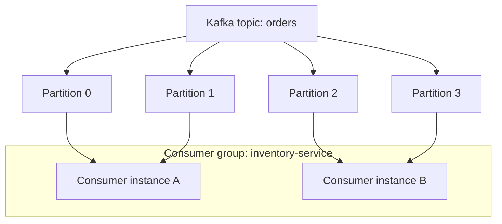
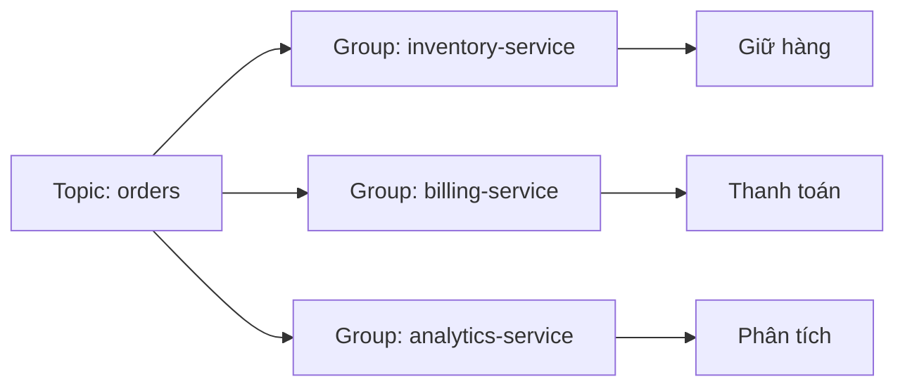

# Consumer group

Khi application event được chuyển từ ứng dụng Spring Modulith sang một message broker, nhiều consumer có thể cùng đọc một luồng sự kiện. Consumer group xác định những consumer nào đang chia sẻ một workload và cách broker phân phối message giữa chúng. Thiết kế group đúng giúp tăng khả năng xử lý song song, mở rộng số instance và tách các nghiệp vụ nhận cùng một event.

Khái niệm consumer group thường được nhắc đến với Apache Kafka. Trong Kafka, các consumer có cùng `group.id` phối hợp để chia nhau đọc các partition của topic. Các consumer thuộc group khác nhau đọc độc lập, vì vậy mỗi group có thể nhận toàn bộ luồng record của topic. Đây là mô hình phân phối ở tầng broker; nó có ranh giới và cơ chế offset riêng với application event listener chạy bên trong một ứng dụng Spring Modulith.

## 1. Consumer group giải quyết vấn đề gì?

Giả sử module đơn hàng phát event `OrderPlaced`. Module kho cần giữ hàng, module thanh toán cần chuẩn bị thu tiền và hệ thống phân tích cần cập nhật số liệu. Các consumer này thực hiện những công việc độc lập, nhưng mỗi công việc có thể cần nhiều instance để đáp ứng tải.

Consumer group cho phép tổ chức các instance theo mục đích xử lý:

- Các instance `inventory` cùng đọc group `inventory-service`, chia nhau xử lý đơn hàng.
- Các instance `billing` cùng đọc group `billing-service`, chia nhau xử lý công việc thanh toán.
- Group `analytics` đọc luồng riêng để cập nhật dữ liệu phân tích.

Mỗi group có tiến độ đọc riêng. Việc group kho đã xử lý một record không làm group thanh toán mất record đó. Trong cùng một group, các consumer phối hợp để phân phối partition và lưu tiến độ đọc chung theo từng partition.

## 2. Consumer group trong Kafka hoạt động như thế nào?

Kafka lưu record trong topic và chia topic thành một hoặc nhiều partition. Trong một consumer group, tại một thời điểm, mỗi partition được gán cho tối đa một consumer member. Một consumer có thể nhận nhiều partition; một partition không được hai member cùng group đọc song song trong cùng một thời điểm bình thường.

Ví dụ topic `orders` có bốn partition và group `inventory-service` có hai consumer:



Trong ví dụ này, mỗi instance xử lý hai partition. Khi thêm instance C, Kafka có thể phân phối lại partition cho ba member. Khi một member dừng hoặc rời group, broker thực hiện rebalance để những member còn lại tiếp nhận partition của nó.

Số partition giới hạn mức song song tối đa trong một group tại một thời điểm. Nếu topic có bốn partition nhưng group có sáu consumer, ít nhất hai consumer sẽ không được gán partition. Tăng số instance vượt số partition không tự làm tăng throughput đọc của group. Muốn tăng song song, cần xem xét cả số partition, khả năng xử lý của consumer, tải hệ thống phụ thuộc và yêu cầu thứ tự.

Các group khác nhau nhận cùng topic một cách độc lập:



Đây là điểm khác biệt quan trọng giữa hai cách đặt group ID:

| Cấu hình | Hành vi |
| --- | --- |
| Nhiều instance dùng cùng `group.id` | Chia sẻ workload; mỗi partition được phân cho một member trong group. |
| Các nghiệp vụ dùng `group.id` khác nhau | Mỗi group có tiến độ riêng và tự đọc các record của topic. |
| Mỗi lần khởi động tạo một group ID mới | Broker xem đó là group mới; hành vi đọc record cũ phụ thuộc chính sách offset reset. |

## 3. Group ID và offset

`group.id` là định danh ổn định của một nhóm consumer logic. Kafka lưu offset theo group và partition. Offset cho biết group đã tiến tới vị trí nào trong partition; nó là tiến độ tiêu thụ của group, không phải trạng thái nghiệp vụ của đơn hàng.

Ví dụ, group `inventory-service` có thể đã commit offset đến record 120 của partition 0, trong khi group `billing-service` mới commit đến record 95 của cùng partition. Hai group tiến triển độc lập.

Hãy chọn group ID theo workload nghiệp vụ, ví dụ `inventory-service`, `billing-service` hoặc `order-analytics`. Các instance thực hiện cùng một trách nhiệm dùng chung ID. Môi trường production, staging và development thường cần group ID tách biệt để dữ liệu thử nghiệm không làm thay đổi tiến độ tiêu thụ production.

Group ID nên ổn định qua các lần restart. Nếu ứng dụng tạo ID ngẫu nhiên mỗi lần khởi động, Kafka sẽ nhìn thấy một group mới. Khi group chưa có offset, cấu hình `auto.offset.reset` quyết định vị trí bắt đầu đọc, chẳng hạn `earliest` hoặc `latest`. Cần chọn rõ chính sách này để tránh vô tình đọc lại toàn bộ lịch sử hoặc bỏ qua record cũ.

Offset được commit là tín hiệu tiến độ mà Kafka ghi nhận. Nếu consumer commit offset trước khi tác dụng phụ nghiệp vụ được lưu bền vững, tiến trình có thể dừng sau commit và trước khi hoàn tất công việc; record khi đó có thể bị bỏ qua khi chạy lại. Nếu consumer hoàn tất tác dụng phụ nhưng chưa commit offset rồi bị dừng, record có thể được giao lại. Vì thế, thứ tự xử lý và commit phải được thiết kế cùng với tính idempotent của consumer.

## 4. Consumer group và ranh giới event trong Spring Modulith

Spring Modulith tổ chức application event giữa các module trong cùng ứng dụng. Một module phát event qua `ApplicationEventPublisher`; module khác có thể đăng ký `@ApplicationModuleListener` để xử lý sau commit. Event Publication Registry theo dõi publication tới transactional listener, giúp ứng dụng nhận biết listener nào đã hoàn tất và publication nào cần được xử lý lại.

Các listener nội bộ này không tự động trở thành Kafka consumer group. Nếu một application event có nhiều listener nội bộ, mỗi listener đại diện cho một phản ứng nghiệp vụ riêng. Registry theo dõi publication theo listener. Consumer group lại là cơ chế phân phối record của broker tới nhiều instance thuộc cùng một workload logic.

Một ứng dụng có thể dùng cả hai tầng:

1. Module nguồn phát application event trong transaction nghiệp vụ.
2. Listener nội bộ xử lý các phản ứng thuộc cùng ứng dụng.
3. Event được đánh dấu externalized được chuyển qua adapter tích hợp broker.
4. Kafka lưu record trong topic và phân phối tới các consumer group bên ngoài.

Ví dụ event có thể được đánh dấu để externalize:

```java
import java.time.Instant;
import java.util.UUID;

import org.springframework.modulith.events.Externalized;

@Externalized("orders")
public record OrderPlaced(UUID orderId, Instant occurredAt) {
}
```

`orders` là target logic được khai báo cho externalization. Adapter được cấu hình trong ứng dụng chịu trách nhiệm ánh xạ target đó sang đích của broker, chẳng hạn topic Kafka. Cấu hình adapter, serializer, schema và bảo đảm giao nhận phải phù hợp với phiên bản Spring Modulith và hạ tầng messaging đang dùng.

Một consumer Kafka ở ứng dụng nhận có thể khai báo group ID như sau:

```java
import org.springframework.kafka.annotation.KafkaListener;
import org.springframework.stereotype.Component;

@Component
class InventoryOrderConsumer {

    private final InventoryService inventory;

    InventoryOrderConsumer(InventoryService inventory) {
        this.inventory = inventory;
    }

    @KafkaListener(topics = "orders", groupId = "inventory-service")
    void onOrderPlaced(OrderPlaced event) {
        inventory.reserveFor(event.orderId());
    }
}
```

Ví dụ consumer giả định ứng dụng đã cấu hình Kafka listener container, deserializer hoặc message converter để chuyển payload thành `OrderPlaced`. Annotation `@KafkaListener` thuộc Spring for Apache Kafka; nó không phải annotation của Spring Modulith. Một consumer khác xử lý thanh toán có thể đọc cùng topic với group ID `billing-service`.

Khi chỉ cần giao tiếp giữa các module trong cùng ứng dụng, dùng application event và listener nội bộ thường là đủ. Consumer group trở nên cần thiết khi event được đưa qua broker và nhiều instance hoặc nhiều ứng dụng độc lập cần tiêu thụ luồng message.

## 5. Chọn group theo trách nhiệm nghiệp vụ

Một group nên đại diện cho một workload logic có cùng mục tiêu, quy tắc xử lý và tiến độ tiêu thụ. Ví dụ, ba replica của dịch vụ kho cùng xử lý giữ hàng thì dùng một group `inventory-service`. Dịch vụ thanh toán cần tự theo dõi tiến độ của mình thì dùng group `billing-service`.

Không nên dùng chung một group cho hai nghiệp vụ độc lập chỉ vì chúng cùng đọc topic `orders`. Nếu inventory và billing dùng chung group, Kafka sẽ phân phối record cho một trong hai loại consumer theo assignment; mỗi record có thể chỉ đến một nghiệp vụ, trong khi cả hai nghiệp vụ đều cần nhận event. Hãy dùng hai group riêng để cả hai cùng nhận luồng.

Ngược lại, không nên tạo group riêng cho từng replica của cùng một dịch vụ nếu mục tiêu là chia tải. Mỗi group mới có offset riêng và có thể đọc lại toàn bộ luồng theo cấu hình reset. Điều đó làm tăng số lần xử lý và tài nguyên broker mà không tạo ra khả năng chia workload như mong muốn.

Khi xác định group, hãy trả lời:

- Các consumer có thực hiện cùng một trách nhiệm nghiệp vụ không?
- Chúng có thể chia nhau xử lý các partition không?
- Chúng có cần tiến độ đọc độc lập với consumer khác không?
- Khi một consumer hoàn tất record, các consumer còn lại có cần xử lý chính record đó không?
- Group có cần đọc lại lịch sử độc lập để xây dựng projection hoặc báo cáo không?

Nếu hai consumer có chính sách retry, thời hạn lưu dữ liệu hoặc yêu cầu replay khác nhau đáng kể, tách group thường giúp quản lý độc lập hơn.

## 6. Partition key và thứ tự xử lý

Kafka bảo đảm thứ tự record trong một partition. Để các event của cùng một nghiệp vụ được ghi vào cùng partition, producer thường chọn key ổn định, ví dụ `orderId`. Các record có cùng key thường được định tuyến vào cùng partition theo partitioner đang cấu hình.

Ví dụ, `OrderPlaced`, `PaymentCaptured` và `OrderCancelled` của cùng đơn hàng có thể dùng `orderId` làm key. Điều này giúp consumer quan sát các record của đơn hàng theo thứ tự trong partition. Tuy nhiên, nó không tạo ra thứ tự toàn cục giữa mọi đơn hàng hoặc giữa nhiều topic.

```java
// Minh họa ý tưởng: dùng orderId làm record key khi gửi message.
kafkaTemplate.send("orders", event.orderId().toString(), event);
```

Đoạn gửi trên minh họa lựa chọn key ở tầng Kafka producer. Nếu dùng Spring Modulith externalization, cách đặt key phụ thuộc adapter và cấu hình routing tương ứng; không nên giả định giá trị target trong `@Externalized` tự động trở thành Kafka record key.

Số partition và key distribution ảnh hưởng trực tiếp đến khả năng song song. Nếu một key chiếm phần lớn lưu lượng, partition nhận key đó có thể trở thành điểm nóng dù các partition khác còn rảnh. Tăng partition cũng có thể thay đổi cách key được ánh xạ trong một số cấu hình partitioner, nên cần cân nhắc ảnh hưởng tới thứ tự khi thay đổi topic.

Nếu nghiệp vụ cần thứ tự theo đơn hàng, consumer cũng phải tránh xử lý song song các record cùng key theo cách làm đảo thứ tự. Một thao tác bất đồng bộ được gửi đi rồi hoàn tất muộn hơn thao tác sau có thể làm trạng thái nghiệp vụ sai dù record được đọc theo thứ tự.

## 7. Rebalance và khả năng xử lý lại

Rebalance xảy ra khi thành viên group thay đổi hoặc metadata partition thay đổi. Kafka phân phối lại partition cho các member. Trong giai đoạn này, consumer có thể ngừng nhận record tạm thời; công việc đang xử lý dở cần được quản lý để tránh commit offset sai hoặc tạo tác dụng phụ trùng.

Các nguyên nhân thường gặp gồm:

- Một instance mới tham gia hoặc một instance hiện tại rời group.
- Container bị restart, mất kết nối hoặc không gửi heartbeat đúng hạn.
- Thời gian xử lý record dài hơn giới hạn cấu hình của consumer.
- Số partition của topic thay đổi.

Consumer cần xử lý được tình huống record được giao lại sau rebalance. Không được giả định mỗi record chỉ được gọi một lần. Hãy giới hạn thời gian xử lý, cấu hình poll/heartbeat phù hợp, đóng consumer gọn gàng khi shutdown và thiết kế thao tác nghiệp vụ idempotent.

Nếu xử lý một record mất nhiều thời gian, cần chọn chiến lược phù hợp: tăng thời gian xử lý cho phép, tách công việc nặng sang worker có cơ chế xác nhận riêng hoặc tạm dừng partition theo khả năng của listener container. Tránh tăng timeout tùy tiện vì nó có thể chỉ che giấu consumer bị treo.

## 8. Retry, offset và dead-letter topic

Khi consumer gặp lỗi, chính sách retry phải phù hợp với loại lỗi và yêu cầu thứ tự. Lỗi tạm thời như timeout dịch vụ có thể được thử lại với backoff. Lỗi dữ liệu không hợp lệ có thể không tự hết và cần chuyển sang dead-letter topic (DLT) hoặc quy trình xử lý thủ công.

Một luồng xử lý thường có các quyết định:

1. Xác định lỗi có thể thử lại hay là lỗi vĩnh viễn.
2. Giới hạn số lần retry và thời gian backoff để tránh tạo tải tăng đột biến.
3. Quyết định khi nào offset được commit sau khi xử lý thành công hoặc chuyển message sang DLT.
4. Lưu metadata đủ để liên kết message gốc, lỗi, số lần thử và consumer group.
5. Có quy trình replay DLT sau khi nguyên nhân được khắc phục.

Retry trên cùng partition có thể làm chậm các record phía sau hoặc làm thay đổi thứ tự nếu message lỗi được chuyển sang retry topic và record tiếp theo tiếp tục chạy. Với nghiệp vụ yêu cầu thứ tự theo key, cần thiết kế retry và DLT để không cho phép trạng thái sau vượt qua trạng thái trước một cách sai lệch.

Offset commit và cập nhật database là hai thao tác riêng nếu không có cơ chế transaction tích hợp phù hợp. Nếu consumer commit offset trước khi database commit, có thể mất tác dụng phụ. Nếu database commit trước rồi consumer dừng trước khi offset commit, record có thể được giao lại. Thiết kế phổ biến là chấp nhận khả năng giao ít nhất một lần và dùng idempotency để xử lý an toàn.

Không xem DLT là nơi lưu trữ vĩnh viễn không cần quản lý. Cần đặt retention, cảnh báo backlog, quyền truy cập, quy trình sửa dữ liệu và replay có kiểm soát. Khi replay, phải giữ hoặc ánh xạ idempotency key phù hợp để tránh tạo giao dịch trùng.

## 9. Idempotency và tác dụng phụ nghiệp vụ

Một consumer có thể nhận lại cùng một record khi offset chưa được commit, khi group rebalance hoặc khi ứng dụng phục hồi sau lỗi. Vì vậy, thao tác xử lý nên idempotent: cùng một message được xử lý nhiều lần vẫn dẫn tới một kết quả nghiệp vụ đúng.

Một số kỹ thuật:

- Dùng event ID ổn định làm khóa chống trùng.
- Lưu inbox/processed-message record cùng transaction với thay đổi nghiệp vụ.
- Đặt unique constraint cho thao tác như reservation, payment capture hoặc notification delivery.
- Truyền idempotency key ổn định khi gọi API bên ngoài.
- Kiểm tra trạng thái và thực hiện chuyển trạng thái có điều kiện trong transaction.

Ví dụ bảng inbox có thể lưu `consumer_name`, `event_id` và `processed_at`, với unique constraint trên cặp consumer và event. Consumer ghi nhận event ID và cập nhật nghiệp vụ trong cùng transaction. Khi message được giao lại, bản ghi đã tồn tại giúp nhận biết công việc đã hoàn tất. Đây là mẫu thiết kế do ứng dụng sở hữu; nó không tự động được tạo ra chỉ vì dùng consumer group.

Exactly-once trong broker không tự động bảo đảm một lần duy nhất cho mọi tác dụng phụ bên ngoài. Nếu consumer gọi HTTP hoặc cập nhật một database khác, cần thiết kế idempotency hoặc transaction phối hợp cho chính ranh giới đó. Hãy mô tả rõ bảo đảm thực tế của hệ thống thay vì chỉ dựa vào tên cấu hình delivery semantics.

## 10. Quan sát consumer group

Theo dõi trạng thái group giúp phát hiện consumer chậm, partition bị dồn tải hoặc message lỗi kéo dài. Các chỉ số hữu ích gồm:

| Chỉ số | Ý nghĩa vận hành |
| --- | --- |
| Consumer lag theo partition | Khoảng cách giữa vị trí record mới nhất và offset đã commit của group. |
| Tuổi record cũ nhất chưa xử lý | Cho biết thời gian một nghiệp vụ phải chờ. |
| Số member và assignment | Phát hiện member rời group, partition không có consumer hoặc phân phối không đều. |
| Rebalance count và duration | Nhận biết group liên tục mất ổn định. |
| Processing latency và error rate | Đánh giá tốc độ xử lý và lỗi theo loại event. |
| Retry/DLT volume | Phát hiện lỗi lặp lại hoặc message không thể xử lý. |

Lag thấp không luôn đồng nghĩa nghiệp vụ đã hoàn tất. Consumer có thể commit offset rồi thực hiện tác dụng phụ bất đồng bộ ở nơi khác. Cần kết hợp chỉ số broker với trạng thái nghiệp vụ, publication registry ở ứng dụng nguồn và trạng thái xử lý của consumer.

Log nên có event ID, business key, topic, partition, offset và group ID để liên kết sự cố giữa producer, broker và consumer. Không ghi payload nhạy cảm toàn phần nếu chỉ metadata là đủ cho điều tra.

## 11. Kiểm thử consumer group

Kiểm thử cần xác nhận hành vi phân phối và tính đúng đắn nghiệp vụ khi có nhiều instance:

- **Chia tải trong một group:** hai consumer cùng group xử lý các partition khác nhau và không chủ ý xử lý đồng thời cùng partition.
- **Fan-out giữa các group:** inventory và billing dùng group ID khác nhau đều nhận record của topic.
- **Thêm hoặc mất member:** group rebalance và tiếp tục xử lý sau khi assignment ổn định.
- **Offset và restart:** record đã commit không bị đọc lại theo chính sách thông thường; record chưa commit có thể được giao lại.
- **Idempotency:** gửi lại một event không tạo reservation hoặc thanh toán trùng.
- **Thứ tự theo key:** các event của cùng business key được xử lý theo quy tắc đã thiết kế.
- **Retry và DLT:** lỗi tạm thời được retry, lỗi không thể xử lý được chuyển theo chính sách và có thể replay sau khi khắc phục.
- **Externalization:** event được chọn externalize tới đúng target; event nội bộ không bị phát ra ngoài ngoài ý muốn.

Nên dùng integration test với broker thật hoặc môi trường tương đương, tạo topic có nhiều partition và khởi chạy nhiều consumer member. Test chỉ gọi trực tiếp method listener không xác minh được assignment, offset, rebalance hay fan-out giữa các group.

## 12. Những nhầm lẫn thường gặp

- **Consumer group không phải module boundary.** Module boundary được Spring Modulith kiểm soát trong cấu trúc ứng dụng; group là cơ chế phân phối message của broker.
- **Cùng topic không có nghĩa cùng group.** Các nghiệp vụ độc lập thường cần group ID riêng để mỗi bên nhận đầy đủ event.
- **Tăng consumer không luôn tăng throughput.** Số partition và năng lực hệ thống phụ thuộc giới hạn mức song song.
- **Một record không đồng nghĩa chỉ được xử lý một lần.** Rebalance, retry và offset commit có thể dẫn tới giao lại.
- **Offset không phải trạng thái nghiệp vụ.** Offset chỉ thể hiện tiến độ tiêu thụ mà broker ghi nhận.
- **Consumer group không thay thế Event Publication Registry.** Registry theo dõi publication nội bộ của Spring Modulith; broker group phân phối record trong hạ tầng messaging.
- **Các broker có mô hình khác nhau.** Kafka dùng group ID và partition assignment; RabbitMQ thường dùng nhiều consumer cạnh tranh trên cùng queue, còn fan-out tới các workload độc lập thường được tổ chức bằng các queue riêng được bind vào exchange. Không áp dụng máy móc thuật ngữ và bảo đảm của Kafka cho mọi broker.

## Checklist thiết kế

- [ ] Mỗi group đại diện cho một workload logic có cùng mục tiêu xử lý.
- [ ] Các replica của cùng workload dùng chung group ID ổn định.
- [ ] Các nghiệp vụ cần nhận độc lập dùng group ID riêng.
- [ ] Số partition phù hợp với throughput và mức song song mong muốn.
- [ ] Partition key phù hợp với yêu cầu thứ tự nghiệp vụ.
- [ ] Offset chỉ được commit theo chiến lược nhất quán với tác dụng phụ đã lưu bền vững.
- [ ] Consumer có idempotency và xử lý được record giao lại.
- [ ] Có chính sách retry, backoff, DLT và replay.
- [ ] Có giám sát lag, tuổi record, rebalance, lỗi và DLT.
- [ ] Đã kiểm thử nhiều member, nhiều group, restart và tình huống giao lại.

Consumer group giúp mở rộng một workload và tách tiến độ tiêu thụ giữa các nghiệp vụ. Khi kết hợp đúng với externalization của Spring Modulith, partition key, offset, idempotency và quan sát vận hành, ứng dụng có thể phân phối event đáng tin cậy mà vẫn giữ rõ trách nhiệm của từng module và từng consumer.
