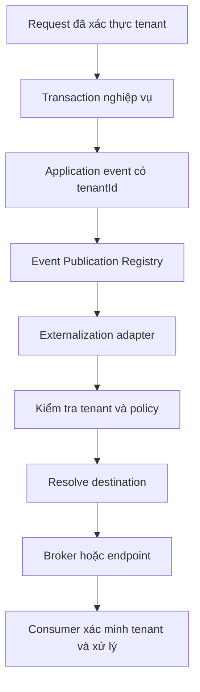

# Định tuyến application event theo tenant

Trong ứng dụng multi-tenant, cùng một loại sự kiện có thể được tạo ra bởi nhiều tenant. Ví dụ, hai khách hàng cùng hoàn tất đơn hàng và đều phát sinh `OrderCompleted`. Hệ thống tích hợp có thể dùng chung một broker, nhưng mỗi thông điệp vẫn phải được gắn đúng tenant, chuyển tới đúng nhóm consumer và không làm lộ dữ liệu của tenant khác.

Spring Modulith cung cấp application event và cơ chế externalization để tổ chức việc công bố sự kiện. Việc chọn tenant đích, kiểm tra quyền truy cập và ánh xạ tenant sang destination là trách nhiệm của thiết kế ứng dụng và lớp tích hợp. `@Externalized` có thể đánh dấu event cần externalize và một target logic; annotation tự nó không thay thế chính sách định tuyến, xác thực tenant hoặc cô lập dữ liệu.

## 1. Bài toán định tuyến theo tenant

Giả sử một nền tảng quản lý đơn hàng phục vụ nhiều doanh nghiệp. Mỗi tenant có dữ liệu, người dùng và cấu hình tích hợp riêng. Khi tenant A hoàn tất đơn hàng, event cần tới hệ thống fulfillment được cấu hình cho A. Khi tenant B phát cùng loại event, thông điệp phải được xử lý theo cấu hình của B.

Nếu chỉ định tuyến theo event type, mọi event `OrderCompleted` có thể đi tới cùng một destination. Cách này phù hợp khi tất cả consumer được phép nhận dữ liệu của mọi tenant và tự lọc bằng tenant ID. Nếu mỗi tenant có hệ thống nhận hoặc quyền truy cập riêng, adapter phải chọn đích theo tenant một cách có kiểm soát.

Một luồng khái quát:



Luồng này cần giữ được tenant identity từ lúc nghiệp vụ phát sinh event tới lúc consumer xử lý. Vì publication có thể được xử lý bất đồng bộ hoặc sau khi ứng dụng khởi động lại, không thể chỉ dựa vào thông tin tenant đang nằm trong request thread.

## 2. Xác định tenant identity tại ranh giới nghiệp vụ

Tenant ID phải đến từ nguồn đã được xác thực, chẳng hạn security principal, tenant resolver đã kiểm tra quyền hoặc aggregate đã được truy vấn trong phạm vi tenant. Không lấy tenant ID tùy ý từ request body rồi dùng trực tiếp làm quyền định tuyến.

Trước khi phát event, ứng dụng cần bảo đảm:

- Người gọi được phép thao tác trên tenant đó.
- Aggregate được đọc và cập nhật trong đúng tenant scope.
- Tenant ID gắn với event khớp tenant sở hữu aggregate.
- Tenant ID được lưu dưới dạng giá trị bất biến trong event.
- Việc thay đổi tenant context ở thread khác không thể làm đổi tenant của event đã phát.

Ví dụ event chứa tenant ID rõ ràng:

```java
import java.time.Instant;
import java.util.UUID;

import org.springframework.modulith.events.Externalized;

@Externalized("orders")
public record OrderCompleted(
    UUID eventId,
    String tenantId,
    UUID orderId,
    Instant occurredAt,
    int schemaVersion
) {}
```

`tenantId` trong ví dụ là định danh tenant nội bộ đã được xác thực và kiểm tra quyền. `orders` là target logic được dùng cho externalization; cách target này được ánh xạ sang destination cụ thể phụ thuộc adapter. Event lưu tenant ID để adapter có thể định tuyến lại ngay cả khi publication được xử lý sau request ban đầu.

Không nên đặt toàn bộ `TenantContext`, security principal hoặc request object vào event. Những đối tượng này thường chứa trạng thái theo thread, thông tin xác thực hoặc tham chiếu không thể serialize. Hãy sao chép những giá trị bất biến cần thiết vào payload hoặc metadata đã được kiểm soát.

## 3. Phát event trong transaction

Một application service có thể lấy tenant từ context đã được xác thực, kiểm tra aggregate và phát event cùng transaction nghiệp vụ:

```java
@Service
class OrderApplicationService {

    private final OrderRepository orders;
    private final TenantContext tenantContext;
    private final ApplicationEventPublisher events;

    OrderApplicationService(
        OrderRepository orders,
        TenantContext tenantContext,
        ApplicationEventPublisher events
    ) {
        this.orders = orders;
        this.tenantContext = tenantContext;
        this.events = events;
    }

    @Transactional
    public void complete(UUID orderId) {
        String tenantId = tenantContext.requireTenantId();
        var order = orders.findByTenantIdAndId(tenantId, orderId)
            .orElseThrow();

        order.complete();
        events.publishEvent(new OrderCompleted(
            UUID.randomUUID(),
            tenantId,
            order.getId(),
            Instant.now(),
            1
        ));
    }
}
```

`TenantContext` và phương thức repository ở đây là thành phần minh họa do ứng dụng định nghĩa. Điểm quan trọng là service xác thực tenant trước khi truy vấn aggregate, sau đó ghi tenant ID vào event cùng transaction. Repository cũng phải bảo đảm truy vấn có tenant predicate hoặc dùng cơ chế cô lập tenant tương ứng.

Event được phát trong transaction giúp event publication phối hợp với thay đổi nghiệp vụ theo cấu hình persistence. Nếu transaction rollback, hệ thống không nên externalize một sự kiện mô tả thay đổi chưa commit. Cơ chế transaction và Event Publication Registry cần được cấu hình đúng với phiên bản Spring Modulith và persistence đang dùng.

## 4. Không phụ thuộc vào ThreadLocal sau khi phát event

Nhiều ứng dụng lưu tenant hiện tại trong `ThreadLocal` để phục vụ request đồng bộ. Cách này có thể hữu ích trong thời gian xử lý request, nhưng externalization thường chạy bất đồng bộ, sau commit hoặc sau khi ứng dụng phục hồi publication còn dang dở.

Ở thời điểm đó:

- Thread xử lý request ban đầu có thể đã kết thúc.
- Worker xử lý publication có thể chạy trên thread khác.
- Thread pool có thể tái sử dụng thread cho tenant khác.
- Ứng dụng có thể khởi động lại và đọc publication từ database.
- Không có HTTP request hoặc security context ban đầu để khôi phục.

Vì vậy, không dùng `ThreadLocal` làm nguồn tenant duy nhất cho routing. Tenant ID cần được lưu trong event hoặc metadata bền vững gắn với publication. Nếu dùng tenant context trong worker để gọi code dùng chung, phải thiết lập và xóa context trong `try/finally`, đồng thời xác minh nó được khôi phục từ dữ liệu bền vững của chính event.

```java
try {
    tenantContext.set(event.tenantId());
    dispatcher.dispatch(event);
} finally {
    tenantContext.clear();
}
```

Đây chỉ là ví dụ về vòng đời context trong worker. Kiến trúc tốt hơn vẫn truyền tenant ID tường minh vào các thành phần cần nó, giúp luồng xử lý dễ kiểm tra và tránh rò rỉ context giữa các tác vụ trong thread pool.

## 5. Chọn chiến lược destination

Không có một cách phân vùng destination phù hợp cho mọi hệ thống. Lựa chọn phụ thuộc mức độ cô lập dữ liệu, số tenant, lưu lượng, yêu cầu vận hành và khả năng của broker.

| Chiến lược | Cách hoạt động | Phù hợp khi | Đánh đổi |
|---|---|---|---|
| Destination dùng chung | Mọi tenant gửi vào cùng topic/queue; message mang tenant ID | Nhiều tenant, consumer được phép đọc luồng chung | Consumer phải lọc và kiểm tra tenant; cần ACL và partition phù hợp |
| Partition theo tenant | Dùng tenant ID làm partition/routing key trong destination dùng chung | Cần giữ thứ tự trong phạm vi tenant hoặc phân tải | Thứ tự thường chỉ có trong một partition; tenant lớn có thể gây lệch tải |
| Destination riêng từng tenant | Mỗi tenant có topic/queue/exchange riêng | Cần cô lập truy cập hoặc cấu hình tích hợp riêng | Nhiều destination làm tăng chi phí quản trị và giới hạn tài nguyên |
| Endpoint riêng theo tenant | Adapter gọi endpoint đã đăng ký cho tenant | Tenant tích hợp qua HTTP hoặc dịch vụ riêng | Cần quản lý timeout, credential, rate limit và retry theo từng tenant |

### 5.1. Destination dùng chung

Với destination dùng chung, thông điệp có tenant ID trong payload hoặc header. Consumer đọc message rồi xác minh tenant trước khi truy cập dữ liệu. Đây là lựa chọn dễ mở rộng khi số tenant lớn và các consumer được phép nhận luồng chung.

Không coi tenant ID trong header là bằng chứng xác thực. Producer phải gắn ID từ nguồn tin cậy; consumer vẫn cần kiểm tra rằng message đến từ producer được cấp quyền và tenant đó nằm trong phạm vi xử lý của consumer.

### 5.2. Partition theo tenant

Nếu broker hỗ trợ partition key, có thể dùng tenant ID để các event cùng tenant đi vào cùng partition. Điều này giúp duy trì thứ tự tương đối trong partition theo semantics của broker. Nó không tự bảo đảm thứ tự giữa nhiều partition hoặc giữa nhiều destination.

Tenant có lưu lượng rất lớn có thể tạo hot partition. Hãy đo phân bố lưu lượng và cân nhắc cách phân vùng khác nếu một tenant làm giảm thông lượng của các tenant còn lại.

### 5.3. Destination riêng

Destination riêng giúp cấp quyền và cấu hình độc lập cho từng tenant, nhưng không nên tạo destination từ một chuỗi tenant ID bất kỳ. Cần có registry cấu hình tenant được quản trị, giới hạn số destination, quy trình tạo/xóa, kiểm soát ACL và xử lý tenant bị đình chỉ.

## 6. Tách target logic và destination vật lý

Trong Spring Modulith, `@Externalized("orders")` biểu thị target logic của event. Target này không nên chứa broker hostname, credential hoặc thông tin môi trường. Adapter tích hợp có thể nhận event đã externalize, đọc tenant ID và resolve target logic sang destination phù hợp.

Một port nội bộ của ứng dụng có thể mô tả bước resolve:

```java
public interface TenantDestinationResolver {
    Destination resolve(String target, String tenantId);
}
```

Đây là interface minh họa do ứng dụng định nghĩa, không phải API chuẩn của Spring Modulith. Một resolver có thể đọc cấu hình đã được quản trị:

```java
public class ConfiguredTenantDestinationResolver
        implements TenantDestinationResolver {

    private final TenantIntegrationRegistry registry;

    @Override
    public Destination resolve(String target, String tenantId) {
        var integration = registry.requireActiveIntegration(tenantId);
        return integration.destinationFor(target);
    }
}
```

`TenantIntegrationRegistry` và `Destination` cũng là kiểu minh họa. Trong triển khai thật, registry có thể lấy cấu hình từ database hoặc configuration service, có cache với thời hạn rõ ràng và có quy trình cập nhật khi tenant thay đổi cấu hình.

Điều quan trọng là resolver phải kiểm tra tenant tồn tại, đang hoạt động, được phép dùng target và có destination đã cấu hình. Nếu không có mapping, hãy trả lỗi có thể quan sát và đưa publication vào luồng xử lý lỗi phù hợp. Không tự tạo destination dựa trên dữ liệu chưa được kiểm tra.

## 7. Adapter định tuyến và gửi message

Adapter là nơi kết hợp event contract, target logic, tenant mapping và transport. Pseudocode sau minh họa thứ tự trách nhiệm; API gửi message thực tế phụ thuộc broker và integration module được chọn:

```java
public class TenantAwareOrderEventDispatcher {

    private final TenantDestinationResolver destinations;
    private final MessageTransport transport;

    public void dispatch(OrderCompleted event) {
        var destination = destinations.resolve(
            "orders",
            event.tenantId()
        );

        var message = new IntegrationMessage(
            event.eventId(),
            "order.completed",
            event.tenantId(),
            event.occurredAt(),
            event.schemaVersion(),
            event
        );

        transport.send(destination, message);
    }
}
```

`MessageTransport` và `IntegrationMessage` là abstraction minh họa. Khi nối vào Spring Modulith, hãy dùng extension point hoặc externalization integration được hỗ trợ bởi đúng phiên bản đang chạy; không giả định tên interface trong ví dụ tồn tại trong framework.

Adapter cần giữ các thuộc tính sau:

- Tenant ID được lấy từ event đã lưu, không lấy từ request hoặc thread hiện tại.
- Event ID giữ nguyên qua retry và replay.
- Target logic được kiểm tra trước khi resolve destination.
- Destination đến từ registry cấu hình đã được xác thực.
- Tenant metadata được truyền cho consumer theo hợp đồng thống nhất.
- Việc gửi có timeout và kết quả thành công/thất bại được xác định rõ.
- Không log credential hoặc toàn bộ payload nhạy cảm.

## 8. Tenant context và Event Publication Registry

Spring Modulith Event Publication Registry theo dõi publication của application event tới listener. Với cấu hình lưu trữ bền vững, registry giúp ứng dụng nhận biết publication đã hoàn tất hoặc còn dang dở để phục hồi theo cơ chế được cung cấp.

Registry không tự trở thành bộ định tuyến multi-tenant. Nó không thay thế tenant authorization, tenant-to-destination mapping hoặc ACL ở broker. Ứng dụng cần bảo đảm dữ liệu cần để externalize, đặc biệt tenant ID, có thể được khôi phục khi publication được xử lý lại.

Khi thiết kế persistence, cần trả lời:

- Tenant ID nằm trong payload event hay metadata được lưu bền vững?
- Serializer có giữ nguyên tenant ID sau khi đọc publication lại không?
- Worker phục hồi publication có thể resolve đúng tenant mà không cần request context không?
- Nếu tenant bị đình chỉ sau khi event được tạo, policy là gửi tiếp, giữ lại hay chuyển sang trạng thái cần can thiệp?
- Nếu mapping destination thay đổi giữa lúc event được tạo và lúc retry, dùng mapping tại thời điểm nào?

Với mapping thay đổi theo thời gian, cần quyết định rõ semantics. Một số sự kiện nên dùng destination hiện hành tại thời điểm gửi; một số tích hợp yêu cầu giữ đúng endpoint đã được chấp thuận tại thời điểm phát. Nếu phải giữ lịch sử, có thể lưu phiên bản cấu hình hoặc integration key trong event metadata. Tránh lưu credential hoặc secret trực tiếp vào event.

## 9. Cô lập dữ liệu và bảo mật tenant

Định tuyến đúng destination chưa đủ để bảo vệ dữ liệu. Cần kiểm soát cả producer, broker và consumer:

1. **Producer:** xác thực tenant, kiểm tra aggregate thuộc tenant, chỉ phát event với tenant ID hợp lệ.
2. **Adapter:** xác minh tenant active, target được phép và destination thuộc cấu hình của tenant.
3. **Broker:** dùng TLS, service identity và ACL giới hạn quyền publish/consume theo destination hoặc nhóm tenant.
4. **Consumer:** xác minh producer, tenant metadata và phạm vi dữ liệu trước khi xử lý.
5. **Persistence:** mọi truy vấn nghiệp vụ dùng tenant predicate hoặc cơ chế phân vùng phù hợp.

Không tin tenant ID chỉ vì nó xuất hiện trong message. Nếu consumer nhận message từ broker dùng chung, nó phải xác thực nguồn gửi và áp dụng tenant scope khi truy vấn dữ liệu. Một message có tenant ID sai có thể dẫn đến truy cập chéo tenant nếu consumer chỉ dựa vào payload để chọn database schema hoặc repository.

Nếu dùng destination riêng, ACL phải ngăn producer tenant A gửi vào destination tenant B và consumer A đọc dữ liệu của B. Nếu dùng destination chung, consumer phải có bộ lọc và kiểm tra tenant đáng tin cậy. Mã hóa đường truyền không thay thế kiểm soát quyền truy cập ở cấp message.

## 10. Idempotency và khóa chống trùng theo tenant

External event có thể được gửi lại khi broker timeout, worker khởi động lại hoặc publication được phục hồi. Consumer cần idempotency để cùng một event không tạo tác động nghiệp vụ nhiều lần.

Một bảng Inbox có thể dùng khóa duy nhất gồm consumer, tenant và event ID:

```sql
CREATE TABLE processed_event (
    consumer_name VARCHAR(200) NOT NULL,
    tenant_id VARCHAR(100) NOT NULL,
    event_id UUID NOT NULL,
    processed_at TIMESTAMP NOT NULL,
    PRIMARY KEY (consumer_name, tenant_id, event_id)
);
```

Trong transaction xử lý, consumer ghi Inbox và cập nhật dữ liệu nghiệp vụ cùng lúc. Nếu khóa đã tồn tại, message đó đã được xử lý trong phạm vi consumer và tenant tương ứng. Việc đưa `tenant_id` vào khóa giúp thể hiện phạm vi định danh rõ ràng, nhưng `event_id` vẫn phải duy nhất và ổn định theo quy ước của producer.

Nếu event ID được đảm bảo duy nhất toàn hệ thống, khóa `(consumer_name, event_id)` cũng có thể đủ. Chọn một quy ước thống nhất giữa producer và consumer; không để cùng một event bị coi là hai sự kiện khác nhau chỉ vì tenant metadata bị chuẩn hóa khác nhau.

Với tác động ngoài database, hãy truyền idempotency key tới hệ thống đích nếu nó hỗ trợ. Nếu không, cần lưu trạng thái yêu cầu và có quy trình đối soát hoặc bù trừ. Routing đúng tenant không giải quyết được việc một lệnh thanh toán hoặc gửi thông báo bị thực hiện hai lần.

## 11. Thứ tự sự kiện trong phạm vi tenant

Một tenant có thể phát nhiều event liên quan đến cùng aggregate. Nếu consumer yêu cầu thứ tự, cần xác định phạm vi ordering rõ ràng, chẳng hạn theo `tenantId + aggregateId`.

Các lựa chọn gồm:

- Dùng broker partition key kết hợp tenant ID và aggregate ID để các event liên quan đi cùng partition.
- Gắn sequence tăng dần theo aggregate và để consumer kiểm tra sequence kế tiếp.
- Claim hoặc xử lý tuần tự theo aggregate khi dùng worker tự quản lý.
- Phát hiện event đến sai thứ tự và giữ lại để xử lý sau thay vì áp dụng mù quáng.

Không giả định rằng thứ tự publish ở một thread được giữ nguyên qua nhiều worker, nhiều partition hoặc nhiều destination. Nếu tenant có nhiều luồng aggregate độc lập, vẫn có thể xử lý song song giữa các aggregate để tránh tuần tự hóa toàn tenant.

## 12. Retry, tenant bị lỗi và fairness

Lỗi cấu hình của một tenant không nên làm dừng toàn bộ luồng externalization nếu các tenant khác vẫn hoạt động bình thường. Cần phân loại lỗi theo tenant và destination, đồng thời áp dụng retry có giới hạn.

| Tình huống | Cách xử lý gợi ý |
|---|---|
| Broker tạm thời không sẵn sàng | Retry với exponential backoff và jitter |
| Endpoint riêng của một tenant lỗi | Retry riêng cho tenant đó, giới hạn concurrency |
| Tenant bị đình chỉ | Giữ hoặc cách ly publication theo policy đã định nghĩa |
| Tenant chưa có mapping destination | Báo lỗi cấu hình, không tự tạo destination |
| Payload không hợp lệ | Đưa vào trạng thái cần can thiệp; không retry vô hạn |
| Một tenant gửi lưu lượng quá lớn | Rate limit hoặc quota theo tenant |

Nếu một worker lấy batch gồm nhiều tenant, lỗi lặp của một tenant có thể chiếm worker hoặc làm chậm các tenant khác. Có thể chia queue theo nhóm, giới hạn số tác vụ đồng thời trên mỗi tenant hoặc dùng scheduler công bằng. Tránh tạo một thread riêng cho từng tenant khi số tenant không có giới hạn.

Retry nên có `eventId`, `tenantId`, target và attempt để truy vết. Nếu mapping destination thay đổi khi retry, ghi nhận mapping version hoặc destination đã chọn theo chính sách để đội vận hành hiểu message được gửi tới đâu.

## 13. Kiểm thử định tuyến theo tenant

Kiểm thử cần chứng minh cả tính đúng đắn của routing và khả năng ngăn truy cập chéo tenant. Các tình huống nên bao gồm:

| Tình huống | Điều cần xác minh |
|---|---|
| Tenant A phát event | Resolver chọn destination đã cấu hình cho A |
| Tenant B phát cùng loại event | Event được định tuyến theo cấu hình B |
| Tenant ID trong request giả mạo | Service từ chối hoặc dùng tenant từ identity đã xác thực |
| Aggregate thuộc tenant khác | Repository/service không cho thao tác chéo tenant |
| Worker xử lý sau khi request kết thúc | Routing vẫn đúng nhờ tenant ID lưu trong event |
| Publication được phục hồi sau restart | Tenant ID và mapping cần thiết vẫn được khôi phục |
| Tenant không active hoặc thiếu mapping | Không gửi sang destination mặc định ngoài ý muốn |
| Tenant A cố gửi tới destination B | Adapter/ACL từ chối |
| Broker giao message lặp | Consumer idempotent trong đúng tenant scope |
| Nhiều event cùng aggregate | Ordering được giữ nếu hợp đồng yêu cầu |
| Một tenant quá tải | Quota/fairness bảo vệ các tenant còn lại |

Một unit test cho resolver có thể cung cấp nhiều tenant và cùng target logic, sau đó xác minh destination khác nhau theo registry. Integration test cần dùng broker hoặc adapter test để kiểm tra routing key, header và ACL. Kiểm thử bất đồng bộ nên bảo đảm worker không cần request ThreadLocal để xác định tenant.

Đối với kiểm thử bảo mật, cần có trường hợp cố tình sửa tenant ID trong payload và trường hợp consumer nhận message từ producer không được cấp quyền. Kết quả mong đợi là message bị từ chối hoặc đưa vào luồng cách ly có thể quan sát, không được âm thầm chuyển sang tenant khác.

## 14. Observability và vận hành multi-tenant

Theo dõi externalization ở cả mức tổng thể và mức tenant. Các metric hữu ích gồm:

- Tổng số publication đang chờ, đã hoàn tất và thất bại.
- Độ trễ publication theo target và nhóm tenant.
- Số lần retry, số publication quá hạn và số lỗi resolve destination.
- Tỷ lệ lỗi transport, timeout và authentication/ACL.
- Số message trùng bị consumer loại bỏ.
- Phân bố lưu lượng và mức sử dụng quota theo tenant.

Log nên có `eventId`, `tenantId`, event type, target, destination key, attempt và correlation/trace ID. Hạn chế ghi dữ liệu nghiệp vụ nhạy cảm. Với hệ thống có rất nhiều tenant, không dùng tenant ID làm metric label không giới hạn vì cardinality cao có thể làm hệ thống metrics quá tải. Có thể dùng log/tracing có kiểm soát hoặc dashboard truy vấn theo tenant khi điều tra.

Đặt cảnh báo cho publication chờ quá lâu, lỗi mapping tăng đột biến, một tenant vượt quota hoặc consumer nhận message có tenant không hợp lệ. Cảnh báo cần đủ thông tin để phân biệt lỗi riêng một tenant với sự cố toàn hệ thống.

## 15. Checklist thiết kế

Trước khi triển khai định tuyến theo tenant, hãy xác nhận:

- [ ] Tenant ID được lấy từ nguồn đã xác thực và được kiểm tra quyền.
- [ ] Aggregate được truy cập trong đúng tenant scope.
- [ ] Event lưu tenant ID bất biến; worker không phụ thuộc request ThreadLocal.
- [ ] `@Externalized` và target logic được dùng đúng mục đích; mapping vật lý nằm ở adapter/configuration.
- [ ] Chiến lược destination (dùng chung, partition hoặc riêng) phù hợp với isolation và quy mô.
- [ ] Resolver chỉ chọn destination từ registry cấu hình được quản trị.
- [ ] Tenant bị đình chỉ hoặc thiếu mapping có policy rõ ràng.
- [ ] Broker ACL và consumer authorization bảo vệ ranh giới tenant.
- [ ] Payload không chứa credential hoặc dữ liệu vượt mục đích tích hợp.
- [ ] Event ID ổn định và consumer idempotent.
- [ ] Ordering được xác định theo tenant/aggregate nếu nghiệp vụ yêu cầu.
- [ ] Retry, quota và concurrency không để một tenant chiếm hết tài nguyên.
- [ ] Có kiểm thử tenant giả mạo, routing sai, phục hồi sau restart và message trùng.
- [ ] Metric, log và cảnh báo hỗ trợ điều tra theo tenant mà không tạo cardinality quá cao.

Định tuyến theo tenant bắt đầu từ việc xác định tenant đáng tin cậy tại ranh giới nghiệp vụ và lưu tenant identity cùng event. Externalization adapter dùng dữ liệu bền vững đó để resolve target logic thành destination, trong khi broker và consumer tiếp tục kiểm tra quyền truy cập. Kết hợp routing, isolation, idempotency, retry và observability giúp một ứng dụng Spring Modulith phục vụ nhiều tenant mà vẫn giữ được ranh giới dữ liệu và vận hành rõ ràng.
