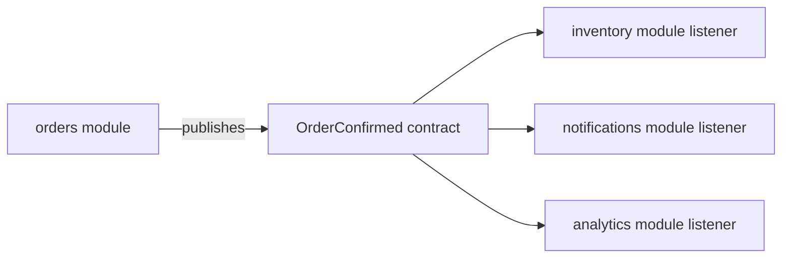
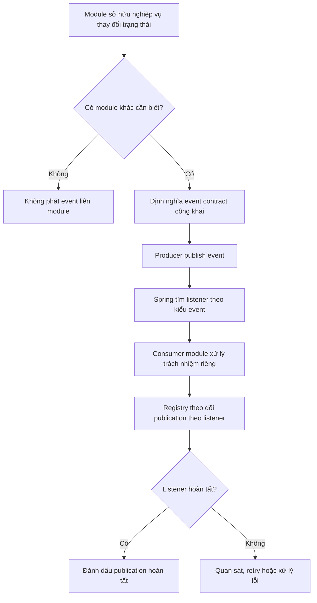

# Định tuyến theo module

Trong một ứng dụng Spring Modulith, application event cho phép module phát thông tin nghiệp vụ mà không cần biết module tiêu thụ đang được cài đặt ở đâu hoặc có implementation nào. Module phát sự kiện công bố một kiểu event có ý nghĩa rõ ràng; các module quan tâm đăng ký listener cho kiểu đó. Spring xử lý việc phân phối tới các listener phù hợp trong application context, còn Spring Modulith giúp kiểm soát quan hệ phụ thuộc giữa các module.

Định tuyến theo module vì vậy bắt đầu từ hợp đồng event và vị trí listener. Một event được publish từ module đơn hàng có thể được module kho hàng và module thông báo cùng tiêu thụ. Module đơn hàng không cần import các listener đó hoặc gọi trực tiếp từng module. Nếu chỉ một module cần nhận một thông tin, hãy thiết kế hợp đồng và consumer tương ứng với ý định đó; đừng biến tên module thành một chuỗi định tuyến tùy tiện nằm trong payload.

## Mục tiêu

Sau bài này, bạn có thể:

- Tổ chức event contract ở API của module phát sự kiện.
- Đăng ký listener trong module tiêu thụ và để Spring phân phối theo kiểu event.
- Kiểm soát dependency giữa producer và consumer bằng module API hoặc named interface.
- Hiểu fan-out khi nhiều module lắng nghe cùng một event.
- Chọn giữa event nghiệp vụ broadcast và lời gọi có đích rõ ràng.
- Kết hợp định tuyến với transaction, Event Publication Registry, kiểm thử và quan sát.

## 1. Định tuyến event diễn ra như thế nào?

Khi một bean gọi `ApplicationEventPublisher.publishEvent(event)`, event được phát trong Spring application context. Spring tìm các listener có khả năng nhận kiểu event đó và gọi chúng theo cơ chế listener đã cấu hình. Spring Modulith không yêu cầu producer chỉ định một tên module trong lời gọi `publishEvent`.

Điều này tạo ra một mô hình định tuyến dựa trên kiểu dữ liệu:

1. Module sở hữu nghiệp vụ định nghĩa event contract.
2. Producer publish một instance của event contract.
3. Các module tiêu thụ đăng ký listener cho kiểu event đó.
4. Spring phân phối event đến các listener phù hợp.
5. Event Publication Registry có thể theo dõi publication riêng cho từng listener được quản lý.

| Thành phần | Trách nhiệm |
|---|---|
| Producer module | Phát biểu một sự kiện nghiệp vụ đã xảy ra |
| Event contract | Mô tả dữ liệu consumer cần để phản ứng |
| Consumer module | Đăng ký listener và thực hiện hành vi thuộc trách nhiệm của module mình |
| Spring application context | Phân phối event tới các listener khớp kiểu |
| Spring Modulith | Kiểm soát module boundary và hỗ trợ theo dõi publication của listener |

Ví dụ, sau khi đơn hàng được xác nhận, module đơn hàng phát `OrderConfirmed`. Module kho hàng có thể giữ chỗ hàng, module thông báo có thể gửi email, còn module phân tích có thể cập nhật số liệu. Producer chỉ phát một sự kiện; nó không cần biết có bao nhiêu consumer đang đăng ký.

## 2. Đặt event contract tại ranh giới module

Hãy đặt event contract ở một package được module sở hữu và công khai có chủ đích. Cấu trúc ví dụ:

```text
com.example.shop
├── orders
│   ├── OrderApplicationService.java
│   └── events
│       ├── package-info.java
│       └── OrderConfirmed.java
├── inventory
│   └── OnOrderConfirmed.java
└── notifications
    └── OnOrderConfirmed.java
```

Trong Spring Modulith, các package con trực tiếp của application base package có thể được nhận diện thành application module. Package `orders` là module sở hữu event. Package `orders.events` có thể được công bố như một named interface để module khác phụ thuộc vào đúng hợp đồng event thay vì toàn bộ implementation của module đơn hàng.

Ví dụ `package-info.java`:

```java
@org.springframework.modulith.NamedInterface("events")
package com.example.shop.orders.events;
```

Event contract nên bất biến và chỉ chứa dữ liệu cần thiết cho consumer:

```java
package com.example.shop.orders.events;

import java.time.Instant;
import java.util.UUID;

public record OrderConfirmed(
    UUID orderId,
    Instant occurredAt
) {}
```

Event trên biểu diễn một sự kiện đã xảy ra: đơn hàng được xác nhận. Nó không chứa entity JPA, repository, service hoặc reference tới object nội bộ của module đơn hàng. Consumer chỉ phụ thuộc vào kiểu event công khai và các kiểu dữ liệu cơ bản trong hợp đồng.

Named interface giúp thể hiện rõ phần API mà module cho phép module khác sử dụng. Nếu event contract được đặt trực tiếp trong package gốc của module, package đó thường đã là API công khai mặc định; named interface hữu ích khi muốn phân tách một nhóm API như `events`, `spi` hoặc `api` trong package con.

## 3. Producer chỉ publish sự kiện của mình

Module đơn hàng phát event sau khi nghiệp vụ xác nhận đơn hàng thành công. Ví dụ dưới đây giả định phương thức chạy trong transaction:

```java
package com.example.shop.orders;

import java.time.Clock;
import org.springframework.context.ApplicationEventPublisher;
import org.springframework.stereotype.Service;
import org.springframework.transaction.annotation.Transactional;

import com.example.shop.orders.events.OrderConfirmed;

@Service
class OrderApplicationService {

    private final OrderRepository orders;
    private final ApplicationEventPublisher events;
    private final Clock clock;

    OrderApplicationService(
            OrderRepository orders,
            ApplicationEventPublisher events,
            Clock clock) {
        this.orders = orders;
        this.events = events;
        this.clock = clock;
    }

    @Transactional
    void confirm(OrderId orderId) {
        Order order = orders.getRequired(orderId);
        order.confirm();
        orders.save(order);

        events.publishEvent(new OrderConfirmed(
            order.id().value(), clock.instant()
        ));
    }
}
```

Producer chỉ phụ thuộc vào `ApplicationEventPublisher` và event contract của module mình. Nó không import `OnOrderConfirmed` từ module kho hàng hoặc module thông báo. Khi một consumer mới được thêm, producer không phải sửa code chỉ để gọi thêm consumer.

Đặt event sau khi trạng thái nghiệp vụ đã được thay đổi trong transaction. Với listener cần xử lý sau commit, dùng cơ chế listener theo transaction phù hợp để consumer không đọc thấy dữ liệu trước khi transaction của producer hoàn tất. Cách xử lý khi transaction rollback cần được xác định rõ: một event mô tả nghiệp vụ đã hoàn tất không nên làm consumer hành động nếu thay đổi tạo ra event chưa được commit.

## 4. Consumer đăng ký listener trong module của mình

Module kho hàng có thể đăng ký listener cho `OrderConfirmed`:

```java
package com.example.shop.inventory;

import com.example.shop.orders.events.OrderConfirmed;
import org.springframework.modulith.events.ApplicationModuleListener;
import org.springframework.stereotype.Component;

@Component
class OnOrderConfirmed {

    private final InventoryReservationService reservations;

    OnOrderConfirmed(InventoryReservationService reservations) {
        this.reservations = reservations;
    }

    @ApplicationModuleListener
    void reserveStock(OrderConfirmed event) {
        reservations.reserveFor(event.orderId());
    }
}
```

Module thông báo có thể đăng ký listener khác cho cùng kiểu event:

```java
package com.example.shop.notifications;

import com.example.shop.orders.events.OrderConfirmed;
import org.springframework.modulith.events.ApplicationModuleListener;
import org.springframework.stereotype.Component;

@Component
class OnOrderConfirmed {

    private final OrderNotificationService notifications;

    OnOrderConfirmed(OrderNotificationService notifications) {
        this.notifications = notifications;
    }

    @ApplicationModuleListener
    void sendConfirmation(OrderConfirmed event) {
        notifications.sendOrderConfirmation(event.orderId());
    }
}
```

Hai consumer có trách nhiệm riêng và không gọi lẫn nhau. Module kho hàng sở hữu việc giữ chỗ; module thông báo sở hữu việc gửi thông báo. Nếu một module cần thêm dữ liệu để thực hiện trách nhiệm của nó, nó có thể truy vấn API công khai của module sở hữu dữ liệu hoặc điều chỉnh event contract sau khi xem xét tác động tới tất cả consumer.

`@ApplicationModuleListener` thường được dùng cho xử lý event theo module với ngữ nghĩa bất đồng bộ và transaction riêng theo cấu hình Spring Modulith. Nếu cần xử lý đồng bộ ngay trong luồng publish, hãy chọn listener đồng bộ và chấp nhận rằng thời gian hoặc lỗi listener có thể ảnh hưởng trực tiếp tới producer. Hãy chọn cơ chế dựa trên yêu cầu nhất quán và thời gian phản hồi của nghiệp vụ.

## 5. Một event có thể được định tuyến tới nhiều module

Khi nhiều listener cùng nhận một kiểu event, Spring phân phối event tới từng listener phù hợp. Đây là fan-out. Mỗi module tự quyết định hành động của mình và có thể có thời gian xử lý, transaction và kết quả khác nhau.

| Event | Consumer module | Hành động |
|---|---|---|
| `OrderConfirmed` | `inventory` | Giữ chỗ hàng hóa |
| `OrderConfirmed` | `notifications` | Gửi thông báo xác nhận |
| `OrderConfirmed` | `analytics` | Cập nhật số liệu đơn hàng |

Producer không cần đợi tất cả consumer hoàn tất nếu dùng listener bất đồng bộ. Điều này giảm phụ thuộc thời gian giữa các module, nhưng cũng có nghĩa trạng thái của từng consumer có thể hoàn tất ở những thời điểm khác nhau. Nếu nghiệp vụ yêu cầu chỉ hiển thị đơn hàng là hoàn tất sau khi kho hàng đã giữ chỗ thành công, cần mô hình hóa trạng thái hoặc quy trình điều phối phù hợp thay vì giả định mọi listener đã chạy xong ngay sau `publishEvent`.

Đừng dùng một listener trung tâm để gọi trực tiếp tất cả module. Cách đó biến listener thành bộ điều phối biết quá nhiều về các module, khiến mỗi lần thêm consumer đều phải sửa một điểm chung. Hãy để từng module tự đăng ký với event contract mà nó quan tâm.

## 6. Khi nào cần định tuyến tới một module duy nhất?

Application event phù hợp nhất để công bố một sự kiện hoặc thông tin mà một hay nhiều consumer có thể quan tâm. Cơ chế listener theo kiểu event có tính chất publish-subscribe; producer không truyền tham số `moduleName` để Spring chỉ gửi event tới một module cụ thể.

Nếu một yêu cầu có đích duy nhất, hãy phân biệt hai tình huống:

- **Yêu cầu gọi một khả năng của module khác:** cân nhắc gọi module API công khai. Ví dụ, module checkout cần hỏi module pricing tính giá hiện tại. Đây là lời gọi có kết quả và phụ thuộc thời gian rõ ràng.
- **Một sự kiện nghiệp vụ đã xảy ra và một module cụ thể cần phản ứng:** dùng event contract có ý nghĩa rõ ràng, với consumer sở hữu hành động đó. Có thể đặt tên và phạm vi contract cụ thể để chỉ module dự kiến đăng ký listener.

Không nên thêm trường `targetModule = "inventory"` vào mọi event rồi tự viết một router chung nếu ứng dụng không thực sự cần cơ chế định tuyến động. Router kiểu này tạo thêm một giao thức riêng, cần xử lý tên module sai, consumer không tồn tại, quyền truy cập và kiểm thử. Một kiểu event riêng hoặc lời gọi module API thường dễ hiểu hơn.

Hãy phân biệt event và command. Event diễn tả điều đã xảy ra, chẳng hạn `OrderConfirmed`. Command diễn tả điều cần được thực hiện, chẳng hạn `ReserveStockForOrder`. Command thường có một chủ sở hữu xử lý và có thể cần kết quả hoặc trạng thái chấp nhận. Nếu dùng event để truyền một command, hãy đặt tên và quy định rõ semantics để consumer không hiểu nhầm đây là sự kiện đã hoàn tất.

## 7. Giữ dependency đúng chiều

Khi consumer import event contract của producer, dependency đi từ consumer tới API công khai của producer. Producer không phụ thuộc vào consumer. Đây là chiều phụ thuộc có thể kiểm soát trong modular monolith.



Trong mã nguồn, module tiêu thụ chỉ nên import kiểu event đã được công bố. Không import repository, entity hoặc service implementation từ module phát. Nếu consumer cần truy cập một hành vi của producer, hãy yêu cầu producer công bố một API rõ ràng thay vì truy cập package nội bộ.

Spring Modulith có thể kiểm tra cấu trúc module và dependency bằng `ApplicationModules`. Một kiểm thử kiến trúc cơ bản:

```java
import org.junit.jupiter.api.Test;
import org.springframework.modulith.core.ApplicationModules;

class ModularityTests {

    @Test
    void verifiesModuleDependencies() {
        ApplicationModules.of(ShopApplication.class).verify();
    }
}
```

Kiểm thử này giúp phát hiện dependency vi phạm quy tắc module, chẳng hạn consumer truy cập package nội bộ không được công bố. Nó không thay thế kiểm thử hành vi listener hoặc kiểm tra tính đúng đắn của quy trình nghiệp vụ.

## 8. Kết hợp transaction và Event Publication Registry

Định tuyến xác định listener nào nhận event; transaction xác định thời điểm listener được phép xử lý; Event Publication Registry theo dõi publication tới từng listener được quản lý. Đây là ba khía cạnh khác nhau của cùng một luồng.

Với listener xử lý sau commit, event được phát trong transaction producer và consumer chỉ nên chạy khi transaction đó commit thành công. Nếu transaction rollback, hành động của consumer không nên được xem là đã xảy ra. Với listener bất đồng bộ, mỗi consumer có thể hoàn tất độc lập.

Event Publication Registry theo dõi publication riêng cho listener. Nếu `inventory` hoàn tất nhưng `notifications` thất bại, trạng thái của hai publication không nên bị gộp thành một kết quả chung. Registry giúp nhận diện listener nào đã hoàn tất và publication nào còn chưa hoàn tất; khi được cấu hình với persistence phù hợp, thông tin đó hỗ trợ phục hồi sau khi ứng dụng khởi động lại.

Không nên coi việc producer gọi `publishEvent` là bằng chứng rằng mọi consumer đã xử lý thành công. Nếu nghiệp vụ cần biết một consumer cụ thể đã hoàn tất, hãy dùng trạng thái publication hoặc một trạng thái nghiệp vụ được thiết kế rõ ràng. Đừng suy ra trạng thái đó từ việc event đã được phát.

Khi listener gọi dịch vụ ngoài, transaction cơ sở dữ liệu không thể rollback tác động đã xảy ra ở hệ thống ngoài. Consumer cần idempotency key, đối soát hoặc cơ chế bù trừ phù hợp. Nếu retry một publication, cùng một event có thể được xử lý lại; vì vậy thao tác của listener phải an toàn khi nhận lặp.

## 9. Kiểm thử định tuyến theo module

Nên kiểm thử cả cấu trúc dependency và hành vi phân phối event:

| Trường hợp | Điều cần xác nhận |
|---|---|
| Producer publish `OrderConfirmed` | Các listener đăng ký đúng kiểu event được gọi |
| Thêm consumer mới | Producer không cần import hoặc sửa code để gọi consumer |
| Consumer không đăng ký event | Module đó không thực hiện hành động liên quan |
| Một event có nhiều consumer | Mỗi consumer thực hiện đúng trách nhiệm riêng |
| Producer transaction rollback | Listener sau commit không thực hiện hành động nghiệp vụ |
| Một listener thất bại | Publication của listener đó được ghi nhận chưa hoàn tất theo cấu hình registry |
| Một listener hoàn tất, listener khác thất bại | Trạng thái publication được theo dõi riêng |
| Consumer nhận lại cùng event | Xử lý idempotent, không tạo tác động trùng lặp |
| Dependency truy cập package nội bộ | Kiểm thử `ApplicationModules.verify()` phát hiện vi phạm |

Trong unit test, có thể gọi trực tiếp listener với event mẫu để kiểm tra quy tắc nghiệp vụ. Trong integration test, khởi động application context hoặc module context, publish event qua `ApplicationEventPublisher` và xác minh hành vi consumer. Với listener bất đồng bộ, dùng cơ chế chờ có điều kiện hoặc Awaitility để đợi kết quả; không dựa vào `Thread.sleep` cố định.

Nếu cần kiểm tra thứ tự giữa các listener, hãy xác định rõ yêu cầu nghiệp vụ trước. Không nên dựa vào thứ tự đăng ký bean hoặc thứ tự tình cờ của listener để điều phối quy trình. Nếu bước B chỉ được chạy sau khi bước A hoàn tất, hãy biểu diễn sự phụ thuộc bằng một event tiếp theo hoặc workflow có trạng thái rõ ràng.

## 10. Quan sát và xử lý lỗi theo consumer

Với định tuyến theo module, một event có thể đi tới nhiều consumer và mỗi consumer có vòng đời riêng. Log và metric cần cho phép nhận diện event nào được phát, module nào đang xử lý và publication nào thất bại.

Nên ghi nhận:

- Event type và event ID hoặc correlation ID.
- Module hoặc listener đích.
- Thời điểm publish, thời điểm bắt đầu xử lý và thời điểm hoàn tất.
- Kết quả xử lý, nhóm lỗi và số lần retry nếu có.
- Tuổi của publication chưa hoàn tất và số publication tồn đọng theo listener.

Tránh dùng event ID hoặc order ID làm metric label vì cardinality có thể tăng không giới hạn. Dùng các nhãn có tập giá trị ổn định như module, listener, event type và outcome; định danh cụ thể để trong log hoặc trace. Với fan-out, dashboard nên tách tỷ lệ hoàn tất và lỗi theo consumer để biết module nào đang gặp vấn đề.

Khi một consumer lỗi, trước tiên xác định lỗi thuộc dữ liệu event, quy tắc nghiệp vụ, phụ thuộc bên ngoài hay hạ tầng. Lỗi dữ liệu thường cần xử lý hoặc sửa dữ liệu; lỗi tạm thời có thể retry có giới hạn; lỗi không thể tự phục hồi có thể cần thao tác thủ công hoặc compensation. Đừng retry vô hạn mọi exception vì điều đó có thể làm một consumer chiếm tài nguyên và kéo dài publication chưa hoàn tất.

## 11. Những lỗi thiết kế thường gặp

| Lỗi | Hệ quả | Cách khắc phục |
|---|---|---|
| Producer import listener của module khác | Producer biết chi tiết consumer và tạo dependency ngược | Chỉ publish event contract |
| Event contract nằm trong package implementation | Consumer buộc phải phụ thuộc vào package nội bộ | Đưa contract vào API hoặc named interface |
| Một listener trung tâm gọi tất cả module | Điểm điều phối trở thành nơi phụ thuộc vào toàn hệ thống | Mỗi module tự đăng ký listener |
| Dùng event như command có phản hồi tức thời | Producer không biết command đã được chấp nhận hay chưa | Dùng module API hoặc mô hình command có kết quả rõ ràng |
| Giả định mọi consumer hoàn tất cùng lúc | Trạng thái nghiệp vụ bị hiểu sai khi xử lý bất đồng bộ | Theo dõi publication và trạng thái theo consumer |
| Dựa vào thứ tự listener ngẫu nhiên | Quy trình không ổn định giữa các lần chạy | Biểu diễn thứ tự bằng workflow hoặc event tiếp theo |
| Consumer không idempotent | Retry hoặc giao lại tạo tác động trùng | Dùng event ID/idempotency key và lưu dấu đã xử lý |
| Chỉ kiểm thử producer | Không phát hiện listener thiếu, sai hoặc lỗi | Kiểm thử cả module consumer và application context |

## 12. Quy trình thiết kế route



Khi thiết kế một route, hãy bắt đầu từ module sở hữu sự kiện và các module thực sự cần phản ứng. Công bố event contract qua API hoặc named interface, để mỗi consumer tự đăng ký listener và giữ dependency hướng về contract. Dùng fan-out khi nhiều module cần biết cùng một sự kiện; dùng module API hoặc command có đích rõ ràng khi cần yêu cầu một khả năng cụ thể và nhận kết quả. Kết hợp transaction, publication registry, idempotency và quan sát theo listener để luồng event có thể vận hành đáng tin cậy.
