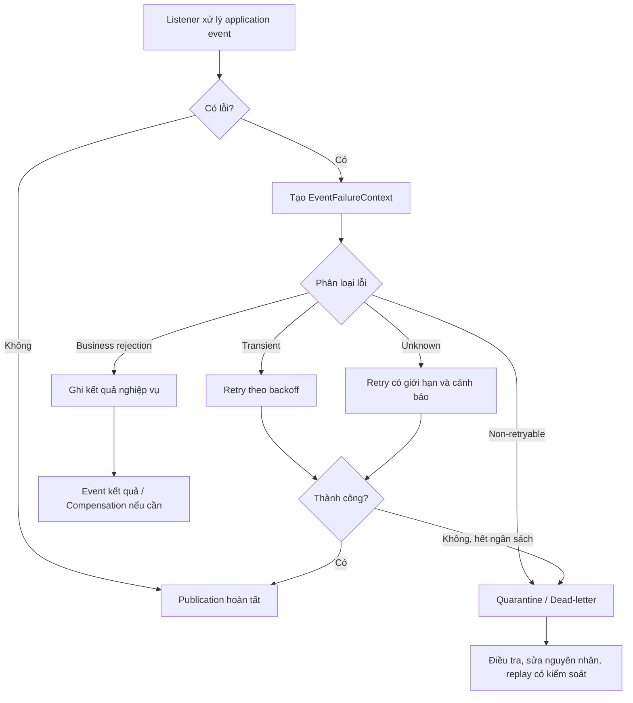

# Định tuyến lỗi

## Mục tiêu

Trong ứng dụng Spring Modulith, một application event có thể được nhiều module lắng nghe. Mỗi listener thực hiện một phần công việc riêng và có thể thất bại vì những nguyên nhân khác nhau. Nếu mọi exception đều đi qua cùng một nhánh xử lý, hệ thống khó phân biệt lỗi cần thử lại, dữ liệu cần cách ly, kết quả nghiệp vụ bị từ chối hay sự cố cần người vận hành can thiệp.

**Định tuyến lỗi** là việc chọn đúng luồng xử lý tiếp theo dựa trên ngữ cảnh của lần giao sự kiện và loại lỗi. Một lỗi timeout có thể được đưa vào lịch retry; payload không hợp lệ cần vào vùng cách ly; một điều kiện nghiệp vụ có thể tạo event kết quả hoặc kích hoạt compensation; lỗi chưa xác định cần được ghi nhận và cảnh báo.

Sau bài học, bạn có thể:

- Phân biệt định tuyến application event bình thường với định tuyến lỗi sau khi listener thất bại.
- Xây dựng ngữ cảnh lỗi có đủ event ID, listener, loại lỗi, attempt và correlation ID.
- Chọn tuyến retry, quarantine/dead-letter, business rejection hoặc compensation.
- Phối hợp tuyến lỗi với Spring Modulith Event Publication Registry mà không tạo hai cơ chế retry cạnh tranh.
- Thiết kế handler idempotent, tránh vòng lặp lỗi và kiểm thử từng tuyến.

## 1. Định tuyến lỗi giải quyết vấn đề gì?

Giả sử module Đơn hàng phát `OrderPlaced`. Module Kho giữ hàng, module Thanh toán khởi tạo thu tiền và module Thông báo gửi email. Cùng một event có thể được các listener xử lý độc lập. Khi một listener lỗi, hệ thống cần biết chính xác listener nào gặp vấn đề và phần công việc nào cần tiếp tục.

Ví dụ:

- Module Kho timeout khi truy cập database. Có thể thử lại sau một khoảng chờ.
- Listener Thanh toán nhận mã tiền tệ không được hỗ trợ. Gửi lại cùng payload không giúp ích; cần cách ly và sửa hợp đồng/dữ liệu.
- Module Thông báo không gửi được email vì địa chỉ sai. Có thể ghi nhận thông báo không gửi được và đưa vào quy trình cập nhật địa chỉ, thay vì chặn các listener khác.
- Module Kho xác định sản phẩm đã hết hàng. Đây có thể là kết quả nghiệp vụ hợp lệ dẫn tới hủy đơn hoặc chọn sản phẩm thay thế, không phải lỗi hạ tầng cần retry vô hạn.

Định tuyến lỗi giúp hệ thống đưa mỗi trường hợp tới đúng nơi chịu trách nhiệm. Tuyến xử lý cần giữ được ngữ cảnh của event gốc để có thể điều tra, retry, replay hoặc bù trừ.

### Phân biệt event routing và error routing

Event routing bình thường quyết định listener hoặc đích tích hợp nào nhận một event. Ví dụ, `OrderPlaced` được module Kho và module Thanh toán lắng nghe; một integration event có thể được gửi tới destination tương ứng.

Error routing chỉ diễn ra sau khi một lần xử lý thất bại. Nó quyết định cách xử lý failure của một cặp event/listener cụ thể. Một `OrderPlaced` có thể được module Kho xử lý thành công nhưng listener Thông báo thất bại. Khi đó chỉ publication của listener Thông báo cần đi theo tuyến lỗi; không nên xem toàn bộ event như một giao dịch thất bại chung.

Spring application events thường được phân phối tới các listener phù hợp với kiểu event và điều kiện đăng ký. Định tuyến lỗi là chính sách ứng dụng xây dựng quanh kết quả xử lý của từng listener; không có một annotation Spring Modulith chung tự động quyết định mọi loại lỗi phải đi tới retry queue, dead-letter hay compensation.

## 2. Phân loại lỗi và chọn tuyến

Trước khi định tuyến, hãy phân loại lỗi dựa trên nguyên nhân và khả năng khắc phục. Bảng sau là một chính sách khởi đầu; từng module có thể điều chỉnh theo SLO và quy tắc nghiệp vụ.

| Nhóm lỗi | Ví dụ | Tuyến đề xuất |
| --- | --- | --- |
| Tạm thời (transient) | Timeout, connection reset, deadlock, HTTP 503. | Retry có backoff; giữ publication chưa hoàn tất cho tới khi xử lý thành công hoặc hết ngân sách. |
| Không thể retry với cùng payload | Payload sai schema, thiếu định danh bắt buộc, phiên bản event không hỗ trợ. | Quarantine hoặc dead-letter kèm lý do và dữ liệu phục vụ điều tra. |
| Từ chối nghiệp vụ | Đơn đã hủy, sản phẩm hết hàng, hạn mức không đủ. | Ghi kết quả nghiệp vụ và phát event/command tiếp theo nếu quy trình yêu cầu. |
| Dependency kéo dài | Broker hoặc hệ thống ngoài ngừng hoạt động quá thời hạn xử lý. | Circuit breaker, retry có giới hạn, cảnh báo; sau đó quarantine chờ quyết định. |
| Không xác định | Exception mới, lỗi code hoặc lỗi chưa có bộ phân loại. | Retry có giới hạn, ghi đầy đủ context và chuyển hàng chờ xem xét khi vượt ngưỡng. |

Không nên chỉ phân loại bằng tên lớp exception hoặc mã HTTP. Một `IllegalStateException` có thể chỉ ra bug cần điều tra; một phản hồi HTTP 409 có thể là xung đột có thể giải quyết bằng cách tải lại trạng thái; HTTP 404 có thể là dữ liệu tham chiếu sai hoặc tài nguyên chưa được tạo kịp. Ý nghĩa phụ thuộc hợp đồng của dependency và nghiệp vụ.

Hãy tạo các loại lỗi có ngữ nghĩa rõ ràng, ví dụ `TransientEventException`, `NonRetryableEventException`, `BusinessRejectionException`. Nếu không thể xác định nguyên nhân, dùng nhóm `UNKNOWN` và một chính sách an toàn có giới hạn. Tránh mặc định mọi exception đều là lỗi tạm thời hoặc mọi lỗi sau lần thử thứ ba đều là lỗi dữ liệu vĩnh viễn.

## 3. Ngữ cảnh lỗi cần được giữ lại

Một tuyến lỗi không nên chỉ nhận một chuỗi thông báo exception. Nó cần một envelope chứa đủ dữ liệu để chọn chính sách, tìm publication gốc và quan sát quá trình phục hồi.

Ví dụ cấu trúc khái niệm:

```java
public record EventFailureContext(
        UUID eventId,
        String eventType,
        String listenerId,
        String aggregateId,
        String correlationId,
        String causationId,
        int attempt,
        Instant occurredAt,
        Instant failedAt,
        FailureCategory category,
        String errorCode,
        String errorMessage,
        String payloadReference) {}

public enum FailureCategory {
    TRANSIENT,
    NON_RETRYABLE,
    BUSINESS_REJECTION,
    DEPENDENCY_UNAVAILABLE,
    UNKNOWN
}
```

Ý nghĩa của các trường:

- `eventId`: định danh ổn định của event gốc, dùng để liên kết các lần thử và chống xử lý trùng.
- `eventType`: loại event và phiên bản hợp đồng nếu có.
- `listenerId`: module/listener chịu trách nhiệm cho lần xử lý thất bại.
- `aggregateId`: đối tượng nghiệp vụ liên quan, hữu ích khi điều tra thứ tự event.
- `correlationId`, `causationId`: liên kết event với request hoặc event đã gây ra nó.
- `attempt`: số lần xử lý theo một quy ước thống nhất; cần xác định lần đầu là 1 hay 0.
- `category`, `errorCode`: dữ liệu để chọn tuyến và thống kê.
- `payloadReference`: tham chiếu tới payload được lưu bền vững; không nhất thiết nhúng toàn bộ payload vào log hoặc error envelope.

Không nên phụ thuộc vào tên class Java đã serialize để xác định loại event. Dùng event type ổn định và version schema giúp consumer khác phiên bản vẫn hiểu hợp đồng. Không đưa mật khẩu, token, dữ liệu thanh toán hoặc toàn bộ dữ liệu cá nhân vào failure context; chỉ giữ dữ liệu cần thiết và tuân thủ chính sách truy cập/retention.

## 4. Mô hình các tuyến lỗi

Một mô hình dễ vận hành là phân tuyến theo category và policy thay vì viết một chuỗi `if/else` rải rác trong từng listener.



### Tuyến retry

Tuyến retry dành cho lỗi có khả năng tự phục hồi. Mỗi lần thử cần có delay, giới hạn số lần hoặc deadline. Exponential backoff kết hợp jitter giúp giảm việc nhiều worker cùng gọi dependency ngay sau một sự cố:

\[
  delay_n = \min(delay_{max}, delay_{base} \times 2^{n-1}) + jitter
\]

Khi retry thành công, listener hoàn tất và publication được đánh dấu hoàn tất theo cơ chế registry. Khi hết ngân sách, event được chuyển sang quarantine hoặc hàng chờ xử lý thủ công với lý do `RETRY_EXHAUSTED`/`DEADLINE_EXCEEDED`.

Chỉ nên có một nơi làm chủ ngân sách retry chính. Nếu Event Publication Registry resubmit publication, đồng thời một scheduler riêng cũng gửi lại cùng event và HTTP client có retry nội bộ, số lần gọi thực tế có thể nhân lên. Hãy thống nhất tầng nào chịu trách nhiệm retry, tầng nào chỉ retry request kỹ thuật ngắn hạn và cách tính attempt tổng.

### Tuyến quarantine hoặc dead-letter

Quarantine giữ event không thể tiếp tục xử lý tự động, cùng failure context, payload/reference, lịch sử attempt và nguyên nhân. Dead-letter queue (DLQ) thường là khái niệm ở tầng messaging broker, còn quarantine có thể là kho dữ liệu do ứng dụng quản lý. Chúng có mục đích gần nhau nhưng không đồng nhất:

| Cơ chế | Phạm vi | Cần lưu ý |
| --- | --- | --- |
| Quarantine trong ứng dụng | Lưu event/listener thất bại và quyết định xử lý. | Có thể gắn với Event Publication Registry và quy trình vận hành nội bộ. |
| Dead-letter queue | Lưu message bị broker/consumer chuyển sang đích lỗi theo cấu hình transport. | Cần theo dõi queue, quyền truy cập, retention và quy trình replay theo broker. |

Không gửi message vào DLQ rồi xóa publication gốc nếu chưa có xác nhận rằng message lỗi đã được lưu bền vững và có thể truy xuất. Việc chuyển tuyến cần có idempotency key để nếu worker chết sau khi ghi DLQ nhưng trước khi cập nhật trạng thái, lần chạy lại không tạo nhiều bản sao không kiểm soát.

### Tuyến business rejection

Một điều kiện nghiệp vụ bị từ chối có thể là kết quả hợp lệ. Ví dụ, module Kho trả về `InventoryUnavailable`; module Đơn hàng quyết định hủy đơn hoặc yêu cầu người dùng chọn sản phẩm khác. Hãy biểu diễn điều này bằng kết quả hoặc event nghiệp vụ có tên rõ ràng, thay vì biến nó thành exception kỹ thuật rồi retry.

Nếu việc từ chối làm cho các bước trước đó cần được hoàn tác, định tuyến sang quy trình compensation. Compensation là hành động nghiệp vụ mới, có ID và trạng thái riêng; không phải thao tác xóa event lỗi.

### Tuyến lỗi chưa xác định

Lỗi chưa phân loại nên được ghi đầy đủ context, retry trong giới hạn an toàn và phát cảnh báo khi vượt ngưỡng. Đây là nhóm cần chú ý vì có thể chứa bug mới hoặc thay đổi hợp đồng ngoài dự kiến. Không tự động bỏ qua để bảo vệ thông lượng; event phải còn khả năng điều tra và phục hồi.

## 5. Tích hợp với Spring Modulith Event Publication Registry

Spring Modulith Event Publication Registry theo dõi publication của application event tới các listener được quản lý. Registry lưu dấu vết publication và việc listener hoàn tất; publication chưa hoàn tất có thể được tìm và resubmit theo cơ chế ứng dụng cấu hình.

Định tuyến lỗi cần xác định rõ quan hệ giữa registry và failure handler:

1. Nếu lỗi tạm thời, listener để exception truyền ra. Publication chưa hoàn tất để chính sách retry/resubmission có thể thử lại.
2. Nếu lỗi không thể retry và ứng dụng chọn quarantine, listener chỉ kết thúc sau khi failure record đã được lưu bền vững. Registry có thể ghi nhận listener hoàn tất vì trách nhiệm của listener đã được chuyển giao cho quy trình quarantine.
3. Failure record vẫn phải thể hiện event bị lỗi. Trạng thái publication hoàn tất không có nghĩa nghiệp vụ thành công.
4. Nếu lưu failure record thất bại, exception cần được truyền ra để publication còn cơ hội phục hồi; không được nuốt lỗi lưu trữ.

Ví dụ dưới đây minh họa một tuyến lỗi do ứng dụng định nghĩa. Các interface `FailureClassifier`, `EventFailureRouter` và `FailureRecorder` là abstraction của ứng dụng, không phải API có sẵn của Spring Modulith.

```java
@Component
class InventoryOnOrderPlaced {

    private final InventoryProcessor processor;
    private final FailureClassifier classifier;
    private final EventFailureRouter failureRouter;

    InventoryOnOrderPlaced(
            InventoryProcessor processor,
            FailureClassifier classifier,
            EventFailureRouter failureRouter) {
        this.processor = processor;
        this.classifier = classifier;
        this.failureRouter = failureRouter;
    }

    @ApplicationModuleListener
    void reserveItems(OrderPlaced event) {
        try {
            processor.reserve(event);
        } catch (RuntimeException exception) {
            EventFailureContext context = classifier.classify(
                    event, "inventory-reservation", exception);

            FailureRoute route = failureRouter.route(context);
            if (route == FailureRoute.RETRY) {
                throw exception;
            }
            // QUARANTINE hoặc BUSINESS_REJECTION chỉ được trả về
            // sau khi đã lưu kết quả bền vững.
        }
    }
}
```

Một router có thể chọn tuyến theo category:

```java
public enum FailureRoute {
    RETRY,
    QUARANTINE,
    BUSINESS_REJECTION
}

@Component
class EventFailureRouter {

    private final FailureRecorder recorder;
    private final BusinessFailureHandler businessHandler;

    EventFailureRouter(
            FailureRecorder recorder,
            BusinessFailureHandler businessHandler) {
        this.recorder = recorder;
        this.businessHandler = businessHandler;
    }

    FailureRoute route(EventFailureContext context) {
        return switch (context.category()) {
            case TRANSIENT, DEPENDENCY_UNAVAILABLE, UNKNOWN ->
                    FailureRoute.RETRY;
            case NON_RETRYABLE -> {
                recorder.quarantine(context);
                yield FailureRoute.QUARANTINE;
            }
            case BUSINESS_REJECTION -> {
                businessHandler.recordRejection(context);
                yield FailureRoute.BUSINESS_REJECTION;
            }
        };
    }
}
```

Đây là ví dụ khung để diễn giải quyết định routing; triển khai thật cần định nghĩa cách tính attempt, tạo context, transaction và cách xử lý exception theo phiên bản Java/Spring đang dùng. Với lỗi `UNKNOWN`, chính sách thực tế thường phải retry có giới hạn thay vì ném exception vô hạn. Khi hết ngân sách, router chuyển sang quarantine với category/lý do `RETRY_EXHAUSTED`.

### Ranh giới transaction khi ghi failure record

Failure record phải bền vững trước khi listener kết thúc theo tuyến quarantine. Nếu việc ghi record tham gia cùng transaction đang bị rollback do exception, record có thể bị rollback theo và registry không có bằng chứng rằng lỗi đã được chuyển giao.

Một cách thiết kế là dùng một service ghi failure record trong transaction riêng, chẳng hạn `REQUIRES_NEW`, sau khi đã xác định listener sẽ xử lý lỗi theo tuyến quarantine. Cần kiểm tra proxy/transaction boundary để bảo đảm transaction riêng thực sự được mở. Nếu transaction ghi record thất bại, exception phải thoát ra ngoài. Không dùng `REQUIRES_NEW` một cách máy móc cho mọi side effect; phải hiểu rõ thứ tự commit và nguy cơ record lỗi được ghi trong khi transaction nghiệp vụ ban đầu rollback.

`@ApplicationModuleListener` thường chạy bất đồng bộ và sau commit theo semantics của annotation trong Spring Modulith. Vì vậy, listener cần được thiết kế theo transaction boundary thực tế; không giả định nó chạy đồng bộ trong transaction của publisher. Event Publication Registry nên dùng persistence phù hợp khi cần khôi phục sau restart. API resubmission và cách lọc publication incomplete phụ thuộc phiên bản; hãy kiểm tra đúng phiên bản thư viện của ứng dụng khi cấu hình.

## 6. Thiết kế policy theo event và listener

Không phải mọi listener đều nên dùng cùng một chính sách. Gửi email có thể chấp nhận trễ vài giờ; giữ hàng có thể cần hoàn thành trong vài phút; cập nhật sổ cái có yêu cầu kiểm soát và audit nghiêm ngặt hơn.

Một policy có thể được xác định theo các thuộc tính:

- Event type và schema version.
- Listener/module nhận event.
- Failure category và error code.
- Ngân sách retry, backoff và deadline.
- Tuyến terminal khi hết ngân sách.
- Nhóm sở hữu và mức độ cảnh báo.

Ví dụ bảng policy:

| Event/listener | Lỗi | Policy |
| --- | --- | --- |
| `OrderPlaced` / Inventory | Database timeout | Retry ngắn, sau đó quarantine và cảnh báo đội Kho. |
| `OrderPlaced` / Notification | Email provider unavailable | Retry dài hơn; không chặn listener Kho/Thanh toán. |
| `OrderPlaced` / Payment | Currency unsupported | Quarantine, cảnh báo ưu tiên cao và yêu cầu xử lý hợp đồng/dữ liệu. |
| `InventoryUnavailable` / Order | Tồn kho không đủ | Xử lý như business rejection; quyết định hủy hoặc thay thế theo nghiệp vụ. |

Policy nên được quản lý tập trung hoặc khai báo rõ ràng theo module, có version và có kiểm thử. Tránh để tên listener hoặc tên exception tự động biến thành tên queue; route key cần ổn định, có thể quan sát và không làm lộ thông tin nội bộ.

## 7. Ngăn vòng lặp và xử lý duplicate

Một hệ thống định tuyến lỗi có thể tự tạo thêm event, ví dụ `EventProcessingFailed`. Nếu listener xử lý event lỗi cũng thất bại rồi lại phát một `EventProcessingFailed` mới, hệ thống tạo vòng lặp vô hạn.

Để tránh vòng lặp:

- Không dùng cùng listener/handler đang lỗi để xử lý event thông báo lỗi của chính nó.
- Giới hạn số tầng định tuyến; khi error handler thất bại, ghi log/metric tối thiểu và chuyển sang cơ chế dự phòng phù hợp.
- Gắn `causationId` trỏ về event gốc và giữ `correlationId` xuyên suốt quy trình.
- Đánh dấu event loại failure notification để tránh router áp dụng lại cùng policy.
- Có idempotency key ổn định cho thao tác ghi quarantine, gửi DLQ và phát thông báo.

Một lỗi có thể được xử lý nhiều lần do retry hoặc crash. Failure recorder nên upsert theo khóa như `(event_id, listener_id)`; bảng attempt riêng lưu lịch sử nếu cần. Khi chuyển sang DLQ, dùng event ID gốc làm khóa deduplication nếu broker hỗ trợ. Consumer nhận thông báo lỗi cũng cần idempotent.

Nếu nhiều listener cùng nhận một application event, trạng thái và attempt phải gắn với từng listener. Listener Kho hoàn tất không có nghĩa listener Thanh toán hoàn tất. Không đặt một cờ `event.failed=true` toàn cục nếu nó làm mất trạng thái riêng của từng publication.

## 8. Quan sát và vận hành các tuyến lỗi

Định tuyến lỗi cần cho người vận hành biết event đang nằm ở tuyến nào và vì sao. Nên theo dõi:

- Số lượng và tuổi event ở từng tuyến: retry pending, quarantine, DLQ, business rejection và compensation.
- Tỷ lệ lỗi theo event type, listener, module, failure category và error code.
- Attempt trung bình/tối đa, retry success rate và thời gian từ lỗi đầu đến phục hồi.
- Số publication incomplete trong Event Publication Registry và tuổi publication lâu nhất.
- Số lần chuyển tuyến thất bại, số failure record không ghi được và số duplicate bị loại.
- Số event đang chờ người xử lý, thời gian quarantine đến resolution và tỷ lệ replay thành công.

Log/trace nên chứa `event_id`, `listener_id`, `aggregate_id`, `correlation_id`, `causation_id`, `attempt`, `failure_category` và route đã chọn. Tránh log toàn bộ payload hoặc secret. Dashboard nên cho phép đi từ event ID tới publication registry, failure record, lịch sử retry và kết quả cuối cùng.

Đặt cảnh báo theo tác động nghiệp vụ: tuổi event chờ giữ hàng vượt deadline, publication thanh toán chưa hoàn tất, DLQ tăng đột biến hoặc quarantine không được xử lý trong thời gian cam kết. Chỉ nhìn tổng số lỗi có thể bỏ qua một nhóm nhỏ event quan trọng đang bị kẹt.

Quy trình vận hành cần nêu rõ ai chịu trách nhiệm cho từng route, khi nào được replay, khi nào cần compensation và ai có quyền bỏ qua event. Mỗi quyết định thủ công phải có lý do và dấu vết audit. Payload và failure context cần retention phù hợp với nhu cầu điều tra, quyền riêng tư và dung lượng lưu trữ.

## 9. Kiểm thử định tuyến lỗi

Kiểm thử nên xác nhận cả route được chọn và trạng thái publication/failure record sau cùng.

| Tình huống | Điều cần xác minh |
| --- | --- |
| Listener thành công | Không tạo failure record; publication hoàn tất. |
| Lỗi transient | Chọn tuyến retry; exception được truyền để cơ chế retry nhận biết. |
| Lỗi non-retryable | Quarantine được ghi bền vững; không tiếp tục retry tự động theo cùng policy. |
| Business rejection | Ghi kết quả nghiệp vụ hoặc phát event kết quả đúng một lần. |
| Failure recorder không ghi được | Listener không nuốt lỗi; publication có thể được phục hồi. |
| Retry hết ngân sách | Chuyển quarantine với lý do `RETRY_EXHAUSTED` và cảnh báo phù hợp. |
| Hai listener cùng nhận event | Trạng thái publication và failure được theo dõi độc lập. |
| Error notification thất bại | Không tạo vòng lặp thông báo lỗi vô hạn. |
| DLQ ghi thành công nhưng worker dừng trước khi cập nhật trạng thái | Lần chạy lại không tạo duplicate không kiểm soát. |
| Replay sau khi khắc phục | Event gốc được xử lý lại theo chính sách mới; lịch sử cũ còn nguyên. |

Ví dụ unit test cho policy router:

```java
@Test
void routesTransientFailureToRetry() {
    EventFailureContext context = contextWith(FailureCategory.TRANSIENT);

    FailureRoute route = router.route(context);

    assertThat(route).isEqualTo(FailureRoute.RETRY);
    verifyNoInteractions(failureRecorder, businessFailureHandler);
}

@Test
void persistsNonRetryableFailureBeforeReturningQuarantine() {
    EventFailureContext context = contextWith(FailureCategory.NON_RETRYABLE);

    FailureRoute route = router.route(context);

    assertThat(route).isEqualTo(FailureRoute.QUARANTINE);
    verify(failureRecorder).quarantine(context);
}
```

Unit test kiểm tra lựa chọn policy; integration test cần kiểm tra transaction, registry và tính bền vững. Với listener `@ApplicationModuleListener`, chú ý rằng listener chạy bất đồng bộ và sau commit; test gắn transaction rollback mặc định có thể không kích hoạt listener như kỳ vọng. Hãy dùng transaction commit rõ ràng hoặc gọi publisher/service từ một transaction độc lập. Kiểm thử resubmission bằng đúng cấu hình registry của ứng dụng để chắc chắn publication đã quarantine không bị retry ngoài ý muốn.

## 10. Những lỗi thiết kế thường gặp

| Lỗi | Hậu quả | Cách xử lý |
| --- | --- | --- |
| Dùng một tuyến chung cho mọi exception | Lỗi dữ liệu bị retry vô hạn hoặc lỗi tạm thời bị bỏ qua. | Phân loại lỗi và khai báo policy theo listener. |
| Coi toàn bộ application event thất bại khi một listener lỗi | Các listener đã hoàn tất bị xử lý lại không cần thiết. | Theo dõi publication theo từng listener. |
| Đồng thời retry bằng registry và scheduler riêng | Tăng số lần giao, duplicate và tải dependency. | Chọn một nơi làm chủ retry; phối hợp attempt/deadline. |
| Nuốt exception sau khi ghi log | Registry có thể ghi nhận listener hoàn tất dù chưa có xử lý bền vững. | Chỉ kết thúc khi đã hoàn tất hoặc bàn giao bền vững; nếu không, ném lỗi. |
| Error handler phát lại event lỗi của chính nó | Tạo vòng lặp error notification. | Tách handler, giới hạn routing depth và dùng fallback. |
| Chuyển DLQ nhưng không giữ ID gốc | Khó deduplicate và truy vết. | Giữ event ID, correlation ID và causation ID. |
| Quarantine không có người sở hữu | Event lỗi tồn đọng mà không ai giải quyết. | Gắn owner, SLA, dashboard và quy trình replay. |

## 11. Quy trình áp dụng

Khi triển khai định tuyến lỗi cho một module Spring Modulith:

1. Liệt kê event và listener; xác định side effect, deadline và mức độ quan trọng của từng listener.
2. Định nghĩa FailureContext có event ID, listener ID, attempt, category, error code và correlation metadata.
3. Phân loại lỗi và lập policy cho retry, quarantine/DLQ, business rejection và compensation.
4. Chọn cơ chế retry chính; xác định cách phối hợp với Event Publication Registry và resubmission.
5. Bảo đảm việc ghi failure record hoặc DLQ là bền vững và idempotent trước khi kết thúc listener theo tuyến terminal.
6. Tách trạng thái publication khỏi trạng thái failure và trạng thái compensation.
7. Ngăn vòng lặp error notification, kiểm soát duplicate và giữ thứ tự khi nghiệp vụ yêu cầu.
8. Kiểm thử từng route, transaction boundary, retry exhaustion, replay và nhiều listener.
9. Thiết lập dashboard, cảnh báo, owner, retention và audit cho các quyết định vận hành.

Định tuyến lỗi giúp mỗi lần xử lý event đi tới một con đường phục hồi phù hợp với nguyên nhân và trách nhiệm của listener. Khi kết hợp policy rõ ràng với Event Publication Registry, trạng thái bền vững và khả năng quan sát, các module Spring Modulith có thể tiếp tục giao tiếp qua application events mà vẫn xử lý được lỗi theo cách có thể giải thích và phục hồi.
