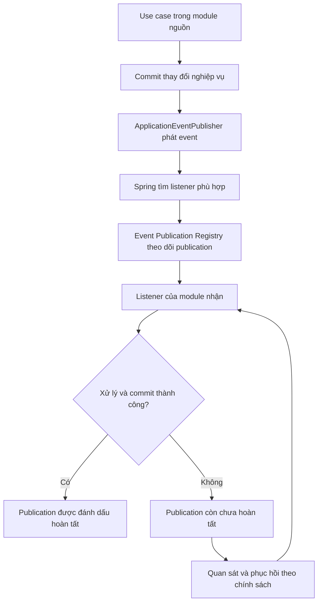

# Kiểm tra đường đi event

Trong Spring Modulith, một application event thường được phát từ module sở hữu nghiệp vụ và được giao đến một hoặc nhiều listener thuộc các module quan tâm. Kiểm tra đường đi event là xác nhận toàn bộ chuỗi đó hoạt động đúng: publisher tạo đúng event trong transaction, Spring tìm đúng listener, listener chạy đúng thời điểm, Event Publication Registry ghi nhận kết quả giao và hệ thống có đủ dấu vết để điều tra khi một chặng bị lỗi.

Đường đi event thể hiện cách các module giao tiếp qua hợp đồng sự kiện. Module phát event không cần gọi trực tiếp service của module nhận; module nhận chỉ cần lắng nghe loại event mà nó quan tâm. Cách tổ chức này giúp giảm phụ thuộc thời gian chạy và bảo vệ ranh giới nghiệp vụ. Phạm vi ở đây là application events trong cùng ứng dụng Spring Modulith. Chuyển event ra message broker hoặc hệ thống bên ngoài là một chặng tích hợp riêng, cần được cấu hình và quan sát riêng.

## 1. Nhìn toàn bộ đường đi

Một luồng event nội bộ thường có các bước sau:

1. Use case trong module nguồn thay đổi trạng thái nghiệp vụ.
2. Publisher phát event mô tả sự việc đã xảy ra.
3. Spring tìm các listener có kiểu event phù hợp và đăng ký publication tương ứng.
4. Listener transactional được gọi tại phase đã cấu hình; với `@ApplicationModuleListener`, việc xử lý diễn ra bất đồng bộ sau commit theo cơ chế của Spring Modulith.
5. Listener xử lý nghiệp vụ trong transaction của nó và hoàn tất publication khi xử lý thành công.
6. Nếu listener thất bại, publication chưa hoàn tất có thể được phát hiện và phục hồi theo cấu hình, phiên bản và chính sách vận hành của ứng dụng.



Sơ đồ biểu diễn luồng khái niệm. Chi tiết đăng ký publication, transaction và phục hồi phụ thuộc loại listener, cấu hình Event Publication Registry và phiên bản Spring Modulith đang dùng.

## 2. Phát event từ module sở hữu nghiệp vụ

Publisher nên phát một sự kiện mô tả điều đã xảy ra, với dữ liệu bất biến đủ để listener hiểu ý nghĩa nghiệp vụ. Ví dụ, sau khi đơn hàng được xác nhận, module Order phát `OrderConfirmed`:

```java
public record OrderConfirmed(
        UUID eventId,
        UUID orderId,
        Instant occurredAt
) {}
```

Use case phát event qua `ApplicationEventPublisher` trong transaction thay đổi đơn hàng:

```java
@Service
public class ConfirmOrderService {

    private final OrderRepository orders;
    private final ApplicationEventPublisher events;

    public ConfirmOrderService(
            OrderRepository orders,
            ApplicationEventPublisher events) {
        this.orders = orders;
        this.events = events;
    }

    @Transactional
    public void confirm(UUID orderId) {
        Order order = orders.findById(orderId)
                .orElseThrow(() -> new OrderNotFoundException(orderId));

        order.confirm();
        orders.save(order);

        events.publishEvent(new OrderConfirmed(
                UUID.randomUUID(),
                order.getId(),
                Instant.now()
        ));
    }
}
```

Phát event bên trong transaction cho phép listener transactional được gắn với kết quả commit của use case. Nếu transaction rollback, listener có phase `AFTER_COMMIT` không được chạy như thể nghiệp vụ đã thành công. Không nên phát event xác nhận một trạng thái trước khi trạng thái đó được lưu bền vững.

`ApplicationEventPublisher` chỉ phát application event trong process hiện tại. Lời gọi `publishEvent` không tự gửi message qua mạng và không tự biến event thành message của broker. Nếu cần giao ra ngoài ứng dụng, phải cấu hình externalization hoặc outbox/integration adapter phù hợp.

## 3. Xác định listener nhận event

Spring chọn listener dựa trên kiểu event mà phương thức đăng ký. Một module có thể có listener riêng cho từng trách nhiệm:

```java
@Component
public class InventoryEventListener {

    private final InventoryService inventory;

    public InventoryEventListener(InventoryService inventory) {
        this.inventory = inventory;
    }

    @ApplicationModuleListener
    public void on(OrderConfirmed event) {
        inventory.reserveFor(event.orderId());
    }
}
```

```java
@Component
public class BillingEventListener {

    private final BillingService billing;

    public BillingEventListener(BillingService billing) {
        this.billing = billing;
    }

    @ApplicationModuleListener
    public void on(OrderConfirmed event) {
        billing.createInvoiceFor(event.orderId());
    }
}
```

Khi `OrderConfirmed` được phát, cả hai listener phù hợp có thể nhận publication độc lập. Inventory và Billing không cần biết nhau; cả hai chỉ phụ thuộc vào hợp đồng `OrderConfirmed` do module nguồn công bố. Một event có thể tạo nhiều publication, mỗi publication tương ứng với một listener.

`@ApplicationModuleListener` là lựa chọn thường dùng cho giao tiếp giữa các module Spring Modulith. Annotation này kết hợp xử lý bất đồng bộ và transactional event listener theo cơ chế của framework. Theo mặc định của transactional event listener, việc xử lý gắn với transaction phase `AFTER_COMMIT`; listener có transaction riêng theo cấu hình annotation. Điều đó giúp listener chỉ xử lý sau khi thay đổi từ module nguồn đã commit.

Một phương thức `@EventListener` thông thường có thể chạy đồng bộ ngay khi event được phát. Nếu listener cần chỉ chạy sau commit, hãy dùng cơ chế transactional event listener thích hợp thay vì giả định mọi listener đều đợi transaction kết thúc.

## 4. Chọn chiến lược định tuyến

Đường đi event cần được thể hiện rõ trong hợp đồng và cấu trúc listener. Có ba cách thường gặp:

| Cách định tuyến | Khi phù hợp | Điều cần kiểm tra |
| --- | --- | --- |
| Theo kiểu event | Các module nhận cùng quan tâm một sự kiện nghiệp vụ. | Kiểu event được công bố đúng; mọi listener cần thiết đều đăng ký đúng kiểu. |
| Theo event type riêng | Các luồng có ý nghĩa hoặc chính sách xử lý khác nhau. | Publisher phát đúng loại event; consumer không phải suy diễn quá nhiều từ payload. |
| Theo điều kiện nghiệp vụ trong listener | Một listener chỉ xử lý một phần event theo dữ liệu rõ ràng. | Điều kiện có thể đọc, kiểm thử được; trường hợp bỏ qua được xem là kết quả hợp lệ. |

Ví dụ, nếu đơn hàng nội địa và đơn hàng quốc tế có quy tắc giao nhận khác hẳn nhau, có thể công bố hai event riêng như `DomesticOrderConfirmed` và `InternationalOrderConfirmed`. Nếu khác biệt chỉ là một thuộc tính nhỏ và cùng một listener sở hữu quyết định, listener có thể kiểm tra thuộc tính đó trước khi gọi service tương ứng.

```java
@ApplicationModuleListener
public void on(OrderConfirmed event) {
    if (!event.requiresInventoryReservation()) {
        return;
    }

    inventory.reserveFor(event.orderId());
}
```

Trong ví dụ này, listener vẫn nhận publication. Việc bỏ qua là quyết định nghiệp vụ có chủ đích và listener kết thúc bình thường, do đó publication được xem là đã xử lý. Không dùng `return` để che giấu lỗi hoặc điều kiện chưa được xử lý; nếu event cần được retry, hãy để lỗi truyền về cơ chế quản lý publication.

Tránh biến một event chung thành payload chứa nhiều cờ mơ hồ khiến mọi listener phải tự giải mã xem có nên chạy hay không. Nếu nhiều module cần cùng một quy tắc định tuyến phức tạp, hãy làm rõ quy tắc trong hợp đồng hoặc tách các event theo ý nghĩa nghiệp vụ. Đừng để module nguồn phụ thuộc trực tiếp vào tên class hoặc service của từng module nhận.

## 5. Giữ ranh giới module trong đường đi event

Event là một phần hợp đồng giao tiếp giữa các module. Module nguồn sở hữu định nghĩa và thời điểm phát event; module nhận sở hữu phản ứng của nó. Các quy tắc sau giúp đường đi dễ kiểm soát:

- Công bố event qua API mà module khác được phép sử dụng. Không yêu cầu consumer truy cập package nội bộ hoặc repository của module nguồn.
- Dùng dữ liệu bất biến, có ý nghĩa nghiệp vụ và đủ để listener thực hiện trách nhiệm của mình.
- Không nhúng entity quản lý bởi persistence context hoặc truyền trực tiếp aggregate đang được sửa sang module khác.
- Không để module nguồn gọi service của consumer để hỏi event đã được xử lý chưa. Trạng thái giao publication thuộc cơ chế registry và quan sát vận hành.
- Đặt tên event theo sự kiện đã xảy ra, ví dụ `OrderConfirmed`, thay vì tên lệnh như `ConfirmOrder`.
- Khi thay đổi cấu trúc event, cân nhắc tương thích ngược, phiên bản payload và các listener đang triển khai.

Có thể dùng kiểm tra cấu trúc module của Spring Modulith để xác nhận các phụ thuộc module vẫn hợp lệ:

```java
class ModuleStructureTests {

    @Test
    void moduleDependenciesAreValid() {
        ApplicationModules.of(Application.class).verify();
    }
}
```

Kiểm tra này xác nhận quy tắc cấu trúc và phụ thuộc module theo cấu hình Spring Modulith. Nó không chứng minh event đã được phát, listener đã được gọi hoặc publication đã hoàn tất. Cần kiểm thử hành vi event riêng cho từng luồng quan trọng.

## 6. Kiểm tra vai trò của Event Publication Registry

Event Publication Registry theo dõi việc giao event đến các transactional listener. Với mỗi publication, registry ghi nhận listener liên quan và trạng thái hoàn tất. Khi listener hoàn tất thành công, publication được đánh dấu hoàn tất. Khi listener thất bại hoặc tiến trình dừng trước khi hoàn tất, publication còn dang dở có thể được truy vấn và phục hồi theo cơ chế được cấu hình.

Registry giúp trả lời các câu hỏi như:

- Event đã được giao đến listener nào?
- Listener nào còn publication chưa hoàn tất?
- Có publication nào tồn tại lâu hơn ngưỡng vận hành không?
- Sau khi khắc phục lỗi, publication nào cần được gửi lại?

Registry không phải một router tùy biến để ánh xạ event đến URL hoặc queue tùy ý. Việc chọn listener nội bộ dựa trên cơ chế event listener của Spring; registry theo dõi vòng đời publication tương ứng. Registry cũng không thay thế nhật ký audit nghiệp vụ chi tiết nếu ứng dụng cần ghi mã lỗi, số lần thử, thời lượng, người vận hành hoặc lý do bù trừ.

Khi kiểm tra registry, dùng API công khai như `EventPublicationRegistry` và cơ chế quản lý được hỗ trợ bởi phiên bản Spring Modulith đang sử dụng. Không phụ thuộc trực tiếp vào tên bảng hoặc cập nhật SQL nội bộ để ép publication hoàn tất. Cách đó có thể làm sai trạng thái mà framework dùng để phục hồi.

Một listener thất bại phải để lỗi được nhận biết bởi cơ chế transactional listener. Nếu bắt exception rồi trả về bình thường, framework có thể xem publication là hoàn tất mặc dù nghiệp vụ chưa xong. Chỉ bắt lỗi khi ứng dụng đã xử lý nó thành một kết quả hợp lệ và có thể giải thích rõ quyết định đó.

## 7. Phân biệt routing nội bộ và gửi event ra ngoài

Định tuyến application event trong một ứng dụng và gửi message đến hệ thống bên ngoài là hai chặng khác nhau.

| Nhu cầu | Cơ chế thường dùng |
| --- | --- |
| Module Order thông báo cho Inventory và Billing trong cùng ứng dụng | `ApplicationEventPublisher` và các listener Spring Modulith. |
| Theo dõi listener nội bộ đã xử lý event hay chưa | Event Publication Registry. |
| Gửi event đến broker hoặc hệ thống khác | Event externalization, outbox/relay hoặc integration adapter. |
| Đảm bảo consumer ngoài xử lý message lặp an toàn | Message ID ổn định, inbox/idempotency và chính sách retry của consumer. |

Nếu ứng dụng externalize event, hãy xác định rõ event nào được phép rời khỏi process, đích nhận, hợp đồng payload và trách nhiệm retry. `@Externalized` là một trong các cơ chế Spring Modulith hỗ trợ đánh dấu event cần externalize; cách cấu hình adapter và đích nhận phụ thuộc broker, phiên bản và cấu hình ứng dụng. Việc một module nhận application event thành công không tự chứng minh broker hoặc consumer bên ngoài đã nhận message.

Khi có nhiều chặng, nên quan sát từng chặng bằng cùng `event_id` hoặc correlation ID. Ví dụ: publisher tạo `OrderConfirmed`, Inventory hoàn tất publication nội bộ, externalizer gửi message ra broker, rồi consumer bên ngoài ghi nhận message. Mỗi chặng có thể có trạng thái và retry riêng; không gộp chúng thành một trạng thái “event thành công” duy nhất.

## 8. Kiểm thử đường đi event

Một bài kiểm thử tốt xác nhận cả publisher, listener phù hợp, tác động nghiệp vụ và trạng thái giao event. Với luồng `OrderConfirmed`, có thể tổ chức các trường hợp sau:

1. Khi use case xác nhận đơn commit, event được phát với đúng `orderId` và `eventId`.
2. Khi transaction nguồn rollback, listener chỉ chạy sau commit không thực hiện tác động nghiệp vụ.
3. Inventory listener nhận event và tạo reservation cho đúng đơn.
4. Billing listener nhận cùng event và tạo invoice đúng một lần theo idempotency policy.
5. Listener không liên quan không tạo tác động ngoài ý muốn.
6. Khi listener ném exception, publication chưa hoàn tất và có thể được phát hiện để phục hồi.
7. Khi publication được gửi lại, listener xử lý lặp an toàn và không tạo reservation hoặc invoice trùng.
8. Nếu event được externalize, kiểm tra riêng việc tạo message, xác nhận broker và xử lý ở consumer ngoài.

`@ApplicationModuleTest` có thể khởi động module cùng các module liên quan theo chế độ kiểm thử của Spring Modulith. Scenario API của Spring Modulith hỗ trợ mô tả việc publish event và chờ kết quả hoặc trạng thái mong đợi, phù hợp để kiểm tra hành vi bất đồng bộ mà không phải tự thêm các khoảng `sleep` tùy ý. Với từng phiên bản, dùng đúng API Scenario được cung cấp trong test support.

Ngoài kiểm thử hành vi, chạy `ApplicationModules.of(Application.class).verify()` để phát hiện phụ thuộc trái quy tắc. Hai loại kiểm tra bổ sung cho nhau: một loại kiểm tra cấu trúc module, loại còn lại kiểm tra đường đi và tác động của event.

## 9. Quan sát và chẩn đoán khi event đi sai đường

Khi một listener không chạy như mong đợi, lần lượt kiểm tra các điểm sau:

| Dấu hiệu | Điểm cần kiểm tra |
| --- | --- |
| Không có event được phát | Nhánh use case, transaction rollback, vị trí gọi `publishEvent` và loại event thực tế. |
| Event có phát nhưng listener không được gọi | Bean listener có được đăng ký không, kiểu tham số có khớp không, điều kiện lọc có loại event không, transaction phase có được kích hoạt không. |
| Listener chạy trước khi dữ liệu nguồn commit | Có dùng listener đồng bộ thông thường thay vì transactional listener không. |
| Listener chạy nhưng publication vẫn dang dở | Exception, rollback trong listener, lỗi lúc commit hoặc lỗi cập nhật registry. |
| Listener chạy nhiều lần | Publication được retry, nhiều listener cùng xử lý, hoặc có thêm tầng retry ở client/broker. Kiểm tra idempotency và cấu hình. |
| Module khác gọi trực tiếp service nội bộ | Rà soát hợp đồng event và quy tắc phụ thuộc module. |
| Consumer ngoài không nhận message | Kiểm tra riêng externalization, adapter, broker, routing destination và xác nhận gửi. |

Log nên chứa `event_id`, event type, module nguồn, listener ID, correlation/trace ID và thời điểm xử lý. Với mỗi listener, ghi thời điểm bắt đầu, thời điểm hoàn tất và lỗi đã được làm sạch. Không đưa toàn bộ payload hoặc dữ liệu nhạy cảm vào log.

Các chỉ số nên theo dõi gồm số publication chưa hoàn tất, tuổi publication lâu nhất, thời gian từ lúc commit nguồn đến lúc listener hoàn tất, tỷ lệ lỗi theo listener và số lần gửi lại. Với event externalized, bổ sung backlog và độ trễ riêng của broker/consumer. Tránh dùng event ID làm metric label có cardinality cao; dùng ID đó trong log và trace để truy vết.

## 10. Checklist xác nhận một đường đi event

- [ ] Publisher thuộc module sở hữu nghiệp vụ và phát event sau khi thay đổi đã sẵn sàng commit.
- [ ] Event có tên mô tả sự kiện đã xảy ra, ID ổn định và payload bất biến.
- [ ] Các listener phù hợp được Spring phát hiện và đăng ký đúng kiểu event.
- [ ] Listener cần xử lý sau commit dùng transactional event listener hoặc `@ApplicationModuleListener` phù hợp.
- [ ] Mỗi listener có trách nhiệm rõ ràng và xử lý lặp an toàn.
- [ ] Event Publication Registry theo dõi publication và có quy trình phát hiện publication chưa hoàn tất.
- [ ] Lỗi listener được truyền về cơ chế quản lý publication khi xử lý thực sự thất bại.
- [ ] Quy tắc module được kiểm tra bằng `ApplicationModules.verify()`.
- [ ] Kiểm thử xác nhận publisher, listener, transaction rollback, retry và tác động nghiệp vụ.
- [ ] Routing nội bộ và externalization có quan sát, retry và định danh riêng cho từng chặng.

Kiểm tra đường đi event là kiểm tra một hợp đồng giao tiếp từ lúc nghiệp vụ phát sinh sự kiện đến khi từng listener hoàn tất trách nhiệm. Khi publisher, kiểu event, listener, transaction phase, registry và công cụ quan sát được xác định rõ, các module có thể phối hợp mà không cần phụ thuộc trực tiếp vào service nội bộ của nhau; đồng thời nhóm vận hành có thể xác định chính xác event dừng ở chặng nào và cần phục hồi ra sao.
