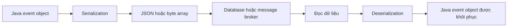
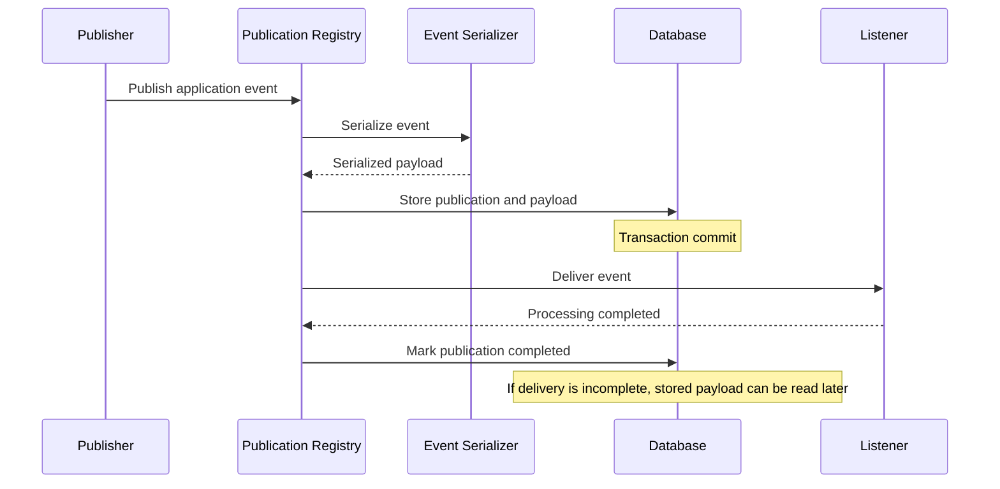

# Vì sao cần serialization trong Spring Modulith?

Trong một ứng dụng Spring, publisher có thể phát application event dưới dạng một object Java. Listener trong cùng tiến trình có thể nhận trực tiếp object đó mà không cần chuyển nó thành chuỗi hay mảng byte. Tuy nhiên, khi ứng dụng cần lưu publication vào database, khôi phục sự kiện sau khi restart, chuyển event qua message broker hoặc trao đổi với một hệ thống khác, object đang nằm trong heap không còn đủ. Ứng dụng cần một biểu diễn dữ liệu có thể lưu trữ hoặc truyền đi, và cần khả năng tái tạo event từ biểu diễn đó.

Quá trình chuyển object thành một định dạng dữ liệu được gọi là **serialization**. Quá trình ngược lại, tạo lại object từ dữ liệu đã lưu hoặc truyền, là **deserialization**. Trong module `SPRING_MODULITH_APPLICATION_EVENTS`, serialization giúp application event vượt qua ranh giới thời gian và ranh giới tiến trình, để cơ chế publication registry, retry và externalization có thể hoạt động đáng tin cậy.

## 1. Object trong bộ nhớ chưa phải dữ liệu có thể lưu trữ

Khi gọi `ApplicationEventPublisher.publishEvent(event)`, Spring chuyển event tới các listener phù hợp trong application context. Với listener chạy trong cùng tiến trình, event có thể được truyền dưới dạng object Java. Object này có kiểu, trường dữ liệu và các tham chiếu tới những object khác trong bộ nhớ.

Ví dụ:

```java
public record OrderCompleted(
        UUID eventId,
        UUID orderId,
        Instant occurredAt
) {}
```

Một instance `OrderCompleted` tồn tại trong heap của JVM. Sau khi tiến trình dừng, vùng nhớ đó không còn tồn tại. Database không thể lưu trực tiếp tham chiếu object của JVM để tiến trình khác dùng lại. Message broker cũng không thể nhận một tham chiếu Java như thể nó là dữ liệu trên mạng.

Serialization biến trạng thái cần thiết của object thành một biểu diễn độc lập với địa chỉ bộ nhớ, ví dụ JSON, byte array hoặc một định dạng nhị phân có schema. Biểu diễn này có thể được ghi vào database, gửi qua mạng hoặc lưu trong file. Khi cần xử lý lại, ứng dụng đọc dữ liệu và deserialize thành kiểu event mà listener hiểu được.



Serialization chỉ chuyển đổi biểu diễn dữ liệu. Nó không tự tạo transaction, không gửi message, không bảo đảm listener đã xử lý và cũng không làm cho event trở nên an toàn hoặc tương thích với mọi phiên bản ứng dụng.

## 2. Khi nào application event cần serialization?

Không phải mọi lần phát application event đều cần serialization. Nếu publisher và listener chạy trong cùng tiến trình, listener xử lý ngay và ứng dụng không cần lưu hay truyền event, object Java có thể được sử dụng trực tiếp. Serialization trở nên cần thiết khi event phải vượt qua một ranh giới mà object trong heap không thể đi qua.

### Lưu publication bền vững

Spring Modulith Event Publication Registry theo dõi việc giao event tới các listener. Khi ứng dụng dùng repository lưu trữ bền vững, registry cần lưu thông tin publication và nội dung event để có thể tiếp tục xử lý sau khi tiến trình khởi động lại. Database lưu dữ liệu, không lưu tham chiếu object của JVM; vì vậy event cần được serialize trước khi lưu.

Ví dụ, module đơn hàng phát `OrderCompleted` trong transaction. Listener cập nhật kho tạm thời không hoạt động. Registry cần giữ publication chưa hoàn tất. Khi ứng dụng được khởi động lại và lỗi đã được khắc phục, event được đọc từ kho lưu trữ, deserialize rồi giao lại cho listener. Nếu payload không thể khôi phục thành kiểu event tương ứng, registry không thể thực hiện việc phát lại theo cách mong đợi.

### Retry sau lỗi hoặc restart

Retry có thể xảy ra sau vài giây, vài phút hoặc sau một lần triển khai mới. Khi đó, object ban đầu có thể đã biến mất và phiên bản class trong ứng dụng có thể đã thay đổi. Serialization cho phép giữ lại dữ liệu event giữa các lần chạy, nhưng ứng dụng vẫn phải duy trì khả năng đọc dữ liệu cũ.

### Externalize qua broker

Khi application event được đưa ra ngoài qua Kafka, AMQP hoặc một adapter khác, payload cần được chuyển thành dữ liệu truyền qua mạng. Producer serialize event; consumer đọc message rồi deserialize hoặc ánh xạ payload sang kiểu dữ liệu của chính consumer.

### Ghi nhận và tích hợp dữ liệu

Một số ứng dụng cần lưu snapshot event, xuất dữ liệu hoặc chuyển event tới hệ thống phân tích. Các nhu cầu này cũng cần một biểu diễn dữ liệu rõ ràng. Tuy nhiên, log, audit record và message tích hợp có thể có yêu cầu định dạng khác với payload mà Event Publication Registry dùng để phục hồi listener.

## 3. Serialization nằm ở đâu trong vòng đời publication?

Hãy xét một luồng có persistent Event Publication Registry:

1. Publisher tạo event sau khi thực hiện thay đổi nghiệp vụ trong transaction.
2. Spring Modulith xác định các listener cần nhận event và ghi nhận publication.
3. Serializer chuyển event thành biểu diễn dữ liệu mà repository có thể lưu.
4. Transaction commit làm cho dữ liệu nghiệp vụ và publication được lưu theo cấu hình transaction đã chọn.
5. Listener xử lý event; registry ghi nhận publication hoàn tất khi quá trình xử lý thành công.
6. Nếu publication chưa hoàn tất sau lỗi hoặc restart, ứng dụng đọc payload đã lưu và deserialize để có thể giao event lại.



Sơ đồ mô tả vai trò khái niệm của serializer và registry. Thời điểm gọi listener, transaction phase, cách repository ghi bản ghi và cơ chế phục hồi cụ thể phụ thuộc cấu hình Spring Modulith cùng integration đang sử dụng.

Điều cần giữ rõ là registry quản lý trạng thái publication, còn serializer chuyển đổi nội dung event. Repository lưu trữ publication không thể tự suy ra cách tạo lại object Java nếu không có cơ chế deserialize phù hợp.

## 4. Phân biệt serialization của registry và serialization của broker

Một ứng dụng có thể có nhiều ranh giới serialization trong cùng một luồng event:

| Ranh giới | Mục đích | Bên đọc dữ liệu |
| --- | --- | --- |
| Event Publication Registry | Lưu event để theo dõi và phục hồi publication | Spring Modulith trong chính ứng dụng |
| Message broker | Đưa integration event qua mạng và lưu message theo chính sách broker | Consumer của hệ thống nhận |
| Log hoặc audit store | Lưu thông tin phục vụ điều tra, kiểm toán hoặc tra cứu | Công cụ vận hành hoặc hệ thống audit |

Các ranh giới này có thể dùng cùng một định dạng, nhưng không bắt buộc phải dùng chung serializer hoặc cùng schema. Registry có thể cần tái tạo kiểu event nội bộ để gọi listener. Broker cần một hợp đồng ổn định mà producer và consumer độc lập cùng hiểu. Audit store có thể chỉ cần một bản ghi đã chuẩn hóa và không cần khôi phục thành object event.

Không nên giả định việc registry serialize thành công đồng nghĩa message broker sẽ hiểu payload. Cũng không nên giả định JSON gửi qua broker có thể được đưa thẳng vào registry để khôi phục event nội bộ. Hãy xác định rõ định dạng, schema, metadata và trách nhiệm tương thích ở từng ranh giới.

## 5. EventSerializer trong Spring Modulith

Spring Modulith cung cấp abstraction `EventSerializer` cho việc chuyển event thành dữ liệu và khôi phục event từ dữ liệu đã serialize. Abstraction này tách cách biểu diễn event khỏi phần quản lý publication. Integration lưu trữ có thể sử dụng serializer để ghi nội dung event vào repository và đọc lại khi cần.

Khi chọn hoặc cấu hình serializer, cần trả lời các câu hỏi:

- Serializer hỗ trợ các kiểu dữ liệu được dùng trong event hay không?
- Dữ liệu đã serialize có thể được deserialize sau khi ứng dụng restart hay không?
- Phiên bản ứng dụng mới có đọc được payload do phiên bản cũ tạo ra không?
- Serializer xử lý trường thiếu, trường mới và kiểu dữ liệu đã thay đổi như thế nào?
- Kiểu event được xác định bằng cơ chế nào khi dữ liệu được khôi phục?
- Có giới hạn kích thước, thời gian xử lý hoặc quy tắc bảo mật nào không?

Spring Modulith có thể được tích hợp với serializer dựa trên Jackson hoặc một cơ chế phù hợp khác tùy dependency và phiên bản. Hãy kiểm tra artifact, cấu hình và API của đúng dòng phiên bản dự án đang sử dụng. Không nên suy luận rằng mọi ứng dụng Spring Modulith đều dùng một serializer hoặc một cấu hình mặc định giống nhau.

Trong trường hợp cần tùy biến, `EventSerializer` là điểm mở rộng cần xem xét. Serializer tùy chỉnh phải có cả chiều serialize và deserialize nhất quán. Chỉ viết được payload mà không khôi phục được đúng kiểu event thì không đáp ứng yêu cầu phục hồi publication.

## 6. Chọn định dạng serialization

Định dạng cần phù hợp với mục đích sử dụng, khả năng tương thích, công cụ vận hành và chi phí xử lý.

| Định dạng | Ưu điểm | Điểm cần cân nhắc | Trường hợp phù hợp |
| --- | --- | --- | --- |
| JSON | Dễ đọc, dễ kiểm tra, hỗ trợ rộng và thuận tiện cho tích hợp | Payload thường dài hơn binary; cần quy ước schema và kiểu dữ liệu | API, integration event và nhiều consumer khác nền tảng |
| Avro | Có schema, hỗ trợ tiến hóa schema và biểu diễn nhị phân gọn | Cần quản lý schema và tương thích phiên bản | Luồng event có schema registry hoặc nhiều consumer |
| Protocol Buffers | Binary gọn, schema rõ và sinh code cho nhiều ngôn ngữ | Cần quản lý file `.proto`, field number và quy tắc tương thích | Giao tiếp dịch vụ có hợp đồng schema chặt chẽ |
| Java native serialization | Có thể biểu diễn object Java theo cơ chế của nền tảng Java | Phụ thuộc class Java, khó tương thích dài hạn và có rủi ro khi deserialize dữ liệu không tin cậy | Chỉ trong phạm vi hẹp, có kiểm soát chặt về class và nguồn dữ liệu |

JSON thường là lựa chọn dễ bắt đầu cho integration event vì nhiều nền tảng có thể đọc được. Avro hoặc Protocol Buffers phù hợp khi tổ chức cần schema rõ, payload gọn hoặc quản lý tiến hóa schema tập trung. Định dạng binary không tự động tốt hơn: chi phí schema, công cụ debug và quy trình tương thích cũng cần được tính đến.

Không nên chọn định dạng chỉ dựa trên kích thước payload. Hãy xét thời gian lưu publication, khả năng đọc lại sau nhiều lần triển khai, số ngôn ngữ của consumer và yêu cầu quan sát khi có lỗi.

## 7. Thiết kế event dễ serialize

Event nên là một hợp đồng dữ liệu nhỏ và ổn định. Một kiểu event phù hợp thường có các đặc điểm sau:

- Dùng các trường dữ liệu có ý nghĩa nghiệp vụ rõ ràng.
- Ưu tiên kiểu giá trị đơn giản như UUID, chuỗi, số, boolean, enum có quy ước và thời điểm.
- Dùng record hoặc DTO bất biến khi phù hợp.
- Không giữ reference tới entity đang được quản lý bởi ORM hoặc object graph lớn.
- Không đưa connection, stream, thread, resource mở hoặc đối tượng framework vào payload.
- Không phụ thuộc proxy lazy-loading hay trạng thái nội bộ của persistence context.
- Giữ constructor, tên trường và ý nghĩa dữ liệu tương thích trong thời gian payload còn được lưu.

Ví dụ event gọn:

```java
public record OrderCompleted(
        UUID eventId,
        UUID orderId,
        Instant occurredAt,
        int schemaVersion
) {}
```

Event này chứa định danh, thời điểm và phiên bản hợp đồng. Listener có thể dùng `orderId` để thực hiện nghiệp vụ thuộc quyền sở hữu của nó. Publisher không phải serialize cả aggregate `Order` với các quan hệ và trạng thái persistence không liên quan.

### Vì sao không serialize trực tiếp entity?

Entity ORM thường có quan hệ hai chiều, proxy lazy-loading, collection có thể chưa được tải và trạng thái thay đổi trong persistence context. Serialize entity có thể kích hoạt truy vấn ngoài dự kiến, tạo vòng tham chiếu, làm payload rất lớn hoặc vô tình tiết lộ trường nội bộ.

Ngoài ra, entity thường thay đổi theo nhu cầu lưu trữ. Nếu event lưu trong database qua nhiều lần triển khai, việc đổi cấu trúc entity có thể làm payload cũ không còn deserialize được. DTO event tách hợp đồng sự kiện khỏi mô hình persistence và giúp quản lý thay đổi có chủ đích.

## 8. Ví dụ serialize và deserialize với Jackson

Ví dụ dưới đây minh họa nguyên tắc chuyển một record thành JSON và khôi phục lại. Đây là ví dụ Java/Jackson độc lập để giải thích serialization, không phải cấu hình đầy đủ cho Event Publication Registry của mọi phiên bản Spring Modulith.

```java
ObjectMapper mapper = new ObjectMapper()
        .findAndRegisterModules();

OrderCompleted event = new OrderCompleted(
        UUID.randomUUID(),
        UUID.fromString("a1b2c3d4-1111-4222-8333-123456789abc"),
        Instant.now(),
        1
);

byte[] payload = mapper.writeValueAsBytes(event);

OrderCompleted restored = mapper.readValue(
        payload,
        OrderCompleted.class
);
```

Với Jackson, ứng dụng cần dependency và module phù hợp cho các kiểu dữ liệu đang sử dụng. Ví dụ, `Instant` thường cần hỗ trợ Java Time của Jackson. Cấu hình mapper thực tế phải nhất quán giữa lúc ghi và lúc đọc; không nên tạo một mapper có quy tắc khác nhau ở hai chiều.

Kết quả JSON có thể có dạng:

```json
{
  "eventId": "d1b2c3d4-1111-4222-8333-123456789abc",
  "orderId": "a1b2c3d4-1111-4222-8333-123456789abc",
  "occurredAt": "2026-11-25T10:00:00Z",
  "schemaVersion": 1
}
```

Định dạng thời gian và cách ghi UUID phụ thuộc cấu hình serializer. Ví dụ chỉ minh họa dữ liệu cần được khôi phục; payload thực tế phải được kiểm tra bằng cấu hình đang dùng trong ứng dụng.

## 9. Tương thích khi event thay đổi

Serialization tạo ra dữ liệu có thể tồn tại lâu hơn object đã sinh ra nó. Một publication có thể được lưu hôm nay nhưng chỉ được xử lý sau khi ứng dụng đã nâng cấp. Vì vậy, tương thích ngược là yêu cầu thiết kế quan trọng.

Giả sử phiên bản đầu có event:

```java
public record OrderCompleted(UUID orderId) {}
```

Phiên bản sau thêm thời điểm hoàn tất:

```java
public record OrderCompleted(
        UUID orderId,
        Instant completedAt
) {}
```

Payload cũ không có `completedAt`. Consumer mới cần có cách xử lý trường thiếu, chẳng hạn dùng giá trị mặc định phù hợp hoặc chuyển payload cũ qua một mapper phiên bản. Không nên mặc định mọi serializer đều tự gán giá trị mặc định theo ý nghĩa nghiệp vụ.

Một số nguyên tắc tiến hóa schema:

- Thêm trường mới theo cách consumer cũ có thể bỏ qua và consumer mới có thể xử lý khi trường vắng mặt.
- Tránh đổi kiểu dữ liệu hoặc ý nghĩa của trường đã công bố.
- Tránh đổi tên enum value đang được lưu trong payload nếu dữ liệu cũ vẫn có thể được đọc.
- Giữ khả năng deserialize payload cũ trong khoảng thời gian publication chưa hoàn tất còn tồn tại.
- Dùng version rõ ràng và mapper chuyển đổi khi thay đổi không thể tương thích trực tiếp.
- Viết kiểm thử với payload mẫu được tạo từ các phiên bản trước.

### Kiểu event và tên class

Để khôi phục event, hệ thống cần biết payload tương ứng với kiểu event nào. Một số cách triển khai có thể lưu metadata kiểu hoặc dùng thông tin class; cách cụ thể phụ thuộc serializer và integration. Nếu dữ liệu phụ thuộc hoàn toàn vào tên package hoặc class Java, việc đổi package hay tái cấu trúc class có thể làm payload cũ khó đọc.

Với integration event, nên có `eventType` ổn định và schema version được quản lý như hợp đồng công khai. Với publication nội bộ, cần có chiến lược giữ tương thích class hoặc chuyển đổi dữ liệu publication cũ khi refactor. Đừng đổi tên class event đã lưu mà không xem xét các publication chưa hoàn tất trong database.

## 10. Serialization và bảo mật

Payload đã serialize vẫn là dữ liệu cần được bảo vệ. Khi đọc dữ liệu từ database, broker hoặc nguồn bên ngoài, ứng dụng phải xem xét nguồn gốc và tính hợp lệ của dữ liệu trước khi deserialize và xử lý.

Các nguyên tắc cần áp dụng:

- Không deserialize Java native object từ nguồn không tin cậy.
- Hạn chế cơ chế polymorphic typing rộng có thể cho phép tạo kiểu object tùy ý.
- Xác thực schema, event type và version trước khi gọi logic nghiệp vụ.
- Giới hạn kích thước payload, độ sâu object và các trường có thể gây tiêu thụ tài nguyên bất thường.
- Không serialize password, access token, secret hoặc dữ liệu cá nhân không cần thiết.
- Phân quyền truy cập database publication và topic/queue theo nguyên tắc tối thiểu.
- Dùng TLS cho truyền dữ liệu và mã hóa khi lưu trữ nếu yêu cầu bảo mật của hệ thống cần.

JSON dễ quan sát hơn Java native serialization, nhưng JSON không tự động an toàn. Cấu hình deserializer, polymorphic type metadata, kích thước đầu vào và kiểm tra schema vẫn rất quan trọng.

Serialization cũng không phải encryption. Nếu cần giữ bí mật payload, phải dùng cơ chế mã hóa phù hợp và quản lý khóa riêng. Base64 hoặc việc chuyển object thành JSON không làm dữ liệu trở nên bí mật.

## 11. Hiệu năng và dung lượng

Serialization tiêu tốn CPU và có thể tạo thêm bộ nhớ tạm. Payload lớn làm tăng dung lượng database, băng thông broker, thời gian ghi/đọc và chi phí quan sát. Với luồng event có lưu lượng cao, lựa chọn định dạng và kích thước payload có ảnh hưởng trực tiếp tới hiệu năng.

Một số cách kiểm soát:

- Chỉ đưa dữ liệu consumer cần vào event.
- Tránh lặp lại các object lồng nhau hoặc danh sách lớn.
- Không serialize entity graph hoặc dữ liệu nhị phân lớn nếu có thể lưu ở kho chuyên dụng và truyền định danh tham chiếu.
- Đo kích thước payload, thời gian serialize/deserialize và tốc độ ghi publication bằng dữ liệu đại diện.
- Chọn JSON hoặc binary dựa trên phép đo và yêu cầu tương thích thực tế.
- Thiết lập retention cho publication đã hoàn tất và message broker theo yêu cầu vận hành.

Nén có thể giảm dung lượng truyền hoặc lưu, nhưng làm tăng CPU và thêm một bước giải nén. Chỉ dùng khi đo đạc cho thấy lợi ích rõ ràng. Nếu nén payload, cần giới hạn kích thước sau giải nén để tránh dữ liệu nén gây tiêu thụ tài nguyên quá mức.

## 12. Kiểm thử serialization

Một event được tạo thành công trong unit test chưa chứng minh nó có thể được lưu và khôi phục. Cần kiểm tra cả chiều serialize, deserialize và khả năng tương thích với payload đã tồn tại.

Các tình huống kiểm thử nên có:

| Kiểm thử | Điều cần xác nhận |
| --- | --- |
| Round-trip | Serialize rồi deserialize tạo dữ liệu tương đương với event ban đầu |
| Kiểu dữ liệu | UUID, thời gian, enum, số thập phân và kiểu lồng nhau được biểu diễn đúng |
| Trường thiếu | Payload cũ thiếu trường mới được xử lý theo quy tắc đã định |
| Trường không biết | Consumer hoặc serializer xử lý trường mới theo chính sách tương thích |
| Payload cũ | Phiên bản ứng dụng hiện tại đọc được các payload mẫu được lưu trước đó |
| Publication registry | Publication có thể được lưu, đọc lại và phục hồi bằng persistent repository |
| Payload lỗi | Dữ liệu sai schema hoặc không hợp lệ được phát hiện và xử lý có kiểm soát |
| Giới hạn kích thước | Payload vượt ngưỡng bị từ chối hoặc cách ly theo chính sách |

Ví dụ một round-trip test có thể kiểm tra các trường quan trọng:

```java
@Test
void serializesAndDeserializesOrderCompleted() throws Exception {
    OrderCompleted original = new OrderCompleted(
            UUID.randomUUID(),
            UUID.randomUUID(),
            Instant.parse("2026-11-25T10:00:00Z"),
            1
    );

    byte[] payload = mapper.writeValueAsBytes(original);
    OrderCompleted restored = mapper.readValue(
            payload,
            OrderCompleted.class
    );

    assertThat(restored).isEqualTo(original);
}
```

Đây là ví dụ kiểm thử Jackson round-trip. Với Spring Modulith, cần thêm kiểm thử tích hợp trên repository và serializer thực tế để xác nhận publication có thể được khôi phục qua application context hoặc lần khởi động mới. Kiểm thử một mapper riêng không chứng minh toàn bộ cấu hình registry hoạt động.

## 13. Những lỗi thường gặp

| Lỗi | Hệ quả | Cách khắc phục |
| --- | --- | --- |
| Nghĩ rằng object Java có thể lưu trực tiếp vào database | Không thể khôi phục object sau khi tiến trình kết thúc | Chọn serializer và lưu payload có định dạng rõ |
| Serialize trực tiếp entity ORM | Payload lớn, vòng tham chiếu, lazy loading và lộ dữ liệu | Dùng event DTO bất biến |
| Chỉ kiểm tra chiều serialize | Có thể ghi dữ liệu nhưng không đọc lại được | Kiểm thử round-trip và payload cũ |
| Đổi class hoặc package event đã lưu | Publication cũ có thể không deserialize được | Giữ tương thích hoặc cung cấp migration/mapper |
| Đổi schema mà không version hóa | Consumer cũ và mới diễn giải dữ liệu khác nhau | Quản lý version và quy tắc tiến hóa schema |
| Dùng Java native serialization cho dữ liệu trao đổi rộng | Phụ thuộc class Java và tăng rủi ro bảo mật | Dùng định dạng có schema, giới hạn và kiểm soát |
| Cho rằng JSON là an toàn mặc định | Deserializer vẫn có thể nhận dữ liệu độc hại hoặc quá lớn | Kiểm tra schema, kiểu, kích thước và nguồn dữ liệu |
| Nhầm serialization với encryption | Payload vẫn đọc được nếu người khác truy cập dữ liệu | Dùng mã hóa và quản lý khóa riêng khi cần |
| Dùng cùng serializer cho mọi ranh giới mà không đánh giá | Hợp đồng nội bộ bị ràng buộc với hệ thống bên ngoài | Xác định serializer và schema theo từng ranh giới |

Một lỗi vận hành khác là xóa class event ngay sau khi đổi tên mà không kiểm tra publication chưa hoàn tất. Bản ghi cũ vẫn có thể nằm trong database và cần được deserialize khi retry. Việc dọn dữ liệu hoặc chuyển đổi payload phải theo quy trình có kiểm soát, tránh làm mất những publication còn cần giao.

## 14. Quy trình lựa chọn và triển khai serialization

Khi thiết kế serialization cho một luồng application event, hãy thực hiện theo trình tự sau:

1. Xác định event chỉ được xử lý trong bộ nhớ hay phải lưu bền vững, retry hoặc chuyển qua broker.
2. Liệt kê từng ranh giới serialization: publication registry, broker, audit store hoặc hệ thống tích hợp.
3. Thiết kế event DTO nhỏ, bất biến và tách khỏi entity persistence.
4. Chọn định dạng theo nhu cầu tương thích, khả năng quan sát, kích thước và công cụ của consumer.
5. Cấu hình serializer có cả chiều ghi và đọc, đồng thời xác định cách nhận diện kiểu event.
6. Định nghĩa version và chính sách tương thích cho payload có thể tồn tại qua nhiều lần triển khai.
7. Kiểm soát dữ liệu nhạy cảm, nguồn đầu vào, kích thước payload và quyền truy cập kho lưu trữ.
8. Viết round-trip test, kiểm thử payload cũ và kiểm thử tích hợp với Event Publication Registry.
9. Theo dõi lỗi serialization/deserialization, kích thước payload và publication chưa hoàn tất trong vận hành.
10. Khi thay đổi class hoặc schema, xử lý các payload cũ trước khi loại bỏ khả năng đọc chúng.

Serialization là nền tảng để event rời khỏi bộ nhớ và tồn tại qua thời gian. Trong Spring Modulith, nó giúp Event Publication Registry lưu và khôi phục publication; trong externalization, nó giúp producer và consumer trao đổi dữ liệu qua broker. Khi payload được thiết kế gọn, serializer có hai chiều nhất quán và schema được quản lý qua các phiên bản, application event có thể được lưu trữ, retry và tích hợp mà không làm mất ý nghĩa nghiệp vụ.
