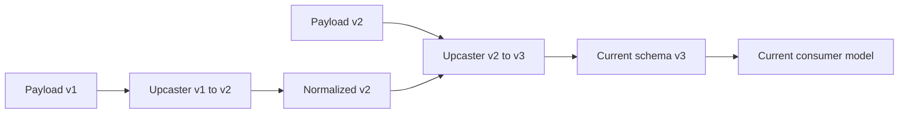
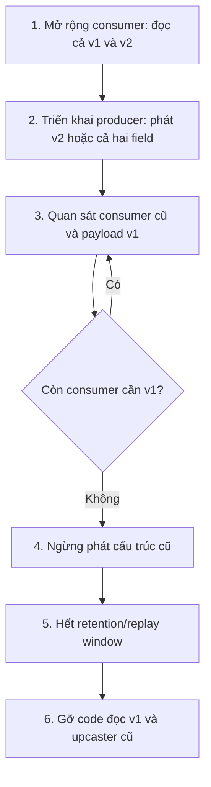

# Schema evolution

Application event là hợp đồng dữ liệu giữa module phát và module nhận. Khi nghiệp vụ thay đổi, cấu trúc event thường cũng thay đổi: thêm trường, đổi tên thuộc tính, thay kiểu dữ liệu hoặc tách một event thành nhiều sự kiện nhỏ hơn. Những thay đổi này có thể làm consumer cũ không đọc được payload mới, hoặc khiến publication đã lưu từ phiên bản trước không thể được deserialize sau khi ứng dụng nâng cấp.

Schema evolution là cách quản lý những thay đổi đó theo thời gian để producer và consumer có thể được triển khai độc lập, message đang lưu vẫn đọc được và ý nghĩa nghiệp vụ không bị thay đổi ngoài dự kiến. Với Spring Modulith, cần quan tâm cả application event được lưu trong Event Publication Registry lẫn event được externalize sang broker. Hai đường đi có thể dùng serializer và vòng đời dữ liệu khác nhau, nhưng đều cần một chiến lược tương thích rõ ràng.

## 1. Vì sao schema của event cần tiến hóa?

Giả sử module `orders` phát `OrderPlaced` với các trường `orderId`, `occurredAt` và `totalAmount`. Module kho chỉ cần `orderId`; module phân tích dùng thêm thời điểm và giá trị đơn hàng. Sau một thời gian, nghiệp vụ yêu cầu lưu thêm kênh bán hàng, mã tiền tệ hoặc thông tin giảm giá.

Nếu sửa trực tiếp cấu trúc event mà không xét consumer, một bản phát hành mới có thể làm hỏng các module hoặc dịch vụ vẫn chạy phiên bản cũ. Vấn đề còn xuất hiện khi event được lưu bền vững: publication phát ở phiên bản trước có thể được xử lý lại sau khi ứng dụng đã nâng cấp. Consumer mới phải hiểu payload cũ trong khoảng thời gian những payload đó còn tồn tại.

Schema evolution giúp trả lời các câu hỏi:

- Producer mới có thể phát event mà consumer cũ vẫn đọc được không?
- Consumer mới có thể đọc event được phát bởi producer cũ không?
- Có thể đổi cấu trúc mà vẫn giữ nguyên ý nghĩa nghiệp vụ không?
- Các publication hoặc message cũ còn cần retry, replay hay audit trong bao lâu?
- Khi một thay đổi không tương thích là bắt buộc, cách chuyển đổi và thời điểm ngừng hỗ trợ phiên bản cũ là gì?

Một schema tương thích về cấu trúc vẫn có thể không tương thích về ngữ nghĩa. Ví dụ, trường `totalAmount` vẫn là số thập phân nhưng chuyển ý nghĩa từ tổng tiền trước thuế sang tổng tiền sau thuế. Consumer cũ có thể deserialize thành công nhưng tính toán sai. Vì vậy, hợp đồng event cần mô tả cả kiểu dữ liệu, ý nghĩa, đơn vị đo, quy tắc nullability và các bất biến nghiệp vụ.

## 2. Tách event contract khỏi domain model

Domain model được thiết kế để bảo vệ quy tắc và hành vi bên trong module. Event contract được thiết kế để module hoặc hệ thống nhận hiểu được một sự kiện đã xảy ra. Hai mô hình có liên quan nhưng không nhất thiết có cùng cấu trúc hoặc cùng tốc độ thay đổi.

Không nên phát trực tiếp một JPA entity hoặc aggregate đang được quản lý làm payload tích hợp. Entity có thể chứa quan hệ lazy, trường nội bộ, trạng thái chưa commit hoặc cấu trúc thay đổi theo migration database. Consumer bên ngoài không nên phụ thuộc vào các chi tiết đó.

Hãy định nghĩa một DTO event rõ ràng, bất biến và chỉ chứa dữ liệu cần thiết:

```java
import java.math.BigDecimal;
import java.time.Instant;
import java.util.UUID;

public record OrderPlaced(
        UUID orderId,
        Instant occurredAt,
        BigDecimal totalAmount) {
}
```

Module nguồn có thể ánh xạ aggregate sang event DTO tại thời điểm phát:

```java
@Transactional
public void placeOrder(OrderRequest request) {
    Order order = orders.save(Order.create(request));

    events.publishEvent(new OrderPlaced(
            order.getId(),
            clock.instant(),
            order.totalAmount()));
}
```

Đoạn code minh họa ranh giới dữ liệu: event chứa snapshot tối thiểu cần cho consumer. Các kiểu `Order`, `OrderRepository`, `OrderRequest` và `clock` thuộc phần triển khai nghiệp vụ của ứng dụng.

Khi event chỉ phục vụ các listener nội bộ, DTO có thể phản ánh nhu cầu phối hợp giữa các module trong cùng ứng dụng. Khi event được externalize, nó trở thành hợp đồng tích hợp với hệ thống khác và cần được quản lý ổn định hơn: tên event, schema, phiên bản, quyền sử dụng, retention và quy trình thông báo thay đổi.

## 3. Phiên bản schema và envelope của event

Không nên suy ra phiên bản hợp đồng chỉ từ phiên bản ứng dụng hoặc phiên bản Java class. Một ứng dụng có thể nâng cấp nhiều lần nhưng event contract không đổi; ngược lại, một contract có thể thay đổi trong khi ứng dụng vẫn cùng phiên bản phát hành.

Với event được trao đổi qua broker hoặc lưu thành payload có envelope, có thể biểu diễn metadata như sau:

```json
{
  "eventId": "5c3e9b0d-6a74-4d3d-9a63-8f3c8a3e2f10",
  "eventType": "orders.order-placed",
  "schemaVersion": 2,
  "occurredAt": "2026-11-25T10:15:30Z",
  "producer": "orders",
  "correlationId": "f1b7d5d0-6e4f-4f7a-a8b5-4f3e1d3a0b22",
  "data": {
    "orderId": "e2a1c5a4-3d62-4d0e-8e65-2a7a2c7a9c10",
    "totalAmount": 149.90,
    "salesChannel": "WEB"
  }
}
```

Envelope này là một mẫu hợp đồng do ứng dụng định nghĩa, không phải cấu trúc bắt buộc do Spring Modulith tự động tạo. `eventId` định danh lần phát logic; `eventType` xác định loại event; `schemaVersion` chỉ phiên bản cấu trúc payload; `occurredAt` là thời điểm nghiệp vụ xảy ra; `correlationId` giúp liên kết các bước trong một luồng xử lý.

Giữ các khái niệm tách biệt:

| Khái niệm | Trả lời câu hỏi |
| --- | --- |
| Application version | Phiên bản phần mềm đang chạy là phiên bản nào? |
| Event type | Đây là loại sự kiện nghiệp vụ nào? |
| Schema version | Payload tuân theo cấu trúc hợp đồng nào? |
| Event ID | Đây là lần phát logic nào, dùng để chống xử lý trùng ra sao? |
| Correlation ID | Event thuộc luồng nghiệp vụ hoặc yêu cầu tổng thể nào? |

Nếu hệ thống dùng một schema registry của broker, subject và version được quản lý theo quy tắc của registry đó. Nếu chỉ lưu application event trong database nội bộ, ứng dụng có thể cần metadata phiên bản hoặc cơ chế nhận diện payload tương ứng trong serializer/upcaster. Không nên cho rằng thêm trường `schemaVersion` vào DTO sẽ tự động khiến mọi serializer hoặc Event Publication Registry xử lý migration thay ứng dụng.

## 4. Các mức tương thích

Khi producer và consumer được triển khai ở những thời điểm khác nhau, schema mới cần tương thích với dữ liệu cũ hoặc consumer cũ theo hướng triển khai. Ba khái niệm phổ biến là backward, forward và full compatibility.

| Loại tương thích | Ý nghĩa | Tình huống thường cần |
| --- | --- | --- |
| Backward | Consumer dùng schema mới có thể đọc dữ liệu được ghi theo schema cũ. | Nâng consumer trước, trong khi producer cũ vẫn còn phát event. |
| Forward | Consumer dùng schema cũ có thể đọc dữ liệu được ghi theo schema mới. | Nâng producer trước, trong khi consumer cũ vẫn còn chạy. |
| Full | Đáp ứng cả backward và forward compatibility. | Triển khai rolling hoặc nhiều producer/consumer lệch phiên bản trong thời gian chuyển tiếp. |

Các định nghĩa này mô tả quan hệ giữa writer schema và reader schema. Chi tiết kiểm tra tương thích phụ thuộc định dạng và công cụ. JSON Schema, Avro và Protobuf có quy tắc khác nhau; một thay đổi được chấp nhận trong định dạng này có thể không an toàn trong định dạng khác.

Ví dụ với JSON: consumer mới có thể chấp nhận payload cũ thiếu `salesChannel` bằng cách gán giá trị mặc định hợp lý. Consumer cũ thường có thể bỏ qua trường mới nếu cấu hình parser và schema validation cho phép thuộc tính chưa biết. Nếu consumer cũ từ chối field lạ hoặc yêu cầu mọi trường phải đúng một tập cố định, việc thêm field có thể phá vỡ tương thích.

Đừng chọn chế độ tương thích chỉ theo tên gọi. Hãy kiểm tra cả hướng đọc, quy tắc validation, giá trị mặc định, nullability, enum và ý nghĩa nghiệp vụ. Chạy contract test trên payload thực tế của các phiên bản đang còn được hỗ trợ.

## 5. Những thay đổi thường gặp và mức độ rủi ro

### Thêm trường tùy chọn

Đây thường là thay đổi ít rủi ro nếu consumer cũ bỏ qua field không biết và consumer mới xử lý được payload không có field đó. Cần xác định rõ ý nghĩa khi field vắng mặt.

Ví dụ schema mới thêm `salesChannel`:

```json
{
  "orderId": "e2a1c5a4-3d62-4d0e-8e65-2a7a2c7a9c10",
  "occurredAt": "2026-11-25T10:15:30Z",
  "totalAmount": 149.90,
  "salesChannel": "WEB"
}
```

Consumer mới phải đọc được payload cũ chưa có `salesChannel`. Có thể biểu diễn field là optional hoặc gán `UNKNOWN` khi thiếu, nếu `UNKNOWN` thực sự đúng về mặt nghiệp vụ. Không dùng một giá trị mặc định giả định như `WEB` nếu không có dữ liệu chứng minh.

### Xóa trường

Xóa field có thể phá vỡ consumer cũ vẫn đang đọc field đó. Trước khi xóa, ngừng sử dụng field ở tất cả consumer được hỗ trợ, đo mức sử dụng nếu có telemetry và chờ qua khoảng thời gian lưu trữ/replay cần thiết. Sau đó mới bỏ field khỏi producer và schema.

### Đổi tên trường

Đổi tên thường được xem như xóa field cũ và thêm field mới. Với JSON, consumer cũ sẽ không tự hiểu tên mới. Có thể triển khai giai đoạn chuyển tiếp phát cả hai field, cho consumer đọc cả hai tên, sau đó ngừng field cũ khi tất cả consumer đã nâng cấp. Với Avro có reader alias hỗ trợ một số trường hợp rename; Protobuf có thể giữ field number khi đổi tên source-level, nhưng vẫn cần xem tác động tới generated code và các ngôn ngữ consumer.

### Đổi kiểu dữ liệu

Đổi `totalAmount` từ number sang string, hoặc từ số nguyên sang số thập phân với quy tắc làm tròn mới, có thể làm hỏng parser và thay đổi ý nghĩa. Nên thêm field mới với tên và đơn vị rõ ràng, chuyển consumer dần, rồi mới ngừng field cũ. Nếu thay đổi đơn vị, ghi rõ scale và currency; không chỉ đổi kiểu mà không có quy tắc chuyển đổi.

### Thêm giá trị enum

Consumer cũ có thể không biết giá trị enum mới. Với JSON, một parser có thể từ chối giá trị không khớp enum khai báo. Hãy cân nhắc biểu diễn enum theo cách cho phép giá trị chưa biết, có nhánh `UNKNOWN` hoặc xử lý fallback có kiểm soát. Không tự chuyển một giá trị không biết thành một trạng thái nghiệp vụ có tác động như `CANCELLED`.

### Thay đổi ý nghĩa

Thay đổi ý nghĩa field thường nguy hiểm hơn thay đổi cấu trúc. Nếu `totalAmount` đổi từ trước thuế sang sau thuế, hãy tạo contract mới hoặc field mới có tên diễn đạt đúng nghĩa. Không tái sử dụng tên field cũ với ý nghĩa khác chỉ để tránh thay đổi schema.

## 6. Ví dụ tiến hóa OrderPlaced từ v1 sang v2

Phiên bản đầu chỉ có mã đơn hàng, thời điểm và tổng tiền:

```json
{
  "eventType": "orders.order-placed",
  "schemaVersion": 1,
  "data": {
    "orderId": "e2a1c5a4-3d62-4d0e-8e65-2a7a2c7a9c10",
    "occurredAt": "2026-11-25T10:15:30Z",
    "totalAmount": 149.90
  }
}
```

Phiên bản 2 bổ sung kênh bán hàng. Trường mới có thể vắng mặt trong payload v1:

```json
{
  "eventType": "orders.order-placed",
  "schemaVersion": 2,
  "data": {
    "orderId": "e2a1c5a4-3d62-4d0e-8e65-2a7a2c7a9c10",
    "occurredAt": "2026-11-25T10:15:30Z",
    "totalAmount": 149.90,
    "salesChannel": "WEB"
  }
}
```

Consumer v2 nên quy định rõ cách xử lý khi nhận v1. Ví dụ, nếu không biết kênh bán, consumer có thể dùng `UNKNOWN` cho báo cáo phân loại; nếu nghiệp vụ bắt buộc phải biết kênh để tính thuế, nó cần từ chối hoặc chuyển xử lý thủ công thay vì tự đoán.

Một lớp chuyển đổi có thể chuẩn hóa payload cũ về cấu trúc nội bộ mới trước khi deserialize:

```java
import com.fasterxml.jackson.databind.JsonNode;
import com.fasterxml.jackson.databind.node.ObjectNode;

class OrderPlacedUpcaster {

    ObjectNode toCurrentSchema(JsonNode payload) {
        ObjectNode current = payload.deepCopy();
        JsonNode version = current.get("schemaVersion");

        if (version != null && version.asInt() == 1) {
            ObjectNode data = (ObjectNode) current.get("data");
            if (!data.has("salesChannel")) {
                data.put("salesChannel", "UNKNOWN");
            }
            current.put("schemaVersion", 2);
        }

        return current;
    }
}
```

Đây là ví dụ minh họa cho một bước upcast JSON đơn giản. Trong code production cần kiểm tra payload null/sai kiểu, từ chối version không được hỗ trợ, không sửa payload gốc đã lưu, xử lý từng phiên bản theo chuỗi chuyển đổi rõ ràng và kiểm thử các trường hợp thiếu hoặc sai dữ liệu. Giá trị `UNKNOWN` chỉ phù hợp nếu nghiệp vụ cho phép.

## 7. Upcasting và chuyển đổi payload cũ

Upcasting là chuyển một payload ở schema cũ sang biểu diễn hiện tại khi đọc. Nó hữu ích khi ứng dụng cần duy trì khả năng đọc message lịch sử mà không buộc mọi consumer phải mang logic cho tất cả phiên bản cũ.

Một chuỗi chuyển đổi có thể như sau:



Mỗi upcaster nên làm một thay đổi nhỏ, có thể kiểm thử độc lập và có tính xác định: cùng một payload đầu vào luôn tạo cùng một payload đầu ra. Tránh gọi dịch vụ bên ngoài hoặc truy vấn dữ liệu thay đổi theo thời gian trong bước upcast, vì khi replay kết quả có thể khác lần đầu.

Có hai cách tổ chức phổ biến:

- **Upcast khi đọc:** giữ nguyên payload gốc và chuyển đổi trong đường đọc. Cách này bảo toàn dữ liệu ban đầu, phù hợp khi cần audit hoặc có nhiều consumer với nhu cầu khác nhau.
- **Migration dữ liệu lưu trữ:** chuyển payload cũ thành dạng mới trong một đợt có kiểm soát. Cách này có thể đơn giản hóa consumer nhưng cần backup, kiểm chứng số lượng, khả năng rollback và giữ dấu vết chuyển đổi.

Với Event Publication Registry, publication chưa hoàn tất có thể còn tồn tại sau khi ứng dụng triển khai phiên bản mới. Cần bảo đảm serializer hoặc lớp chuyển đổi vẫn đọc được payload đã lưu trước đó. Không nên xóa publication cũ chỉ vì event class đã đổi tên hoặc package được tái cấu trúc.

## 8. Triển khai tương thích theo chiến lược expand-contract

Một cách triển khai an toàn là mở rộng khả năng đọc trước, rồi mới thay đổi dữ liệu phát ra và cuối cùng mới loại bỏ cấu trúc cũ.



Trình tự điển hình:

1. **Expand consumer:** triển khai consumer hiểu cả payload cũ và payload mới. Với field mới, xác định default/fallback và kiểm thử.
2. **Expand producer:** bắt đầu phát schema mới hoặc phát song song field cũ/mới trong giai đoạn chuyển tiếp.
3. **Observe:** theo dõi phiên bản consumer, lỗi deserialize, tỷ lệ payload cũ và số publication chưa hoàn tất.
4. **Contract producer:** ngừng phát field hoặc event cũ sau khi consumer cũ đã được loại bỏ.
5. **Retain compatibility:** giữ khả năng đọc payload cũ ít nhất trong thời gian message, publication, backup và replay còn cần.
6. **Contract consumer:** chỉ gỡ code tương thích cũ khi không còn dữ liệu cần đọc và đã có bằng chứng vận hành.

Nếu producer và consumer thuộc các đội hoặc hệ thống khác nhau, cần công bố thời hạn hỗ trợ schema, kế hoạch ngừng phiên bản và cách kiểm tra tương thích. Một thay đổi breaking cần có version/event type mới hoặc một giai đoạn chuyển tiếp được thống nhất.

## 9. Đổi tên class, package và event type

Trong ứng dụng Java, việc đổi tên class hoặc package có thể ảnh hưởng tới payload lưu trữ nếu serializer lưu thông tin kiểu Java hoặc dựa vào tên class để khôi phục đối tượng. Điều này đặc biệt đáng chú ý với publication còn dang dở trong Event Publication Registry: event được phát bởi phiên bản trước có thể chỉ được deserialize khi listener chạy lại sau deploy.

Một số nguyên tắc:

- Giữ class event và package cũ trong thời gian cần đọc các publication cũ, nếu serializer phụ thuộc tên kiểu.
- Nếu phải đổi tên, cung cấp mapping/serializer tương thích hoặc quy trình chuyển đổi payload có kiểm thử.
- Duy trì constructor, field hoặc custom deserialization logic phù hợp với payload đã lưu, tùy serializer đang dùng.
- Tách event contract bên ngoài khỏi tên class Java nội bộ; event type công khai nên là định danh ổn định do ứng dụng quản lý.
- Không dùng Java class name làm hợp đồng tích hợp lâu dài nếu nhiều hệ thống độc lập cần tiêu thụ event.

Java serialization, Jackson JSON và các serializer của broker có quy tắc tương thích khác nhau. `serialVersionUID` chỉ có ý nghĩa với Java native serialization; nó không giải quyết rename/type compatibility cho mọi serializer. Trước khi thay đổi event class, hãy xác định serializer thực tế được cấu hình cho publication registry và externalization.

## 10. Schema Registry và định dạng dữ liệu

Khi event được externalize qua Kafka hoặc một broker khác, tổ chức có thể dùng schema registry để quản lý schema và kiểm tra compatibility trước khi producer phát dữ liệu. Các định dạng thường gặp:

| Định dạng | Đặc điểm | Lưu ý tiến hóa |
| --- | --- | --- |
| JSON / JSON Schema | Dễ đọc, thuận tiện cho HTTP và tích hợp đa ngôn ngữ. | Cần quy định rõ required, optional, additional properties, format và default behavior. |
| Avro | Schema tách khỏi payload, hỗ trợ writer/reader schema resolution. | Field default và alias có vai trò quan trọng khi đọc dữ liệu cũ. |
| Protocol Buffers | Mã hóa gọn, schema có field number ổn định. | Không tái sử dụng field number đã xóa; dùng `reserved` cho number/name cũ. |

Ví dụ Protobuf:

```proto
syntax = "proto3";

message OrderPlaced {
  string order_id = 1;
  string occurred_at = 2;
  double total_amount = 3;
  string sales_channel = 4;
}
```

Nếu bỏ một field, giữ lại number và tên đã dùng trong khai báo `reserved`:

```proto
message OrderPlaced {
  reserved 3;
  reserved "total_amount";

  string order_id = 1;
  string occurred_at = 2;
  string sales_channel = 4;
}
```

Không gán lại field number đã phát hành cho ý nghĩa mới. Consumer cũ có thể vẫn gặp payload chứa field number đó và hiểu nhầm dữ liệu. Với mọi định dạng, schema registry là công cụ hỗ trợ kiểm tra hợp đồng; nó không thay thế thiết kế event, kiểm thử nghiệp vụ hoặc chính sách versioning.

Schema Registry của Kafka (nếu được dùng) là thành phần riêng của kiến trúc broker. Event Publication Registry của Spring Modulith theo dõi việc giao application event tới transactional listener. Hai registry có mục đích khác nhau; không nên nhầm việc lưu trạng thái publication nội bộ với việc quản lý schema của message externalized.

## 11. Schema evolution cho application event nội bộ

Event nội bộ thường được lưu hoặc xử lý trong vòng đời của cùng ứng dụng, nhưng vẫn có thể vượt qua ranh giới deploy. Nếu dùng persistent Event Publication Registry, publication được ghi lại để có thể khôi phục khi listener chưa hoàn tất. Sau khi nâng cấp ứng dụng, payload cũ có thể được đọc bởi serializer hoặc listener mới.

Để bảo vệ khả năng đọc lại:

- Giữ event DTO ổn định khi có thể; ưu tiên thêm field tùy chọn với quy tắc mặc định rõ ràng.
- Tránh đổi kiểu hoặc tái sử dụng tên field với ý nghĩa khác.
- Xác định thời gian tối đa publication có thể còn pending và chính sách lưu trữ/cleanup.
- Kiểm thử deserialize payload được tạo bởi phiên bản trước.
- Khi đổi package hoặc class, thử nghiệm với payload đã lưu thật hoặc fixture đại diện.
- Chỉ xóa code tương thích cũ sau khi hết thời hạn retry/replay và đã xác nhận không còn payload cần đọc.

Nếu ứng dụng không có persistent registry hoặc không giữ event payload qua deploy, một số rủi ro lịch sử có thể thấp hơn. Tuy nhiên, contract giữa các module vẫn cần tương thích trong giai đoạn rolling deployment, khi nhiều instance của cùng ứng dụng có thể chạy các phiên bản khác nhau.

## 12. Quản lý event bị ngừng hỗ trợ

Một schema cũ không nên bị loại bỏ chỉ vì producer đã ngừng phát. Message có thể vẫn còn trong retention của broker, DLT, backup, archive hoặc database publication. Cần có chính sách end-of-life cho event contract.

Một quy trình ngừng hỗ trợ có thể gồm:

1. Công bố event type/schema version sẽ ngừng hỗ trợ và thời điểm dự kiến.
2. Xác định producer, consumer, group, topic và dữ liệu lưu trữ còn phụ thuộc.
3. Chuyển consumer sang schema mới, theo dõi metric và log để xác nhận không còn traffic cũ.
4. Xử lý DLT, publication pending và dữ liệu cần replay.
5. Đảm bảo backup hoặc archive có cách khôi phục nếu còn nghĩa vụ lưu trữ.
6. Gỡ parser/upcaster cũ sau khi hết thời hạn đã thống nhất.

Nếu không thể đọc một event cũ, hãy chuyển nó sang luồng điều tra hoặc dead-letter có kiểm soát và giữ nguyên payload gốc. Không âm thầm bỏ qua message hoặc đánh dấu publication hoàn tất chỉ để làm sạch backlog.

## 13. Kiểm thử tương thích schema

Kiểm thử schema cần chạy ở nhiều cấp độ:

- **Schema validation:** payload mẫu tuân theo schema đã công bố, bao gồm required, optional, enum và format.
- **Backward compatibility:** consumer mới đọc được payload của producer cũ.
- **Forward compatibility:** consumer cũ xử lý được payload mới theo mức bảo đảm đã chọn.
- **Upcaster:** mỗi phiên bản cũ được chuyển thành model hiện tại đúng và có tính xác định.
- **Semantic compatibility:** giá trị, đơn vị, nullability và quy tắc nghiệp vụ không bị hiểu sai.
- **Stored publication:** payload event đã lưu từ phiên bản trước có thể deserialize và listener có thể hoàn tất.
- **Rolling deployment:** producer và consumer khác phiên bản có thể cùng hoạt động trong giai đoạn chuyển tiếp.
- **Unknown version:** consumer từ chối hoặc chuyển xử lý thủ công một cách quan sát được khi gặp schema version không hỗ trợ.

Có thể lưu fixture JSON của từng phiên bản trong bộ kiểm thử contract. Mỗi lần thay đổi event, chạy consumer hiện tại trên tất cả fixture còn được hỗ trợ. Với Avro hoặc Protobuf, bổ sung bước kiểm tra compatibility tự động trong pipeline build hoặc quy trình phát hành schema.

Không chỉ kiểm tra rằng payload deserialize thành công. Hãy xác nhận listener tạo ra đúng trạng thái nghiệp vụ, đặc biệt với field tiền tệ, trạng thái đơn hàng, thời gian và các giá trị enum.

## 14. Quan sát và vận hành schema version

Để xử lý sự cố tương thích, log và metric nên cho biết event type và schema version. Có thể theo dõi:

- Số lượng event theo `eventType` và `schemaVersion`.
- Tỷ lệ lỗi deserialize hoặc validation theo producer/consumer version.
- Số payload cần upcast và lỗi upcaster.
- Tuổi của publication pending và số lần retry.
- Số message chuyển sang DLT do schema không được hỗ trợ.
- Consumer group hoặc module còn đọc phiên bản cũ.

Khi log event, ưu tiên metadata và correlation ID. Payload có thể chứa thông tin khách hàng, giá trị giao dịch hoặc dữ liệu nội bộ. Cần giới hạn quyền truy cập, masking trường nhạy cảm và retention log phù hợp.

Một dashboard chỉ hiển thị số lượng event mới không đủ để kết luận schema cũ đã biến mất. Hãy quan sát cả dữ liệu tồn đọng, retry, DLT và các luồng replay. Việc ngừng hỗ trợ chỉ an toàn khi các nguồn dữ liệu đó đã được xử lý hoặc có cam kết rõ ràng về khả năng đọc.

## 15. Những sai lầm thường gặp

- Sửa event DTO theo domain model mà không kiểm tra consumer đang phụ thuộc.
- Đổi tên hoặc đổi kiểu field trực tiếp trong một bản phát hành mà không có giai đoạn chuyển tiếp.
- Dùng giá trị mặc định không đúng ngữ nghĩa chỉ để deserialize thành công.
- Cho rằng JSON parser luôn bỏ qua field lạ hoặc luôn chấp nhận field bị thiếu.
- Đổi tên Java class/package mà không kiểm tra serializer và publication cũ.
- Xóa upcaster ngay sau khi producer ngừng phát schema cũ dù broker hoặc registry còn payload cũ.
- Nhầm application version, event type và schema version là một khái niệm.
- Coi schema registry của broker và Event Publication Registry của Spring Modulith là cùng một thành phần.
- Chỉ kiểm tra cấu trúc mà bỏ qua thay đổi ý nghĩa nghiệp vụ.

## Checklist thiết kế và phát hành

- [ ] Event contract là DTO rõ ràng, bất biến và tách khỏi persistence entity.
- [ ] Event type và schema version có quy ước ổn định.
- [ ] Mỗi field có ý nghĩa, kiểu, đơn vị, nullability và quy tắc default được mô tả.
- [ ] Thay đổi schema đã được đánh giá backward/forward compatibility theo định dạng đang dùng.
- [ ] Consumer mới đọc được payload cũ trong thời gian cần hỗ trợ.
- [ ] Producer mới không phá consumer cũ trong giai đoạn rolling deployment.
- [ ] Upcaster hoặc migration có kiểm thử và giữ được payload gốc khi cần audit.
- [ ] Serializer của Event Publication Registry có thể đọc publication được tạo bởi phiên bản trước.
- [ ] Schema Registry của broker (nếu có) được cấu hình compatibility phù hợp.
- [ ] Có telemetry cho schema version, lỗi deserialize, upcast, retry và DLT.
- [ ] Có chính sách retention và end-of-life trước khi gỡ hỗ trợ schema cũ.

Schema evolution là một phần của độ tin cậy trong giao tiếp giữa các module. Khi event contract được quản lý độc lập với code nội bộ, consumer có khả năng đọc nhiều phiên bản, và payload cũ được giữ tương thích trong suốt thời gian cần thiết, ứng dụng Spring Modulith có thể thay đổi nghiệp vụ mà không làm đứt quãng việc giao và xử lý sự kiện.
