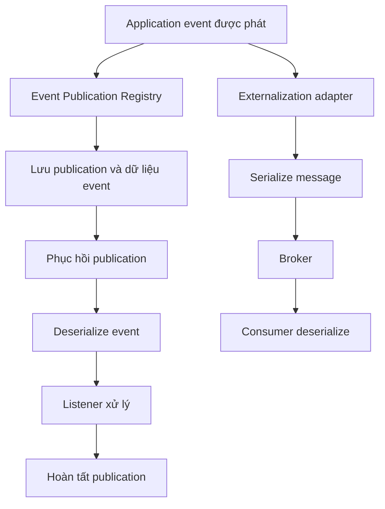

# Xử lý lỗi deserialize application event

Deserialize là bước chuyển dữ liệu sự kiện đã được serialize thành object mà ứng dụng có thể xử lý. Trong một ứng dụng Spring Modulith, bước này có thể xuất hiện khi Event Publication Registry đọc lại publication đã lưu, khi một listener nhận event, hoặc khi adapter giải mã message từ broker. Nếu dữ liệu cũ không còn tương thích với code hiện tại, event có thể không được khôi phục thành object dù bản ghi publication vẫn tồn tại.

Lỗi deserialize cần được xử lý theo nguyên nhân. Lỗi do broker tạm thời không sẵn sàng có thể retry; lỗi do payload sai schema hoặc class đã bị đổi tên thường không tự hết khi retry. Nếu coi mọi lỗi là lỗi tạm thời, một event không thể đọc có thể bị thử vô hạn, làm publication tồn đọng và che khuất sự cố thực sự.

## 1. Xác định deserialize đang xảy ra ở đâu

Trong luồng application events, có hai ranh giới dễ bị nhầm:

1. **Lưu trữ publication trong ứng dụng:** Event Publication Registry ghi nhận publication và persistence implementation có thể lưu nội dung event dưới dạng dữ liệu đã serialize. Khi cần phục hồi publication chưa hoàn tất, ứng dụng phải deserialize dữ liệu đã lưu để tái tạo event.
2. **Vận chuyển qua hệ thống ngoài:** Producer serialize event thành message; consumer nhận bytes hoặc text rồi deserialize thành DTO của consumer. Lỗi tại đây thuộc hợp đồng message và serializer của integration.

Hai ranh giới có thể dùng chung một DTO nhưng không nhất thiết dùng cùng serializer, cấu hình hay vòng đời. Hãy xác định stack trace xuất hiện ở lúc đọc publication, lúc gọi listener hay lúc consumer nhận message trước khi sửa cấu hình.



Nếu lỗi nằm ở bước E, hãy điều tra serializer và payload được persistence lưu. Nếu lỗi nằm ở bước K, hãy điều tra schema message, content type, encoding và cấu hình serializer của consumer. Thay đổi cấu hình Kafka hoặc JSON của consumer sẽ không sửa được một payload cũ mà Event Publication Registry không thể đọc.

## 2. Dấu hiệu thường gặp

Một số lỗi phổ biến có thể xuất hiện dưới nhiều dạng exception:

| Dấu hiệu | Nguyên nhân có thể gặp |
|---|---|
| `ClassNotFoundException` hoặc `NoClassDefFoundError` | Class event đã đổi package, bị xóa hoặc module chứa class không còn trên classpath |
| `InvalidTypeIdException` | Type metadata trong JSON trỏ tới subtype không còn được nhận diện hoặc không nằm trong allowlist |
| `MismatchedInputException` | Cấu trúc JSON không khớp constructor, record component hoặc kiểu dữ liệu hiện tại |
| `UnrecognizedPropertyException` | Payload cũ/mới có field mà DTO hoặc cấu hình mapper không chấp nhận |
| `InvalidDefinitionException` | Jackson không biết cách tạo hoặc serialize/deserialize kiểu dữ liệu |
| `DateTimeParseException` | Định dạng ngày giờ, timezone hoặc kiểu thời gian không đúng hợp đồng |
| `InvalidClassException` | Java native serialization gặp khác biệt class descriptor hoặc `serialVersionUID` |
| Lỗi parse JSON | Payload bị cắt, sai encoding, không phải JSON hoặc hỏng dữ liệu |
| Enum value không hợp lệ | Payload chứa tên enum đã bị xóa hoặc đổi tên |

Không kết luận chỉ dựa trên exception ngoài cùng. Hãy đọc chuỗi `cause` để tìm class, field, token hoặc byte offset gây lỗi. Ví dụ `MessageConversionException` có thể chỉ là lớp bọc cho một lỗi Jackson sâu hơn.

## 3. Phân biệt lỗi dữ liệu và lỗi hạ tầng

Trước khi retry, phân loại lỗi theo khả năng tự phục hồi:

| Nhóm lỗi | Ví dụ | Hành động phù hợp |
|---|---|---|
| Hạ tầng tạm thời | Database timeout khi đọc payload, broker unavailable | Retry có backoff và giới hạn |
| Thiếu cấu hình có thể khắc phục | Module serializer chưa được đăng ký, schema registry tạm mất kết nối | Sửa cấu hình/dịch vụ rồi retry có kiểm soát |
| Không tương thích schema | Field đổi kiểu, enum bị xóa, class bị đổi package | Dùng compatibility mapping hoặc migration |
| Payload không hợp lệ | JSON bị cắt, bytes bị hỏng, content type sai | Cách ly và điều tra nguồn dữ liệu |
| Payload không an toàn | Type metadata yêu cầu class ngoài allowlist | Từ chối giải mã, kiểm tra nguồn và chính sách type |

Một lỗi deserialize lặp lại với cùng event ID và cùng payload thường là lỗi xác định (deterministic). Tăng số lần retry không thay đổi kết quả. Chỉ retry tự động khi có bằng chứng rằng nguyên nhân có thể biến mất mà payload không cần thay đổi.

## 4. Nguyên nhân do thay đổi class event

Một nguyên nhân thường gặp là dùng class Java nội bộ làm hợp đồng lưu trữ lâu dài. Ví dụ, ứng dụng từng lưu event với tên class:

```java
package com.acme.orders.events;

public record OrderCompleted(
    UUID orderId,
    BigDecimal total
) {}
```

Sau một đợt refactor, class được chuyển sang package khác hoặc đổi tên thành `OrderFinished`. Publication cũ vẫn chứa type metadata hoặc tên class cũ. Khi ứng dụng mới đọc publication, serializer có thể không tìm thấy class cũ để khởi tạo object.

Đổi tên field hoặc kiểu field cũng có thể gây lỗi. Ví dụ `total` từ `BigDecimal` đổi thành một object `Money`, hoặc `occurredAt` từ chuỗi ISO-8601 đổi thành một kiểu custom. Payload được lưu trước thay đổi không tự biến thành cấu trúc mới.

Các lựa chọn xử lý:

- Giữ class event cũ trong thời gian cần đọc các publication tồn đọng.
- Dùng DTO lưu trữ ổn định, tách khỏi entity và model nội bộ.
- Thêm bộ chuyển đổi từ schema cũ sang model hiện tại.
- Chạy migration dữ liệu có kiểm soát nếu payload đã lưu cần được chuyển đổi.
- Chỉ xóa class cũ sau khi xác nhận không còn publication hoặc message cần đọc bằng class đó.

Không đổi package hoặc tên class event đã lưu bền vững mà không có kế hoạch tương thích dữ liệu cũ.

## 5. Thiết kế event contract ổn định

Event lưu trữ hoặc message tích hợp nên có cấu trúc rõ ràng, có phiên bản và ít phụ thuộc vào chi tiết triển khai Java. Một envelope minh họa:

```json
{
  "eventId": "e7fdd2ad-23a4-4d25-89a5-0ac88a90cde1",
  "eventType": "order.completed",
  "schemaVersion": 1,
  "occurredAt": "2026-11-25T12:30:00Z",
  "payload": {
    "orderId": "b7a5dd77-8104-47c2-a9c4-ff0dbb4d781d",
    "total": "125.50",
    "currency": "VND"
  }
}
```

Đây là ví dụ hợp đồng do ứng dụng định nghĩa, không phải định dạng envelope bắt buộc của Spring Modulith. Các trường `eventType` và `schemaVersion` cho phép chọn đúng DTO và mapper mà không cần suy luận từ tên class Java.

Một event contract bền vững nên:

- Dùng tên event ổn định theo ngôn ngữ nghiệp vụ.
- Có `eventId` không đổi qua retry và replay.
- Có schema version khi cần phân biệt cấu trúc.
- Dùng kiểu dữ liệu có biểu diễn rõ ràng giữa các phiên bản.
- Quy định format ngày giờ, timezone, số thập phân, enum và null.
- Tránh serialize JPA entity, proxy, lazy relation hoặc object chứa resource runtime.
- Không chứa credential hoặc dữ liệu nhạy cảm vượt quá mục đích xử lý.

Đối với tiền tệ, có thể dùng chuỗi decimal cùng currency code để tránh phụ thuộc cách biểu diễn số của từng nền tảng. Với thời gian, nên thống nhất ISO-8601 và UTC nếu nghiệp vụ không cần lưu timezone địa phương ban đầu.

## 6. Quản lý schema version và chuyển đổi payload

Khi cấu trúc event thay đổi, consumer hoặc serializer cần biết cách đọc phiên bản cũ. Ví dụ, phiên bản 1 lưu tổng tiền dưới dạng chuỗi `total`, trong khi phiên bản 2 tách `amount` và `currency`:

```json
{
  "eventType": "order.completed",
  "schemaVersion": 2,
  "payload": {
    "orderId": "b7a5dd77-8104-47c2-a9c4-ff0dbb4d781d",
    "amount": "125.50",
    "currency": "VND"
  }
}
```

Có thể dùng các DTO riêng cho từng version và chuyển về một model nội bộ:

```java
sealed interface OrderCompletedPayload {
    UUID orderId();
}

record OrderCompletedV1(
    UUID orderId,
    String total
) implements OrderCompletedPayload {}

record OrderCompletedV2(
    UUID orderId,
    String amount,
    String currency
) implements OrderCompletedPayload {}

record OrderCompletedCommand(
    UUID orderId,
    BigDecimal amount,
    String currency
) {}
```

Mapper phiên bản cũ có thể chuyển `total` thành amount và áp dụng currency theo quy ước đã được xác nhận của schema cũ. Không tự suy ra currency nếu payload cũ không chứa thông tin và hệ thống không có một quy tắc nghiệp vụ đáng tin cậy.

Một bộ giải mã theo version có thể được tổ chức như sau:

```java
OrderCompletedCommand decode(EventEnvelope envelope) {
    return switch (envelope.schemaVersion()) {
        case 1 -> mapV1(readPayload(envelope, OrderCompletedV1.class));
        case 2 -> mapV2(readPayload(envelope, OrderCompletedV2.class));
        default -> throw new UnsupportedEventVersionException(
            envelope.eventType(), envelope.schemaVersion()
        );
    };
}
```

Đây là pseudocode mô tả cách phân nhánh theo version; `EventEnvelope`, `readPayload` và exception là kiểu do ứng dụng định nghĩa. Cần kiểm tra schema version trước khi chuyển đổi, đồng thời từ chối rõ phiên bản chưa được hỗ trợ thay vì cố deserialize bằng DTO gần giống.

## 7. Cấu hình Jackson một cách tường minh

Nếu ứng dụng dùng Jackson cho JSON event, cấu hình mapper phải nhất quán giữa lúc serialize và deserialize. Những kiểu như `Instant`, `LocalDate` hoặc `OffsetDateTime` cần module phù hợp. Ví dụ một mapper được cấu hình tường minh:

```java
ObjectMapper eventObjectMapper = JsonMapper.builder()
    .addModule(new JavaTimeModule())
    .build();
```

Đoạn code chỉ minh họa việc đăng ký hỗ trợ Java Time. Cách cung cấp mapper cho Spring Modulith hoặc transport adapter cần tuân theo extension point của phiên bản và integration đang sử dụng. Không tạo mapper mới tùy tiện ở từng listener vì các mapper khác nhau có thể tạo ra hành vi không nhất quán.

Một số nguyên tắc cấu hình:

- Đăng ký module cho các kiểu dữ liệu được sử dụng trong payload.
- Dùng constructor/record creator rõ ràng để DTO có thể được khởi tạo.
- Quy định chính sách field lạ và field bắt buộc theo từng schema version.
- Không bật polymorphic default typing rộng cho dữ liệu đến từ nguồn không tin cậy.
- Nếu dùng type metadata, giới hạn subtype được phép và kiểm soát nguồn payload.
- Giữ cấu hình serialize/deserialize tương thích trong thời gian chuyển phiên bản.

Không nên bật `FAIL_ON_UNKNOWN_PROPERTIES` thành false một cách toàn cục chỉ để che lỗi. Với một schema version có quy định cho phép field mở rộng, có thể chọn chính sách bỏ qua field lạ ở DTO hoặc mapper dành riêng cho schema đó. Field bắt buộc sai kiểu hoặc thiếu vẫn cần được phát hiện.

## 8. Spring Modulith và EventSerializer

Spring Modulith có abstraction `EventSerializer` để tách việc serialize/deserialize event khỏi logic theo dõi publication. Persistence implementation của Event Publication Registry sử dụng cơ chế serializer tương ứng để lưu và khôi phục event. Chi tiết implementation, cấu hình mặc định và cách đăng ký serializer có thể thay đổi theo phiên bản Spring Modulith và module persistence được dùng.

Khi gặp lỗi deserialize publication đã lưu:

1. Xác định phiên bản Spring Modulith và persistence module đang chạy.
2. Kiểm tra serializer thực tế đang được cấu hình và format payload đã lưu.
3. Lấy event ID, publication metadata và nguyên nhân sâu nhất của exception.
4. Xác định payload được tạo bởi phiên bản ứng dụng nào.
5. Kiểm tra class event cũ còn tồn tại và serializer có thể đọc đúng type hay không.
6. Chọn compatibility mapping, giữ class cũ hoặc migration trước khi thử phục hồi lại.

Nếu cần custom `EventSerializer`, hãy triển khai theo interface và contract của đúng phiên bản đang dùng. Kiểm tra cả chiều serialize lẫn deserialize, bảo đảm payload đã lưu từ phiên bản trước vẫn đọc được. Không thay serializer giữa các phiên bản rồi giả định mọi publication cũ sẽ tự chuyển đổi.

Event Publication Registry theo dõi trạng thái publication; nó không thể tự sửa một payload hỏng hoặc tự suy ra cách đổi schema. Nếu deserialize thất bại, publication có thể tiếp tục ở trạng thái chưa hoàn tất để điều tra/phục hồi theo cơ chế của persistence implementation. Không cập nhật trực tiếp bảng registry hoặc đánh dấu publication hoàn tất chỉ để loại bỏ lỗi nếu chưa xác định được event có thể bị mất hay không.

## 9. Phân biệt lỗi deserialize với lỗi listener

Một event có thể deserialize thành công nhưng listener vẫn ném exception khi xử lý. Hai trường hợp cần cách điều tra khác nhau:

| Giai đoạn | Ví dụ | Hướng điều tra |
|---|---|---|
| Đọc bytes/text | JSON hỏng, encoding sai | Kiểm tra payload và content type |
| Khôi phục kiểu event | Class không tồn tại, type metadata sai | Kiểm tra classpath, type mapping và serializer |
| Map schema | Version chưa hỗ trợ, field không tương thích | Kiểm tra schema và version mapper |
| Gọi listener | Business validation hoặc database constraint lỗi | Điều tra logic nghiệp vụ và dữ liệu |
| Gửi ra broker | Authentication, timeout hoặc destination lỗi | Điều tra transport và adapter |

Không dùng retry listener để xử lý lỗi parse payload nếu listener chưa từng được gọi. Tương tự, không thay DTO chỉ vì listener gặp lỗi nghiệp vụ sau khi event đã được deserialize đúng.

## 10. Quy trình điều tra một publication lỗi

Khi một publication không thể deserialize, nên thu thập bằng chứng trước khi thay đổi dữ liệu:

1. Ghi nhận event/publication ID và listener hoặc externalization target liên quan.
2. Ghi nhận thời điểm tạo publication, thời điểm lỗi và phiên bản ứng dụng.
3. Lấy exception đầy đủ cùng chuỗi cause, class/field/token bị lỗi.
4. Xác định serializer, content type, schema version và encoding thực tế.
5. So sánh payload với DTO/schema của phiên bản đã tạo ra nó và phiên bản hiện tại.
6. Kiểm tra payload có bị cắt, thay đổi hoặc hỏng khi lưu trữ/vận chuyển không.
7. Chọn một phương án phục hồi có thể kiểm chứng và giữ lại bản gốc để đối chiếu.

Metadata chẩn đoán hữu ích gồm:

- `eventId` hoặc publication identifier.
- Event type và schema version.
- Tên serializer và phiên bản serializer nếu có thể ghi nhận.
- Phiên bản ứng dụng tạo event và phiên bản ứng dụng đang đọc.
- Payload size, content type, encoding và checksum.
- Thời điểm tạo, số lần thử và giai đoạn thất bại.

Tránh ghi toàn bộ payload vào log nếu có dữ liệu cá nhân hoặc thông tin nhạy cảm. Có thể lưu payload gốc trong vùng lưu trữ được kiểm soát và log checksum cùng vị trí tham chiếu có phân quyền.

## 11. Retry, quarantine và phục hồi

Retry phù hợp với lỗi tạm thời. Với lỗi schema xác định, cần ngăn retry vô hạn:

| Loại lỗi | Retry tự động? | Cách phục hồi |
|---|---|---|
| Database tạm thời không đọc được | Có, có backoff | Retry sau khi database ổn định |
| Schema registry tạm thời không truy cập được | Có, có giới hạn | Khôi phục dịch vụ rồi thử lại |
| Class event đã bị xóa | Không lặp vô hạn | Khôi phục class cũ hoặc dùng compatibility mapper |
| Schema version không hỗ trợ | Không lặp vô hạn | Bổ sung mapper hoặc nâng cấp consumer |
| Payload bị cắt/hỏng | Không | Quarantine và điều tra nguồn hỏng |
| Type metadata không được phép | Không | Kiểm tra nguồn và allowlist, không nới lỏng bảo mật tùy tiện |

Quarantine là nơi lưu giữ event lỗi cùng metadata đủ để điều tra và phát lại sau khi nguyên nhân được xử lý. Bản gốc nên được bảo toàn, có checksum, event ID và lịch sử thao tác. Quy trình replay cần xác nhận schema/mapper mới đọc được event và consumer có idempotency để tránh tác động nghiệp vụ lặp.

Nếu publication được quản lý bởi Event Publication Registry, hãy dùng API phục hồi hoặc xử lý incomplete publication mà phiên bản cung cấp sau khi sửa nguyên nhân. Không xóa bản ghi registry, chỉnh payload trực tiếp hoặc đánh dấu hoàn tất bằng SQL thủ công nếu chưa có quy trình migration được phê duyệt và hiểu rõ hậu quả.

## 12. Migration payload đã lưu

Khi schema cũ không còn được ứng dụng mới hỗ trợ, có thể cần migration. Một quy trình an toàn thường gồm:

1. Xác định chính xác tập publication/message cũ còn tồn tại.
2. Sao lưu payload gốc và metadata, giữ checksum để đối chiếu.
3. Viết converter từ schema cũ sang schema đích, có version rõ ràng.
4. Chạy thử converter trên bản sao và kiểm tra số lượng, giá trị quan trọng, event ID.
5. Triển khai reader tương thích trước khi ngừng writer cũ nếu có giai đoạn rolling.
6. Migration theo batch có checkpoint, log lỗi và khả năng tiếp tục.
7. Readback dữ liệu đã chuyển và xác nhận consumer xử lý đúng.
8. Chỉ loại bỏ reader/class cũ khi không còn payload nào cần đến chúng.

Migration phải bảo toàn ý nghĩa nghiệp vụ. Nếu trường cũ không có dữ liệu tương đương trong schema mới, đừng tự gán giá trị mặc định làm thay đổi ý nghĩa event. Hãy xác định chính sách với event thiếu dữ liệu: bổ sung từ nguồn lịch sử đáng tin cậy, chuyển sang trạng thái cần can thiệp hoặc giữ nguyên schema cũ cho consumer tương thích.

## 13. Bảo mật khi deserialize

Deserialize dữ liệu không tin cậy có thể tạo rủi ro bảo mật, đặc biệt khi serializer cho phép khởi tạo class tùy ý từ type metadata. Không bật polymorphic typing toàn cục cho payload đến từ broker hoặc nguồn bên ngoài nếu không có allowlist chặt chẽ.

Các nguyên tắc nên áp dụng:

- Dùng DTO cụ thể cho từng event type thay vì deserialize vào `Object` tùy ý.
- Kiểm tra `eventType` và `schemaVersion` trước khi chọn DTO.
- Chỉ cho phép các subtype đã được xác định rõ nếu polymorphism thực sự cần thiết.
- Giới hạn kích thước message, độ sâu object và số phần tử collection.
- Từ chối payload sai encoding hoặc cấu trúc vượt giới hạn.
- Xác thực producer và bảo vệ broker bằng TLS/ACL.
- Không đưa secret vào exception message hoặc log payload.

Không giải quyết lỗi `InvalidTypeIdException` bằng cách cho phép mọi class. Hãy xác minh payload đến từ producer nào, type nào thuộc hợp đồng và mapping nào cần được đăng ký.

## 14. Kiểm thử tương thích deserialize

Kiểm thử không chỉ xác nhận payload mới đọc được. Hệ thống còn phải đọc được các payload cũ còn nằm trong registry hoặc broker trong thời gian retention/retry.

| Tình huống | Điều cần xác minh |
|---|---|
| Serialize rồi deserialize cùng version | Khôi phục đúng các field và giá trị |
| Payload version cũ | Compatibility mapper tạo model nội bộ chính xác |
| Payload version mới chưa hỗ trợ | Từ chối rõ ràng, không xử lý như event hợp lệ |
| Field optional bị thiếu | Áp dụng default theo schema đã công bố |
| Field bắt buộc sai kiểu | Phát hiện lỗi và ghi nhận nguyên nhân |
| Enum value không còn tồn tại | Có chính sách compatibility hoặc quarantine |
| Ngày giờ và timezone | Đọc đúng instant/offset theo hợp đồng |
| Class event đổi package | Payload cũ vẫn đọc được qua class cũ hoặc migration |
| Payload bị cắt/hỏng | Không đánh dấu publication hoàn tất |
| Type metadata không được phép | Từ chối deserialize an toàn |
| Retry sau khi sửa lỗi | Event được đọc lại và consumer không xử lý trùng |

Nên lưu một tập payload mẫu đại diện cho các schema version đã phát hành. Khi thay serializer, DTO hoặc dependency Jackson, chạy compatibility test trên toàn bộ fixture còn được hỗ trợ. Với Event Publication Registry, bổ sung integration test sử dụng persistence tương ứng để xác nhận publication có thể được đọc lại sau khi ứng dụng khởi động lại.

## 15. Observability cho lỗi deserialize

Theo dõi riêng lỗi deserialize để không bị gộp chung với lỗi listener hoặc broker:

- Số lỗi deserialize theo event type, schema version và serializer.
- Số publication chưa hoàn tất do không khôi phục được event.
- Tuổi của publication lỗi lâu nhất.
- Số payload bị quarantine và số lần replay thành công.
- Tỷ lệ lỗi theo phiên bản ứng dụng sau mỗi lần deploy.
- Thời gian từ lúc phát hiện đến lúc phục hồi publication.

Log và trace nên có event ID, publication ID, event type, schema version, serializer, giai đoạn thất bại và correlation ID. Tránh dùng event ID hoặc tenant ID làm metric label không giới hạn vì cardinality cao. Với payload nhạy cảm, log checksum và metadata thay vì nội dung.

Đặt cảnh báo khi xuất hiện lỗi deserialize mới sau deploy, một schema version cũ bắt đầu thất bại hàng loạt hoặc publication tồn đọng vượt ngưỡng. Lỗi tập trung ở một event type thường gợi ý vấn đề tương thích schema; lỗi đồng loạt ở nhiều type có thể chỉ ra cấu hình mapper hoặc dependency serializer.

## 16. Checklist trước khi phát hành thay đổi event

- [ ] Xác định rõ ranh giới deserialize: registry, listener hay transport consumer.
- [ ] Event contract không phụ thuộc không cần thiết vào entity và package nội bộ.
- [ ] Có event ID, event type và schema version theo quy ước ổn định.
- [ ] Serializer được cấu hình tường minh và có test cho các kiểu dữ liệu.
- [ ] Các payload cũ còn tồn tại vẫn có thể được đọc hoặc có migration.
- [ ] Không bật polymorphic typing rộng cho dữ liệu không tin cậy.
- [ ] Lỗi schema xác định không bị retry vô hạn.
- [ ] Có quarantine và quy trình replay được kiểm soát.
- [ ] Event Publication Registry chỉ được cập nhật qua cơ chế/API được hỗ trợ.
- [ ] Có fixture compatibility cho mọi schema version còn hiệu lực.
- [ ] Có metric, log và cảnh báo riêng cho deserialize failure.

Lỗi deserialize thường phản ánh sự không tương thích giữa dữ liệu đã lưu và code đang chạy. Xác định đúng ranh giới lỗi, giữ event contract ổn định, quản lý schema version và kiểm thử payload cũ giúp hệ thống phục hồi publication đáng tin cậy. Retry chỉ nên dùng cho lỗi có khả năng tự hết; payload sai schema cần compatibility mapping, migration hoặc quarantine để không biến một lỗi xác định thành hàng đợi bị kẹt.
