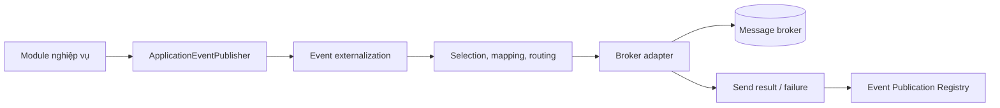
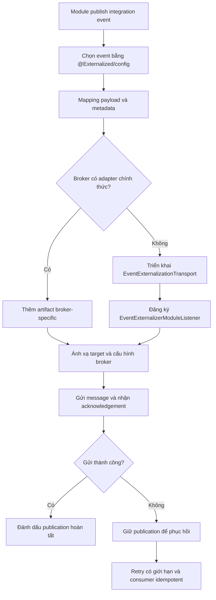

# Adapter với broker

Trong một ứng dụng Spring Modulith, module nghiệp vụ nên publish application event qua `ApplicationEventPublisher`. Khi một số event cần được gửi tới hệ thống khác, ứng dụng cần thêm một lớp kết nối giữa event contract và message broker. Lớp kết nối đó là adapter: nó chuyển payload cùng thông tin định tuyến thành lời gọi phù hợp với Kafka, AMQP, JMS hoặc một hạ tầng messaging khác.

Spring Modulith cung cấp các adapter có sẵn cho những broker phổ biến và các điểm mở rộng để tích hợp transport riêng. Nhờ vậy, module nghiệp vụ không phải biết broker đang dùng, tên API của client hay cách xác nhận message. Module chỉ công bố event có ý nghĩa nghiệp vụ; cấu hình externalization quyết định event nào được gửi ra ngoài, còn adapter đảm nhiệm giao tiếp với broker.

## Mục tiêu

Sau bài này, bạn có thể:

- Phân biệt application event, externalization và thao tác gửi message tới broker.
- Chọn adapter có sẵn của Spring Modulith cho Kafka, AMQP, JMS hoặc Spring Messaging.
- Khai báo target, routing key, payload mapping và message header.
- Hiểu vai trò của `EventExternalizationTransport` khi cần transport tùy chỉnh.
- Kết hợp adapter với Event Publication Registry và lựa chọn mô hình outbox phù hợp.
- Kiểm thử việc định tuyến, gửi thành công, lỗi broker, retry, idempotency và quan sát vận hành.

## 1. Kiến trúc giữa module và broker

Luồng gửi một integration event có thể chia thành các bước:

1. Module nghiệp vụ thay đổi trạng thái và publish event trong application context.
2. Spring Modulith kiểm tra event có được chọn để externalize hay không.
3. Cấu hình externalization có thể chuyển event thành payload phù hợp với hợp đồng bên ngoài, bổ sung header và xác định target.
4. Adapter chuyển payload tới broker bằng client hoặc API tương ứng.
5. Kết quả gửi được trả về để publication được đánh dấu hoàn tất hoặc giữ lại cho việc phục hồi khi thất bại.



| Phần | Trách nhiệm |
|---|---|
| Module nghiệp vụ | Phát event contract mô tả sự kiện đã xảy ra |
| Externalization configuration | Chọn event, biến đổi payload, thêm header và xác định target |
| Broker adapter | Chuyển payload và target thành thao tác gửi của broker |
| Message broker | Lưu trữ hoặc phân phối message theo semantics của broker |
| Event Publication Registry | Theo dõi publication tới externalizer và hỗ trợ phục hồi khi gửi lỗi |

Adapter là ranh giới giữa mô hình event của ứng dụng và API của hạ tầng messaging. Nếu đổi từ Kafka sang RabbitMQ, module nghiệp vụ và event contract thường không cần đổi; adapter, dependency, target và cấu hình broker sẽ thay đổi.

## 2. Chọn adapter có sẵn

Spring Modulith cung cấp các artifact externalization theo broker. Chọn artifact tương ứng và dùng cùng phiên bản với BOM hoặc dependency management Spring Modulith của ứng dụng.

| Hạ tầng | Artifact | Cách adapter sử dụng target |
|---|---|---|
| Kafka | `spring-modulith-events-kafka` | Target logic được dùng làm topic; routing key được dùng làm message key |
| AMQP | `spring-modulith-events-amqp` | Adapter ánh xạ routing target/key sang cơ chế định tuyến AMQP; cần khai báo client broker cụ thể, ví dụ Spring Rabbit |
| JMS | `spring-modulith-events-jms` | Target xác định destination; adapter JMS không hỗ trợ routing key |
| Spring Messaging | `spring-modulith-events-messaging` | Target là tên bean `MessageChannel`; routing information được chuyển thành header để downstream flow xử lý |

Ví dụ khai báo adapter Kafka trong Maven:

```xml
<dependency>
    <groupId>org.springframework.modulith</groupId>
    <artifactId>spring-modulith-events-kafka</artifactId>
</dependency>
```

Ví dụ với AMQP:

```xml
<dependency>
    <groupId>org.springframework.modulith</groupId>
    <artifactId>spring-modulith-events-amqp</artifactId>
</dependency>
<dependency>
    <groupId>org.springframework.amqp</groupId>
    <artifactId>spring-rabbit</artifactId>
</dependency>
```

Các dependency trên chỉ minh họa việc chọn adapter. Ứng dụng vẫn phải cấu hình kết nối, credentials, TLS, exchange/topic/queue, serializer và các thuộc tính broker theo môi trường. Không đặt thông tin xác thực trực tiếp trong source code.

Khi broker đã có adapter chính thức, hãy ưu tiên adapter đó. Nó tích hợp với cơ chế externalization và publication của Spring Modulith, đồng thời giảm lượng code phải tự duy trì. Chỉ xây adapter riêng khi cần transport chưa được hỗ trợ hoặc có yêu cầu tích hợp đặc thù.

## 3. Đánh dấu event và xác định target

Event được externalize nên là integration event có hợp đồng ổn định, không phải entity hoặc object nội bộ của module. Ví dụ:

```java
import java.time.Instant;
import java.util.UUID;

import org.springframework.modulith.events.Externalized;

@Externalized("orders")
public record OrderConfirmed(
    UUID eventId,
    UUID orderId,
    Instant occurredAt,
    int schemaVersion
) {}
```

Với adapter Kafka, target `orders` trở thành topic. Với AMQP, adapter chuyển routing target và key thành thông tin định tuyến AMQP theo cách tích hợp của nó. Ý nghĩa vật lý của target vì thế phụ thuộc broker; hãy đặt tên target theo hợp đồng tích hợp và mapping thực tế của hạ tầng.

Một số broker hỗ trợ routing key riêng bên trong target. Có thể khai báo target và key bằng cú pháp `target::key`:

```java
@Externalized("orders::#{#this.orderId()}")
public record OrderConfirmed(
    UUID eventId,
    UUID orderId,
    Instant occurredAt
) {}
```

Với Kafka, key thường được dùng để chọn partition và giữ các message cùng key trong cùng partition theo semantics của Kafka. Với AMQP, key được dùng như routing key để broker định tuyến message theo binding. Với JMS, adapter không hỗ trợ routing key. Chỉ thêm key khi nó có ý nghĩa đối với cách consumer đọc hoặc broker phân phối message.

Nếu không khai báo target, Spring Modulith có thể suy ra target từ tên kiểu event theo quy tắc application-local name. Để hợp đồng hạ tầng ổn định và dễ vận hành, nên khai báo target tường minh cho event tích hợp quan trọng thay vì để tên package/class trở thành tên topic hoặc destination ngoài ý muốn.

## 4. Cấu hình chọn event, mapping và header

Externalization có ba quyết định chính: event nào được gửi, payload nào được gửi và gửi tới đâu. `EventExternalizationConfiguration` cho phép tùy chỉnh các quyết định này.

Ví dụ cấu hình chọn event có annotation `@Externalized`, chuyển event sang payload phiên bản 1, thêm header và tạo routing key từ `orderId`:

```java
import java.util.Map;

import org.springframework.context.annotation.Bean;
import org.springframework.context.annotation.Configuration;
import org.springframework.modulith.events.EventExternalizationConfiguration;

@Configuration
class OrderExternalizationConfiguration {

    @Bean
    EventExternalizationConfiguration eventExternalizationConfiguration() {
        return EventExternalizationConfiguration.externalizing()
            .select(EventExternalizationConfiguration.annotatedAsExternalized())
            .mapping(OrderConfirmed.class, event ->
                new OrderConfirmedV1(
                    event.eventId(),
                    event.orderId(),
                    event.occurredAt()
                )
            )
            .headers(event -> Map.of("schema-version", 1))
            .routeKey(OrderConfirmed.class, event -> event.orderId().toString())
            .build();
    }
}
```

`OrderConfirmedV1` là DTO tích hợp do ứng dụng định nghĩa. Ví dụ giả định record này có các trường tương ứng với constructor ở trên. Cấu hình mapping không thay đổi event nội bộ đã publish; nó tạo payload dùng cho bước gửi ra ngoài.

Lưu ý rằng khi mapping event, target mặc định vẫn được xác định từ event gốc, trừ khi cấu hình yêu cầu định tuyến theo payload đã mapping bằng `routeMapped()`. Nếu target hoặc routing key được suy ra từ payload mới, hãy cấu hình điều đó một cách tường minh.

Lời gọi `.select(...)` thay thế điều kiện lựa chọn mặc định. Khi dùng `annotatedAsExternalized()` như ví dụ, điều kiện chọn tập trung vào annotation và không còn áp dụng bộ lọc application base package mặc định. Nếu ứng dụng cần giới hạn package, hãy kết hợp điều kiện package với annotation hoặc dùng các API lựa chọn theo package phù hợp. Kiểm thử danh sách event được chọn sau mỗi thay đổi cấu hình.

Adapter Kafka và AMQP hỗ trợ bổ sung message header qua cấu hình externalization. Header có thể mang schema version, correlation ID, tenant ID hoặc thông tin tracing đã được kiểm soát. Đừng giả định adapter JMS hoặc Spring Messaging xử lý header giống hệt hai adapter này; hãy kiểm tra khả năng của transport đang dùng. Không đưa access token, mật khẩu, dữ liệu cá nhân không cần thiết hoặc payload nhạy cảm vào header vì header thường được ghi log và truyền qua nhiều thành phần hạ tầng.

## 5. Adapter có sẵn và adapter tùy chỉnh

Adapter có sẵn của Spring Modulith đóng gói cách gọi broker client. Ứng dụng chỉ cần khai báo dependency và cấu hình broker. Ví dụ, adapter Kafka dùng Spring Kafka; adapter AMQP dùng Spring AMQP; adapter JMS dùng Spring JMS.

Khi cần tích hợp một transport chưa được hỗ trợ, Spring Modulith từ phiên bản 2.1 cung cấp SPI `EventExternalizationTransport`. Adapter tùy chỉnh triển khai một phương thức nhận payload và `RoutingTarget`, sau đó trả về `CompletableFuture` mô tả kết quả gửi:

```java
import java.util.concurrent.CompletableFuture;

import org.springframework.modulith.events.RoutingTarget;
import org.springframework.modulith.events.support.EventExternalizationTransport;
import org.springframework.stereotype.Component;

@Component
class CustomBrokerTransport implements EventExternalizationTransport {

    private final VendorMessagePublisher publisher;

    CustomBrokerTransport(VendorMessagePublisher publisher) {
        this.publisher = publisher;
    }

    @Override
    public CompletableFuture<?> externalize(
            Object payload, RoutingTarget target) {
        return publisher.publish(
            target.getTarget(),
            target.getKey(),
            payload
        );
    }
}
```

`VendorMessagePublisher` là abstraction do ứng dụng định nghĩa quanh SDK của broker cụ thể. Phương thức `publish` cần trả về future chỉ hoàn tất khi transport đã có kết quả gửi mà ứng dụng chấp nhận, ví dụ broker đã xác nhận nhận message. Không trả về một future đã hoàn tất ngay sau khi đưa message vào bộ đệm trong bộ nhớ nếu việc gửi thực tế vẫn có thể thất bại sau đó.

Với transport tùy chỉnh, cần đăng ký listener externalizer để Spring Modulith chuyển event được chọn tới SPI:

```java
import org.springframework.context.annotation.Bean;
import org.springframework.context.annotation.Configuration;
import org.springframework.modulith.events.EventExternalizationConfiguration;
import org.springframework.modulith.events.support.EventExternalizerModuleListener;
import org.springframework.modulith.events.support.EventExternalizationTransport;

@Configuration
class CustomBrokerConfiguration {

    @Bean
    EventExternalizerModuleListener customBrokerExternalizer(
            EventExternalizationConfiguration configuration,
            EventExternalizationTransport transport) {
        return new EventExternalizerModuleListener(configuration, transport);
    }
}
```

Đây là điểm tích hợp dành cho adapter riêng; khi dùng artifact broker chính thức, cấu hình tự động của adapter sẽ cung cấp externalizer tương ứng. Không đăng ký trùng một externalizer cho cùng một transport nếu adapter chính thức đã được kích hoạt, vì một event có thể bị gửi hai lần.

Adapter phải chuyển tiếp lỗi đồng bộ hoặc lỗi bất đồng bộ thành trạng thái thất bại của future. Nếu adapter nuốt exception và trả về thành công, Event Publication Registry sẽ nghĩ việc externalize đã hoàn tất dù broker chưa nhận message. Nếu SDK trả về callback, hãy chuyển callback đó thành `CompletableFuture` và hoàn tất future đúng theo kết quả broker.

## 6. Hiểu target, topic, exchange và destination

Target là tên logic được khai báo ở lớp event. Adapter ánh xạ tên logic đó sang khái niệm của broker:

| Khái niệm logic | Kafka | AMQP | JMS | Spring Messaging |
|---|---|---|---|---|
| Target | Topic | Target logic được adapter diễn giải để định tuyến | Queue hoặc destination | Tên bean `MessageChannel` |
| Routing key | Message key | Key/routing information được ánh xạ thành AMQP routing key | Không hỗ trợ | Header `springModulith_routingTarget` cho downstream xử lý |
| Phân phối | Topic, partition và consumer group | Exchange, binding và queue | Destination và subscription | Channel và flow cấu hình |

Với AMQP, thông tin định tuyến không tự tạo exchange, queue hoặc binding. Quản trị viên hoặc cấu hình hạ tầng phải tạo topology tương ứng. Hãy xác nhận adapter đang dùng exchange và routing key nào, rồi kiểm tra exchange, binding và queue để message thực sự tới consumer mong đợi.

Với Kafka, topic phải tồn tại hoặc broker/client được cấu hình cho phép tạo topic tự động theo chính sách môi trường. Key ảnh hưởng tới phân vùng và thứ tự trong partition. Thứ tự toàn cục giữa nhiều partition không được bảo đảm.

Với JMS, target phải ánh xạ tới destination phù hợp với queue/topic mode của ứng dụng. Vì adapter không hỗ trợ routing key, không dựa vào key để phân phối message.

Với Spring Messaging, target trỏ tới bean `MessageChannel`. Adapter chuyển routing information trong header `springModulith_routingTarget`; một Spring Integration `IntegrationFlow` hoặc thành phần downstream có thể dùng header đó để quyết định bước tiếp theo.

## 7. Kết hợp adapter với Event Publication Registry

Spring Modulith triển khai externalization native thông qua một transactional event listener ủy quyền việc gửi cho adapter broker. Event Publication Registry ghi nhận publication của externalizer trong transaction phát sinh event nếu ứng dụng đã cấu hình kho lưu trữ publication bền vững. Khi broker xác nhận gửi thành công và listener hoàn tất, publication được đánh dấu hoàn tất. Nếu thao tác gửi lỗi, publication vẫn chưa hoàn tất để ứng dụng có thể phục hồi hoặc gửi lại qua API publication tương ứng.

Vì vậy, broker adapter cần báo đúng kết quả gửi. Thành công ở đây phải phản ánh kết quả mà client broker trả về theo cấu hình acknowledgement/confirm, không chỉ là việc lời gọi gửi đã được tạo. Khi ứng dụng không cấu hình Event Publication Registry bền vững, khả năng phục hồi sau khi tiến trình dừng sẽ bị giới hạn; hãy xác định rõ mức đảm bảo cần thiết trước khi triển khai.

Mô hình externalization native dựa trên listener là cách tích hợp đơn giản và hữu ích, nhưng không nên tự động xem nó tương đương một transactional outbox đầy đủ. Khi cần cơ chế outbox chuyên biệt, Spring Modulith 2.1 trở lên có hỗ trợ tích hợp Namastack Outbox và JobRunr. Chế độ outbox được cấu hình bằng:

```properties
spring.modulith.events.externalization.mode=outbox
```

Chế độ này cần dependency và cấu hình outbox tương ứng. Hãy chọn theo yêu cầu atomicity, khối lượng gửi, khả năng vận hành và hạ tầng lưu trữ của ứng dụng. Không bật chế độ outbox chỉ vì có broker; hãy hiểu rõ cách outbox được ghi, lấy ra gửi và đánh dấu hoàn tất trong phiên bản đang dùng.

### Thứ tự gửi và tính song song

Externalization có thể chạy từ nhiều thread, vì vậy message sau có thể tới broker trước message trước nếu các thao tác gửi có thời gian hoàn tất khác nhau. Nếu thứ tự gửi theo thứ tự publication là yêu cầu, Spring Modulith cung cấp thuộc tính:

```properties
spring.modulith.events.externalization.serialize-externalization=true
```

Thuộc tính này tuần tự hóa tương tác externalization theo cơ chế hỗ trợ của Spring Modulith. Nó có thể làm giảm thông lượng vì chỉ một event được gửi tại một thời điểm. Nếu chỉ cần thứ tự theo aggregate hoặc khách hàng, hãy cân nhắc routing key/partition key ổn định và thiết kế consumer theo thứ tự trong phạm vi đó thay vì tuần tự hóa toàn bộ luồng.

## 8. Bảo đảm consumer xử lý an toàn

Adapter có thể gửi lại message khi broker timeout, acknowledgement bị mất hoặc publication được resubmit. Trong một số tình huống, broker đã nhận message nhưng ứng dụng không nhận được phản hồi; lần gửi lại có thể tạo một message trùng. Vì vậy, không nên giả định externalization đảm bảo exactly-once end-to-end.

Consumer cần idempotency. Một cách phổ biến là đưa `eventId` ổn định vào payload và lưu dấu event đã xử lý trong cùng transaction với thay đổi nghiệp vụ của consumer:

```java
@Transactional
void handle(OrderConfirmed event) {
    if (processedEvents.exists(event.eventId())) {
        return;
    }

    inventory.reserveFor(event.orderId());
    processedEvents.record(event.eventId());
}
```

Ví dụ giả định `exists` và `record` được bảo vệ bằng unique constraint hoặc thao tác upsert phù hợp. Nếu kiểm tra và ghi nhận không nguyên tử, hai consumer song song có thể cùng xử lý một event. Hãy lưu idempotency key trong cùng transaction với cập nhật nghiệp vụ hoặc dùng cơ chế inbox có khóa duy nhất.

Ngoài idempotency, consumer cần:

- Phân biệt lỗi tạm thời và lỗi vĩnh viễn.
- Có retry với giới hạn và backoff ở phía consumer.
- Có dead-letter hoặc quy trình xử lý message không thể tiêu thụ.
- Kiểm tra schema và phiên bản payload trước khi áp dụng thay đổi nghiệp vụ.
- Ghi nhận correlation ID và event ID để hỗ trợ đối soát.

## 9. Kiểm thử adapter và luồng externalization

Nên chia kiểm thử thành ba lớp. Unit test kiểm tra mapping, routing key và chuyển đổi kết quả SDK thành future. Integration test với broker kiểm tra topology, serialization, acknowledgement và cấu hình kết nối. Kiểm thử luồng ứng dụng xác nhận event được chọn, externalizer được gọi và publication được đánh dấu hoàn tất hoặc giữ lại khi lỗi.

| Tình huống | Kết quả cần xác nhận |
|---|---|
| Event có `@Externalized` | Event được chọn và gửi tới đúng target |
| Event không được chọn | Không có message gửi tới broker |
| Mapping payload | Broker nhận DTO đúng schema, không nhận object nội bộ không cần thiết |
| Routing key | Kafka key hoặc AMQP routing key có giá trị mong đợi |
| Header | Chỉ chứa metadata được phép và đúng kiểu dữ liệu |
| Broker xác nhận thành công | Future hoàn tất thành công và publication được đánh dấu hoàn tất |
| Broker từ chối hoặc timeout | Future thất bại và publication còn khả năng phục hồi |
| Ứng dụng khởi động lại | Publication chưa hoàn tất được khôi phục theo cấu hình registry |
| Gửi lại publication | Consumer xử lý trùng an toàn nhờ idempotency |
| Nhiều event đồng thời | Thứ tự và partitioning đáp ứng yêu cầu đã chọn |

Với Kafka, có thể dùng embedded broker hoặc container test để kiểm tra topic, key và payload. Với AMQP, cần xác nhận exchange, binding, routing key và queue. Với JMS, kiểm tra destination và acknowledgement mode. Không chỉ mock `KafkaTemplate` hoặc `RabbitTemplate` rồi kết luận topology broker đã đúng.

## 10. Quan sát adapter trong môi trường thật

Adapter nằm ở ranh giới giữa ứng dụng và hạ tầng, vì vậy cần có metric và log cho cả kết quả gửi lẫn publication. Nên theo dõi:

- Số message gửi thành công và thất bại theo target và loại event.
- Độ trễ từ lúc bắt đầu gửi tới khi broker xác nhận.
- Số publication externalization chưa hoàn tất và tuổi của publication cũ nhất.
- Số lần resubmit, số lần gửi timeout và tỷ lệ lỗi theo broker.
- Kích thước backlog hoặc consumer lag nếu broker cung cấp metric tương ứng.
- Tỷ lệ lỗi serialization, lỗi schema và lỗi xác thực kết nối.

Log nên chứa event type, event ID, target, routing key khi phù hợp, correlation ID, kết quả gửi và mã lỗi của broker. Không ghi toàn bộ payload hoặc credentials. Tránh dùng event ID, order ID hoặc routing key có cardinality lớn làm metric label; dùng chúng trong log/trace và giới hạn metric ở các nhãn như event type, target, outcome và broker.

Khi có lỗi, kiểm tra theo ranh giới: ứng dụng có chọn event không, mapping có tạo payload hợp lệ không, target có tồn tại không, adapter có nhận được acknowledgement không, registry có lưu publication chưa hoàn tất không và consumer có đọc được message không. Cách phân chia này giúp xác định lỗi thuộc module nghiệp vụ, cấu hình externalization, adapter, broker hay consumer.

## 11. Lỗi thường gặp khi tích hợp broker

| Lỗi | Hệ quả | Cách khắc phục |
|---|---|---|
| Module nghiệp vụ gọi trực tiếp `KafkaTemplate` | Nghiệp vụ phụ thuộc vào broker và khó đổi transport | Publish application event; để adapter gửi ra ngoài |
| Dùng event nội bộ làm wire contract | Refactor nội bộ có thể phá consumer bên ngoài | Tạo integration DTO ổn định và mapping rõ ràng |
| Nhầm target với queue hoặc exchange đã tồn tại | Message không tới consumer dù lời gọi gửi thành công | Quản lý topology broker và kiểm thử routing |
| Adapter báo thành công trước broker acknowledgement | Registry đánh dấu hoàn tất dù message chưa được broker nhận | Trả future phản ánh đúng kết quả gửi |
| Không có publication store bền vững | Khó phục hồi khi ứng dụng dừng giữa lúc gửi | Cấu hình Event Publication Registry phù hợp |
| Cho rằng registry đảm bảo exactly-once | Consumer có thể nhận message trùng | Dùng event ID và idempotent consumer |
| Tuần tự hóa mọi message không cần thiết | Giảm throughput và tạo nút thắt | Chọn partition key và phạm vi thứ tự theo nghiệp vụ |
| Đăng ký đồng thời adapter có sẵn và custom externalizer | Một event có thể được externalize nhiều lần | Chỉ kích hoạt một đường externalization cho mỗi event |

## 12. Quy trình lựa chọn adapter



Hãy để module nghiệp vụ chỉ công bố sự kiện có ý nghĩa. Chọn adapter chính thức khi có hỗ trợ; chỉ triển khai transport riêng khi có lý do rõ ràng. Xác định target, mapping, key và header như một phần của hợp đồng tích hợp. Sau đó cấu hình publication registry hoặc outbox theo mức đảm bảo cần thiết, kiểm thử acknowledgement và khả năng phục hồi, đồng thời làm consumer idempotent để message gửi lại không tạo tác động nghiệp vụ trùng lặp.

## Tài liệu tham khảo

- [Spring Modulith — Working with Application Events](https://docs.spring.io/spring-modulith/reference/events.html)
- [EventExternalizationTransport API](https://docs.spring.io/spring-modulith/docs/current/api/org/springframework/modulith/events/support/EventExternalizationTransport.html)
- [EventExternalizationConfiguration API](https://docs.spring.io/spring-modulith/docs/current/api/org/springframework/modulith/events/EventExternalizationConfiguration.html)
