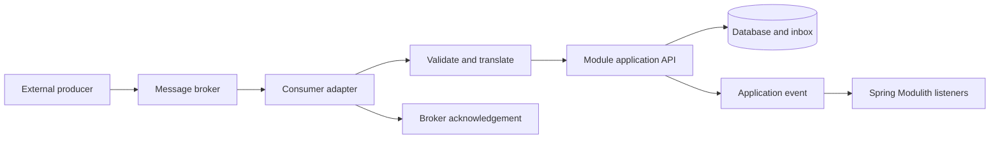

# Consumer adapter

## Mục tiêu

Khi một ứng dụng Spring Modulith nhận message từ Kafka, RabbitMQ hoặc một hệ thống messaging khác, module nghiệp vụ không nên phải biết chi tiết về broker, header, offset hay kiểu acknowledgement. **Consumer adapter** là thành phần ở ranh giới bên ngoài tiếp nhận message, kiểm tra hợp đồng, chuyển đổi dữ liệu transport thành lệnh hoặc dữ liệu ứng dụng, rồi gọi vào module chịu trách nhiệm.

Adapter giúp giữ ranh giới giữa giao thức bên ngoài và mô hình nghiệp vụ bên trong. Nó cũng là nơi phù hợp để áp dụng xác thực nguồn gửi, kiểm tra schema, ghi nhận idempotency key, phân loại lỗi transport và phối hợp acknowledgement với transaction xử lý.

Sau bài học, bạn có thể:

- Phân biệt consumer adapter với application event listener nội bộ của Spring Modulith.
- Thiết kế inbound adapter nhận message và chuyển đổi thành lời gọi application API hoặc application event.
- Xác định thứ tự an toàn giữa transaction database và acknowledgement của broker.
- Ngăn xử lý trùng bằng inbox/idempotency và hiểu giới hạn của exactly-once.
- Thiết kế retry, dead-letter, schema evolution, bảo mật và kiểm thử adapter.

## 1. Consumer adapter nằm ở đâu?

Giả sử hệ thống Đối tác gửi message `partner.order-confirmed.v1` tới broker. Ứng dụng cần xác nhận đơn hàng và phát application event `OrderConfirmed` để các module nội bộ tiếp tục xử lý.

Luồng kiến trúc có thể gồm:

1. **Broker** nhận và lưu message theo cơ chế của transport.
2. **Consumer adapter** đọc message, kiểm tra metadata, giải mã payload và xác thực hợp đồng bên ngoài.
3. **Mapper/translator** chuyển DTO bên ngoài thành command hoặc kiểu dữ liệu ứng dụng.
4. **Application service của module** thực hiện nghiệp vụ trong transaction.
5. **Application event** được phát để các module nội bộ giao tiếp qua hợp đồng của Spring Modulith.
6. **Acknowledgement** được gửi sau khi ứng dụng đã hoàn thành trách nhiệm tiếp nhận bền vững.



Consumer adapter thuộc lớp tích hợp/inbound của ứng dụng. Nó phụ thuộc vào API công khai của module nghiệp vụ, còn module nghiệp vụ không cần phụ thuộc ngược lại vào thư viện Kafka hoặc RabbitMQ.

## 2. Phân biệt broker consumer và application event listener

Hai loại consumer có thể cùng tồn tại nhưng phục vụ hai ranh giới khác nhau:

| Thành phần | Nhận dữ liệu từ đâu? | Trách nhiệm chính |
| --- | --- | --- |
| Consumer adapter | Broker hoặc hệ thống bên ngoài | Chuyển giao thức/message bên ngoài thành lời gọi ứng dụng; quản lý acknowledgement và lỗi transport. |
| `@ApplicationModuleListener` | Spring application event trong cùng ứng dụng | Xử lý sự kiện nghiệp vụ giữa các module theo ranh giới module; Event Publication Registry có thể theo dõi publication. |
| `@EventListener` | Spring application event | Xử lý event trong Spring context; độ bền và retry phụ thuộc cấu hình và cơ chế bổ sung. |

Ví dụ, một Kafka listener nhận `PartnerOrderConfirmed`, sau đó gọi `OrderApplicationService.confirmFromPartner(...)`. Service cập nhật đơn và phát `OrderConfirmed`. Module Kho hoặc Thông báo nhận application event thông qua listener của Spring Modulith.

Không nên biến từng message broker thành một loại application event chỉ vì cả hai đều mang dữ liệu. Message transport có header, partition, offset, retry và schema riêng. Application event nên biểu diễn điều đã xảy ra trong miền nghiệp vụ. Adapter chịu trách nhiệm chuyển đổi giữa hai hợp đồng.

## 3. Thiết kế hợp đồng message bên ngoài

Một message envelope nên cung cấp đủ metadata để định danh, tương quan và kiểm tra phiên bản. Ví dụ hợp đồng JSON:

```json
{
  "messageId": "bcb5a62d-5e5d-4a2d-9d7d-2c4efb9e2c31",
  "messageType": "partner.order-confirmed",
  "schemaVersion": 1,
  "occurredAt": "2026-11-25T10:15:30Z",
  "correlationId": "b4c55f1d-90f2-4c2c-9c8d-82a8bbfbe8bd",
  "payload": {
    "partnerOrderId": "P-100045",
    "ourOrderReference": "ORD-7001",
    "confirmedAt": "2026-11-25T10:15:20Z"
  }
}
```

Các trường quan trọng:

- `messageId`: ID ổn định do producer cấp; dùng để nhận diện message redelivery.
- `messageType`: tên hợp đồng độc lập với tên class Java.
- `schemaVersion`: phiên bản payload để adapter chọn DTO/mapper tương ứng.
- `occurredAt`: thời điểm sự kiện ở phía producer xảy ra; khác với thời điểm consumer nhận message.
- `correlationId`: liên kết message với một quy trình hoặc request xuyên nhiều hệ thống.
- `payload`: dữ liệu nghiệp vụ tối thiểu cần thiết cho consumer.

Có thể đặt metadata trong broker headers thay vì body. Hãy thống nhất một quy ước cho `messageId`, content type, schema version, correlation ID và event type. Không dùng class name, package Java hoặc tên topic làm định danh hợp đồng duy nhất vì các chi tiết đó có thể thay đổi theo implementation.

### Validate trước khi gọi module

Adapter nên kiểm tra:

- Message có đủ header/field bắt buộc và đúng content type.
- Message type và schema version có được hỗ trợ hay không.
- Payload có đúng cấu trúc, kiểu dữ liệu và giới hạn kích thước.
- ID và timestamp có hợp lệ theo hợp đồng.
- Nguồn gửi đã được xác thực và có quyền gửi loại message này.

Validation cấu trúc khác validation nghiệp vụ. Ví dụ `ourOrderReference` có thể đúng định dạng nhưng không tồn tại trong hệ thống. Adapter xác nhận hình dạng message; application service quyết định ý nghĩa và tính hợp lệ của thao tác trong miền nghiệp vụ.

## 4. Chuyển đổi message thành application command

Không nên truyền `ConsumerRecord`, `Message<?>`, `Acknowledgment`, `Channel` hoặc DTO riêng của broker vào module nghiệp vụ. Hãy chuyển chúng thành kiểu dữ liệu thuộc ứng dụng.

Ví dụ DTO bên ngoài và command nội bộ:

```java
public record PartnerOrderConfirmedPayload(
        String partnerOrderId,
        String ourOrderReference,
        Instant confirmedAt) {}

public record ConfirmOrderFromPartner(
        UUID messageId,
        String partnerOrderId,
        String orderReference,
        Instant confirmedAt,
        String correlationId) {}
```

Mapper thực hiện chuyển đổi tường minh:

```java
@Component
class PartnerOrderMessageMapper {

    ConfirmOrderFromPartner toCommand(PartnerMessage message) {
        PartnerOrderConfirmedPayload payload = message.payload();

        return new ConfirmOrderFromPartner(
                message.messageId(),
                payload.partnerOrderId(),
                payload.ourOrderReference(),
                payload.confirmedAt(),
                message.correlationId());
    }
}
```

Application service thuộc module Đơn hàng chỉ nhận command:

```java
@Service
class OrderApplicationService {

    private final OrderRepository orders;
    private final ApplicationEventPublisher events;

    OrderApplicationService(
            OrderRepository orders,
            ApplicationEventPublisher events) {
        this.orders = orders;
        this.events = events;
    }

    @Transactional
    public void confirmFromPartner(ConfirmOrderFromPartner command) {
        Order order = orders.findByPartnerReference(
                        command.orderReference())
                .orElseThrow(() -> new OrderNotFoundException(
                        command.orderReference()));

        order.confirmFromPartner(command.partnerOrderId(), command.confirmedAt());
        orders.save(order);

        events.publishEvent(new OrderConfirmed(
                UUID.randomUUID(),
                order.getId(),
                command.messageId(),
                command.correlationId(),
                command.confirmedAt()));
    }
}
```

`OrderConfirmed` là application event của hệ thống, không phải DTO do đối tác định nghĩa. Module khác chỉ cần biết hợp đồng nghiệp vụ này; chúng không cần biết message gốc đến từ Kafka, RabbitMQ hay HTTP callback.

## 5. Acknowledgement và transaction database

Một trong những quyết định quan trọng nhất của consumer adapter là khi nào xác nhận message với broker. Nếu acknowledgement xảy ra trước khi dữ liệu được ghi bền vững, ứng dụng có thể mất message. Nếu database commit xong nhưng acknowledgement chưa được gửi, broker có thể giao lại message. Vì vậy, thiết kế phổ biến là chấp nhận at-least-once delivery và làm consumer idempotent.

### Thứ tự xử lý an toàn

Với một consumer đồng bộ, luồng cơ bản là:

1. Broker giao message.
2. Adapter decode và validate.
3. Application service xử lý trong transaction database.
4. Transaction commit thành công.
5. Adapter/container acknowledge hoặc commit offset.

Nếu transaction thất bại, adapter không acknowledge theo nhánh thành công để broker có thể retry hoặc chuyển message theo chính sách lỗi. Nếu tiến trình dừng sau bước 4 nhưng trước bước 5, message có thể được giao lại; inbox/idempotency xử lý trường hợp này.

Ví dụ listener Kafka dùng manual acknowledgement minh họa thứ tự gọi service rồi mới acknowledge:

```java
@Component
class PartnerOrderKafkaAdapter {

    private final PartnerMessageMapper mapper;
    private final InboundOrderHandler handler;

    PartnerOrderKafkaAdapter(
            PartnerMessageMapper mapper,
            InboundOrderHandler handler) {
        this.mapper = mapper;
        this.handler = handler;
    }

    @KafkaListener(topics = "partner.order-confirmed")
    void consume(
            PartnerMessage message,
            Acknowledgment acknowledgment) {
        ConfirmOrderFromPartner command = mapper.toCommand(message);
        handler.handle(command); // Transaction commit hoàn tất khi method trả về.
        acknowledgment.acknowledge();
    }
}
```

```java
@Service
class InboundOrderHandler {

    private final OrderApplicationService orders;
    private final InboxRepository inbox;

    InboundOrderHandler(
            OrderApplicationService orders,
            InboxRepository inbox) {
        this.orders = orders;
        this.inbox = inbox;
    }

    @Transactional
    public void handle(ConfirmOrderFromPartner command) {
        if (!inbox.tryRegister("partner-order-confirmed", command.messageId())) {
            return; // Message đã được xử lý trước đó.
        }

        orders.confirmFromPartner(command);
    }
}
```

Ví dụ giả định `InboundOrderHandler` và `OrderApplicationService` tham gia cùng transaction manager/database; `tryRegister` dùng unique constraint để xử lý cạnh tranh. `@KafkaListener` và `Acknowledgment` là API của Spring Kafka, không phải API Spring Modulith. Cấu hình container như ack mode, offset commit, retry và error handler cần phù hợp với phiên bản Spring Kafka đang dùng. Với RabbitMQ, cơ chế acknowledgement và channel có semantics khác; hãy giữ cùng nguyên tắc về thứ tự bền vững nhưng dùng API đúng của adapter tương ứng.

### Vì sao không thể commit database và broker ack một cách nguyên tử mặc định?

Database transaction và broker acknowledgement thường là hai cơ chế độc lập. Một transaction database có thể commit trong khi broker chưa nhận ack; hoặc broker đã ack trong khi database chưa commit nếu thứ tự xử lý sai. Không nên tuyên bố exactly-once end-to-end chỉ vì broker hỗ trợ transaction hoặc listener có `@Transactional`.

Với hệ thống yêu cầu phối hợp chặt giữa offset/ack và database, cần xem xét transaction integration cụ thể của broker, transaction manager và framework. Dù dùng cơ chế nào, hãy xác định crash window, khả năng redelivery và cách chống duplicate. Inbox pattern là lựa chọn thực tế khi side effect nghiệp vụ nằm trong database của ứng dụng.

## 6. Inbox và idempotency

Message broker có thể giao lại message vì consumer mất kết nối, ack timeout, rebalance, crash hoặc lỗi trong lúc commit offset. Vì vậy, một consumer bền vững phải xử lý được cùng message nhiều lần.

Inbox lưu ID message đã được tiếp nhận/hoàn tất theo một consumer cụ thể. Ví dụ schema:

```sql
CREATE TABLE inbound_message (
    consumer_name VARCHAR(160) NOT NULL,
    message_id    UUID NOT NULL,
    received_at   TIMESTAMP WITH TIME ZONE NOT NULL,
    processed_at  TIMESTAMP WITH TIME ZONE,
    status        VARCHAR(24) NOT NULL,
    PRIMARY KEY (consumer_name, message_id)
);
```

`consumer_name` giúp cùng một message có thể được xử lý bởi các consumer logic khác nhau mà không va chạm ID. Unique constraint trên `(consumer_name, message_id)` là hàng rào cuối cùng khi nhiều thread hoặc instance cùng nhận một message.

Luồng xử lý lý tưởng khi nghiệp vụ và inbox dùng cùng database transaction:

```text
BEGIN
    INSERT inbound_message(consumer_name, message_id, status)
    nếu unique key đã tồn tại và đã xử lý:
        COMMIT và trả về kết quả duplicate
    nếu đăng ký mới:
        thực hiện thay đổi nghiệp vụ
        ghi application event/publication theo transaction
        cập nhật inbound_message thành PROCESSED
COMMIT
ACK broker
```

Nếu transaction rollback, bản ghi inbox và thay đổi nghiệp vụ rollback cùng nhau; lần giao lại có thể thử xử lý. Nếu transaction commit nhưng ack thất bại, lần giao lại gặp unique key và được nhận diện là duplicate đã xử lý. Không nên ghi inbox thành `PROCESSED` trước khi side effect nghiệp vụ commit.

Nếu consumer phải gọi hệ thống ngoài trong lúc xử lý, database transaction không bao phủ được side effect đó. Hãy dùng outbox cho lời gọi đi ra, idempotency key được hệ thống đích hỗ trợ hoặc quy trình saga/compensation. Không giữ transaction database mở trong thời gian chờ mạng dài.

Inbox cần chính sách retention. Chỉ xóa ID cũ sau khi thời gian redelivery/replay có thể xảy ra đã qua và nghiệp vụ chấp nhận rủi ro duplicate. Với event có side effect tài chính hoặc không thể lặp, cần lưu dấu idempotency lâu hơn theo yêu cầu kiểm toán.

## 7. Retry, dead-letter và xử lý lỗi

Consumer adapter cần phối hợp ba cấp lỗi:

- **Decode/validation failure:** message không thể chuyển thành command hợp lệ. Có thể đưa vào quarantine/DLQ sau khi lưu payload gốc, metadata và lý do.
- **Transient application failure:** transaction hoặc dependency tạm lỗi. Để exception đi tới retry policy của container hoặc cơ chế retry đã chọn.
- **Business rejection/non-retryable:** ghi nhận kết quả nghiệp vụ hoặc quarantine theo policy; không lặp lại cùng thao tác vô hạn.

Một chính sách retry nên có exponential backoff, jitter, giới hạn attempt hoặc deadline. Tránh retry đồng thời ở container, listener, HTTP client và scheduler mà không có ngân sách chung. Nếu hết retry, message có thể chuyển sang DLQ hoặc quarantine do ứng dụng quản lý.

### DLQ và quarantine

DLQ thường thuộc broker/transport, còn quarantine có thể là bảng trong database ứng dụng. Cả hai đều cần lưu message ID, nguồn, destination, event type, schema version, payload hoặc payload reference, thời điểm lỗi và error code. Hãy giữ correlation ID để nối message với quy trình nghiệp vụ.

Chỉ acknowledge message lỗi sau khi nó đã được chuyển giao bền vững sang DLQ/quarantine theo policy. Nếu thao tác ghi failure record thất bại, cần để lỗi được retry hoặc xử lý theo cơ chế dự phòng; không ack rồi làm mất dữ liệu lỗi.

Replay phải có kiểm soát. Trước khi gửi lại, xác minh nguyên nhân đã được sửa, consumer version tương thích và side effect trước đó. Giữ message ID gốc khi replay cùng một message để idempotency hoạt động. Nếu đó là một hành động nghiệp vụ mới, tạo message/event ID mới và liên kết với message gốc bằng causation ID.

## 8. Schema evolution và version compatibility

Producer và consumer có thể triển khai ở thời điểm khác nhau. Message cũ có thể còn nằm trong broker khi consumer mới được deploy; consumer cũ cũng có thể nhận payload do producer mới phát.

Các nguyên tắc cần áp dụng:

- Version schema rõ ràng và chọn DTO/mapper theo `messageType` + `schemaVersion`.
- Ưu tiên thay đổi tương thích ngược như thêm field optional có default.
- Không đổi ý nghĩa field hoặc tái sử dụng tên field cho kiểu dữ liệu khác.
- Xác định hành vi với field không biết, field bắt buộc bị thiếu và version không hỗ trợ.
- Lưu contract mẫu và kiểm thử consumer với payload của các version còn được hỗ trợ.
- Có thời hạn hỗ trợ version cũ và kế hoạch loại bỏ rõ ràng.

Adapter là nơi thích hợp để chuyển nhiều version message bên ngoài về một command nội bộ ổn định. Module nghiệp vụ không nên phải duy trì nhiều DTO transport chỉ vì đối tác thay đổi schema.

## 9. Bảo mật và độ tin cậy của inbound adapter

Message broker là một ranh giới tin cậy. Consumer adapter nên kiểm tra danh tính producer theo cơ chế broker, ACL/topic permission, TLS và credential phù hợp. Nếu payload có chữ ký hoặc token, xác minh trước khi thực hiện nghiệp vụ. Không coi message hợp lệ về JSON là message đến từ nguồn đáng tin cậy.

Các điểm cần kiểm soát:

- Giới hạn kích thước message và độ sâu/độ phức tạp JSON để tránh tiêu thụ tài nguyên quá mức.
- Validate field, enum, timestamp và identifier trước khi gọi module.
- Chống replay ngoài ý muốn nếu hợp đồng yêu cầu timestamp, nonce hoặc idempotency key.
- Không log secret, access token hoặc payload nhạy cảm.
- Dùng timeout và concurrency limit phù hợp để broker không làm quá tải module nghiệp vụ.
- Theo dõi lag, số message đang xử lý, thời gian xử lý và tỷ lệ lỗi.
- Tách topic/queue và quyền tiêu thụ theo trách nhiệm module; không cấp quyền rộng hơn nhu cầu.

Backpressure cũng là một phần của adapter. Nếu database đang quá tải, tăng số consumer thread có thể làm tình trạng xấu hơn. Điều chỉnh concurrency, prefetch, batch size và pause/resume theo khả năng xử lý của module và semantics của broker.

## 10. Kiểm thử consumer adapter

Nên kiểm thử adapter ở nhiều lớp:

| Loại kiểm thử | Nội dung |
| --- | --- |
| Unit test mapper/validator | Chuyển DTO đúng, từ chối schema/version không hỗ trợ, xử lý field optional. |
| Unit test adapter | Gọi đúng application API; ack chỉ sau khi handler trả về; exception đi đúng nhánh. |
| Integration test database | Inbox, thay đổi nghiệp vụ và publication được commit/rollback nhất quán. |
| Broker integration test | Kiểm tra deserialize, ack/offset, redelivery, retry và DLQ với broker thật hoặc container. |
| Contract test | Payload mẫu từ producer được consumer hỗ trợ qua các version. |
| Failure test | Crash window sau commit trước ack; duplicate; database/broker tạm lỗi; payload độc hại hoặc quá lớn. |

Ví dụ unit test cho thứ tự ack:

```java
@Test
void acknowledgesOnlyAfterApplicationHandlerReturns() {
    InOrder order = inOrder(handler, acknowledgment);

    adapter.consume(message, acknowledgment);

    order.verify(handler).handle(command);
    order.verify(acknowledgment).acknowledge();
}

@Test
void doesNotAcknowledgeWhenHandlerFails() {
    doThrow(new TransientEventException("database unavailable"))
            .when(handler).handle(command);

    assertThatThrownBy(() -> adapter.consume(message, acknowledgment))
            .isInstanceOf(TransientEventException.class);

    verify(acknowledgment, never()).acknowledge();
}
```

Ví dụ giả định adapter đang dùng manual acknowledgement và container được cấu hình để exception kích hoạt retry phù hợp. Với auto-ack hoặc transaction integration khác, test phải xác minh semantics thật của container thay vì áp dụng nguyên xi ví dụ này.

Đối với Spring Modulith, kiểm tra application event được phát từ application service và listener nội bộ được theo dõi qua Event Publication Registry. Test transaction cần commit rõ ràng nếu muốn kích hoạt listener sau commit; rollback mặc định ở cuối test có thể khiến listener không chạy. Hãy kiểm tra crash window và redelivery ở mức tích hợp, vì unit test không thể chứng minh semantics offset/ack của broker.

## 11. Những lỗi thiết kế thường gặp

| Lỗi | Hậu quả | Cách xử lý |
| --- | --- | --- |
| Đưa Kafka/Rabbit API vào module nghiệp vụ | Module bị phụ thuộc transport và khó kiểm thử độc lập. | Adapter chuyển message thành command hoặc application event. |
| Ack trước khi transaction commit | Message có thể mất dù nghiệp vụ chưa được lưu. | Ack sau khi application handler trả về sau commit. |
| Không có inbox/idempotency | Redelivery có thể lặp lại side effect. | Dùng message ID ổn định và unique constraint. |
| Dùng DTO đối tác làm domain event | Hợp đồng bên ngoài rò rỉ vào các module nội bộ. | Map sang application command/event riêng. |
| Retry vô hạn message sai schema | Một message lỗi liên tục chiếm tài nguyên. | Quarantine/DLQ với lý do và quy trình xử lý. |
| Ghi inbox trước side effect nhưng ngoài cùng transaction | Message có thể bị đánh dấu đã xử lý dù nghiệp vụ rollback. | Ghi inbox và thay đổi nghiệp vụ trong cùng transaction. |
| Không version hóa message | Producer/consumer deploy lệch phiên bản gây lỗi deserialize hoặc sai nghĩa. | Schema version và contract test. |
| Tăng concurrency không theo năng lực xử lý | Database hoặc downstream bị quá tải. | Áp dụng backpressure và giới hạn concurrency. |

## 12. Quy trình áp dụng

Khi xây dựng consumer adapter cho một module Spring Modulith:

1. Xác định broker, topic/queue, producer và hợp đồng message cần nhận.
2. Định nghĩa envelope, message ID, event type, schema version và correlation metadata.
3. Viết adapter để decode, xác thực và validate message; không truyền transport type vào module nghiệp vụ.
4. Map message thành application command và gọi API công khai của module sở hữu nghiệp vụ.
5. Ghi inbox/idempotency cùng transaction với thay đổi nghiệp vụ và application event cần phát.
6. Chỉ acknowledge sau khi trách nhiệm tiếp nhận đã commit bền vững; chấp nhận redelivery và xử lý duplicate.
7. Cấu hình retry, DLQ/quarantine, business rejection và replay có kiểm soát.
8. Thiết lập schema evolution, bảo mật, backpressure, metric, log và cảnh báo.
9. Kiểm thử mapper, transaction, ack, redelivery, crash window, DLQ và các version hợp đồng.

Consumer adapter là cổng vào giúp message bên ngoài đi vào đúng module thông qua hợp đồng ứng dụng ổn định. Khi tách adapter khỏi nghiệp vụ, phối hợp acknowledgement với transaction và thiết kế idempotency, ứng dụng Spring Modulith có thể tiếp nhận message đáng tin cậy mà vẫn giữ các module độc lập với hạ tầng broker.
